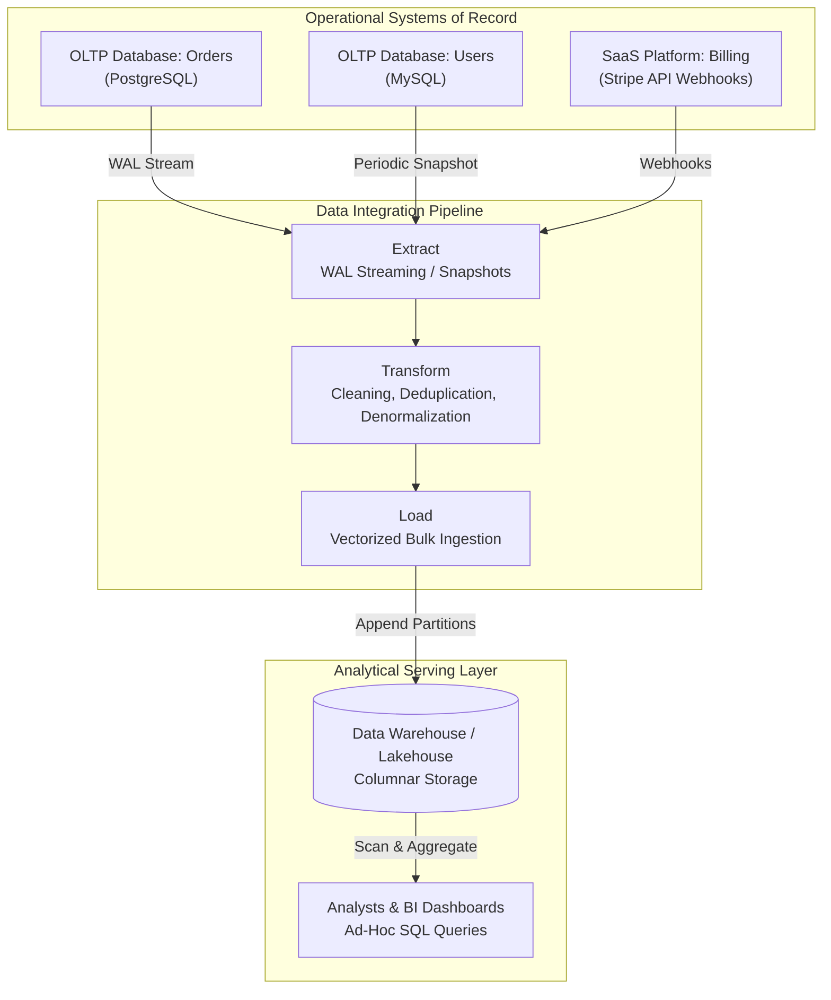
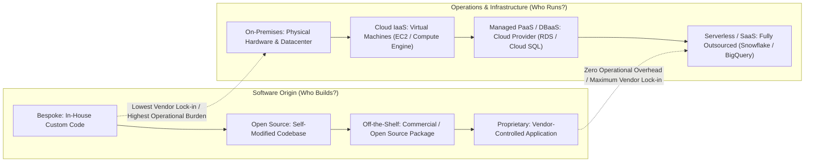
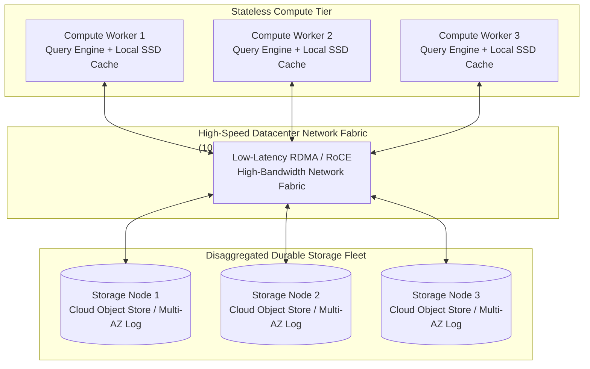
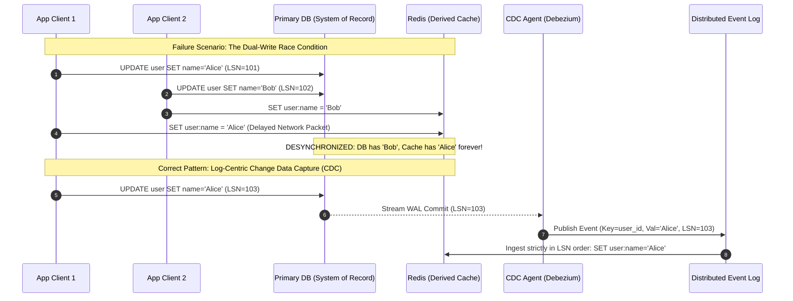

# Chapter 1: Trade-Offs in Data Systems Architecture — Definitive Technical Summary
*From: Designing Data-Intensive Applications (2nd Edition) by Martin Kleppmann and Chris Riccomini*
*Source PDF: pp. 25–56 (673-page PDF) — figures below cite PDF pages.*

> [!NAV] **Chapter Navigation**
> ⬅️ **Previous:** *None (Start of Book)* | 🏠 **Index:** [[00-Master-Reading-Dashboard|Master Dashboard]] | ➡️ **Next:** [[chapter-02-defining-nonfunctional-requirements|Chapter 02: Defining Nonfunctional Requirements]]

---

## 1. Executive Summary & Core Engineering Problem

> *"There are no solutions; there are only trade-offs. [...] You try to get the best trade-off you can get, and that's all you can hope for."*
> — Thomas Sowell (Interview with Fred Barnes, cited by Kleppmann & Riccomini, PDF p.25)

- **Core Thesis:** Modern data system design is not about finding an idealized "perfect" technology, but about thoughtfully choosing trade-offs. This chapter frames four contrasts that structure the whole book: (1) operational (OLTP) versus analytical (OLAP) workloads, (2) cloud-managed services versus self-hosted infrastructure, (3) distributed multi-node clusters versus optimized single-node engines, and (4) business value of data versus legal/ethical responsibility to the people the data describes. Every choice trades one bottleneck (CPU, memory bandwidth, disk seeks, network, team coordination) for another.
- **The Core Problem Statement:** Naive architectures break when scale, concurrency, latency SLAs, and org boundaries collide. Classic failure: run an unindexed analytical aggregation (`SUM(total_amount) GROUP BY country`) directly against the operational MySQL powering live checkout. The full-table scan acquires shared read locks, evicts hot buffer-pool pages, saturates disk I/O, and stalls concurrent checkout writes — p99 checkout latency spikes from 15 ms to 30,000 ms and connection pools exhaust.
- **What This Chapter Covers (Book TOC, PDF pp.27–49):** Operational Versus Analytical Systems (p27) → Characterizing TP/Analytics (p29, Table 1-1) → Data Warehousing (p31, Fig 1-1 ETL) → Systems of Record and Derived Data (p34) → Cloud Versus Self-Hosting (p36, Fig 1-2 spectrum) → Pros and Cons of Cloud (p37) → Cloud Native Architecture (p38, Table 1-2, S3, disaggregation, multitenancy) → Operations in Cloud Era (p41, DBA→DevOps/SRE) → Distributed Versus Single-Node (p43) → Problems with Distributed (p44) → Microservices and Serverless (p45) → Cloud vs Supercomputing/HPC (p47) → Data Systems, Law, Society (p48, Datensparsamkeit) → Summary (p49).
- **Terminology — Frontends and Backends (PDF p.27):** Frontend = client-side code in browser / mobile app handling one user's data. Backend = server-side code reachable via HTTP/WebSocket, usually stateless application code reading/writing shared data infrastructure (databases, caches, queues) on behalf of *all* users. The hardest data challenges live in the backend. Local-first software (ref [2]) is an exception, but this book focuses on backend data infrastructure.
- **Historical Context:** 1970s–80s relational databases on mainframes handled both transactions and reports. Late 1980s–early 1990s split analytics into separate data warehouses via ETL. 2000s–2010s added data lakes on cheap object storage for raw events/ML features. Today fast Clos datacenter networks, metered object storage, and vectorized engines enable disaggregated cloud-native systems (Aurora, Spanner, Snowflake, BigQuery) and lakehouses (Iceberg, Delta Lake, Hudi).

---

## 2. In-Depth Technical Concepts & Internal Mechanics

### 2.1 Operational (OLTP) vs. Analytical (OLAP) Systems — Point Mutations vs. Big Scans

- **Foundational Theory & Intuition:** Two completely different access patterns, two audiences:
  - **OLTP** (*Online Transaction Processing / operational*): backend engineers serving external users. Low-latency point reads/writes touching a few rows by key (load one profile, charge one card, check authorization). Queries are fixed, baked into app code; ad-hoc SQL is forbidden (security + perf risk).
  - **OLAP** (*Online Analytical Processing / analytics*): business analysts (BI reports for management) and data scientists (novel insights, ML/AI features like "people who bought X also bought Y", spam filtering, search ranking). Read-only copy of operational data, scanned in bulk with aggregate statistics (count/sum/average). Users write arbitrary ad-hoc SQL or generate it via Tableau/Looker/Power BI.
- **New roles (PDF p.28):** *Data engineers* integrate operational↔analytical systems and own data infrastructure; *analytics engineers* model/transform data to make it useful for analysts/scientists. Many engineers specialize on one side; this book covers both.
- **Characterizing Transaction Processing and Analytics (PDF p.29):** A "transaction" historically meant a commercial exchange (sale, salary); the term stuck for any logical group of reads+writes. Ch.8 defines it rigorously; here it loosely means low-latency reads+writes. OLTP = point queries (index lookup by key + insert/update/delete on user input, interactive). OLAP = scan huge record counts + aggregate. Example analyst questions at a supermarket chain: total revenue per store in January? How many more bananas sold in promotion? Which baby-food brand co-purchases with diaper brand X?

| Dimension (Table 1-1, PDF p.30 — book verbatim) | OLTP (Operational) | OLAP (Analytical) |
| :--- | :--- | :--- |
| **Main read pattern** | Point queries (fetch individual records by key) | Aggregate over large number of records |
| **Main write pattern** | Create, update, delete individual records | Bulk import (ETL) or event stream |
| **Human user example** | End user of web/mobile application | Internal analyst, for decision support |
| **Machine use example** | Checking if an action is authorized | Detecting fraud/abuse patterns |
| **Type of queries** | Fixed, predefined by application | Arbitrary, ad-hoc exploration by analysts |
| **Query volume** | Lots of small queries | Few queries, each is complex |
| **Data represents** | Latest state (current point in time) | History of events over time |
| **Dataset size** | Gigabytes to terabytes | Terabytes to petabytes |

- **Book nuance:** Meaning of "online" in OLAP is unclear; probably means analysts query interactively/exploratively, not just canned reports.
- **Product / real-time analytics (PDF p.30):** A third pattern — analytical workloads embedded in user-facing products (low-latency aggregations served to end users). Systems: Pinot, Druid, ClickHouse [6]. They ingest in real time and optimize for low-latency responses, unlike traditional OLAP which ingests in batches and optimizes for throughput.
- **Under-the-Hood Mechanics:**
  1. *OLTP path:* `UPDATE accounts SET balance=balance-50 WHERE id=42` → B-tree lookup for 4–16 KiB page → intent-exclusive lock → WAL append + `fsync` → dirty page in buffer pool → ack in 1–10 ms.
  2. *OLAP path:* `SELECT region, SUM(amount) FROM sales GROUP BY region` → bypass index lookups → sequential async I/O over 100 MB–1 GB columnar chunks (Parquet/ORC) → project only needed columns → SIMD-vectorized filter/aggregate → stream result.
- **Concrete Example — Alice and the CFO:**
  - *OLTP:* Alice clicks Buy Now. Engine touches 3 rows (cart, inventory, payment), locks 3 ms, done.
  - *OLAP:* CFO asks revenue per country over 5 years (120M rows). On OLTP row-store this pulls full rows, evicts Alice's cart pages, locks tables, checkout halts. On columnar OLAP it scans only `country`+`amount`, compresses 60–85% via dictionary/RLE/bit-packing, finishes in ~400 ms vectorized.
- **Storage layout consequence (preview of Ch.4):** OLTP favors row-oriented normalized (3NF) layouts; OLAP favors columnar denormalized star/snowflake schemas (see "Stars and Snowflakes" p.77).
- **Failure mode:** Running ad-hoc BI on OLTP primary evicts hot pages → disk seeks for operational queries. HTAP (below) does not remove the need for isolation.

### 2.2 Data Warehousing, Data Lakes, and Beyond (ETL, ELT, Reverse ETL)

- **Data Warehousing (PDF p.31):** Initially the same DB served both patterns; SQL handles both. Late 1980s–early 1990s trend: stop running analytics on OLTP, run on separate *data warehouse*. A large enterprise has dozens–hundreds of OLTP systems (website, POS checkouts, inventory, routing, suppliers, HR), each with its own team, operating independently.
- **Why analysts must not query OLTP directly (book list, p.31):**
  1. Data of interest spread across multiple operational systems (data silos) — can't join in one query.
  2. Schemas/layouts good for OLTP are poor for analytics.
  3. Analytical queries are expensive — would degrade OLTP performance for live users.
  4. OLTP may sit in a restricted network analysts may not access (security/compliance).
- **ETL mechanics (Fig 1-1, PDF p.31–32):** Warehouse holds read-only copy of *all* OLTP systems. Extract from OLTP (periodic dump or continuous update stream) → Transform into analysis-friendly schema (clean, deduplicate, denormalize) → Load into warehouse. Sometimes order swapped → ELT (transform inside warehouse after loading). SaaS sources (Salesforce CRM, email marketing, Stripe) have no direct DB access — only vendor API; specialist connectors (Fivetran, Singer, Airbyte) pull them in, enabling analyses the SaaS API cannot answer.
- **HTAP (PDF p.32):** Hybrid transactional/analytical processing aims to do both without ETL [8,9]. But many HTAP systems are internally an OLTP engine + separate analytical engine behind one interface — the distinction still matters. Good practice remains one DB per operational service (→ hundreds of operational DBs) vs one warehouse (so analysts can join across services). HTAP fits when *one app* needs both low-latency point ops and large scans — e.g., fraud detection [10]. It does not replace warehouses. Wider trend (Stonebraker [11]): small scale → general-purpose suffices; large scale → specialized systems win.
- **From data warehouse to data lake (PDF p.33):** Warehouses use relational/SQL, ideal for BI analysts but poor for data scientists who need: (a) feature engineering — turning rows/columns into numeric feature vectors/matrices with custom code SQL can't express; (b) NLP on reviews / vision on photos to extract structure. Despite SQL-ML extensions [12,13], many prefer Pandas/scikit-learn, R, Spark [14] (see "DataFrames, Matrices, Arrays" p.105). Answer: *data lake* — centralized repo holding any possibly-useful copy via ETL, as plain files with no imposed format/model/schema [15]: Avro/Parquet record collections, text, images, video, sensor readings, sparse matrices, feature vectors, genomes [16]. Cheaper (commodity object stores — see §2.4b) + flexible. ETL generalized to *data pipelines*; lake often becomes intermediate stop (raw operational form) before warehouse. Consumers transform raw → fit their need. Sushi principle: "raw data is better" [17].
- **Lakehouse (supplementary synthesis — not named in Ch.1 but implied by trajectory):** Open table formats (Iceberg, Delta Lake, Hudi) add warehouse guarantees (ACID, time-travel, schema evolution) atop lake Parquet files via immutable metadata tree (snapshot pointer → manifest list → manifest files with min/max stats, atomic CAS commit). Background compaction merges <16 MB small files into 128–512 MB to avoid S3 GET-amplification ($O(N)$ round-trips).

| Architecture | Ingestion | Schema | Storage | Trade-Off |
| :--- | :--- | :--- | :--- | :--- |
| **Warehouse** (Teradata, Redshift, Snowflake) | ETL | Schema-on-write (clean first) | Proprietary columnar | Fast curated queries; brittle to upstream change |
| **Lake** (S3+HDFS) | ELT | Schema-on-read (dump raw JSON/CSV) | Raw object files | Cheap/flexible; risks "data swamp" without governance |
| **Lakehouse** (Iceberg/Delta/Hudi) | Stream/batch + metadata commit | Governed open schema + versioning | Open Parquet + metadata tree | Lake scale + ACID/time-travel; needs compaction |

- **Beyond the data lake (PDF p.34):** Analytics matured → DataOps Manifesto [18] (governance, privacy, GDPR/CCPA — see §2.6 and Ch.14). Data increasingly arrives as *event streams* (Ch.12), not just files/tables: file analysis reruns daily; stream processing reacts in seconds (block fraud/abuse). Outputs sometimes flow *back* to operational systems — *reverse ETL* [19]: e.g., ML model trained analytically deployed to production ("people who bought X also bought Y") via TFX/Kubeflow/MLflow.

### 2.3 Systems of Record and Derived Data (PDF pp.34–35)

- **Foundational distinction (terminology for whole book):**
  - **System of record (source of truth):** Holds authoritative canonical version. New data (user input) written here first. Each fact represented exactly once (typically normalized — see "Normalization, Denormalization, Joins" p.72). On discrepancy, this value is by definition correct.
  - **Derived data system:** Result of transforming/processing another system's data. Lose it → re-create from source. Examples: cache (fall back to DB on miss), denormalized values, indexes, materialized views, transformed representations, trained ML models. Technically redundant yet essential for read performance; one source → many views.
- **Mapping:** Analytical systems are usually derived (consume data created elsewhere). Operational services mix both: primary DBs = systems of record; indexes/caches = derived for queries the record store can't answer fast.
- **Key insight:** No engine is inherently one or the other — a database is just a tool; the *usage* decides. Being explicit about derivation lineage clarifies otherwise confusing architectures.
- **The hard part:** When record changes, derived must update. Many DBs assume you'll use only that one DB and make cross-system propagation hard. Ch.11 (data pipelines) addresses composing systems. Correct pattern is log-centric CDC, never app dual-writes:
  1. Primary commits to WAL with increasing LSN.
  2. CDC agent (Debezium) tails WAL → publishes to Kafka in order.
  3. Derived consumers (Redis/Elasticsearch) ingest in LSN order, commit offset.
- **Dual-write hazard (Alice/Bob):** App writes Postgres then Redis directly. Req1 (Alice→`alice@work.com`) commits at $t_1$, Req2 (admin→inactive) at $t_2$, but Req2 reaches Redis first, Req1's delayed packet overwrites second → Postgres correct, Redis stale forever. Plus crash-between-writes loses updates. Tombstones for deletes must also propagate or deleted rows resurrect in search.

### 2.4a Pros and Cons of Cloud Services (PDF pp.36–38)

- **Framing (PDF p.36):** Build vs buy. Rule of thumb [20]: core competency/competitive advantage → in-house; routine/commonplace → vendor. Extreme: nobody fabricates own CPUs. Two decisions: who *builds* software, who *deploys/operates* it — spectrum in Fig 1-2 (bespoke in-house → self-hosted off-the-shelf MySQL on own hardware/on-prem rack or IaaS VM → modified open source → SaaS/cloud service via API). Deployment tooling (Kubernetes) matters less for data-system architecture and is out of scope.
- **Cloud = outsourced operation.** Providers claim savings in time/money/speed. Reality is workload-dependent:
  - **Cheaper to self-host when (book specifics [21,22]):** You already know how to deploy/operate the system *and* load is predictable (machine count doesn't fluctuate wildly) → buying own machines is often cheaper. Hiring/training dedicated ops staff is expensive, but if expertise exists, ownership wins.
  - **Cheaper/easier in cloud when:** You *don't* know how to deploy/operate it (learning curve + hires cost more than service fee); load *varies a lot* (provision-for-peak leaves idle iron). Analytical systems are the extreme: a big interactive query needs massive parallelism briefly, then idles; predefined daily reports can be queued to smooth load, but interactive speed demands variability. Large dataset + bursty queries → cloud saves money (return resources vs idle); small datasets → difference minor.
  - **Quality argument:** Outsourcing to a specialist serving many customers can yield better service (accumulated expertise) and frees your team for higher-level concerns. Counter: self-running lets you configure/tune for *your* workload; cloud vendor won't customize per customer.
- **Biggest downside — no control (book's six bullets, p.38, preserved):**
  1. Missing feature → can only politely ask vendor; cannot implement yourself.
  2. Outage → can only wait for recovery.
  3. Bug/perf triggered by your usage → hard to diagnose; self-hosted gives OS metrics, server logs, perf counters; vendor hides internals.
  4. Shutdown/price hike/unwanted change → at their mercy; can't pin old version, must migrate [23]. Mitigated only if compatible APIs exist — but many cloud services have no standard APIs → vendor lock-in + switching cost.
  5. Provider in another country + political conflict → sanctions lockout risk.
  6. Provider must be trusted with data security → complicates privacy/regulatory compliance.
- **Despite risks:** building new apps on cloud/hybrid is increasingly popular. Cloud won't subsume everything: pre-cloud legacy systems persist; specialist needs (e.g., high-frequency trading demanding full hardware control for ultra-low latency) stay in-house.

### 2.4b Cloud Native System Architecture (PDF pp.38–41, Table 1-2)

- **Beyond economics:** Cloud changed *implementation*. *Cloud native* = architecture designed to exploit cloud services. Any self-hosted software *could* be offered as managed service (and many are), but ground-up cloud-native designs show better perf on same hardware, faster failure recovery, rapid compute scaling, larger datasets [24,25,26].

| Category (Table 1-2, PDF p.39 — book verbatim) | Self-hosted systems | Cloud native systems |
| :--- | :--- | :--- |
| **Operational / OLTP** | MySQL, PostgreSQL, MongoDB | AWS Aurora [24], Azure SQL DB Hyperscale [25], Google Cloud Spanner |
| **Analytical / OLAP** | Teradata, ClickHouse, Spark | Snowflake [26], Google BigQuery, Azure Synapse Analytics |

- **Layering of cloud services (PDF p.39):** Self-hosted systems assume generic resources: Linux/Windows, filesystem files, TCP/IP; a few need GPUs or RDMA, but mostly CPU+RAM+filesystem+IP network. On IaaS VMs you get faster provisioning + more sizes but same model (any software, self-administered). Cloud-native idea: build higher-level services *on* lower-level cloud services. Higher abstraction → more use-case-oriented; if it fits, far less hassle than building from primitives; if not, build from lower layers yourself.
  - *Example:* Object storage (S3, Azure Blob, Cloudflare R2) stores large files via limited API (basic reads/writes) but hides physical machines — auto-shards across hosts, survives disk/host loss without running out of space on one node. Snowflake (warehouse) in turn builds *on* S3 [26]; other services build on Snowflake.
- **Aurora disaggregated-log mechanics (supplementary detail consistent with [24]):** Traditional MySQL flushes 8–16 KiB dirty pages + WAL + doublewrite + binlog. Aurora compute sends only ~100–200 byte redo-log records to 6 storage nodes across 3 AZs; ack on 4/6 quorum ($V_w=4$); storage materializes pages asynchronously in background. Result: ~80% less network, up to 5× throughput vs stock MySQL on same compute.
- **Separation of storage and compute / disaggregation (PDF pp.40–41 [9,26,29,30]):** Traditional: same box owns disk (durable; RAID masks single-disk loss transparently) + CPU/RAM. Cloud-native: local VM disks treated as ephemeral cache (lost on instance replace/resize); virtual disks (EBS, Azure managed disks, GCE persistent disks) emulate 4 KiB block devices over network — lets legacy disk software run in cloud but adds emulation overhead [24] and every I/O is a network call sensitive to glitches [27]. Cloud-native avoids virtual disks, builds on workload-optimized stores: object storage for 100 KB–GB files; small DB rows/values managed separately, packed into large blocks in object store [25,28] (Ch.4 patterns). Consequence: S3 stores only; analysis runs *outside* S3 → data moves over network (see §2.5a). Local NVMe ~10–30 µs vs disaggregated ~1–3 ms (100× tax) — compensated by caching, async pipelining, batching.
- **Multitenancy (PDF p.41 [31,32]):** Cloud-native often multitenant — multiple customers' data/compute share hardware vs one machine per customer. Enables utilization, elasticity, easier provider management — but demands engineering so one tenant's activity doesn't hurt others' perf/security (noisy-neighbor + isolation).

### 2.4c Operations in the Cloud Era (PDF pp.41–42)

- **From DBA/sysadmin to DevOps/SRE (PDF p.41 [33]):** Traditional ops: DBAs/sysadmins doing per-machine work — capacity planning (watch disk, add disks before full), provisioning, moving services between hosts, OS patches — to deliver reliability + stable production (config, deploy, monitor, diagnose). DevOps integrates dev+ops with shared responsibility; SRE is Google's implementation.
- **Cloud shift:** Services hide individual machines. Metered billing replaces fixed disks (store without pre-planning, pay per GB) and stays available despite host failures (see "Reliability and Fault Tolerance" p.43). Goal (reliable service) unchanged; processes/tools evolved. DevOps/SRE emphasizes [34]: automation over manual one-offs; ephemeral VMs/services over long-lived pets; frequent updates; learning from incidents; preserving institutional knowledge as people churn.
- **Bifurcation (PDF p.42 [35]):** Infra-company ops teams specialize in reliable multi-tenant service; customers spend minimal infra effort but still *need* ops: choose right service, integrate services, migrate between them. Metered billing kills classic capacity planning but creates *financial* planning (track usage per purpose, kill waste — perf tuning becomes cost tuning [36]) + quota planning (max concurrent processes etc. [37]). Learning the service + working around limits still takes time. Integration is growing pain: ETL is only part; operational cloud services also need stitching, with no standards → manual effort [38,39]. Non-outsourceable: app/library security, inter-service interactions, load monitoring, root-causing degradations/outages. Cloud changes ops; need is as great as ever.

### 2.5a Problems with Distributed Systems (PDF pp.43–44)

- **Definition:** Multiple machines (nodes) communicating via network. Reasons to distribute (book list, pp.43–44):
  1. *Inherent distribution:* two+ users on own devices must communicate over network.
  2. *Requests between cloud services / microservices:* data in one service, processed in another → network transfer (cloud-native + microservices are therefore distributed).
  3. *Fault tolerance/HA:* redundancy so another node takes over (Ch.6).
  4. *Scalability:* spread load beyond one box ("Scalability" p.49).
  5. *Latency:* worldwide servers serve nearby users, avoid halfway-around-world packets ("Describing Performance" p.37).
  6. *Elasticity:* scale cloud up/down with demand, pay only for active use; single box must provision for peak.
  7. *Specialized hardware:* object store (many disks, few CPUs) vs analytics (CPU/RAM, no disks) vs ML (GPUs for deep nets).
  8. *Legal compliance:* data-residency laws require in-jurisdiction storage/processing (medical/financial vs broader [40]).
  9. *Sustainability:* schedule/move jobs to where/when renewable power is abundant/cheap [41,42].
- **Downsides (PDF p.44):** Every networked request can fail — interrupted network, overload, crash → timeout without knowing if service received it; retry may be unsafe (Ch.9). Even fast datacenter networks are vastly slower than in-process calls [43]; on large volumes, move *computation to data* instead [44]. More nodes ≠ faster — single-threaded program can beat 100+ core cluster [45] (see §2.5d COST). Troubleshooting is hard — where is slowness? Answer: *observability* [46,47] — instrument execution, query metrics + events; tracing (OpenTelemetry, Zipkin, Jaeger) tracks which client called which server for which op and latency [48]. Consistency: DBs offer mechanisms (Ch.6,8), but per-service DBs push cross-service consistency to the app; distributed transactions (Ch.8) are rarely used with microservices — they defeat independence, many DBs lack them [49].

### 2.5b Microservices and Serverless (PDF pp.45–46)

- **Microservices — most common distribution (PDF p.45 [51,52]):** Clients ↔ servers, usually HTTP (see "Dataflow Through Services: REST and RPC" p.180); a process is both server (inbound) and client (outbound). Older name: service-oriented architecture (SOA); refined as *microservices*: one well-defined purpose per service (S3 = file storage), API over network, one owning team. Complex app → many team-owned services. Cloud-native leans heavily on this, but on-prem can too.
- **Advantages:** independent updates (less cross-team coordination); right-size hardware per service; API hides implementation (free to refactor internally). Data: each microservice typically owns its DBs, never shares DBs — shared DB makes schema part of API (hard to change) and lets one service's queries degrade others.
- **Costs:** testing needs all dependencies running; every service needs deploy/release, autosizing, log collection, health monitoring, on-call alerting (Kubernetes is popular substrate but doesn't remove the burden). API evolution is hard: clients expect fields; adding/removing breaks them, often discovered only in staging/prod. OpenAPI/gRPC help manage client/server contracts (Ch.5).
- **Book's punchline:** Microservices are primarily a *technical solution to a people problem* — letting teams progress independently. Valuable in large companies; in small companies with few teams it's unnecessary overhead — build simplest thing [51].
- **Data consequences:** Database-per-service → cross-service transactions need 2PC or Sagas. 2PC blocks on coordinator failure + latency penalty; Sagas need compensating actions + temporary inconsistency. Tail-latency amplification: 20 serial RPCs each p99=100 ms → $1-(0.99)^{20}\approx 18.2\%$ of user requests hit tail. Fix: async events (Kafka) off critical path, derived caches, deadlines/circuit-breakers (see §4.3 war story).
- **Serverless / Function as a Service — FaaS (PDF p.46 [32,53]):** Outsource infra management to vendor. VMs require explicit start/stop decisions; serverless auto-allocates/frees hardware per request — just as cloud storage replaced capacity planning with metered billing, serverless brings metered billing to *code execution* (pay only while code runs, no pre-provisioning). Constraints for this to work: execution time limits, restricted runtimes, *cold starts* (slow first invoke while runtime/container provisioned). "Serverless" misleads — code still runs on servers, possibly different ones each invoke. Term expanded: BigQuery, managed Kafka "serverless" = autoscale + usage billing, not instances.
- **Serverless state constraints (Berkeley view [32], Hellerstein critique [44]):** FaaS functions are stateless/ephemeral; any persistence must go to external storage/queues → extra network hops + consistency burden. Good fit: bursty, event-driven, short-lived tasks (webhooks, ETL glue, scheduled jobs, fan-out thumbnails). Poor fit: long-running, stateful, low-latency transactional loops, high-throughput DB joins — VM/container or provisioned service wins. Serverless doesn't mean DevOpsLess/NoOps [37] — quotas, observability, integration still need ops.
- **When to use what:** Small team / few services → modular monolith with domain boundaries; extract microservices only when team-scale independence demands it. Spiky, infrequent handlers → serverless FaaS; steady, latency-critical, stateful → containers/VMs or managed DB; many tenants sharing infra → multitenant serverless data systems [31].

### 2.5c Cloud Computing Versus Supercomputing / HPC (PDF p.47)

- **Not the only large-scale model:** Alternative is high-performance computing (HPC)/supercomputing. Overlaps exist, but priorities/techniques differ. Book's five contrasts:
  1. *Workload:* Supercomputers → computationally intensive science (weather/climate, molecular dynamics, optimization, PDEs). Cloud → online services, business data systems, HA user requests.
  2. *Failure handling:* Supercomputer runs large batch jobs with periodic *checkpoint-restart* to disk; on node failure stop entire cluster, repair, resume from last checkpoint [54,55]. Cloud must *not* stop — services serve continuously; fault tolerance in software via replication + consensus (Raft/Paxos), failover without global halt.
  3. *Network trust:* HPC nodes use shared memory + RDMA — high bandwidth, microsecond latency, but assumes high mutual trust [56]. Cloud shares network/machines among mutually untrusting orgs → VMs for isolation, encryption, authentication.
  4. *Topology:* Cloud datacenter nets = IP/Ethernet in Clos topologies for high bisection bandwidth [54,57] (Google Jupiter [57]). Supercomputers = specialized meshes/tori [58] tuned for known HPC communication patterns.
  5. *Geography:* Cloud spans regions; supercomputers co-locate all nodes closely.
- **RDMA/InfiniBand vs IP/Ethernet (expanded):** RDMA bypasses kernel/CPU (zero-copy, ~1–2 µs, 200–400 Gbps InfiniBand/NVLink) ideal for tightly coupled MPI barriers — but needs lossless fabric + trust (weak isolation — see HotCloud RDMA security [56]). Cloud Clos over Ethernet/IP prioritizes aggregate bisection + commodity multi-tenant isolation over single-flow latency; every virtual-disk I/O becomes a network RPC vulnerable to glitches [27] — hence Aurora/Snowflake batch + quorum + cache designs.
- **Checkpoint-restart vs Raft (expanded):** HPC checkpoint = global synchronized snapshot; recovery = stop-the-world rollback. Simple for batch science, unacceptable for 24/7 services. Cloud data systems replicate each write (Aurora 6-way quorum, Spanner Paxos) so single-node loss is masked live; background repair restores redundancy without halting serving path. Large analytical systems sometimes borrow HPC traits (bulk synchronous parallel, Clos awareness) — worth knowing — but this book focuses on continually available services ("Reliability and Fault Tolerance" p.43).

### 2.5d COST, Single-Node Power, and When to Distribute

- **Book advice (PDF p.45 [22,45,50]):** Single machine is often simpler + cheaper. CPUs/RAM/disks grew larger/faster/reliable; with DuckDB, SQLite, KùzuDB many workloads now fit one node (Ch.4 explores further).
- **COST metric (McSherry et al. [45]):** *Configuration that Outperforms a Single Thread* — how many distributed cores/nodes needed to beat an optimized single-threaded program? If a 100-core cluster barely beats one thread, distribution overhead (shuffle, serialization, coordination) dominates. Tigani "Big Data Is Dead" [50] and Badizadegan "Use One Big Server" [22] make the same point: a `u-24tb1.metal`/`m6i.32xlarge` box (128 cores, 1–24 TB RAM, PB NVMe, >1M IOPS) + DuckDB scans tens of millions of rows in hundreds of ms — beating 100-node Spark by eliminating shuffle/scheduling. Rule: resist distribution until single-node (≤1–5 TB, ≤1 TB RAM) exhausted; distribute when >10 TB, multi-region HA, or residency mandates it.

| Trait | Single-Node (DuckDB, SQLite, big server) | Distributed (Spark, Trino, Cassandra) |
| :--- | :--- | :--- |
| **Scale limit** | 128 cores, TBs RAM, ~100 TB NVMe | 1000s nodes, PBs |
| **Ops** | Near zero: single binary | High: coordinators, consensus, network |
| **Latency** | Local bus <100 µs, zero network | Network 5–50 ms + shuffle barriers |
| **Failures** | Node crash (standby replica) | Splits, drift, partial failure, stragglers |
| **Wins when** | ≤5 TB, minimize complexity/cost | >10 TB, geo/HA/residency |

### 2.6 Data Systems, Law, and Society — Datensparsamkeit and Erasure vs Immutability (PDF pp.48–49)

- **Beyond tech + org needs:** Engineers serve society too. Systems storing behavior data face GDPR (since 2018, EU residents' control/rights), CCPA, EU AI Act restricting personal-data use. Even unregulated areas matter: social media shapes news → opinions → elections; automated decisions affect loans, insurance, hiring, criminal suspicion [59]. Everyone shares responsibility; basic law/ethics literacy is as important as distributed-systems basics. Legal concerns now shape *foundations* of design [60].
- **Core clash:** GDPR right to erasure / right to be forgotten vs immutable append-only constructs (WALs, LSM SSTables, Kafka segments, S3 Parquet, WORM). How to delete mid-file that's supposed immutable? How to remove data baked into derived datasets / ML training data (see §2.3)? No clear technology whitelist — regulation states principles, not implementations (they'd stale fast). Ch.14 revisits bias/discrimination; Shastri et al. [60] benchmarks GDPR impact on DBs.
- **Cost beyond S3 bill (PDF p.49 [50]):** Store data only if value > *total* cost: S3 fee + liability/reputational risk if leaked + fines/legal if non-compliant. Governments/police can compel handover. Safety-critical: location/IP logs can outlawed behavior (homosexuality in parts of Middle East/Africa; abortion-clinic travel in some US states) — storing creates real user danger.
- **Datensparsamkeit (Fowler [61], GDPR [62]):** *Data minimization* — collect only for specified explicit purpose, use for nothing else, keep no longer than necessary; otherwise delete. Counters "big data" hoard-speculatively ethos. Businesses already feel it: PCI-DSS for payments (audited), SOC 2 Type 2 for vendors (audited). Balance business needs vs data-subjects' needs.
- **Engineering fixes:** (1) *Cryptographic shredding* — per-user KMS key encrypts PII; erasure = destroy key, ciphertext in immutable logs rendered unrecoverable. (2) *Tombstone + compaction* — deletion markers with TTL, background merge purges within 30-day window. Never rely on rewriting 500 MB Parquet per user-delete.

---

## 3. Important Figures, Diagrams & Visual Architecture

> 📕 **Original figures quick index (source PDF, 673 pages):** open the PDF at the cited page to verify each reconstruction.
>
> | Book Fig | PDF page | What to compare |
> |---|---|---|
> | Fig 1-1 | PDF p.31 | ETL into a data warehouse |
> | Fig 1-2 | PDF p.36 | Outsourcing spectrum |
> | Table 1-1 | PDF p.30 | OLTP vs OLAP characteristics |
> | Table 1-2 | PDF p.39 | Self-hosted vs cloud native systems |

### Figure 1-1: A Simplified Outline of ETL into a Data Warehouse
- **Figure Reference:** `Figure 1-1: A simplified outline of ETL into a data warehouse (from text p. 7)`
- **Original PDF:** Fig 1-1 → PDF p.31 — open the PDF at page 31 to compare with the Mermaid reconstruction below.
- **Visual Flow & Description:** Operational sources (OLTP databases + external SaaS APIs) feed an ETL pipeline. Data is extracted via dumps/CDC streams, cleaned and reshaped into star/snowflake schema, loaded into the warehouse for BI/analyst queries without touching OLTP performance.
- **Mermaid.js Architectural Diagram:**



- **Key Takeaway:** ETL boundary isolates OLTP from destructive scans and translates normalized write-optimized models into denormalized read-optimized schemas.

---

### Figure 1-2: The Spectrum of Decisions on Outsourcing Software and Operations
- **Figure Reference:** `Figure 1-2: The spectrum of decisions on outsourcing software and its operations (from text p. 12)`
- **Original PDF:** Fig 1-2 → PDF p.36 — open the PDF at page 36 to compare with the Mermaid reconstruction below.
- **Visual Flow & Description:** Two axes — who *builds* software (bespoke → open-source-modified → off-the-shelf → vendor SaaS) and who *runs* it (on-prem physical → IaaS VMs → managed PaaS/DBaaS → serverless/SaaS). Movement rightward trades control for reduced ops burden.
- **Mermaid.js Architectural Diagram:**



- **Key Takeaway:** Core differentiators stay bespoke/in-house; generic undifferentiated infrastructure (disk failures, OS patches) delegates to cloud. Choice of deployment tooling (Kubernetes) is secondary.

---

### Supplementary Diagram S1-3 [Supplementary — not in book; book has only Fig 1-1/1-2]: Disaggregated Storage and Compute (Cloud-Native Model)
- **Figure Reference:** `Supplementary S1-3 [Supplementary - not in book] (PDF has only Fig 1-1 p.31, 1-2 p.36): Disaggregated Storage-Compute Engine (Aurora / Snowflake Pattern)`
- **Visual Flow & Description:** Stateless compute workers (elastic warehouses) talk over 100/400 Gbps Clos fabric to durable multi-tenant storage fleet (S3 / Aurora log nodes). Local SSDs are ephemeral caches only.
- **Mermaid.js Architectural Diagram:**



- **Key Takeaway:** Scaling compute never reshards storage; workers start/stop in seconds holding only ephemeral caches.

---

### Supplementary Diagram S1-4 [Supplementary — not in book]: The Dual-Write Anomaly vs. Log-Driven CDC
- **Figure Reference:** `Supplementary S1-4 [Supplementary - not in book]: Dual-Write Out-of-Order Race Condition vs. Reliable Log-Driven Derived Data`
- **Visual Flow & Description:** App-level dual-writes race; WAL-ordered CDC restores monotonic order.
- **Mermaid.js Sequence Diagram:**



- **Key Takeaway:** Only the WAL has total order; derived stores must consume it monotonically, never accept direct app writes.

---

## 4. Real-World Systems, Case Studies & Code Examples

### 4.1 Industry Implementations & Architectural Divergence
- **AWS Aurora vs. Traditional MySQL:** Stock MySQL on EBS writes 16 KiB dirty pages + doublewrite + binlog + redo over virtual block network. Aurora sends only redo-log stream to 6 nodes/3 AZs (4/6 quorum), storage materializes pages lazily → ~80% less network, ~5× throughput [24]. Azure Hyperscale/Socrates [25] and Spanner follow similar disaggregated playbooks.
- **Snowflake / BigQuery / Synapse vs. Teradata / ClickHouse / Spark:** Cloud-native OLAP (Table 1-2) pulls micro-partitions from S3 on demand, scales to zero — ideal for bursty BI. Shared-nothing ClickHouse on local NVMe sacrifices elasticity for 5–10× faster scans — ideal for high-QPS observability/product analytics (Pinot/Druid/ClickHouse).
- **Microservices done right vs wrong:** S3 (one purpose, one team, stable API) exemplifies good decomposition. 35-service checkout with synchronous fan-out exemplifies failure (see §4.3).
- **Serverless in practice:** Webhook fan-out, nightly ETL glue, thumbnail generation — FaaS scales to zero and bills per ms. Checkout transaction path, sub-10 ms auth checks, long-lived streaming joins — provisioned containers/VMs win (no cold starts, no per-invoke state rehydration). Managed "serverless" BigQuery/Kafka = autoscale + usage billing, still needs quota/observability ops [37].
- **HPC vs cloud in practice:** Weather model on InfiniBand mesh with hourly global checkpoints tolerates stop-restart; payment ledger on Clos Ethernet with Raft quorum tolerates single-AZ loss without halting. Don't apply checkpoint-restart to user-facing ledgers; don't apply Raft per-timestep to tightly coupled PDE solvers.

### 4.2 Code Example: Monotonic CDC Consumer for Derived Stores
Python sketch enforcing LSN monotonicity + tombstone TTL for GDPR-compatible deletes:

```python
import json
from typing import Dict, Any

class MonotonicDerivedCacheConsumer:
    def __init__(self, cache_client):
        self.cache = cache_client  # Abstract Redis/Memcached client

    def process_cdc_event(self, raw_message: str) -> bool:
        """
        Processes a Change Data Capture event from an append-only log.
        Guarantees stale out-of-order events do not overwrite newer state.
        """
        event: Dict[str, Any] = json.loads(raw_message)
        entity_id: str = event["entity_id"]
        incoming_lsn: int = event["lsn"]
        operation: str = event["op"]  # 'INSERT', 'UPDATE', 'DELETE'
        payload: Dict[str, Any] = event.get("after", {})

        lsn_key = f"lsn:{entity_id}"
        data_key = f"data:{entity_id}"

        # Atomic transaction or Lua script in Redis
        current_lsn = self.cache.get(lsn_key)
        if current_lsn is not None and int(current_lsn) >= incoming_lsn:
            # Drop stale out-of-order event
            return False

        if operation == "DELETE":
            # Set a deletion tombstone with a statutory TTL
            self.cache.delete(data_key)
            self.cache.set(lsn_key, incoming_lsn, ex=86400)  # 24h tombstone TTL
        else:
            # Monotonically advance state
            self.cache.set(data_key, json.dumps(payload))
            self.cache.set(lsn_key, incoming_lsn)

        return True
```

### 4.3 Production War Story: Tail Latency Collapse via RPC Call-Tree Cascade
Tier-1 retailer split monolithic checkout into 35 microservices each with own DB. Black Friday: downstream recommendation service GC-paused 400 ms. Upstream orchestrator called synchronously without deadlines/circuit-breakers → threads blocked → gateway pools exhausted in 3 s → global checkout outage.
*Fix:* Recommendation moved off critical path (async Kafka + derived cache), hard 25 ms deadline with fallback, OpenTelemetry tracing to isolate stragglers. Lesson: microservices solve team-independence, not latency; every network hop adds tail risk (cf. §2.5b math).

---

## 5. Architectural Trade-Off Matrix

| Architectural Dimension | Approach A | Approach B | Primary Bottleneck / Invariant | Best Used When... | Worst Used When... |
| :--- | :--- | :--- | :--- | :--- | :--- |
| **Workload** | **OLTP** (row-oriented, point ops) | **OLAP** (columnar, bulk scans) | Seek/lock vs bandwidth/vectorization | Point lookups/updates <10 ms, fixed queries | Aggregations over >100k rows, ad-hoc exploration |
| **Integration** | **ETL** (transform before load) | **ELT** (load raw, transform in-engine) | Schema rigidity vs query-time parsing | Regulated reporting, known schemas | Exploratory science, fast-evolving events |
| **Authority** | **System of Record** (normalized, single writer) | **Derived System** (denormalized, rebuildable) | Write normalization vs read fanout | Authoritative mutations, invariants | High-QPS reads, search, ML features |
| **Hosting** | **Self-hosted** (own HW, full tuning) | **Cloud service** (metered, elastic) | CapEx predictability vs elasticity/lock-in | Predictable load + in-house expertise; HFT latency | Unknown/spiky load; unknown stack; need speed |
| **Cloud internals** | **Coupled** (local NVMe, 10 µs) | **Disaggregated** (object store, 1–3 ms + cache) | Local latency vs independent scaling | Steady latency-critical writes | Bursty analytics, scale-to-zero |
| **Scale** | **Single-node** (DuckDB/SQLite, ≤5 TB) | **Distributed** (Spark/NoSQL, PBs) | Chassis limit vs partition complexity | ≤1 TB, minimize ops (COST test first) | >10 TB, geo-HA, residency |
| **Services** | **Modular monolith** | **Microservices / Serverless FaaS** | Coordination vs team independence | Small teams, low RPC fan-out | Many teams needing independent deploys; spiky events |
| **Large-scale model** | **Cloud** (Raft/quorum, IP/Clos, multitenant) | **HPC** (checkpoint-restart, RDMA/mesh, co-located) | Availability vs raw tightly-coupled throughput | 24/7 services, untrusted tenants | Batch science, trusted users, known comms pattern |

### Concrete Decision Heuristics
1. **Read/write ratio:** >95% point ops <10 ms → PostgreSQL/MySQL row-store. >80% queries touch few columns over >100k rows → ClickHouse/Snowflake columnar; never scan OLTP primary.
2. **Volatility vs cost:** Spiky (20 min morning burst, idle night) → disaggregated serverless (Snowflake/BigQuery, scale-to-zero). Steady predictable → self-hosted/provisioned saves 40–70% markup; requires ops skill [21,22].
3. **Distribution threshold (COST):** Fit in 1 TB RAM + 16 TB NVMe → DuckDB single-node; eliminates shuffle/RPC/coordination. Distribute only for >10 TB, multi-region, residency, or 24/7 fault domains.
4. **Microservices/Serverless gate:** Few teams → modular monolith. Many teams → microservices with per-service DB + async boundaries + OpenAPI/gRPC contracts. Short bursty stateless handlers → FaaS (accept cold starts/time limits); stateful/low-latency core path → containers/VMs.
5. **HPC vs cloud gate:** Continuous serving + untrusted tenants → cloud (Raft, Clos, isolation). Large batch science + trusted users + known pattern → HPC (RDMA/mesh, checkpoint-restart).
6. **Legal gate:** PII subject to GDPR/CCPA → per-user KMS keys + cryptographic shredding + tombstone compaction <30 days; default to Datensparsamkeit (don't store what you can't justify).

---

## 6. Jargon Buster & Key Terminology

- **OLTP (Online Transaction Processing):** Low-latency point reads/writes serving live users; fixed queries baked into app. *Confused with:* OLAP (bulk scans for decisions).
- **OLAP (Online Analytical Processing):** Aggregate-heavy scans over history for BI/science; ad-hoc SQL via Tableau/Looker/Power BI. *Confused with:* warehouse (workload vs implementation).
- **Point Query:** Fetch of few rows by key via index. Opposite of full scan.
- **ETL / ELT / Reverse ETL:** Extract-Transform-Load (clean before warehouse) / Extract-Load-Transform (dump raw to lake, clean on read) / push analytical outputs (ML scores) back to operational serving.
- **Data Warehouse / Data Lake / Lakehouse:** Curated relational analytics DB / raw file repo (any format, sushi principle) / lake files + ACID/metadata (Iceberg/Delta/Hudi).
- **HTAP:** Hybrid engine attempting OLTP+OLAP behind one interface; internally often two engines; doesn't replace warehouses.
- **Product / Real-time Analytics:** OLAP embedded in user products (Pinot, Druid, ClickHouse) — real-time ingest, low-latency serving.
- **System of Record (Source of Truth):** Authoritative canonical store; written first; normalized; correct by definition. *Confused with:* derived stores.
- **Derived Data System:** Cache/index/view/model rebuilt from record via CDC; redundant yet essential for reads.
- **CDC (Change Data Capture):** Tail WAL by LSN → Kafka → derived stores monotonically. *Confused with:* batch dumps or app dual-writes (both unsafe).
- **Cloud Native:** Built atop cloud primitives (S3, disaggregated logs); e.g., Aurora, Spanner, Snowflake, BigQuery (Table 1-2). *Confused with:* lift-and-shift on IaaS VMs.
- **Object Storage (S3/Blob/R2):** Large-file store hiding physical hosts; limited API; survives disk/host loss.
- **Disaggregation (Storage⇔Compute):** Scale CPU/RAM and storage independently over network; local disks become ephemeral caches. *Confused with:* shared-disk SAN.
- **Multitenancy:** One service/hardware serves many customers; needs noisy-neighbor/security isolation.
- **DevOps / SRE:** Shared dev+ops ownership; automation, ephemeral VMs, frequent deploys, incident learning (Google SRE [33]).
- **Microservices / SOA:** One purpose + one team + network API + own DBs per service; solves people-independence at cost of RPC/tracing/API-evolution burden [51,52].
- **Serverless / FaaS:** Metered auto-provisioned execution (pay per ms); time limits, restricted runtimes, cold starts; stateless — state lives externally. Managed "serverless" (BigQuery/Kafka) = autoscale + usage billing [32].
- **COST (Configuration that Outperforms a Single Thread):** Nodes needed to beat one optimized thread [45]; measures distribution overhead.
- **HPC / Supercomputing:** Batch science on RDMA/mesh, checkpoint-restart, co-located trusted nodes. *Confused with:* cloud (HA services on IP/Clos, Raft, geo-distributed, untrusted tenants).
- **RDMA / InfiniBand vs IP/Ethernet/Clos:** Kernel-bypass microsecond fabric (fast, low-trust) vs commodity routable fabric optimized for bisection + isolation.
- **Checkpoint-Restart vs Raft/Quorum:** Stop-world global snapshot resume vs live per-write replication masking failures without halting.
- **Observability / Tracing:** Metrics + events + traces (OpenTelemetry/Zipkin/Jaeger, Dapper [48]) to locate slowness in distributed call trees.
- **Datensparsamkeit (Data Minimization):** Collect only for explicit purpose, keep no longer than necessary, then delete (GDPR [62], Fowler [61]). *Confused with:* archiving.
- **Cryptographic Shredding:** Per-user KMS key per PII; erasure = destroy key, immutable ciphertext unrecoverable.
- **Data Residency:** Legal mandate to store/process within jurisdiction [40].
- **DataOps / Data Engineer / Analytics Engineer:** Practices/roles governing pipelines and record↔derived integration [3,4,18].

---

## 7. System Design & Practical Engineering Takeaways

### 7.1 Production Engineering Checklist
1. **Never scan OLTP primaries for analytics:** Serve BI from replicas/warehouse/lake via CDC/ETL; forbid ad-hoc SQL on primaries.
2. **One writer per fact; CDC to derived:** Postgres/MySQL = sole record; Debezium→Kafka→Redis/Elasticsearch in LSN order with tombstones. No app dual-writes.
3. **Choose hosting by predictability + skill:** Predictable + expert → buy hardware/self-host [21,22]. Variable/unknown → cloud metered/elastic. Budget quotas + cost-observability even in cloud [36,37].
4. **Design disaggregation deliberately:** Bursty analytics → Snowflake/BigQuery scale-to-zero; steady latency-critical → provisioned/shared-nothing + local NVMe; mask 100× network tax with cache/batch/quorum.
5. **Contain microservices/serverless blast radius:** Per-service DBs, async Kafka off critical path, deadlines + circuit-breakers, OpenAPI/gRPC contracts, tracing from day one. Small team → modular monolith first. FaaS only for short stateless bursts (mind cold starts/time limits); stateful core stays on containers/VMs.
6. **Don't conflate HPC with cloud:** Need 24/7 + untrusted tenants → Raft/quorum + Clos + isolation. Need batch PDE/climate throughput → RDMA/mesh + checkpoint-restart, co-located.
7. **Prove single-node insufficiency (COST) before distributing:** DuckDB/SQLite on big iron first; distribute only past ~5–10 TB, geo-HA, or residency.
8. **Architect erasure upfront:** Per-user KMS + shredding + compaction TTLs < statutory window; apply Datensparsamkeit — total cost includes breach + fines + compelled disclosure + user safety (location/IP).

### 7.2 System Design Interview Strategy
- **Open with the four splits:** "I'll separate OLTP (checkout, <10 ms point writes) from OLAP (seller dashboards, bulk scans via CDC→warehouse), decide self-host vs cloud by load predictability, single-node vs distributed by COST, and flag PII minimization/erasure." Immediately signals seniority.
- **Challenge microservice-by-default:** Quantify tail amplification ($1-0.99^{20}$), propose modular monolith + async derived paths unless team scale forces services. Mention per-service DBs, Saga/2PC avoidance, FaaS cold-start caveat.
- **Invoke HPC vs cloud correctly:** "Fraud scoring needs live Raft failover, not checkpoint-restart; nightly risk grid could borrow HPC batch patterns."
- **Capacity sketch:**

$$\text{Storage Growth} = \text{Events/sec} \times \text{Avg Size} \times 86{,}400 \times 365 \times \text{Replication}$$

  *Example:* $10{,}000 \times 500\,\text{B} \times 86{,}400 \approx 432\,\text{GB/day} \to 157.6\,\text{TB/yr}$; $3\times$ → $472.8\,\text{TB/yr}$ → disaggregated object store + columnar, not single Postgres.

### 7.3 Mastery Self-Assessment Questions

#### Question 1 (Conceptual Depth)
*Why does `SELECT AVG(age) FROM users` run faster on columnar Parquet/ClickHouse than row-oriented InnoDB/Postgres even in memory?*
- **Answer:** Row-store packs full tuples (`id,name,email,age,...`) into 8–16 KiB pages; averaging one int loads 90%+ waste across buses into L1/L2, thrashing cache. Columnar packs dense `age` ints with bit-packing/dictionary, so one 64 B cache line holds sixteen int32s and SIMD processes many per cycle without branches — plus only relevant micro-partitions read (min/max pruning).

#### Question 2 (Failure Scenario & Edge Cases)
*Catalog writes Postgres then Elasticsearch via HTTP; prices go stale. Name, explain, remediate.*
- **Answer:** **Dual-write race + crash window.** Concurrent $10/$12 updates race over network; delayed packet wins last → ES stuck at $10$ while PG at $12$; crash between writes loses second write entirely. *Remediation:* PG sole record; Debezium tails WAL → Kafka ordered by LSN → ES consumer enforces monotonic LSN (drop stale, §4.2), tombstones for deletes.

#### Question 3 (Trade-Off & Capacity Estimation)
*50k tx/s × 200 B: Aurora Postgres vs single 128-core/1.5 TB bare metal?*
- **Answer:** $50{,}000 \times 200 = 10\,\text{MB/s} \approx 864\,\text{GB/day}$. *Aurora:* 6-way multi-AZ quorum durability + managed backups, but 50k writes/s = heavy I/O billing + 5–15 ms network-commit latency, $5–10k+/mo cluster. *Bare metal:* 10 MB/s trivial for NVMe (>2 GB/s), 50–200 µs fsync latency, ~$0.6–1k/mo fixed — but SPOF without app-level standby replica. *Decision:* predictable + ops skill → bare metal + standby (COST wins); variable/unknown ops or need instant elasticity/multitenancy → Aurora despite markup. Either way analytics must not touch write path — CDC to OLAP.

#### Question 4 (Serverless + HPC — gaps closed)
*When is FaaS the wrong choice, and when is checkpoint-restart the wrong recovery model?*
- **Answer:** FaaS wrong for long-lived stateful low-latency loops (per-invoke rehydration + cold starts + time limits dominate); use containers/VMs or provisioned services. Checkpoint-restart wrong for continually available user services (global stop-the-world halt unacceptable); use Raft/quorum live replication. Conversely FaaS fits spiky stateless webhooks/ETL glue, checkpoint-restart fits batch HPC science on trusted RDMA meshes.

---

> [!NAV] **Chapter Navigation**
> ⬅️ **Previous:** *None (Start of Book)* | 🏠 **Index:** [[00-Master-Reading-Dashboard|Master Dashboard]] | ➡️ **Next:** [[chapter-02-defining-nonfunctional-requirements|Chapter 02: Defining Nonfunctional Requirements]]
