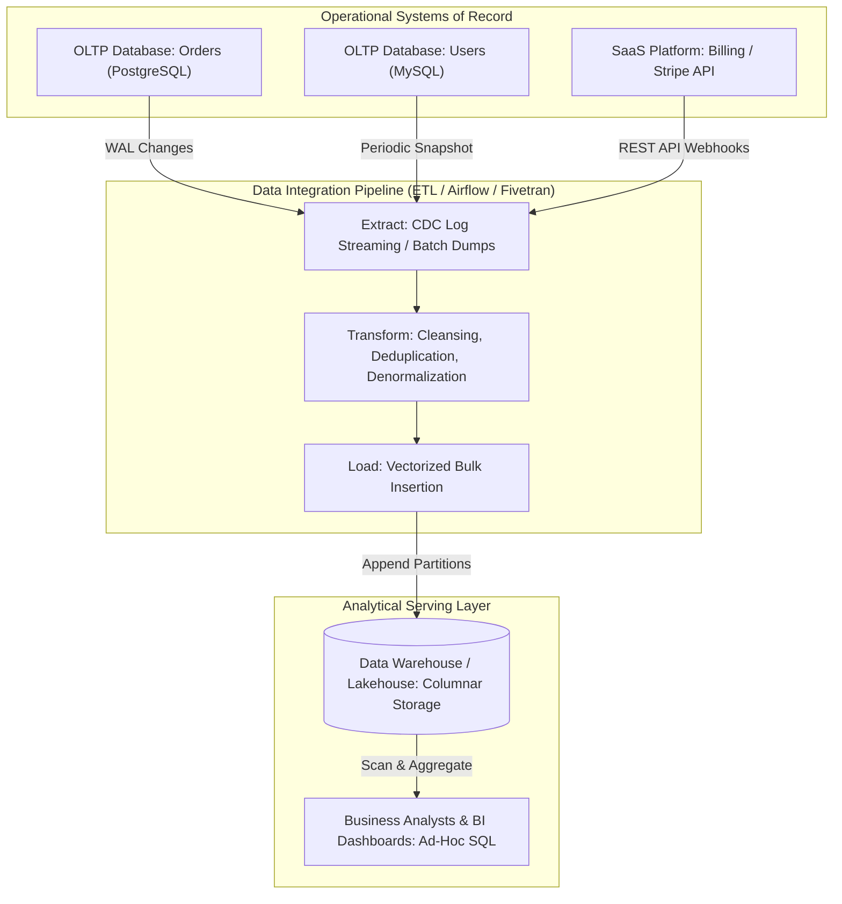
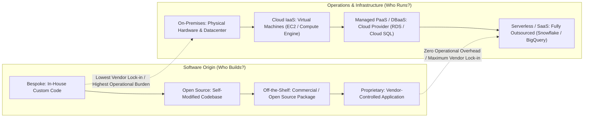
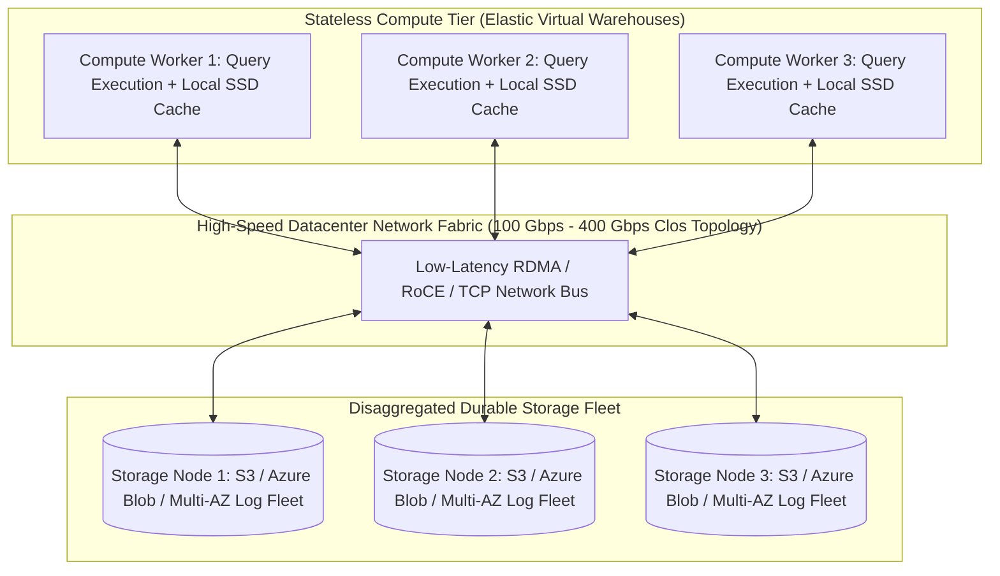
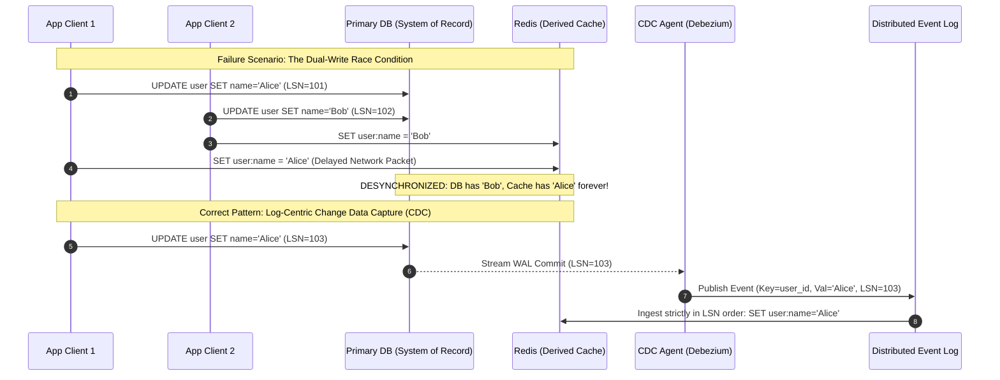

# Chapter 1: Trade-Offs in Data Systems Architecture — Definitive Technical Summary
*From: Designing Data-Intensive Applications (2nd Edition) by Martin Kleppmann and Chris Riccomini*
*Source PDF: pp. 25–56 (673-page PDF) — figures below cite PDF pages.*

> [!NAV] **Chapter Navigation**
> ⬅️ **Previous:** *None (Start of Book)* | 🏠 **Index:** [[00-Master-Reading-Dashboard|Master Dashboard]] | ➡️ **Next:** [[chapter-02-defining-nonfunctional-requirements|Chapter 02: Defining Nonfunctional Requirements]]


---

## 1. Executive Summary & Core Engineering Problem

- **Core Thesis:** Modern data system design is not about finding an idealized "perfect" technology, but navigating fundamental architectural trade-offs: operational (OLTP) versus analytical (OLAP) access patterns, cloud-managed services versus self-hosted infrastructure, and distributed multi-node clusters versus optimized single-node engines. Every architectural choice trades one operational bottleneck (CPU cycles, memory capacity, random I/O seek latency, network bandwidth, or team coordination overhead) for another.
- **Problem Statement:** Naive architectures inevitably fail when scale, concurrency, latency SLAs, and organizational boundaries collide. A classic example is executing unindexed analytical aggregations (e.g., `SUM(total_amount) GROUP BY country`) directly against an operational MySQL database powering an e-commerce checkout flow. The resulting table scan acquires shared read locks, saturates buffer pool memory, triggers disk I/O thrashing, and stalls concurrent write transactions on checkout rows, causing p99 transaction latencies to spike from 15 ms to >30,000 ms and triggering widespread connection pool exhaustion.
- **Historical & Industry Context:** In the 1970s and 1980s, relational databases (RDBMS) ran on expensive monolithic mainframes where the same engine handled both transactions and reporting. The explosive data growth of the 1990s forced the decoupling of analytical workloads into separate enterprise data warehouses via Extract-Transform-Load (ETL). The 2000s and 2010s saw the rise of Hadoop/HDFS data lakes to capture unbounded raw semi-structured event streams. Today, the convergence of 100Gbps/400Gbps datacenter networking, low-cost cloud object storage, and vectorized compute has birthed disaggregated cloud-native architectures (e.g., Snowflake, AWS Aurora) and open table format "lakehouses" (Apache Iceberg, Delta Lake).

---

## 2. In-Depth Technical Concepts & Internal Mechanics

### 2.1 Operational (OLTP) vs. Analytical (OLAP) Systems & Workload Characterization
- **Foundational Theory:** The fundamental dichotomy of data systems stems from contrasting access patterns: Online Transaction Processing (OLTP) optimizes for low-latency, deterministic point mutations and reads over a tiny fraction of the total dataset, whereas Online Analytical Processing (OLAP) optimizes for high-throughput scans and mathematical aggregations across millions or billions of records.
- **Under-the-Hood Mechanics & Data Paths:**
  1. *OLTP Data Path:* A client initiates an update (e.g., updating user account balance). The engine performs a B-tree index lookup to locate the specific 4 KiB to 16 KiB database page. An intent-exclusive lock is acquired; the transaction appends an entry to the Write-Ahead Log (WAL) on disk (with an `fsync` call), modifies the page in memory (buffer pool), marks the page as dirty, and returns an acknowledgment to the client within 1 to 10 ms.
  2. *OLAP Data Path:* A business intelligence query requests monthly average sales grouped by region. The analytical engine bypasses row-level index lookups, issues sequential asynchronous I/O requests to read contiguous column chunks (often 100 MB to 1 GB files encoded in Parquet/ORC), loads only the required column projections into RAM, executes SIMD-vectorized filter/aggregation instructions, and streams the aggregated result set.
- **Storage Layout & Metrics:**
  - *OLTP (Row-Oriented):* Stores complete tuples consecutively on disk (`[ID, Name, Email, Balance]`). High write efficiency for single records; disastrous for analytics because scanning a single column requires pulling all unused columns across disk buses and memory channels, resulting in a read amplification factor easily exceeding $10\times$ to $50\times$.
  - *OLAP (Column-Oriented):* Stores values of a single column consecutively (`[Balance_1, Balance_2, ... Balance_N]`). Yields dramatic data compression (dictionary encoding, bit-packing, run-length encoding) reducing on-disk footprints by $60\%$ to $85\%$.
- **Failure Modes & Edge Cases:**
  - *Resource Starvation:* Running ad-hoc reporting queries on an OLTP primary evicts hot operational pages from the cache, causing subsequent OLTP queries to incur physical disk seeks.
  - *HTAP Illusion:* Hybrid Transactional/Analytical Processing (HTAP) systems attempt to bridge this divide within a single cluster (e.g., TiDB via TiKV + TiFlash, SingleStore). However, under high concurrency, internal resource contention between the OLTP write log and analytical columnar compaction engine can destabilize write latencies unless strict CPU/memory isolation cgroups are enforced.

---

### 2.2 Data Integration: Data Warehouses, Data Lakes, and Lakehouses
- **Foundational Theory:** Because operational databases cannot withstand analytical workloads and are scattered across organizational silos, data must be extracted and unified into a dedicated analytical repository.
- **The Evolution of Analytical Storage:**
  1. *Data Warehouse (Schema-on-Write):* Structured, highly curated relational stores (e.g., Teradata, Amazon Redshift). Data is extracted from OLTP databases and external SaaS APIs (Salesforce, Stripe via Fivetran/Airbyte), cleaned and denormalized into star or snowflake schemas, and loaded via ETL. Inflexible: modifying upstream schema requires rewriting fragile transformation pipelines before ingestion.
  2. *Data Lake (Schema-on-Read):* Powered by the "Sushi Principle" (raw data is better than processed data; Bobby Johnson & Joseph Adler). Raw data dumps (JSON, Avro, CSV, log files) are loaded directly into object storage (Amazon S3, Azure Blob) or HDFS via ELT (Extract-Load-Transform). Transformation is deferred to query time. *Failure mode:* Without governance, data lakes degrade into unusable "data swamps" full of orphaned files, untracked schemas, and corrupted partial uploads.
  3. *Lakehouse (Open Table Formats):* Modern compromise unifying data lake scale with data warehouse ACID transactional guarantees. Built on open formats: Apache Iceberg, Delta Lake, Apache Hudi.
- **Under-the-Hood Lakehouse Mechanics:**
  - Instead of treating an object store bucket as a directory of loose files, a Lakehouse maintains a hierarchical tree of immutable metadata files:
    - `Snapshot Pointer` $\to$ points to current active snapshot metadata file.
    - `Manifest List` $\to$ lists all manifest files that compose the snapshot.
    - `Manifest File` $\to$ tracks individual immutable Parquet/ORC data files with column-level minimum/maximum statistics.
  - *ACID Transaction Path:* A writer creates new Parquet data files and writes a new manifest file. To commit, it attempts an atomic compare-and-swap (CAS) operation updating the snapshot pointer. If a concurrent writer committed first, Optimistic Concurrency Control (OCC) detects the conflict, validates whether the partition sets overlap, and retries if disjoint.
- **Complexity & Invariants:**
  - *Compaction Invariant:* Background maintenance must periodically merge small immutable Parquet files (<16 MB) into optimized 128 MB–512 MB files; failure to run compaction leads to a "small file problem" that causes catastrophic query latency due to excessive S3 `GET` request overhead ($O(N)$ HTTP round-trips).

---

### 2.3 Systems of Record vs. Derived Data Systems
- **Foundational Theory:** A system of record (Source of Truth) holds the canonical, authoritative version of a fact. It represents reality; each fact is normalized and written here first. A derived data system is the output of taking canonical data and transforming, indexing, or caching it to optimize specialized access paths.
- **Under-the-Hood Mechanics & Change Data Capture (CDC):**
  - Caches (Redis, Memcached), search indexes (Elasticsearch, Lucene), and materialized views are purely derived. If corrupted or lost, they can be deterministically rebuilt from the system of record.
  - To maintain convergence between the system of record and derived systems, updates must flow through an asynchronous event pipeline:
    1. Primary database commits transaction to Write-Ahead Log (WAL) with a strictly increasing Log Sequence Number (LSN).
    2. A CDC process (e.g., Debezium) tails the database WAL and publishes change events to an append-only message log (e.g., Apache Kafka).
    3. Derived system consumers ingest events in log order, update their local representations, and commit their consumed offset.
- **Edge Cases & Failure Modes:**
  - *Dual-Write Hazard:* A common antipattern is an application service writing directly to the primary database and subsequently executing a write to Redis/Elasticsearch. If the second call fails (network timeout, process crash), the derived system permanently drifts from the source of truth. Furthermore, concurrent out-of-order writes ($T_1$ and $T_2$) can execute in reverse order in the cache, causing permanent state corruption.
  - *Tombstone Accumulation:* Deleting records in the system of record must propagate explicit deletion tombstones to derived stores. If a derived consumer misses tombstone events, deleted entities resurrect in search results.

---

### 2.4 Cloud-Native Architectures & Disaggregation of Storage and Compute
- **Foundational Theory:** Traditional database architectures coupled CPU, RAM, and persistent disks within a single physical server (shared-nothing architecture). Cloud-native system design radically disaggregates compute from storage, leveraging high-bandwidth datacenter network fabrics (100 Gbps to 400 Gbps Clos topologies) to allow compute nodes and storage clusters to scale independently and elastically.
- **Under-the-Hood Mechanics (AWS Aurora & Snowflake Models):**
  1. *AWS Aurora Disaggregated Log Architecture:*
     - In traditional MySQL/PostgreSQL, a dirty page (typically 8 KiB to 16 KiB) modified in memory must eventually be flushed over the I/O bus to disk, alongside WAL records, double-write buffers, and replica replication streams.
     - Aurora replaces the storage layer with a purpose-built, multi-tenant distributed storage fleet. The database engine on the EC2 compute instance *never writes dirty data pages across the network*. Instead, it transmits only the stream of redo log records (often only 100 to 200 bytes per modification) to 6 storage nodes distributed across 3 Availability Zones (AZs).
     - Storage nodes receive the log stream, write it to an NVMe-backed write buffer, acknowledge the write to the database engine once 4 of 6 nodes accept (write quorum $V_w = 4$), and asynchronously apply the log records to generate data blocks in background compaction threads.
     - *Result:* Eliminates dirty-page write amplification; network traffic is reduced by up to $80\%$, enabling the engine to achieve up to $5\times$ higher throughput than standard MySQL on equivalent compute hardware.
  2. *Analytical Disaggregation (Snowflake, BigQuery):*
     - Stateless compute clusters (virtual warehouses) are provisioned in seconds. They mount read-only immutable columnar files (micro-partitions) stored in central object storage (Amazon S3 / Google Cloud Storage).
     - Local NVMe SSDs on compute nodes serve solely as an ephemeral caching tier. When a query arrives, metadata pruning identifies relevant micro-partitions, pulls them over the high-speed network into local SSD cache, and processes them. Compute instances can be dynamically scaled up, scaled down, or suspended to zero without risk of data loss.
- **Hardware Realities & Latency Trade-Offs:**
  - Local NVMe access latency: $\sim 10 - 30\ \mu\text{s}$.
  - Network-disaggregated I/O latency (EBS / Remote Storage Fleet): $\sim 1 - 3\ \text{ms}$ (a $100\times$ increase).
  - To overcome this network latency tax, cloud-native engines rely heavily on in-memory caching, parallel asynchronous pipelining, and aggressive batching of I/O requests.

---

### 2.5 Distributed vs. Single-Node Systems & Microservices Realities
- **Foundational Theory:** A distributed system consists of autonomous nodes communicating over an unreliable network. While distribution is necessary for high availability across fault domains, geographic latency reduction, and capacity expansion beyond a single machine, it introduces non-deterministic failure modes that do not exist on a single machine.
- **The Hidden Costs of Microservices:**
  - Splitting an application into dozens of microservices with individual databases creates an inherently distributed system.
  - *Tail Latency Amplification:* If a user-facing API request requires synchronous RPC calls to $N = 20$ downstream microservices, and each service has an independent 99th percentile response time of $100\ \text{ms}$, the probability that the user request experiences a p99 delay is:
    $$P(\text{Tail Latency}) = 1 - (0.99)^{20} \approx 1 - 0.818 = 18.2\%$$
    Nearly 1 in 5 requests will suffer tail latency degradation.
  - *Data Consistency Breakdown:* With a database-per-service architecture, transactions spanning multiple services require distributed transaction protocols (Two-Phase Commit, 2PC) or asynchronous Saga orchestrations. 2PC introduces blocking coordinator failure modes and severe latency penalties; Sagas introduce complex compensating-action edge cases and temporary inconsistency.
- **The Case for Modern Single-Node Architecture:**
  - Modern server hardware has expanded dramatically: a single commodity cloud instance (e.g., AWS `u-24tb1.metal` or `m6i.32xlarge`) can provide 128 physical CPU cores, 1 to 24 TB of RAM, and petabyte-scale NVMe drive arrays yielding $>1,000,000\ \text{IOPS}$.
  - Embedded and single-node columnar engines (e.g., DuckDB, SQLite, KùzuDB) can execute analytical queries over tens of millions of rows in hundreds of milliseconds entirely within memory and local NVMe, outperforming a 100-node Spark cluster by eliminating network serialization, distributed shuffle barriers, and cluster scheduling overhead (validating Frank McSherry's COST metric: *Configuration that Outperforms a Single Thread*).
- **Cloud Computing vs. Supercomputing (HPC):**
  - *HPC / Supercomputers:* Assume reliable, tightly coupled environments with low-latency InfiniBand / RDMA interconnects and shared memory. If a node fails, the entire cluster halts, rolls back to a global checkpoint, and resumes.
  - *Cloud Data Systems:* Built from commodity, multi-tenant hardware over standard IP/Ethernet Clos topologies. Hardware faults, packet drops, and node crashes are treated as normal runtime events; fault tolerance is solved in software via replication and consensus protocols (Raft, Paxos).

---

### 2.6 Data Systems, Law, and Society: Datensparsamkeit and Architectural Erasure
- **Foundational Theory:** Data systems architecture is fundamentally constrained by human society, ethics, and legal frameworks (GDPR, CCPA/CPRA, HIPAA, EU AI Act). The historical "Big Data" ethos of collecting and retaining all user telemetry speculatively is now an immense legal liability ("data as toxic waste").
- **The Technical Clash with Immutability:**
  - Legal mandates grant users the "Right to Erasure" (GDPR Article 17) and impose the principle of Data Minimization (*Datensparsamkeit*—collecting only what is strictly necessary for a specified purpose, and deleting it immediately after).
  - *Architectural Conflict:* Modern high-performance data systems are intentionally designed around **immutable, append-only structures** (WALs, LSM-tree SSTables, Kafka log segments, Parquet files on S3, WORM optical storage). Modifying an immutable 500 MB Parquet file on S3 to redact a single user's identifier requires rewriting the entire file, resulting in massive compute and write amplification.
- **Engineering Solutions for Compliant Erasure:**
  1. *Cryptographic Shredding:* Encrypt each user's personal identifiable information (PII) with a unique, user-specific encryption key managed in a secure Key Management Service (KMS). To execute a compliant deletion across all immutable logs, backups, and derived caches, the system cryptographically destroys the user's specific key. The ciphertext remains in the immutable logs but is rendered permanently unrecoverable.
  2. *Compaction-Driven Tombstoning:* Publishing deletion tombstones with enforced TTL boundaries, ensuring that background compaction cycles purge the tombstone and underlying data within the 30-day statutory window.

---

## 3. Important Figures, Diagrams & Visual Architecture

> 📕 **Original figures quick index (source PDF, 673 pages):** open the PDF at the cited page to verify each reconstruction.
>
> | Book Fig | PDF page | What to compare |
> |---|---|---|
> | Fig 1-1 | PDF p.31 | ETL into a data warehouse |
> | Fig 1-2 | PDF p.36 | Outsourcing spectrum |


### Figure 1-1: A Simplified Outline of ETL into a Data Warehouse
- **Figure Reference:** `Figure 1-1: A simplified outline of ETL into a data warehouse (from text p. 7)`
- **Original PDF:** Fig 1-1 → PDF p.31 — open the PDF at page 31 to compare with the Mermaid reconstruction below.
- **Visual Flow & Description:** Illustrates the data transformation boundary between transaction processing and analytics. Operational sources (OLTP databases and external third-party SaaS APIs) feed data into an intermediate ETL pipeline. Data is extracted via replication dumps or CDC streams, cleaned, restructured into a star/snowflake schema in worker memory, and loaded into the analytical data warehouse for query consumption by BI tools and analysts.
- **Mermaid.js Architectural Diagram:**



- **Key Takeaway:** The ETL boundary isolates operational databases from destructive analytical query patterns and provides a clean structural translation from normalized write-optimized transactional models to denormalized read-optimized analytical schemas.

---

### Figure 1-2: The Spectrum of Decisions on Outsourcing Software and Operations
- **Figure Reference:** `Figure 1-2: The spectrum of decisions on outsourcing software and its operations (from text p. 12)`
- **Original PDF:** Fig 1-2 → PDF p.36 — open the PDF at page 36 to compare with the Mermaid reconstruction below.
- **Visual Flow & Description:** Maps software engineering decisions along two orthogonal axes: *Software Construction* (who builds the code) and *Software Deployment/Operations* (who manages the infrastructure). The architecture moves from complete in-house control to total vendor outsourcing.
- **Mermaid.js Architectural Diagram:**



- **Key Takeaway:** The optimal operational model depends on whether a capability represents a core competitive differentiator. Core business logic warrants bespoke code; generic infrastructure (e.g., managing physical SSD failures or OS security patches) is more cost-effectively delegated to cloud operators.

---

### Supplementary Diagram S1-3 (not in book — book has only Fig 1-1/1-2): Disaggregated Storage and Compute Architecture (Cloud-Native Model)
- **Figure Reference:** `Supplementary S1-3 [Supplementary - not in book] (PDF has only Fig 1-1 p.31, 1-2 p.36): Disaggregated Storage-Compute Engine (AWS Aurora / Snowflake Pattern)`
- **Visual Flow & Description:** Contrasts traditional shared-nothing database nodes with modern cloud-native disaggregated architectures. Compute nodes act as stateless query execution workers communicating over 100/400 Gbps network fabrics with a distributed, multi-tenant storage fleet.
- **Mermaid.js Architectural Diagram:**



- **Key Takeaway:** Disaggregation eliminates costly cross-node storage resharding during compute scaling. Compute workers can be added or shut down in milliseconds because they hold no state other than ephemeral read caches.

---

### Supplementary Diagram S1-4 (not in book):: The Dual-Write Anomaly vs. Log-Driven Change Data Capture
- **Figure Reference:** `Supplementary S1-4 [Supplementary - not in book]: Dual-Write Out-of-Order Race Condition vs. Reliable Log-Driven Derived Data`
- **Visual Flow & Description:** Illustrates the catastrophic race condition inherent in application-level dual-writes and how asynchronous log-driven CDC enforces sequential consistency.
- **Mermaid.js Sequence Diagram:**



- **Key Takeaway:** Never allow application clients to independently write to secondary derived stores. Only the database write-ahead log possesses total sequential order; derived caches must be updated strictly from that log stream.

---

## 4. Real-World Systems, Case Studies & Code Examples

### 4.1 Industry Implementations & Architectural Divergence
- **AWS Aurora vs. Traditional MySQL:**
  - *Standard MySQL on EBS:* Writing a transaction requires writing the dirty data page (16 KiB) to the doublewrite buffer, writing to the data file, writing to the binary log, and writing to the InnoDB redo log over virtual network-attached block storage (EBS).
  - *AWS Aurora:* Only the redo log stream is sent over the network to 6 storage replicas. The storage fleet asynchronously materializes database pages on demand. This reduces network packet volume by $80\%$, entirely removes disk write stalls from the compute engine, and yields a $5\times$ transaction throughput improvement.
- **Snowflake vs. Apache ClickHouse:**
  - *Snowflake:* Entirely disaggregated. Compute warehouses pull micro-partitions from AWS S3 / Azure Blob Storage on demand. Excellent for elastic, highly variable workloads and multi-department concurrency where compute can scale to zero when idle.
  - *ClickHouse:* Traditionally shared-nothing. Compute and columnar storage reside on the same physical bare-metal nodes with local NVMe drives. Sacrifices independent compute elasticity for raw query speed: reading directly from local NVMe buses yields $5\times$ to $10\times$ faster scan throughput than reading across network storage, making it ideal for high-QPS, sub-second analytical observability pipelines.

### 4.2 Code Example: Monotonic CDC Consumer for Derived Stores
The following Python script illustrates how a derived cache consumer should handle CDC records, enforcing monotonic Log Sequence Number (LSN) validation to prevent out-of-order state corruption:

```python
import json
from typing import Dict, Any

class MonotonicDerivedCacheConsumer:
    def __init__(self, cache_client):
        self.cache = cache_client  # Abstract Redis/Memcached client

    def process_cdc_event(self, raw_message: str) -> bool:
        """
        Processes a Change Data Capture event from an append-only log.
        Guarantees that stale out-of-order events do not overwrite newer state.
        """
        event: Dict[str, Any] = json.loads(raw_message)
        entity_id: str = event["entity_id"]
        incoming_lsn: int = event["lsn"]
        operation: str = event["op"]  # 'INSERT', 'UPDATE', 'DELETE'
        payload: Dict[str, Any] = event.get("after", {})

        lsn_key = f"lsn:{entity_id}"
        data_key = f"data:{entity_id}"

        # Atomic transaction or Lua script in Redis
        current_lsn = self.cache.get(lsn_key)
        if current_lsn is not None and int(current_lsn) >= incoming_lsn:
            # Drop stale out-of-order event
            return False

        if operation == "DELETE":
            # Set a deletion tombstone with a statutory TTL
            self.cache.delete(data_key)
            self.cache.set(lsn_key, incoming_lsn, ex=86400)  # 24h tombstone TTL
        else:
            # Monotonically advance state
            self.cache.set(data_key, json.dumps(payload))
            self.cache.set(lsn_key, incoming_lsn)

        return True
```

### 4.3 Production War Story: Tail Latency Collapse via RPC Call-Tree Cascade
A Tier-1 e-commerce retailer decomposed its monolithic checkout service into 35 fine-grained microservices. During peak Black Friday traffic, a downstream recommendation service experienced intermittent garbage collection pauses of 400 ms. 
Because the upstream checkout orchestrator called dependencies synchronously without strict circuit breakers or localized deadlines, checkout threads blocked waiting for responses. Connection pools on intermediate API gateways exhausted within 3 seconds, triggering a cascading failure that brought down checkout across all international regions. 
*Architectural Fix:* The team replaced synchronous checkout RPCs with an asynchronous event-driven workflow (Kafka), placed the recommendation engine outside the critical path as a purely derived cache, and enforced a hard 25 ms timeout with graceful fallback on non-essential dependencies.

---

## 5. Architectural Trade-Off Matrix

| Architectural Dimension | Approach A: Operational (OLTP) / Monolithic | Approach B: Analytical (OLAP) / Disaggregated | Primary Bottleneck / Invariant | Best Used When... | Worst Used When... |
| :--- | :--- | :--- | :--- | :--- | :--- |
| **Data Layout** | **Row-Oriented** (B-trees, contiguous records) | **Column-Oriented** (Parquet, dictionary encoded) | Memory bandwidth vs. I/O bus saturation | Fetching entire entities by ID; frequent single-row mutations | Aggregating billions of rows (`SUM`, `AVG`, `GROUP BY`) |
| **Storage Architecture** | **Coupled Storage & Compute** (Local NVMe/SSD) | **Disaggregated Storage** (Object store / Cloud log fleet) | Network bandwidth vs. local bus latency ($10\,\mu\text{s}$ vs $2\,\text{ms}$) | Sub-millisecond write latency required; predictable, steady-state workloads | Highly volatile, bursty workloads requiring instant independent compute scaling |
| **Data Integration** | **ETL** (Transform before loading into warehouse) | **ELT** (Load raw to Lakehouse, transform in-engine) | Schema rigidity vs. query-time parsing overhead | Highly sensitive, strictly regulated financial reporting with known schemas | Exploratory data science; high-velocity raw event streams with rapid schema evolution |
| **Source Authority** | **System of Record** (Normalized, single writer) | **Derived System** (Denormalized, multi-representation) | Write-path normalization vs. Read-path fanout | Authoritative state mutations; enforcing domain consistency invariants | High-QPS read paths; full-text search; complex graph traversals |
| **System Scale** | **Single-Node Optimized** (DuckDB, SQLite, large server) | **Distributed Cluster** (Spark, distributed NoSQL) | Single-chassis memory/CPU limit vs. network partition complexity | Datasets $\le 1\,\text{TB}$; minimizing operational maintenance and latency | Datasets $> 10\,\text{TB}$; multi-region fault tolerance; strict geographic data residency |

### Concrete Decision Heuristics
1. **Workload Read/Write Ratio:** If $>95\%$ of operations are point lookups and updates on discrete primary keys with strict SLA $<10\ \text{ms}$, select a row-oriented OLTP engine (PostgreSQL, MySQL). If $>80\%$ of queries touch only a subset of columns across $>100,000$ rows, immediately route data to a columnar OLAP engine (ClickHouse, Snowflake).
2. **Compute Volatility vs. Cost:** If compute demands fluctuate wildly (e.g., heavy batch queries run for 20 minutes every morning and zero queries run overnight), adopt a disaggregated cloud-native engine (Snowflake, BigQuery) to leverage scale-to-zero economics. If query load is continuous, predictable, and latency-critical, self-hosted or provisioned shared-nothing infrastructure saves $40\%$ to $70\%$ in cloud markup costs.
3. **Distribution Threshold:** Resist distributed clusters until single-node capabilities are exhausted. If an analytical dataset fits within 1 TB of RAM and 16 TB of local NVMe, utilize single-node vectorized engines (e.g., DuckDB); you eliminate distributed network shuffles, RPC serialization costs, and cluster management overhead.

---

## 6. Jargon Buster & Key Terminology

- **OLTP (Online Transaction Processing):** Systems designed to handle large volumes of immediate, atomic, low-latency read-write requests over small records. *Confused with:* OLAP, which handles complex scans over historical data.
- **OLAP (Online Analytical Processing):** Systems designed to execute complex, aggregate-heavy read queries across vast datasets for decision support and business intelligence. *Confused with:* Data warehousing (OLAP is the workload type; a warehouse is an implementation).
- **System of Record (Source of Truth):** The canonical, authoritative data store holding the primary representation of a fact. If a discrepancy occurs, this system's value is by definition correct. *Confused with:* Derived data systems, which replicate or transform this data.
- **Derived Data System:** A data store (cache, search index, materialized view) created by processing or transforming data from a system of record. It is completely reproducible from the canonical source. *Confused with:* Backup systems (derived data actively serves specialized read queries).
- **Disaggregated Storage and Compute:** An architecture that decouples CPU/RAM processing nodes from persistent storage media across high-speed network fabrics, allowing independent scaling of both resources. *Confused with:* Shared-disk architectures (which traditionally relied on specialized SAN/NAS hardware rather than multi-tenant cloud networks).
- **Lakehouse:** A modern data storage architecture that implements database management features (ACID transactions, schema enforcement, time travel) directly on top of low-cost, open object storage using formats like Apache Iceberg or Delta Lake. *Confused with:* Traditional data lakes (which lack transactional guarantees and metadata indexing).
- **Change Data Capture (CDC):** An architectural pattern that extracts state-changing transactions from a database's write-ahead log (WAL) and streams them as discrete events to downstream derived systems. *Confused with:* Periodic batch ETL dumps (CDC is continuous, low-latency, and event-driven).
- **Datensparsamkeit (Data Minimization):** A German privacy principle codified in the GDPR mandating that systems must collect only the minimum data strictly required to accomplish a specific, declared purpose, deleting it once the purpose is served. *Confused with:* Data archiving (archiving retains data long-term; minimization destroys it).
- **COST (Configuration that Outperforms a Single Thread):** An architectural metric coined by Frank McSherry measuring the hardware scale required for a distributed system to outperform an optimized, single-threaded algorithm running on a single commodity machine.

---

## 7. System Design & Practical Engineering Takeaways

### 7.1 Production Engineering Checklist
1. **Never Execute Analytical Scans on OLTP Primaries:** If ad-hoc business intelligence or reporting queries must execute against transactional data, read from dedicated read-replicas or stream updates via CDC to an OLAP store.
2. **Eliminate Application Dual-Writes:** Never write to a database and a cache/search index sequentially in application code. Use transaction-log-based CDC (e.g., Debezium to Kafka) to propagate updates to derived stores.
3. **Plan for Asymmetric Compute and Storage Growth:** When designing cloud data architectures, choose disaggregated storage (S3/GCS or Aurora-style storage tiers) if storage volume grows at a vastly different trajectory than daily compute requirements.
4. **Architect for Cryptographic Shredding Upfront:** If storing PII subject to GDPR/CCPA, do not rely on modifying immutable append-only storage for deletions. Encrypt user data with per-user KMS keys and destroy the key upon deletion request.
5. **Enforce Monotonic Versioning on Derived Stores:** Always attach database Log Sequence Numbers (LSNs) or version timestamps to data propagation streams to allow derived consumers to discard out-of-order stale updates.

### 7.2 System Design Interview Strategy
- **Proactive Workload Segregation:** When given an open-ended prompt (e.g., "Design an E-Commerce Platform"), immediately separate the operational transaction path (checkout, inventory decrement, payment) from the analytical reporting path (seller analytics, recommendation training).
- **Challenge the "Microservice by Default" Reflex:** In high-concurrency designs, demonstrate seniority by highlighting the latency tax and consistency failure modes of distributed microservices. Propose a modular monolith with domain boundaries unless organizational team scaling mandates separate deployment pipelines.
- **Capacity Sketching Template:**
  $$\text{Storage Growth} = \text{Events/sec} \times \text{Average Payload Size} \times 86,400\ \text{seconds/day} \times 365\ \text{days} \times \text{Replication Factor}$$
  *Example:* $10,000\ \text{writes/sec} \times 500\ \text{bytes} \times 86,400 \approx 432\ \text{GB/day} \to \sim 157.6\ \text{TB/year}$. At $3\times$ replication: $\approx 472.8\ \text{TB/year}$. This calculation directly dictates whether to choose single-node storage, disaggregated cloud storage, or sharded clusters.

### 7.3 Mastery Self-Assessment Questions

#### Question 1 (Conceptual Depth)
*Why does an OLAP query executing `SELECT AVG(age) FROM users` run dramatically faster on a column-oriented store (Parquet/ClickHouse) than on a traditional row-oriented OLTP database (InnoDB/PostgreSQL), even if the total table data fits in memory?*
- **Answer:** In a row-oriented database, each row tuple (`id`, `name`, `email`, `age`, `created_at`, `address`) is stored contiguously on 8–16 KiB pages. To calculate `AVG(age)`, the CPU must load entire 16 KiB pages across memory buses into L1/L2 caches, discarding $90\%+$ of the fetched bytes. In a column-oriented store, all `age` integers are packed contiguously in memory and compressed (e.g., bit-packing). The CPU reads purely dense arrays of integers, maximizing cache line utilization (a single 64-byte cache line holds sixteen 32-bit integers) and enabling SIMD (Single Instruction, Multiple Data) vectorized instructions that process multiple numbers per clock cycle without branching overhead.

#### Question 2 (Failure Scenario & Edge Cases)
*An engineering team implements an e-commerce catalog where product updates are written to PostgreSQL, and the application immediately issues an HTTP request to update an Elasticsearch search index. Over time, search results display stale and incorrect prices. Name this failure mode, explain how it occurs under concurrency, and provide the correct architectural remediation.*
- **Answer:** This failure mode is the **Dual-Write Race Condition**. Under concurrent modifications, Client 1 updates price to $\$10$ in PostgreSQL, and Client 2 updates price to $\$12$. Due to non-deterministic network routing, thread scheduling, or temporary packet drops, Client 2's update reaches Elasticsearch *before* Client 1's delayed update. Elasticsearch executes Client 1's write last, leaving PostgreSQL with $\$12$ and Elasticsearch with $\$10$ indefinitely. Furthermore, if Client 2 crashes after committing to PostgreSQL but before calling Elasticsearch, the write is lost entirely. 
*Remediation:* Make PostgreSQL the sole system of record. Tailing its Write-Ahead Log via Change Data Capture (CDC, e.g., Debezium) streams change events sequentially ordered by Log Sequence Number (LSN) into Kafka. An Elasticsearch consumer updates the index strictly according to monotonic LSN ordering, rejecting stale sequence numbers.

#### Question 3 (Trade-Off & Capacity Estimation)
*A financial analytics platform processes 50,000 transactions per second. Each transaction record is 200 bytes. The team must decide between provisioning an AWS Aurora PostgreSQL cluster versus a single bare-metal server with 128 cores and 1.5 TB RAM running an embedded engine. What are the operational, latency, and cost trade-offs of this decision?*
- **Answer:**
  - *Data Ingestion Math:* $50,000\ \text{tx/s} \times 200\ \text{bytes} = 10\ \text{MB/s} \approx 864\ \text{GB/day}$.
  - *AWS Aurora Trade-off:* Yields managed multi-AZ durability (6-way replication of redo logs across 3 AZs) and automated backups. However, 50,000 write transactions/second incurs heavy I/O charges and network communication overhead, requiring a top-tier multi-node Aurora cluster costing $\$5,000$ to $\$10,000+$ per month, with write latencies governed by network round-trips ($\sim 5 - 15\ \text{ms}$).
  - *Single Bare-Metal Server Trade-off:* Ingesting 10 MB/s of sequential data is trivial for a modern NVMe drive (which sustains $>2,000\ \text{MB/s}$). Write latency is determined purely by local bus and fsync speed ($\sim 50 - 200\ \mu\text{s}$ with battery-backed write cache). The server costs a fixed $\sim \$600 - \$1,000/\text{month}$. However, the single node represents a single point of failure (SPOF); achieving high availability requires engineering an application-level replica stream to a standby node. If the team lacks internal infrastructure engineering capability, the operational risk of the single node outweighs the cloud bill markup.


---
> [!NAV] **Chapter Navigation**
> ⬅️ **Previous:** *None (Start of Book)* | 🏠 **Index:** [[00-Master-Reading-Dashboard|Master Dashboard]] | ➡️ **Next:** [[chapter-02-defining-nonfunctional-requirements|Chapter 02: Defining Nonfunctional Requirements]]