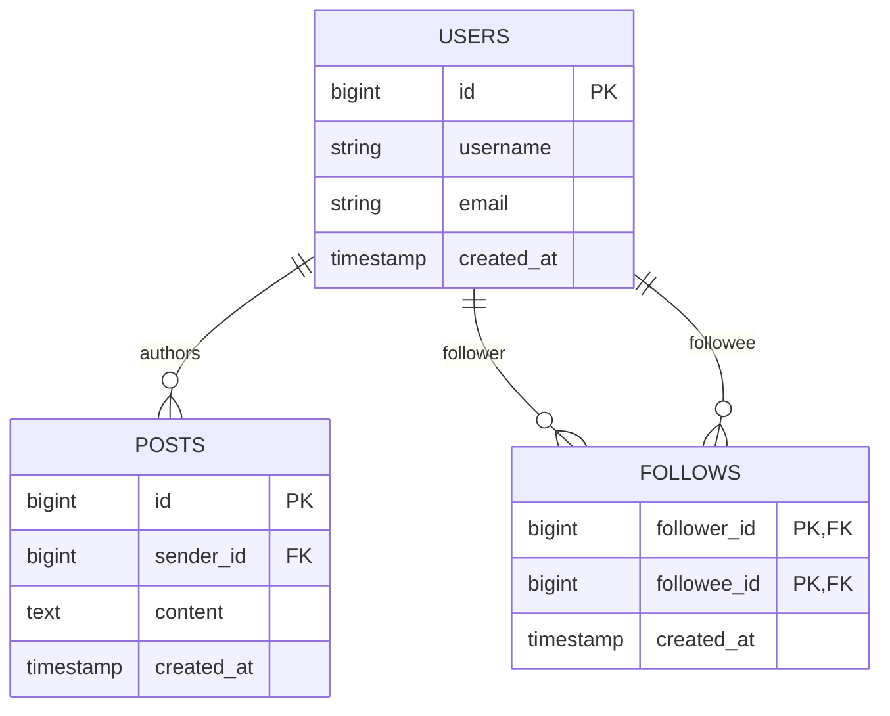
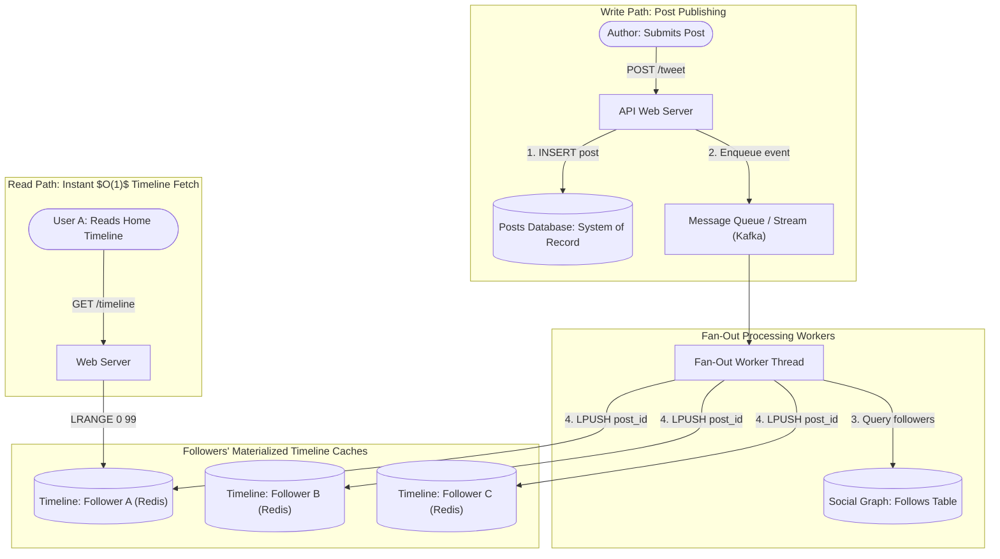
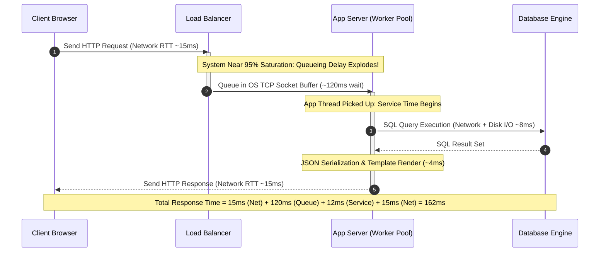
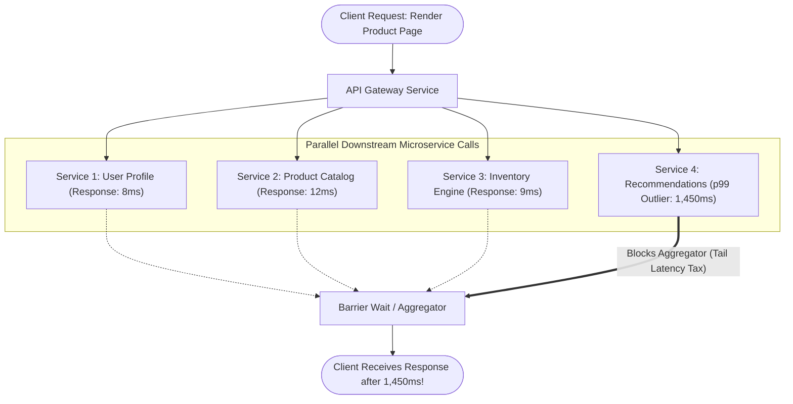

# Chapter 2: Defining Nonfunctional Requirements — Definitive Technical Summary
*From: Designing Data-Intensive Applications (2nd Edition) by Martin Kleppmann and Chris Riccomini*
*Source PDF: pp. 57–88 (673-page PDF) — figures below cite PDF pages.*

> [!NAV] **Chapter Navigation**
> ⬅️ **Previous:** [[chapter-01-trade-offs-in-data-systems-architecture|Chapter 01: Trade-Offs in Data Systems Architecture]] | 🏠 **Index:** [[00-Master-Reading-Dashboard|Master Dashboard]] | ➡️ **Next:** [[chapter-03-data-models-and-query-languages|Chapter 03: Data Models and Query Languages]]


---

## 1. Executive Summary & Core Engineering Problem

- **Core Thesis:** Systems architecture cannot be judged purely on whether it produces correct outputs under ideal conditions (functional requirements); it is fundamentally defined by its nonfunctional capabilities: **Reliability** (continuing to function correctly despite hardware, software, and human faults), **Scalability** (maintaining performance SLAs under quantitative growth in data volume, traffic throughput, or structural complexity), and **Maintainability** (minimizing operational toil, accidental complexity, and friction for future evolutionary change).
- **Problem Statement:** Systems fail catastrophically when nonfunctional dynamics are neglected. A prime example is the naive "Fan-out on Read" architecture for social network timelines: storing posts in a relational database and computing home timelines on the fly via joins (`SELECT * FROM posts JOIN follows ON ... WHERE follows.follower_id = ? ORDER BY timestamp DESC LIMIT 100`). While functionally correct at 100 users, at scale ($300,000$ timeline reads/sec across billions of rows), the query creates immense disk I/O thrashing, exhausts database connection pools, and spikes p99 response times from 30 ms to >10,000 ms. Inverting the model to "Fan-out on Write" works for average users, but instantly collapses when applied to high-fanout "celebrity" accounts ($>50\text{M}$ followers), where a single post triggers a 50-million-write stampede that backs up message queues and starves ordinary users.
- **Historical & Industry Context:** Early internet systems monitored performance using simple arithmetic mean (average) latency and treated hardware as inherently durable ("enterprise-grade" RAID arrays, dual power supplies). Modern hyper-scale engineering recognized that: (1) averages obscure the tail latencies experienced by the most active (and valuable) users; (2) hardware faults at scale are statistical certainties rather than rare anomalies (e.g., 1 in 1,000 CPU cores silently computing corrupt arithmetic); and (3) software complexity and human configuration errors cause far more downtime than physical hardware wear.

---

## 2. In-Depth Technical Concepts & Internal Mechanics

### 2.1 Case Study: Social Network Timeline Materialization (The Twitter Evolution)
- **Foundational Theory:** The tension between write-time computation (eager pre-computation / push) and read-time computation (lazy evaluation / pull). In read-heavy systems with asymmetric access ratios (e.g., Twitter: $\sim 5,800$ writes/sec average, spiking to $150,000$ writes/sec, versus $\sim 300,000$ timeline reads/sec), the choice of where to pay the computational cost dictates system feasibility.
- **Under-the-Hood Architectural Mechanics:**
  1. *Approach 1: Fan-out on Read (Relational Joins)*
     - User posts: Append row to `posts` table ($O(1)$ write).
     - User reads timeline: Execute multi-table join between `users`, `follows`, and `posts`. Engine must scan the `follows` index to fetch all followee IDs, execute an index range scan on `posts` for each followee, merge the sorted post streams, sort by timestamp descending, and paginate.
     - *Bottleneck:* Read amplification. Under heavy concurrency, the relational buffer pool is saturated with index pages; concurrent timeline generation causes catastrophic lock contention and cache eviction.
  2. *Approach 2: Fan-out on Write (Materialized Timeline Inboxes)*
     - Each user maintains an in-memory home timeline cache (e.g., Redis list of 800 post IDs, requiring $\sim 8\ \text{KiB}$ of RAM per active user).
     - When user $U$ posts a message: Look up $U$'s followers in social graph database. For each follower $F_i$, insert the post ID into $F_i$'s timeline cache via `LPUSH` and `LTRIM` (keeping max 800 items).
     - When follower reads timeline: Read the Redis list directly via `LRANGE timeline:user_id 0 99` ($O(1)$ read path, sub-millisecond latency).
     - *The Celebrity Invariant Breakdown:* If a user has 50 million followers, posting a single tweet requires issuing 50 million `LPUSH` operations across the Redis cluster. At 50,000 writes/sec cluster capacity, a single tweet takes 1,000 seconds ($\approx 16.6$ minutes) to fan out. During this window, followers experience massive timeline lag, and the write queue exhausts memory.
  3. *Approach 3: The Hybrid Fan-out Architecture*
     - Normal accounts ($<25,000$ followers): Fan-out on write (push into followers' Redis timeline caches).
     - Celebrity accounts ($>25,000$ followers): Excluded from write fan-out.
     - *Timeline Read Flow:* The client fetches the user's pre-materialized timeline from Redis, queries the global posts of the few celebrities the user follows (fan-out on read), and merges the two sorted arrays in memory before rendering.

---

### 2.2 Describing Performance: Latency Decomposition, Percentiles, and Tail Amplification
- **Foundational Theory:** Performance in request-response systems cannot be characterized by a single number. Response times form a non-normal, heavily right-skewed distribution characterized by long fat tails.
- **Under-the-Hood Latency Breakdown:**
  $$\text{Response Time} = \text{Network Latency (RTT)} + \text{Queueing Delay} + \text{Service Time}$$
  - *Service Time:* The actual CPU processing time and disk/network I/O execution within the server thread.
  - *Queueing Delay:* The time a request sits in operating system socket buffers, TCP listen backlogs, load balancer queues, or application thread pools waiting for worker thread assignment.
  - *Head-of-Line Blocking:* When a small number of slow requests (e.g., expensive queries or large payloads) monopolize worker threads or queue heads, fast subsequent requests queue behind them, multiplying their observed latency despite having tiny service times.
- **Percentiles ($p50, p95, p99, p99.9$):**
  - *Arithmetic Mean (Average):* Meaningless in production because it hides outliers. A single 10-second timeout skews the average while obscuring that 99% of users had 10 ms responses.
  - *Median ($p50$):* Half of the requests return faster than this threshold; represents typical user experience.
  - *Tail Percentiles ($p95, p99, p99.9$):* The 95th, 99th, and 99.9th percentiles measure worst-case latency.
  - *The High-Value Customer Correlation:* The customers who trigger tail latency queries are frequently the most valuable power users—those with the largest shopping carts, the longest purchase histories, and the highest followings. Slowing down tail queries directly penalizes revenue (e.g., Amazon observed that every 100 ms increase in latency reduced sales by 1%).
- **Tail Latency Amplification:**
  When an end-user request requires calls to $M$ backend services in parallel, the total user request latency is bound by the *slowest* backend response.
  If each backend call has an independent probability $p$ of being slow (e.g., $p = 0.01$ for $p99$), the probability $P_{\text{slow}}$ that the overall user request experiences a tail delay is:
  $$P_{\text{slow}} = 1 - (1 - p)^M$$
  - For $M = 100$ parallel backend calls with $p = 0.01$:
    $$P_{\text{slow}} = 1 - (0.99)^{100} = 1 - 0.366 = 63.4\%$$
  - Despite every single backend service meeting its 99% SLA individually, nearly **two-thirds of all end-user requests** suffer tail latency delays.

---

### 2.3 Queueing Dynamics, Metastable Failures, and Saturation Behavior
- **Foundational Theory (Kingman's Formula & Queueing Theory):**
  As system utilization $U$ approaches capacity ($100\%$), queueing delays grow non-linearly towards infinity:
  $$\text{Wait Time} \propto \frac{U}{1 - U} \times \text{Service Time}$$
  At $50\%$ utilization, queueing delay is modest. At $90\%$ utilization, delay is $9\times$ service time. At $99\%$, delay is $99\times$ service time.
- **Metastable Failure & The Retry Storm:**
  1. A transient traffic spike or database garbage collection pause pushes utilization beyond 100%. Queues grow rapidly.
  2. Latency exceeds client timeouts ($T_{\text{timeout}}$). Clients abort the connection and resend the request (automatic retries).
  3. The server is now doing "wasted work": executing original requests whose clients have already disconnected, while receiving duplicate incoming retry requests.
  4. The effective load spikes to $2\times$ or $3\times$ capacity. The system remains trapped in a persistent degraded state **even after the original traffic surge drops back to normal levels**.
  5. *Recovery Invariant:* The system cannot self-heal without external intervention (rebooting, aggressive load shedding, or severing client traffic).
- **Defensive Engineering Mechanisms:**
  - *Exponential Backoff with Full Jitter:* Clients retry with exponentially increasing randomized wait intervals:
    $$t_{\text{wait}} = \text{random}(0, \min(M_{\text{max}}, B \times 2^{\text{attempt}}))$$
  - *Circuit Breakers:* If downstream error rate exceeds a threshold (e.g., $50\%$ over 10 seconds), the circuit trips to `OPEN`, immediately failing fast without sending network packets to the struggling dependency.
  - *Load Shedding & Backpressure:* When CPU or queue depth exceeds safe thresholds ($>85\%$), the server immediately rejects incoming low-priority requests with HTTP 429 / 503 rather than queuing them.

---

### 2.4 Reliability and Fault Tolerance: Hardware Faults, Silent Corruption, and Software Bugs
- **Foundational Theory:** A **Fault** is defined as one component of the system deviating from its standard specification. A **Failure** occurs when the entire system stops providing its required service to users. Fault tolerance is the engineering discipline of designing systems such that inevitable component faults do not trigger system failure.
- **Hardware Fault Classes & Realities:**
  - *Hard Disk & SSD Wear:* Hard disk Mean Time to Failure (MTTF) is $\sim 10$ to 50 years. In a datacenter cluster with 10,000 disks, statistically $1 \text{ to } 3\text{ disks fail every day}$.
  - *Correlated Firmware Defects:* Hardware components are not always independent failure domains. In 2019, a firmware defect in enterprise SAS SSDs caused all drives to crash simultaneously after precisely $32,768\ \text{hours}$ of operation (3 years, 270 days, 8 hours), instantly wiping out redundant RAID-10 arrays.
  - *Silent Data Corruption (SDC):* Cosmic rays, voltage instability, and manufacturing silicon defects cause "silent bit flips" in RAM and CPU arithmetic logic units (ALUs). Studies by Meta (Dixit et al., 2021) and Google revealed that approximately **1 in 1,000 CPU cores** computes incorrect mathematical results without triggering machine check exceptions. Systems must rely on end-to-end cryptographic checksums (CRC32C, Adler-32, SHA-256) rather than trusting hardware busses.
- **Software Systematic Errors (The Dangerous Faults):**
  - Hardware faults are mostly uncorrelated (one disk dying doesn't cause another to die, barring temperature or firmware anomalies). Software bugs are **systematically correlated**: an unhandled edge case or leap-second bug exists across every node running the software, bringing down entire clusters simultaneously.
  - Examples: Runaway memory leaks triggering OS Out-Of-Memory (OOM) killer; NTP clock step causing kernel lockups; shared resource starvation (thread pool exhaustion, DNS resolver failure).
- **Human Reliability Engineering:**
  - Configuration errors by operators represent the single largest cause of production outages.
  - *Defensive Design:* Decouple the places where people make mistakes from the places where they cause outages (sandbox testing, staging clusters, automated blue-green/canary rollouts, automated rollback upon metric regression).
  - *Chaos Engineering:* Intentionally injecting random faults (killing random server processes, dropping network packets, introducing disk latency via tools like Chaos Monkey) during business hours to verify that software fault tolerance mechanisms operate correctly.

---

### 2.5 Scalability Architectures: Load Parameters and Scaling Paradigms
- **Foundational Theory:** Scalability is not a binary label ("System X is scalable"). It is the parameter-driven measure: *"If system load increases by factor $X$, how do we maintain performance SLAs, and what resources must be added?"*
- **Defining Load Parameters:** Must be quantitatively specified:
  - Request throughput (requests/sec).
  - Read-to-write ratio ($99:1$ vs $1:1$).
  - Hit rate of in-memory caching tiers ($95\%$ vs $60\%$).
  - Fan-out distribution factor ($p50 = 200$ followers, $p99.9 = 50,000,000$ followers).
- **Architectural Scaling Paradigms:**
  1. *Shared-Memory (Scale-Up / Vertical Scaling):*
     - All CPUs, RAM, and disks reside within a single chassis managed by one operating system kernel.
     - *Advantages:* Extreme programming simplicity; ACID transactions operate via local CPU lock instructions; zero network serialization overhead.
     - *Limits:* Non-linear cost curve (a 24 TB RAM server costs exponentially more per gigabyte than commodity nodes); bounded by physical motherboard interconnects (NUMA cross-socket latency bottlenecks).
  2. *Shared-Disk (NAS / SAN):*
     - Independent compute nodes access a shared array of storage disks across Fibre Channel or iSCSI.
     - *Limits:* Distributed lock manager (DLM) contention limits scaling beyond a few dozen nodes; storage network bus becomes the primary bottleneck.
  3. *Shared-Nothing (Scale-Out / Horizontal Scaling):*
     - Each node runs its own independent operating system, CPU, RAM, and local disk. Coordination is executed purely at the software layer across an IP network.
     - *Dominant Paradigm:* The foundation of modern distributed data systems. Enables linear cost scaling using commodity servers. Requires complex software partitioning, consensus protocols (Raft, Paxos), and replication coordination.

---

### 2.6 Maintainability: Operability, Simplicity, and Evolvability
- **Foundational Theory:** Over 80% of the total financial cost of software is spent during maintenance (debugging, operational toil, adapting to new requirements, upgrading dependencies) rather than initial development.
- **The Three Pillars of Maintainability:**
  1. **Operability (Making Life Easy for Ops):**
     - Good observability: Exporting structured metrics, health checks, and OpenTelemetry distributed traces.
     - Predictable defaults with runtime configuration modification without process restarts.
     - Self-healing capabilities with defensive isolation against failure cascades.
  2. **Simplicity (Managing Accidental Complexity):**
     - *Essential Complexity:* Inherent in the business problem that needs to be solved.
     - *Accidental Complexity:* Introduced purely by the chosen implementation, bad abstractions, uncoordinated dependencies, and state hacks.
     - *Remediation:* Clean, modular abstractions. For example, high-level declarative query languages (SQL) hide the immense accidental complexity of low-level disk I/O, B-tree balance maintenance, and index scans.
  3. **Evolvability (Extensibility / Modifiability):**
     - The ease with which engineers can safely change a data system's codebase and schema as business requirements shift.
     - Requires loose coupling, automated end-to-end regression test suites, strict backwards/forwards schema compatibility (Protobuf, Avro), and domain-driven service boundaries.

---

## 3. Important Figures, Diagrams & Visual Architecture

> 📕 **Original figures quick index (source PDF, 673 pages):** open the PDF at the cited page to verify each reconstruction.
>
> | Book Fig | PDF page | What to compare |
> |---|---|---|
> | Fig 2-1 | PDF p.58 | Social-network schema |
> | Fig 2-2 | PDF p.59 | Fan-out |
> | Fig 2-3 | PDF p.61 | Throughput vs response time |
> | Fig 2-4 | PDF p.63 | Response/service/queue delay |
> | Fig 2-5 | PDF p.64 | Mean vs percentiles |
> | Fig 2-6 | PDF p.65 | Tail latency amplification |


### Figure 2-1: Relational Schema for Social Network Timelines
- **Figure Reference:** `Figure 2-1: A simple relational schema for a social network (from text p. 34)`
- **Original PDF:** Fig 2-1 → PDF p.58 — open the PDF at page 58 to compare with the Mermaid reconstruction below.
- **Visual Flow & Description:** Depicts the relational entity relationships for users, posts, and follows. A user can create many posts (`1:N`), and users can follow many other users (`M:N` junction table `follows`).
- **Mermaid.js Entity-Relationship Diagram:**



- **Key Takeaway:** While relational normalization guarantees data integrity and eliminates redundancy, retrieving a timeline requires joining all three tables and sorting by post timestamp descending, which breaks under read-heavy scale.

---

### Figure 2-2: Fan-out on Write: Materialized Home Timeline Push
- **Figure Reference:** `Figure 2-2: Fan-out: delivering new posts to every follower of the user who made the post (from text p. 35)`
- **Original PDF:** Fig 2-2 → PDF p.59 — open the PDF at page 59 to compare with the Mermaid reconstruction below.
- **Visual Flow & Description:** Shows the eager fan-out write pipeline. When an author posts a message, a background worker queries the social graph for all followers and pushes the new post ID into each follower's dedicated timeline cache mailbox.
- **Mermaid.js Flowchart:**



- **Key Takeaway:** Fan-out on write shifts computational cost from read time to write time. Read operations become ultra-fast $O(1)$ lookups, but write amplification scales linearly with follower count.

---

### Figure 2-3 & 2-4: Latency Decomposition and Non-Linear Saturation
- **Figure Reference:** `Figure 2-3: Response time decomposition and saturation knee (from text pp. 37-38)`
- **Original PDF:** Fig 2-3 → PDF p.61 — open the PDF at page 61 to compare with the Mermaid reconstruction below. & 2-4
- **Visual Flow & Description:** Breaks down a request's lifecycle into network RTT, queueing delay, and service time, highlighting how queueing delay explodes non-linearly as server throughput reaches saturation capacity.
- **Mermaid.js Sequence Diagram:**



- **Key Takeaway:** When systems approach maximum capacity, service time remains constant, but queueing delays increase exponentially, making load shedding and queue bounding mandatory.

---

### Figure 2-5: Tail Latency Amplification in Parallel Fan-Out Microservices
- **Figure Reference:** `Figure 2-6: Tail latency amplification when several backend calls are needed (from text p. 41)`
- **Original PDF:** Fig 2-6 → PDF p.65 — open the PDF at page 65 to compare with the Mermaid reconstruction below.
- **Visual Flow & Description:** Depicts an API gateway issuing parallel requests to multiple downstream backend services to render a composite page. A single delayed service response delays the entire end-user response.
- **Mermaid.js Flowchart:**



- **Key Takeaway:** End-to-end user latency is bound by the maximum latency of any parallel dependency. As service fan-out ($M$) increases, 99th percentile backend latency becomes the 50th percentile user experience.

---

## 4. Real-World Systems, Case Studies & Code Examples

### 4.1 Twitter Timeline Evolution Metrics
- **Production Numbers:**
  - Average tweet creation volume: $\approx 5,800\ \text{tweets/sec}$.
  - Peak tweet volume (events/holidays): $>150,000\ \text{tweets/sec}$.
  - Home timeline reads: $>300,000\ \text{requests/sec}$.
  - Average follower count: $\approx 200$ followers.
  - Celebrity follower count: $>50,000,000$ to $100,000,000+$ followers.
- **Architectural Divergence:**
  - Pure Fan-out on Read required executing massive relational joins over billions of rows hundreds of thousands of times per second, which collapsed under I/O saturation.
  - Pure Fan-out on Write handled the $300,000$ timeline reads/sec with sub-millisecond Redis reads, but collapsed during celebrity tweets: $150,000\ \text{peak tweets/sec} \times 200\ \text{followers} = 30,000,000\ \text{writes/sec}$. For celebrities with 50M followers, a single tweet consumed 50M operations, creating minutes of follower delivery lag.
  - The hybrid cutoff threshold ($\sim 25,000$ followers) prevented write queues from melting while keeping read-time joins restricted to a maximum of 5 to 10 celebrity streams per active user.

### 4.2 Production Defense: Token Bucket Rate Limiter with Backoff & Jitter
The following Python implementation demonstrates client-side defensive backoff with full jitter alongside an in-memory token bucket load-shedder to prevent metastable retry storms:

```python
import time
import random
from typing import Optional

class TokenBucketRateLimiter:
    """
    Server-side defensive mechanism: Sheds load proactively
    when incoming request rate exceeds capacity.
    """
    def __init__(self, capacity: int, refill_rate_per_sec: float):
        self.capacity = float(capacity)
        self.tokens = float(capacity)
        self.refill_rate = refill_rate_per_sec
        self.last_refill_timestamp = time.monotonic()

    def allow_request(self, tokens_required: float = 1.0) -> bool:
        now = time.monotonic()
        elapsed = now - self.last_refill_timestamp
        self.last_refill_timestamp = now

        # Refill tokens up to maximum capacity
        self.tokens = min(self.capacity, self.tokens + elapsed * self.refill_rate)

        if self.tokens >= tokens_required:
            self.tokens -= tokens_required
            return True
        return False  # Shed load immediately (return HTTP 429)


def execute_with_exponential_backoff_and_jitter(
    task_callable,
    max_retries: int = 5,
    base_backoff_sec: float = 0.1,
    max_backoff_sec: float = 2.0
) -> Optional[any]:
    """
    Client-side defensive mechanism: Prevents retry storms by de-synchronizing
    retries using Exponential Backoff with Full Jitter.
    """
    for attempt in range(max_retries):
        try:
            return task_callable()
        except Exception as e:
            if attempt == max_retries - 1:
                raise e  # Exhausted retries, fail fast

            # Full Jitter Formula: sleep = uniform(0, min(max_backoff, base * 2^attempt))
            calculated_backoff = min(max_backoff_sec, base_backoff_sec * (2 ** attempt))
            sleep_duration = random.uniform(0.0, calculated_backoff)
            time.sleep(sleep_duration)
```

### 4.3 Production War Story: The Metastable Retry Storm at Scale
An online payments API handled 10,000 transactions per second. A brief 800 ms network hiccup severed connectivity between the application server tier and the primary database. 
1. Worker threads on the application servers blocked waiting for database TCP read timeouts (configured to a naive 5.0 seconds).
2. During those 5 seconds, 50,000 incoming user requests piled up in load balancer buffers.
3. Mobile client apps, set to a strict 1.0-second timeout, timed out and immediately retried with zero backoff.
4. When the database network recovered, the incoming load had tripled to 30,000 QPS. Every app server spun up max worker threads, triggering heavy CPU context switching and thrashing database lock tables.
5. The system remained completely down for 45 minutes—even after user traffic subsided—until engineers performed an emergency manual traffic cut at the edge CDN, flushed the intermediate queues, and gradually reintroduced traffic via a canary gateway.

---

## 5. Architectural Trade-Off Matrix

| Strategy / Paradigm | Primary Advantage | Primary Bottleneck / Liability | Failure Mode Under Stress | Best Used When... | Worst Used When... |
| :--- | :--- | :--- | :--- | :--- | :--- |
| **Fan-out on Read (Pull)** | Instant write path ($O(1)$ append); zero storage write amplification | Massive read amplification; CPU/disk saturation on complex multi-table joins | Read timeline latency spikes to seconds; connection pool exhaustion | Write-heavy systems with balanced or low read volume (e.g., event logs) | Read-heavy systems with high user fan-in/fan-out (social feeds) |
| **Fan-out on Write (Push)** | Instant read path ($O(1)$ cache lookup); blazing sub-millisecond timeline retrieval | Extreme write amplification; memory consumption ($N$ copies of post IDs) | Celebrity post triggers queue backlog and delayed delivery across cluster | High read-to-write ratio ($>100:1$); low variance in user follower distributions | Systems with extreme celebrity skew or high write-to-read ratios |
| **Hybrid Fan-out** | Best of both worlds: $O(1)$ read path for 99% of posts; bounded write amplification | Higher architectural complexity; requires runtime follower threshold logic | Failure in either push worker or pull aggregator causes timeline desync | Large-scale social graphs with Pareto follower distributions ($>10\text{M}$ users) | Small, simple internal applications where operational overhead outweighs benefits |
| **Shared-Memory (Scale-Up)** | Zero network latency; local atomic memory locks; absolute operational simplicity | Hardware ceiling; non-linear hardware cost; single physical point of failure | Motherboard or power supply failure brings down the entire system | Datasets $< 1\ \text{TB}$; predictable workloads; small engineering teams | Massively unpredictable hyperscale growth; multi-region active-active needs |
| **Shared-Nothing (Scale-Out)** | Linear cost scaling on commodity hardware; no physical scale ceiling | High software complexity; network partitions; consensus and replication overhead | Partial failures, split-brain, distributed deadlock, cross-node tail latency | Datasets $> 10\ \text{TB}$; requirements for geo-distribution and fault domains | Low-complexity applications that fit comfortably on a single modern server |

### Concrete Decision Heuristics
1. **Fan-out Selection Rule:** Calculate your system's write-to-read ratio and follower distribution variance. If $\text{Reads} / \text{Writes} > 50$ and $\max(\text{Followers}) < 5,000$, choose **Fan-out on Write**. If $\max(\text{Followers}) > 50,000$, you **must implement Hybrid Fan-out** to prevent celebrity write stampedes.
2. **Tail Latency Mitigation Rule:** If an API gateway executes $M > 10$ parallel backend calls to serve a single request, average and median metrics are irrelevant. Enforce strict deadlines, issue hedged requests (resending requests to a replica if no response within the 95th percentile window), and return partial results rather than blocking on tail services.
3. **Scale-Up vs. Scale-Out Rule:** Always exhaust vertical scaling limits before moving stateful data systems to shared-nothing distributed clusters. A modern 128-core server with 2 TB RAM running single-node engines (PostgreSQL, DuckDB) will outperform a 20-node distributed cluster for datasets $< 1\ \text{TB}$ while eliminating network failure modes entirely.

---

## 6. Jargon Buster & Key Terminology

- **Reliability:** The ability of a system to continue performing its required functions correctly and with acceptable performance, even in the presence of hardware, software, or human faults. *Confused with:* Fault tolerance (fault tolerance is the technique; reliability is the outcome).
- **Fault vs. Failure:** A *fault* is an individual component deviating from its specification (e.g., a single bad memory sector or dropped packet). A *failure* is when the complete user-facing service ceases to deliver its required functionality.
- **Tail Latency Amplification:** The statistical phenomenon where an end-user request that fans out to $M$ independent backend services experiences an overall latency bound by the slowest 99th percentile backend service, causing high-percentile delays to become common. *Confused with:* Network latency (amplification is a statistical fan-out effect, not physical line delay).
- **Metastable Failure:** A persistent, self-sustaining failure state in an overloaded system where the system remains broken due to internal feedback loops (such as retry storms, wasted work, or cache thrashing) even after the external load surge has subsided. *Confused with:* Simple transient overload.
- **Head-of-Line Blocking:** A performance bottleneck where a slow request at the head of a first-in, first-out (FIFO) queue prevents all subsequent fast requests from being processed, causing severe queueing delay. *Confused with:* High service time.
- **Fan-out:** In message routing and event systems, the process of taking a single incoming event and delivering copies of it to multiple downstream consumers or mailboxes.
- **Silent Data Corruption (SDC):** An undetected error in which a CPU ALU, memory bus, or disk controller produces incorrect computational or storage data without generating a hardware interrupt or error code. *Confused with:* Hard disk crash (crashes announce themselves; SDC silently corrupts data).
- **Accidental Complexity:** Complexity that arises purely from flaws, clumsy abstractions, or bad choices in the software implementation, rather than being inherent in the business problem being solved. *Confused with:* Essential complexity.

---

## 7. System Design & Practical Engineering Takeaways

### 7.1 Production Engineering Checklist
1. **Never Rely on Averages for Performance SLAs:** Measure and alarm on percentiles ($p50, p99, p99.9$). Define SLAs based on high percentiles to protect high-value power users.
2. **Cap and Bound Every Queue:** Never use unbounded in-memory queues. When queue capacity is reached, proactively drop or reject requests (load shedding) and return HTTP 429/503 to preserve system stability.
3. **Implement Full Jitter on Retries:** Ensure all client-side retry libraries utilize exponential backoff combined with full randomization (jitter) to prevent synchronized retry storms.
4. **Isolate Celebrity / High-Variance Keys:** In any fan-out or partitioning system, identify entities whose load parameters deviate by $>100\times$ from the median (e.g., celebrity users, viral products) and route them through dedicated, non-blocking asynchronous paths.
5. **Use Checksums End-to-End:** Never trust lower-level hardware or OS layers to preserve data integrity. Enforce end-to-end cryptographic checksums (e.g., CRC32C, BLAKE3) on all persisted records and network payloads to catch Silent Data Corruption.

### 7.2 System Design Interview Strategy
- **Deconstruct Nonfunctional Metrics Upfront:** When the interviewer asks you to "Design Twitter" or "Design a Notification System," do not jump straight to drawing databases and load balancers. Immediately define the quantitative load parameters:
  - Write QPS vs. Read QPS.
  - Read-to-write ratio ($300,000 : 5,800 \approx 50:1$).
  - Fan-out distribution (median followers vs. maximum followers).
- **Proactively Address the "Celebrity Problem":** In any feed, messaging, or notification system design, unprompted discussion of fan-out skew (celebrities) immediately establishes Staff+ (L6/L7) engineering maturity.
- **Tail Latency Mitigation Framing:** When designing microservice architectures, explain how parallel fan-out amplifies tail latency ($P = 1 - (1 - p)^M$), and propose concrete mitigations: hedged requests, timeouts with fallback cached data, and circuit breakers.

### 7.3 Mastery Self-Assessment Questions

#### Question 1 (Conceptual Depth)
*Explain why an application whose individual microservices each achieve a 99.9th percentile response time of 50 ms can still cause 10% of end-user requests to take longer than 50 ms when rendering a web page.*
- **Answer:** If the user-facing web page requires calling $M$ backend microservices in parallel (e.g., user profile, cart, recommendations, ads, inventory, reviews), the total response time is bounded by the *slowest* of those $M$ calls. Even if each service has an independent failure/delay rate of only $0.1\%$ ($p = 0.001$, representing $p99.9$), the probability $P_{\text{slow}}$ that at least one of the $M$ services experiences a tail latency delay is:
  $$P_{\text{slow}} = 1 - (1 - p)^M = 1 - (0.999)^M$$
  Setting $P_{\text{slow}} = 0.10$ ($10\%$):
  $$(0.999)^M = 0.90 \implies M \times \ln(0.999) = \ln(0.90) \implies M \times (-0.0010005) \approx -0.10536 \implies M \approx 105$$
  If the page aggregates responses from approximately 105 parallel backend services, $10\%$ of all user requests will suffer the 99.9th percentile delay of 50 ms (or worse).

#### Question 2 (Failure Scenario & Edge Cases)
*A high-throughput payment processing cluster begins experiencing intermittent database slowdowns. The engineering team notices that even after the database recovers and query latency drops back to 2 ms, the application server CPU remains pinned at 100% and refuses to serve user requests until the entire cluster is restarted. Diagnose this failure mode and explain the internal mechanics that sustain it.*
- **Answer:** This failure mode is a **Metastable Failure** driven by a **Retry Storm and Wasted Work**. 
*Internal Mechanics:* When the database slowed down, application worker threads blocked waiting on queries, causing incoming requests to queue in load balancer socket buffers until they exceeded client timeouts. Clients disconnected and re-sent duplicate payment attempts. When the database recovered, the application servers were overwhelmed by a backlog of requests. The servers spent massive CPU cycles processing original requests whose client connections had already been abandoned, while simultaneously receiving new retries. The high thread count caused thrashing and CPU context-switching overhead, ensuring that throughput remained below the incoming arrival rate. Because clients continued to retry, the queue never cleared, trapping the system in a self-sustaining failure loop until all traffic was severed and queues were cleared.

#### Question 3 (Trade-Off & Capacity Estimation)
*A social network has 200 million active users. On average, each user posts 2 times per day and reads their home timeline 15 times per day. The average user follows 300 people, but the top 0.1% of users (celebrities) have an average of 2 million followers. Compare the write throughput and storage demands of a pure Fan-out on Write system against a Hybrid Fan-out system that excludes the top 0.1% of users from write-time fan-out.*
- **Answer:**
  - *Base Metrics:*
    - Total posts/day: $200\text{M} \times 2 = 400\text{M}\ \text{posts/day} \approx 4,630\ \text{posts/sec}$.
    - Non-celebrity users ($99.9\%$): $199.8\text{M}$ users posting $\approx 4,625\ \text{posts/sec}$. Average followers $= 300$.
    - Celebrity users ($0.1\%$): $200,000$ users posting $\approx 4.63\ \text{posts/sec}$. Average followers $= 2,000,000$.
  - *Pure Fan-out on Write Demand:*
    $$\text{Non-celebrity write ops/sec} = 4,625 \times 300 = 1,387,500\ \text{writes/sec}$$
    $$\text{Celebrity write ops/sec} = 4.63 \times 2,000,000 = 9,260,000\ \text{writes/sec}$$
    $$\text{Total Cache Write QPS} = 1,387,500 + 9,260,000 = 10,647,500\ \text{writes/sec}$$
    Celebrities account for only $0.1\%$ of posts but generate **$87\%$ of all cache write operations**!
  - *Hybrid Fan-out Demand:*
    Celebrity posts are excluded from write fan-out.
    $$\text{Total Cache Write QPS} = 1,387,500\ \text{writes/sec}$$
    The hybrid approach **reduces total cache write throughput by $\sim 87\%$** (from $10.65\text{M}$ writes/sec to $1.39\text{M}$ writes/sec).
  - *Read Path Trade-off:* When an active user reads their timeline ($15\text{ reads/day} \times 200\text{M} / 86,400 \approx 34,722\ \text{reads/sec}$), the hybrid system fetches their materialized cache ($O(1)$) and queries the recent posts of any celebrities they follow (at most a few dozen index lookups per user) and merges them in memory, which is trivially handled at 34,700 reads/sec.


---
> [!NAV] **Chapter Navigation**
> ⬅️ **Previous:** [[chapter-01-trade-offs-in-data-systems-architecture|Chapter 01: Trade-Offs in Data Systems Architecture]] | 🏠 **Index:** [[00-Master-Reading-Dashboard|Master Dashboard]] | ➡️ **Next:** [[chapter-03-data-models-and-query-languages|Chapter 03: Data Models and Query Languages]]