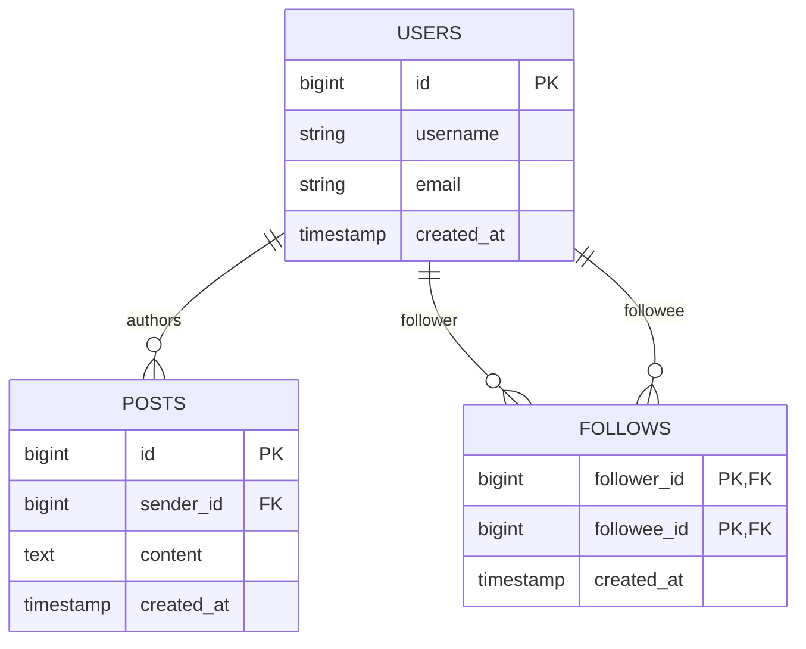
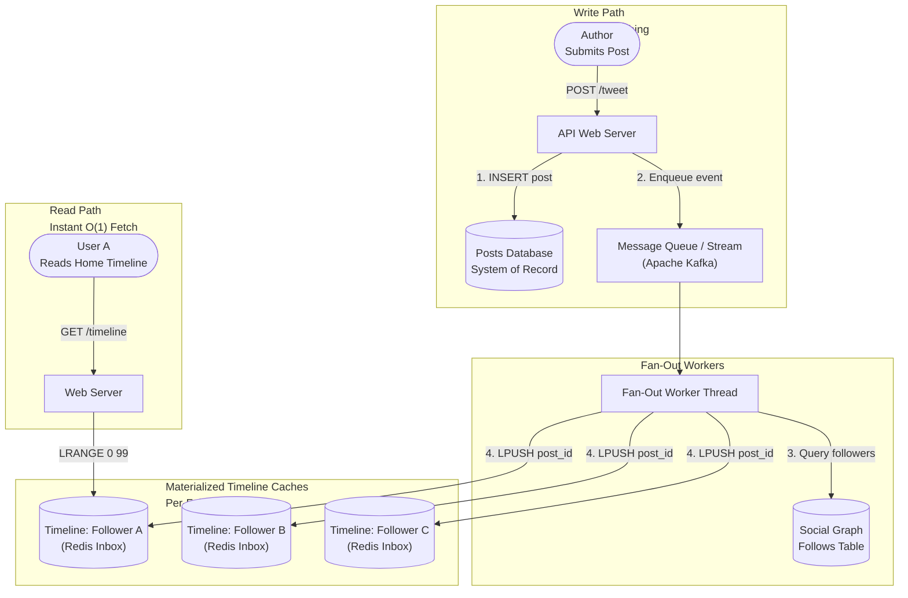
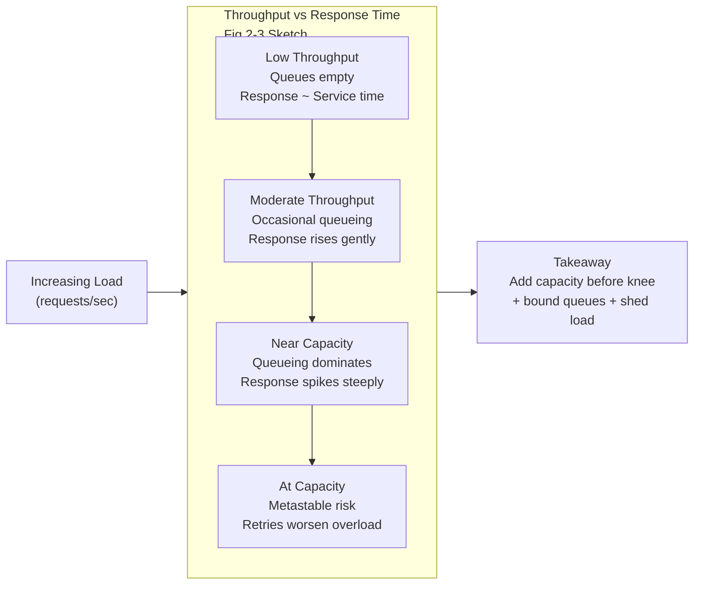
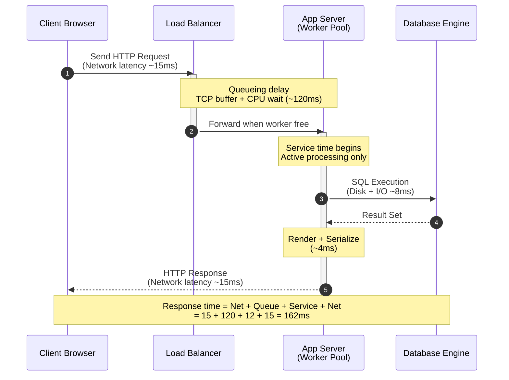
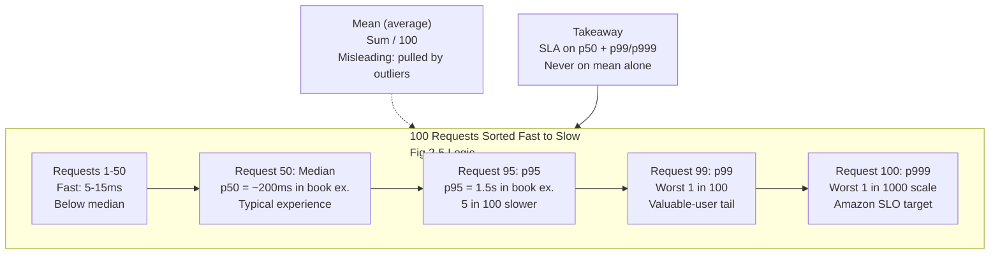
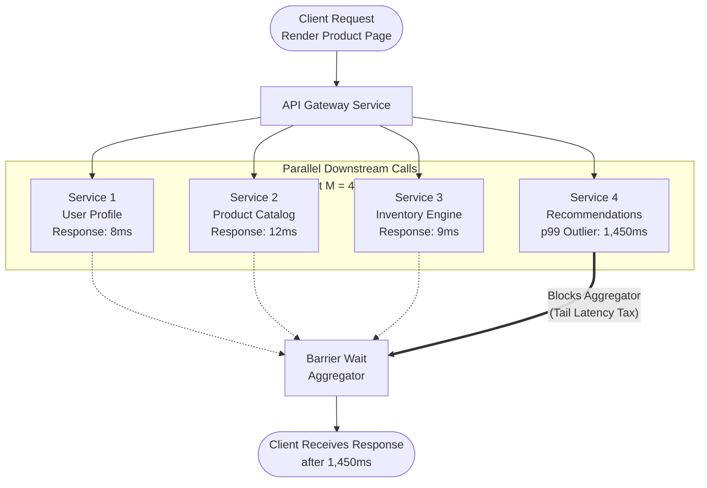

# Chapter 2: Defining Nonfunctional Requirements — Definitive Technical Summary
*From: Designing Data-Intensive Applications (2nd Edition) by Martin Kleppmann and Chris Riccomini*
*Source PDF: pp. 57–88 (673-page PDF) — figures below cite PDF pages.*

> [!NAV] **Chapter Navigation**
> ⬅️ **Previous:** [[chapter-01-trade-offs-in-data-systems-architecture|Chapter 01: Trade-Offs in Data Systems Architecture]] | 🏠 **Index:** [[00-Master-Reading-Dashboard|Master Dashboard]] | ➡️ **Next:** [[chapter-03-data-models-and-query-languages|Chapter 03: Data Models and Query Languages]]


---

## 1. Executive Summary & Core Engineering Problem

- **Core Thesis:** Systems architecture cannot be judged purely on whether it produces correct outputs under ideal conditions (functional requirements); it is fundamentally defined by its nonfunctional capabilities: **Reliability** (continuing to work correctly despite hardware faults, software faults, and human faults), **Scalability** (maintaining performance SLAs under quantitative growth in data volume, traffic throughput, or structural complexity), and **Maintainability** (minimizing operational toil, accidental complexity, and friction for future evolutionary change). Performance description — throughput and response time, latency, service time, queueing delay, percentiles — is the shared vocabulary for all three.
- **Problem Statement:** Systems fail catastrophically when nonfunctional dynamics are neglected. A prime example is the naive "Fan-out on Read" architecture for social network timelines: storing posts in a relational database and computing home timelines on the fly via joins (`SELECT posts.*, users.* FROM posts JOIN follows ON posts.sender_id = follows.followee_id WHERE follows.follower_id = current_user ORDER BY posts.timestamp DESC LIMIT 1000`). While functionally correct at 100 users, at scale (500M posts/day, ~5,800 posts/sec average spiking to 150,000 posts/sec, 10M users online polling every 5 sec = 2M timeline queries/sec × 200 followees = 400M lookups/sec), the query creates immense disk I/O thrashing, exhausts database connection pools, and spikes p99 response time from milliseconds to seconds. Inverting the model to "Fan-out on Write" (materializing timelines) works for average users (5,800 × 200 = ~1M timeline writes/sec, a large saving vs 400M lookups/sec), but instantly collapses when applied to high-fan-out celebrity accounts (100M followers, 3% of Twitter servers once dedicated to Justin Bieber), where a single post triggers a multi-million-write stampede that backs up message queues and starves ordinary users.
- **Historical & Industry Context:** Early internet systems monitored performance using simple arithmetic mean response time and treated hardware as inherently durable (enterprise RAID, dual power supplies). Modern hyper-scale engineering recognized that: (1) mean response time obscures tail latency experienced by the most active and valuable users — Amazon defines internal SLOs at p99.9 because the slowest 1-in-1000 customers hold the most data; (2) hardware faults at scale are statistical certainties — 2–5% HDDs/yr (1 disk/day per 10k disks), 0.5–1% SSDs/yr plus ~1 uncorrectable error/yr/drive, 1-in-1000 CPUs computing wrong results, >1% machines/yr ECC-uncorrectable DRAM; (3) software faults are systematically correlated across all nodes running the same code (2012 leap-second Linux/Java hang, SSD 32,768-hour firmware death) and human operator configuration changes are the leading cause of outages (hardware only 10–25%), demanding fault tolerance, chaos engineering, blameless postmortems, operability, simplicity, and evolvability.
- **Chapter Roadmap:** Case study of social home timelines (p58) → Describing Performance: throughput vs response time, latency vs response time, percentiles, SLO/SLA use (p61) → Reliability and Fault Tolerance: faults vs failures, hardware/software/human faults (p67) → Scalability: understanding load, shared-memory/shared-disk/shared-nothing, principles for scalability (p73) → Maintainability: operability, simplicity, evolvability (p76) → Summary (p80).

---

## 2. In-Depth Technical Concepts & Internal Mechanics

### 2.1 Case Study: Social Network Home Timelines — Representing Users/Posts/Follows, Materializing and Updating Timelines

- **Foundational Theory & Intuition:** The fundamental tension between write-time computation (eager pre-computation / push / materialization) and read-time computation (lazy evaluation / pull). In read-heavy systems with asymmetric access ratios (Twitter case study: ~5,800 writes/sec average, spikes to 150,000 writes/sec, versus millions of timeline reads/sec), the choice of where to pay the computational cost dictates system feasibility. The book makes this concrete with numbers, not hand-waving: load parameters must be quantified before scalability can be discussed.
- **Representing Users, Posts, and Follows (Fig 2-1, PDF p.58):**
  - All data in a relational database: one table for `users`, one for `posts` (sender_id, timestamp, content), one for `follows` (follower_id, followee_id junction for M:N follows).
  - Main read operation: home timeline — recent posts by people the user follows (ignoring ads/suggested posts for simplicity).
  - Canonical query:
    ```sql
    SELECT posts.*, users.* FROM posts
      JOIN follows ON posts.sender_id = follows.followee_id
      JOIN users   ON posts.sender_id = users.id
      WHERE follows.follower_id = current_user
      ORDER BY posts.timestamp DESC
      LIMIT 1000;
    ```
  - Execution: use `follows` to find everybody current_user follows (avg 200, but some follow tens of thousands), look up recent posts by each, merge and sort by timestamp to get most recent 1,000.
  - Timeliness requirement: followers see a post within 5 seconds. Naive approach: client polls every 5 sec while online. With 10M users online simultaneously → 2M queries/sec. Each query fans out to ~200 followed accounts → 400M per-sender post lookups/sec average, far worse at peak and for users following tens of thousands. Expensive, hard to make fast, connection-pool destroying.
- **Materializing and Updating Timelines (Fig 2-2, PDF p.59):**
  - Two improvements: (1) server pushes instead of client polling — client subscribes to stream of posts added to its home timeline; (2) precompute (materialize) results so reads are served from cache.
  - Design: per-user data structure holding home timeline (recent posts by followees). On every post, look up all followers and insert post into each follower's timeline — like delivering to mailboxes. Read path is then a simple cache fetch. This precomputation is called **materialization**, the cache is a **materialized view** (recurring theme in later chapters) — speeds up reads at cost of more work on writes. Derived data must be updated.
  - **Fan-out:** one initial request resulting in several downstream requests; fan-out factor = multiplication. Here avg fan-out 200 → 5,800 posts/sec × 200 = just over 1M home timeline writes/sec. Still a lot, but a significant saving vs 400M lookups/sec. During spikes, deliveries can be enqueued — accept temporary extra delivery delay while timeline loads stay fast from cache.
  - **Extreme cases that dominate scalability:**
    - *Heavy reader following many prolific accounts:* high write rate into that one materialized timeline, but user likely not reading everything → OK to drop some timeline writes, show only a sample (Bluesky lossy timelines precedent).
    - *Celebrity with millions of followers posting:* must insert into millions of timelines; dropping is NOT OK (followers expect to see it). Solution: handle celebrities separately — store celebrity posts separately, merge with materialized timeline on read. Despite optimization, celebrities require disproportionate infrastructure.
  - Cost model summary:

| Dimension / Metric | Approach 1: Fan-out on Read (Pull) | Approach 2: Fan-out on Write (Push/Materialized) | Approach 3: Hybrid Fan-out (Book + Twitter Practice) |
| :--- | :--- | :--- | :--- |
| **Write Cost** | `O(1)` — single row into `posts` | `O(F)` — write to every follower's timeline cache | `O(F)` normal users; `O(1)` celebrities (no fan-out) |
| **Read Cost** | `O(F log P)` — multi-table join + merge + sort | `O(1)` — simple cache list read | `O(1)` cache read + small in-memory merge of celebrity posts |
| **Storage Overhead** | Minimal (normalized single copy) | High (duplicate post IDs in millions of inboxes) | Moderate (only non-celebrity timelines fully materialized) |
| **Celebrity Problem** | None on write; crushing read load | **Catastrophic:** millions of writes per post stall queues | **Solved:** celebrities bypass write fan-out, merged on read |
| **Spike Behavior** | Reads collapse under queueing | Writes queue; reads stay fast (enqueue tolerance) | Bounded queues both paths |

- **Concrete Walkthrough (book numbers):**
  - *Ordinary Alice (150 followers):* tweet → 150 inbox inserts (~2 ms total with pipelining). Bob reads timeline via single range read (~0.5 ms).
  - *Celebrity (40M followers) under naive push:* 40M inserts at 50k writes/sec = 800 sec (13+ min) queue blockage for one tweet.
  - *Hybrid:* follower-count threshold (e.g., ~25k). Below → push; above → skip push, store separately, merging at read time across at most a handful of celebrities per reader (5 ms merge).

### 2.2 Describing Performance: Throughput vs Response Time, Latency vs Response Time, Percentiles, Use of Response Time Metrics (SLOs/SLAs)

- **Foundational Theory & Intuition:** Performance in request-response systems cannot be characterized by a single number. Throughput and response time are distinct but related through queueing. Response time itself is a distribution (right-skewed, fat-tailed), not a scalar — hence percentiles, SLOs/SLIs, and tail-amplification reasoning.
- **Throughput vs Response Time (Fig 2-3, PDF p.61):**
  - *Response time:* elapsed time from user making request until receiving answer. Units: seconds / ms / µs. What users care about most.
  - *Throughput:* number of requests/sec or data volume/sec the system processes. For given hardware, there is a maximum throughput. Units: somethings/sec. Determines required computing resources (how many servers) and hence cost. If throughput must grow beyond current hardware, capacity must expand — scalability is the ability to significantly increase maximum throughput by adding resources.
  - In case study: "posts/sec" and "timeline writes/sec" are throughput metrics; "time to load home timeline" and "time until post delivered" are response time metrics.
  - Relationship: low response time at low throughput; response time rises with load because of queueing — incoming request waits while CPU finishes earlier request. As throughput approaches hardware capacity, queueing delay increases sharply (nonlinear knee). Formalized by queueing theory (Kingman: wait ∝ U/(1-U); at 90% utilization 9× service time, at 99% 99×).
  - **When an overloaded system won't recover — metastable failure, retry storms:** Near overload, long queues → clients time out and resend → request rate increases further → worse overload → vicious cycle persisting even after load drops until reboot/reset. Defenses: client exponential backoff with randomization/jitter, circuit breaker / token bucket to stop sending to erroring service, server load shedding (proactively reject with 429/503), backpressure (ask clients to slow down), careful queueing/load-balancing choice. See §2.3 for mechanics.
  - Focus split: this section focuses on response time; throughput and scalability return in §2.5 (Scalability, p49 in print / PDF p73+).
- **Latency vs Response Time — Service Time vs Response Time vs Queue + Network Breakdown (Fig 2-4, PDF p.62–63):**
  - Book uses terms precisely (Fig 2-4 time flows left→right, nodes as horizontal lines, messages as thick diagonal arrows — recurring diagram style):
    - *Response time:* what the client sees; includes ALL delays anywhere in the system. Must be measured on the client side.
    - *Service time:* duration service is actively processing the request (CPU + local I/O execution).
    - *Queueing delays:* occur at several points — waiting for CPU after receipt, buffered response packets behind bulk sends on outbound NIC, OS socket buffers, TCP listen backlog, LB queues, thread-pool waits.
    - *Latency:* catchall for time request is NOT actively processed (latent). In particular *network latency / network delay* = time request+response spend traveling through network.
  - Decomposition:
    ```
    Response Time = Service Time + Queueing Delays (multiple stages) + Network Latency (round-trip)
    ```
  - Variability: response time varies request-to-request even for identical requests — context switch to background process, lost packet + TCP retransmission, GC pause, page fault forcing disk read, mechanical vibrations in rack (fail-slow). Queueing is the largest variability source. Only a few slow requests suffice to hold up subsequent fast requests — **head-of-line blocking** — so fast-service requests still show slow response time. Hence client-side measurement is essential (server-side service time hides queueing).
- **Average, Median, and Percentiles (Fig 2-5, PDF p.64):**
  - Think distribution, not single number. Fig 2-5: 100 requests as gray bars, height = duration; most fast, occasional outliers much longer. Network-delay variation is **jitter**.
  - *Mean (arithmetic average):* sum/ count. Useful for estimating throughput limits, but poor for "typical" experience — hides outliers. Example: 99×10 ms + 1×10,000 ms → mean 109 ms, yet 99% of users saw 10 ms and one saw 10 sec.
  - *Median (p50):* sorted list halfway point. p50 200 ms = half <200 ms, half longer. Good "typically how long" metric.
  - *Higher percentiles (tails):* p95, p99, p99.9 (p999) common. p95 1.5 s = 95/100 <1.5 s, 5/100 ≥1.5 s. **Tail latencies** directly affect experience. Amazon requires p999 for internal services though only 1-in-1000 affected — because slowest customers are those with most data (most purchases), i.e., most valuable. Optimizing p99.99 (1-in-10k) deemed too expensive for diminishing returns — tails are dominated by uncontrollable random events.
  - *User-impact evidence (caution):* obvious fast is better, but quantification is hard and often-cited stats unreliable: Google 2006 (400→900 ms = −20% traffic/revenue) vs Google 2009 (+400 ms = −0.6% searches/day) vs Bing 2009 (+2 s load = −4.3% ad revenue); Akamai 100 ms → −7% conversion claim undermined because fastest pages were empty 404s without separating content vs load-time effects; Yahoo (controlled for quality) found 20–30% more clicks on fast searches when fast-slow gap ≥1.25 s.
- **Use of Response Time Metrics — SLOs, SLIs, SLAs and Tail Amplification (Fig 2-6, PDF p.65–66):**
  - *Tail latency amplification:* backend services called multiple times per end-user request — even in parallel, user request waits for slowest parallel call. One slow call makes entire user request slow (Fig 2-6). Small per-call slow probability becomes large per-user slow probability as fan-out M grows: `P_slow = 1 − (1−p)^M`. With p=0.01 (p99) and M=100, P_slow = 1−0.99^100 ≈ 63.4% of user requests slow despite each backend meeting 99% SLA. Dean & Barroso "Tail at Scale."
  - *SLOs/SLAs/SLIs:* Percentiles are the contract language. Example SLO: median response time <200 ms AND p99 <1 s AND ≥99.9% valid requests non-error. **SLO** = internal target; **SLA** = contract specifying consequences if SLO missed (e.g., refund). Defining good availability metrics is nontrivial (Nines Are Not Enough; Meaningful Availability).
  - Concrete contract guidance: never SLA on the mean. SLA on p50 for typical experience + p95/p99/p99.9 for tails + availability SLI (fraction non-error). Example production SLO block: `p50 < 200 ms, p95 < 500 ms, p99 < 1 s, p99.9 < 2 s over 10-min rolling window; 99.9% success`. Breach triggers error-budget burn and freeze on feature releases.
  - *Computing percentiles:* rolling window (e.g., last 10 min, recompute every minute for dashboards). Naive: keep list, sort each minute. Efficient approximations: HdrHistogram, t-digest, OpenHistogram/Circllhist, DDSketch (minimal CPU/memory). Warning: averaging percentiles (across time buckets or machines) is mathematically meaningless — correct aggregation is adding histograms.

### 2.3 Queueing Dynamics, Metastable Failures, and Saturation Behavior

- **Foundational Theory (Kingman's Formula & Queueing Theory):** As utilization U→100%, queueing delay →∞ nonlinearly: Wait ∝ U/(1−U) × Service Time. At 50% modest; 90% → 9×; 99% → 99×. This is the knee in Fig 2-3.
- **Metastable Failure & Retry Storm (PDF p.62 box):**
  1. Transient spike / GC pause pushes utilization >100%. Queues grow.
  2. Response time exceeds client timeout T_timeout. Clients abort + resend (retries).
  3. Server does wasted work: executes abandoned originals while receiving duplicates.
  4. Effective load 2–3× capacity. System trapped in degraded state even after original surge subsides — metastable failure (Bronson et al. HotOS; Brooker; Huang et al. OSDI).
  5. Recovery requires external intervention: reboot/reset, edge traffic cut, queue flush, gradual canary reintroduction.
- **Defensive Engineering Mechanisms (book list, PDF p.62):**
  - *Exponential backoff with jitter (client):* increase + randomize inter-retry time. `t_wait = random(0, min(Max, Base × 2^attempt))`. Desynchronizes retries.
  - *Circuit breaker / token bucket (client):* temporarily stop sending to recently errored/timed-out service; trip OPEN above error threshold (e.g., 50% over 10 s), fail fast without network send.
  - *Load shedding (server):* detect approaching overload, proactively reject (429/503) low-priority requests.
  - *Backpressure (server→client):* send slow-down signals upstream (applies to streams, e.g., Twitter fan-out workers).
  - *Queueing/load-balancing choice:* bounded queues,hedged requests, least-loaded routing matter.

### 2.4 Reliability and Fault Tolerance: Hardware Faults (MTBF), Software Systematic Bugs, Human Misconfiguration

- **Foundational Definitions (PDF p.67):** Typical expectations: performs expected function; tolerates user mistakes/unexpected use; performance good enough under expected load/data; prevents unauthorized access/abuse. If together = "working correctly," then **reliability ≈ continuing to work correctly, even when things go wrong.**
  - *Fault:* one part stops working correctly (single disk malfunctions, single machine crashes, depended-on external service outage).
  - *Failure:* whole system stops providing required service (misses SLO). Same thing at different levels: single-disk system — disk fault = system failure; multi-disk with replica — disk fault is only a fault, tolerated via copy.
  - *Fault-tolerant:* continues providing required service despite certain faults. Part whose fault escalates to system failure = **single point of failure (SPOF)**.
  - *Social-network example:* machine updating materialized timelines crashes mid-fan-out → fault-tolerant design needs another machine to take over without missing or duplicating posts — **exactly-once semantics** (Chapter 12).
  - *Limits:* tolerance always bounded (e.g., max 2 disks, 1-of-3 nodes). Tolerating all faults is nonsense (all nodes crash; Earth swallowed by black hole → space hosting). Counterintuitive practice: **fault injection** — deliberately kill random processes to continually exercise fault-tolerance machinery (many critical bugs are poor error handling); **chaos engineering** systematizes this. Prevention vs cure: some faults have no cure (security breach / data exfiltration cannot be undone) — prevent; book focuses on curable faults below.
- **Hardware Faults — MTBF Numbers and Redundancy (PDF p.68–69):**
  - *Disk/magnetic HDD:* ~2–5%/yr fail; 10k-disk cluster → ~1 failure/day average. Newer data: more reliable but still significant (Backblaze).
  - *SSD:* ~0.5–1%/yr fail; small bit errors auto-corrected, but uncorrectable errors ~1/yr/drive even when fairly new — higher than HDD. Firmware can kill all same-model drives simultaneously after exactly 32,768 h (<4 yr).
  - *Other components:* PSUs, RAID controllers, memory modules also fail, less often than disks.
  - *CPU silent corruption:* ~1-in-1000 machines has a core occasionally computing wrong result (manufacturing defects — Hochschild "Cores That Don't Count," Meta Dixit SDC at Scale). Sometimes crash, sometimes silently wrong answer.
  - *RAM:* cosmic rays or defects corrupt data; even with ECC, >1% machines/yr see uncorrectable error → crash + module replacement. Rowhammer access patterns flip bits with high probability.
  - *Datacenter-scale:* power outage, network misconfiguration, fire/flood/earthquake, solar superstorm inducing currents in long wires/undersea cables — rare but catastrophic if loss of a datacenter not tolerated.
  - Small systems: replace faulty hardware, don't over-engineer. Large systems: faults are normal operation.
  - *Tolerating via redundancy:* RAID (spread across disks in one machine), dual PSUs, hot-swappable CPUs, batteries + diesel generators. Effective when faults independent — but significant correlations observed (same batch, same rack/DC). Redundancy raises single-machine uptime; distributed multi-datacenter tolerance (Ch 6, 10, availability zones — co-located resources fail together) is the cloud approach: let another datacenter's machine take over. Bonus: rolling upgrades — patch one node at a time without downtime (Chapter 5). Single-server systems require planned downtime for OS patches.
- **Software Faults — Systematic, Correlated Bugs (PDF p.70):**
  - Hardware mostly independent; software faults highly correlated — all nodes run same software, same bugs → many more system failures than uncorrelated hardware faults. Dormant bugs triggered by unusual circumstances reveal false environmental assumptions.
  - Examples: (1) simultaneous crash bug — 2012 leap-second Linux-kernel/Java hang took down many services; SSD firmware time-bomb; (2) runaway process exhausting shared limited resource — CPU, memory (OOM-killed), disk, bandwidth, threads; client-library bug causing request-volume surge; (3) dependency slows / unresponsive / corrupt responses; (4) emergent cross-system interaction not seen in isolated tests; (5) cascading failures — one component overloads → slows next → brings down another.
  - No quick fix. Many small helps: scrutinize assumptions/interactions; thorough testing; process isolation; crash-and-restart (supervision); avoid feedback loops like retry storms; measure/monitor/analyze production behavior.
- **Humans and Reliability — Misconfiguration as Leading Cause (PDF p.71–72):**
  - Humans design/build/operate; strength is creativity/adaptivity, weakness unpredictability/mistakes. Study of large internet services: operator configuration changes leading cause of outages; hardware (servers/network) only 10–25%.
  - "Human error" label is counterproductive — it is a symptom of sociotechnical system problems (Dekker), not a cause; complex systems have emergent unexpected interactions (Cook, Woods). Blaming tighter procedures misses the point.
  - Technical mitigations: thorough testing (handwritten + property-based random inputs — Yuan et al. most critical failures preventable by simple testing), rollback for config changes, gradual rollouts/canaries, detailed monitoring + observability for diagnosis (cf. p20), well-designed interfaces encouraging right thing / discouraging wrong thing.
  - Organizational reality: resilience investment competes with revenue features; choosing features then blaming the deployer is incoherent — it's a priorities problem. Remedy: **blameless postmortems** — share full details without fear of punishment so org learns, surfaces neglected investment/incentive/systemic issues (Allspaw, Etsy). Be suspicious of simplistic answers — neither "Bob should have been careful" nor "rewrite backend in Haskell" — management must learn sociotechnical reality from operators' viewpoint and improve it.
  - *How important is reliability?* Not just nuclear/ATC: business-app bugs → lost productivity + legal risk; ecommerce outage → revenue + reputation. Temporary minutes/hours outage often tolerable; permanent data loss/corruption catastrophic (parent's photos of children — could they restore from backup?). Post Office Horizon scandal (1999–2019): hundreds of branch managers convicted of theft/fraud on accounting-software shortfalls later shown to be bugs; convictions overturned — largest British miscarriage of justice, rooted in legal presumption computers operate correctly. May consciously sacrifice reliability for prototype speed in unproven markets — but do so explicitly, mindful of consequences.

| Fault Category | Typical Root Causes (book) | Fleet Correlation | Best Defensive Mechanism |
| :--- | :--- | :--- | :--- |
| **Random Hardware Wear** | Bad sectors, PSU burnout, fan death; 2–5% HDD/yr, 0.5–1% SSD/yr | **Low (Uncorrelated):** ~1 disk/day per 10k disks | RAID-6, multi-DC replicas, automatic failover, rolling upgrades |
| **Correlated Hardware / Env** | Same-batch defects, rack/DC power, solar storm, ECC-uncorrectable (>1%/yr), 1/1000 bad CPU cores | **High:** batch/rack/DC fail together | Multi-vendor sourcing, staggered deploys, availability zones |
| **Systematic Software Bug** | Leap-second hang, 32,768-h firmware death, memory leak, deadlock, runaway resource use, cascading overload | **Very High:** 100% of nodes on that version | Canaries, isolation, crash-restart, backpressure, fuzzing + property tests |
| **Human Operator Error** | Bad firewall push, dropped table in CLI, config rollout — leading outage cause | **High:** one push breaks all clusters | Sandboxes, read-only defaults, IaC review, gradual rollouts, instant rollback, blameless postmortems |

- **Silent Data Corruption (SDC):** Cosmic rays, voltage instability, silicon defects cause silent bit flips in RAM and CPU ALUs. Meta/Google field studies: ~1-in-1000 cores compute incorrect results without machine-check exception. Never trust bus/RAM/disk; rely on end-to-end checksums (CRC32C, SHA) and error isolation.

### 2.5 Scalability: Load Parameters, Shared-Memory / Shared-Disk / Shared-Nothing, Principles for Scalability

- **Foundational Theory & Intuition:** Scalability is not a binary label ("X is scalable"). It answers: *if the system grows in a particular way, what options cope with growth? How to add resources to hold performance? When do current-architecture limits hit given projections?* Even reliable-today systems degrade as load grows (10k→100k concurrent users, 1M→10M records). Two lenses: (1) load up, resources fixed → how does performance change? (2) load up, hold performance (SLA) → how much must resources grow? Goal: hold SLA while minimizing cost (hardware choice affects cost-effectiveness over time). **Linear scalability** — double resources → handle double load at same performance — is good; sublinear (less than double via economies of scale / peak spreading) occasionally possible; superlinear cost (e.g., per-write work grows with data size) is the common pain.
- **Startup caveat (book, PDF p.73):** "You're not Google. Stop worrying about scale, just use a relational DB" applies to small-user new products: overriding goal is simplicity/flexibility to learn customer needs; premature scalability investment is wasted or locks in inflexibility. Worry when popularity reveals real bottlenecks and scaling dimensions.
- **Understanding Load — Load Parameters with Book Examples (PDF p.74):**
  - Must quantify current load before asking "what if doubled?" Often a throughput: req/sec to service, GB new data/day, checkouts/hour. Sometimes the peak: simultaneously online users (10M in case study).
  - Statistical characteristics affecting access patterns and scalability requirements:
    - *Request rates + read/write ratio:* 5,800 posts/sec writes vs 2M timeline reads/sec; ratio ~50:1 read-heavy vs 1:1 balanced changes optimal architecture (materialize vs compute-on-read).
    - *Cache hit rate:* 95% vs 60% hit rate changes DB load by 8×.
    - *Items per user / fan-out distribution:* avg 200 followers vs p99.9 50M followers — average case vs extreme-case dominated bottleneck. Book stresses: know whether average or small number of extremes dominate.
    - *Data volume + request size:* 100k×1 kB/sec vs 3×2 GB/min — same 100 MB/sec throughput, utterly different architectures.
    - *Spike headroom:* avg 5,800 vs peak 150,000 posts/sec (26×) — provision for peak or queue with graceful degradation?
  - Worked parameter block for the case study: 500M posts/day; 5,800 avg / 150,000 peak posts/sec; 10M concurrent online; avg 200 follows/followers; celebrity 100M+; 5-sec freshness SLO; 1,000-post timeline page. Any scalability claim must state which parameter is scaled.
- **Shared-Memory, Shared-Disk, Shared-Nothing Architectures (PDF p.75):**
  1. *Shared-Memory — vertical scaling / scaling up:*
     - Move service to more powerful machine (more cores/RAM/disk; single cores no longer getting much faster). Parallelism via processes/threads sharing RAM under one kernel — hence shared-memory.
     - Advantages: simplest programming (local locks, ACID without network), zero serialization, easiest ops for small teams; right choice when single-machine DB suffices (datasets <1 TB).
     - Limits: cost grows superlinearly (2× resources costs >>2×); bottlenecks (NUMA cross-socket, memory bus) mean unlikely to handle 2× load; physical ceiling; single physical SPOF.
  2. *Shared-Disk — NAS / SAN:*
     - Several machines with independent CPUs/RAM share a disk array over fast network (NAS filesystem or SAN block device). Traditionally on-prem data warehousing.
     - Advantages: storage pooled/independently scaled to a degree; failover simpler than nothing-shared for some workloads.
     - Limits: contention + distributed lock-manager overhead cap scalability (dozens of nodes); storage-network bus becomes bottleneck. Book cites Stopford comparison. Modern cloud-native variant — separate storage and compute services sharing a storage service via specialized DB API (e.g., Socrates/SQL Server cloud) rather than NAS/SAN — resembles shared-disk but avoids old scalability problems by not exposing filesystem/block abstraction.
  3. *Shared-Nothing — horizontal scaling / scaling out:*
     - Distributed nodes each with own CPUs/RAM/disks; coordination purely in software over conventional network. Requires explicit sharding (Chapter 7) and absorbs all distributed-systems complexity (Chapter 9: partitions, consensus Raft/Paxos, replication).
     - Advantages (why dominant): potential linear scalability; best price/performance commodity/cloud hardware; elastic add/remove with load; greater fault tolerance across datacenters/regions/zones.
     - Downsides: sharding, consensus, replication, partial failure/split-brain, cross-node tail latency, far higher engineering/ops burden. 20-node cluster can lose to one 128-core/2 TB box for <1 TB datasets.
  - Decision sketch: dataset <1 TB + predictable load + small team → scale up first; >10 TB / geo-distribution / fault-domain requirements → scale out; warehousing legacy on shared-disk → evaluate disaggregated cloud storage-compute before sharding by hand.
- **Principles for Scalability (PDF p.76):**
  - *No magic scaling sauce:* no generic one-size-fits-all scalable architecture. Load shape dictates design; plan at most one order of magnitude ahead — appropriate-for-N unlikely to cope with 10N; fast growers rethink architecture per order of magnitude.
  - *Break into independently operable smaller components:* underlying principle of microservices (p21), sharding (Ch 7), stream processing (Ch 12), shared-nothing. Challenge is drawing boundaries (DDD/microservice guides; Ch 7 for sharding). Corollaries the task calls out:
    - *Horizontal partitioning/sharding* over vertical growth once single-node limits near; partition by key so each shard operates largely independently.
    - *Stateless services* where possible — any node handles any request; state pushed to partitioned storage/queues so compute scales by adding identical nodes behind LB.
    - *Idempotent operations* — safe retry without duplication (ties to exactly-once discussion Ch 12; essential when retries/backoff/load-shedding are the norm).
    - *Async decoupling* — enqueue fan-out/deliveries (as in timeline case: accept temporary delivery lag to keep reads fast); backpressure + bounded queues instead of synchronous blocking chains that amplify tails.
  - *Don't overcomplicate:* single-machine DB if it does the job; manually scaled predictable load may have fewer surprises than autoscaling; 5 services simpler than 50. Good architectures pragmatically mix approaches.

### 2.6 Maintainability: Operability, Simplicity (Essential vs Accidental Complexity), Evolvability

- **Foundational Theory (PDF p.76–77):** Software doesn't wear out like mechanics, but requirements evolve, environments change (dependencies/platforms), bugs need fixing. Majority of cost is not initial development but ongoing maintenance — bug fixes, keeping systems operational, failure investigation, platform adaptation, new use cases, tech-debt repayment, features. Legacy pain is real: long-lived systems on outdated stacks (mainframes/COBOL) with lost institutional rationale; fixing others' mistakes; intertwining with human orgs makes maintenance as much a people problem as technical (Bellotti). Every valuable system becomes legacy — design for future maintainers. Three principles: operability, simplicity, evolvability.
- **Operability — Making Life Easy for Operations (PDF p.77, Hamilton checklist):**
  - Context from Ch 1 cloud era: human processes at least as important as tools; "good operations can work around bad software, but good software cannot run reliably with bad operations" (Kreps). Thousands of machines → manual maintenance impossibly expensive → automation essential, but double-edged (Bainbridge Ironies of Automation): unautomatable edge cases are the most complex, demanding more skilled ops; highly automated failures harder to troubleshoot than semi-manual ones. More automation ≠ always better; find application/org-specific sweet spot; make routine tasks easy so ops focuses on high-value work.
  - Data-system operability checklist (book):
    - Allow monitoring tools to check key metrics + support observability into runtime behavior (commercial/open-source observability stack).
    - Avoid dependency on individual machines — take any machine down for maintenance while system keeps running uninterrupted (ties to shared-nothing + rolling upgrades).
    - Provide good documentation + easy operational model ("If I do X, Y will happen").
    - Provide good defaults but allow admin override when needed.
    - Self-heal where appropriate, but preserve manual control over system state when needed.
    - Exhibit predictable behavior, minimize surprises.
  - Avoiding lock-in / portability angle: operability also means not depending on irreplaceable singletons — machines, vendors, or bespoke snowflakes — so maintenance, migration, and recovery stay feasible.
- **Simplicity — Managing Essential vs Accidental Complexity (PDF p.78):**
  - Small projects delightfully simple; large projects drift to complex, hard-to-understand "big ball of mud" — slows everyone, overruns budgets/schedules, raises bug-on-change risk via hidden assumptions and unexpected interactions (Woods). Reducing complexity is the maintainability lever; solve problems in simplest possible way — easier said than done.
  - *Subjectivity:* no objective simplicity standard (Brooker) — one system hides complexity behind simple interface (complex implementation), another has simple implementation exposing internals — which is simpler?
  - *Essential vs accidental (Brooks):* essential = inherent in problem domain; accidental = from tooling limitations. Flawed distinction because boundary shifts as tooling evolves (Luu) — yesterday's essential becomes today's accidental once better abstractions arrive.
  - *Abstraction as tool:* good abstraction hides implementation behind clean façade, reusable across applications — reuse amortizes quality improvements to all users. Examples: high-level languages hide machine code/registers/syscalls (still using machine code, just not thinking about it); **SQL as declarative abstraction hides on-disk/in-memory structures (B-trees), concurrent requests, crash recovery** — users state what, not how. App-level abstractions via design patterns / DDD can be built atop the general-purpose abstractions of this book (transactions, indexes, event logs).
- **Evolvability — Making Change Easy (PDF p.79, Agile + TDD):**
  - Requirements never static — new facts, unanticipated uses, priority shifts, feature requests, platform turnover, legal/regulatory change, growth-forced rearchitecture.
  - Org process: **Agile** patterns for adapting to change; technical companions **test-driven development (TDD) and refactoring** for safe change in fluid environments. Book lifts agility to data-system level across multiple apps/services: **evolvability** — ease of modifying a data system for changing requirements, linked to simplicity/abstractions (loosely coupled simple systems easier to modify than tightly coupled complex ones).
  - *Irreversibility* as change-killer: migration from DB-A to DB-B with no path back raises stakes enormously vs reversible dual-write + switch-back plan. Minimize irreversibility to preserve flexibility (e.g., backwards/forwards-compatible schemas with Protobuf/Avro, dual reads, feature flags, expand-migrate-contract).

---

## 3. Important Figures, Diagrams & Visual Architecture

> 📕 **Original figures quick index (source PDF, 673 pages):** open the PDF at the cited page to verify each reconstruction.
>
> | Book Fig | PDF page | What to compare |
> |---|---|---|
> | Fig 2-1 | PDF p.58 | Social-network relational schema (users/posts/follows) |
> | Fig 2-2 | PDF p.59 | Fan-out: delivering posts to followers |
> | Fig 2-3 | PDF p.61 | Throughput vs response time (queueing knee) |
> | Fig 2-4 | PDF p.63 | Response time vs service time vs queue + network breakdown |
> | Fig 2-5 | PDF p.64 | Mean vs median vs percentiles (100 requests) |
> | Fig 2-6 | PDF p.65 | Tail latency amplification (parallel backends) |


### Figure 2-1: Relational Schema for Social Network (PDF p.58)
- **Figure Reference:** `Figure 2-1: A simple relational schema for a social network in which users can follow one another (book p.34)`
- **Original PDF:** Fig 2-1 → PDF p.58 — open the PDF at page 58 to compare with the Mermaid reconstruction below.
- **Visual Flow & Description:** Users table, posts table (each post has sender_id → users), follows junction table (follower_id + followee_id → users). One user authors many posts (1:N); users follow many users (M:N via follows).
- **Mermaid.js Entity-Relationship Diagram:**



- **Key Takeaway:** Normalized integrity at cost of read-time joins: timeline = join follows→posts→users + sort by timestamp DESC LIMIT 1000, which collapses at 2M queries/sec × 200 followees.

---

### Figure 2-2: Fan-Out — Delivering New Posts to Every Follower (PDF p.59)
- **Figure Reference:** `Figure 2-2: Fan-out: delivering new posts to every follower of the user who made the post (book p.35)`
- **Original PDF:** Fig 2-2 → PDF p.59 — open the PDF at page 59 to compare with the Mermaid reconstruction below.
- **Visual Flow & Description:** Eager write pipeline. Author post → INSERT into posts store → enqueue fan-out event → worker queries social graph for followers → LPUSH post ID into each follower's materialized timeline mailbox. Read path serves precomputed inbox via single range fetch; client subscribes to new arrivals instead of polling.
- **Mermaid.js Flowchart:**



- **Key Takeaway:** Shifts cost from read to write: ~1M writes/sec (5,800×200) replaces 400M lookups/sec; spikes absorbed by queueing deliveries while reads stay fast; celebrities need separate merge-on-read path.

---

### Figure 2-3: Throughput vs Response Time — Queueing Knee (PDF p.61)
- **Figure Reference:** `Figure 2-3: As the throughput of a service approaches its capacity, the response time increases dramatically because of queueing (book p.37)`
- **Original PDF:** Fig 2-3 → PDF p.61 — open the PDF at page 61 to compare with the Mermaid reconstruction below.
- **Visual Flow & Description:** Response time flat at low throughput, then steep nonlinear rise as throughput nears hardware capacity. Cause is queueing: arrivals wait behind in-flight work; near 100% utilization, wait ∝ U/(1−U).
- **Mermaid.js Flowchart (curve annotated):**



- **Key Takeaway:** Throughput determines cost (servers needed); response time determines user experience. Scalability = raising max throughput via added resources without moving the knee leftward. Operate left of knee; shed/backpressure before it.

---

### Figure 2-4: Response Time vs Service Time vs Queueing + Network Breakdown (PDF p.63)
- **Figure Reference:** `Figure 2-4: Response time, service time, network latency, and queueing delay (book p.39)`
- **Original PDF:** Fig 2-4 → PDF p.63 (described PDF p.62, captioned PDF p.63) — open the PDF at page 63 to compare with the Mermaid reconstruction below.
- **Visual Flow & Description:** Time flows left→right; nodes as horizontal lines; messages as thick diagonal arrows (book's recurring style). Client request traverses network → waits in server queues (socket buffer, CPU wait) → active service (DB + render) → network return. Response time = everything client sees; service time = only active processing slice; remainder is queueing + network latency (latent, not processing).
- **Mermaid.js Sequence Diagram:**



- **Key Takeaway:** Service time constant (~12 ms) while queueing (120 ms) dominates near saturation; server-side timers hide this — measure response time on the client. Head-of-line blocking lets a few slow services inflate everyone's response time.

---

### Figure 2-5: Mean vs Median vs Percentiles — 100 Requests (PDF p.64)
- **Figure Reference:** `Figure 2-5: Illustrating mean and percentiles: response times for a sample of 100 requests to a service (book p.40)`
- **Original PDF:** Fig 2-5 → PDF p.64 — open the PDF at page 64 to compare with the Mermaid reconstruction below.
- **Visual Flow & Description:** 100 gray bars (one per request), height = duration; most short, few tall outliers. Mean sits above median (dragged by outliers); p50 splits 50/50; p95/p99/p999 mark progressively rarer tails. Jitter = network-delay variation across bars.
- **Mermaid.js Flowchart (distribution annotated):**



- **Key Takeaway:** Mean estimates throughput limits (Brooker) but hides experience; median shows typical; p95/p99/p99.9 expose outliers that hit power users hardest. Amazon SLOs at p99.9; p99.99 deemed uneconomical.

---

### Figure 2-6: Tail Latency Amplification — Parallel Backend Calls (PDF p.65)
- **Figure Reference:** `Figure 2-6: When several backend calls are needed to serve a request, just a single slow call can slow down the entire end-user request (book p.41)`
- **Original PDF:** Fig 2-6 → PDF p.65 — open the PDF at page 65 to compare with the Mermaid reconstruction below.
- **Visual Flow & Description:** API gateway fans out in parallel to multiple downstream services to render one page; aggregator barrier waits for all; single p99 outlier dictates end-user response time. Even tiny per-call slow probability compounds across M calls.
- **Mermaid.js Flowchart:**



- **Key Takeaway:** User latency = max(parallel backend latencies). `P_slow = 1 − (1−p)^M`: p=0.01, M=100 → 63.4% of user requests hit tail despite each backend meeting 99%. Mitigate with deadlines, hedged requests, partial results, circuit breakers. Percentiles feed SLOs/SLAs (e.g., p50 <200 ms, p99 <1 s, 99.9% non-error; breach → refund/error-budget policy).

---

## 4. Real-World Systems, Case Studies & Code Examples

### 4.1 Twitter Timeline Evolution Metrics (Book Numbers + Practice)
- **Production Numbers (PDF p.58–60):**
  - Average tweet creation: ~5,800 tweets/sec (500M/day).
  - Peak tweet volume (events): >150,000 tweets/sec.
  - Polling load if naive: 10M online × (1 query/5 s) = 2M queries/sec × 200 followees = 400M lookups/sec.
  - Materialized load: 5,800 × 200 = ~1.16M writes/sec (large saving).
  - Average follows/followers: ~200 each; range wide — handful to 100M+ (Obama); ~3% of servers once for Bieber.
  - Freshness SLO: visible within 5 seconds.
- **Architectural Divergence:**
  - Pure fan-out on read: massive joins over billions of rows millions of times/sec → I/O saturation, pool exhaustion, p99 blowup.
  - Pure fan-out on write: sub-ms reads, but peak 150k×200 = 30M writes/sec sustained plus single celebrity tweet = tens of millions of ops → minutes of lag.
  - Hybrid cutoff (~25k followers in illustration): bounds write amplification while restricting read-time merges to a handful of celebrity streams per reader. Heavy-followee readers sampled (dropped writes OK); celebrity writes never dropped, merged on read.

### 4.2 Production Defense: Token Bucket Rate Limiter with Backoff & Jitter
The following Python implementation demonstrates client-side defensive backoff with full jitter alongside an in-memory token bucket load-shedder to prevent metastable retry storms (book PDF p.62 defenses: backoff, circuit breaker/token bucket, load shedding, backpressure):

```python
import time
import random
from typing import Optional

class TokenBucketRateLimiter:
    """
    Server-side defensive mechanism: Sheds load proactively
    when incoming request rate exceeds capacity (load shedding).
    """
    def __init__(self, capacity: int, refill_rate_per_sec: float):
        self.capacity = float(capacity)
        self.tokens = float(capacity)
        self.refill_rate = refill_rate_per_sec
        self.last_refill_timestamp = time.monotonic()

    def allow_request(self, tokens_required: float = 1.0) -> bool:
        now = time.monotonic()
        elapsed = now - self.last_refill_timestamp
        self.last_refill_timestamp = now

        # Refill tokens up to maximum capacity
        self.tokens = min(self.capacity, self.tokens + elapsed * self.refill_rate)

        if self.tokens >= tokens_required:
            self.tokens -= tokens_required
            return True
        return False  # Shed load immediately (return HTTP 429)


def execute_with_exponential_backoff_and_jitter(
    task_callable,
    max_retries: int = 5,
    base_backoff_sec: float = 0.1,
    max_backoff_sec: float = 2.0
) -> Optional[any]:
    """
    Client-side defensive mechanism: Prevents retry storms by de-synchronizing
    retries using Exponential Backoff with Full Jitter (Brooker).
    """
    for attempt in range(max_retries):
        try:
            return task_callable()
        except Exception as e:
            if attempt == max_retries - 1:
                raise e  # Exhausted retries, fail fast

            # Full Jitter: sleep = uniform(0, min(max_backoff, base * 2^attempt))
            calculated_backoff = min(max_backoff_sec, base_backoff_sec * (2 ** attempt))
            sleep_duration = random.uniform(0.0, calculated_backoff)
            time.sleep(sleep_duration)
```

### 4.3 Production War Story: The Metastable Retry Storm at Scale
An online payments API handled 10,000 transactions per second. A brief 800 ms network hiccup severed app-tier to primary-DB connectivity.
1. Worker threads blocked on naive 5.0 s DB TCP timeouts.
2. 50,000 incoming requests piled in LB buffers over 5 s.
3. Mobile clients (strict 1.0 s timeout, zero backoff) timed out and retried immediately.
4. On network recovery, arrival rate tripled to 30,000 QPS (originals + retries). Maxed thread pools thrashed on context switches and DB lock contention; throughput stayed below arrival rate.
5. System stayed down 45 min after traffic normalized — classic metastable failure — until edge CDN cut traffic, queues flushed, and canary gateway gradually reintroduced load with backoff + shedding enabled.
- **Reliability parallel:** same feedback-loop shape as cascading software failures (PDF p.70–71) and correlated config pushes — small trigger, system-wide amplification, recovery only via external reset + blameless postmortem.

### 4.4 Percentile SLO Check (Illustrative Numbers, Book Method)
- Collect 10-min rolling window of client-measured response times; compute p50/p95/p99/p99.9 via HdrHistogram/t-digest/DDSketch; plot; never average percentiles across hosts — add histograms (Schwartz).
- Example SLO: `p50 < 200 ms, p99 < 1 s, 99.9% non-error over 10 min`. If p50 passes but p99 breaches during fan-out spikes, error budget burns — gate releases, prioritize tail (hedging, celebrity-path isolation, queue bounds) over features.

---

## 5. Architectural Trade-Off Matrix

| Strategy / Paradigm | Primary Advantage | Primary Bottleneck / Liability | Failure Mode Under Stress | Best Used When... | Worst Used When... |
| :--- | :--- | :--- | :--- | :--- | :--- |
| **Fan-out on Read (Pull)** | Instant write path (`O(1)` append); zero storage write amplification | Massive read amplification (400M lookups/sec); CPU/disk saturation on joins + sorts | Read response time spikes to seconds; pool exhaustion; queueing knee hit | Write-heavy, low-read systems (event logs); tiny scale | Read-heavy social feeds (50:1+ read:write) |
| **Fan-out on Write (Push/Materialized)** | Instant read path (`O(1)` cache); sub-ms p50 response time | Extreme write amplification; memory for N copies; ~1–30M writes/sec | Celebrity post backlogs queues for minutes; delivery lag | High read:write (>50:1); tight follower variance | Extreme celebrity skew; high write:read |
| **Hybrid Fan-out** | `O(1)` reads for 99% posts; bounded write amplification; spike-tolerant (enqueue) | Complexity: threshold logic + dual read merge | Push-worker or pull-aggregator desync → stale timelines | Large Pareto graphs (>10M users, 100M-follower celebs) | Small internal apps where ops overhead dominates |
| **Shared-Memory (Scale-Up)** | Zero network latency; local atomics; simplest ops; ACID easy | Superlinear cost; NUMA/bus bottlenecks; hard ceiling; physical SPOF | PSU/board failure takes all down; cannot survive DC loss | Datasets <1 TB; predictable load; small teams | Hyperscale / multi-region active-active |
| **Shared-Disk (NAS/SAN)** | Pooled storage; simpler failover than sharding for warehousing | DLM contention; storage-network bus bottleneck (dozens of nodes) | Lock thrash + bus saturation under parallel writes | On-prem warehousing; moderate scale | High-concurrency OLTP / elastic cloud scale |
| **Shared-Nothing (Scale-Out)** | Linear cost on commodity; elastic; survives machine/rack/DC loss; AZ-spread | Sharding + consensus + replication complexity; partitions; cross-node tails | Split-brain, distributed deadlock, amplified p99 | Datasets >10 TB; geo-distribution; fault domains | Single-node-sufficient apps (<1 TB) |
| **Disaggregated Storage-Compute (Cloud-Native)** | Shared-disk-like pooling via specialized DB API (Socrates); avoids NAS/SAN lock pitfalls | Still network-dependent; API-specific; newer operational surface | Storage-service hotspot / API limits | Cloud SQL needing elastic compute + shared state | Workloads needing POSIX/block semantics |

### Concrete Decision Heuristics
1. **Fan-out Selection Rule:** Compute reads/writes and `max(followers)`. If `Reads/Writes > 50` and `max < 5,000`, fan-out on write wins. If `max > 50,000` (or p99.9/median >100×), hybrid is mandatory — never push celebrity writes synchronously.
2. **Throughput vs Response Time Rule:** Provision throughput for peak (150k/sec, not 5.8k avg) and SLA response time at p99/p99.9, not mean. Operate left of Fig 2-3 knee; bound every queue, shed (429/503) past 85% + backpressure.
3. **Tail Latency Mitigation Rule:** If gateway fans to M>10 backends, median is irrelevant — `P_slow = 1−(1−p)^M` governs. Enforce deadlines, hedge past p95, return partial/cached fallback, break synchrony with async queues.
4. **Scale-Up vs Scale-Out Rule:** Exhaust vertical limits first. A 128-core/2 TB single node (Postgres/DuckDB) beats a 20-node shared-nothing cluster for <1 TB while eliminating network failure modes. Scale out when data, throughput, or fault-domain needs force sharding.
5. **Reliability Investment Rule:** Budget for correlated software + human faults, not just disk MTBF. Require canaries, instant rollback, property tests, chaos injection, and blameless postmortems — config pushes cause more outages than disks (disks 10–25% only).
6. **Maintainability Rule:** Score designs on operability checklist (monitor/observe, kill single-machine dependence, docs + predictable model, sane defaults + override, self-heal + manual control), simplicity (prefer declarative SQL-like abstractions hiding B-trees/concurrency/recovery), and evolvability (reversible migrations, compatible schemas, TDD/refactor).

---

## 6. Jargon Buster & Key Terminology

- **Functional vs Nonfunctional Requirements:** Functional = what screens/buttons/operations do; nonfunctional = how well (fast, reliable, scalable, maintainable, secure, compliant). This chapter covers performance, reliability, scalability, maintainability.
- **Throughput:** Requests/sec or bytes/sec processed; max for given hardware; determines resources/cost. *Confused with:* response time (throughput is rate, response time is delay; linked by queueing).
- **Response Time:** Client-observed elapsed request→answer (network + queue + service). Measure client-side. *Confused with:* service time / latency.
- **Service Time:** Active processing duration only (CPU + local I/O). Excludes queueing/network waits.
- **Queueing Delay:** Wait in socket buffers, TCP backlogs, LB queues, thread pools for a worker/CPU/NIC. Dominant variability source near saturation.
- **Latency:** Catchall for latent (non-processing) time; network latency = travel time. Jitter = variation in network delay. Head-of-line blocking = slow head request delaying fast followers.
- **Mean / Median (p50) / Percentiles (p95/p99/p99.9):** Mean = sum/count (throughput estimation, hides tails); median = halfway point (typical experience; p50 200 ms ex.); percentiles = fraction below threshold (p95 1.5 s ex.; tails govern SLAs). Tail latencies = high percentiles affecting experience/valuable users.
- **Tail Latency Amplification:** Parallel fan-out makes user latency = slowest backend; small per-call p compounds as `1−(1−p)^M` (M=100, p=0.01 → 63.4% user-slow). *Confused with:* physical network latency.
- **SLI / SLO / SLA:** SLI = measured indicator (p99, success fraction); SLO = internal target (p50<200 ms, p99<1 s, 99.9% non-error); SLA = contract + consequences (refund). Nines alone insufficient — define percentile + window + aggregation (histograms, not averaged percentiles).
- **Metastable Failure / Retry Storm:** Self-sustaining overload via timeouts→retries→wasted work persisting after trigger removed; needs external reset. *Confused with:* transient spike.
- **Load Shedding / Backpressure / Circuit Breaker / Exponential Backoff:** Shedding = proactively reject (429/503) near overload; backpressure = signal upstream to slow; breaker/token-bucket = stop sending to erroring dependency, fail fast; backoff+jitter = randomized growing inter-retry waits.
- **Reliability:** Continuing to work correctly despite faults. *Confused with:* fault tolerance (technique; reliability is outcome).
- **Fault vs Failure vs SPOF:** Fault = one component off-spec; failure = whole service misses SLO; SPOF = part whose fault = system failure. Exactly-once semantics = no miss/dup despite failover (Ch 12).
- **Fault Injection / Chaos Engineering:** Deliberately induce faults (kill processes) to exercise tolerance machinery and build confidence.
- **Hardware MTBF Realities:** 2–5% HDD/yr, 0.5–1% SSD/yr + ~1 uncorrectable/yr, 1/1000 bad CPU cores (SDC), >1%/yr ECC-uncorrectable DRAM + Rowhammer, rack/DC-correlated losses (power, fire, solar storm). Redundancy (RAID, dual PSU, generators) helps independent faults; correlated faults need multi-AZ distribution + rolling upgrades.
- **Systematic Software Fault:** Same-code-everywhere bug crashing all nodes together (leap second, firmware time-bomb), runaway resource exhaustion, poisoned dependency, emergent cross-system interaction, cascading overload. Dormant until unusual conditions break environmental assumptions.
- **Human Error / Sociotechnical System / Blameless Postmortem:** "Human error" is symptom of system design/incentives, not root cause; config changes lead outages. Fix via testing/rollback/canaries/observability/good interfaces + culture capturing learning without punishment; reject simplistic "Bob careless" or "rewrite in X."
- **Scalability / Linear Scalability:** Ability to hold SLA as load grows by adding resources; linear = double resources → double load at same performance. Economies of scale can beat linear; data-size-dependent work often worse than linear.
- **Load Parameters:** Quantified throughput + shape: req/sec, GB/day, peak online, read:write ratio, cache hit rate, items/user + fan-out distribution (avg vs extremes), request size mix.
- **Shared-Memory / Shared-Disk / Shared-Nothing:** Memory = scale-up single box/shared RAM (simple, superlinear cost, ceiling); disk = independent compute + shared NAS/SAN array (DLM/bus-limited); nothing = own CPU/RAM/disk per node + software coordination (linear, elastic, needs sharding/consensus). Disaggregated storage-compute = cloud shared-disk via specialized API avoiding NAS/SAN pitfalls.
- **Horizontal vs Vertical Scaling:** Horizontal (scale-out) = more nodes; vertical (scale-up) = bigger machine. Stateless + idempotent + async + partitioned services scale horizontally.
- **Maintainability / Operability / Simplicity / Evolvability:** Maintainability = lifetime cost dominated by maintenance; operability = easy to run (monitor, no single-machine dependence, docs, defaults+override, self-heal+manual, predictable); simplicity = easy to understand (fight big ball of mud; essential vs accidental complexity; abstractions like SQL hiding B-trees/concurrency/recovery); evolvability = easy to change (Agile/TDD/refactor at data-system level; minimize irreversibility).
- **Materialization / Materialized View / Fan-out:** Materialization = precompute query results; view = cached derived copy speeding reads, costing writes; fan-out = one request multiplying into many downstream requests (factor 200 here).
- **Essential vs Accidental Complexity:** Essential = inherent in domain; accidental = from tooling choices. Boundary shifts with tooling (Brooks → Luu critique).
- **Irreversibility:** Change with no safe return path (hard cutover migration) vs reversible (dual-write + switch-back). Minimize to stay evolvable.

---

## 7. System Design & Practical Engineering Takeaways

### 7.1 Production Engineering Checklist
1. **Quantify Load Before Architecting (Scalability):** Write down throughput (avg + peak: 5,800 vs 150,000/sec), read:write ratio, cache hit rate, fan-out distribution (p50 200 vs max 100M), request-size mix (100k×1 kB vs 3×2 GB), freshness SLO (5 s). Re-evaluate every order of magnitude; plan at most 10× ahead.
2. **SLA on Percentiles, Never Means (Response Time):** Alarm on client-measured p50/p95/p99/p99.9 over rolling windows (HdrHistogram/t-digest/DDSketch; add histograms, never average percentiles). Example: `p50 <200 ms, p99 <1 s, 99.9% non-error`. Protect tails — slowest users are most valuable.
3. **Decompose Response Time (Service vs Queue vs Network):** Instrument service time separately from queueing + network latency (Fig 2-4). If p99 degrades while service time flat, fix queues (bound, shed, backpressure, LB), not code hot paths. Watch head-of-line blocking.
4. **Cap and Bound Every Queue + Shed Early (Throughput):** Never unbounded in-memory queues. Past ~85% utilization or queue-depth threshold, shed (429/503) + backpressure. Operate left of Fig 2-3 knee; remember metastable trap needs external reset once entered.
5. **Implement Full Jitter + Breakers on Every Client (Reliability):** Exponential backoff with jitter, circuit breaker/token-bucket fail-fast, deadlines + hedged requests for M-way fan-outs. Make retries idempotent; design for exactly-once effects (Ch 12).
6. **Isolate Celebrity / High-Variance Keys (Scalability):** Route >100×-median keys (celebrity users, viral SKUs) to dedicated async paths: skip push, merge on read, sample heavy-reader timelines. Never let one key's fan-out stall shared queues.
7. **Design for Correlated Software + Human Faults (Reliability):** Beyond disk MTBF: canary + gradual rollouts, instant config rollback, property/fuzz tests, process isolation + crash-restart, chaos injection, multi-AZ distribution, rolling upgrades. Treat every config push as leading outage candidate.
8. **Use Checksums End-to-End (Hardware SDC):** Never trust bus/RAM/disk/CPU (1/1000 bad cores, ECC gaps, SSD uncorrectables). CRC32C/SHA from writer to reader; scrub + alert on mismatch.
9. **Run the Operability Checklist (Maintainability):** Monitoring + observability; no single-machine dependence; docs with clear operational model ("If X then Y"); sane defaults + override; self-heal + manual control; predictable behavior. Automate routine toil but keep skilled humans for unautomatable edges — more automation isn't always better.
10. **Choose Simplicity, Hide Complexity Declaratively:** Fight big ball of mud with clean abstractions reused widely (SQL hiding B-trees/concurrency/crash recovery; transactions/indexes/logs from later chapters). Prefer single-node + 5 services over distributed + 50 until load proves otherwise. Distinguish shifting essential vs accidental complexity explicitly.
11. **Keep Every Change Reversible (Evolvability):** Agile + TDD/refactor at service level; compatible schemas (Avro/Protobuf), dual-write/read, feature flags, expand-migrate-contract. Minimize irreversibility — never hard-cut databases without switch-back.

### 7.2 System Design Interview Strategy
- **Deconstruct Nonfunctional Metrics Upfront:** For "Design Twitter / Notifications / Feed," don't draw boxes first. State: write QPS (avg/peak), read QPS, ratio (~50:1), fan-out (median vs max), freshness SLO (5 s), page size (1000), then derive 400M vs 1M ops/sec to justify hybrid fan-out. Interviewers reward quantified load parameters + peak vs average + extreme-case analysis.
- **Proactively Address the Celebrity Problem:** Unprompted fan-out skew discussion (threshold, push vs merge-on-read, sampling, async enqueue with lag SLO) signals Staff+ maturity. Cite 150k×200 = 30M writes/sec and single 50M-follower tweet cost.
- **Nail the Performance Vocabulary:** Distinguish throughput (cost/servers) vs response time (experience), service vs queue vs network (Fig 2-4), mean vs p50/p99/p99.9, SLO vs SLA. Sketch Fig 2-3 knee and explain shedding/backpressure/hedging. Derive `1−(1−p)^M` for M-way fan-outs and propose deadlines + partial results.
- **Show Reliability Depth:** Contrast independent hardware MTBF (RAID/AZ/rolling upgrade) vs correlated software bugs (leap second, firmware bomb, cascades) vs human misconfig (leading cause; blameless postmortem, canary, rollback). Mention SDC/checksums and chaos engineering.
- **Show Scalability Judgment:** Compare shared-memory (scale-up, <1 TB, simplest) vs shared-disk/NAS (warehousing, DLM-limited) vs shared-nothing (scale-out, sharding+consensus cost) vs disaggregated cloud storage-compute. Invoke principles: partition, stateless, idempotent, async; no magic sauce; rethink per 10×; don't overcomplicate (5 vs 50 services).
- **Close with Maintainability:** Operability checklist, SQL-like declarative simplicity hiding accidental complexity, Agile/TDD + reversible evolvability. Note majority lifetime cost is maintenance, every system becomes legacy.

### 7.3 Mastery Self-Assessment Questions

#### Question 1 (Conceptual Depth)
*Explain why an application whose individual microservices each achieve a 99.9th percentile response time of 50 ms can still cause 10% of end-user requests to take longer than 50 ms when rendering a web page.*
- **Answer:** If the user-facing page fans out to M parallel backends (profile, cart, recommendations, ads, inventory, reviews…), total response time = max(M latencies) — Fig 2-6 tail amplification. Even with per-service slow probability p=0.001 (p99.9), user-slow probability is:

$$P_{\text{slow}} = 1 - (1 - p)^M = 1 - (0.999)^M$$

  Setting $P_{\text{slow}} = 0.10$:

$$(0.999)^M = 0.90 \implies M \times \ln(0.999) = \ln(0.90) \implies M \times (-0.0010005) \approx -0.10536 \implies M \approx 105$$

  With ~105 parallel backends, 10% of user requests hit the 50 ms tail. Each backend meets its SLO; the composition doesn't. Fix with deadlines, hedging, partial fallback — and SLO the composition at p99, not just components.

#### Question 2 (Failure Scenario & Edge Cases)
*A high-throughput payment cluster sees intermittent DB slowdowns. Even after query latency recovers to 2 ms, app CPU stays pinned at 100% and serves nothing until full restart. Diagnose and explain sustaining mechanics.*
- **Answer:** **Metastable failure via retry storm + wasted work** (PDF p.62). When DB slowed, workers blocked on long TCP timeouts; LB buffers queued arrivals past client timeouts; clients disconnected + retried with no jitter, doubling/tripling arrival rate. On DB recovery, servers ground through abandoned originals (wasted CPU/context switches/lock thrash) while ingesting duplicates — throughput stayed below arrival rate so queues never drained, retries kept arriving. Self-sustaining loop persists after trigger removed; only external reset (edge cut, queue flush, canary reintroduction with backoff + shedding + breakers + idempotent retries) recovers. Lesson: bound queues, shed (429/503), backoff+jitter, breaker, short deadlines.

#### Question 3 (Trade-Off & Capacity Estimation)
*A social network has 200M active users. Each posts 2/day and reads timeline 15/day. Avg follows 300; top 0.1% (celebrities) avg 2M followers. Compare pure push vs hybrid (exclude top 0.1% from push) write throughput and storage.*
- **Answer:**
  - *Base:*
    - Total posts/day: $200\text{M} \times 2 = 400\text{M}$/day ≈ 4,630/sec.
    - Non-celebrity (99.9%, 199.8M users): ≈4,625 posts/sec × 300 followers.
    - Celebrity (0.1%, 200k users): ≈4.63 posts/sec × 2,000,000 followers.
  - *Pure push:*

$$\text{Non-celeb} = 4{,}625 \times 300 = 1{,}387{,}500\ \text{writes/sec}$$

$$\text{Celeb} = 4.63 \times 2{,}000{,}000 = 9{,}260{,}000\ \text{writes/sec}$$

$$\text{Total} = 10{,}647{,}500\ \text{writes/sec}$$

    Celebrities: 0.1% of posts but **87% of cache writes**!
  - *Hybrid (skip celebrity push):* Total = 1,387,500/sec — **~87% reduction** (10.65M → 1.39M/sec). Storage similarly drops (no celebrity-copy explosion; only separately stored celebrity posts + normal inboxes).
  - *Read cost:* 15×200M/86,400 ≈ 34,722 reads/sec; each fetches `O(1)` inbox + lookups for followed celebrities (dozens max) merged in memory — trivial at 35k reads/sec. Hybrid trades tiny read merge for 9M writes/sec saved — the book's core scalability lesson: optimize for quantified load shape, isolate extremes.


---
> [!NAV] **Chapter Navigation**
> ⬅️ **Previous:** [[chapter-01-trade-offs-in-data-systems-architecture|Chapter 01: Trade-Offs in Data Systems Architecture]] | 🏠 **Index:** [[00-Master-Reading-Dashboard|Master Dashboard]] | ➡️ **Next:** [[chapter-03-data-models-and-query-languages|Chapter 03: Data Models and Query Languages]]
