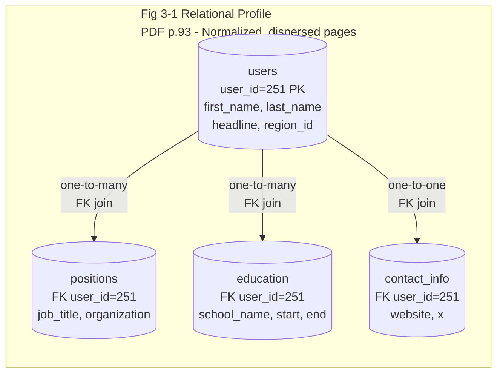
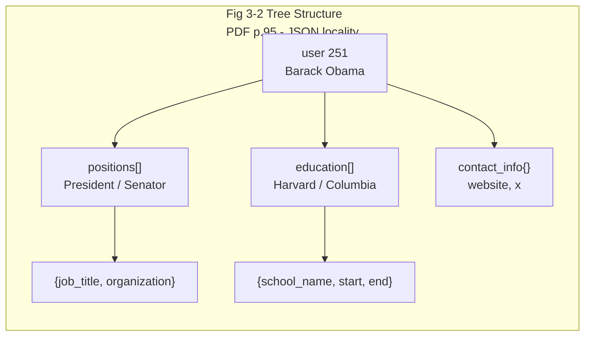
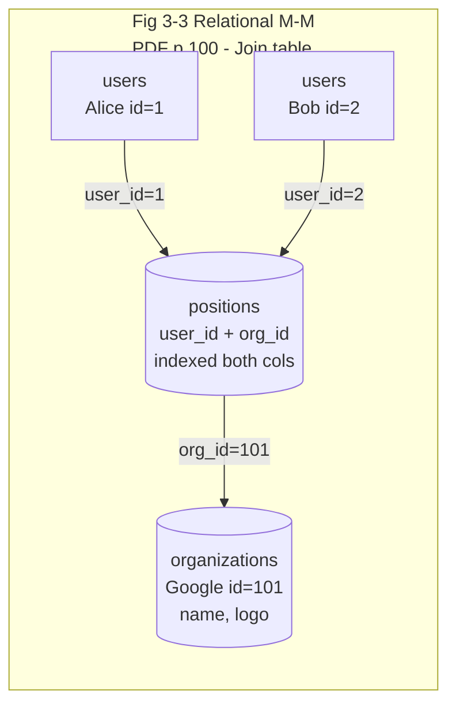
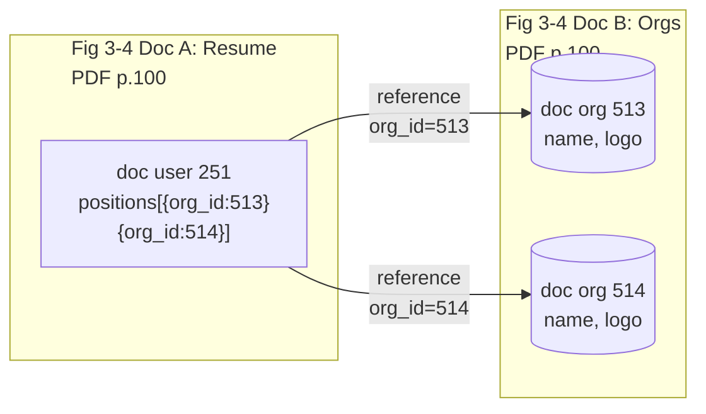
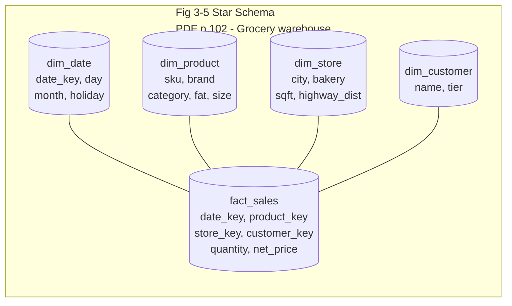
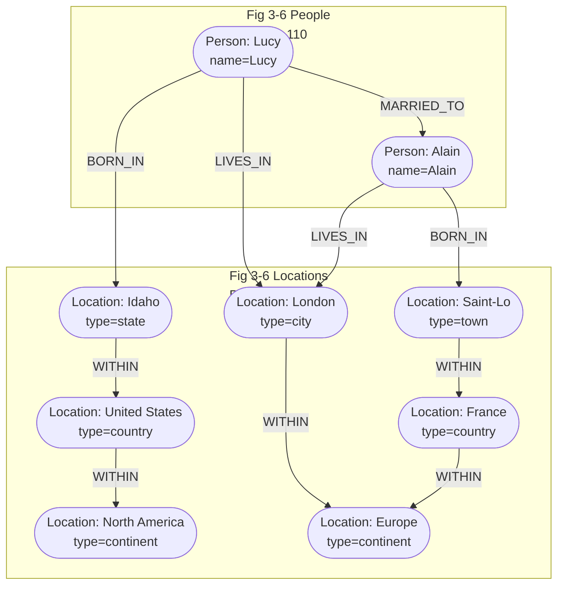
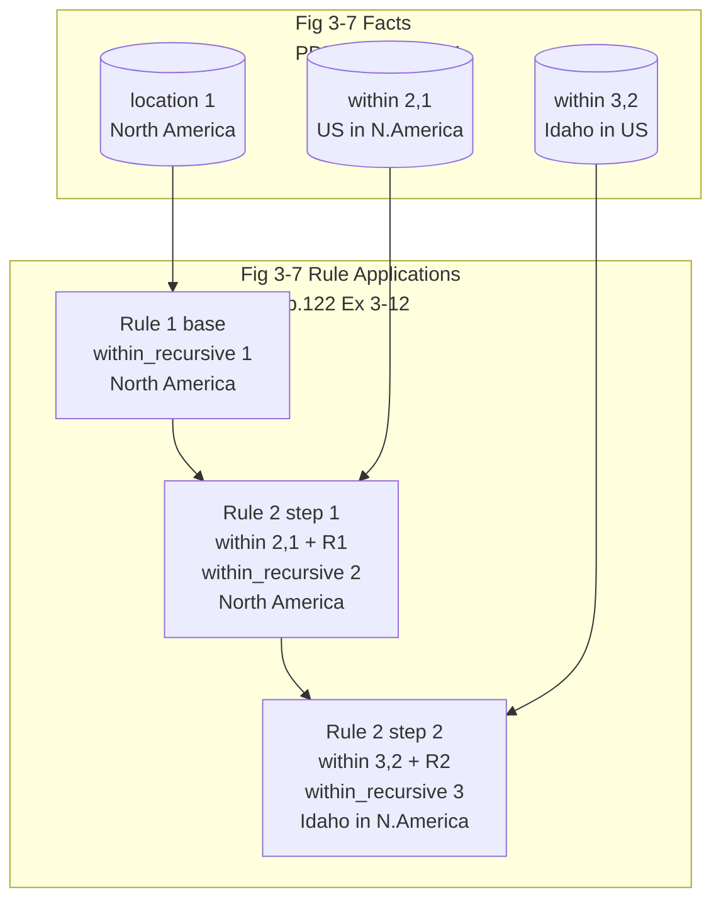
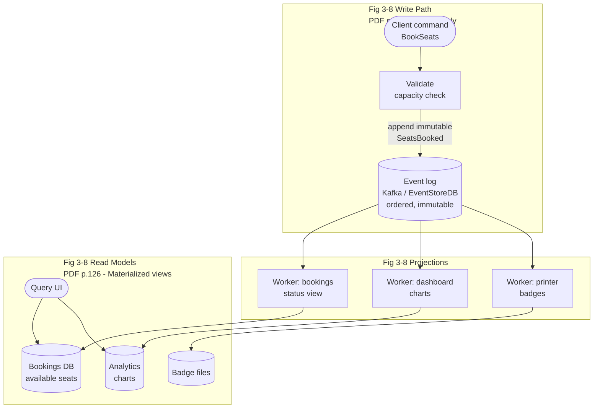
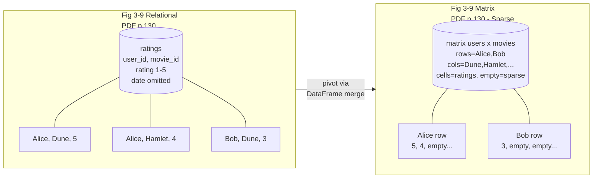

# Chapter 3: Data Models and Query Languages — Definitive Technical Summary
*From: Designing Data-Intensive Applications (2nd Edition) by Martin Kleppmann and Chris Riccomini*
*Source PDF: pp. 89–138 (673-page PDF) — figures below cite PDF pages.*

> [!NAV] **Chapter Navigation**
> ⬅️ **Previous:** [[chapter-02-defining-nonfunctional-requirements|Chapter 02: Defining Nonfunctional Requirements]] | 🏠 **Index:** [[00-Master-Reading-Dashboard|Master Dashboard]] | ➡️ **Next:** [[chapter-04-storage-and-retrieval|Chapter 04: Storage and Retrieval]]


---

## 1. Executive Summary & Core Engineering Problem

- **Core Thesis:** Data models are the most important part of developing software, because they affect not only how software is written but how we think about the problem (PDF p.89, Wittgenstein epigraph). Most applications layer one data model on top of another: application objects → general-purpose model (JSON / tables / vertices+edges, this chapter) → bytes on disk/network (Chapter 4) → electrical currents. Each layer hides the complexity below it. This chapter compares relational, document, graph-like (property graphs + triple stores), event sourcing/CQRS, and DataFrames/matrices/arrays, plus their declarative query languages (SQL, Cypher, SPARQL, Datalog, GraphQL), to help you decide when to use which model (PDF p.90).
- **Declarative vs Imperative:** SQL, Cypher, SPARQL, and Datalog are declarative: you specify the pattern of data you want — what conditions results must meet and how to transform (sort/group/aggregate) — but not how to achieve it. The optimizer chooses indexes, join algorithms, order, and parallelism (even multi-core/multi-machine) without query changes [1,2,3] (PDF p.90). Contrast Python/Java where you hand-code the algorithm and the parallelization.
- **Problem Statement:** Alice stores a LinkedIn résumé. As 4 normalized tables she needs 4 queries or a messy 4-way join; as one JSON document she needs 1 sequential read — but updating one shared company logo then requires rewriting millions of documents. Bob traverses "friends of friends who emigrated from the US to Europe": in Cypher it is 4 lines with `[:WITHIN*0..]`; in SQL it is 31 lines of `WITH RECURSIVE`; in a document store it is N+1 client-side round-trips. Choosing the wrong model turns a sub-10 ms pointer chase into a minutes-long index scan, or a single-row update into a write avalanche.
- **Historical & Industry Context:** Relational model (Codd 1970 [4]) beat network/hierarchical (1970s), object DBs (late 1980s), XML DBs (early 2000s) — none lasted [5]; SQL absorbed XML, JSON, graph [6] (PDF p.91). 2010s NoSQL/NewSQL pushed schema flexibility and scale, then terms faded as ideas were absorbed. Lasting effect: document model (MongoDB, Couchbase JSON) vs rigid tables debate. Convergence now: relational engines have `jsonb` + document indexes; document stores (MongoDB, Couchbase, RethinkDB) added joins (`$lookup`), secondary indexes, declarative pipelines; SQL:2023/GQL add graph support (PDF pp.107-108, 116). Codd himself allowed "nonsimple domains" — nested tables inside rows — the 1970 precursor to JSON columns (PDF p.108).

---

## 2. In-Depth Technical Concepts & Internal Mechanics

### 2.1 Relational Versus Document Models: The Object-Relational Mismatch (PDF pp.91-92)

- **Foundational Theory:** Most app code is object-oriented. Storing objects in relational tables (relations = unordered collections of tuples/rows) requires an awkward translation layer — the impedance mismatch (borrowed from electronics: mismatched input/output impedance causes reflections).
- **ORMs (ActiveRecord, Hibernate):** Reduce boilerplate but criticized [7] (PDF p.92):
  1. Complex, never fully hide both models — you still think in objects AND tables.
  2. Only for OLTP app dev; analytics engineers still need the raw relational schema (cf. p.5 OLTP vs OLAP).
  3. Mostly relational-OLTP-only; poor support for search engines, graph DBs, NoSQL.
  4. Auto-generated schemas are awkward/inefficient; customizing negates the benefit.
  5. Easy to write inefficient queries — classic **N+1 query problem** [8]: fetch N comments (1 query), then N separate `users` lookups for author names instead of one JOIN. Must eagerly fetch.
- **ORM Advantages:** Inevitable translation is less boilerplate; query-result caching reduces DB load; helps schema migrations/admin.
- **One-to-many / one-to-few tree example (Fig 3-1 / Fig 3-2):** Résumé identified by `user_id`; `first_name`/`last_name` appear once → columns on `users`. Positions/education/contact vary per user → separate tables with foreign-key `user_id` (Fig 3-1), OR one JSON document (Example 3-1, PDF p.94):

```json
{
  "user_id": 251, "first_name": "Barack", "last_name": "Obama",
  "headline": "Former President of the United States of America",
  "region_id": "us:91", "photo_url": "/p/7/000/253/05b/308dd6e.jpg",
  "positions": [
    {"job_title": "President", "organization": "United States of America"},
    {"job_title": "US Senator (D-IL)", "organization": "United States Senate"}
  ],
  "education": [
    {"school_name": "Harvard University", "start": 1988, "end": 1991},
    {"school_name": "Columbia University", "start": 1981, "end": 1983}
  ],
  "contact_info": {"website": "https://barackobama.com", "x": "https://x.com/barackobama"}
}
```

  - JSON has better **locality**: one place, one fetch, simpler + faster. Relational needs multiple queries by `user_id` or messy multiway join [9,10]. JSON makes the tree explicit (Fig 3-2).
  - Caveat — **one-to-few vs one-to-many** [11,12]: résumé has few positions → embed. Celebrity post with thousands of comments → embedding is unwieldy; prefer relational Figure 3-1 approach.

| Dimension | Relational Model | Document Model |
| :--- | :--- | :--- |
| **Core Structure** | Flat 2D tables, rows + columns | Hierarchical trees (JSON / BSON / XML) |
| **Relationships** | First-class foreign keys + JOINs | Embedded subdocuments or client-side references |
| **Read Locality** | Low: profile = 4 tables, 4 seeks / multiway join | High: 1 contiguous document, 1 sequential read |
| **Write Cost** | In-place row update, no copy | Whole-document rewrite on growth; fragmentation |
| **Schema** | Schema-on-write (static typing analogue) | Schema-on-read (dynamic typing analogue) |
| **Best Fit** | Many-to-one / many-to-many, shared mutable entities | Self-contained one-to-many trees loaded at once |

### 2.2 Normalization, Denormalization, and Joins (PDF pp.96-99)

- **Why `region_id` not `"Washington, DC"`?** Standardized region list gives: consistent spelling; disambiguation (DC vs state); single-place update (city renamed); localization; better search (know Washington is on East Coast) (PDF p.96).
- **Normalization** = store human-meaningful text once, reference by meaningless ID everywhere. ID never needs to change even if the thing it denotes changes. **Denormalization** = duplicate the text in every record (Example 3-1 duplicates `organization`/`school_name` strings).
  - Normalized: faster to write (one copy), slower to read (needs JOIN to resolve ID → name).
  - Denormalized: faster to read (fewer JOINs), expensive to write (many copies, disk, code, inconsistency risk). View denormalization as derived data (p.10); needs update process + atomicity or stream processing (Ch.12).
- **JOIN mechanics:**
```sql
SELECT users.*, regions.region_name FROM users
JOIN regions ON users.region_id = regions.id WHERE users.id = 251;
```
  - Document DBs historically weak on JOINs: fetch doc, second query to resolve ID in app code. MongoDB aggregation `$lookup` closes the gap (PDF p.97):
```js
db.users.aggregate([
  { $match: { _id: 251 } },
  { $lookup: { from: "regions", localField: "region_id", foreignField: "_id", as: "region" } }
])
```
- **Trade-off — logo example (PDF p.97):** Add school/company logo. Denormalized: embed `logo_url` in every résumé — self-contained but changing logo means finding/updating all occurrences [11]. Normalized: one `organizations` entity with name/logo/description; résumés reference ID; update is trivial.
- **Rule of thumb (PDF p.98):** Normalized better for OLTP (reads + updates fast); denormalized better for analytics (bulk updates, read speed dominates). Small/moderate scale → normalized (joins cheap, no consistency headache). Very large scale → join cost can dominate.
- **Denormalization case study — X/Twitter home timelines (PDF pp.98-99, cf. p.34 Fig 2-1, [13]):** Normalized `posts JOIN follows` too expensive → precomputed **materialized** timelines (fan-out on write = keeping denormalized cache consistent). But X stores only `post_id + sender_id + repost/reply bits` per entry — approximately:
```sql
SELECT posts.id, posts.sender_id FROM posts
JOIN follows ON posts.sender_id = follows.followee_id
WHERE follows.follower_id = current_user ORDER BY posts.timestamp DESC LIMIT 1000;
```
  - On read, still two JOINs: post ID → content/likes/replies, sender ID → username/photo. This **hydrating the IDs** is a JOIN in application code [13] — parallelizes well, cost independent of follow counts. Stored as IDs because likes/replies change multiple times/sec and usernames/photos change; denormalizing them would be stale + huge. Lesson: most scalable = denormalize some things, leave others normalized; consider change frequency and outlier costs (celebrity follows). **Normalization and denormalization are not good/bad — pure read/write/effort trade-offs.**

### 2.3 Many-to-One and Many-to-Many Relationships (PDF pp.99-101)

- **Definitions:** Positions/education in Fig 3-1 = **one-to-many** (one résumé → several positions, each position belongs to one résumé; also called **one-to-few**). `region_id` = **many-to-one** (many people → one region; each person in one region at a time). Organizations/schools by ID = **many-to-many** (one person → several orgs; one org → many employees).
- **Relational many-to-many:** Associative / join table (Fig 3-3): each `positions` row = (user_id, org_id) pair.
- **Document many-to-many dilemma (Example 3-2, Fig 3-4, PDF p.100):**
```json
{ "user_id": 251, "first_name": "Barack", "last_name": "Obama",
  "positions": [
    {"start": 2009, "end": 2017, "job_title": "President", "org_id": 513},
    {"start": 2005, "end": 2008, "job_title": "US Senator (D-IL)", "org_id": 514}
  ] }
```
  - Data in each dotted box = one document; links to orgs/schools = references. Does not fit one self-contained document → normalized representation wins.
  - Query both directions (person's orgs AND org's people): Option A store ID refs on both sides — **denormalized**, two places, can diverge. Option B normalized single place + secondary indexes (Ch.4) on both `user_id` and `org_id` (relational) or on `positions[].org_id` inside documents (many document + JSON-relational DBs support this).
- **Key contrast table:**

| Relationship | Example | Relational fit | Document fit |
| :--- | :--- | :--- | :--- |
| **One-to-one** | user → contact_info | Column or joined table | Embed inline |
| **One-to-many / one-to-few** | user → positions (2-5) | Shredded tables + JOIN | Embed array — ideal, high locality |
| **Many-to-one** | many users → one region | FK + JOIN / dimension | Reference ID + lookup |
| **Many-to-many** | users ↔ organizations | Associative join table + dual indexes | Reference IDs + secondary index; embed only if immutable |

### 2.4 Stars and Snowflakes: Schemas for Analytics (PDF pp.101-103)

- **Context:** Data warehouses are usually relational (p.7). Conventions: star, snowflake, dimensional modeling [14], one big table (OBT). ETL translates operational data into them. Optimized for analysts, not OLTP.
- **Star schema (Fig 3-5, grocery retailer):** Center **fact table** `fact_sales` — each row = event at a time (purchase; or page view/click). Facts captured as individual events for max flexibility → fact tables reach petabytes. Columns: attributes (price, supplier cost → margin) + FKs to **dimension tables** (who/what/where/when/how/why: `dim_product` with SKU/description/brand/category/fat/package; date/time dims encode holidays). Name from visualization: fact in middle, dimension rays like a star.
- **Snowflake:** Dimensions further split into subdimensions (brand/category tables; `dim_product` FKs to them instead of strings). More normalized; star usually preferred — simpler for analysts [14].
- **Width:** Fact tables often 100s of columns; `dim_store` carries bakery/square-footage/opened/remodeled/highway-distance. Mostly **many-to-one** (many sales → one product/store) as fact FKs → dims. Multi-item basket not explicit: one fact row per product, sharing customer/store/timestamp. **OBT** folds dims into fact (precomputed JOIN) — more storage, sometimes faster [15]. Analytics denormalization is safe: historical log rarely changes (except corrections); OLTP consistency/write overheads don't apply.

| Schema | Structure | Joins | Storage | Best for |
| :--- | :--- | :--- | :--- | :--- |
| **Star** | Fact + denormalized dims | Single-hop | Moderate | Standard warehouse (Snowflake, BigQuery) |
| **Snowflake** | Fact + normalized dim chains | Multi-hop | Lowest | Legacy disk-constrained systems |
| **One Big Table (OBT)** | No dims, all in fact | Zero | Highest (columnar-compressed) | ClickHouse/Druid real-time scans |

### 2.5 When to Use Which Model (PDF pp.104-107) — *previously missing, now restored*

- **Document-like tree loaded at once → document model.** Shredding into `positions/education/contact_info` tables = cumbersome schema + code. **Need to reference nested item directly? → relational** (ID-addressable; document requires "2nd item in positions of user 251"). **User-ordered lists (drag-drop todo/issue tracker)? → document** (JSON array order is native; relational needs renumber-int-column / linked-list / fractional indexing [16,17,18]).
- **Schema flexibility — schema-on-read vs schema-on-write (PDF pp.104-105):** Document/JSON DBs enforce no schema (XML optionally validated). "Schemaless" is misleading — readers assume implicit schema [19]; accurate term **schema-on-read** (interpreted at read) vs **schema-on-write** (DB enforces at write) [20]. Analogous to dynamic vs static type checking [21] — no clear winner. Change example `name` → `first_name/last_name` [22]: document = write new shape + defensive read branch:
```js
if (user && user.name && !user.first_name) {
  user.first_name = user.name.split(" ")[0]; // pre-Dec-2023 docs
}
```
  - Cost: every reader handles ancient formats. Relational:
```sql
ALTER TABLE users ADD COLUMN first_name text DEFAULT NULL; -- fast, metadata-only
UPDATE users SET first_name = split_part(name,' ',1);      -- PostgreSQL (slow: rewrites all rows)
-- MySQL: substring_index(name,' ',1)
```
  - Modern tools do background zero-downtime migrations [23,24,25,26], but large-table rewrites/type changes remain hard. Shortcut: add NULL column + fill at read (document-style). Schema-on-read wins when heterogeneous (many types impractical per-table; external systems change anytime). Same-structure records → explicit schema documents + enforces (more Ch.5).
- **Data locality for reads and writes (PDF p.106):** Document = one contiguous JSON/XML/BSON string. Whole-doc access (render page) wins. Small-slice access wastes load; updates rewrite whole doc → keep docs small, avoid frequent small writes. Not document-exclusive: Spanner interleaved/nested rows [27], Oracle multi-table index clusters [28], Bigtable/HBase/Accumulo column families [29] give same locality relationally.
- **Query languages for documents (PDF pp.106-107):** Relational = SQL; documents vary (key-only → secondary indexes on inner values → rich languages). XML: XQuery/XPath with cross-document JOINs [30]; JSON: JSON Pointer [31]/JSONPath [32]; MongoDB aggregation `$lookup` (p.72). Shark-per-month example — PostgreSQL:
```sql
SELECT date_trunc('month', observation_timestamp) AS observation_month,
       sum(num_animals) AS total_animals FROM observations
WHERE family='Sharks' GROUP BY observation_month;
```
  MongoDB pipeline (JSON syntax, subset-of-SQL expressiveness, taste difference):
```js
db.observations.aggregate([
  { $match: { family: "Sharks" } },
  { $group: { _id: { year: { $year: "$observationTimestamp" }, month: { $month: "$observationTimestamp" } },
              totalAnimals: { $sum: "$numAnimals" } } }
]);
```
- **Convergence (PDF pp.107-108):** Started opposite, grown similar [33]. Relational added JSON types/operators/inner indexes; documents added JOINs/secondary indexes/declarative languages. Best when combined in one DB. Alice's catalog with flexible specs + strict orders benefits from relational-document hybrid.

### 2.6 Property Graphs and Cypher (PDF pp.108-113)

- **When graphs win:** Mostly one-to-many trees → document. Very common many-to-many with complex connections → graph. Graph = vertices (nodes/entities) + edges (relationships/arcs). Examples: social graphs (people/knows), web graph (pages/links), road/rail (junctions/segments) with shortest-path/PageRank [34]. Representations: adjacency list (neighbor IDs per vertex, good for traversals) vs adjacency matrix (2D 0/1 array, good for ML — see §2.12). Heterogeneous single graph is powerful: Facebook single graph (people/locations/events/check-ins/comments; friend/check-in/comment/attendance edges) [35]; search knowledge graphs (Wikidata crawl + structured publish) [36].
- **Models in book:** Property graph (Neo4j, Memgraph, KùzuDB [37], others [38]; Amazon Neptune supports both) + triple store (Datomic, AllegroGraph, Blazegraph). Fairly equivalent expressiveness. Languages: **Cypher**, SPARQL, Datalog, GraphQL + SQL graph support; also Gremlin [39], GSQL [44], PGQL [45], ISO GQL (2024, Cypher-based [46,47,48]). Running example Fig 3-6: Lucy (Idaho) + Alain (Saint-Lô) married in London — each person/location a vertex, relationships as edges; demos queries hard elsewhere.
- **Property graph structure:** Vertex = id + label (type) + outgoing/incoming edge sets + properties (k-v). Edge = id + tail + head + label + properties. Relational emulation (Example 3-3, PDF p.111):
```sql
CREATE TABLE vertices (vertex_id integer PRIMARY KEY, label text, properties jsonb);
CREATE TABLE edges (edge_id integer PRIMARY KEY,
  tail_vertex integer REFERENCES vertices(vertex_id),
  head_vertex integer REFERENCES vertices(vertex_id), label text, properties jsonb);
CREATE INDEX edges_tails ON edges (tail_vertex);
CREATE INDEX edges_heads ON edges (head_vertex);
```
  - Any vertex → any vertex (no schema restriction); traverse forward+backward efficiently (dual indexes); labels allow many types in one clean graph. Edges table = generalized many-to-many join table + label/property indexes. Limitation: edge links only 2 vertices; 3-way relational rows need reified vertex or hypergraph.
- **Why flexible (PDF p.112):** Different regional structures per country (French départements/régions vs US counties/states), country-in-country quirks, varying granularity (Lucy lives=city, born=state). Extend freely: add allergen vertices + person→allergen edges + food→substance links → "safe to eat" query. Graphs = evolvability.
- **Cypher (Neo4j-origin, openCypher [40]; Matrix character, not crypto [41]; also Memgraph/Kùzu/Neptune/AGE):** Insert left half of Fig 3-6 (Example 3-4, PDF p.113) — symbolic names (`usa`, `idaho`) query-local only, arrows create edges:
```cypher
CREATE
  (namerica :Location {name:'North America', type:'continent'}),
  (usa :Location {name:'United States', type:'country'}),
  (idaho :Location {name:'Idaho', type:'state'}),
  (lucy :Person {name:'Lucy'}),
  (idaho) -[:WITHIN]-> (usa) -[:WITHIN]-> (namerica),
  (lucy) -[:BORN_IN]-> (idaho)
```
  Query US→Europe emigrants (Example 3-5): `(person)-[:BORN_IN]->()` binds tail to `person`, head anonymous; `[:WITHIN*0..]` = zero-or-more WITHIN (regex `*`):
```cypher
MATCH
  (person) -[:BORN_IN]-> () -[:WITHIN*0..]-> (:Location {name:'United States'}),
  (person) -[:LIVES_IN]-> () -[:WITHIN*0..]-> (:Location {name:'Europe'})
RETURN person.name
```
  - Read: person with BORN_IN chain into US AND LIVES_IN chain into Europe. Executable people-scan-forward or index-US/Europe-then-backward via incoming WITHIN + incoming BORN_IN/LIVES_IN (PDF p.114). Cypher Cypher Cypher pattern matching is the native graph idiom — concise, index-free traversal.

### 2.7 Graph Queries in SQL — WITH RECURSIVE (PDF pp.114-116)

- **Problem:** Graph in relational = edges table, but each traversal = JOIN with unknown count in advance. Cypher `:WITHIN*0..` (LIVES_IN may point to street/city/district/region/state, each WITHIN-chained arbitrarily) needs variable-length path.
- **SQL:1999 `WITH RECURSIVE`** (Example 3-6, PDF pp.114-115 — 4-line Cypher becomes 31-line SQL; comments `--` preserved):
```sql
WITH RECURSIVE
  in_usa(vertex_id) AS (
    SELECT vertex_id FROM vertices WHERE label='Location' AND properties->>'name'='United States'
    UNION SELECT edges.tail_vertex FROM edges JOIN in_usa ON edges.head_vertex=in_usa.vertex_id
           WHERE edges.label='within' ),
  in_europe(vertex_id) AS (
    SELECT vertex_id FROM vertices WHERE label='location' AND properties->>'name'='Europe'
    UNION SELECT edges.tail_vertex FROM edges JOIN in_europe ON edges.head_vertex=in_europe.vertex_id
           WHERE edges.label='within' ),
  born_in_usa(vertex_id) AS (
    SELECT edges.tail_vertex FROM edges JOIN in_usa ON edges.head_vertex=in_usa.vertex_id
    WHERE edges.label='born_in' ),
  lives_in_europe(vertex_id) AS (
    SELECT edges.tail_vertex FROM edges JOIN in_europe ON edges.head_vertex=in_europe.vertex_id
    WHERE edges.label='lives_in' )
SELECT vertices.properties->>'name' FROM vertices
JOIN born_in_usa ON vertices.vertex_id=born_in_usa.vertex_id
JOIN lives_in_europe ON vertices.vertex_id=lives_in_europe.vertex_id;
```
  - Algorithm: seed US/Europe sets → repeatedly add incoming-`within` tails → incoming `born_in`/`lives_in` tails → intersect via JOIN. Clumsy; cycles/breadth-vs-depth subtleties [42]; Oracle hierarchical extension differs [43]. Shows right model/language matters enormously.

### 2.8 Triple Stores and SPARQL — Turtle Syntax (PDF pp.116-120)

- **Triple store ≈ property graph, different words** — worth learning. All info = (subject, predicate, object): `(Jim, likes, bananas)`. Caveat: real stores add metadata — Neptune quads (+graph ID [49]), Datomic 5-tuples (+tx ID + deletion flag [50]) — still called triple stores here. Subject = vertex. Object = primitive (predicate+object = property, e.g. `(lucy, birthYear, 1989)` ≡ `lucy{"birthYear":1989}`) OR vertex (predicate = edge label, e.g. `(lucy, marriedTo, alain)`).
- **Turtle (Terse RDF Triple Language, subset of N3 [51])** — Example 3-7 (PDF p.117), same data as Cypher Example 3-4. Required ground-truth triple `:lucy :bornIn :idaho` appears here:
```turtle
@prefix : <urn:example:>.
_:lucy a :Person.
_:lucy :name "Lucy".
_:lucy :bornIn _:idaho.
_:idaho a :Location.
_:idaho :name "Idaho".
_:idaho :type "state".
_:idaho :within _:usa.
_:usa a :Location.
_:usa :name "United States".
_:usa :type "country".
_:usa :within _:namerica.
_:namerica a :Location.
_:namerica :name "North America".
_:namerica :type "continent".
```
  - `_:name` blank-node labels are file-local identity glue. Edge predicate → vertex object; property predicate → string literal. Semicolon shorthand (Example 3-8) — multiple predicates, same subject — very readable Turtle Turtle:
```turtle
@prefix : <urn:example:>.
_:lucy a :Person; :name "Lucy"; :bornIn _:idaho.
_:idaho a :Location; :name "Idaho"; :type "state"; :within _:usa.
_:usa a :Location; :name "United States"; :type "country"; :within _:namerica.
_:namerica a :Location; :name "North America"; :type "continent".
```
- **Semantic Web / RDF (PDF pp.118-119):** Turtle encodes RDF [58] (also verbose RDF/XML Example 3-9 via Jena conversion; XML nests Location→within→Location). Semantic Web (early-2000s internet-wide machine-readable publishing) failed as envisioned [52,53] but legacy lives: JSON-LD [54], biomedical ontologies [55], Facebook Open Graph/unfurling [56,57], Wikidata, Schema.org. RDF quirk: S/P/O often URIs (`http://my-company.com/namespace#within` vs `http://other.org/foo#within`) to merge without collision; need not resolve — book uses `urn:example:` prefix-once.
- **SPARQL (SPARQL Protocol and RDF Query Language, "sparkle" [59]; predates Cypher, Cypher borrowed from it):** Same US→Europe query (Example 3-10, PDF p.119) — as concise as Cypher Cypher:
```sparql
PREFIX : <urn:example:>
SELECT ?personName WHERE {
  ?person :name ?personName.
  ?person :bornIn / :within* / :name "United States".
  ?person :livesIn / :within* / :name "Europe".
}
```
  - Equivalences: Cypher `(person)-[:BORN_IN]->()-[:WITHIN*0..]->(location)` ≡ SPARQL `?person :bornIn / :within* ?location.` (variables `?`-prefixed); Cypher `(usa {name:'United States'})` ≡ SPARQL `?usa :name "United States".` RDF doesn't split properties/edges — same syntax. Supported by Neptune, AllegroGraph, Blazegraph, Virtuoso, Jena [38]. SPARQL SPARQL triple-pattern matching is the semantic-web query idiom.

### 2.9 Datalog: Recursive Relational Queries (PDF pp.120-122)

- **Pedigree:** 1980s academic [60,61,62], Prolog subset, less known but very expressive for complex/recursive queries. Niche DBs: Datomic, LogicBlox, CozoDB, LinkedIn LIquid [63]. Relational (not graph) model — covered here for graph-traversal strength. Datalog Datalog rules build virtual tables (SQL views that aren't stored but queryable).
- **Facts = relational rows:** `location(2,"United States","country")` ≡ row. Edges = 2-column join tables. Example 3-11 (PDF p.120; Lucy=100, Idaho=3):
```prolog
location(1, "North America", "continent").
location(2, "United States", "country").
location(3, "Idaho", "state").
within(2, 1).    /* US is in North America */
within(3, 2).    /* Idaho is in the US     */
person(100, "Lucy").
born_in(100, 3). /* Lucy was born in Idaho */
```
- **Rules (Example 3-12, PDF p.121):** `Head :- Body` (Head if Body matches; variables bind like pattern match; re-derived rows act as if added):
```prolog
within_recursive(LocID, PlaceName) :- location(LocID, PlaceName, _). /* Rule 1 base */
within_recursive(LocID, PlaceName) :- within(LocID, ViaID),          /* Rule 2 recursive */
                                      within_recursive(ViaID, PlaceName).
migrated(PName, BornIn, LivingIn) :- person(PersonID, PName),       /* Rule 3 */
                                      born_in(PersonID, BornID),
                                      within_recursive(BornID, BornIn),
                                      lives_in(PersonID, LivingID),
                                      within_recursive(LivingID, LivingIn).
us_to_europe(Person) :- migrated(Person, "United States", "Europe"). /* Rule 4 */
```
  - `migrated(PName,BornIn,LivingIn)` virtual table: person + birthplace + residence. Rule applies when all RHS patterns match. Unlike Cypher/SPARQL jumping to SELECT, Datalog Datalog builds rule-by-rule like functions calling functions — Rule 2 self-recursion enables graph traversal. Derivation chain for Idaho→North America visualized in Fig 3-7 (§3).
- **Comparison table (emigrant query across 4 languages):**

| Language | Model | Recursion idiom | Lines | Character |
| :--- | :--- | :--- | :--- | :--- |
| **Cypher** | Property graph | `[:WITHIN*0..]` path | 4 | ASCII-art arrows, most concise |
| **SPARQL** | Triple store / RDF | `:within*` property path | 5 | `?vars`, `/`-chained predicates |
| **SQL WITH RECURSIVE** | Relational | `UNION` fixed-point CTEs | 31 | Verbose, planner-unfriendly |
| **Datalog** | Relational facts + rules | Self-recursive Rule 2 | 4 rules | Logic functions, stepwise derivation |
| **GraphQL** | Any (client-driven) | None allowed | n/a | Cannot express — needs explicit search field |

### 2.10 GraphQL — Declarative Client Queries (PDF pp.122-125) — *previously missing, now restored*

- **What it is:** Much more restrictive by design than Cypher/SPARQL/SQL/Datalog. Intended for OLTP: client on user device (mobile/JS frontend) requests a JSON document of exact shape needed to render UI. GraphQL GraphQL interfaces let client devs change queries without changing server APIs — at cost: orgs need tooling to fan out into internal REST/gRPC (Ch.5), plus authorization/rate-limit/performance concerns [64]. Despite "graph" in name, implementable atop relational, document, or graph stores; response looks document-like.
- **Intentionally limited (untrusted queries):** No recursion (unlike Cypher, SPARQL, SQL, Datalog), no arbitrary search ("born in US, live in Europe") unless owners explicitly expose it — otherwise users could accidentally DoS the server with expensive queries.
- **ChatApp example (Examples 3-13/3-14, PDF pp.123-124):** Request channels + 50 recent messages each (timestamp/content/sender name+photo; reply context):
```graphql
query ChatApp {
  channels {
    name
    recentMessages(latest: 50) {
      timestamp content
      sender { fullName imageUrl }
      replyTo { content sender { fullName } }
    }
  }
}
```
  Response mirrors query shape exactly (no more/no less) — server needn't know UI needs; adding `imageUrl` to replyTo sender is client-only change:
```json
{"data": {"channels": [{"name": "#general", "recentMessages": [
  {"timestamp": 1693143014, "content": "Hey! How are y'all doing?",
   "sender": {"fullName": "Aaliyah", "imageUrl": "https://..."}, "replyTo": null},
  {"timestamp": 1693143024, "content": "Great! And you?",
   "sender": {"fullName": "Caleb", "imageUrl": "https://..."},
   "replyTo": {"content": "Hey! How are y'all doing?", "sender": {"fullName": "Aaliyah"}}}
]}]}}
```
  - Duplication is deliberate: sender name/photo repeated per message; reply content+name duplicated under `replyTo` instead of returning reply ID (which would force extra fetch if outside the 50). Larger response accepted for simpler rendering.
- **Server side + resolver N+1:** DB stays normalized (message stores `sender_id` + `reply_to_id`); resolvers JOIN/lookup on demand — but only JOINs declared in GraphQL schema are requestable. Naïve resolvers = ORM-style N+1: 50 messages → 50 user fetches + 50 reply fetches. Production fix: batched DataLoader (`WHERE id IN (...)`), field-level authorization, query-cost analysis/pagination (`latest: 50`), persisted queries. Vs REST (server fixes shapes → over/under-fetch, version sprawl) and Falcor (Netflix JSON-graph paths `["channels",0,"messages",...]` — similar shape-matching, less ecosystem).

### 2.11 Event Sourcing and CQRS (PDF pp.125-129)

- **Premise:** All models so far query as written (JSON/rows/vertices). Complex apps can't serve all reads from one representation — write in one form, derive read-optimized forms (cf. p.10 Systems of Record/Derived Data; p.7 ETL). Push further: separate write-optimized vs read-optimized = CQRS. Fastest/most expressive write-only model = event log: append self-contained strings (JSON + timestamp); immutable, never update/delete, only supersede. Arbitrary properties, order matters.
- **Conference example (Fig 3-8):** Bulk company orders, invoice pay, seat assignment, speaker/sponsor/volunteer reserves, cancellations, room-capacity moves → "available seats" is hard. Every state change first stored as event (registrations opened, seats booked/canceled); each append updates several **materialized views** (projections/read models): booking status, organizer dashboard charts, badge-printer files. Past-tense naming (`SeatsBooked`, not `BookSeat`) — event = fact something happened; cancellation is a later event, former booking stays true.
- **Event sourcing + CQRS definitions (DDD [65,66,67]; cf. state-machine replication p.433):** Event sourcing = events as source of truth. CQRS = maintain separate read models derived from write model. Command flow: request = command → validate (enough seats?) → valid → fact → append. Log contains only valid events; consumers must not reject.
- **Fact-table similarity/difference (p.77):** Both collections of past events. Fact rows share columns + unordered; events have many types/properties + order critical (book-then-cancel reversed = nonsense).
- **Advantages:** (1) Intent clarity (`BookingCanceled` vs `active=false + 3 deletes + refund insert`). (2) Reproducible derivation — delete + recompute views, rerun to debug. (3) Multiple query-specific views (same/different DB, any model, denormalized, even memory-only if recomputable). (4) Easy evolution — new views from old log; new event types/fields (old untouched); chain behaviors (cancel → offer waitlist). (5) Reversible via compensating deletion event (vs hard-to-reverse in-place commits; Ch.2 evolvability p.55). (6) Audit log for regulated industries. (7) High write throughput — sequential log absorbs bursts; views catch up async.
- **Downsides:** (1) External-data determinism — currency conversion needs rate embedded in event or historical-rate-at-timestamp lookup, else recompute differs. (2) Immutability vs GDPR deletion — per-user log deletable; mixed log needs off-log personal data or crypto-shredding (delete key [68]) which hinders recompute. (3) Side effects on reprocess — don't resend confirmation emails on rebuild. Implement atop any DB; purpose-built: EventStoreDB, MartenDB (PostgreSQL), Axon; Kafka log + stream processors (Ch.12). Hard requirement: all views process events in identical log order — nontrivial distributed (Ch.10).
- **Under-the-hood:** Command side = sequential append (max throughput, no locks). Query side = async tailers → **materialized views**. Gap = 10-500 ms eventual-consistency window (read-your-own-writes handling). Scale = snapshot every ~1k-5k events to bound replay.

### 2.12 DataFrames, Matrices, and Arrays (PDF pp.129-131) — *expanded*

- **Scope:** Models so far serve OLTP + analytics (p.3). DataFrames + numeric multidimensional arrays (matrices) are analytics/scientific, rarely OLTP. **DataFrame** supported by R, Python Pandas, Spark, ArcticDB, Dask [69,72].
- **DataFrame mechanics:** Looks like table/spreadsheet; relational-like bulk ops (apply-to-rows, filter, group-aggregate, `merge` = JOIN) but via imperative wrangling chain, not declarative SQL — matches scientist incrementally shaping private (often laptop-local) copy before sharing. Far beyond relational ops; common path: relational → matrix for ML input.
- **Fig 3-9 pivot (PDF p.130):** Left: relational `(user_id, movie_id, rating 1-5)`; right: matrix rows=users, cols=movies, cells=ratings (spreadsheet pivot). **Sparse** (most user-movie pairs empty) — fine. Thousands of columns impossible relationally (50k movie columns); DataFrames + sparse arrays (NumPy/SciPy CSR) handle easily.
- **Columnar vs row, CSR sparse, GPU/SIMD:** OLTP rows store whole records together (good point lookup); analytics columnars (Parquet, ClickHouse, BigQuery) store each column contiguously → scan/aggregate one column at memory-bus speed + SIMD vectorization. Sparse CSR (Compressed Sparse Row: `values[], col_index[], row_ptr[]`) stores only nonzeros — 100k×50k=5B-cell ratings with 10M nonzeros compresses >99%. Dense contiguous numerics → CPU SIMD (one instruction, many lanes) + GPU tensor cores for matmul — collaborative-filtering/neural inference orders faster than row-wise loops.
- **Numbers-only matrices:** Dates → scaled floats; small enums (genre) → **one-hot encoding** (one column per value: comedy/drama/horror; 1 in matching column(s), 0 elsewhere; multi-genre natural). Then linear algebra (ML basis; Fig 3-9 feeds movie recommendations). DataFrames let scientists evolve relational → matrix gradually with representation control (PDF p.131).
- **Array DBs + finance:** TileDB [70] stores huge numeric grids (geospatial raster, medical imaging, telescope surveys [71]). Finance time-series (asset prices/trades [72]; ArcticDB). Added to Spark/Flink batch (Ch.11).
- **Pandas sketch (ratings → sparse matrix):**
```python
import pandas as pd, numpy as np
from scipy.sparse import csr_matrix
ratings = pd.DataFrame({"user_id":[1,1,2], "movie_id":[7,42,7], "rating":[5,4,3]})
users, movies = ratings.user_id.astype("category"), ratings.movie_id.astype("category")
M = csr_matrix((ratings.rating, (users.cat.codes, movies.cat.codes)))
# M.shape = (n_users, n_movies); M.toarray() only for tiny slices; else ALS/SVD on M
```

---

## 3. Important Figures, Diagrams & Visual Architecture

> 📕 **Original figures quick index (source PDF, 673 pages):** open the PDF at the cited page to verify each reconstruction.
>
> | Book Fig | PDF page | What to compare |
> |---|---|---|
> | Fig 3-1 | PDF p.93 | LinkedIn profile relational |
> | Fig 3-2 | PDF p.95 | Tree one-to-many |
> | Fig 3-3 | PDF p.100 | Many-to-many relational |
> | Fig 3-4 | PDF p.100 | Many-to-many document |
> | Fig 3-5 | PDF p.102 | Star schema |
> | Fig 3-6 | PDF p.110 | Graph data |
> | Fig 3-7 | PDF p.122 | Datalog Idaho rule |
> | Fig 3-8 | PDF p.126 | Immutable log + derived views |
> | Fig 3-9 | PDF p.130 | Movie-ratings matrix |

### Figure 3-1: Relational LinkedIn Profile (PDF p.93)
- **Figure Reference:** `Figure 3-1: Using a relational schema to represent a LinkedIn profile (PDF p.93)`
- **Visual Flow & Description:** `users(user_id, first_name, last_name, headline, region_id)` + `positions`, `education`, `contact_info` each FK → `users.user_id`. Fetch = N queries or multiway JOIN.
- **Mermaid.js Architectural Diagram:**



- **Key Takeaway:** Clean isolated mutation, painful whole-profile reads.

---

### Figure 3-2: One-to-Many Tree (PDF p.95)
- **Figure Reference:** `Figure 3-2: One-to-many relationships forming a tree structure (PDF p.95)`
- **Visual Flow & Description:** User root branches to positions/education/contact lists — explicit tree; also called one-to-few. Large-N children (1000s comments) break this pattern.
- **Mermaid.js Architectural Diagram:**



- **Key Takeaway:** Embed when few + loaded together; normalize when many + shared.

---

### Figure 3-3: Many-to-Many Relational (PDF p.100)
- **Figure Reference:** `Figure 3-3: Many-to-many relationships in the relational model (PDF p.100)`
- **Visual Flow & Description:** Associative `positions(user_id, org_id)` links users ↔ organizations; dual secondary indexes on both FKs allow bidirectional $O(\log N)$ search.
- **Mermaid.js Flowchart:**



- **Key Takeaway:** Single normalized relationship row; logo update = 1 row.

---

### Figure 3-4: Many-to-Many Document (PDF p.100)
- **Figure Reference:** `Figure 3-4: Many-to-many relationships in the document model, dotted boxes = one document (PDF p.100)`
- **Visual Flow & Description:** Each dotted box groups into one document; org/school links are ID references (Example 3-2 `org_id: 513/514`). Embed → duplication avalanche; reference → app-side JOIN + index on `positions[].org_id` needed.
- **Mermaid.js Flowchart:**



- **Key Takeaway:** Many-to-one/many-to-many resist self-contained docs — normalize + index.

---

### Figure 3-5: Star Schema (PDF p.102)
- **Figure Reference:** `Figure 3-5: A star schema for use in a data warehouse (PDF p.102)`
- **Visual Flow & Description:** Central `fact_sales` event rows (price/cost + FKs) surrounded by `dim_product/dim_store/dim_date/dim_customer` (who/what/where/when). Snowflake would split dims further; OBT would fold them in.
- **Mermaid.js Flowchart:**



- **Key Takeaway:** Denormalized dims minimize join depth for columnar aggregation.

---

### Figure 3-6: Property Graph (PDF p.110)
- **Figure Reference:** `Figure 3-6: Graph-structured data, boxes = vertices, arrows = edges (PDF p.110)`
- **Visual Flow & Description:** Lucy born Idaho/within US/within North America, lives London; Alain born Saint-Lô/France, lives London; married edge; within chains enable transitive `*0..` queries. Shows heterogeneous granularities hard in tables.
- **Mermaid.js Flowchart:**



- **Key Takeaway:** Arbitrary labels/edges, evolvable, index-free traversal both directions.

---

### Figure 3-7: Datalog Idaho Derivation (PDF p.122) — *reconstructed*
- **Figure Reference:** `Figure 3-7: Determining that Idaho is in North America, using Datalog rules from Example 3-12 (PDF p.122)`
- **Visual Flow & Description:** Rule 1 seeds `within_recursive` from `location` rows; Rule 2 repeatedly joins `within` + prior `within_recursive` to climb Idaho→US→North America. Basis for Rule 3/4 emigrant query.
- **Mermaid.js Flowchart:**



- **Key Takeaway:** Fixed-point rule application derives transitive closure; `within_recursive(3,"North America")` proves Idaho containment.

---

### Figure 3-8: Event Sourcing & CQRS (PDF p.126)
- **Figure Reference:** `Figure 3-8: Using a log of immutable events as source of truth and deriving materialized views (PDF p.126)`
- **Visual Flow & Description:** Conference commands append immutable past-tense events; async workers project booking-status view, dashboard charts, badge files. Delete+recompute safe; order identical everywhere.
- **Mermaid.js Flowchart:**



- **Key Takeaway:** Write-optimized log + read-optimized views = CQRS; replayable, auditable, bursty-write friendly.

---

### Figure 3-9: Ratings Table → Sparse Matrix (PDF p.130) — *reconstructed*
- **Figure Reference:** `Figure 3-9: Transforming a relational database of movie ratings into a matrix (PDF p.130)`
- **Visual Flow & Description:** Left relational `(user, movie, rating)`; right matrix rows=users cols=movies cells=ratings, mostly empty (sparse). Thousands of columns → CSR, not 50k-column table. Feeds linear-algebra recommenders.
- **Mermaid.js Flowchart:**



- **Key Takeaway:** DataFrames bridge relational → CSR sparse → SIMD/GPU matmul; one-hot/dates→floats enable ML.

---

## 4. Real-World Systems, Case Studies & Code Examples

### 4.1 Comparative Query: Emigrants from US to Europe (Fig 3-6, PDF pp.113-122)
Same question in 4 languages. Alice and Bob both test Lucy (born Idaho→US, lives London→Europe → match).

#### A. Cypher Cypher (native graph, 4 lines, Example 3-5)
```cypher
MATCH
  (person) -[:BORN_IN]-> () -[:WITHIN*0..]-> (:Location {name:'United States'}),
  (person) -[:LIVES_IN]-> () -[:WITHIN*0..]-> (:Location {name:'Europe'})
RETURN person.name
```

#### B. SQL SQL WITH RECURSIVE (31 lines, Example 3-6)
```sql
WITH RECURSIVE
  in_usa(vertex_id) AS (
    SELECT vertex_id FROM vertices WHERE label='Location' AND properties->>'name'='United States'
    UNION SELECT edges.tail_vertex FROM edges JOIN in_usa ON edges.head_vertex=in_usa.vertex_id WHERE edges.label='within'),
  in_europe(vertex_id) AS (
    SELECT vertex_id FROM vertices WHERE label='location' AND properties->>'name'='Europe'
    UNION SELECT edges.tail_vertex FROM edges JOIN in_europe ON edges.head_vertex=in_europe.vertex_id WHERE edges.label='within'),
  born_in_usa(vertex_id) AS (
    SELECT edges.tail_vertex FROM edges JOIN in_usa ON edges.head_vertex=in_usa.vertex_id WHERE edges.label='born_in'),
  lives_in_europe(vertex_id) AS (
    SELECT edges.tail_vertex FROM edges JOIN in_europe ON edges.head_vertex=in_europe.vertex_id WHERE edges.label='lives_in')
SELECT vertices.properties->>'name' FROM vertices
JOIN born_in_usa ON vertices.vertex_id=born_in_usa.vertex_id
JOIN lives_in_europe ON vertices.vertex_id=lives_in_europe.vertex_id;
```

#### C. SPARQL SPARQL over Turtle Turtle triples (Examples 3-7/3-10)
```turtle
@prefix : <urn:example:>.
_:lucy :bornIn _:idaho.   # :lucy :bornIn :idaho ground-truth triple
_:idaho :within _:usa.
_:usa :within _:namerica.
```
```sparql
PREFIX : <urn:example:>
SELECT ?personName WHERE {
  ?person :name ?personName.
  ?person :bornIn / :within* / :name "United States".
  ?person :livesIn / :within* / :name "Europe".
}
```

#### D. Datalog Datalog facts + recursive rules (Examples 3-11/3-12)
```prolog
person(100, "Lucy"). born_in(100, 3). within(3, 2). within(2, 1).
within_recursive(LocID, PlaceName) :- location(LocID, PlaceName, _).
within_recursive(LocID, PlaceName) :- within(LocID, ViaID), within_recursive(ViaID, PlaceName).
migrated(PName, BornIn, LivingIn) :- person(PersonID, PName), born_in(PersonID, BornID),
  within_recursive(BornID, BornIn), lives_in(PersonID, LivingID), within_recursive(LivingID, LivingIn).
us_to_europe(Person) :- migrated(Person, "United States", "Europe").
```

### 4.2 Analytics Aggregation: Sharks per Month (PDF p.107)
```sql
SELECT date_trunc('month', observation_timestamp) AS observation_month, sum(num_animals) AS total_animals
FROM observations WHERE family='Sharks' GROUP BY observation_month;
```
```js
db.observations.aggregate([
  { $match: { family: "Sharks" } },
  { $group: { _id: { year: { $year: "$observationTimestamp" }, month: { $month: "$observationTimestamp" } },
              totalAnimals: { $sum: "$numAnimals" } } }
]);
```

### 4.3 GraphQL ChatApp Query + Response (Examples 3-13/3-14, PDF pp.123-124)
See §2.10 for full `query ChatApp { channels { name recentMessages(latest:50){ timestamp content sender{fullName imageUrl} replyTo{content sender{fullName}} } } }` and mirrored JSON. Naïve resolver N+1 (50 msgs → 100 fetches) fixed with DataLoader batching `WHERE id IN (...)`, cost limits, persisted queries.

### 4.4 Python: Event-Sourced Projection with Snapshot
```python
from dataclasses import dataclass
from typing import Dict, Any, List

@dataclass(frozen=True)
class DomainEvent:
    event_id: int; event_type: str; payload: Dict[str, Any]

class ConferenceRoomProjection:
    """CQRS materialized view: replay immutable events; snapshot every N."""
    def __init__(self):
        self.capacity = 0; self.confirmed: set = set(); self.waitlist: List[str] = []
        self.lsn = 0
    def apply(self, e: DomainEvent):
        p = e.payload; self.lsn = e.event_id
        if e.event_type == "ConferenceCreated": self.capacity = p["initial_capacity"]
        elif e.event_type == "RoomCapacityExpanded": self.capacity += p["additional_seats"]
        elif e.event_type == "TicketPurchased":
            (self.confirmed.add(p["user_id"]) if len(self.confirmed) < self.capacity
             else self.waitlist.append(p["user_id"]))
        elif e.event_type == "TicketRefunded":
            if p["user_id"] in self.confirmed:
                self.confirmed.remove(p["user_id"])
                if self.waitlist: self.confirmed.add(self.waitlist.pop(0))
    @property
    def available_seats(self): return max(0, self.capacity - len(self.confirmed))
    def snapshot(self): return (self.lsn, self.capacity, set(self.confirmed), list(self.waitlist))
```

### 4.5 Production War Stories
- **Document denormalization meltdown:** Logistics platform embedded customer address in every shipment doc for read speed. Corporate relocation → batch rewrite of millions of 4 KiB→6 KiB docs → block reallocations, index lock stalls, IOPS exhaustion, 3-hour dispatch freeze. Fix: normalize addresses by immutable ID, accept lookup (hydration).
- **Timeline hydration at scale [13]:** X fan-out writes materialized timelines (IDs only), hydrates post/user on read — parallelizable, outlier-safe. Denormalizing like-counts/photos would be stale + huge.
- **GraphQL resolver storm:** Chat app fetched 50 messages then 50 sender + 50 reply queries (101 round-trips, p99 blowup). Fix: DataLoader + `latest: 50` + field auth.

---

## 5. Architectural Trade-Off Matrix

| Data Model | Primary Advantage | Primary Bottleneck / Invariant | Worst-Case Access Path | Best Used When... | Worst Used When... |
| :--- | :--- | :--- | :--- | :--- | :--- |
| **Relational (RDBMS)** | Schema-on-write enforcement; JOINs; zero redundancy; ACID | Multi-table JOIN cost at scale; rigid evolution | Recursive multi-hop cyclic JOINs ($O(M^K \log N)$) | OLTP finance; strict invariants; many-to-many moderate | Nested trees; deep path queries |
| **Document (NoSQL)** | Read locality; schema-on-read evolution; OOP match | Write amplification; weak many-to-many (N+1) | Cross-document relations (client JOINs) | CMS/catalogs/sessions; one-to-many one-to-few | Shared mutable many-to-many |
| **Property Graph (Cypher/GQL)** | Index-free adjacency $O(1)$/hop; evolvable labels | Sharding NP-hard; poor global scans | Full-graph aggregations (`SUM` all vertices) | Fraud/social/routing/knowledge; path queries | Tabular reports; append streams |
| **Triple Store (SPARQL/Turtle)** | Open linked data; URI merge; standard ontologies | Verbose URIs; fewer OLTP engines | High-throughput transactional writes | Semantic web, Wikidata, biomedical [55] | Latency-critical OLTP |
| **Datalog** | Elegant recursion; composable rules; fixed-point | Obscure; few mainstream engines | Ad-hoc non-recursive CRUD | Complex recursive policies/graphs (LIquid) | Simple app persistence |
| **GraphQL** | Client-shaped JSON; no over-fetch; rapid UI iteration | No recursion/search; resolver N+1; auth/cost | Arbitrary traverse/search | Mobile/frontends over mixed backends | Analytics / graph traversal |
| **Star / Snowflake / OBT (OLAP)** | Columnar scan aggregation; analyst-friendly | Redundancy; slow point updates | Single-row mutations | Warehousing/BI | High-concurrency OLTP |
| **Event Sourcing / CQRS** | Audit trail; sequential-write speed; replayable views | Eventual consistency; GDPR/shredding; versioning | Read-your-own-writes on unprojected log | Ledgers, complex domains, collaboration | Simple CRUD |
| **DataFrame / Array / Tensor** | CSR sparse; SIMD/GPU matmul; 1-hot/numeric pipeline | No text/JOINs; numbers-only matrices | Text search / relational JOINs | ML features, raster/imaging, time-series | Web persistence |

### Concrete Decision Heuristics
1. **Cardinality rule:** One-to-many loaded whole → document. Many-to-one/many-to-many moderate → relational + dual indexes. Recursive path queries → property graph / SPARQL / Datalog.
2. **Change-frequency rule:** Fast-changing shared facts (likes, photos) stay normalized + hydrated; slow dims get denormalized/materialized.
3. **Read-write split:** Can't serve both → CQRS: append-only log writes, specialized materialized views reads, snapshot every 1k-5k events.
4. **Numeric density:** Thousands of columns + linear algebra → DataFrame → CSR sparse → GPU; never 50k-column table.
5. **Client shape:** Heterogeneous UIs, over-fetch pain → GraphQL + DataLoader + cost limits; never expose raw recursion.

---

## 6. Jargon Buster & Key Terminology

- **Impedance Mismatch:** Friction between OOP objects and flat tables; needs translation (ORM).
- **Normalization:** Store each fact once, reference by ID (e.g. `region_id`). Normalization is faster to write, slower to read (JOINs). Normalized data suits OLTP.
- **Denormalization:** Duplicate human-readable data for read speed (e.g. embed `logo_url`). Denormalization is faster to read, costlier to write/keep consistent; view as derived data.
- **One-to-Many / One-to-Few:** One parent → several children (user → positions). One-to-many trees embed well as JSON.
- **Many-to-One:** Many children → one parent (many users → one region via `region_id`; many sales → one product dim).
- **Many-to-Many:** Both sides multiple (users ↔ organizations via associative join table or `org_id` refs + dual indexes).
- **Materialized View:** Precomputed cached query result kept consistent (X timelines; CQRS projections; OBT = precomputed star JOIN). Materialized view trades write/fan-out for read speed. Hydrating a materialized view of IDs = app-side JOIN.
- **Star / Snowflake / OBT:** Fact + denormalized dims / normalized dim chains / fully folded wide table.
- **Fact / Dimension Tables:** Event measurements (sales rows) vs context (product/store/date/customer).
- **Index-Free Adjacency:** Vertex stores direct pointers to neighbors → $O(1)$ hop, size-independent.
- **Transitive Closure:** All nodes reachable by repeated edge-following (`WITHIN*`, `within_recursive`).
- **Property Graph:** Vertices + edges each with labels + key-value properties; queried by Cypher.
- **Cypher:** ASCII-art property-graph language (`-[:WITHIN*0..]->`); openCypher, ISO GQL basis. Cypher pattern matching binds variables along arrows.
- **Triple Store:** Subject-predicate-object facts; quads/quints add graph/tx metadata; queried by SPARQL.
- **Turtle:** Terse RDF triple syntax (`_:lucy :bornIn _:idaho.`; `;` same-subject shorthand; `@prefix :`). Turtle encodes RDF alternately rendered as RDF/XML. Every Turtle statement is subject-predicate-object.
- **RDF:** Resource Description Framework; URI-namespaced triples for internet-wide merge.
- **SPARQL:** Triple-pattern query language (`?person :bornIn / :within* ?loc.`); "sparkle"; Cypher borrowed from SPARQL. SPARQL property paths mirror Cypher variable-length patterns.
- **Datalog:** Logic facts + `Head :- Body` recursive rules deriving virtual tables; fixed-point evaluation. Datalog recursion (Rule 2) expresses transitive closure functionally.
- **GraphQL:** Client-shaped declarative JSON queries (`query ChatApp{...}` mirroring response); no recursion/arbitrary search; resolvers need DataLoader to avoid N+1. GraphQL trades server flexibility for client velocity + cost controls.
- **N+1 Problem:** 1 query for N parents + N child queries (ORM lazy load; GraphQL resolvers); fix by JOIN/eager/DataLoader `IN`.
- **Schema-on-Read vs Schema-on-Write:** Interpret at read (dynamic, flexible, heterogeneous) vs enforce at write (static, documented, homogeneous).
- **Event Sourcing:** Append-only immutable past-tense events as source of truth; order matters.
- **CQRS:** Separate write-optimized log from read-optimized materialized views.
- **DataFrame:** R/Pandas/Spark/ArcticDB table with imperative wrangling + `merge`; bridge to matrices. DataFrame operations evolve relational rows into numeric tensors.
- **CSR Sparse / SIMD / One-Hot:** Compressed Sparse Row (values/col/row-ptr, >99% saving); Single-Instruction-Multiple-Data vector lanes + GPU tensor cores; enum→binary-columns encoding.

---

## 7. System Design & Practical Engineering Takeaways

### 7.1 Production Engineering Checklist
1. **Bound document growth:** Never embed unbounded/mutable arrays (watch history, comments). >100 items → normalize + secondary index; accept hydration lookup over 1400× write amplification.
2. **Star over snowflake at scale:** Denormalize dims; prefer OBT/columnar for scan-heavy BI; reserve normalization for OLTP consistency.
3. **Kill N+1 everywhere:** ORM eager fetch; GraphQL DataLoader + `IN`; document refs batched. Load-test with celebrity outliers.
4. **Snapshot event logs:** Every 1k-5k events + LSN; deterministic handlers (embed FX rates); crypto-shredding plan for GDPR; no side effects on replay.
5. **Keep graphs local:** Single-memory topology if traversals dominate; cross-shard hops kill $O(1)$ adjacency. Use Turtle/SPARQL for open merge, Cypher/GQL for traversals, Datalog for recursive policy.
6. **Pivot numeric early:** Ratings → DataFrame → CSR before ML; one-hot enums, scale dates; keep GPU-contiguous dense slices.

### 7.2 System Design Interview Strategy
- **Justify from cardinality:** "1:N whole-tree loads → document locality; M:M shared mutable → relational join table; path queries → graph index-free adjacency ($O(M^K)$ vs $O(M^K\log N)$)."
- **Quote the 4-vs-31-line gap:** Cypher/SPARQL vs `WITH RECURSIVE` proves model fit; offer Datalog rules as elegant recursion alternative.
- **Propose CQRS + GraphQL correctly:** High-write + heterogeneous reads → event log + materialized views; diverse frontends → GraphQL shape-matching with resolver batching, never raw recursion.

### 7.3 Mastery Self-Assessment Questions

#### Question 1 (Conceptual Depth)
*Why does index-free adjacency beat indexed FK JOINs ~10-100× on multi-hop traversals?*
- **Answer:** Relational hop = B-tree $O(\log N)$ on edges table; $K$ hops × branching $M$ = $O(M^K\log N)$ growing with total $N$ (100M-row index scanned twice for friends-of-friends). Graph hop = pointer dereference $O(1)$ (~10 ns RAM); total $O(M^K)$ independent of $N$ — 1T-node graph traverses local 3 hops as fast as 1k-node graph. Columnar+SIMD helps scans, not pointer chases.

#### Question 2 (Failure Scenario)
*Event-sourced shop with 50M Kafka events takes 45 min to reboot, orchestrator kill-loops. Diagnose + fix.*
- **Answer:** *Defect:* Replay-from-zero deserializes/evaluates 50M events past liveness timeout. *Fix:* Snapshotting — persist state + LSN every ~5k events/hour; boot loads snapshot $O(1)$ + replays delta since LSN (<100 ms). Add deterministic handlers, suppress email side effects on rebuild.

#### Question 3 (Trade-Off & Capacity)
*10M users, 500 B profile + 50 B/watch × 4/day. Document vs normalized after 1 year?*
- **Answer:** 1460 watches/yr = 73 KiB history → 73.5 KiB profile. (A) Mongo single doc: 500 B→73 KiB crosses 1/2/4/...KiB extents repeatedly — relocate+copy+reindex each growth, 50 B append flushes 70 KiB (1400× amplification), 10M users = IOPS/fragmentation collapse. (B) Postgres `users`(static 500 B) + `watch_history`(74 B/row sequential WAL/8 KiB pages, ~1× amplification, indexed both sides). (B) wins for append-heavy one-to-many; (A) only if profile read-whole + history tiny/bounded.

#### Question 4 (Graph Languages)
*Express "Idaho within North America" in Turtle, Cypher, SPARQL, Datalog, and why GraphQL cannot?*
- **Answer:** Turtle: `_:idaho :within _:usa. _:usa :within _:namerica.` Cypher: `(idaho)-[:WITHIN*0..]->(:Location{name:'North America'})`. SPARQL: `?idaho :within* / :name "North America".` Datalog: Rules 1+2 derive `within_recursive(3,"North America")` (Fig 3-7). GraphQL: no recursion/variable paths, no arbitrary predicates — needs explicit `isWithin(name:...)` field; client cannot invent traversals.

---

> [!NAV] **Chapter Navigation**
> ⬅️ **Previous:** [[chapter-02-defining-nonfunctional-requirements|Chapter 02: Defining Nonfunctional Requirements]] | 🏠 **Index:** [[00-Master-Reading-Dashboard|Master Dashboard]] | ➡️ **Next:** [[chapter-04-storage-and-retrieval|Chapter 04: Storage and Retrieval]]
