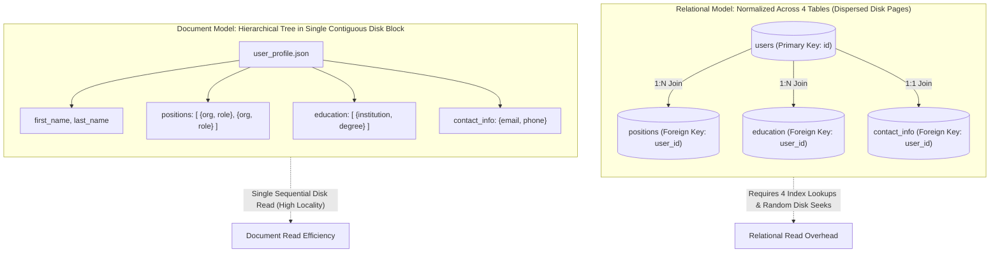
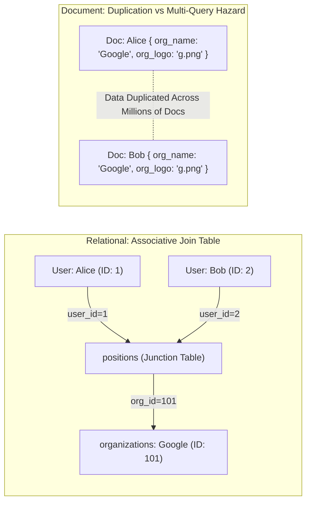
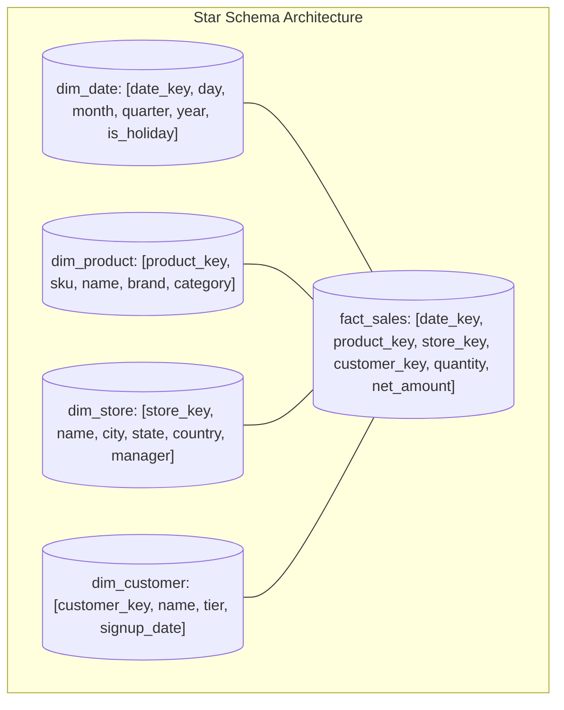
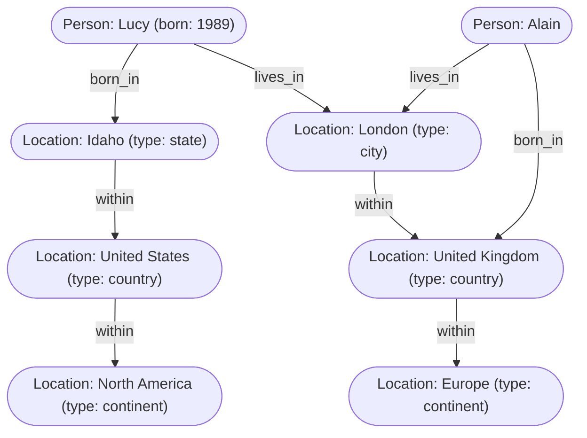
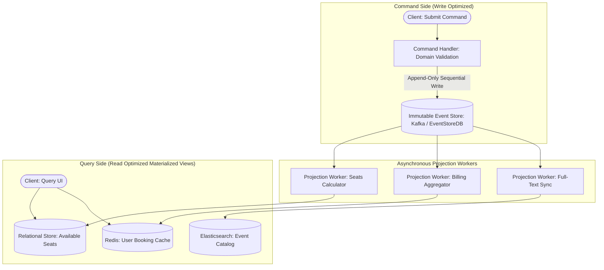

# Chapter 3: Data Models and Query Languages — Definitive Technical Summary
*From: Designing Data-Intensive Applications (2nd Edition) by Martin Kleppmann and Chris Riccomini*
*Source PDF: pp. 89–138 (673-page PDF) — figures below cite PDF pages.*

> [!NAV] **Chapter Navigation**
> ⬅️ **Previous:** [[chapter-02-defining-nonfunctional-requirements|Chapter 02: Defining Nonfunctional Requirements]] | 🏠 **Index:** [[00-Master-Reading-Dashboard|Master Dashboard]] | ➡️ **Next:** [[chapter-04-storage-and-retrieval|Chapter 04: Storage and Retrieval]]


---

## 1. Executive Summary & Core Engineering Problem

- **Core Thesis:** Data models are the single most critical architectural decision in software engineering because they dictate not only how software is written, but how engineers must think about the problem domain. Every data model embodies assumptions about access patterns: whether data is structured as self-contained hierarchical trees (document model), normalized tables with foreign-key relationships (relational model), highly interconnected arbitrary many-to-many networks (graph model), immutable historical state transitions (event sourcing), or dense multi-dimensional numeric tensors (matrix/array models). Choosing the wrong model forces the application layer to compensate with immense accidental complexity.
- **Problem Statement:** Mismatch between data relationships and the underlying storage model introduces severe operational and performance penalties. For instance, attempting to model a deep, cyclic organizational hierarchy or fraud-detection network in a relational database requires recursive Common Table Expressions (CTEs) that repeatedly join tables against themselves across arbitrary depths. A 5-hop recursive join across a table with 10 million rows degrades from an intended sub-10 ms query into a catastrophic CPU-bound index scan spanning several minutes. Conversely, forcing many-to-many relationships into a hierarchical document store leads to massive data duplication, manual client-side joins across multiple network requests, or catastrophic write amplification when denormalized shared entities are updated.
- **Historical & Industry Context:** The 1970s Network Model (CODASYL) and Hierarchical Model (IBM IMS) represented data as trees and manual pointer chains, requiring developers to write procedural navigation paths through disk blocks. Edgar Codd's Relational Model revolutionized the industry by proposing declarative relational algebra: the query optimizer automatically chooses optimal access paths, hiding physical disk layouts behind a declarative query language (SQL). In the 2000s, the NoSQL explosion sought greater write throughput, horizontal scalability, and schema flexibility (document databases like MongoDB, CouchDB). Today, the industry has moved past ideological model wars toward polyglot persistence and model convergence: relational engines support native binary JSON (PostgreSQL `jsonb`) and graph extensions, document stores offer ACID transactions and joins (`$lookup`), and specialized graph, event-sourced, and array engines serve dedicated access patterns.

---

## 2. In-Depth Technical Concepts & Internal Mechanics

### 2.1 Relational Versus Document Models: The Object-Relational Mismatch & Locality
- **Foundational Theory:** The "Object-Relational Impedance Mismatch" arises from the fundamental disconnect between in-memory object-oriented programming structures (nested objects, lists, polymorphic classes) and on-disk relational models (flat 2D tables of tuples linked by scalar foreign keys).
- **Under-the-Hood Mechanics & Data Locality:**
  - *Relational Layout:* Storing a user profile (e.g., LinkedIn résumé containing positions, education, and contact details) requires decomposing a single conceptual entity into multiple normalized tables: `users`, `positions`, `education`, `contact_info` (Figure 3-1).
    - *Read Path:* Fetching a user profile requires executing multiple index lookups and join operations across 4 distinct tables on disk. If pages are not cached in the buffer pool, this incurs multiple random physical disk I/O seeks ($O(K)$ disk reads for $K$ related entities).
  - *Document Layout:* Encodes the entire profile as a single self-contained JSON/BSON/XML tree document (Figure 3-2).
    - *Storage Locality:* The entire document is stored contiguously on disk in a single block or chunk. Fetching the profile requires exactly one index lookup on the primary key `user_id` and a single sequential read from disk ($O(1)$ disk I/O).
  - *The Document Locality Penalty on Mutations:*
    - If a document grows beyond its pre-allocated disk block (e.g., adding a new position record to a 16 KiB BSON chunk), the storage engine must allocate a new, larger disk region, copy the entire document over, update all secondary index pointers pointing to the old disk address, and reclaim the fragmented hole.
    - Updating a single nested field in an immutable document often requires rewriting the entire document to disk, causing high write amplification.
- **Schema-on-Read vs. Schema-on-Write:**
  - *Relational (Schema-on-Write):* Schema is explicitly enforced by the RDBMS engine. Data cannot be written unless it strictly conforms to defined column types and constraints. Equivalent to static compile-time type checking.
  - *Document (Schema-on-Read):* The database treats the document payload as opaque or semi-structured bytes. Structure is interpreted dynamically by application code at query time. Equivalent to runtime dynamic typing.
  - *Evolution Reality:* When a schema evolves, relational engines traditionally required table-locking `ALTER TABLE` commands (modern engines like PostgreSQL/MySQL now support instant metadata-only column additions for `NULL` defaults). In document stores, existing documents remain in their historical format, requiring the application code to contain defensive conditional branches (`if (doc.version < 2) ...`).

---

### 2.2 Many-to-One and Many-to-Many Relationships: Normalization vs. Denormalization
- **Foundational Theory:** Normalization eliminates redundant data by storing each fact exactly once and referencing it via unique identifiers (foreign keys). Denormalization copies data into multiple locations to optimize read paths at the expense of write complexity.
- **Under-the-Hood Architectural Mechanics:**
  1. *Relational Many-to-Many:* Implemented using a normalized junction/associative table containing foreign-key pairs (`(follower_id, followee_id)`). Secondary indexes on both foreign keys allow efficient bidirectional lookups ($O(\log N)$) using standard B-tree index scans.
  2. *Document Many-to-Many Dilemma:*
     - *Option A (Embed / Denormalize):* Duplicate data directly inside the document. For instance, duplicating organization details (`name`, `logo_url`, `industry`) inside every employee's position record (Figure 3-4). 
       - *Failure Mode:* An organization update requires finding and modifying millions of distinct employee documents across the database, triggering an immense write avalanche and high risk of inconsistent stale replicas.
     - *Option B (Document References):* Store only foreign object IDs in an array inside the document (`organization_ids: [101, 102]`).
       - *Failure Mode:* The database cannot resolve references in a single operation. The client must execute multiple sequential network round-trips to resolve references (the classic $N+1$ query problem), drastically increasing p99 read latency.

---

### 2.3 Stars and Snowflakes: Schemas for Analytical Warehouses
- **Foundational Theory:** Analytical queries (OLAP) rarely access individual records by primary key; instead, they aggregate vast swathes of business transactions across multiple dimensions (e.g., total sales grouped by store region, product category, and calendar quarter).
- **Under-the-Hood Data Warehouse Modeling:**
  1. *Star Schema (Dimensional Modeling):*
     - At the center sits a single massive **Fact Table** (e.g., `fact_sales`), where each row represents an individual business event or transaction. Fact tables contain millions to billions of rows, with numeric measurement metrics (`quantity_sold`, `net_price`, `tax_amount`) and foreign keys pointing to dimension tables.
     - The fact table is surrounded by multiple **Dimension Tables** (e.g., `dim_date`, `dim_product`, `dim_store`, `dim_customer`), representing the context of who, what, where, and when.
     - Dimensions are intentionally denormalized: `dim_product` might include brand, category, department, and supplier names directly in the same row. This minimizes join depth for analytical query engines, allowing high-speed table scans.
  2. *Snowflake Schema:*
     - A variation of the star schema where dimension tables are broken down further into normalized hierarchies (e.g., `dim_product` joins to `dim_subcategory`, which joins to `dim_category`, which joins to `dim_department`).
     - More space-efficient and eliminates redundancy, but requires significantly more joins per query, degrading query scan throughput in large-scale columnar engines. Modern data warehouses (Snowflake, BigQuery, ClickHouse) universally favor Star Schemas or completely denormalized flat tables.

---

### 2.4 Graph-Like Data Models: Property Graphs & Cypher
- **Foundational Theory:** When relationships between entities are numerous, arbitrary, and recursive—where entities have many-to-many connections that span different categories (e.g., social graphs, fraud rings, logistics routing, telecommunications topologies)—treating entities as **Vertices** and relationships as **Edges** yields superior modeling power and execution performance.
- **The Property Graph Model:**
  - *Vertex (Node) Invariants:* Possesses a unique identifier, a set of incoming edges, a set of outgoing edges, and a key-value map of properties.
  - *Edge (Relationship) Invariants:* Possesses a unique identifier, a head vertex (target), a tail vertex (source), a label defining the relationship type, and a key-value map of properties.
- **Under-the-Hood Mechanics (Index-Free Adjacency vs. Relational Joins):**
  - In a relational database, traversing an edge requires a B-tree index lookup ($O(\log N)$) on foreign keys. Traversing $K$ hops across $M$ branches requires $O(M^K \log N)$ operations.
  - Native graph databases (e.g., Neo4j) implement **Index-Free Adjacency**: each vertex directly stores physical memory or disk pointers to its adjacent edges. Traversing an edge is a simple pointer dereference ($O(1)$ per edge), allowing complex multi-hop traversals to execute in time proportional strictly to the size of the subgraph traversed, completely independent of the total graph size ($O(M^K)$).
- **The Cypher Query Language:**
  - Declarative query language utilizing intuitive ASCII-art arrow syntax:
    ```cypher
    MATCH (person:Person)-[:BORN_IN]->() -[:WITHIN*0..]-> (:Location {name: 'United States'}),
          (person)        -[:LIVES_IN]->() -[:WITHIN*0..]-> (:Location {name: 'Europe'})
    RETURN person.name
    ```
  - The pattern `[:WITHIN*0..]` represents a variable-length path traversal (transitive closure): recursively follow outgoing `WITHIN` edges zero or more times until reaching the target vertex.

---

### 2.5 Graph Queries in SQL, Triple Stores (SPARQL), and Datalog
- **Graph Queries in SQL (Recursive Common Table Expressions):**
  - Standard SQL cannot express variable-length path traversals without procedural loops or recursive queries.
  - SQL:1999 introduced `WITH RECURSIVE`:
    ```sql
    WITH RECURSIVE in_usa(vertex_id) AS (
        SELECT vertex_id FROM vertices 
        WHERE label = 'Location' AND properties->>'name' = 'United States'
      UNION
        SELECT edges.tail_vertex FROM edges
        JOIN in_usa ON edges.head_vertex = in_usa.vertex_id
        WHERE edges.label = 'within'
    )
    SELECT ... FROM in_usa;
    ```
  - *Critique:* Highly verbose, syntactically clumsy, and challenging for relational query planners to optimize efficiently compared to native graph pattern matchers.
- **Triple Stores and SPARQL:**
  - Stored purely as three-part statements: **Subject, Predicate, Object** (e.g., `(lucy, bornIn, idaho)` or `(idaho, within, usa)`).
  - The predicate acts as a directed edge, with the subject as the source vertex. The object can be another vertex or a primitive literal scalar value (e.g., `(lucy, birthYear, 1989)`).
  - Queried via SPARQL (standardized by W3C for the Semantic Web), matching graph triple patterns with variables prefixed by `?`:
    ```sparql
    SELECT ?personName WHERE {
      ?person :name ?personName .
      ?person :bornIn / :within* ?usa .
      ?usa    :name "United States" .
      ?person :livesIn / :within* ?europe .
      ?europe :name "Europe" .
    }
    ```
- **Datalog (Declarative Logic Programming):**
  - Older, mathematically elegant foundation of declarative querying (subset of Prolog).
  - Formulates queries as logical deduction rules:
    $$\text{Rule Head} \leftarrow \text{Rule Body (Predicates)}$$
  - *Transitive Closure in Datalog:*
    ```prolog
    within(X, Y) :- in(X, Y).
    within(X, Z) :- in(X, Y), within(Y, Z).
    
    migrated(Name) :- person(P, Name), born_in(P, B), within(B, "United States"),
                      lives_in(P, L), within(L, "Europe").
    ```
  - The query optimizer evaluates rules incrementally until a fixed point is reached.

---

### 2.6 Event Sourcing and CQRS: Decoupling Writes from Reads
- **Foundational Theory:** Traditional databases overwrite state in place (`UPDATE accounts SET balance = 50 WHERE id = 1`), permanently erasing the history of how that state was reached. **Event Sourcing** models state mutations as an append-only sequence of immutable domain events representing facts that occurred in the past (e.g., `AccountOpened`, `MoneyDeposited`, `MoneyWithdrawn`).
- **Under-the-Hood Mechanics (CQRS Pattern):**
  - **Command Path (Write Optimization):** The application receives a command (`WithdrawMoney`), executes domain validation, and appends an immutable event (`MoneyWithdrawn {amount: 50, lsn: 1045}`) to the append-only event store (Figure 3-8). Writes are append-only sequential disk I/O, achieving maximum write throughput with zero lock contention.
  - **Query Path (Read Optimization):** Asynchronous background workers consume the immutable event log, calculate state projections, and materialize read-optimized views (e.g., an in-memory cache, an Elasticsearch full-text index, or a denormalized relational table).
- **Failure Modes & Complexity:**
  - *Eventual Consistency Window:* Read projections lag behind the write log by $10 - 500\ \text{ms}$. Applications must handle read-your-own-writes inconsistencies.
  - *Event Schema Evolution:* Events are immutable and stored forever. Adding or deprecating event fields requires versioned upcasters or backwards-compatible deserializers.
  - *Snapshotting Invariant:* To prevent replaying millions of historical events from genesis to compute current state, systems must periodically generate snapshots at regular intervals ($L_N = 10,000$ events) and replay only delta events since the snapshot.

---

### 2.7 DataFrames, Matrices, and Arrays
- **Foundational Theory:** In machine learning, quantitative finance, and geospatial science, data is fundamentally mathematical rather than relational or documentary. Entities are represented as dense or sparse multi-dimensional arrays (tensors and matrices) optimized for linear algebra operations.
- **Under-the-Hood Transformation Mechanics (Relational to Matrix Pivot):**
  - Figure 3-9 illustrates transforming a relational table of movie ratings (`user_id`, `movie_id`, `rating`) into a sparse 2D matrix where rows represent users, columns represent movies, and matrix cells hold ratings.
  - *Dimensionality:* The matrix may contain $100,000$ users $\times 50,000$ movies $= 5\times 10^9$ cells. A relational schema cannot handle 50,000 columns; sparse matrix representations (Compressed Sparse Row, CSR in NumPy/SciPy) store only non-zero entries, compressing the memory footprint by $>99\%$.
  - *Vectorization:* Matrix structures map directly to contiguous memory arrays, allowing single-instruction multiple-data (SIMD) CPU instructions and GPU matrix multiplication tensor cores to execute collaborative filtering and neural network inference at memory-bus speeds.

---

## 3. Important Figures, Diagrams & Visual Architecture

> 📕 **Original figures quick index (source PDF, 673 pages):** open the PDF at the cited page to verify each reconstruction.
>
> | Book Fig | PDF page | What to compare |
> |---|---|---|
> | Fig 3-1 | PDF p.93 | LinkedIn profile relational |
> | Fig 3-2 | PDF p.95 | Tree one-to-many |
> | Fig 3-3 | PDF p.100 | Many-to-many relational |
> | Fig 3-4 | PDF p.100 | Many-to-many document |
> | Fig 3-5 | PDF p.102 | Star schema |
> | Fig 3-6 | PDF p.110 | Graph data |
> | Fig 3-7 | PDF p.122 | Datalog Idaho rule |
> | Fig 3-8 | PDF p.126 | Immutable log + derived views |
> | Fig 3-9 | PDF p.130 | Movie-ratings matrix |


### Figure 3-1 & 3-2: Relational Schema vs. JSON Document Tree Locality
- **Figure Reference:** `Figure 3-1: Representing a LinkedIn Profile in Relational vs. Document Models (from text pp. 68-70)`
- **Original PDF:** Fig 3-1 → PDF p.93 — open the PDF at page 93 to compare with the Mermaid reconstruction below. & 3-2
- **Visual Flow & Description:** Contrasts a normalized relational schema requiring 4 distinct tables joined via foreign keys with a self-contained hierarchical JSON document structure where positions, education, and contact details are nested within a single record.
- **Mermaid.js Architectural Diagram:**



- **Key Takeaway:** The document model provides superior read locality for complete entity retrieval, whereas the relational model provides clean, isolated mutability for sub-components without rewriting the entire profile.

---

### Figure 3-3 & 3-4: Many-to-Many Relationships: Junction Tables vs. Document References
- **Figure Reference:** `Figure 3-3: Many-to-many relationships in relational vs document models (from text pp. 71-73)`
- **Original PDF:** Fig 3-3 → PDF p.100 — open the PDF at page 100 to compare with the Mermaid reconstruction below. & 3-4
- **Visual Flow & Description:** Illustrates how organizations (many-to-many relationships) are handled. In the relational model, an associative junction table links users and organizations. In the document model, embedding organization data causes massive duplication, while referencing IDs requires manual client-side joins.
- **Mermaid.js Flowchart:**



- **Key Takeaway:** If a shared entity's metadata changes, the relational model updates exactly one row (`organizations`), while the embedded document model must execute an unindexed update across millions of documents.

---

### Figure 3-5: Star Schema for Analytical Warehousing
- **Figure Reference:** `Figure 3-5: A star schema for use in a data warehouse (from text p. 77)`
- **Original PDF:** Fig 3-5 → PDF p.102 — open the PDF at page 102 to compare with the Mermaid reconstruction below.
- **Visual Flow & Description:** Central fact table storing discrete sales events connected radially to independent dimension tables representing context (Date, Store, Product, Customer, Promotion).
- **Mermaid.js Flowchart:**



- **Key Takeaway:** Star schemas minimize query complexity and eliminate nested joins, enabling columnar storage engines to execute multi-million-row aggregation queries at maximum scan speed.

---

### Figure 3-6: Property Graph Structure (People, Geographic Entities, and Edges)
- **Figure Reference:** `Figure 3-6: Graph-structured data: vertices and edges with properties (from text p. 86)`
- **Original PDF:** Fig 3-6 → PDF p.110 — open the PDF at page 110 to compare with the Mermaid reconstruction below.
- **Visual Flow & Description:** Illustrates a property graph showing people (`Lucy`, `Alain`) connected via directed edges (`born_in`, `lives_in`) to geographic location nodes (`Idaho`, `London`, `United States`, `Europe`) connected via transitive `within` edges.
- **Mermaid.js Flowchart:**



- **Key Takeaway:** Complex hierarchical and cyclic connections are expressed uniformly as edges without requiring table alterations or rigid relational schemas.

---

### Figure 3-8: Event Sourcing & CQRS Architecture
- **Figure Reference:** `Figure 3-8: Using a log of immutable events as the source of truth and deriving materialized views (from text p. 101)`
- **Original PDF:** Fig 3-8 → PDF p.126 — open the PDF at page 126 to compare with the Mermaid reconstruction below.
- **Visual Flow & Description:** Depicts an append-only event log acting as the authoritative system of record. Commands write events sequentially; asynchronous projection workers tail the event log and populate distinct read-optimized stores.
- **Mermaid.js Flowchart:**



- **Key Takeaway:** Decoupling the write model from the read model allows writing to be lightning-fast and audit-proof while reads execute against specialized, pre-computed views.

---

## 4. Real-World Systems, Case Studies & Code Examples

### 4.1 Comparative Query Implementation: Emigrants from US to Europe
To find all people who were born in the US and live in Europe across Figure 3-6:

#### A. Cypher (Native Graph)
```cypher
MATCH (person:Person)-[:BORN_IN]->() -[:WITHIN*0..]-> (:Location {name: 'United States'}),
      (person)        -[:LIVES_IN]->() -[:WITHIN*0..]-> (:Location {name: 'Europe'})
RETURN person.name
```

#### B. SQL:1999 (Recursive Common Table Expression)
```sql
WITH RECURSIVE
  in_usa(vertex_id) AS (
      SELECT vertex_id FROM vertices 
      WHERE label = 'Location' AND properties->>'name' = 'United States'
    UNION
      SELECT edges.tail_vertex FROM edges 
      JOIN in_usa ON edges.head_vertex = in_usa.vertex_id 
      WHERE edges.label = 'within'
  ),
  in_europe(vertex_id) AS (
      SELECT vertex_id FROM vertices 
      WHERE label = 'Location' AND properties->>'name' = 'Europe'
    UNION
      SELECT edges.tail_vertex FROM edges 
      JOIN in_europe ON edges.head_vertex = in_europe.vertex_id 
      WHERE edges.label = 'within'
  )
SELECT v.properties->>'name' AS person_name
FROM vertices v
JOIN edges e1 ON v.vertex_id = e1.tail_vertex AND e1.label = 'born_in'
JOIN in_usa ON e1.head_vertex = in_usa.vertex_id
JOIN edges e2 ON v.vertex_id = e2.tail_vertex AND e2.label = 'lives_in'
JOIN in_europe ON e2.head_vertex = in_europe.vertex_id
WHERE v.label = 'Person';
```

### 4.2 Python Implementation: Event Sourced Aggregate Projection
The following snippet demonstrates an Event Sourcing aggregate projecting a conference's available seats from an immutable sequence of events:

```python
from dataclasses import dataclass
from typing import List, Dict, Any

@dataclass(frozen=True)
class DomainEvent:
    event_id: int
    event_type: str
    payload: Dict[str, Any]

class ConferenceRoomProjection:
    """
    CQRS Projection: Maintains materialized read state by sequentially
    replaying immutable domain events.
    """
    def __init__(self):
        self.capacity: int = 0
        self.confirmed_registrations: set = set()
        self.waitlist: List[str] = []

    def apply(self, event: DomainEvent) -> None:
        etype = event.event_type
        p = event.payload

        if etype == "ConferenceCreated":
            self.capacity = p["initial_capacity"]
        elif etype == "RoomCapacityExpanded":
            self.capacity += p["additional_seats"]
        elif etype == "TicketPurchased":
            user_id = p["user_id"]
            if len(self.confirmed_registrations) < self.capacity:
                self.confirmed_registrations.add(user_id)
            else:
                self.waitlist.append(user_id)
        elif etype == "TicketRefunded":
            user_id = p["user_id"]
            if user_id in self.confirmed_registrations:
                self.confirmed_registrations.remove(user_id)
                # Promote from waitlist if available
                if self.waitlist:
                    promoted_user = self.waitlist.pop(0)
                    self.confirmed_registrations.add(promoted_user)

    @property
    def available_seats(self) -> int:
        return max(0, self.capacity - len(self.confirmed_registrations))
```

### 4.3 Production War Story: Document Store Denormalization Meltdown
A logistics platform modeled shipments and customer addresses in a document database. To minimize read latency, customer addresses were embedded directly into shipment documents. 
When corporate clients relocated facilities, the platform issued background batch scripts to update the embedded address across historical shipment records. 
*The Catastrophe:* Millions of 4 KiB documents expanded to 6 KiB due to longer new address strings. The storage engine could not update documents in place, triggering disk block reallocations, massive memory fragmentation, and secondary index lock stalls. The database ran out of disk write IOPS, causing the active checkout and dispatch pipeline to freeze for 3 hours. 
*Remediation:* The team normalized `addresses` into a dedicated collection referenced by immutable address IDs, accepting a secondary read lookup to insulate the system from write amplification.

---

## 5. Architectural Trade-Off Matrix

| Data Model | Primary Advantage | Primary Bottleneck / Invariant | Worst-Case Access Path | Best Used When... | Worst Used When... |
| :--- | :--- | :--- | :--- | :--- | :--- |
| **Relational (RDBMS)** | Strong schema enforcement; joins; zero redundancy; mature ACID | Joins become costly across many tables at scale; rigid schema evolution | Recursive multi-hop joins across cyclic networks | Structured transaction processing (OLTP); strict financial invariants | Deeply nested hierarchical trees; highly connected graph networks |
| **Document (NoSQL)** | Read locality for full trees; rapid schema evolution; matches OOP objects | Severe write amplification on updates; poor support for many-to-many joins | Querying relations across multiple documents ($N+1$ queries) | Self-contained documents (CMS, catalogs, user sessions); 1:N relations | Highly interconnected data with shared, mutable many-to-many entities |
| **Property Graph** | Index-free adjacency ($O(1)$ traversal per hop); natural modeling of relationships | Poor horizontal partitioning (sharding graphs is NP-hard); low bulk-scan throughput | Global aggregations over all vertices (`SUM`, `AVG`) | Fraud rings, social networks, knowledge graphs, logistics routing | Simple tabular reporting; high-throughput append-only event streams |
| **Star Schema (OLAP)** | Blazing columnar aggregation scans; intuitive business reporting | High storage redundancy in fact tables; slow single-record point updates | Point lookups and single-row mutations | Data warehousing, business intelligence, multi-dimensional analytics | High-concurrency low-latency transactional updates (OLTP) |
| **Event Sourcing / CQRS** | Perfect audit trail; append-only write speed; arbitrary replayable read models | Eventual consistency; storage amplification; event schema migration complexity | Immediate read-your-own-writes queries on unprojected state | Regulated financial ledgers, complex business domains, collaborative apps | Simple CRUD applications where historical state transitions have zero value |
| **Array / Tensor Store** | Contiguous SIMD/GPU tensor multiplication; extreme numeric density | Completely incapable of handling unstructured text or arbitrary relational joins | Ad-hoc text search or relational joins | Machine learning feature stores, geospatial raster grids, quantitative finance | Standard web application persistence |

### Concrete Decision Heuristics
1. **Relationship Cardinality Rule:**
   - If relationships are predominantly **1-to-Many** and records are loaded as self-contained units, use a **Document Model**.
   - If relationships are **Many-to-Many** with moderate interconnectedness, use a **Relational Model**.
   - If relationships are **Many-to-Many**, deeply recursive, and the core queries evaluate *paths* between entities, use a **Property Graph Model**.
2. **Read-Write Optimization Rule:** If you cannot satisfy both high write throughput and diverse read query patterns in a single model, introduce **CQRS**: optimize the write path as an immutable append-only event log, and project derived data into specialized read models.

---

## 6. Jargon Buster & Key Terminology

- **Impedance Mismatch:** The architectural friction and translation overhead between in-memory object-oriented data structures (classes, references) and relational table schemas (rows, foreign keys).
- **Index-Free Adjacency:** A graph storage engine technique where each vertex holds direct memory or disk pointers to its adjacent neighbor nodes, making edge traversals $O(1)$ rather than requiring an index lookup.
- **Star Schema:** A dimensional data warehouse schema consisting of a central fact table surrounded by denormalized dimension tables. *Confused with:* Snowflake schema (which normalizes the dimension tables).
- **Fact Table:** In an analytical warehouse, the central table containing discrete numeric measurement records of business events (e.g., individual sales, page views).
- **Dimension Table:** A table in an analytical warehouse containing contextual attributes (who, what, where, when) that surround a fact table.
- **Transitive Closure:** The set of all elements that can be reached by recursively following a relationship (e.g., finding all parent containers of a city via repeated `within` edges).
- **Command Query Responsibility Segregation (CQRS):** An architectural pattern that strictly segregates state-mutating operations (Commands) from read operations (Queries), using different models for each.
- **Event Sourcing:** A data modeling paradigm where changes to application state are stored as an ordered, append-only log of immutable domain events.
- **Schema-on-Read:** A data formatting philosophy where the structure of data is not enforced during ingestion, but interpreted dynamically when queries read the data. *Opposite of:* Schema-on-Write.
- **Datalog:** A declarative logic programming language that models data as relational facts and evaluates queries as recursive deduction rules.

---

## 7. System Design & Practical Engineering Takeaways

### 7.1 Production Engineering Checklist
1. **Beware the Document Locality Trap:** Never embed mutable sub-entities that grow unboundedly inside a document. If a nested array can exceed 100 items, normalize it into a separate collection or table.
2. **Enforce Star Schemas in Data Warehouses:** Avoid highly normalized snowflake dimensions in large-scale columnar warehouses. Denormalizing dimensions into wide star schemas reduces join depth and maximizes columnar compression.
3. **Guard Against $N+1$ Query Cascades in GraphQL/REST:** When building APIs over normalized databases, always implement batched data loaders (e.g., DataLoader pattern) to combine multiple foreign-key lookups into a single `IN (...)` SQL query.
4. **Snapshot Event-Sourced Aggregates:** If implementing Event Sourcing, enforce periodic state snapshotting every $1,000$ to $5,000$ events to prevent unbounded recovery replay latency upon cold restarts.
5. **Treat Graph Sharding with Caution:** If your domain requires a graph database, plan for the entire graph topology to fit within a single large-memory machine. Partitioning graph edges across distributed clusters introduces severe cross-network hop latency.

### 7.2 System Design Interview Strategy
- **Justify Your Data Model Choice from First Principles:** Do not pick MongoDB or PostgreSQL based on popularity. Justify choices using relationship cardinality: *"The user profile has strict 1:N containment with zero external foreign keys, making a document model ideal for read locality."*
- **Recognize When a Graph is Necessary:** In interviews involving recommendation systems, fraud rings, or social network connections, explicitly mention why relational joins fail ($O(M^K \log N)$ index scans vs. $O(1)$ index-free adjacency pointers).
- **Propose CQRS for Complex Invariants:** When asked to design systems with high write volume and complex, heterogeneous read views (e.g., ride-sharing matching, real-time ticket booking), propose Event Sourcing on the write path and specialized materialized views on the read path.

### 7.3 Mastery Self-Assessment Questions

#### Question 1 (Conceptual Depth)
*Why does index-free adjacency allow native graph databases (like Neo4j) to execute multi-hop graph traversals ~10-100x higher scan throughput (columnar + SIMD, see trade-off matrix) than a relational database executing recursive joins, even when the relational tables are indexed on foreign keys?*
- **Answer:** In a relational database, traversing an edge from node $A$ to node $B$ requires performing a B-tree index lookup on the join table. A B-tree lookup takes $O(\log N)$ time, where $N$ is the total number of edges in the entire database. If a query traverses $K$ hops and each node has branching factor $M$, the relational engine executes $O(M^K \log N)$ operations; as the total database size $N$ grows to billions of rows, each traversal step slows down. 
In a native graph database with index-free adjacency, each vertex directly stores physical pointers (memory addresses or byte offsets) to its adjacent edge structures. Traversing an edge requires only a direct pointer dereference ($O(1)$). The total traversal time is strictly $O(M^K)$, completely independent of the total graph size $N$. A graph with 1 trillion nodes executes a local 3-hop traversal in the exact same time as a graph with 1,000 nodes.

#### Question 2 (Failure Scenario & Edge Cases)
*An engineering team builds an e-commerce platform using Event Sourcing. Every state change is stored as an event in Apache Kafka. After two years in production with 50 million events, an application instance crashes and attempts to restart. The instance takes 45 minutes to boot, during which health checks fail and the container orchestrator repeatedly kills it. Diagnose the architectural defect and prescribe the exact solution.*
- **Answer:** 
*Defect:* The application aggregate attempts to reconstruct its current in-memory state by replaying every historical event from offset 0 (the beginning of time). Replaying 50 million events requires massive CPU deserialization and business rule evaluation, exceeding the orchestrator's liveness probe timeout. 
*Prescription:* Implement **State Snapshotting**. The system must periodically (e.g., every 5,000 events or every hour) persist a materialized snapshot of the aggregate's complete state to durable storage alongside the corresponding Log Sequence Number (LSN). Upon restart, the application loads the latest snapshot in $O(1)$ time and replays only the small delta of events committed *since* that snapshot's LSN, reducing boot time from 45 minutes to $<100\ \text{ms}$.

#### Question 3 (Trade-Off & Capacity Estimation)
*A video streaming platform has 10 million active users. Each user profile contains basic metadata (500 bytes) and an array of watched video history entries (each entry is 50 bytes). On average, an active user watches 4 videos per day. Compare the storage footprint, memory fragmentation, and write amplification after 1 year if the platform stores profiles using (A) a single document per user in MongoDB vs. (B) a normalized schema in PostgreSQL (`users` table + `watch_history` table).*
- **Answer:**
  - *Growth Metrics:*
    - 1 user watches: $4\ \text{videos/day} \times 365\ \text{days} = 1,460\ \text{entries/year}$.
    - Watch history size per user: $1,460 \times 50\ \text{bytes} = 73,000\ \text{bytes} \approx 71.3\ \text{KiB/year}$.
    - Total profile size after 1 year: $500\ \text{bytes} + 73\ \text{KiB} \approx 73.5\ \text{KiB}$.
  - *Approach A (MongoDB Single Document):*
    - Adding an entry appends to the document's array. As the document expands from its initial 500 bytes past 1 KiB, 2 KiB, 4 KiB, etc., it repeatedly exceeds its allocated memory/disk extent.
    - The storage engine must continuously allocate new, larger disk blocks, copy the entire existing document, update secondary index pointers, and leave behind fragmented dead space.
    - Updating a 70 KiB document to add a 50-byte record incurs a write amplification factor of $>1,400\times$ if the entire document is flushed to the WAL/journal.
    - Across 10M users, this triggers massive disk I/O thrashing and memory bloat.
  - *Approach B (PostgreSQL Normalized):*
    - The `users` row remains static at 500 bytes.
    - Each video watch is a single row appended to `watch_history`: 50 bytes + 24 bytes row overhead $\approx 74\ \text{bytes}$.
    - Appends are written sequentially to the WAL and standard 8 KiB table pages with zero document relocation, zero dead space fragmentation, and near $1\times$ write amplification.
    - *Conclusion:* Approach B is drastically superior for append-heavy sub-entities.


---
> [!NAV] **Chapter Navigation**
> ⬅️ **Previous:** [[chapter-02-defining-nonfunctional-requirements|Chapter 02: Defining Nonfunctional Requirements]] | 🏠 **Index:** [[00-Master-Reading-Dashboard|Master Dashboard]] | ➡️ **Next:** [[chapter-04-storage-and-retrieval|Chapter 04: Storage and Retrieval]]