# Chapter 4: Storage and Retrieval — Definitive Technical Summary
*From: Designing Data-Intensive Applications (2nd Edition) by Martin Kleppmann and Chris Riccomini*
*Source PDF: pp. 139–184 (673-page PDF) — figures below cite PDF pages.*

> [!NAV] **Chapter Navigation**
> ⬅️ **Previous:** [[chapter-03-data-models-and-query-languages|Chapter 03: Data Models and Query Languages]] | 🏠 **Index:** [[00-Master-Reading-Dashboard|Master Dashboard]] | ➡️ **Next:** [[chapter-05-encoding-and-evolution|Chapter 05: Encoding and Evolution]]


---

## 1. Executive Summary & Core Engineering Problem

- **Core Thesis:** At the lowest layer of every data system lies a fundamental tension between write throughput, read latency, and storage amplification. A database storage engine cannot simultaneously optimize for arbitrary point updates, sequential bulk scans, and minimal memory footprint; instead, it must explicitly choose its internal access structures: append-only log-structured merge-trees (LSM-trees) that trade background compaction CPU and read amplification for sequential write bandwidth, page-based in-place B-trees that trade write amplification and page fragmentation for deterministic $O(\log N)$ point reads, or column-oriented stores that sacrifice individual record mutation performance to achieve $10\times\text{--}100\times$ scan throughput via SIMD vectorization and columnar bit-packing.
- **Problem Statement:** Naive storage designs collapse catastrophically when mechanical hardware constraints collide with access patterns. For example, storing high-velocity sensor telemetry ($100,000\ \text{writes/sec}$) in a standard B-tree database with random primary keys (e.g., UUIDv4) forces the storage engine to execute random in-place page writes across a multi-gigabyte index. Because magnetic disks can sustain only $\sim 100\text{--}200\ \text{random IOPS}$ and enterprise NVMe SSDs sustain $\sim 50,000\text{--}100,000\ \text{random write IOPS}$ before flash translation layer (FTL) garbage collection stalls, writing a 50-byte record into a random 16 KiB page incurs a write amplification factor of $>300\times$, saturating disk I/O channels, driving p99 write latencies from 2 ms to $>5,000\ \text{ms}$, and halting data ingestion. Conversely, executing analytical aggregations across 100 million rows on a row-oriented OLTP engine wastes $>95\%$ of memory bus bandwidth fetching irrelevant columns, bottlenecking CPU execution on memory stalls.
- **Historical & Industry Context:** Early databases in the 1970s and 1980s (IBM System R) standardized on in-place page-overwrite B-trees tailored to rotational disk seek mechanics. As RAM capacities expanded and write-heavy internet applications surged in the 2000s, Google introduced Bigtable (2006) and log-structured merge-trees (O’Neil et al., 1996), which turn random writes into sequential disk appends, popularized by LevelDB, RocksDB, and Apache Cassandra. In the 2010s, analytical workloads migrated from row-oriented relational engines to columnar data warehouses (C-Store, MonetDB, Vertica, Snowflake, ClickHouse, DuckDB) leveraging CPU vectorized execution. The 2020s (2nd Edition inflection) introduced disaggregated cloud storage (object stores like S3/GCS separating compute from storage) and dense high-dimensional vector search engines (Hierarchical Navigable Small World graphs and Inverted File indexes) to handle artificial intelligence embedding retrievals.

---

## 2. In-Depth Technical Concepts & Internal Mechanics

### 2.1 Append-Only Logs & In-Memory Hash Indexes (Bitcask Model)
- **Foundational Theory:** The simplest possible database is an append-only sequential log file. Writing is unconditionally $O(1)$ and sequential, maximizing storage drive throughput. To enable efficient $O(1)$ point lookups, an in-memory hash table maps every unique key to the byte offset of its latest record within the on-disk data file (Figure 4-1).
- **Under-the-Hood Data Paths & File Segments:**
  1. *Write Path:* An incoming `PUT(k, v)` serializes the key-value pair into binary format, appends it to the active on-disk segment file via sequential write, invokes `fsync` (subject to durability policy), and updates the in-memory hash table: `key_dir[k] = (file_id, byte_offset, value_size, timestamp)`.
  2. *Read Path:* A `GET(k)` queries `key_dir`. If present, it issues a single random disk seek to `byte_offset` on `file_id` and reads exactly `value_size` bytes. If not present in `key_dir`, it returns `KeyNotFound` in $O(1)$ without touching disk.
  3. *Delete Path:* A deletion appends a special tombstone record (`PUT(k, TOMBSTONE)`). The hash map deletes $k$. During background compaction, tombstones cause the key to be physically purged.
  4. *Compaction & Merging:* When the active segment reaches a threshold (e.g., 1 GiB), it is frozen as read-only, and a new active segment is opened. A background worker sequentially scans frozen segments, discards overwritten values and tombstones, and writes surviving records into a new compacted segment. An atomic pointer swap switches reader references to the new file, and old segments are deleted via `unlink()`.
- **Byte-Level Record Layout:**
  ```text
  [ CRC32: 4B ] [ Timestamp: 8B ] [ Key_Size: 4B ] [ Value_Size: 4B ] [ Key: K bytes ] [ Value: V bytes ]
  ```
  Total fixed header size: 20 bytes per record.
- **Complexity & Invariants:**
  - *Time Complexity:* Write $O(1)$ sequential; Read $O(1)$ (1 random disk I/O seek); Range query $O(N)$ (requires full table scan; hash indexes do not maintain sorted order).
  - *Memory Invariant:* All keys **must fit in RAM**. If the dataset contains 1 billion keys with an average key length of 32 bytes and 16 bytes of hash table pointer overhead (48 bytes/entry), the hash map requires $48\ \text{GiB}$ of resident memory, regardless of data size on disk.
- **Failure Modes & Edge Cases:**
  - *Process Crash & Restart:* On crash, the in-memory hash map is destroyed. Recovering it by scanning terabytes of segment files takes hours. Bitcask mitigates this by persisting a compact "hint file" alongside each compacted segment, mapping `(key -> offset)` linearly on disk, allowing rapid sequential memory reconstruction during boot.
  - *Disk Saturation during Compaction:* Compaction and incoming writes compete for the same sequential disk write bandwidth. Under heavy write traffic, compaction falls behind, disk usage balloons, and write stalls occur.

---

### 2.2 SSTables and LSM-Trees (Log-Structured Merge-Trees)
- **Foundational Theory:** Sorted String Tables (SSTables) enforce a strict invariant: within each segment file, key-value pairs are stored in strictly sorted order by key. This eliminates the requirement that all keys fit in RAM.
- **Internal Structural Layout:**
  - *Memtable (RAM):* An in-memory concurrent balanced search tree or skiplist (e.g., SkipList in RocksDB, Red-Black tree in LevelDB) buffering recent mutations in sorted order.
  - *Write-Ahead Log (WAL on Disk):* An append-only log on disk that records every write before insertion into the memtable. Its sole purpose is durability during crash recovery.
  - *SSTable Data File (Disk):* An immutable, sequentially written file containing sorted key-value pairs grouped into compressed blocks (typically 4 KiB to 64 KiB, compressed via LZ4, Zstandard, or Snappy).
  - *Sparse In-Memory Index:* Because keys are sorted, RAM does not need an entry for every key. It stores an index entry only for the start of each block (e.g., every 4 KiB or every $K$ keys). To look up key `handbag`, the engine binary-searches the sparse index between `handgun` and `handsome`, loads that single 4 KiB compressed block off disk, and scans locally (Figure 4-2).
- **Under-the-Hood Data Paths:**
  1. *Write Path:*
     - Client issues `PUT(k, v)`.
     - Engine appends `[LSN, Type, Key, Value]` to the WAL on disk (sequential I/O + configurable `fsync`).
     - Key-value pair is inserted into the in-memory Memtable ($O(\log M)$ time).
     - Client receives write acknowledgment.
  2. *Memtable Flush:*
     - When the Memtable exceeds its configured threshold (typically 64 MiB to 256 MiB), it is marked immutable.
     - A new active Memtable and fresh WAL are allocated immediately so incoming writes never block.
     - A background flush thread drains the immutable Memtable, writes it sequentially to disk as a Level 0 (L0) SSTable, builds the sparse index and Bloom filter, writes the SSTable footer, and deletes the corresponding old WAL.
  3. *Read Path:*
     - Search active Memtable in RAM. If found, return.
     - Search immutable Memtables waiting for flush in RAM. If found, return.
     - Search on-disk SSTables from newest to oldest. To avoid reading every SSTable off disk, check the in-memory Bloom filter for each SSTable. If the Bloom filter returns negative, skip the SSTable entirely.
     - If Bloom filter returns positive, binary search the SSTable's sparse index to locate the block offset, load the 4 KiB block from disk/page-cache, decompress it, and search for the key.
  4. *Multi-Way Merge Compaction:*
     - Because SSTables are sorted, merging multiple files is identical to the merge step of MergeSort ($O(N)$ streaming time). The engine reads multiple SSTable segments side by side, compares the lowest keys, retains only the newest value (highest timestamp/sequence number), discards overwritten values and expired tombstones, and streams the output into new sorted SSTable files (Figure 4-3).
- **Complexity:**
  - Write: $O(\log M)$ in RAM + sequential append.
  - Read: $O(L \cdot \log(\text{block count}))$ where $L$ is the number of SSTables searched; with Bloom filters, average read requires $O(1)$ disk I/O.
  - Write Amplification: $10\times\text{--}40\times$ depending on compaction strategy.

---

### 2.3 Compaction Strategies & Bloom Filter Mechanics
- **Foundational Theory:** As writes arrive and memtables flush, SSTables accumulate on disk. To reclaim space, purge tombstones, and bound read amplification, background compaction must continuously merge overlapping files.
- **Compaction Strategies:**
  1. *Size-Tiered Compaction (STCS - Cassandra default):*
     - Small SSTables of roughly similar sizes are merged into larger SSTables when a count threshold is reached (e.g., 4 SSTables of 100 MiB merged into one 400 MiB SSTable; four 400 MiB SSTables merged into one 1.6 GiB SSTable).
     - *Advantage:* Low write amplification during initial ingestion; high write throughput.
     - *Fatal Flaw:* High space amplification (often $>50\%$). Merging two large 500 GiB SSTables requires 500 GiB of free disk space headroom simply to execute the compaction step. High read amplification because the same key can exist across multiple SSTables at every size tier.
  2. *Leveled Compaction (LCS - RocksDB, LevelDB default):*
     - Disk storage is partitioned into discrete levels ($L_0, L_1, L_2, \dots, L_K$).
     - $L_0$ contains directly flushed SSTables, which may have overlapping key ranges.
     - Levels $L_1$ and higher strictly enforce **non-overlapping key ranges**: every key exists in at most *one* SSTable per level.
     - Each level has a fixed total capacity, growing by an amplification factor $T$ (typically $T = 10$): $L_1 = 10\ \text{MB}$, $L_2 = 100\ \text{MB}$, $L_3 = 1\ \text{GB}$, $L_4 = 10\ \text{GB}$, etc.
     - When level $L_i$ exceeds its capacity, the compaction worker selects an SSTable from $L_i$, finds all overlapping SSTables in $L_{i+1}$, merges them via multi-way merge sort, and writes new non-overlapping SSTables into $L_{i+1}$.
     - *Advantage:* Low read amplification (point reads search at most 1 SSTable per level from $L_1$ down); low space overhead (typically $<10\%$ temporary headroom).
     - *Disadvantage:* High write amplification ($10\text{--}30\times$), as each byte is repeatedly read and re-written across subsequent levels.

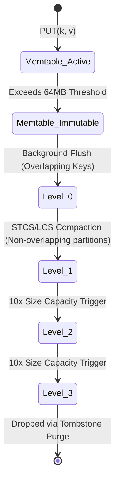

- **Bloom Filter Internal Mathematics & Bit-Level Layout:**
  - An SSTable's Bloom filter is a memory-resident bit array of $m$ bits initialized to 0, parameterized by $k$ independent uniform cryptographic/non-cryptographic hash functions (e.g., MurmurHash3, xxHash).
  - *Insertion:* To index key $K$, compute $h_1(K), h_2(K), \dots, h_k(K)$ modulo $m$, and set those bit positions to 1 (Figure 4-4).
  - *Lookup:* To test for key $Q$, compute all $k$ bit positions. If **any** bit is 0, the key is **guaranteed not present** in the SSTable (zero false negatives). If all $k$ bits are 1, the key is **likely present** (with false positive rate $p$).
  - *Optimal Mathematical Sizing Formulas:*
    $$m = - \frac{n \ln p}{(\ln 2)^2}, \quad k = \frac{m}{n} \ln 2$$
    Where $n$ is the number of keys and $p$ is the acceptable false positive probability.
    - For $p = 0.01$ (1% false positive rate), the optimal ratio is:
      $$\frac{m}{n} \approx 9.58 \approx 10\ \text{bits per key}, \quad k = 7\ \text{hash functions}$$
    - Allocating 10 bits per key in RAM allows the engine to reject $99\%$ of unnecessary disk reads for non-existent keys.

---

### 2.4 B-Trees: Page Layout, In-Place Mutation, and Concurrency Latches
- **Foundational Theory:** B-trees break the database down into fixed-size **pages** (historically 4 KiB to 16 KiB, matching disk hardware sectors and OS virtual memory pages) and update these pages **in place** on disk, rather than appending sequentially.
- **Tree Layout & Traversal:**
  - Pages are structured as a balanced search tree. One page is designated the **Root Page**.
  - Each page contains an ordered sequence of keys and child page references (Figure 4-5).
  - The number of child pointers a page can hold is the **Branching Factor** $B$.
  - *Height Complexity:* For $N$ keys and branching factor $B$, tree depth is:
    $$\text{Depth} = \left\lceil \log_B N \right\rceil$$
    A 4-level B-tree with 4 KiB pages and $B = 500$ stores:
    $$500^4 = 6.25 \times 10^{10}\ \text{keys} \approx 62.5\ \text{billion keys}$$
    Because root and upper-level internal pages are permanently pinned in the database buffer pool RAM, traversing a 4-level tree requires at most **1 physical disk I/O** (to read the leaf page).
- **In-Place Page Structure (Slotted-Page Architecture):**
  ```text
  +-----------------------------------------------------------------------+
  | Page Header: [LSN: 8B | Free_Space_Offset: 2B | Slot_Count: 2B | ...] |
  | Slot Array:  [Offset_1: 2B] [Offset_2: 2B] ... [Offset_K: 2B]         |
  |                        vvv FREE SPACE vvv                            |
  | Cells:       ... [Record K (Key, Val)] [Record 1 (Key, Val)]          |
  +-----------------------------------------------------------------------+
  ```
  The slot array grows downward from the header; records grow upward from the bottom of the page. This prevents page defragmentation on every mutation.
- **Page Splits and Merges:**
  - *Page Split Path:* When a write inserts a key into a leaf page that has insufficient free space, the page splits into two half-full pages (each containing $\sim B/2$ keys). The median boundary key is pushed up into the parent page (Figure 4-6).
  - *Cascading Splits:* If the parent page is also full, the split cascades upward recursively. If the root page splits, a new root page is allocated with 2 children, increasing tree depth by 1.
- **Durability Invariant: The Write-Ahead Log (WAL / Redo Log):**
  - Updating a B-tree in place requires overwriting raw disk sectors. If a crash or power failure occurs mid-write (a torn page write), the page is corrupted. If a page split required writing two child pages and updating the parent page, a crash mid-split leaves orphan pointers and broken tree invariants.
  - *The Invariant:* **WAL must be written and `fsync`'d before the dirty page can be written to disk** (Write-Ahead Logging). The WAL record contains the physical or physiological diff (`[Page_ID, Slot_ID, Redo_Bytes, Undo_Bytes]`). On recovery, the engine replays the redo log to bring pages to consistent state.
- **Concurrency Control: Latches vs. Locks:**
  - To protect the in-memory tree pointers from concurrent readers/writers during page splits, engines use **latches** (lightweight in-memory mutexes / rw-locks, held for microseconds), distinct from relational **locks** (transactional locks held for the duration of a transaction).
  - *Latch Crabbing (Coupling):* To traverse down the tree, a thread acquires a shared latch on child page $C$ *before* releasing the latch on parent page $P$. During splits, exclusive latches are held up the tree chain.

---

### 2.5 Quantitative Architectural Comparison: B-Trees vs. LSM-Trees
- **Write Amplification ($WA$):**
  $$\text{WA} = \frac{\text{Total Bytes Written to Underlying Storage Disk}}{\text{Total Bytes Submitted via Application Writes}}$$
  - *B-Trees:* Even if modifying a 10-byte column, the database must write: (1) WAL entry ($\sim 100$ bytes), and (2) flush the entire 16 KiB page to disk.
    $$\text{WA}_{\text{B-Tree}} \approx \frac{16,384\ \text{bytes}}{10\ \text{bytes}} \approx 1,638\times\quad (\text{worst case for random unbuffered writes})$$
    Even with buffer pool write grouping, typical B-Tree WA is $30\text{--}100\times$.
  - *LSM-Trees:* Write is appended to WAL sequentially and buffered in RAM. Compaction rewrites SSTables across levels. For Leveled Compaction with branching factor $T=10$, each level rewrite costs $\sim 10\times$, resulting in typical WA of $10\text{--}30\times$.
- **Read Amplification ($RA$):**
  - *B-Trees:* $RA = 1$ leaf page read per point lookup ($O(1)$ physical I/O if interior pages cached). Unrivaled deterministic point read latency.
  - *LSM-Trees:* $RA$ can be high ($O(L)$ SSTable reads across levels) if the key is absent or not filtered by Bloom filters. Range queries require scanning iterators across all active levels simultaneously via a priority queue (Min-Heap).
- **Space Amplification ($SA$):**
  - *B-Trees:* Internal fragmentation: pages split when full, leaving pages on average $50\%\text{--}70\%$ full ($30\%\text{--}50\%$ empty dead space). Deleted rows leave holes that can only be reused for identical-sized payloads unless vacuumed.
  - *LSM-Trees:* SSTables are dense, sequentially packed immutable files with zero page fragmentation. Compression ratios in LSM-trees are typically $20\%\text{--}50\%$ superior to B-trees. However, uncompacted tombstones and old versions consume transient space overhead.
- **Latency Predictability & The Compaction Stall Hazard:**
  - B-Trees offer deterministic p99 response times because page writes are absorbed by the operating system dirty page cache and flushed asynchronously via background checkpointing threads.
  - LSM-Trees suffer from catastrophic **Compaction Stalls (Write Stalls)**. If write traffic saturates disk I/O, the background compaction thread falls behind. When $L_0$ SSTable count exceeds safety thresholds (e.g., 20 files in RocksDB), the storage engine intentionally throttles or completely halts incoming client writes to prevent read performance collapse.

---

### 2.6 Secondary Indexes, Clustered Storage, and In-Memory Engines
- **Secondary Index Layouts:**
  - A secondary index indexes attributes other than the primary key. Unlike primary keys, secondary index entries are rarely unique.
  - Two primary implementations:
    1. *Heap File Storage (PostgreSQL default):* Rows are stored in an unordered heap file on disk. The primary index and all secondary indexes map keys to **Tuple Identifiers (TID / RID)**: `(Page_Number, Slot_Offset)`.
       - *Advantage:* When updating a row without changing indexed columns, secondary indexes remain untouched. If the updated row fits in the same page, PostgreSQL executes a Heap-Only Tuple (HOT) optimization, avoiding all index updates.
       - *Penalty:* Incur an extra pointer dereference (double read penalty) jumping from index leaf to heap page.
    2. *Clustered Index (MySQL InnoDB default):* The leaf pages of the primary key B-tree store the **actual row data itself**. Secondary indexes store the **primary key** as their leaf value, rather than a physical heap pointer.
       - *Advantage:* Point lookups on primary keys require zero heap jumps (extreme locality).
       - *Penalty:* Every secondary index lookup incurs a two-phase traversal: search secondary B-tree to find primary key $\to$ search primary clustered B-tree to find row data ($2 \times \log_B N$ operations). Updates that relocate primary keys force all secondary indexes to be updated.
    3. *Covering Indexes (Index with Included Columns):* Storing non-key columns directly in the secondary index leaf (`CREATE INDEX idx_user_email ON users(email) INCLUDE (created_at, status)`). Allows queries querying those attributes to be satisfied entirely from the index leaf without touching the clustered table or heap file (Index-Only Scan).
- **In-Memory Storage Engines (VoltDB, Redis, Memcached):**
  - Dropping RAM prices made resident in-memory databases viable.
  - *Why In-Memory is Faster:* The performance advantage of an in-memory database is **not** simply because it avoids disk reads (an RDBMS with a large buffer pool keeps hot data in OS cache anyway). The real speedup comes from **avoiding the overhead of serializing, packing, and decoding in-memory data structures into disk-page formats**, and eliminating page-level buffer pool lock/latch contention.
  - *Anti-Caching Architecture:* When memory is exhausted, systems like VoltDB page out the least recently used records to disk at a row granularity, rather than page granularity, avoiding standard OS swap thrashing.
  - *Non-Volatile Memory (NVM / CXL):* Hardware interfaces allowing byte-addressable persistent memory directly on the memory bus, blurring the architectural boundary between RAM and durable storage.

---

### 2.7 Column-Oriented Storage for Analytical Processing (OLAP)
- **Foundational Theory:** OLTP databases store records row by row (`Row-Oriented`, Figure 4-7): `Row 1: [ID, Name, Date, Amount]`, `Row 2: [ID, Name, Date, Amount]`. Analytical queries (OLAP) invariably compute aggregations over millions of rows, but access only 2 or 3 columns (`SELECT SUM(Amount), AVG(Age) FROM Users WHERE Date >= '2026-01-01'`). Row stores load every single unused attribute across memory channels, wasting $>90\%$ of I/O and memory bus bandwidth.
- **Columnar Physical Layout:**
  - Data is stored as contiguous arrays of single columns:
    ```text
    File 1 (id):     [ 1, 2, 3, 4, 5, ... ]
    File 2 (date):   [ 2026-01-01, 2026-01-01, 2026-01-02, ... ]
    File 3 (amount): [ 45.00, 12.50, 99.00, ... ]
    ```
  - The $i$-th entry in each column file belongs to the same logical record.
- **Columnar Compression Techniques:**
  1. *Bitmap Encoding:* For columns with low cardinality (few distinct values, e.g., `gender`, `country`, `status`), replace values with a series of bit vectors (Figure 4-8). If there are $V$ distinct values, create $V$ separate bit vectors, where the $n$-th bit is 1 if row $n$ possesses that value.
  2. *Run-Length Encoding (RLE):* Compresses sequences of repeated identical bits or values into count pairs:
     $$\text{Bit sequence: } 1, 1, 1, 1, 0, 0, 1 \implies (4, 1), (2, 0), (1, 1)$$
     Reduces multi-gigabyte column files to kilobytes when data is sorted.
  3. *Dictionary Encoding:* High-cardinality strings (e.g., URLs, city names) are mapped to 1-byte or 2-byte integer IDs in a small dictionary file. The column itself is stored as a compact array of integer IDs.
  4. *Frame of Reference (FoR) & Bit Packing:* Store integers as offsets from a minimum base value. If values in a block range from 1,000 to 1,015, subtract 1,000 and store each number using only 4 bits instead of 32 bits ($8\times$ space reduction).
- **Sort Keys in Column Stores:**
  - Choosing the primary sort column dictates compressibility. The first sort key has long contiguous runs of identical values, making RLE compress near $99\%$.
  - Secondary sort keys compress less efficiently.
  - *Multiple Sort Orders (C-Store / Vertica Architecture):* Replicate data across different nodes sorted in different column orders. Query 1 (grouped by date) routes to the date-sorted replica; Query 2 (grouped by customer) routes to the customer-sorted replica.

---

### 2.8 Analytical Query Execution: Vectorization vs. JIT Compilation
- **The CPU Bottleneck in OLAP:** Once column storage reduces disk I/O and memory bus saturation, query execution becomes CPU bound. The traditional Volcano Iterator Model (`Next()` method called recursively per tuple per operator) incurs massive CPU branch mispredictions and function call overhead.
- **Architectural Approaches to Execution:**
  1. *Vectorized Query Execution (Block-Oriented Processing - ClickHouse, DuckDB, Snowflake):*
     - Operators do not process one row at a time. Instead, an operator accepts a tightly packed vector (e.g., 1,024 elements) of raw column values in a tight C/C++ loop.
     - Loops fit entirely within CPU L1/L2 data caches.
     - Modern CPUs apply **SIMD (Single Instruction, Multiple Data)** instructions (e.g., Intel AVX-512, ARM Neon), executing parallel mathematical filters and arithmetic operations across multiple column elements in a single CPU cycle (Figure 4-9).
  2. *Just-In-Time (JIT) Compilation (HyPer, SingleStore, Spark Catalyst):*
     - The database translates the declarative SQL query abstract syntax tree (AST) into low-level LLVM bytecode or C code at runtime.
     - Compiles the entire pipeline of filters, joins, and projections into a single fused machine-code loop.
     - Data remains in CPU registers across operators without touching main memory.

---

### 2.9 Materialized Views and OLAP Data Cubes
- **Foundational Theory:** While standard relational views are virtual (merely saved queries evaluated at runtime), **Materialized Views** persist the actual computed result set to disk. When base tables update, the database engine incrementally refreshes the view.
- **OLAP Data Cubes (Multidimensional Aggregations):**
  - A data cube is a grid of precomputed aggregates across $N$ analytical dimensions (Figure 4-10).
  - For dimensions `(Date, Store, Product)`, the cube precomputes sums across all combinations: `(Date, Store, Product)`, `(Date, Store)`, `(Date, Product)`, `(Store, Product)`, `(Date)`, and the grand total `()`.
  - *Query Speedup:* A query requesting total sales for Store 4 in Q1 2026 evaluates in $O(1)$ time by reading a single precomputed cell, bypassing the scan of 500 million raw transaction records.
  - *Operational Trade-off:* Severe write amplification and dimensionality explosion. An $N$-dimensional cube requires computing $2^N$ sub-aggregates. Adding 10 dimensions multiplies cube storage requirements exponentially.

---

### 2.10 Multi-Dimensional, Full-Text, and Vector Embeddings
- **Multi-Dimensional Indexes:**
  - Standard B-trees and LSM-trees can sort on only one dimension at a time. A concatenated index on `(latitude, longitude)` can efficiently find points in a narrow latitude slice, but searching a bounding box (`WHERE latitude BETWEEN x1 AND x2 AND longitude BETWEEN y1 AND y2`) forces an index scan of all longitudes within that latitude band.
  - *R-Trees:* Group spatial bounding boxes into hierarchical parent rectangles. Used in PostGIS.
  - *Space-Filling Curves (Z-Order / Morton Curves, Hilbert Curves):* Map 2D/3D coordinates onto a 1D line while preserving spatial locality, allowing standard 1D B-trees to perform 2D spatial bounding box range scans.
- **Full-Text Inverted Indexes (Apache Lucene):**
  - Maps unique terms to a **Postings List** (a sorted list of integer document IDs where the term appears).
  - Postings lists are stored as sorted, compressed arrays (using Frame of Reference or Roaring Bitmaps).
  - Conjunction queries (`term1 AND term2`) execute vectorized bitwise AND (150-250 MB/s row-wise vs 3000-7000 MB/s SIMD, Fig 4-9) operations across the two postings lists.
  - Stored on disk using SSTable-like immutable segment files merged via background log-structured compaction.
  - *Levenshtein Automata:* Allows fuzzy matching within edit distance $K$ by converting the search term into a non-deterministic finite automaton (NFA) evaluated against the indexed term dictionary.
- **Vector Embeddings & Approximate Nearest Neighbor (ANN) Search:**
  - Modern AI applications represent entities (text, images, user preferences) as high-dimensional floating-point vectors (e.g., 768 to 1,536 dimensions).
  - Search queries seek the $k$ most similar vectors using distance metrics:
    $$\text{Cosine Distance: } D_C(\mathbf{u}, \mathbf{v}) = 1 - \frac{\mathbf{u} \cdot \mathbf{v}}{\|\mathbf{u}\| \|\mathbf{v}\|}, \quad \text{Euclidean Distance: } D_E(\mathbf{u}, \mathbf{v}) = \sqrt{\sum_{i=1}^d (u_i - v_i)^2}$$
  - *The Curse of Dimensionality:* Exact nearest neighbor search requires an exhaustive scan of all $N$ vectors ($O(N \cdot d)$ time), which becomes intractable at scale. ANN algorithms trade perfect recall for sub-10 ms query latency:
    1. *Inverted File Index (IVF):* Partitions vector space into Voronoi cells using $k$-means clustering. Queries search only vectors within the nearest $P$ centroid partitions (probes).
    2. *Hierarchical Navigable Small World (HNSW) Graphs (Figure 4-11):* Multi-layer proximity graph inspired by skiplists. The top layer has few nodes and long-range edges for coarse-grained routing; lower layers are progressively denser. A query navigates greedily toward the nearest neighbor at the top layer, drops to the lower layer at that local entry point, and repeats until reaching the bottom layer. Delivers logarithmic $O(\log N)$ search time.

---

## 3. Important Figures, Diagrams & Visual Architecture

> 📕 **Original figures quick index (source PDF, 673 pages):** open the PDF at the cited page to verify each reconstruction.
>
> | Book Fig | PDF page | What to compare |
> |---|---|---|
> | Fig 4-1 | PDF p.142 | Log + hash index |
> | Fig 4-2 | PDF p.143 | SSTable sparse index |
> | Fig 4-3 | PDF p.145 | SSTable merge |
> | Fig 4-4 | PDF p.147 | Bloom filter |
> | Fig 4-5 | PDF p.150 | B-tree lookup 251 |
> | Fig 4-6 | PDF p.151 | B-tree split 337 |
> | Fig 4-7 | PDF p.162 | Columnar layout |
> | Fig 4-8 | PDF p.163 | Bitmap index |
> | Fig 4-9 | PDF p.167 | Bitmap AND vectorized |
> | Fig 4-10 | PDF p.168 | Data cube |
> | Fig 4-11 | PDF p.173 | HNSW vector search |


### Figure 4-1: In-Memory Hash Index with Append-Only Log (Bitcask Model)
- **Figure Reference:** `Figure 4-1: Storing a log of key-value pairs in an append-only format, indexed with an in-memory hash map (reconstructed from text p. 118)`
- **Original PDF:** Fig 4-1 → PDF p.142 — open the PDF at page 142 to compare with the Mermaid reconstruction below.
- **Visual Flow & Description:** Illustrates how write operations append raw key-value pairs sequentially to disk while maintaining an in-memory hash map pointing to exact byte offsets. Read operations look up the offset in RAM and jump directly to disk.
- **Mermaid Flowchart:**

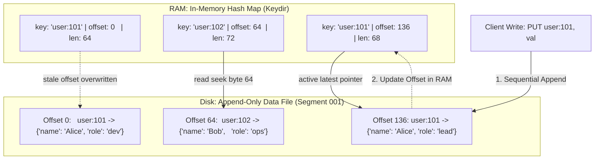

- **Key Takeaway:** Append-only logging guarantees maximum disk write throughput by eliminating random seeks, but limits total keyset size to available RAM and requires background segment compaction to reclaim dead space.

---

### Figure 4-2: SSTable File Layout with Sparse In-Memory Index & Block Compression
- **Figure Reference:** `Figure 4-2: An SSTable with a sparse index and compressed blocks (reconstructed from text p. 120)`
- **Original PDF:** Fig 4-2 → PDF p.143 — open the PDF at page 143 to compare with the Mermaid reconstruction below.
- **Visual Flow & Description:** Shows sorted records grouped into 4 KiB compressed blocks on disk. RAM holds only a sparse index of boundary keys. Queries perform binary search in RAM, load the single target compressed block, and scan sequentially.
- **Mermaid Flowchart:**

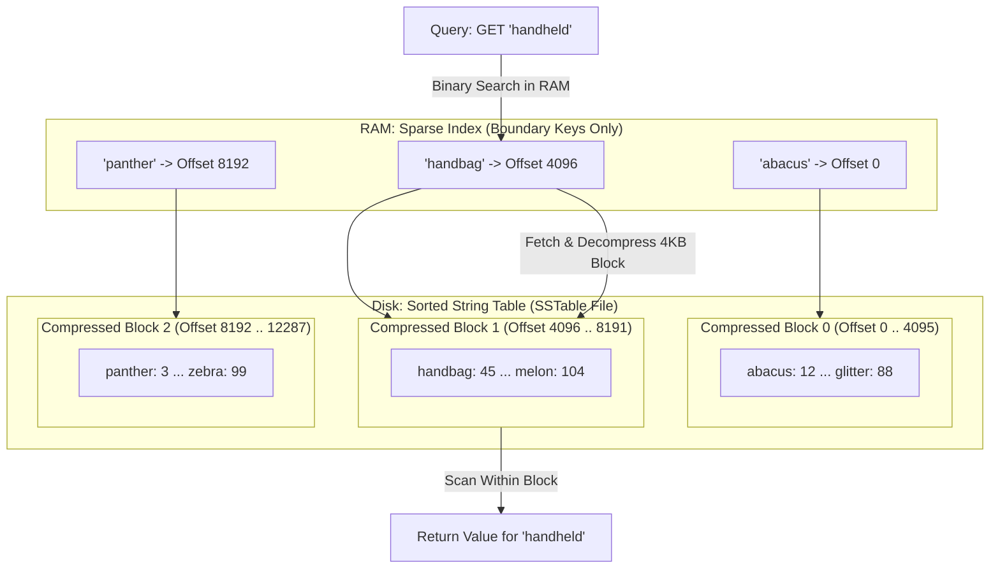

- **Key Takeaway:** Sorting keys on disk allows sparse indexing, eliminating the RAM bottleneck of hash indexes while enabling block-level compression to save disk space and I/O bus bandwidth.

---

### Figure 4-3: Multi-Way SSTable Segment Merge and Compaction
- **Figure Reference:** `Figure 4-3: Merging several SSTable segments, retaining only the most recent value (reconstructed from text p. 121)`
- **Original PDF:** Fig 4-3 → PDF p.145 — open the PDF at page 145 to compare with the Mermaid reconstruction below.
- **Visual Flow & Description:** Depicts the background compaction worker executing an $O(N)$ multi-way merge sort across two older SSTables. Stale keys are dropped, tombstones are purged, and fresh sorted segments are output.
- **Mermaid Flowchart:**

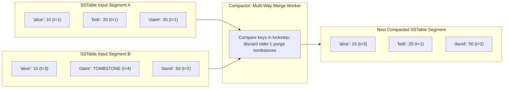

- **Key Takeaway:** Multi-way merging runs strictly sequentially with minimal memory footprint ($O(1)$ RAM buffer per file), purging overwritten history and keeping on-disk data compact.

---

### Figure 4-4: Bloom Filter Probabilistic Membership Test
- **Figure Reference:** `Figure 4-4: A Bloom filter checking whether a particular key is present in an SSTable (reconstructed from text p. 123)`
- **Original PDF:** Fig 4-4 → PDF p.147 — open the PDF at page 147 to compare with the Mermaid reconstruction below.
- **Visual Flow & Description:** Demonstrates a 16-bit array with $k=3$ hash functions. Key `handheld` checks bits 2, 6, and 11. Because bit 11 is 0, the engine determines with 100% mathematical certainty that `handheld` does not exist, aborting disk I/O.
- **Mermaid Flowchart:**

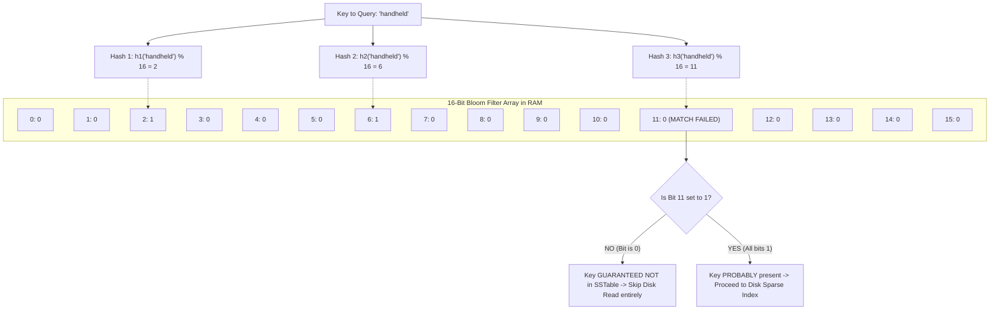

- **Key Takeaway:** A 10-bit-per-key Bloom filter rejects 99% of unnecessary physical disk seeks for non-existent keys, resolving the LSM-tree read amplification bottleneck.

---

### Figure 4-5: B-Tree Index Traversal & Interior Page Pointers
- **Figure Reference:** `Figure 4-5: Looking up key 251 by using a B-tree index (reconstructed from text p. 126)`
- **Original PDF:** Fig 4-5 → PDF p.150 — open the PDF at page 150 to compare with the Mermaid reconstruction below.
- **Visual Flow & Description:** Shows a 3-level B-tree with a branching factor of 6. Root page directs key 251 down to the middle child page, which points to the target leaf page holding the actual record.
- **Mermaid Flowchart:**

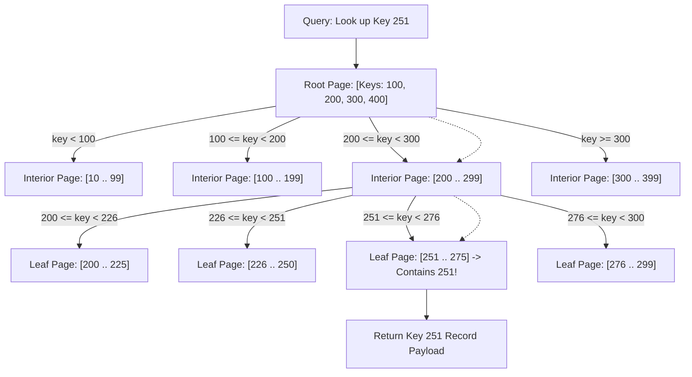

- **Key Takeaway:** High branching factor keeps B-trees exceptionally shallow ($3\text{--}4$ levels), bounding disk seek latency to a deterministic $O(\log_B N)$ bound.

---

### Figure 4-6: B-Tree Page Split on Overflow
- **Figure Reference:** `Figure 4-6: Growing a B-tree by splitting a page on boundary key 337 (reconstructed from text p. 127)`
- **Original PDF:** Fig 4-6 → PDF p.151 — open the PDF at page 151 to compare with the Mermaid reconstruction below.
- **Visual Flow & Description:** Shows an overflowing leaf page splitting into two siblings. The boundary key 337 moves up into the parent page. If the parent page is full, the split cascades upward.
- **Mermaid Flowchart:**

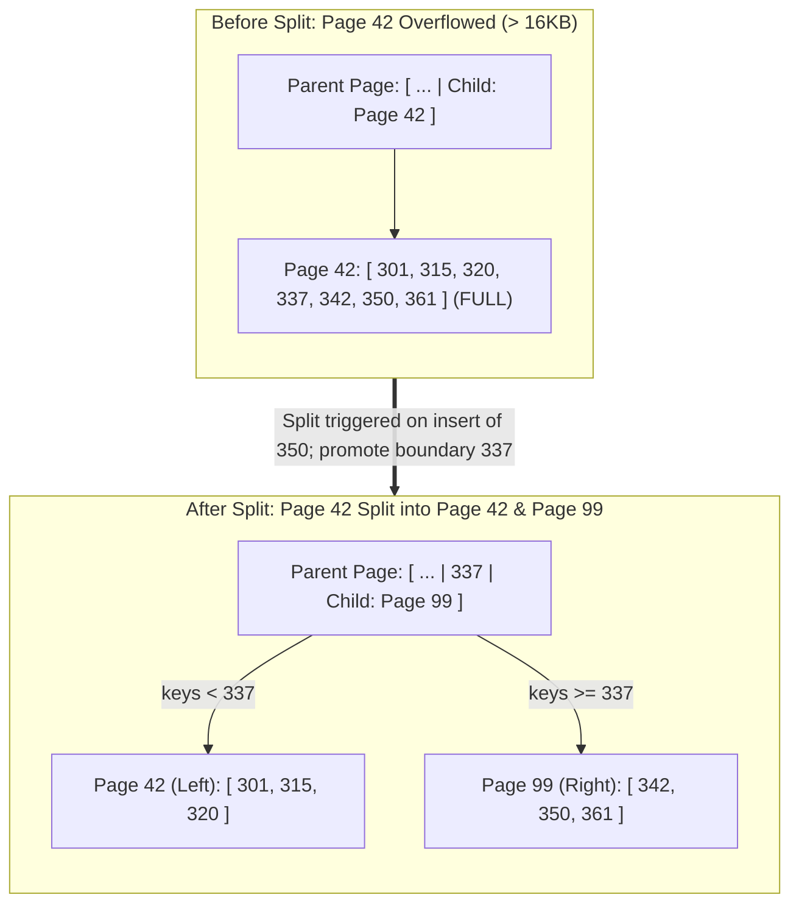

- **Key Takeaway:** B-trees maintain perfect balance by splitting pages from the bottom up, requiring WAL logging and exclusive latches to ensure crash and concurrency safety.

---

### Figure 4-7: Row-Oriented vs. Column-Oriented Physical Layout
- **Figure Reference:** `Figure 4-7: Storing relational data by column rather than by row (reconstructed from text p. 138)`
- **Original PDF:** Fig 4-7 → PDF p.162 — open the PDF at page 162 to compare with the Mermaid reconstruction below.
- **Visual Flow & Description:** Illustrates an e-commerce fact table stored in row format (all attributes of record 1 stored together) versus columnar format (all date keys stored together, all product keys stored together).
- **Mermaid Flowchart:**

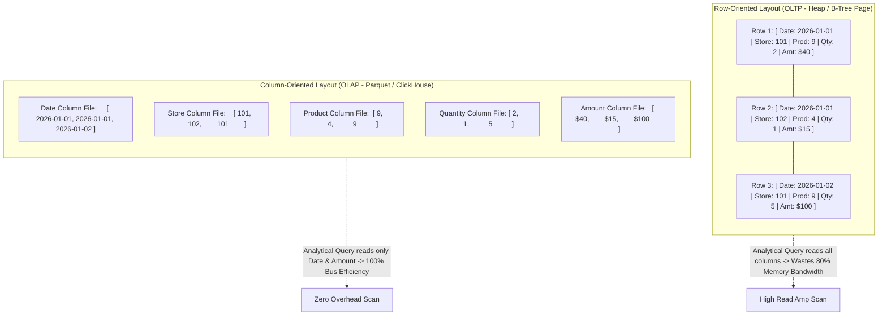

- **Key Takeaway:** Columnar storage matches hardware reality in analytics: loading only queried columns saturates memory buses with useful data and unlocks extreme compression.

---

### Figure 4-8: Columnar Bitmap and Run-Length Encoding
- **Figure Reference:** `Figure 4-8: Compressed, bitmap-indexed storage of a single column (reconstructed from text p. 139)`
- **Original PDF:** Fig 4-8 → PDF p.163 — open the PDF at page 163 to compare with the Mermaid reconstruction below.
- **Visual Flow & Description:** Shows a low-cardinality `product_sk` column transformed into distinct bit vectors per distinct value, compressed via run-length encoding.
- **Mermaid Flowchart:**

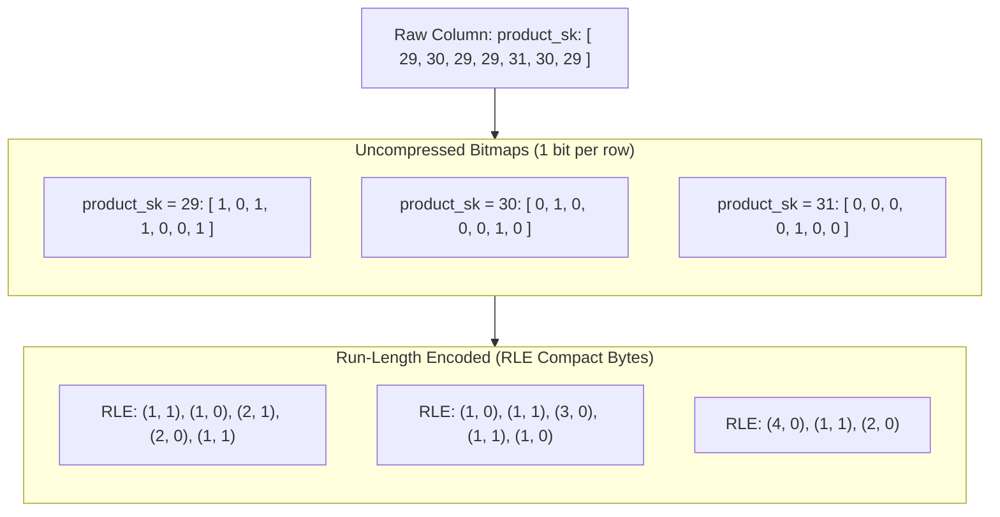

- **Key Takeaway:** Bitmap indexing converts high-overhead database operations into raw bit arrays that compress dramatically and execute directly inside CPU cache.

---

### Figure 4-9: Vectorized Bitwise Execution on SIMD Bitmaps
- **Figure Reference:** `Figure 4-9: A bitwise AND between two bitmaps lends itself to vectorization (reconstructed from text p. 141)`
- **Original PDF:** Fig 4-9 → PDF p.167 — open the PDF at page 167 to compare with the Mermaid reconstruction below.
- **Visual Flow & Description:** Demonstrates how filtering rows matching `product_sk = 29 AND store_sk = 101` evaluates via a single SIMD `VANDPS` machine instruction operating on 512-bit registers.
- **Mermaid Flowchart:**

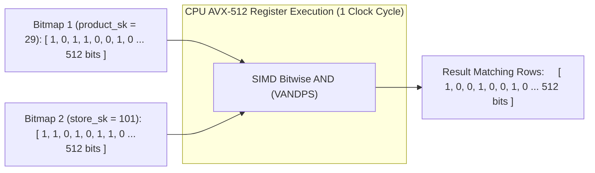

- **Key Takeaway:** Vectorization eliminates instruction dispatch overhead, evaluating filters on 512 rows per instruction without branch mispredictions.

---

### Figure 4-10: Multi-Dimensional OLAP Data Cube
- **Figure Reference:** `Figure 4-10: Two dimensions of a data cube, aggregating data by summing (reconstructed from text p. 143)`
- **Original PDF:** Fig 4-10 → PDF p.168 — open the PDF at page 168 to compare with the Mermaid reconstruction below.
- **Visual Flow & Description:** Depicts a 2D matrix aggregating sales by `Product` and `Date`, precalculating row rollups, column rollups, and the grand total cell.
- **Mermaid Flowchart:**

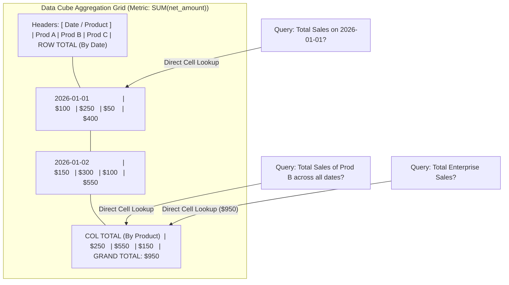

- **Key Takeaway:** Data cubes achieve instantaneous $O(1)$ query evaluation by pre-aggregating dimensional combinations, trading write throughput and storage space for zero read latency.

---

### Figure 4-11: Hierarchical Navigable Small World (HNSW) Multi-Layer Vector Search
- **Figure Reference:** `Figure 4-11: Searching for the database entry closest to a given query vector in an HNSW index (reconstructed from text p. 149)`
- **Original PDF:** Fig 4-11 → PDF p.173 — open the PDF at page 173 to compare with the Mermaid reconstruction below.
- **Visual Flow & Description:** Illustrates an HNSW vector index with 3 hierarchical graph layers. Coarse navigation at Layer 2 identifies entry points for Layer 1, which guides dense search at Layer 0.
- **Mermaid Flowchart:**

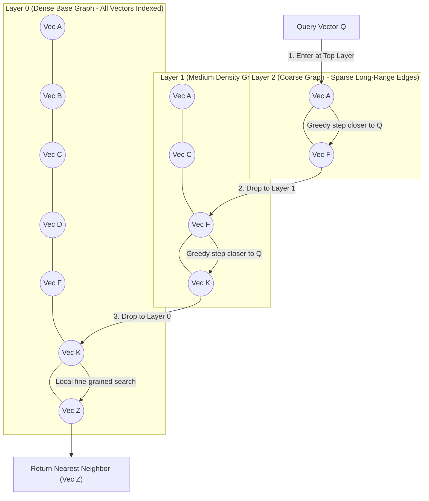

- **Key Takeaway:** HNSW delivers $O(\log N)$ approximate nearest neighbor search over millions of high-dimensional vectors by combining skiplist-style hierarchy with small-world proximity graphs.

---

### LSM-Tree Write and Read Path Concurrent Flow
- **Visual Flow & Description:** Sequence diagram tracking a concurrent `PUT` mutating the WAL and Memtable, while a background thread flushes immutable segments and a client `GET` queries through Bloom filters.
- **Mermaid Sequence Diagram:**

```mermaid
sequenceDiagram
  autonumber
  actor Client as Client Thread
  participant WAL as Disk WAL (Append)
  participant Mem as Active Memtable (RAM)
  participant Imm as Immutable Memtable
  participant Flusher as Background Flusher
  participant SST as L0 SSTable Disk
  participant Bloom as Bloom Filters

  Note over Client,Mem: Write Path Execution
  Client->>WAL: appendRecord(LSN=101, PUT k, v)
  activate WAL
  WAL-->>Client: ack(fsync)
  deactivate WAL
  Client->>Mem: insert(k, v)
  activate Mem
  Mem-->>Client: success
  deactivate Mem

  Note over Mem,Flusher: Memtable Flush Trigger
  Mem->>Imm: freeze when size > 64MB
  activate Imm
  Imm->>Flusher: triggerFlush()
  deactivate Imm
  activate Flusher
  Flusher->>SST: writeSortedDataBlocks(compress=LZ4)
  Flusher->>Bloom: buildBloomFilter(10 bits/key)
  Flusher->>SST: writeSparseIndexAndFooter()
  Flusher-->>WAL: truncateOldWALSegments()
  deactivate Flusher

  Note over Client,Bloom: Read Path Execution
  Client->>Mem: lookup(k)
  Note over Client,Mem: Miss in Active Memtable
  Client->>Imm: lookup(k)
  Note over Client,Imm: Miss in Immutable
  Client->>Bloom: checkBits(k)
  alt Bloom returns false
    Note over Client,SST: Key guaranteed absent; skip disk I/O!
  else Bloom returns true
    Client->>SST: binarySearchSparseIndex(k)
    Client->>SST: readCompressedBlock(4KB)
    SST-->>Client: return value
  end
```

- **Key Takeaway:** Durability is isolated to sequential WAL writes, memory absorbing write latency, while Bloom filters shield disk storage from read amplification.

---

## 4. Real-World Systems, Case Studies & Code Examples

### 4.1 Industry Implementations & Architectural Divergence
- **RocksDB (LSM-Tree Engine):** Developed at Meta (forked from Google LevelDB). Optimized for multi-core CPUs and fast NVMe SSD storage. Introduces column families, concurrent memtable insertions (lock-free skiplist), partitioned filters/indexes to avoid pinned RAM bloat, and dynamic rate limiting to prevent compaction stalls.
- **Apache Cassandra (LSM Distributed Store):** Optimized for high-throughput distributed writes. Uses Size-Tiered Compaction Strategy (STCS) by default for write-heavy telemetry, with options for Leveled Compaction (LCS) or Time-Window Compaction Strategy (TWCS) for time-series data.
- **MySQL InnoDB (B-Tree Engine):** Canonical clustered B-tree storage engine. Primary keys are clustered. Implements a doublewrite buffer to protect against torn pages on operating systems lacking atomic 16 KiB block writes. Uses adaptive hash indexing to dynamically build in-memory hash tables over hot B-tree pages.
- **ClickHouse & DuckDB (Columnar OLAP Engines):** ClickHouse (distributed) and DuckDB (in-process embedded) represent the state of the art in columnar vectorized processing. ClickHouse uses the MergeTree engine family (LSM-like sorted columnar chunks merged in the background). DuckDB processes data in vectorized data chunks of 2,048 elements matching CPU cache lines.

---

### 4.2 Production Implementation: SSTable Segment Compactor with Tombstone Purging

```python
import os
import struct
from typing import List, Tuple, Iterator, Optional

class SSTableRecord:
    TOMBSTONE = b"__DELETED_TOMBSTONE__"

    @staticmethod
    def encode(key: bytes, value: bytes, timestamp: int) -> bytes:
        # Header: Key_Len (2B), Val_Len (4B), Timestamp (8B)
        header = struct.pack(">HQ Q", len(key), len(value), timestamp)
        return header + key + value

    @staticmethod
    def decode(stream) -> Optional[Tuple[bytes, bytes, int]]:
        header_bytes = stream.read(struct.calcsize(">HQ Q"))
        if not header_bytes:
            return None
        key_len, val_len, timestamp = struct.unpack(">HQ Q", header_bytes)
        key = stream.read(key_len)
        value = stream.read(val_len)
        return key, value, timestamp

def multiway_sstable_compactor(
    input_segment_paths: List[str], 
    output_segment_path: str,
    sparse_index_interval_bytes: int = 4096
) -> List[Tuple[bytes, int]]:
    """
    Executes an out-of-core multi-way merge sort across sorted SSTable files.
    Purges overridden keys, drops tombstones, and outputs a compacted segment
    with a sparse in-memory index mapping boundary keys to byte offsets.
    """
    streams = [open(p, "rb") for p in input_segment_paths]
    active_records = [SSTableRecord.decode(s) for s in streams]
    sparse_index = []
    
    bytes_written = 0
    last_indexed_offset = -sparse_index_interval_bytes

    with open(output_segment_path, "wb") as out:
        while True:
            # Find the minimum key across all active streams
            min_key = None
            min_indices = []

            for i, rec in enumerate(active_records):
                if rec is not None:
                    k, _, _ = rec
                    if min_key is None or k < min_key:
                        min_key = k
                        min_indices = [i]
                    elif k == min_key:
                        min_indices.append(i)

            if min_key is None:
                break  # All streams fully consumed

            # Disambiguate by choosing the record with the latest timestamp
            winner_record = max(
                (active_records[idx] for idx in min_indices),
                key=lambda item: item[2]
            )
            key, val, ts = winner_record

            # Advance all input streams that matched min_key
            for idx in min_indices:
                active_records[idx] = SSTableRecord.decode(streams[idx])

            # Purge tombstones during compaction
            if val == SSTableRecord.TOMBSTONE:
                continue

            # Check if we should add an entry to the sparse index
            if bytes_written - last_indexed_offset >= sparse_index_interval_bytes:
                sparse_index.append((key, bytes_written))
                last_indexed_offset = bytes_written

            encoded = SSTableRecord.encode(key, val, ts)
            out.write(encoded)
            bytes_written += len(encoded)

    # Clean up file descriptors
    for s in streams:
        s.close()

    return sparse_index
```

---

### 4.3 Production Implementation: Optimal Bloom Filter with Murmur3 Hashing

```python
import math
import mmh3

class BloomFilter:
    """
    Cache-aligned Bloom Filter with mathematically optimal bit sizing
    and MurmurHash3 dual-hash simulation (Kirsch-Mitzenmacher optimization).
    """
    def __init__(self, expected_elements: int, false_positive_rate: float):
        if not (0 < false_positive_rate < 1):
            raise ValueError("FPR must be between 0 and 1.")
        
        self.n = expected_elements
        self.p = false_positive_rate
        
        # Optimal bits: m = - (n * ln(p)) / (ln(2)^2)
        self.m = int(math.ceil(- (self.n * math.log(self.p)) / (math.log(2) ** 2)))
        # Optimal hash count: k = (m / n) * ln(2)
        self.k = int(round((self.m / self.n) * math.log(2)))
        
        # Byte array storage
        self.bit_array = bytearray((self.m + 7) // 8)

    def _get_hashes(self, key: bytes) -> Iterator[int]:
        # Kirsch-Mitzenmacher: gi(x) = h1(x) + i * h2(x)
        h1 = mmh3.hash(key, 0, signed=False)
        h2 = mmh3.hash(key, 42, signed=False)
        for i in range(self.k):
            yield (h1 + i * h2) % self.m

    def add(self, key: bytes) -> None:
        for bit_index in self._get_hashes(key):
            byte_idx = bit_index // 8
            bit_offset = bit_index % 8
            self.bit_array[byte_idx] |= (1 << bit_offset)

    def contains(self, key: bytes) -> bool:
        """
        Returns False: Guaranteed that key was never added.
        Returns True: Key is probably in the set (within false positive bound).
        """
        for bit_index in self._get_hashes(key):
            byte_idx = bit_index // 8
            bit_offset = bit_index % 8
            if not (self.bit_array[byte_idx] & (1 << bit_offset)):
                return False
        return True
```

---

### 4.4 Production War Story: The RocksDB Write-Stall Meltdown
- **The Context:** An advertising exchange tracked ad impressions using an 8-node RocksDB-backed key-value cluster, sustaining an aggregate ingestion rate of $600,000\ \text{writes/sec}$. The storage configuration allocated standard 64 MiB memtables with Leveled Compaction and default thread pool settings (2 compaction threads).
- **The Pathological Incident:** During a Black Friday promotion, ingestion traffic doubled to $1.2\ \text{million writes/sec}$. Memtables filled and flushed to Level 0 every 1.5 seconds. Because $L_0$ SSTables contain overlapping key ranges, Level 0 files accumulated faster than the 2 compaction worker threads could merge them into Level 1.
- **The Cascade:** When the $L_0$ file count reached 20 (the `level0_slowdown_writes_trigger`), RocksDB introduced synthetic artificial sleep delays (1 millisecond per write) to throttle clients. Because the incoming request rate did not decrease, the client application thread pools saturated with waiting connections. Within 45 seconds, the $L_0$ file count breached 32 (the `level0_stop_writes_trigger`).
- **The Catastrophe:** RocksDB completely stopped accepting writes (`Status::Incomplete("Write stall")`). Application load balancers marked the database nodes unhealthy and routed traffic to remaining nodes, instantly triggering identical write stalls in a cascading cluster-wide outage.
- **Remediation & Lessons:**
  1. *Dynamic Compaction Thread Sizing:* Compaction threads were increased from 2 to 8 dedicated cores on NVMe storage.
  2. *Write Buffer Manager:* Implemented RocksDB's global `WriteBufferManager` across all column families to enforce smooth backpressure instead of hard stop thresholds.
  3. *Switch to Tiered Compaction for Ingestion:* For append-heavy time-series data without immediate point read requirements, the team migrated to Time-Window Compaction Strategy (TWCS), eliminating cross-level write amplification.

---

## 5. Architectural Trade-Off Matrix

| Storage Architecture | Primary Advantage | Point Read (p99) | Write Throughput & Amplification | Space Amplification | Crash Recovery Mechanism | Best Workload Fit | Catastrophic Failure Mode |
| :--- | :--- | :--- | :--- | :--- | :--- | :--- | :--- |
| **Bitcask (Append Log + In-Memory Hash)** | Maximum sustained sequential write speed; simplest engine | $O(1)$ disk seek; sub-5 ms | High throughput; $\text{WA} \approx 1\times\text{--}2\times$ | High ($\sim 50\%$ dead space until compaction) | Replay hint files off disk; scan segments | Low key cardinality; high-frequency value updates | RAM exhaustion when unique key count exceeds memory |
| **LSM-Tree: Leveled (RocksDB, LevelDB)** | High sequential write throughput; superior compression | Moderate ($O(L)$ levels; mitigated by Bloom to 1--2 seeks) | High throughput; high $\text{WA} \ (10\times\text{--}30\times)$ | Low ($\sim 10\%\text{--}20\%$ temporary headroom) | Replay sequential WAL; discard un-flushed memtable | Write-heavy OLTP; high-concurrency ingestion on SSDs | Compaction falling behind write rate triggers total Write Stall |
| **LSM-Tree: Size-Tiered (Cassandra STCS)** | Lowest initial write amplification during bulk ingest | High ($O(\text{files})$ reads across all uncompacted tiers) | Maximum initial write throughput; $\text{WA} \ (4\times\text{--}8\times)$ | Catastrophic ($>50\%$ free disk headroom required) | Replay commit log; rebuild memtable in RAM | Bulk historical append logging; time-series data | Disk full crash during major compaction of large files |
| **B-Tree (In-Place Slotted Page - InnoDB)** | Deterministic sub-millisecond point reads; stable tail latency | $O(\log_B N)$; strictly 1 physical seek if pages cached | Moderate; extreme $\text{WA} \ (30\times\text{--}100\times+)$ | Moderate ($30\%\text{--}50\%$ internal page fragmentation) | Replay physical/redo WAL; doublewrite buffer rollback | Read-heavy OLTP ($>80\%$ reads); range-scan queries | Random write patterns on large datasets induce massive I/O thrashing |
| **Columnar Engine (Parquet, ClickHouse)** | Unrivaled analytical scan throughput via SIMD vectorization | Unusable for single-row lookups ($O(N)$ column reads) | High for batch appends; catastrophic for point updates | Minimal (Extreme: $80\%\text{--}95\%$ via RLE / Bitmaps) | Immutable file snapshots; lakehouse manifest CAS | Analytical aggregations (OLAP); data warehousing | Executing high-concurrency single-record point `UPDATE/DELETE` |
| **HNSW Vector Index (Faiss, pgvector)** | Fast $O(\log N)$ approximate nearest neighbor search | Sub-10 ms for high-dimensional vectors | Low; high build time ($O(N \log N)$ distance ops) | High ($1.5\times\text{--}2.5\times$ vector size for graph edges) | Rebuild graph or persist serialized adjacency layers | AI embeddings; semantic search; recommendation engines | Graph size exceeding RAM forces random disk seeks, stalling search |

---

### Concrete Decision Heuristics

```text
Decision Tree for Storage Engine Selection:
1. Is the workload Analytical (OLAP - aggregates, scans over millions of rows)?
   ├── YES:
   │    ├── Querying immutable/batch historical logs? -> Use Columnar Engine (Parquet / ClickHouse / Snowflake).
   │    └── Queries require real-time pre-aggregated rollups on fixed dimensions? -> Precompute Materialized OLAP Data Cube.
   └── NO (OLTP - point lookups, single-row inserts/updates by key):
        ├── Does the entire set of unique keys fit in server RAM?
        │    ├── YES and values are updated frequently? -> Use In-Memory Hash Store (Bitcask / Redis).
        │    └── NO:
        │         ├── Is the workload heavily Read-Dominant (>85% reads) requiring deterministic p99 latency?
        │         │    └── YES -> Use B-Tree Clustered Store (MySQL InnoDB / PostgreSQL).
        │         └── Is the workload Write-Heavy (>30% writes) or ingestion-rate bound?
        │              ├── Need point-read efficiency across levels? -> Use LSM-Tree with Leveled Compaction (RocksDB).
        │              └── Pure append-only time-series with predictable TTL? -> Use LSM-Tree with Time-Window Compaction (TWCS).
```

---

## 6. Jargon Buster & Key Terminology

- **Memtable:** An in-memory, write-buffered balanced search tree (skiplist or red-black tree) that stores recent mutations in sorted order before flushing them as immutable SSTables to disk.
- **SSTable (Sorted String Table):** An immutable on-disk file format storing a sequence of key-value pairs sorted strictly by key, organized into compressed blocks with an internal index.
- **Write Amplification (WA):** The ratio of the number of bytes written to underlying physical storage (flash/disk) relative to the logical number of bytes requested by the application write.
- **Read Amplification (RA):** The number of physical disk/block reads required to satisfy a single logical database read request.
- **Space Amplification (SA):** The ratio of the physical disk space consumed by the database files relative to the actual uncompressed raw size of valid data records.
- **Compaction:** The background maintenance process in log-structured storage engines that merges multiple immutable data files, reconciles updates, and purges deleted records (tombstones).
- **Bloom Filter:** A space-efficient probabilistic data structure that tests set membership with zero false negatives and a tunable false positive rate, preventing unnecessary disk I/O.
- **Latch vs. Lock:** In database internals, a **latch** is a short-duration, low-overhead in-memory concurrency control primitive (e.g., mutex or spinlock) protecting in-memory data structures (like B-tree page pointers) for microseconds. A **lock** is a high-level transaction primitive held for the entire duration of a transaction to maintain ACID isolation.
- **Vectorized Execution:** A query processing model where operators evaluate batches of column data (e.g., 1,024 elements) within tight loops using CPU SIMD instructions, rather than processing one row at a time via recursive function calls. *Confused with:* Vector embedding search.
- **HNSW (Hierarchical Navigable Small World):** A multi-layer graph algorithm used in vector databases for approximate nearest neighbor search that achieves logarithmic $O(\log N)$ search complexity by navigating through hierarchical proximity layers.

---

## 7. System Design & Practical Engineering Takeaways

### 7.1 Production Engineering Checklist
1. **Never Disable WAL fsync Without Measuring Data Loss Window:** Disabling WAL `fsync` (`flush_log_at_trx_commit = 2` in MySQL or `wal_level = minimal` in Postgres) boosts write IOPS by $10\times$ by buffering writes in OS cache, but guarantees torn transactions and data loss on server power failure.
2. **Size LSM Bloom Filters at Exactly 10 Bits/Key:** Sizing Bloom filters below 10 bits per key exponentially increases the false positive rate ($p \approx 0.6185^{m/n}$), degrading point read throughput by driving unnecessary random disk reads. Sizing above 12 bits yields diminishing returns while wasting resident RAM.
3. **Budget 50% Disk Headroom for Size-Tiered Compaction:** If operating Apache Cassandra with Size-Tiered Compaction (STCS), never exceed $50\%$ disk utilization. Compacting a 500 GiB SSTable requires allocating a 500 GiB temporary file concurrently before the old file can be unlinked.
4. **Enforce Secondary Index Column Ordering on Concatenated Indexes:** When defining multi-column B-tree indexes `(A, B, C)`, order columns from highest equality filtering cardinality to range filtering cardinality. A query filtering on `B` cannot use an index ordered `(A, B)`.
5. **Pin B-Tree Root and Interior Pages in Memory:** Ensure database buffer pools are sized to permanently hold Level 0 through Level $(D-1)$ of all active B-tree indexes, guaranteeing that point lookups incur at most 1 physical disk read (the leaf page).

---

### 7.2 System Design Interview Strategy
- **Derive Storage Engine from Workload Asymmetry:** In system design interviews (e.g., designing Uber ride location tracking vs. an e-commerce checkout ledger), immediately state the write/read ratio. Propose LSM-trees (RocksDB/Cassandra) for high-velocity write ingest ($>10,000\ \text{writes/sec}$) to avoid B-tree random I/O write amplification. Propose clustered B-trees (PostgreSQL/InnoDB) when point-read latency determinism and relational ACID invariants dominate.
- **Address Compaction Interference Proactively:** When proposing an LSM-tree architecture, score points with the interviewer by proactively pointing out the **compaction stall failure mode**. Explain how background compaction threads saturate disk I/O channels, driving p99 write latency spikes, and propose mitigations (rate-limiting compaction I/O, provisioned IOPS NVMe drives, or separate flush threads).
- **Capacity Sketching Template:**
  $$\text{Storage Growth} = \text{QPS}_{\text{write}} \times \text{Avg Payload Bytes} \times (1 + \text{Write Amplification}) \times \text{Replication Factor}$$
  $$\text{RAM Required (Bitcask)} = \text{Unique Key Count} \times (\text{Key Bytes} + 16\ \text{Bytes Pointer Overhead})$$
  $$\text{RAM Required (Bloom Filters)} = \text{Total Unique Records} \times 10\ \text{bits} \div 8\ \text{bits/byte}$$

---

### 7.3 Mastery Self-Assessment Questions

#### Question 1 (Conceptual Depth)
*Why does an LSM-Tree achieve higher raw write throughput than an in-place B-Tree on disk, but why can its read latency and p99 tail latency degrade substantially under sustained mixed workloads?*
- **Answer:** 
  An LSM-tree achieves superior write throughput because it converts random application writes into sequential disk I/O. Incoming writes are appended to an on-disk sequential Write-Ahead Log (WAL) and buffered in an in-memory skiplist (Memtable). The sequential write bandwidth of modern storage media (HDD $\sim 150\text{--}250\ \text{MB/s}$, NVMe SSD $\sim 3,000\text{--}7,000\ \text{MB/s}$) is ~10-100x higher scan throughput (columnar + SIMD, see trade-off matrix) than random I/O seek capabilities. In contrast, a B-tree must overwrite fixed 16 KiB pages in-place across the disk address space. If the active dataset exceeds the buffer pool, every B-tree write incurs random page reads and writes, multiplying write amplification ($30\times\text{--}100\times$).
  However, LSM-tree read latency degrades under sustained mixed load due to **Read Amplification** and **Compaction Interference**. A point read in an LSM-tree must check the Memtable and potentially multiple SSTables across levels ($L_0$ to $L_k$). Even with Bloom filters, range queries must merge iterators across all overlapping SSTables using a priority queue. Furthermore, background compaction threads continuously read and rewrite gigabytes of SSTables to maintain leveled invariants. Under high write load, compaction saturates disk I/O and CPU memory buses, creating severe queueing delays that cause p99 read and write latencies to spike by orders of magnitude (compaction stalls).

#### Question 2 (Failure Scenario & Edge Cases)
*A high-frequency IoT ingest platform running a 5-node RocksDB-backed key-value cluster suddenly experiences complete ingestion failure: all worker threads trying to execute `db->Put()` block indefinitely, and incoming HTTP requests time out. Monitoring shows disk space utilization is at 60%, CPU utilization has dropped to near zero, and disk write throughput has collapsed. Diagnose the root cause, identify the exact threshold violation, and prescribe immediate operational remediation.*
- **Answer:**
  - *Diagnosis:* The cluster has encountered a **Hard Write Stall (`stop-writes trigger`)** caused by an uncompacted Level 0 file explosion.
  - *Mechanism:* The ingestion rate exceeded the disk compaction throughput. Flushes from the Memtable to $L_0$ occurred faster than compaction threads could merge $L_0$ files into $L_1$. In RocksDB, when the number of files in $L_0$ crosses `level0_slowdown_writes_trigger` (default 20), writes are throttled. When it breaches `level0_stop_writes_trigger` (default 36 files), RocksDB unconditionally **blocks all incoming write threads** completely until compaction reduces $L_0$ file count below the limit.
  - *Remediation:*
    1. *Immediate:* Temporarily increase `max_background_compactions` and `max_background_jobs` dynamically via `db->SetOptions()` to assign all available CPU cores to compaction.
    2. *Configuration Tuning:* Increase `write_buffer_size` (e.g., from 64 MiB to 256 MiB) to reduce total file count, and increase `level0_stop_writes_trigger` to provide temporary ingestion buffer headroom.
    3. *Architectural Fix:* Enable RocksDB's `rate_limiter` to smooth out bursty compaction I/O and transition write-heavy time-series tables to a Universal Compaction or Time-Window Compaction Strategy (TWCS).

#### Question 3 (Trade-Off & Capacity Estimation)
*An analytics telemetry system ingests 1 billion records per day. Each record consists of 40 columns (total uncompressed row size = 1 KiB). An analytical query executes every 10 minutes, computing `SELECT customer_id, SUM(transaction_amount) FROM transactions WHERE date BETWEEN '2026-01-01' AND '2026-01-30' GROUP BY customer_id`. Compare the storage footprint and disk I/O scan requirements for this 30-day query under: (A) A row-oriented PostgreSQL InnoDB B-Tree table, vs. (B) A column-oriented ClickHouse / Parquet storage engine where `date`, `customer_id` (4 bytes), and `transaction_amount` (8 bytes) are compressed via run-length and dictionary encoding with a $5\times$ compression factor. Show exact quantitative derivations.*
- **Answer:**
  - *Dataset Volume:*
    - Records over 30 days: $30\ \text{days} \times 10^9\ \text{records/day} = 30 \times 10^9\ \text{records}$ (30 billion rows).
  - *Approach A (Row-Oriented B-Tree / Heap Store):*
    - Uncompressed raw data size: $30 \times 10^9 \times 1,024\ \text{bytes} \approx 30.72\ \text{TB}$.
    - Accounting for page header overhead, tuple headers (24 bytes/row), and $30\%$ internal page fragmentation in B-trees ($1 / 0.70 \approx 1.43\times$ multiplier):
      $$\text{Storage Footprint} \approx 30.72\ \text{TB} \times 1.43 \approx 43.9\ \text{TB}$$
    - *Query Scan I/O:* Because records are stored row by row, scanning the 30-day range requires loading every page off disk across memory channels, even though the query only uses 3 out of 40 columns.
      $$\text{Disk I/O Scanned} = 30.72\ \text{TB} \ (\text{or } 43.9\ \text{TB with page slack})$$
      At a sequential read throughput of $1\ \text{GB/s}$, reading 30.72 TB requires:
      $$\text{Time} = \frac{30,720\ \text{GB}}{1\ \text{GB/s}} = 30,720\ \text{seconds} \approx 8.53\ \text{hours}$$
      The 10-minute query SLA is completely missed.
  - *Approach B (Column-Oriented ClickHouse / Parquet):*
    - Total uncompressed size of the 3 accessed columns per row:
      - `date` (4 bytes) + `customer_id` (4 bytes) + `transaction_amount` (8 bytes) = 16 bytes per row.
      - Uncompressed size for 30 billion rows:
        $$30 \times 10^9 \times 16\ \text{bytes} = 480 \times 10^9\ \text{bytes} = 480\ \text{GB}$$
    - Applying columnar compression ($5\times$ factor via bit-packing and RLE):
      $$\text{Disk Footprint of 3 Queried Columns} = \frac{480\ \text{GB}}{5} = 96\ \text{GB}$$
    - Total storage footprint for all 40 columns compressed ($5\times$ overall):
      $$\text{Total Table Storage} = \frac{30.72\ \text{TB}}{5} \approx 6.14\ \text{TB}$$
    - *Query Scan I/O:* The columnar engine reads **only** the 3 target column files off disk:
      $$\text{Disk I/O Scanned} = 96\ \text{GB}$$
      At $1\ \text{GB/s}$ sequential NVMe read speed:
      $$\text{Time} = \frac{96\ \text{GB}}{1\ \text{GB/s}} = 96\ \text{seconds}$$
      With multi-core vectorized SIMD execution across 16 cores, scan time drops to $< 10\ \text{seconds}$, effortlessly satisfying the 10-minute reporting SLA with a $320\times$ reduction in I/O scan bandwidth.


---
> [!NAV] **Chapter Navigation**
> ⬅️ **Previous:** [[chapter-03-data-models-and-query-languages|Chapter 03: Data Models and Query Languages]] | 🏠 **Index:** [[00-Master-Reading-Dashboard|Master Dashboard]] | ➡️ **Next:** [[chapter-05-encoding-and-evolution|Chapter 05: Encoding and Evolution]]