# Chapter 4: Storage and Retrieval — Definitive Technical Summary
*From: Designing Data-Intensive Applications (2nd Edition) by Martin Kleppmann and Chris Riccomini*
*Source PDF: pp. 139–184 (673-page PDF) — figures below cite PDF pages.*

> [!NAV] **Chapter Navigation**
> ⬅️ **Previous:** [[chapter-03-data-models-and-query-languages|Chapter 03: Data Models and Query Languages]] | 🏠 **Index:** [[00-Master-Reading-Dashboard|Master Dashboard]] | ➡️ **Next:** [[chapter-05-encoding-and-evolution|Chapter 05: Encoding and Evolution]]


---

## 1. Executive Summary & Core Engineering Problem

> *"On the most fundamental level, a database needs to do two things: when you give it some data, it should store the data, and when you ask it for the data later, it should give the data back to you."*
> — **Martin Kleppmann**, *Designing Data-Intensive Applications*

- **The World's Simplest Database (Why Indexes Exist — p.140):**
  To understand storage engines, consider the simplest possible database as two Bash functions:
  ```bash
  #!/usr/bin/env bash
  db_set () {
      echo "$1,$2" >> database.txt
  }
  db_get () {
      grep "^$1," database.txt | sed -e "s/^$1,//" | tail -n 1
  }
  ```
  Alice runs `db_set 42 '{"name":"San Francisco"}'` — an $O(1)$ sequential append costing <1 ms. Bob runs `db_get 42` — `grep` scans the entire file $O(N)$. With 100M records this is minutes per lookup. Appending is the fastest disk operation; scanning is the slowest. Every real engine (Chapter 4, pp.139–174) is an answer to this asymmetry.
  - **The Core Trade-off of Indexing:** An **index** is an auxiliary structure derived from primary data. It speeds reads ($O(1)$ or $O(\log N)$) but **every index slows writes and consumes disk**, because it must be updated on every write. Databases never index everything by default — you choose indexes from query patterns.

- **Core Thesis:** No engine optimizes point writes, bulk scans, and memory footprint simultaneously. Log-structured merge-trees (LSM) trade background compaction CPU and read amplification for sequential write bandwidth; page-based B-trees trade write amplification ($30\times$–$100\times$) and fragmentation for deterministic $O(\log N)$ reads; columnar stores sacrifice single-row mutation to gain $10\times$–$100\times$ scan throughput via compression + SIMD vectorization.
- **Problem Statement:** Alice's IoT fleet writes $100{,}000\ \text{writes/sec}$ of 50-byte sensor records with random UUIDv4 keys into a B-tree. Each write dirties a random 16 KiB page: write amplification $>300\times$, HDD random IOPS cap $\sim 150$, NVMe random-write cap $\sim 80{,}000$ before FTL garbage collection stalls, p99 write latency explodes from 2 ms to $>5{,}000$ ms, ingestion halts. Conversely Bob's `SELECT AVG(age)` over 100M rows on a row store wastes $>95\%$ of memory-bus bandwidth fetching unneeded columns.
- **Historical & Industry Context:** 1970s System R standardized in-place B-trees (Bayer & McCreight 1970, Comer 1979 "ubiquitous"). 1990s O'Neil et al. LSM-tree (1996) + Rosenblum log-structured filesystem → Google Bigtable (2006) introduced SSTable/memtable → LevelDB/RocksDB/Cassandra/HBase/ScyllaDB. 2000s C-Store/MonetDB/Vertica → 2010s Snowflake/ClickHouse/DuckDB columnar + vectorized execution. 2020s disaggregation (S3/GCS object storage, Delta Lake/SlateDB on object stores) + dense vector search (HNSW/IVF for LLM embeddings).

---

## 2. In-Depth Technical Concepts & Internal Mechanics

### 2.1 Append-Only Logs & Hash Indexes (p.140–142 — Bitcask Model)
- **Plain-English Intuition:** Keep appending every write to a log. In RAM keep `key -> byte_offset`. To read, look up offset in RAM and seek once on disk. Alice writes `session_abc123`; Bob reads it with one seek.
- **Foundational Theory:** `db_set` appends `[key,value]` CSV-like lines. Old versions are never overwritten — latest value is last occurrence (`tail -n 1`). This log is the simplest write path ($O(1)$ sequential, no seeks). To avoid $O(N)$ scans, keep an in-memory hash map to byte offsets (Figure 4-1, PDF p.142).
- **Three Fatal Limits:** (1) Disk never reclaimed — overwritten values bloat file forever. (2) Hash map not persisted — restart requires full log scan; 1 TB log = hours of recovery. (3) Hash must fit in RAM — 1B keys × (32B key + 16B overhead) = $48\ \text{GiB}$ RAM. On-disk hash is impractical (random I/O, collision logic, expensive growth). (4) No range scans — `keys 10000–19999` needs 10K individual lookups.

| Engine | RAM Index? | Write Path | Point Read | Range? | Best For |
| :--- | :--- | :--- | :--- | :--- | :--- |
| **Bitcask (log+hash)** | Yes (all keys) | $O(1)$ append | $O(1)$ 1 seek | No | Session store, small keyset |
| **LSM (RocksDB)** | No (sparse+Bloom) | $O(\log M)$ RAM + WAL | $O(1)$–$O(L)$, Bloom-gated | Yes | Write-heavy, SSD |
| **B-tree (InnoDB)** | No (buffer pool) | $O(\log_B N)$ random | $O(\log_B N)$, 1 seek | Yes | Read-heavy OLTP |

- **File Segments & Compaction:** Freeze active segment at ~1 GiB, open new active segment, background thread copies only live keys to new file, swaps pointers, `unlink()` old files. Tombstone `PUT(k,TOMBSTONE)` purges deletes. Hint files `(key->offset)` speed restart. LSN per record orders recovery; `fsync` policy sets durability window ($0$–$10$ ms loss on crash if async).
- **Cost Number:** S3 object storage $\$0.023$/GB-mo vs RAM $\$3$–$\$5$/GB-mo — 100× gap is why RAM-only indexes fail at scale.

---

### 2.2 SSTables and LSM-Trees (pp.143–145 — Sorted Tables, Memtable, Merge)
- **Plain-English Intuition:** Keep data **sorted by key** on disk. Buffer writes in a sorted RAM structure (memtable); when full (64–256 MiB), flush sorted run to disk as an immutable **SSTable**. Reads binary-search a tiny sparse index.
- **SSTable Format (Figure 4-2, PDF p.143):** Keys sorted, each key once per file. Group pairs into 4–64 KiB blocks, compress each (LZ4/Zstd/Snappy — shaded area in book figure). Sparse index stores only first key per block (e.g., `handbag -> offset 4096`, `handsome -> offset 8192`). Lookup `handiwork`: binary-search sparse index in RAM, seek to `handbag` block, scan 4 KiB. Index uses immutable B-tree/trie. Block scan is microseconds; disk seek is milliseconds.
- **LSM Write/Read/Merge (Figure 4-3, PDF pp.144–145):**
  1. *Write:* Append `[LSN,type,key,value]` to on-disk WAL (sequential + `fsync`), insert into memtable (red-black/skiplist/trie, $O(\log M)$), ack. WAL exists only for crash restore; unsorted.
  2. *Flush:* Memtable full → freeze as immutable, open new memtable + WAL, background thread writes sorted L0 SSTable + sparse index + Bloom filter, deletes old WAL.
  3. *Read:* Memtable → immutable memtables → newest-to-oldest SSTables, Bloom-gating each.
  4. *Merge/compaction:* Multi-way mergesort across segments ($O(N)$ streaming, $O(1)$ RAM per file). Keep newest timestamp per key, drop tombstoned keys. Tombstone must propagate to oldest segment before removal.
- **Crash & Cost Details:** SSTables immutable → crash during flush/merge = delete partial file, replay WAL. Checksums detect torn WAL tail. Segments work on object storage (SlateDB, Delta Lake [12]). Used by RocksDB/Cassandra/ScyllaDB/HBase, all from Bigtable paper [9] + LSM paper [10]. Embedded engines (p.149): RocksDB, SQLite, LMDB, DuckDB, KùzuDB — same structures, library-linked, per-tenant instances viable (e.g., Bluesky single-tenant SQLite).

---

### 2.3 Bloom Filters & Compaction Strategies (pp.146–148)
- **Plain-English Intuition:** Checking 20 SSTables per miss = 20 disk seeks. A **Bloom filter** (10 bits/key in RAM) answers "definitely not here" without I/O. **Compaction** merges files to bound that check.
- **Bloom Mechanics (Figure 4-4, PDF p.146):** Bit array $m$, $k$ hashes. Book example: 16 bits, key `handbag -> (2,9,4)` sets bits; query `handheld -> (6,11,2)`: bit 11 is 0 → **guaranteed absent**, skip SSTable. All-1s → probably present (or false positive) → check sparse index + block. Formulas: $m = -n\ln p/(\ln 2)^2$, $k=(m/n)\ln 2$. For $p=1\%$: $m/n\approx 9.6\approx 10$ bits/key, $k=7$. Each +5 bits/key cuts $p$ 10×. 100M keys → $10^9$ bits = 125 MiB RAM to save millions of seeks. False positives cost one wasted 4 KiB read — harmless.
- **Compaction Strategies:**
| Strategy | Write Amp | Space | Read | Best Workload |
| :--- | :--- | :--- | :--- | :--- |
| **Size-tiered (STCS)** | Low $4\times$–$8\times$ | High ($>50\%$ headroom; 4×256 MB → ~898 MB after drops) | $O(\text{files})$ | Bulk ingest, high writes |
| **Leveled (LCS L0,L1…)** | High $10\times$–$30\times$ | Low ($<10\%$) | 1 SSTable/level | Read-heavy OLTP |
| **FIFO/Time-window** | $1\times$–$2\times$ | Lowest (drop whole files) | Fast recent | Metrics, TTL streams |
  Leveled partitions L1+ by key range (e.g., `a–m`, `n–z`), merges $L_i\to L_{i+1}$ on size breach. Rule of thumb: size-tiered for write-dominated, leveled for read-dominated or skewed hot keys. High write burst → memtable fills, compaction lags → RocksDB backpressure: stall/sleep writes until flush (see §4.4 war story).

---

### 2.4 B-Trees: Pages, Splits, WAL (pp.149–152 — Figures 4-5, 4-6)
- **Plain-English Intuition:** Divide DB into fixed 4–16 KiB **pages** (Postgres 8 KiB, MySQL 16 KiB), update in place. Like an encyclopedia: root tells you which volume, interior tells you which page, leaf holds record. Depth stays 3–4 for terabytes.
- **Traversal (Figure 4-5, PDF p.150):** Root page holds keys + child pointers (branching factor $B\approx 500$). Lookup 251: root `[100,200,300,400]` → child `200–300` → leaf `250–270` → value inline or heap pointer. Depth $=\lceil\log_B N\rceil$. 4-level × 4 KiB × $B=500$: $500^4\approx 62.5$B keys ≈ 250 TB. Root + interior pinned in buffer pool → 1 physical I/O per point lookup, predictable.
- **Splits (Figure 4-6, PDF p.151):** Insert 334 into full page `333–345` → allocate new page, split `333–337` / `337–345`, promote boundary 337 to parent. Parent full → recurse; root split → new root, depth +1. Deletes require merges [5]. Slotted-page layout: header `[LSN:8B, free-offset:2B, slots:2B]` + slot array growing down + cells growing up — avoids per-write defrag. Siblings linked for ordered scans; interior keys abbreviated to raise $B$.
- **Reliability — WAL (p.152):** Overwrite = torn-page + orphan-page risk on crash mid-split. **Invariant: WAL (journal) `fsync` before dirty page reaches disk.** WAL = append-only `[pageID,slot,diff]`; recovery replays redo (ARIES [24]). Buffer pool delays page flushes; WAL guarantees durability. Variants: LMDB copy-on-write (new page + new parents, helps snapshot isolation p.293), sequential leaf layout, sibling pointers. Doublewrite buffer (InnoDB) guards non-atomic 16 KiB writes.

---

### 2.5 Comparing B-Trees vs LSM-Trees (pp.153–155)
- **Rule of Thumb:** LSM for write-heavy, B-tree for read-heavy — but measure your workload; hybrids exist (multiple B-trees merged LSM-style).
- **Read Performance:** B-tree: 1 page/level, shallow, predictable. LSM: check memtable + several SSTables, Bloom-gated; range queries fan out across all segments via heap merge (Bloom useless — would hash every key in range). LSM write bursts → latency spikes/backpressure.
- **Sequential vs Random Writes & SSD Physics:** B-tree scattered keys → random page overwrites. LSM → large sequential segment writes. HDD: random seek ~10 ms vs sequential ~200 MB/s — huge gap. SSD/NVMe (PCIe, not SATA): still prefers sequential — flash reads/writes 4 KiB pages but erases 512 KiB blocks; random writes fragment blocks, forcing garbage collection that steals bandwidth and wears flash. Sequential SSTables fill whole erase blocks → erase without GC.
- **Write Amplification:** $WA = \text{bytes to disk}/\text{bytes from app}$. LSM: WAL + flush + per-level recompaction ($10\times$–$30\times$ leveled; WiscKey [37] separates values to cut it). B-tree: WAL + full page flush even for 10B change ($30\times$–$100\times$+, worst $1638\times = 16384/10$). LSM usually lower (no whole-page rewrites + block compression). Measure long enough — empty LSM shows no compaction; growth shares bandwidth with compaction.
- **Space & Snapshots:** B-tree fragmentation (deleted pages mid-file, need `VACUUM`; can't return to OS). LSM: dense, compressed, often smaller; leveled overhead low, size-tiered high transient. LSM deletes linger until tombstone compacts through all levels (GDPR concern [42]). LSM snapshots trivial (pin segments, no copy); B-tree overwrites make snapshots hard.

---

### 2.6 Multicolumn, Secondary, Clustered & In-Memory (pp.156–157)
- **Secondary Indexes (p.156):** Primary key = unique ID; `CREATE INDEX ON …(user_id)` enables non-key search. Built from same key-value structures. Non-unique → postings list per key *or* append row-ID to make unique. Works on B-tree or LSM.
- **Storing Values Within Index (p.157):** (a) **Clustered:** row lives in index leaf (InnoDB primary key; SQL Server one/clustered table). (b) **Heap:** index holds pointer; rows in unordered heap file (Postgres: index → `(page,slot)` TID; heap append-only or reuse). (c) **Covering / INCLUDE:** duplicate some columns in index (`… INCLUDE(created_at,status)`) → index-only scan, no heap fetch, at cost of space + write amp. Non-key update that fits → HOT overwrite in heap; growth → move + update all indexes or leave forwarding pointer.
- **Concatenated vs Multidimensional:** Concatenated `(lastname,firstname)` sorts lexicographically — finds `lastname=X` or `lastname=X AND firstname=Y`, useless for `firstname=Y` alone. True 2-D box queries need spatial indexes (see §2.10).
- **Keeping Everything in Memory (p.157):** RAM cheaper → full datasets fit distributed RAM. Memcached = cache-only (loss OK). VoltDB/SingleStore/TimesTen (relational), RAMCloud (log-structured + durable), Redis/Couchbase (async disk) = durable via battery RAM, disk log, snapshots, or replicas. Disk still used as append-only durability log + backup/inspection. **Counterintuitive truth:** speed comes not from avoiding disk reads (OS page cache already does that) but from avoiding disk-*format* encode/decode overhead [49]. Redis bonus: in-RAM structures (queues, sets) trivial vs disk indexes.

---

### 2.7 Data Storage for Analytics & Cloud Warehouses (pp.158–160)
- **OLTP vs OLAP Internals:** Same SQL surface, different engines. OLTP = many small point reads/writes via PK. OLAP = few huge scans/aggregations. Vendors split engines (SQL Server/HANA/SingleStore HTAP = two engines, one SQL [50–53]).
- **Cloud Data Warehouses (p.159):** Teradata/Vertica/HANA (on-prem + cloud) vs BigQuery/Redshift/Snowflake (cloud-only, object storage + serverless). Decouple storage (S3/GCS, $\$0.023$/GB-mo, 11-nines) from compute (scale independently, cf. p.14). Native log ingestion (Dataflow/Kinesis), elastic burst. Open-source disaggregation: Hive → Trino/DataFusion/Presto (parse/optimize/execute, Spark/Flink execution) + **storage format** (Parquet/ORC/Lance/Nimble bytes on object store — §2.8) + **table format** (Iceberg/Delta: which files = table, schema, inserts/deletes, time-travel, GC, transactions) + **catalog** (Polaris/Unity/Iceberg REST: create/rename/drop, governance p.24).
- **Column-Oriented Storage (pp.160–163 — Figures 4-7, 4-8):** Fact tables 100+ cols, queries touch 4–5 (Example 4-1: `fact_sales ⋈ dim_date ⋈ dim_product WHERE year=2024 AND category IN ('Fresh fruit','Candy')` touches only `date_key,product_sk,quantity`). Row stores load all 100 attrs → 95% waste. Columnar stores each column contiguously (Figure 4-7, PDF pp.161–162); row $i$ = $i$-th entry per column. Blocked by timestamp ranges (thousands–millions rows/block) for partition pruning. Parquet/ORC/Lance/Nimble on disk; Arrow/Pandas/NumPy in RAM; Snowflake/DuckDB/Pinot/Druid/InfluxDB IOx/TimescaleDB engines. Document nesting via Dremel shredding/striping [58–59].
- **Column Compression (Figure 4-8, PDF p.163):** Same-column repetition compresses. Bitmap: $n$ distinct values → $n$ bit-vectors (bit $i$=1 if row $i$ has value); sparse → run-length `(count,value)` + Roaring adaptive. Query `product_sk IN (31,68,69)` = OR 3 bitmaps; `product_sk=30 AND store_sk=3` = AND 2 bitmaps (same row order). Wide-column (Bigtable/HBase/Cassandra) is *row-oriented* despite name — don't confuse.
- **Sort Order & Writes:** Sort whole rows (not columns independently — else row identity lost). DBA picks sort keys from query patterns: `date_key` first → last-month scan prunes; `product_sk` second groups same-day products. First key RLE-compresses to KiBs even for billions of rows. Point writes rewrite compressed columns → batch via row-oriented in-memory sorted buffer, bulk-merge to column files (LSM-like, object-storage friendly). Engine merges disk + memory transparently (Snowflake/Vertica/Pinot/Druid).

---

### 2.8 Query Execution: Compilation vs Vectorization (pp.166–167 — Figure 4-9)
- **Plain-English Intuition:** Columnar removes I/O bottleneck — CPU becomes bottleneck. Volcano `Next()` per row = function-call + branch-mispredict storm. Fix: compile query to machine code *or* process 1,024-value batches with SIMD.
- **Query Compilation (JIT):** SQL AST → LLVM/C loop → machine code (like JVM JIT). Fused filter-join-project loop, data stays in registers. HyPer/SingleStore/Spark Catalyst.
- **Vectorized Processing:** Interpreted but batched: `equality(product_sk,'bananas') → bitmap`, `equality(store_sk,42) → bitmap`, `AND(bitmaps) → result` (Figure 4-9, PDF p.167). Operators are prebuilt C++ kernels over tight arrays fitting L1/L2. Both exploit sequential access (fewer cache misses [78]), tight loops (pipeline-full, no mispredicts), threads + SIMD (AVX-512/Neon [79–80]), operating on compressed data without decode. Kersten et al. [77] survey both.

---

### 2.9 Materialized Views and Data Cubes (pp.167–168 — Figure 4-10)
- **Plain-English Intuition:** Managers rerun `sales by region × product` every morning over 500M rows — precompute the grid once as a materialized view, answer in $O(1)$ at cost of write-time maintenance.
- **Mechanics:** Virtual view = saved query expanded at read; **materialized view** = result persisted to disk, incrementally refreshed on base-table change (auto in some DBs; Materialize specializes [81]; maintenance p.516). **Data cube / OLAP cube** (Figure 4-10, PDF p.168) = grid of `SUM/COUNT/AVG/MIN/MAX` over dimension combinations (book example: `date_key × product_sk` cells hold `SUM(net_price)`; roll up rows/columns for 1-D totals). 5-D cube (date,product,store,promotion,customer, Fig 3-5) = hypercube, $2^N$ sub-aggregates — exponential storage. Fast for precomputed slices (yesterday's store total = one cell); inflexible for ad-hoc predicates (e.g., `price> $100` if price isn't a dimension). Warehouses keep raw data + use cubes as accelerators.
- **Materialized view incremental maintenance (pp.167–168, p.516):** A naive materialized view refresh recomputes the whole query (`REFRESH MATERIALIZED VIEW` full rebuild) — $O(N)$ per base write, untenable for 500M-row facts. Production materialized view maintenance is incremental: on each base-table `INSERT/UPDATE/DELETE`, compute only the delta and apply it to the stored materialized view rows. For `SUM/COUNT`, delta = add/subtract; for `MIN/MAX`, delta needs auxiliary state (keep top-k or recompute group on eviction, since deleting the current minimum requires finding the next). For joins, delta = join new rows with opposite side (`ΔR ⋈ S`). Engines implement this via (a) trigger-based refresh — `AFTER INSERT` trigger recomputes affected groups, simple but per-row overhead and hard to keep transactionally consistent under concurrency; (b) log-based streaming maintenance — tail the WAL/binlog (Materialize with Timely/Differential Dataflow, DBToaster research) and maintain the materialized view as a dataflow, giving millisecond-fresh materialized view results; (c) periodic batch merge — micro-batch deltas every minute/hour (Snowflake Dynamic Tables, BigQuery materialized view auto-refresh, ClickHouse materialized view with `TO` table), trading freshness for bulk efficiency. Book defers full treatment to "Maintaining materialized views" p.516: the write-amplification versus read-speedup choice is workload-driven — materialized view wins when the same aggregate is read hundreds of times per write.
- **Data cube operators — roll-up, drill-down, slice, dice (p.168, Gray et al. [82]):** The Figure 4-10 `date_key × product_sk` grid is the 2-D projection of an $N$-D cube. Four standard OLAP operators navigate it: **roll-up** aggregates one dimension away (daily `date_key × product_sk` cells summed over dates → per-product totals; then summed over products → grand total 950 in the figure — the `COL TOTAL` / `ROW TOTAL` margins); **drill-down** is the inverse (year → quarter → month → day, or category → SKU, adding a dimension back and reading finer cells); **slice** fixes one dimension to a single value (`date='2026-01-01'` → 1-D product vector `[100,250,50]`); **dice** fixes ranges on ≥2 dimensions (`date IN (Jan 1-7) AND product IN (A,B)` → sub-cube). SQL expresses roll-up via `GROUP BY CUBE(date_key,product_sk)` / `ROLLUP` / `GROUPING SETS`, which emit all $2^N$ grouping combinations in one pass. Storage cost is the cube explosion: a 5-D cube materializes 32 cuboids; high-cardinality dimensions (customer_id with 10M values) make full materialization impossible — hence partial cubes (only popular cuboids), iceberg cubes (`HAVING COUNT>threshold`), and approximate cubes (HyperLogLog/Theta sketches for distinct counts).
- **MOLAP vs ROLAP vs HOLAP:** **MOLAP** (Multidimensional OLAP — Essbase, SSAS, Druid segments, ClickHouse `AggregatingMergeTree` / `SummingMergeTree`) stores the cube natively as dense/sparse multidimensional arrays with pre-aggregated roll-ups; fastest for low-cardinality, high-QPS dashboard slices (`O(1)` cell fetch), but rebuild cost and dimension-cardinality limits bite. **ROLAP** (Relational OLAP — Snowflake, BigQuery, Redshift, Trino/Presto on Parquet/Iceberg) keeps star-schema tables relational and computes aggregates at query time with columnar scans + vectorization (§2.8); unlimited cardinality and ad-hoc flexibility (`price>$100` works), but repeated full scans cost. **HOLAP** hybrids keep detailed rows in ROLAP storage and hot cuboids in MOLAP accelerators. Modern mapping: ClickHouse/Druid/Pinot = MOLAP-style pre-aggregation engines (Druid ingests JSON → roll-up at ingestion with `rollup:true`, query granularity + `TOPN`; ClickHouse `MATERIALIZED VIEW ... TO .inner` + `AggregatingMergeTree` incrementally merges `AggregateFunction(sum, UInt64)` states); Snowflake/BigQuery = ROLAP with automatic materialized view rewrite (optimizer substitutes the stored materialized view when query matches, falls back to raw scan otherwise). Rule: dashboard with <100ms SLA on fixed dimensions → MOLAP cube / materialized view; exploratory SQL with unpredictable predicates → ROLAP columnar scan; most warehouses do both (raw lake + materialized view serving layer).

---

### 2.10 Multidimensional, Full-Text & Vector Embeddings (pp.169–173 — Figure 4-11)
- **Multidimensional:** Concatenated index can't answer `lat BETWEEN 51.49 AND 51.50 AND lon BETWEEN -0.11 AND -0.10` (gives latitude strip *or* longitude strip, not box). Fix: space-filling curves (Z/Morton, Hilbert [83]) → 1-D B-tree, or R-trees/Bkd-trees grouping bounding boxes (PostGIS via GiST [85]; Uber H3 hex grids [86]). Same for `(R,G,B)` color or `(date,temperature)` (HyperDex [87]).
- **Full-Text Search (p.170):** Each term = dimension; doc with term $x$ = 1 in dimension $x$. **Inverted index:** `term -> postings list [docIDs]` (or Roaring bitmap, cf. Fig 4-8). `x AND y` = bitmap AND (cf. Fig 4-9); Lucene (Elasticsearch/Solr) stores term→postings in SSTable-like sorted files merged log-structured [90–91]; Postgres GIN same for text + JSON [92–93]. Trigrams (`hello → hel,ell,llo`) enable substring/regex at cost of size [94]; Levenshtein automata over trie/FST handle edit-distance-1 typos [95–97].
- **Vector Embeddings & ANN (pp.171–173 — Figure 4-11, PDF p.173):** Semantic search ("close my account" → "canceling subscription") via LLM embedding model → float vector (e.g., 768–1536 dims; book toy: agriculture `[0.38,0.83,0.41]` near vegetables `[0.36,0.64,0.67]`, far from star-schema `[0.85,0.10,-0.52]`). *Vector* here = position in space, not SIMD batch (p.172 box). Distance: $\text{cosine}=1-\mathbf{u}\!\cdot\!\mathbf{v}/(\|\mathbf{u}\|\|\mathbf{v}\|)$ (angle) or Euclidean $\sqrt{\sum(u_i-v_i)^2}$ (straight line). Query embeds prompt + context, index returns **top-$k$** nearest. R-trees die in high dims → ANN (approximate, sub-10 ms): **Flat** (exact $O(Nd)$ scan), **IVF** (k-means Voronoi partitions/centroids; `nprobe` partitions searched — more probes = higher recall, more ms), **HNSW** (Figure 4-11: skiplist-like layered graphs; top sparse long edges route, lower dense refine; greedy descend → $O(\log N)$). Production: Faiss (IVF-PQ variants [101,103]), pgvector IVF+HNSW [102], plus **PQ product quantization** (compress vectors to codes for RAM-fit billion-scale). Word2Vec/BERT/GPT → multimodal; RAG feeds hits into LLM.

---

### 2.11 When to Materialize: Freshness, Cost, and Engine Choice (pp.167–168, p.516)
- **Plain-English Intuition:** Every materialized view is a bet that reads will repay writes. This subsection makes that bet explicit so the materialized view decision is reviewable.
- **Materialized view freshness ladder:** (1) *Synchronous materialized view* — updated in the same transaction as base tables (triggers, Postgres `REFRESH` in-txn); reads always fresh, writes pay full incremental cost + contention. (2) *Asynchronous materialized view* — base commit returns, background job applies delta seconds/minutes later (Snowflake Dynamic Tables `LAG='5 minutes'`, BigQuery scheduled refresh); reads may be stale, writes stay fast. (3) *On-demand materialized view* — refreshed only on schedule or query miss (nightly cube rebuild, `REFRESH MATERIALIZED VIEW CONCURRENTLY`). Pick by SLA: fraud-balance materialized view needs synchronous;昨日-sales dashboard tolerates 15-min async; monthly-board-deck cube tolerates nightly rebuild.
- **Materialized view vs forward index vs cube — worked rule:** `SELECT SUM(net_price) FROM fact_sales WHERE date_key='2026-01-01'` over 500M rows: raw columnar scan reads ~4 GB quantity+date columns at 3 GB/s → ~1.3 s; materialized view cell lookup reads 1 row → ~2 ms (650× faster) but each of 10k daily ingested rows triggers an incremental materialized view upsert. If QPS is 50 dashboard hits/s, the materialized view pays; if the query runs twice a day ad-hoc, the materialized view never repays its write amplification — keep it virtual. Each additional materialized view multiplies write amplification linearly, so cap production materialized view counts per fact table (typical 3–7) and drop unused cubes via query-log mining.
- **Engine cheat-sheet:** ClickHouse `CREATE MATERIALIZED VIEW m TO dest AS SELECT ...` + `SummingMergeTree/AggregatingMergeTree` (MOLAP push, parts merge in background, ideal for append-only events); Snowflake Dynamic Tables / BigQuery materialized views (ROLAP auto-rewrite, lag-tunable, zero-ops); Druid/Pinot roll-up ingestion (dimensions pre-aggregated at intake, `queryGranularity` controls cube resolution); Materialize (Differential Dataflow tailing Postgres/KafkaCDC for sub-second materialized view freshness). All four preserve raw facts underneath — the materialized view is an accelerator, never the system of record (p.168 warning).

---

## 3. Important Figures, Diagrams & Visual Architecture

> 📕 **Original figures quick index (source PDF, 673 pages):** open the PDF at the cited page to verify each reconstruction.
>
> | Book Fig | PDF page | What to compare |
> |---|---|---|
> | Fig 4-1 | PDF pp.142 | Log + hash index |
> | Fig 4-2 | PDF pp.143 | SSTable sparse index |
> | Fig 4-3 | PDF pp.144–145 | SSTable merge |
> | Fig 4-4 | PDF pp.146 | Bloom filter |
> | Fig 4-5 | PDF pp.150 | B-tree lookup 251 |
> | Fig 4-6 | PDF pp.151 | B-tree split 337 |
> | Fig 4-7 | PDF pp.161–162 | Columnar layout |
> | Fig 4-8 | PDF pp.163 | Bitmap index |
> | Fig 4-9 | PDF pp.167 | Bitmap AND vectorized |
> | Fig 4-10 | PDF pp.168 | Data cube |
> | Fig 4-11 | PDF pp.173 | HNSW vector search |

### Figure 4-1: In-Memory Hash Index with Append-Only Log (Bitcask Model)
- **Figure Reference:** `Figure 4-1: Storing a log of key-value pairs in an append-only format, indexed with an in-memory hash map`
- **Original PDF:** Fig 4-1 → PDF p.142 — open the PDF at page 142 to compare with the Mermaid reconstruction below.
- **Visual Flow & Description:** Writes append sequentially; RAM hash `key -> (offset,len)`; reads seek once. Stale offsets overwritten on update.
- **Mermaid Flowchart:**

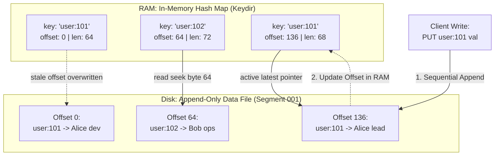

- **Key Takeaway:** Max write throughput, but RAM-bounded keyset + compaction debt.

---

### Figure 4-2: SSTable File Layout with Sparse In-Memory Index & Block Compression
- **Figure Reference:** `Figure 4-2: An SSTable with a sparse index and compressed blocks`
- **Original PDF:** Fig 4-2 → PDF p.143 — open the PDF at page 143 to compare with the Mermaid reconstruction below.
- **Visual Flow & Description:** Sorted keys in 4 KiB compressed blocks; RAM holds boundary keys only (`handbag`, `handsome`); `handiwork` located by bracketing + block scan.
- **Mermaid Flowchart:**

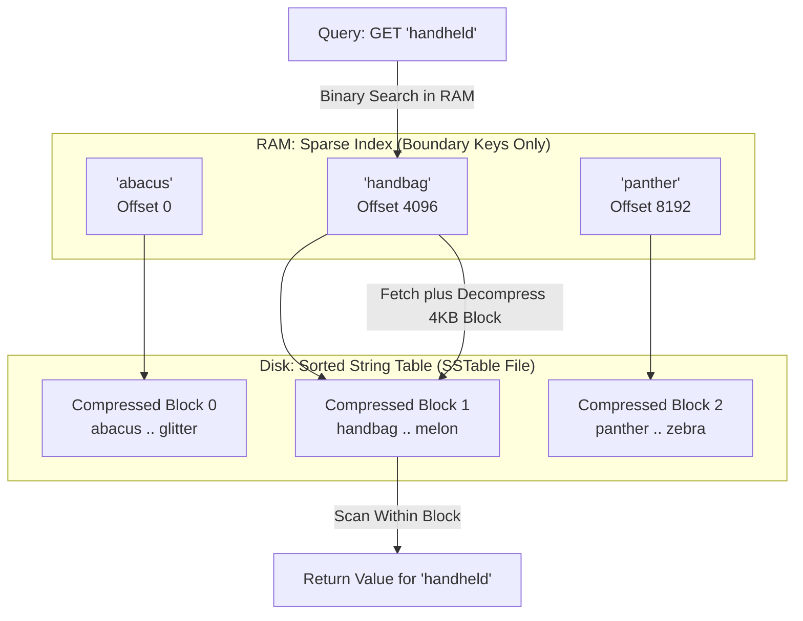

- **Key Takeaway:** Sorting eliminates RAM-per-key; compression saves I/O.

---

### Figure 4-3: Multi-Way SSTable Segment Merge and Compaction
- **Figure Reference:** `Figure 4-3: Merging several SSTable segments, retaining only the most recent value`
- **Original PDF:** Fig 4-3 → PDF pp.144–145 — open the PDF at pages 144–145 to compare with the Mermaid reconstruction below.
- **Visual Flow & Description:** Mergesort-like merge; newest timestamp wins; tombstones purge.
- **Mermaid Flowchart:**

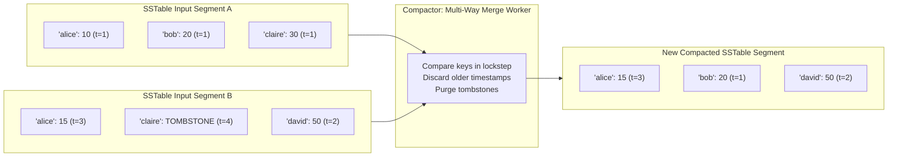

- **Key Takeaway:** Sequential $O(N)$ merge, $O(1)$ RAM per file.

---

### Figure 4-4: Bloom Filter Probabilistic Membership Test
- **Figure Reference:** `Figure 4-4: A Bloom filter checking whether a particular key is present in an SSTable`
- **Original PDF:** Fig 4-4 → PDF p.146 — open the PDF at page 146 to compare with the Mermaid reconstruction below.
- **Visual Flow & Description:** 16-bit array, $k=3$; `handheld -> (6,11,2)`; bit 11 = 0 → guaranteed miss.
- **Mermaid Flowchart:**

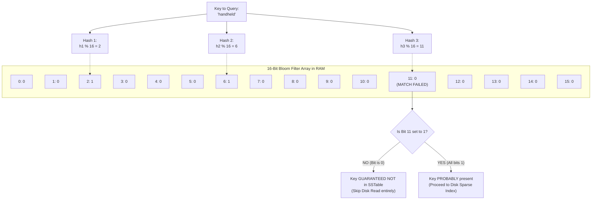

- **Key Takeaway:** 10 bits/key → 99% of useless seeks skipped.

---

### Figure 4-5: B-Tree Index Traversal & Interior Page Pointers
- **Figure Reference:** `Figure 4-5: Looking up key 251 by using a B-tree index`
- **Original PDF:** Fig 4-5 → PDF p.150 — open the PDF at page 150 to compare with the Mermaid reconstruction below.
- **Visual Flow & Description:** Branching factor 6; root `200–300` → interior → leaf `251–275`.
- **Mermaid Flowchart:**

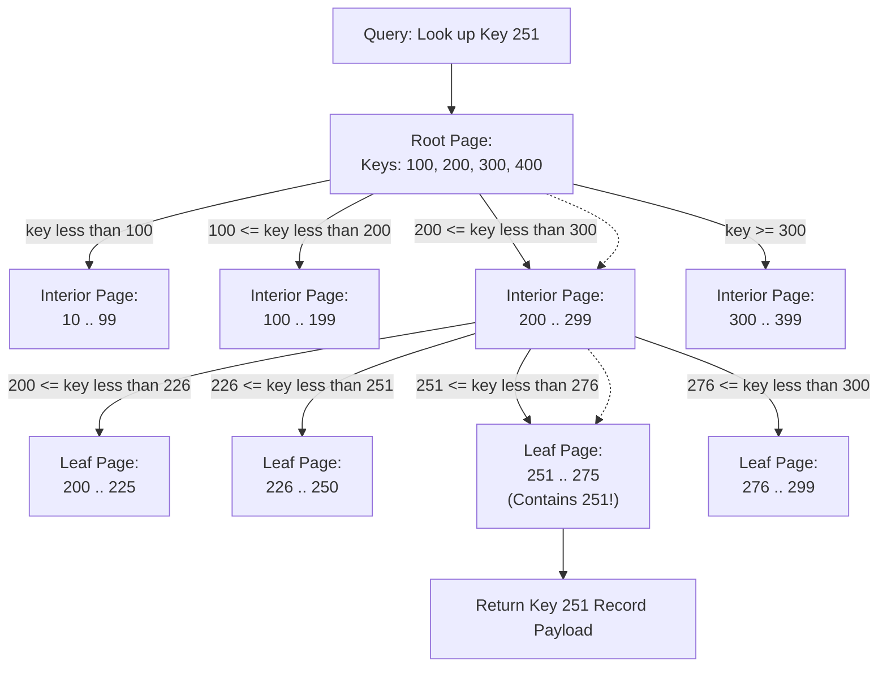

- **Key Takeaway:** $O(\log_B N)$, 1 physical I/O when interior cached.

---

### Figure 4-6: B-Tree Page Split on Overflow
- **Figure Reference:** `Figure 4-6: Growing a B-tree by splitting a page on boundary key 337`
- **Original PDF:** Fig 4-6 → PDF p.151 — open the PDF at page 151 to compare with the Mermaid reconstruction below.
- **Visual Flow & Description:** Full page splits; 337 promoted; cascade + WAL + latches.
- **Mermaid Flowchart:**

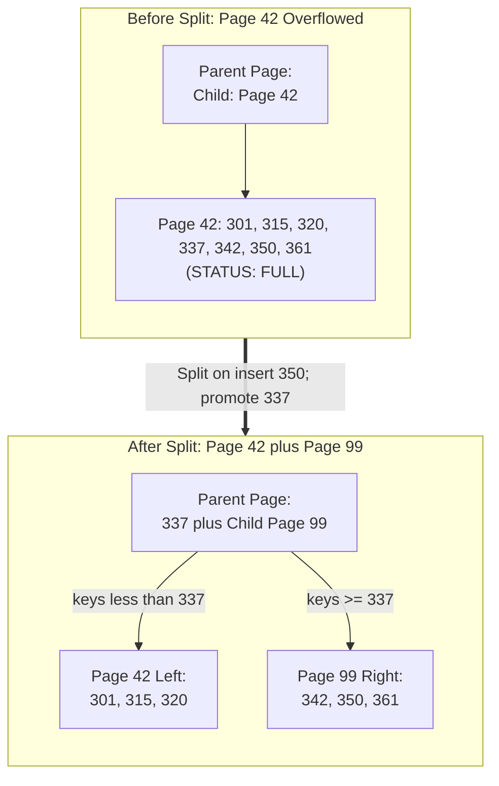

- **Key Takeaway:** Balance via bottom-up splits; crash-safe only with WAL.

---

### Figure 4-7: Row-Oriented vs. Column-Oriented Physical Layout
- **Figure Reference:** `Figure 4-7: Storing relational data by column rather than by row`
- **Original PDF:** Fig 4-7 → PDF pp.161–162 — open the PDF at pages 161–162 to compare with the Mermaid reconstruction below.
- **Visual Flow & Description:** Fact row `[date,store,prod,qty,amt]` vs per-column files; Example 4-1 reads 3/100 cols.
- **Mermaid Flowchart:**

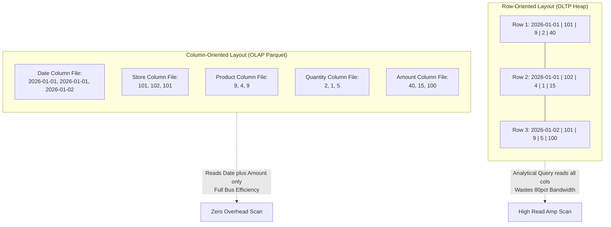

- **Key Takeaway:** Load only queried columns; enables compression.

---

### Figure 4-8: Columnar Bitmap and Run-Length Encoding
- **Figure Reference:** `Figure 4-8: Compressed, bitmap-indexed storage of a single column`
- **Original PDF:** Fig 4-8 → PDF p.163 — open the PDF at page 163 to compare with the Mermaid reconstruction below.
- **Visual Flow & Description:** `product_sk` → per-value bit-vectors → RLE.
- **Mermaid Flowchart:**

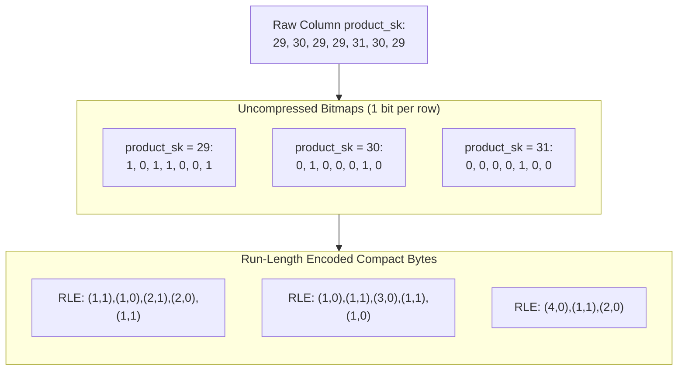

- **Key Takeaway:** Bitwise ops in CPU cache; Roaring adapts dense/sparse.

---

### Figure 4-9: Vectorized Bitwise Execution on SIMD Bitmaps
- **Figure Reference:** `Figure 4-9: A bitwise AND between two bitmaps lends itself to vectorization`
- **Original PDF:** Fig 4-9 → PDF p.167 — open the PDF at page 167 to compare with the Mermaid reconstruction below.
- **Visual Flow & Description:** `product_sk=29 AND store_sk=101` via AVX-512 `VANDPS` over 512-bit registers.
- **Mermaid Flowchart:**

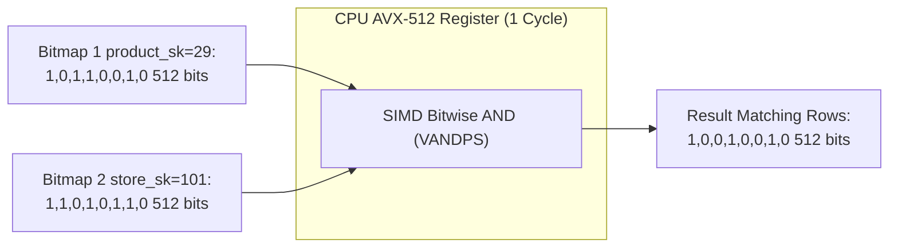

- **Key Takeaway:** 512 rows/instruction, no branch mispredicts.

---

### Figure 4-10: Multi-Dimensional OLAP Data Cube
- **Figure Reference:** `Figure 4-10: Two dimensions of a data cube, aggregating data by summing`
- **Original PDF:** Fig 4-10 → PDF p.168 — open the PDF at page 168 to compare with the Mermaid reconstruction below.
- **Visual Flow & Description:** `date × product` grid of `SUM(net_price)` + row/column rollups + grand total.
- **Mermaid Flowchart:**

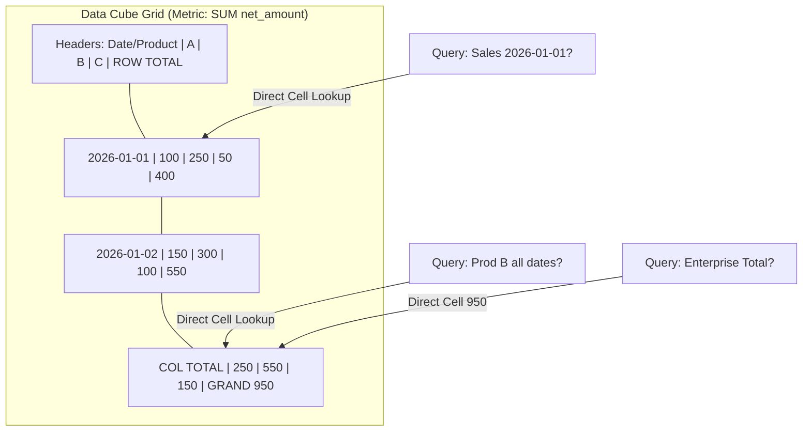

- **Key Takeaway:** $O(1)$ reads for precomputed slices; $2^N$ storage blowup.

---

### Figure 4-11: HNSW Multi-Layer Vector Search
- **Figure Reference:** `Figure 4-11: Searching for the database entry closest to a given query vector in an HNSW index`
- **Original PDF:** Fig 4-11 → PDF p.173 — open the PDF at page 173 to compare with the Mermaid reconstruction below.
- **Visual Flow & Description:** 3-layer graph; top sparse long edges route, bottom dense refines; IVF alternative partitions by centroids with `nprobe` probes; PQ compresses vectors.
- **Mermaid Flowchart:**

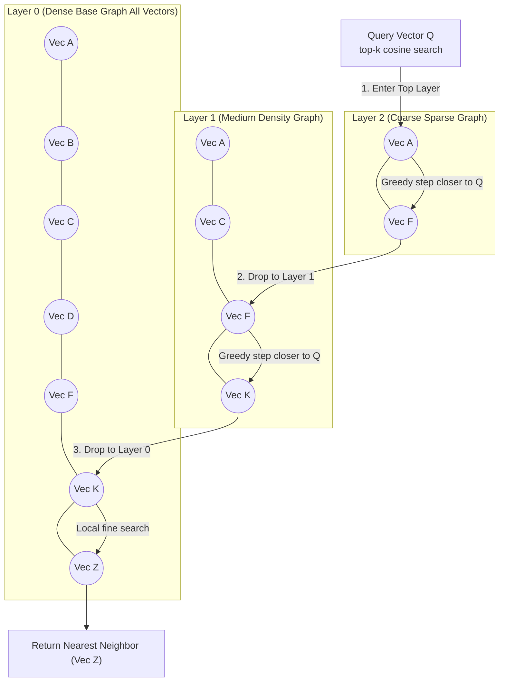

- **Key Takeaway:** $O(\log N)$ ANN; IVF+PQ scales to billions on fixed RAM.

---

### LSM-Tree Write and Read Path Concurrent Flow
- **Visual Flow & Description:** `PUT` via WAL + memtable; background flush; `GET` via Bloom-gated SSTables. LSNs order recovery.
- **Mermaid Sequence Diagram:**

```mermaid
sequenceDiagram
  autonumber
  actor Client as Client Thread
  participant WAL as Disk WAL (Append)
  participant Mem as Active Memtable (RAM)
  participant Imm as Immutable Memtable
  participant Flusher as Background Flusher
  participant SST as L0 SSTable Disk
  participant Bloom as Bloom Filters
  Note over Client,Mem: Write Path Execution
  Client->>WAL: appendRecord(LSN=101, PUT k, v)
  activate WAL
  WAL-->>Client: ack(fsync)
  deactivate WAL
  Client->>Mem: insert(k, v)
  activate Mem
  Mem-->>Client: success
  deactivate Mem
  Note over Mem,Flusher: Memtable Flush Trigger
  Mem->>Imm: freeze when size over 64MB
  activate Imm
  Imm->>Flusher: triggerFlush()
  deactivate Imm
  activate Flusher
  Flusher->>SST: writeSortedDataBlocks(compress=LZ4)
  Flusher->>Bloom: buildBloomFilter(10 bits per key)
  Flusher->>SST: writeSparseIndexAndFooter()
  Flusher-->>WAL: truncateOldWALSegments()
  deactivate Flusher
  Note over Client,Bloom: Read Path Execution
  Client->>Mem: lookup(k)
  Note over Client,Mem: Miss in Active Memtable
  Client->>Imm: lookup(k)
  Note over Client,Imm: Miss in Immutable
  Client->>Bloom: checkBits(k)
  alt Bloom returns false
    Note over Client,SST: Key guaranteed absent; skip disk IO!
  else Bloom returns true
    Client->>SST: binarySearchSparseIndex(k)
    Client->>SST: readCompressedBlock(4KB)
    SST-->>Client: return value
  end
```

- **Key Takeaway:** Sequential WAL isolates durability; Bloom shields disk.

---

## 4. Real-World Systems, Case Studies & Code Examples

### 4.1 Industry Implementations & Architectural Divergence
- **RocksDB (LSM):** Meta fork of LevelDB; multi-core skiplist memtables, column families, partitioned filters, rate-limited compaction to avoid stalls; NVMe-tuned.
- **Cassandra STCS/LCS/TWCS (LSM distributed):** STCS default for ingest; LCS for reads; TWCS drops whole time windows for metrics with TTL.
- **InnoDB / Postgres (B-tree):** InnoDB clustered PK + doublewrite anti-torn-page + adaptive hash; Postgres heap + TID + HOT + `VACUUM`, GIN for full-text/JSON.
- **ClickHouse / DuckDB / Snowflake (columnar):** MergeTree LSM-like sorted parts + 2,048-row vector chunks; Snowflake decoupled S3 + virtual warehouses ($\$2$–$\$4$/credit); BigQuery serverless scan $\$5$/TB.
- **Lucene / Faiss / pgvector:** Lucene SSTable-like term segments + background merge; Faiss IVF-PQ + HNSW; pgvector both in Postgres.

---

### 4.2 Production Implementation: SSTable Segment Compactor with Tombstone Purging

```python
import struct
from typing import List, Tuple, Optional

class SSTableRecord:
    TOMBSTONE = b"__DELETED_TOMBSTONE__"

    @staticmethod
    def encode(key: bytes, value: bytes, timestamp: int) -> bytes:
        header = struct.pack(">HQL", len(key), len(value), timestamp)
        return header + key + value

    @staticmethod
    def decode(stream) -> Optional[Tuple[bytes, bytes, int]]:
        hdr = stream.read(struct.calcsize(">HQL"))
        if not hdr:
            return None
        kl, vl, ts = struct.unpack(">HQL", hdr)
        return stream.read(kl), stream.read(vl), ts

def multiway_sstable_compactor(input_paths: List[str], out_path: str,
                               index_interval: int = 4096):
    """Mergesort SSTables, keeps newest LSN, purges tombstones, builds sparse index."""
    streams = [open(p, "rb") for p in input_paths]
    active = [SSTableRecord.decode(s) for s in streams]
    sparse, written, last_idx = [], 0, -index_interval
    with open(out_path, "wb") as out:
        while True:
            mk = None
            for rec in active:
                if rec and (mk is None or rec[0] < mk):
                    mk = rec[0]
            if mk is None:
                break
            cand = [r for r in active if r and r[0] == mk]
            key, val, ts = max(cand, key=lambda x: x[2])
            for i, rec in enumerate(active):
                if rec and rec[0] == mk:
                    active[i] = SSTableRecord.decode(streams[i])
            if val == SSTableRecord.TOMBSTONE:
                continue
            if written - last_idx >= index_interval:
                sparse.append((key, written))
                last_idx = written
            enc = SSTableRecord.encode(key, val, ts)
            out.write(enc)
            written += len(enc)
    for s in streams:
        s.close()
    return sparse
```

---

### 4.3 Production Implementation: Optimal Bloom Filter

```python
import math
import mmh3
from typing import Iterator

class BloomFilter:
    """10 bits/key -> 1% FPR; Kirsch-Mitzenmacher double hashing."""
    def __init__(self, n: int, p: float):
        self.n, self.p = n, p
        self.m = int(math.ceil(-(n * math.log(p)) / (math.log(2) ** 2)))
        self.k = int(round((self.m / n) * math.log(2)))
        self.bits = bytearray((self.m + 7) // 8)

    def _hashes(self, key: bytes) -> Iterator[int]:
        h1 = mmh3.hash(key, 0, signed=False)
        h2 = mmh3.hash(key, 42, signed=False)
        for i in range(self.k):
            yield (h1 + i * h2) % self.m

    def add(self, key: bytes) -> None:
        for b in self._hashes(key):
            self.bits[b // 8] |= (1 << (b % 8))

    def contains(self, key: bytes) -> bool:
        return all(self.bits[b // 8] & (1 << (b % 8)) for b in self._hashes(key))
```

---

### 4.4 Production War Story: The RocksDB Write-Stall Meltdown
- **Context:** Ad exchange, 8-node RocksDB, $600{,}000\ \text{writes/sec}$, 64 MiB memtables, 2 compaction threads, NVMe $\$0.10$/GB-mo.
- **Incident:** Black Friday $1.2$M writes/sec → L0 flush every 1.5 s, overlapping ranges pile to 20 files (`level0_slowdown_writes_trigger` → 1 ms sleep/write), thread pools saturate, 45 s later 32 files (`level0_stop_writes_trigger` → `Incomplete("Write stall")`), LB marks nodes unhealthy, cascade.
- **Fix:** 2→8 compaction cores, `WriteBufferManager` smooth backpressure, TWCS for TTL series, `rate_limiter` on compaction I/O. Lesson: provision compaction bandwidth = $WA \times$ ingest (e.g., $20\times \times 50$ MB/s = 1 GB/s disk).

---

## 5. Architectural Trade-Off Matrix

| Architecture | Advantage | Point Read p99 | Write Amp | Space Amp | Recovery | Best Fit | Failure Mode |
| :--- | :--- | :--- | :--- | :--- | :--- | :--- | :--- |
| **Bitcask (log+hash)** | Max sequential write | $O(1)$ <5 ms | $1\times$–$2\times$ | ~50% dead pre-compact | Hint files + scan | Small keyset, frequent updates | RAM exhaustion |
| **LSM Leveled (RocksDB)** | High write + compression | $O(L)$, Bloom→1–2 seeks ~3 ms | $10\times$–$30\times$ | 10–20% temp | WAL replay (LSN) | Write-heavy OLTP | Write stall |
| **LSM Size-tiered (Cassandra)** | Bulk ingest | $O(\text{files})$ ~10 ms | $4\times$–$8\times$ | >50% headroom | Commit log | Historical append | Disk-full during merge |
| **B-tree (InnoDB)** | Deterministic reads | $O(\log_B N)$ 1 seek ~1 ms | $30\times$–$100\times$ | 30–50% frag | WAL + doublewrite | Read-heavy + ranges | Random-write thrash |
| **Columnar (Parquet/ClickHouse)** | SIMD scans 3000 MB/s | $O(N)$ unusable | Batch good, point fatal | −80 to −95% via RLE | Immutable snapshots | OLAP | Point UPDATE storm |
| **HNSW (Faiss/pgvector)** | $O(\log N)$ ANN <10 ms | <10 ms top-k | Build $O(N\log N)$ | $1.5\times$–$2.5\times$ | Rebuild/persist | Embeddings/RAG | RAM spill → seeks |
| **Materialized view / Data cube (MOLAP accel)** | $O(1)$ precomputed roll-ups | $O(1)$ ~2 ms cell fetch | +$N_{views}\times$ incremental delta per base write | $2^N$ cuboids if fully materialized | Rebuild or replay deltas | Repeated fixed aggregates | Stale reads + write-amp blowup |

### Concrete Decision Heuristics

```text
1. OLAP aggregates over millions of rows?
   YES -> Columnar (Parquet/ClickHouse/Snowflake); fixed rollups -> Data Cube.
   NO (OLTP point lookups):
     Keys fit RAM + frequent updates? YES -> Bitcask/Redis.
     NO -> Read-dominant >85% + p99 determinism? YES -> B-tree (InnoDB/PG).
           Write-heavy >30%? Leveled LSM (RocksDB); append TTL? TWCS.
```

---

## 6. Jargon Buster & Key Terminology

- **Memtable:** Sorted RAM buffer (skiplist/red-black) drained as SSTables; WAL-guarded by LSN.
- **SSTable:** Immutable sorted key-value file in compressed blocks + sparse index.
- **Write/Read/Space Amplification (WA/RA/SA):** Disk bytes per app byte; disk reads per logical read; disk bytes per live byte.
- **Compaction:** Background mergesort of SSTables purging overwrites/tombstones.
- **Bloom Filter:** Probabilistic membership, zero false negatives; 10 bits/key → 1% FPR.
- **Latch vs Lock:** Microsecond in-memory mutex (crabbing) vs transaction-duration isolation lock.
- **Clustered vs Heap vs Covering:** Row-in-leaf vs pointer-to-heap vs index-duplicated columns for index-only scans.
- **Vectorized Execution vs Vector Embedding:** SIMD batches (bits) vs float position in semantic space — different meanings (p.172 box).
- **HNSW / IVF / PQ:** Layered proximity graph; centroid-partitioned inverted file (`nprobe`); product-quantized codes for RAM-fit billions.
- **Data Cube:** Precomputed $2^N$ aggregates; $O(1)$ reads, exponential writes.
- **Materialized view:** Persisted query result on disk (vs virtual view expanded at read); refreshed by full rebuild or incremental maintenance via triggers / WAL-tail dataflow / batch merge; each extra materialized view adds write amplification but cuts hot aggregate reads from seconds to milliseconds.
- **Materialized view incremental maintenance:** Delta-propagation (`SUM/COUNT` add/subtract, `MIN/MAX` with auxiliary state, join deltas `ΔR ⋈ S`); Materialize/Differential Dataflow, Snowflake Dynamic Tables, ClickHouse `TO`-table views.
- **Roll-up / Drill-down / Slice / Dice:** Cube navigation — aggregate away a dimension / add it back / fix one dimension / fix ranges on several; SQL `CUBE/ROLLUP/GROUPING SETS`.
- **MOLAP vs ROLAP vs HOLAP:** MOLAP stores native multidimensional arrays + pre-aggregated cuboids (Druid, Essbase, ClickHouse `AggregatingMergeTree`) for $O(1)$ dashboard cells; ROLAP computes from relational star schema at query time (Snowflake, BigQuery) for ad-hoc flexibility; HOLAP hybrids keep both.

---

## 7. System Design & Practical Engineering Takeaways

### 7.1 Production Engineering Checklist
1. **Never disable WAL fsync blindly:** `flush_log_at_trx_commit=2` gains $10\times$ IOPS but opens 1-s loss window; torn pages cost $\$50$K+ incidents.
2. **Size Bloom at 10 bits/key:** Below that FPR explodes ($p\approx 0.6185^{m/n}$); above 12 bits wastes RAM.
3. **Keep 50% headroom for STCS:** 500 GiB merge needs 500 GiB temp; exceeding 50% risks ENOSPC mid-compaction.
4. **Order concatenated indexes equality→range:** `(A,B)` useless for `WHERE B=?`; spatial/box needs R-tree, not concatenation.
5. **Pin B-tree interior in buffer pool:** Guarantees 1 physical I/O per point lookup (~1 ms p99 vs 15 ms spilling).

---

### 7.2 System Design Interview Strategy
- **Derive engine from ratio:** $>10{,}000$ writes/sec random keys → LSM (sequentialize); $>80\%$ reads + ranges → clustered B-tree; 100M-row scans of 3/40 cols → columnar (prove $320\times$ I/O cut).
- **Name the stall:** Propose LSM → immediately add compaction backpressure mitigation (I/O limiter, extra threads, TWCS) — interview signal.
- **Capacity sketch:** `Growth = QPS×bytes×(1+WA)×RF`; `RAM_bitcask = keys×(key+16B)`; `RAM_bloom = records×10/8 bytes`; `Scan = rows×col_bytes/compression / (1 GB/s × cores)`.

---

### 7.3 Mastery Self-Assessment Questions

#### Question 1 (Conceptual Depth)
*Why does LSM beat B-tree on writes but risk p99 reads under mixed load?*
- **Answer:** LSM turns random writes into sequential WAL + RAM skiplist ($O(\log M)$), flushing 64 MiB sorted runs at 3–7 GB/s NVMe vs B-tree random 16 KiB overwrites ($30\times$–$100\times$ WA, 80K IOPS cap). Reads degrade via RA (check $L_0$–$L_k$ + heap-merge ranges; Bloom skips only points) + compaction stealing disk/CPU → queueing spikes ms→seconds.

#### Question 2 (Failure Scenario)
*RocksDB `Put()` blocks, disk 60%, CPU ~0, throughput collapsed. Diagnose.*
- **Answer:** Hard write stall: $L_0$ files > `level0_stop_writes_trigger` (36). Flush outran merge. Immediate `SetOptions(max_background_compactions=8)`, raise `write_buffer_size` 64→256 MiB, enable `rate_limiter`; long-term TWCS/universal for append series.

#### Question 3 (Capacity Estimation)
*1B rows/day, 1 KiB/row (40 cols). 30-day `SUM(amount) GROUP BY customer` every 10 min. Row vs columnar I/O?*
- **Answer:** 30B rows = 30.72 TB raw → 43.9 TB with B-tree slack; full scan 30 TB @1 GB/s = 8.5 h (misses SLA). Columnar 3 cols (16B/row) = 480 GB → /5 compression = 96 GB; scan 96 s single-core, <10 s on 16 SIMD cores — $320\times$ cut, meets SLA.

---

> [!NAV] **Chapter Navigation**
> ⬅️ **Previous:** [[chapter-03-data-models-and-query-languages|Chapter 03: Data Models and Query Languages]] | 🏠 **Index:** [[00-Master-Reading-Dashboard|Master Dashboard]] | ➡️ **Next:** [[chapter-05-encoding-and-evolution|Chapter 05: Encoding and Evolution]]
