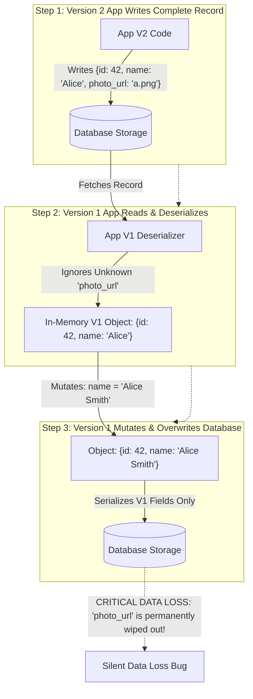
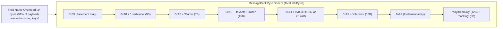
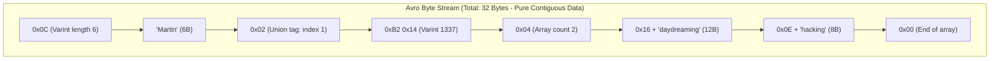
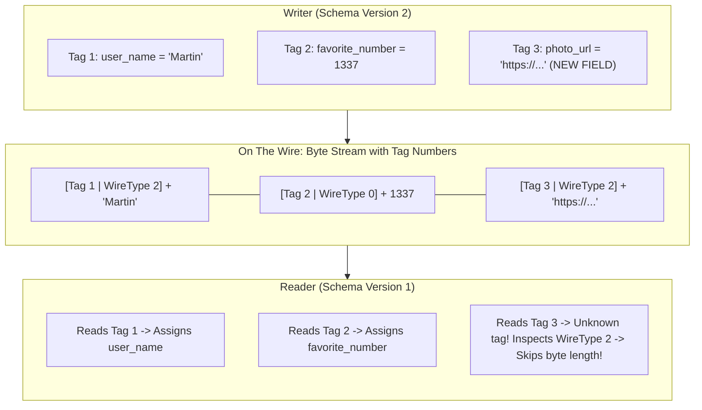
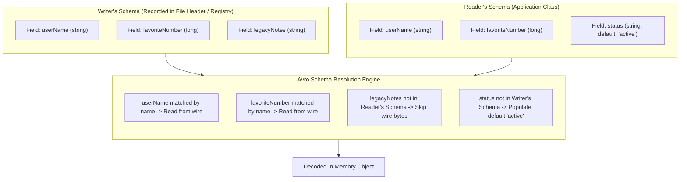
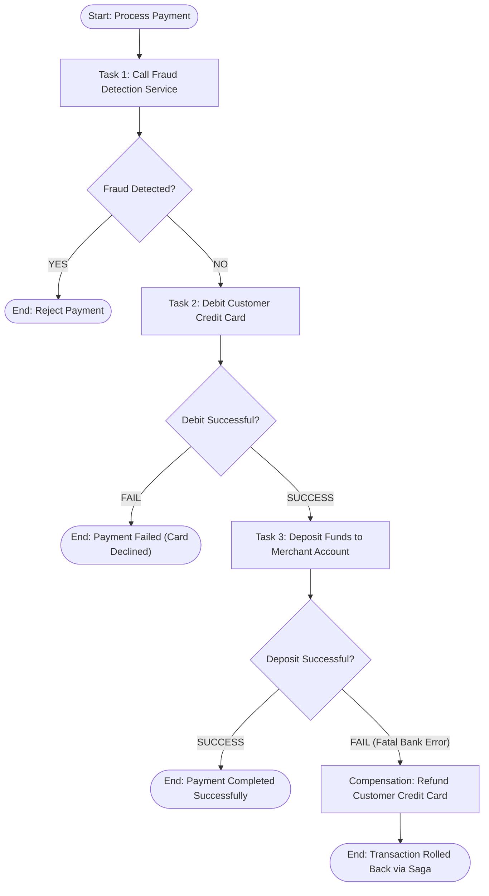
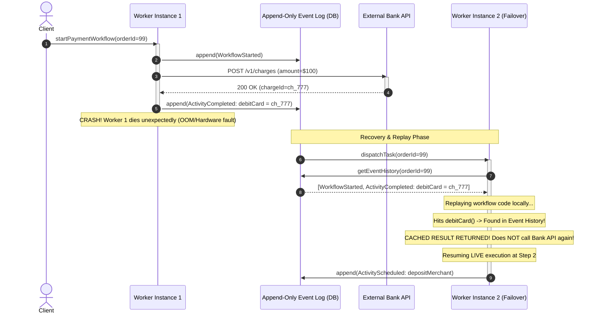

# Chapter 5: Encoding and Evolution — Definitive Technical Summary
*From: Designing Data-Intensive Applications (2nd Edition) by Martin Kleppmann and Chris Riccomini*
*Source PDF: pp. 185–220 (673-page PDF) — figures below cite PDF pages.*

> [!NAV] **Chapter Navigation**
> ⬅️ **Previous:** [[chapter-04-storage-and-retrieval|Chapter 04: Storage and Retrieval]] | 🏠 **Index:** [[00-Master-Reading-Dashboard|Master Dashboard]] | ➡️ **Next:** [[chapter-06-replication|Chapter 06: Replication]]


---

## 1. Executive Summary & Core Engineering Problem

- **Core Thesis:** Systems must be designed to accommodate continuous change. Applications inevitably evolve—adding new features, modifying data representations, and refactoring business logic—yet in distributed architectures, software changes cannot happen instantaneously. Because rolling deployments, distributed microservices, mobile clients, and persistent databases mean that old and new versions of code and data concurrently coexist, data encoding formats must guarantee both **backward compatibility** (newer code can read data written by older code) and **forward compatibility** (older code can read data written by newer code without catastrophic data loss or crashes).
- **Problem Statement:** Naive assumptions about serialization cause catastrophic production outages and silent data corruption. A classic failure occurs during a rolling deployment of a microservice operating on an operational database or message bus: Version 2 of the service introduces a new field (`photo_url`). A Version 1 instance (which does not know about `photo_url`) reads a record updated by Version 2, decodes it into an in-memory object (silently ignoring the unrecognized field), modifies the user's status, and writes the object back to the database. The Version 1 service overwrites the database row with its truncated object, permanently obliterating `photo_url` written by Version 2 (Figure 5-1). Similarly, in high-throughput RPC pipelines ($>50,000\ \text{requests/sec}$), transmitting textual formats like JSON or XML consumes $3\times\text{--}5\times$ more network bandwidth and incurs $10\times$ higher CPU serialization overhead than schema-driven binary encodings, saturating network interfaces and CPU memory buses.
- **Historical & Industry Context:** Early systems relied on language-specific serialization frameworks (Java `Serializable`, Python `pickle`, Ruby `Marshal`), which tied data tightly to a single programming language, introduced critical remote-code-execution security vulnerabilities, and lacked evolution semantics. The web era popularized textual schema-free formats (XML in the 1990s, JSON in the 2000s), prioritizing human readability and dynamic typing over compactness and strict contracts. As datacenter scale exploded in the late 2000s and 2010s, Google developed Protocol Buffers, Facebook created Apache Thrift, and the Hadoop ecosystem birthed Apache Avro to enforce compact binary schemas with mathematically rigorous evolution rules. In the 2020s (2nd Edition inflection), the emergence of cloud-native microservices, event streaming architectures (Kafka Schema Registry), and **Durable Execution workflows** (Temporal, Cadence) transformed encoding from a simple byte-packing optimization into the foundational substrate for long-running, fault-tolerant distributed orchestration.

---

## 2. In-Depth Technical Concepts & Internal Mechanics

### 2.1 Compatibility Invariants: Backward vs. Forward Compatibility
- **Foundational Theory:** In any system where code changes asynchronously, data compatibility is directional:
  - **Backward Compatibility:** *New code can read data that was written by old code.* 
    - *Mechanics:* The author of the new code knows the schema of the old code; they simply handle missing older fields by assigning explicit default values or declaring them optional.
  - **Forward Compatibility:** *Old code can read data that was written by new code.*
    - *Mechanics:* The older code encounters fields added by future versions. The older code must safely recognize unknown fields, ignore them without throwing parsing exceptions, and preserve them during round-trip mutations.
- **The Forward-Compatibility Data-Loss Hazard (Read-Modify-Write Cycles):**
  - Consider an application record representing a user profile (Figure 5-1).
  - Version 1 Schema: `{ user_id: int, name: string }`
  - Version 2 Schema: `{ user_id: int, name: string, photo_url: string }`
  - *Data Path to Corruption:*
    1. A Version 2 client writes a profile: `{ user_id: 42, name: "Alice", photo_url: "https://cdn.example.com/a.png" }`.
    2. A Version 1 backend worker (still active during a rolling deploy) executes a background job to update the user's name:
       - V1 worker fetches record bytes from database.
       - V1 deserializer maps `user_id` and `name` to fields in its in-memory class. Because `photo_url` is not in V1's class definition, the deserializer drops it.
       - V1 worker sets `name = "Alice Smith"`.
       - V1 worker serializes the in-memory object and issues `UPDATE users SET data = ? WHERE user_id = 42`.
       - *Result:* `photo_url` is permanently deleted from the database.
  - *Engineering Invariant:* Storage and serialization libraries must preserve unknown fields during decoding and re-encode them verbatim upon serialization (supported natively in Protocol Buffers v3 via `UnknownFieldSet`).

---

### 2.2 In-Memory Representations vs. Byte Sequences (The Encoding Problem)
- **Foundational Theory:** Programs work with data in two fundamentally distinct states:
  1. *In-Memory Representation:* Optimized for CPU manipulation. Uses pointers, references, virtual method tables, contiguous memory structs, hash tables, and object graphs. Memory layouts are CPU architecture-dependent (e.g., endianness, 64-bit memory addresses, cache line alignments).
  2. *Byte Sequence (Wire/Disk Format):* A serialized array of bytes optimized for transmission across network sockets or persistence on disk. Pointers are meaningless because memory addresses cannot be shared across independent address spaces.
- **Translation Overhead:**
  - *Serialization (Encoding / Marshalling):* Translating in-memory pointer graphs into a contiguous byte sequence.
  - *Deserialization (Decoding / Unmarshalling):* Parsing byte sequences back into in-memory object graphs.
- **The Fatal Flaws of Language-Specific Formats (`java.io.Serializable`, Python `pickle`, Ruby `Marshal`):**
  1. *Language Lock-in:* Data encoded with `pickle` cannot be decoded by a Go microservice or Java client, destroying polyglot architecture.
  2. *Security Vulnerabilities:* To restore arbitrary object graphs, deserializers instantiate arbitrary classes. If an attacker submits a malicious byte payload, the deserializer executes arbitrary code inside the application process (e.g., Java Apache Commons Collections deserialization RCEs, CVE-2015-4852).
  3. *Zero Compatibility Guarantees:* Changing a class field name or private struct layout immediately breaks deserialization with `InvalidClassException`, making rolling deploys impossible.
  4. *Performance Degradation:* Heavy metadata overhead (serializing complete Java class names, package paths, and reflection fields) inflates payload sizes.

---

### 2.3 Textual Formats and Binary Variants (JSON, XML, CSV, MessagePack)
- **Textual Formats (JSON, XML, CSV):**
  - *Advantages:* Universal cross-language support, human-readable, debuggable with `curl` and text editors.
  - *Critical Architectural Flaws:*
    1. *Number Precision Ambiguity:* JSON cannot distinguish between 32-bit integers, 64-bit integers, and floating-point numbers. In JavaScript, numbers greater than $2^{53} - 1$ ($9,007,199,254,740,991$) lose precision because all numbers are parsed as IEEE 754 double-precision floats. Passing a 64-bit Twitter tweet ID (`int64`, e.g., `1234567890123456789`) through JSON causes silent integer truncation unless encoded as a string.
    2. *Binary Data Inefficiency:* JSON and XML cannot directly represent raw byte sequences. Binary data must be Base64-encoded, which incurs a mandatory **$33\%$ storage and bandwidth expansion** ($4$ ASCII characters per $3$ raw bytes).
    3. *Schema Optionality:* Lacking enforced schemas, applications must perform defensive runtime validation (`if (!payload.user || typeof payload.user.id !== 'number') ...`), scattering accidental complexity across codebases.
- **Binary Variants of JSON (MessagePack, BSON, CBOR):**
  - Retain the schema-less document model of JSON while packing bytes into binary representations.
  - *Layout Comparison (Example 5-2):*
    ```json
    { "userName": "Martin", "favoriteNumber": 1337, "interests": ["daydreaming", "hacking"] }
    ```
    - Uncompressed JSON text: **81 bytes**.
    - MessagePack binary encoding (Figure 5-2): **66 bytes** (an $18\%$ reduction).
  - *Why Binary JSON Fails to Save Significant Space:*
    - MessagePack still stores every field name as a literal string in every single message: `"userName"` (8 bytes), `"favoriteNumber"` (14 bytes), `"interests"` (9 bytes).
    - Field name strings consume **31 out of the 66 bytes** ($47\%$ of the entire payload!).

---

### 2.4 Protocol Buffers & Apache Thrift: Tag-Based Binary Encoding
- **Foundational Theory:** Protocol Buffers (Google) and Apache Thrift (Facebook) eliminate field name strings from the encoded payload. Instead, schemas assign a unique integer **Field Tag** to each field.
- **Schema Definition:**
  ```protobuf
  message Person {
      required string user_name       = 1;
      optional int64  favorite_number = 2;
      repeated string interests       = 3;
  }
  ```
- **Byte-Level Encoding Layout (Figure 5-3):**
  The same record from Example 5-2 encodes to just **33 bytes** in Protocol Buffers ($59\%$ smaller than JSON, $50\%$ smaller than MessagePack).
- **Varint Encoding Mechanics:**
  - Standard integers (`int32`, `int64`) use Variable-Byte (Varint) encoding.
  - The Most Significant Bit (MSB) of each byte is a **continuation bit**:
    - `MSB = 1`: More bytes follow for this number.
    - `MSB = 0`: This is the final byte of the number.
  - The lower 7 bits of each byte hold the actual binary payload.
  - *Example:* The integer 1337 (`0x0539` = binary `0000 0101 0011 1001`):
    - Lower 7 bits: `011 1001` ($57$). MSB set to 1 $\implies$ `1011 1001` (`0xB9`).
    - Upper 7 bits: `000 1010` ($10$). MSB set to 0 $\implies$ `0000 1010` (`0x0A`).
    - Serialized on wire: `[0xB9, 0x0A]` (2 bytes instead of 8 bytes for `int64`).
- **Zigzag Encoding for Signed Integers (`sint32`, `sint64`):**
  - Standard two's complement encodes $-1$ as `0xFFFFFFFF` (requiring 5 to 10 bytes in standard varint).
  - Zigzag encoding maps signed integers to unsigned integers by interleaving positive and negative numbers:
    $$\text{Zigzag}(n) = (n \ll 1) \oplus (n \gg 31) \quad (\text{for 32-bit})$$
    - $0 \to 0,\ -1 \to 1,\ 1 \to 2,\ -2 \to 3,\ 2 \to 4,\ -3 \to 5$
    - Small negative numbers encode into 1 or 2 bytes instead of 10 bytes.
- **Wire Types & Field Tag Header:**
  - Each field begins with a 1-byte header combining the field tag and wire type:
    $$\text{Header Byte} = (\text{Field Tag} \ll 3) \mid \text{Wire Type}$$
  - *Wire Types:*
    - `0`: Varint (`int32`, `int64`, `bool`, `enum`)
    - `1`: 64-bit fixed (`fixed64`, `double`)
    - `2`: Length-delimited (`string`, `bytes`, embedded messages, packed arrays)
    - `5`: 32-bit fixed (`fixed32`, `float`)
- **Schema Evolution Invariants (Figure 5-5):**
  1. *Never Change Field Tags:* The field tag is the unique identifier on the wire. Changing tag number 1 to tag number 4 breaks compatibility instantly.
  2. *New Fields Must Be Optional / Defaulted:* New code writing new fields will send tags that old code does not recognize. The old code reads the wire type from the header, computes byte length, and skips the unknown field bytes safely (maintaining forward compatibility).
  3. *Field Removal Rules:* You may only remove a field that was optional. You must **never** reuse that tag number in the future. In Protocol Buffers, declare the removed tag as `reserved 3;` to prevent future developers from reusing it.

---

### 2.5 Apache Avro: Schema Resolution and Dynamic Generation
- **Foundational Theory:** Apache Avro (originated in Apache Hadoop) takes binary compactness to the theoretical extreme: **it includes neither field names nor field tags in the encoded byte sequence** (Figure 5-4).
- **The Avro Wire Format:**
  - Encoded record size for Example 5-2: **32 bytes** (the most compact format).
  - The payload is a raw concatenation of byte-length-prefixed strings and varint integers.
  - To decode the bytes, the reader **must have the exact schema** that was used to write the data.
- **Writer's Schema vs. Reader's Schema (Figure 5-6):**
  - *Writer's Schema:* The schema known to the application that serialized the record.
  - *Reader's Schema:* The schema known to the application deserializing the record.
  - *The Invariant:* The Writer's Schema and Reader's Schema **do not need to be identical**; they only need to be **compatible**.
- **Avro Schema Resolution:**
  - When decoding, the Avro library compares the Writer's Schema and Reader's Schema side-by-side.
  - Fields are matched **by field name**, not by tag number or column offset.
  - If the Writer's Schema contains fields that are not in the Reader's Schema, the reader skips those bytes.
  - If the Reader's Schema expects a field that was not in the Writer's Schema, the reader fills in the **default value** defined in the Reader's Schema.
- **Evolution Rules in Avro:**
  - To maintain forward and backward compatibility, you may **only add or remove a field that has an explicit default value**.
  - Changing a field from non-nullable to nullable requires using a union: `type: ["null", "string"], default: null`.
- **How Does the Reader Know the Writer's Schema?**
  1. *Large Data Files (Hadoop / Iceberg / Parquet):* A container file containing millions of records includes the Writer's Schema once in the **file header metadata**. The millions of subsequent data records contain zero schema overhead.
  2. *Individual Database / Kafka Records:* Embedding a 1 KiB schema in a 50-byte event payload multiplies network traffic by $20\times$. 
     - *Solution:* Include a 5-byte header in each message:
       ```text
       [ Magic Byte: 1B (0x00) ] [ Schema ID: 4B (Network Big-Endian Int) ] [ Raw Avro Bytes ... ]
       ```
     - The 4-byte Schema ID references an immutable schema registered in an external **Schema Registry** (Confluent Schema Registry / Redpanda). The reader fetches the schema once and caches it locally.
  3. *Network RPC (Avro RPC):* Client and server negotiate schemas during connection handshake.
- **Dynamic Schema Generation:**
  - Avro is friendly to dynamically generated schemas. If dumping a relational database table to disk, you can generate an Avro schema dynamically from the relational catalog columns. When the table schema alters (`ALTER TABLE`), a new Avro schema is generated automatically without running an IDL code generator.

---

### 2.6 The Merits of Schemas and Schema Registries
- **Comparative Advantages Over Textual/Ad-Hoc Formats:**
  1. *Compactness:* Eliminating field names shrinks network payloads by $50\%\text{--}80\%$, drastically reducing network interface card (NIC) saturation and cloud cross-zone egress costs.
  2. *Compile-Time Type Safety:* IDL compilers (`protoc`, `avro-tools`) generate native classes in C++, Java, Rust, Go, and TypeScript, catching missing fields and type mismatches at compile time rather than crashing at runtime.
  3. *Authoritative Documentation:* The schema repository serves as the single source of truth for organizational data contracts.
- **Schema Registry Architecture & Compatibility Enforcement:**
  - In event-driven systems (Kafka), producers publish serialized events to topics. If a producer publishes an incompatible schema change, downstream consumer groups fail with deserialization exceptions (a **poison pill**).
  - The Schema Registry acts as a gatekeeper enforcing compatibility modes:
    - `BACKWARD`: Consumers using schema $V_N$ can read data from producers using $V_{N-1}$ (new schema must have defaults for all new fields).
    - `FORWARD`: Consumers using schema $V_{N-1}$ can read data from producers using $V_N$ (deleted fields must have had defaults).
    - `FULL`: Combines backward and forward compatibility (safe for arbitrary rolling deployments of producers and consumers).
    - `NONE`: Compatibility checks disabled (unsafe for production).

---

### 2.7 Modes of Dataflow: Databases (Data Outlives Code)
- **The Temporal Asymmetry:**
  - In a production system, application code is redeployed frequently (daily or hourly via CI/CD pipelines).
  - In contrast, data in a database often lives for **years or decades**.
  - A database contains rows written five minutes ago by the newest code version, alongside rows written five years ago by an ancient version that has long been retired.
- **Rolling Deployments & Coexistence:**
  - During a rolling deployment across 50 container replicas, Version 1 and Version 2 instances run concurrently for minutes or hours.
  - V2 code writes new fields to the database; concurrent V1 code must read those rows without crashing (Forward Compatibility).
  - V1 code writes older format rows; V2 code must read them correctly (Backward Compatibility).
- **Schema Evolution in Relational Databases:**
  - Modern RDBMSs (PostgreSQL $\ge 11$, MySQL $\ge 8.0$) optimize `ALTER TABLE ADD COLUMN ... DEFAULT const`: they update table metadata instantly ($O(1)$) without rewriting disk pages. When reading older pages lacking the column, the engine substitutes the default value in memory.

---

### 2.8 Modes of Dataflow: Services (REST vs. RPC)
- **Service-Oriented and Microservice Architecture:**
  - Applications decompose into independent services communicating over network protocols.
  - The two dominant communication styles are REST (HTTP + JSON/OpenAPI) and RPC (Remote Procedure Call + Protobuf/gRPC).
- **The Flaws of the RPC Illusion:**
  - RPC frameworks attempt to make a remote network service call appear identical to a local programming language function call (`result = service.calculateTax(order)`).
  - This abstraction is fundamentally leaky:
    1. *Predictability vs. Latency Jitter:* Local function calls execute in nanoseconds and are predictable. Network calls take milliseconds, traverse routers, and suffer packet loss and latency spikes.
    2. *Partial Failures & Network Partitions:* A local function either completes or throws an in-process exception. A network call can fail because the request was lost, the remote server crashed *after* processing, or the response packet was lost. The client cannot know whether the remote mutation succeeded.
    3. *Idempotency Hazards:* Retrying a failed local function call is safe if purely computational. Retrying a network RPC that timed out can cause duplicate operations (e.g., charging a credit card twice) unless the remote endpoint enforces strict idempotency keys.
    4. *Parameter Passing Overhead:* Local function calls pass memory pointers in CPU registers ($O(1)$ cost). Network RPCs must deep-copy and serialize all arguments into byte arrays.
- **Modern RPC (gRPC):**
  - Uses Protocol Buffers for structured binary typing.
  - Built on **HTTP/2**: multiplexes multiple concurrent RPC requests over a single TCP connection, supports bidirectional streaming, and implements binary header compression (HPACK).

---

### 2.9 Durable Execution and Workflows (Temporal, Cadence, BPMN)
- **Foundational Theory:** In distributed microservices, multi-step business transactions span multiple independent services (e.g., an e-commerce order: check fraud $\to$ authorize credit card $\to$ reserve warehouse inventory $\to$ dispatch shipment) (Figure 5-7).
- **Why Traditional Solutions Fail:**
  - *Two-Phase Commit (2PC):* Heavy distributed locking; unavailable if any single participant goes offline.
  - *Ad-hoc Stateless Retries:* If a worker process crashes mid-workflow, all in-memory local variables, timers, and execution states are lost. Retrying from step 1 triggers duplicate credit card debits.
- **The Durable Execution Paradigm (Temporal, Restate):**
  - Workflows are authored in standard programming languages (TypeScript, Go, Java, Python) with standard control flow (`if`, `for`, `try/catch`).
  - *Core Invariant:* **The execution of workflow code is made durable through deterministic event-sourcing replay.**
- **Under-the-Hood Event History Replay Mechanics:**
  1. *Activity Scheduling:* When the workflow code calls `await debitCard(userId, amount)`, the runtime intercepts the function call. It does **not** call the bank directly. Instead, it persists an `ActivityTaskScheduled` event to a centralized append-only event log (backed by Cassandra/PostgreSQL).
  2. *Worker Dispatch:* An activity worker polls the task queue, executes the external HTTP API call, and writes an `ActivityTaskCompleted` event containing the return payload.
  3. *Crash and Recovery via Replay:*
     - If the workflow worker crashes while waiting for step 3 (`reserveInventory`), a brand-new worker process picks up the workflow execution.
     - The new worker executes the workflow code from line 1.
     - When line 1 (`checkFraud`) executes, the runtime checks the event history. Because `ActivityTaskCompleted` is already recorded, the runtime **does not call the fraud service again**. It instantly returns the cached result from the log.
     - The code deterministically replays forward in microseconds until it reaches the exact point of interruption, resuming live execution with zero state loss.
- **The Strict Determinism Constraint:**
  - Because state is reconstructed by replaying code against historical events, **the workflow code must be 100% deterministic**:
    - Never call `Math.random()` or UUID generators directly (must use runtime-provided deterministic seeds).
    - Never read system clocks (`Date.now()`, `System.currentTimeMillis()`) directly; use workflow-provided virtual timestamps.
    - Never mutate shared global variables across concurrent workflow routines.
    - Never alter the sequence of activity calls in existing workflow code without explicit versioning APIs (`workflow.getVersion()`), as doing so causes the replayed history to diverge from code execution, throwing a fatal `NonDeterministicWorkflowError`.

---

### 2.10 Event-Driven Architectures & Asynchronous Message Passing
- **Message Broker Topology:**
  - Producers send messages to an intermediate message broker (Apache Kafka, RabbitMQ, Apache Pulsar).
  - The broker decouples sender and receiver in space (sender doesn't need to know consumer IP addresses) and time (messages are buffered durably if consumers are down or lagging).
- **Asymmetric Dataflow Properties:**
  - One-way asynchronous communication: sender does not wait for consumer processing acknowledgment.
  - Pub/Sub: A single topic can be consumed independently by multiple downstream consumer groups with zero coupling.
- **The Actor Model (Erlang/OTP, Akka):**
  - Logic is encapsulated in stateful, independent **Actors**.
  - Each actor processes messages sequentially from its local inbox (mailbox).
  - In distributed actor frameworks (Akka Cluster, Microsoft Orleans), actors communicate across network boundaries using the same serialized byte protocols, facing identical forward/backward compatibility challenges during node rolling upgrades.

---

## 3. Important Figures, Diagrams & Visual Architecture

> 📕 **Original figures quick index (source PDF, 673 pages):** open the PDF at the cited page to verify each reconstruction.
>
> | Book Fig | PDF page | What to compare |
> |---|---|---|
> | Fig 5-1 | PDF p.186 | Backward/forward compat |
> | Fig 5-2 | PDF p.192 | MessagePack |
> | Fig 5-3 | PDF p.194 | Protobuf |
> | Fig 5-4 | PDF p.196 | Thrift/Avro bytes |
> | Fig 5-5 | PDF p.197 | Avro reader schema |
> | Fig 5-6 | PDF p.198 | Avro resolution |
> | Fig 5-7 | PDF p.211 | Workflow |


### Figure 5-1: The Forward Compatibility Data Truncation Bug
- **Figure Reference:** `Figure 5-1: When an older version of the application updates data previously written by a newer version, the newer field may be lost (reconstructed from text p. 168)`
- **Original PDF:** Fig 5-1 → PDF p.186 — open the PDF at page 186 to compare with the Mermaid reconstruction below.
- **Visual Flow & Description:** Tracks a user profile containing a new field (`photo_url`) written by Version 2 code. An older Version 1 worker reads the record, deserializes it into an object that lacks `photo_url`, updates another field, and writes the record back to storage, permanently obliterating `photo_url`.
- **Mermaid Flowchart:**



- **Key Takeaway:** Forward compatibility is not just about avoiding parser crashes; applications performing read-modify-write cycles must preserve unknown fields verbatim to prevent silent database truncation during rolling deployments.

---

### Figure 5-2: MessagePack Binary JSON Encoding Layout
- **Figure Reference:** `Figure 5-2: Our record encoded using MessagePack (reconstructed from text p. 172)`
- **Original PDF:** Fig 5-2 → PDF p.192 — open the PDF at page 192 to compare with the Mermaid reconstruction below.
- **Visual Flow & Description:** Illustrates the byte-by-byte layout of a JSON document encoded into MessagePack. While data values are bit-packed, the literal ASCII strings for all field names (`"userName"`, `"favoriteNumber"`, `"interests"`) remain embedded in the payload.
- **Mermaid Flowchart:**



- **Key Takeaway:** Schema-less binary encodings like MessagePack yield only modest compression ($15\%\text{--}20\%$) because they must repeat field name strings in every single message.

---

### Figure 5-3: Protocol Buffers Binary Encoding Layout
- **Figure Reference:** `Figure 5-3: Our record encoded using Protocol Buffers (reconstructed from text p. 173)`
- **Original PDF:** Fig 5-3 → PDF p.194 — open the PDF at page 194 to compare with the Mermaid reconstruction below.
- **Visual Flow & Description:** Shows the same record encoded in Protocol Buffers. Field names are completely replaced by 1-byte tag headers (`field_number << 3 | wire_type`), compressing the total payload to 33 bytes.
- **Mermaid Flowchart:**



```mermaid
flowchart LR
  subgraph PB["Protocol Buffers Byte Stream (Total: 33 Bytes)"]
    direction LR
    H1["0x0A (Tag 1, Wire Type 2: string)"]
    L1["0x06 (Length: 6)"]
    V1["'Martin' (6B UTF-8)"]

    H2["0x10 (Tag 2, Wire Type 0: varint)"]
    V2["0xB9 0x0A (1337 as 2B Varint)"]

    H3["0x1A (Tag 3, Wire Type 2: string)"]
    L3["0x0B (Length: 11)"]
    V3["'daydreaming' (11B)"]

    H4["0x1A (Tag 3, Wire Type 2: string)"]
    L4["0x07 (Length: 7)"]
    V4["'hacking' (7B)"]
  end

  H1 --> L1 --> V1 --> H2 --> V2 --> H3 --> L3 --> V3 --> H4 --> L4 --> V4
```

- **Key Takeaway:** Replacing string field names with 1-byte integer tag headers slashes payload size by $>55\%$ compared to JSON while enabling rapid bitwise parser dispatch.

---

### Figure 5-4: Apache Avro Binary Encoding Layout
- **Figure Reference:** `Figure 5-4: Our record encoded using Avro (reconstructed from text p. 175)`
- **Original PDF:** Fig 5-4 → PDF p.196 — open the PDF at page 196 to compare with the Mermaid reconstruction below.
- **Visual Flow & Description:** Displays the Avro binary wire format. The payload contains zero field tags, zero wire types, and zero field names. It consists strictly of length-prefixed strings and zig-zag varint values, totaling 32 bytes.
- **Mermaid Flowchart:**



- **Key Takeaway:** Avro achieves theoretical minimum byte density by separating data from schema entirely; decoding requires parsing through the lens of an external schema.

---

### Figure 5-5: Protocol Buffers Tag-Based Schema Evolution
- **Figure Reference:** `Figure 5-5: In Protocol Buffers, encoding and decoding can use different versions of a schema (reconstructed from text p. 176)`
- **Original PDF:** Fig 5-5 → PDF p.197 — open the PDF at page 197 to compare with the Mermaid reconstruction below.
- **Visual Flow & Description:** Depicts an Old Reader schema (knowing tags 1 and 2) decoding a payload written by a New Writer schema (containing tags 1, 2, and 3). The reader decodes known tags and safely skips tag 3.
- **Mermaid Flowchart:**



- **Key Takeaway:** Wire types in tag headers allow parsers to calculate the byte length of unknown future fields, skipping them cleanly without failing.

---

### Figure 5-6: Apache Avro Schema Resolution
- **Figure Reference:** `Figure 5-6: An Avro reader resolving differences between the writer's schema and the reader's schema (reconstructed from text p. 177)`
- **Original PDF:** Fig 5-6 → PDF p.198 — open the PDF at page 198 to compare with the Mermaid reconstruction below.
- **Visual Flow & Description:** Shows how the Avro resolution engine compares the Writer's Schema and Reader's Schema. It maps fields by name, translates compatible data types, drops unneeded writer fields, and injects default values for missing reader fields.
- **Mermaid Flowchart:**



- **Key Takeaway:** Schema resolution decouples data structure evolution from wire encoding, allowing fields to be reordered, dropped, or defaulted transparently.

---

### Figure 5-7: Durable Execution Workflow (Payment Saga Pattern)
- **Figure Reference:** `Figure 5-7: A workflow expressed using Business Process Model and Notation (reconstructed from text p. 189)`
- **Original PDF:** Fig 5-7 → PDF p.211 — open the PDF at page 211 to compare with the Mermaid reconstruction below.
- **Visual Flow & Description:** Details a multi-service payment flow coordinating fraud checks, credit card debiting, and bank deposits. Shows compensation rollback paths (refund credit card) if downstream bank deposits fail.
- **Mermaid Flowchart:**



- **Key Takeaway:** Durable execution frameworks automate distributed saga workflows by persisting each state transition to an append-only event log, guaranteeing recovery without duplicate side effects.

---

### Durable Execution Event History Replay Sequence
- **Visual Flow & Description:** Shows how a Temporal worker crash mid-workflow is handled. A new worker boots, loads the historical event log, fast-forwards through completed activities without calling external services, and resumes live execution at the exact failure point.
- **Mermaid Sequence Diagram:**



- **Key Takeaway:** Durable execution eliminates duplicate external API side effects by replacing live network calls with cached event history lookups during replay.

---

## 4. Real-World Systems, Case Studies & Code Examples

### 4.1 Industry Implementations & Architectural Divergence
- **gRPC (Google):** Default RPC protocol for Kubernetes, Istio, and modern microservices. Encodes messages via Protocol Buffers over HTTP/2 transport. Features client-side load balancing, deadlines/cancellations propagation across distributed traces, and bidirectional streaming.
- **Apache Kafka + Confluent Schema Registry:** Industry standard for event-driven architectures. Producers serialize Avro, Protobuf, or JSON Schema payloads with a 5-byte header prefix containing a Schema ID. The Schema Registry enforces compatibility modes before allowing schemas to register, preventing poison pill deployments.
- **Apache Iceberg & Delta Lake (Lakehouse Formats):** Store analytical datasets in columnar Parquet or ORC files. Both formats embed complete schema metadata within file footers, enabling full schema evolution (adding, dropping, and renaming columns) without rewriting multi-terabyte Parquet files.
- **Temporal.io & AWS Step Functions:** Temporal executes durable workflows by recording every state transition, timer, and RPC output into an immutable event log backed by Cassandra, PostgreSQL, or MySQL. Replays code deterministically to guarantee exactly-once business logic execution.

---

### 4.2 Production Implementation: Protocol Buffers Varint & Zigzag Encoder/Decoder

```python
import struct
from typing import Tuple

class ProtobufVarintCodec:
    """
    Low-level bitwise implementation of Protocol Buffers Variable-Byte (Varint)
    and Zigzag encoding for 32-bit and 64-bit signed/unsigned integers.
    """

    @staticmethod
    def encode_zigzag32(n: int) -> int:
        """Maps signed int32 to unsigned int32: (n << 1) ^ (n >> 31)."""
        return ((n << 1) ^ (n >> 31)) & 0xFFFFFFFF

    @staticmethod
    def decode_zigzag32(n: int) -> int:
        """Inverse of encode_zigzag32: (n >>> 1) ^ -(n & 1)."""
        return (n >> 1) ^ -(n & 1)

    @staticmethod
    def encode_varint(value: int) -> bytes:
        """
        Encodes an unsigned integer into a Protobuf varint byte stream.
        Lower 7 bits carry payload; MSB is continuation bit (1=continue, 0=stop).
        """
        if value < 0:
            raise ValueError("Varint values must be unsigned. Use zigzag encoding for signed ints.")
        
        output = bytearray()
        while True:
            byte = value & 0x7F
            value >>= 7
            if value != 0:
                output.append(byte | 0x80)  # Set MSB continuation bit
            else:
                output.append(byte)         # Final byte (MSB is 0)
                break
        return bytes(output)

    @staticmethod
    def decode_varint(stream: bytes, offset: int = 0) -> Tuple[int, int]:
        """
        Decodes a varint from a byte stream starting at offset.
        Returns: (decoded_integer, new_offset)
        """
        result = 0
        shift = 0
        curr = offset
        
        while True:
            if curr >= len(stream):
                raise ValueError("Unexpected EOF while reading varint.")
            byte = stream[curr]
            curr += 1
            result |= (byte & 0x7F) << shift
            if (byte & 0x80) == 0:
                break
            shift += 7
            if shift >= 64:
                raise ValueError("Varint exceeds 64 bits (malformed stream).")
                
        return result, curr

    @classmethod
    def encode_field_header(cls, field_tag: int, wire_type: int) -> bytes:
        """Header = (field_tag << 3) | wire_type."""
        header_val = (field_tag << 3) | (wire_type & 0x07)
        return cls.encode_varint(header_val)

    @classmethod
    def decode_field_header(cls, stream: bytes, offset: int) -> Tuple[int, int, int]:
        """Returns: (field_tag, wire_type, new_offset)"""
        raw_header, new_offset = cls.decode_varint(stream, offset)
        wire_type = raw_header & 0x07
        field_tag = raw_header >> 3
        return field_tag, wire_type, new_offset
```

---

### 4.3 Production Implementation: Deterministic Workflow Replay Engine

```python
from typing import List, Dict, Any, Callable

class WorkflowExecutionHistory:
    """Represents the durable append-only event log backing workflow execution."""
    def __init__(self):
        self.events: List[Dict[str, Any]] = []

    def append(self, event_type: str, data: Any):
        self.events.append({"type": event_type, "data": data})

    def get_events(self) -> List[Dict[str, Any]]:
        return list(self.events)

class ReplayContext:
    """
    Manages deterministic replay: if an activity result exists in event history,
    it returns the cached result immediately instead of invoking the live activity.
    """
    def __init__(self, history: List[Dict[str, Any]]):
        self.history = history
        self.replay_index = 0
        self.is_replaying = True

    def execute_activity(self, activity_name: str, fn: Callable, *args) -> Any:
        # Check if this activity call is already recorded in the event history
        if self.replay_index < len(self.history):
            event = self.history[self.replay_index]
            if event["type"] == f"ActivityCompleted:{activity_name}":
                self.replay_index += 1
                # Return cached result from durable history (zero network I/O)
                return event["data"]
            else:
                raise RuntimeError(
                    f"NonDeterministicWorkflowError: Expected {event['type']} "
                    f"but encountered activity {activity_name} at step {self.replay_index}"
                )

        # If we have exhausted history, we are now executing LIVE
        self.is_replaying = False
        result = fn(*args)
        self.history.append({"type": f"ActivityCompleted:{activity_name}", "data": result})
        self.replay_index += 1
        return result

def payment_workflow(ctx: ReplayContext, user_id: str, amount: float) -> Dict[str, Any]:
    """
    Sample durable workflow executing multi-service business logic.
    Guaranteed to recover safely without re-charging cards on worker restart.
    """
    # Activity 1: Fraud check
    fraud_approved = ctx.execute_activity(
        "check_fraud", 
        lambda uid, amt: amt < 1000.0, 
        user_id, amount
    )
    if not fraud_approved:
        return {"status": "REJECTED", "reason": "Fraud suspected"}

    # Activity 2: Debit customer credit card
    charge_id = ctx.execute_activity(
        "debit_card", 
        lambda uid, amt: f"ch_{uid}_{int(amt)}", 
        user_id, amount
    )

    # Activity 3: Deposit to merchant bank
    deposit_id = ctx.execute_activity(
        "deposit_merchant", 
        lambda cid: f"dep_for_{cid}", 
        charge_id
    )

    return {"status": "SUCCESS", "charge_id": charge_id, "deposit_id": deposit_id}
```

---

### 4.4 Production War Story: The Kafka Topic Poison Pill Outage
- **The Context:** A tier-1 neo-bank streamed financial transactions via Apache Kafka. Producers published transaction events serialized using Apache Avro, validated against a shared Confluent Schema Registry. A downstream payment routing service operated 20 container instances in a single consumer group.
- **The Incident:** An upstream team modified the Avro schema to add an enum value to `TransactionType`:
  ```json
  // Old Schema V1
  {"type": "enum", "name": "TransactionType", "symbols": ["PURCHASE", "REFUND"]}
  // New Schema V2
  {"type": "enum", "name": "TransactionType", "symbols": ["PURCHASE", "REFUND", "TRANSFER"]}
  ```
  The Schema Registry was configured with default `BACKWARD` compatibility mode. Because adding an enum symbol to a Reader schema is backward compatible, but adding it to a Writer schema is **not** forward compatible (an old consumer reading `TRANSFER` fails with an unrecognized enum index), the registry rejected the registration. 
- **The Bypass & Cascade:** Under urgent release pressure, the upstream engineer manually overrode the topic validation mode to `NONE` using admin CLI credentials and deployed the new producer.
- **The Catastrophe:** As soon as the first `TRANSFER` event hit Kafka partition 3, the downstream consumer thread threw an uncaught `AvroTypeException: Unknown enum symbol`. The consumer crashed and restarted. Upon restarting, it polled the exact same uncommitted offset on partition 3 and crashed again. 
- **The Cluster Meltdown:** Because all 20 consumer instances crashed repeatedly within 3 seconds, Kafka triggered a constant, endless **Consumer Group Rebalance Storm**. Partition processing across all 64 partitions halted entirely, backing up 4 million transactions and delaying payment processing across the entire bank for 4.5 hours.
- **Remediation & Architecture Lessons:**
  1. *Schema Registry Governance:* Hardened Schema Registry RBAC to forbid overriding compatibility modes without VP-level authorization.
  2. *Enforce FULL Compatibility:* Configured all production topics with `FULL_TRANSITIVE` compatibility mode.
  3. *Dead-Letter Queues (DLQ):* Upgraded Kafka consumer clients with a try/catch deserialization interceptor. Deserialization errors now immediately route the raw malformed payload to a dead-letter topic (`transactions.DLQ`) and commit the offset, preventing poison pill halts.
  4. *Avoid Enums in Open Schemas:* Replaced rigid Avro enums with standard strings accompanied by application-level validation.

---

## 5. Architectural Trade-Off Matrix

| Encoding Format | Wire Format & Compactness | Serialization / Deserialization CPU | Schema Enforcement | Forward & Backward Evolution Mechanism | Zero-Copy Memory Mapping | Best Workload Fit | Catastrophic Failure Mode |
| :--- | :--- | :--- | :--- | :--- | :--- | :--- | :--- |
| **JSON / XML** | Textual; Highly verbose ($1\times$ baseline; Base64 expands binary $+33\%$) | Slow ($10\times$ CPU overhead; string parsing, floating-point parsing) | None (optional JSON Schema; validated at app layer) | Ad-hoc (ignore unknown fields; manually branch on missing fields) | Impossible (requires parsing ASCII into heap objects) | Public external APIs; web browser frontends; low-throughput CRUD | Silent number truncation on $>53$-bit integers; Base64 memory bloat |
| **MessagePack / BSON** | Binary Document; Moderate ($0.7\times\text{--}0.8\times$ JSON size) | Moderate ($2\times\text{--}3\times$ faster than JSON text parsing) | Schema-less (preserves field name strings in payload) | Dynamic schema-on-read; identical to JSON | Impossible (dynamically typed object construction) | Document databases (MongoDB); internal caching of arbitrary JSON | Storage bloat from repeating field name strings in every message |
| **Protocol Buffers / Thrift** | Tag-based Binary; High ($0.3\times\text{--}0.5\times$ JSON size) | Blazing (Bitwise varint unpacking; native code generation) | Strict compile-time IDL schemas (`.proto`, `.thrift`) | Field Tags + Wire Types; unknown fields skipped or preserved | No (deserializes into generated class structures) | Internal microservice RPCs (gRPC); high-throughput point-to-point services | Reusing or changing a numeric field tag causes silent data corruption |
| **Apache Avro** | Pure Data Binary; Maximum ($0.2\times\text{--}0.4\times$ JSON size) | Blazing (No tags/names on wire; sequential stream reading) | Strict IDL schemas; requires Schema Registry for events | Schema Resolution (compares Writer's vs Reader's schemas by name) | No (deserializes into record objects or generic records) | Big Data batch storage (Hadoop, Iceberg); Kafka event streams | Incompatible schema change deployed without registry causes Poison Pill crash |
| **FlatBuffers / Cap'n Proto** | Binary Pointers; Moderate ($0.5\times\text{--}0.7\times$ JSON size) | **Zero CPU Overhead** ($0\ \text{ns}$; Zero-Copy memory mapped access) | Strict compile-time IDL schemas | Relative byte offsets; internal pointer tables | **Native Zero-Copy** (read fields directly off mmap/socket buffer) | High-frequency trading (HFT); real-time game networking; embedded IoT | Memory safety vulnerabilities if untrusted buffer offsets are not bounds-checked |

---

### Concrete Decision Heuristics

```text
Decision Tree for Data Encoding Selection:
1. Is the data exposed directly to public web browsers or external third-party developers?
   ├── YES: Use JSON over HTTPS with OpenAPI/Swagger specifications.
   └── NO (Internal service communication, storage, or streaming):
        ├── Does the workload require Zero-Copy access (nanosecond latency, zero deserialization CPU)?
        │    └── YES: Use FlatBuffers or Cap'n Proto (Memory-mapped structs).
        ├── Is the communication pattern synchronous Request/Response RPC between microservices?
        │    └── YES: Use Protocol Buffers with gRPC (Compact wire format, code generation, HTTP/2 multiplexing).
        └── Is the communication pattern asynchronous Event Streaming (Kafka) or Big Data storage (Iceberg/Parquet)?
             └── YES: Use Apache Avro with Confluent Schema Registry (Minimum byte footprint, schema evolution via names).
```

---

## 6. Jargon Buster & Key Terminology

- **Backward Compatibility:** An architectural invariant where newer software code can successfully parse and process data that was formatted and written by older versions of software.
- **Forward Compatibility:** An architectural invariant where older software code can gracefully accept and process data that was formatted and written by newer versions of software without crashing or stripping unrecognized fields.
- **Wire Type:** In Protocol Buffers, a 3-bit numeric flag embedded in the field header that indicates the low-level physical framing format of the field (e.g., varint, 64-bit, length-delimited).
- **Varint (Variable-Byte Integer):** A binary compression encoding that serializes integers using between 1 and 10 bytes depending on magnitude, using the most significant bit (MSB) as a continuation flag.
- **Zigzag Encoding:** A reversible bit-twiddling mapping that interleaves positive and negative signed integers into positive unsigned integers, allowing small negative numbers to encode compactly via varints.
- **Schema Resolution:** The process in Apache Avro where the deserializer compares the Writer's Schema and Reader's Schema side-by-side to translate field types, drop unused fields, and inject default values.
- **Schema Registry:** A centralized distributed service (e.g., Confluent Schema Registry) that stores versioned schemas, assigns unique numeric IDs to schemas, and validates compatibility rules before allowing schema mutations.
- **Poison Pill:** A corrupted, malformed, or incompatible serialized message published to an event topic that repeatedly crashes downstream consumer threads, triggering infinite rebalance loops and halting stream processing.
- **The RPC Illusion:** The flawed engineering assumption that remote network calls can be transparently abstracted as local in-process function calls, ignoring network partitions, partial failure, latency jitter, and serialization overhead.
- **Durable Execution:** An orchestration architecture (e.g., Temporal, Cadence) that guarantees the fault-tolerant, stateful execution of distributed workflows by deterministically logging state transitions and replaying code history after process failures.
- **Saga Pattern:** A distributed transaction design pattern that manages multi-service workflows via a sequence of local transactions, executing explicit compensating actions (e.g., refunds) to roll back state if a downstream step fails.

---

## 7. System Design & Practical Engineering Takeaways

### 7.1 Production Engineering Checklist
1. **Never Reuse or Change Protocol Buffer Field Tags:** Once a tag number is assigned, it must remain immutable for the lifetime of the schema. If removing a field, mark the tag number as `reserved` (e.g., `reserved 4, 7;`) to prevent compiler reuse.
2. **Always Provide Default Values for New Schema Fields:** When evolving schemas in Avro, Protobuf, or JSON Schema, every newly added field **must** have an explicit default value. Adding a mandatory field without a default instantly breaks backward compatibility.
3. **Configure Dead-Letter Queues (DLQ) on All Stream Consumers:** Never deploy Kafka or SQS consumers without catch-all deserialization error handling. If a record cannot be parsed, log the error, route the raw bytes to a DLQ topic, and commit the offset to prevent partition stalls.
4. **Preserve Unknown Fields in Microservice Proxies:** Ensure all middle-tier proxy services (API gateways, routers, caching proxies) configure their protobuf parsers with `preserveUnknownFields = true` to prevent the forward-compatibility truncation bug.
5. **Ban Nondeterministic Calls in Durable Execution Workflows:** In Temporal workflows, never invoke system clocks (`Date.now()`), random number generators (`UUID.randomUUID()`), or native threading routines. All external interactions must be wrapped in isolated **Activities**.

---

### 7.2 System Design Interview Strategy
- **Address Data Evolution Proactively:** When designing microservices or event-driven pipelines, do not simply say *"Services talk via JSON."* Explicitly highlight: *"We will define gRPC contracts via Protocol Buffers for internal microservices to ensure compile-time typing, achieve $3\times$ payload compression, and support rolling deployments through tag-based backward and forward compatibility."*
- **Explain Schema Registries for Asynchronous Pipelines:** In systems using Kafka, explain how the Confluent Schema Registry prevents poison pills. Mention that messages carry a 5-byte header prefix containing a 4-byte Schema ID, decoupling the schema payload from the message body.
- **Propose Durable Execution for Distributed Orchestration:** When asked to design complex multi-step systems (e.g., Uber ride dispatch, airline booking, payment checkout), avoid unreliable ad-hoc cron jobs or complex manual distributed locking. Propose **Durable Execution (Temporal)** and explain how deterministic event log replay guarantees recovery from worker crashes without duplicate external side effects.

---

### 7.3 Mastery Self-Assessment Questions

#### Question 1 (Conceptual Depth)
*Why does Apache Avro achieve higher compactness than Protocol Buffers, and how does its schema resolution engine prevent schema desynchronization without embedding field tags or field names in each message?*
- **Answer:** 
  Protocol Buffers embeds a 1-byte header for every field in the message payload. This header packs the field's integer tag and wire type (`field_tag << 3 | wire_type`). While much smaller than string field names, these headers still consume 1 byte per field. In a record with 10 fields, Protocol Buffers spends 10 bytes purely on tag metadata.
  Apache Avro achieves theoretical maximum compactness by omitting **both field names and field tags** from the wire payload entirely. The Avro byte stream is simply a contiguous array of raw, packed values. 
  Avro prevents schema desynchronization by strictly separating the data payload from the schema. In batch files (HDFS/Iceberg), the exact **Writer's Schema** is written once in the file header. In streaming systems (Kafka), each message prefixes a 4-byte Schema ID that points to an immutable schema in a central Schema Registry. 
  When the reader deserializes the data, it loads the exact Writer's Schema and compares it to its own **Reader's Schema**. The Avro **Schema Resolution** algorithm matches fields by name, translates compatible types, ignores omitted writer fields, and injects default values for missing reader fields. Because the schema structure is resolved out-of-band, the wire format requires zero tag overhead.

#### Question 2 (Failure Scenario & Edge Cases)
*An engineering team maintaining a high-throughput microservice modifies a Protocol Buffers definition. Field tag 3 was originally `optional string email = 3;`. The team decides to deprecate email and repurpose the tag for phone numbers: `optional string phone = 3;`. During a rolling deployment where 50% of instances run the old code and 50% run the new code, analyze the exact bit-level failure and operational behavior of the system.*
- **Answer:**
  - *Bit-Level Mechanics:* In Protocol Buffers, field names exist purely in application code; they are completely discarded during compilation. On the wire, the field is identified solely by the header byte:
    $$\text{Header Byte} = (3 \ll 3) \mid 2 = 24 \mid 2 = 26 = \text{0x1A}$$
    Both `string email` and `string phone` share the exact same wire type: `2` (Length-delimited).
  - *Failure Manifestation:*
    1. A new service instance receives a user registration with phone `"555-0199"`. It serializes the payload with Tag 3: `[0x1A, 0x08, '5', '5', '5', '-', '0', '1', '9', '9']`.
    2. The message is routed to an older service instance (running the previous code).
    3. The old service reads Tag 3. Because its compiled schema expects Tag 3 to be `email`, it deserializes `"555-0199"` into its in-memory `user.email` property without throwing any parsing error.
    4. The old service attempts to send a welcome email to the address `"555-0199"`, causing downstream mail transport agent (MTA) validation failures and routing crashes.
    5. Conversely, when an old service instance writes an actual email `"alice@example.com"` with Tag 3, the new service deserializes it into `user.phone`, corrupting user phone records across the platform.
  - *Architectural Violation:* Never change the semantic meaning of a field tag. The team should have marked Tag 3 as `reserved 3;` and allocated Tag 4 for `optional string phone = 4;`.

#### Question 3 (Trade-Off & Capacity Estimation)
*A financial platform processes $50,000\ \text{events/sec}$ across its microservices. Each event represents a payment authorization containing 20 fields. Compare the network bandwidth consumption, monthly cloud egress costs (at \$0.08 per GB), and CPU serialization load under two architectures: (A) JSON over HTTPS (average uncompressed size = 800 bytes per event), vs. (B) Protocol Buffers over gRPC (average size = 220 bytes per event). Show exact derivations.*
- **Answer:**
  - *Throughput & Event Metrics:*
    - Ingestion Rate: $50,000\ \text{events/sec}$.
    - Seconds per month: $30\ \text{days} \times 86,400\ \text{sec/day} = 2,592,000\ \text{seconds}$.
    - Total monthly events: $50,000 \times 2,592,000 = 129.6 \times 10^9\ \text{events}$ (129.6 billion events).
  - *Approach A: JSON over HTTPS:*
    - Network Bandwidth:
      $$\text{Throughput} = 50,000\ \text{events/sec} \times 800\ \text{bytes} = 40,000,000\ \text{bytes/sec} = 40\ \text{MB/s} \ (320\ \text{Mbps})$$
    - Monthly Data Transferred:
      $$\text{Total Data} = 129.6 \times 10^9 \times 800\ \text{bytes} = 103,680 \times 10^9\ \text{bytes} \approx 103.68\ \text{TB} \ (96,558\ \text{GiB})$$
    - Monthly Cloud Egress Cost (at \$0.08 / GB):
      $$\text{Cost} = 103,680\ \text{GB} \times \$0.08 = \$8,294.40\ \text{per month}$$
    - CPU Load: Parsing 800 bytes of ASCII JSON text across $50,000\ \text{events/sec}$ requires extensive string allocations, boundary checks, and floating-point conversions, consuming an estimated 40 to 60 dedicated CPU cores across the fleet purely for JSON serialization/deserialization.
  - *Approach B: Protocol Buffers over gRPC:*
    - Network Bandwidth:
      $$\text{Throughput} = 50,000\ \text{events/sec} \times 220\ \text{bytes} = 11,000,000\ \text{bytes/sec} = 11\ \text{MB/s} \ (88\ \text{Mbps})$$
    - Monthly Data Transferred:
      $$\text{Total Data} = 129.6 \times 10^9 \times 220\ \text{bytes} = 28,512 \times 10^9\ \text{bytes} \approx 28.51\ \text{TB} \ (26,553\ \text{GiB})$$
    - Monthly Cloud Egress Cost (at \$0.08 / GB):
      $$\text{Cost} = 28,512\ \text{GB} \times \$0.08 = \$2,280.96\ \text{per month}$$
    - CPU Load: Bitwise varint decoding and compiled struct unpacking reduces CPU serialization overhead by $\sim 80\%$, requiring only 8 to 12 dedicated CPU cores.
  - *Quantitative Comparison:*
    - **Bandwidth Reduction:** Saves $29\ \text{MB/s}$ ($232\ \text{Mbps}$), a **$72.5\%$ reduction**.
    - **Direct Egress Savings:** Saves $\$6,013.44\ \text{per month}$ ($\$72,161\ \text{annually}$).
    - **Compute Savings:** Frees $\sim 35\text{--}48$ CPU cores across the microservice cluster.


---
> [!NAV] **Chapter Navigation**
> ⬅️ **Previous:** [[chapter-04-storage-and-retrieval|Chapter 04: Storage and Retrieval]] | 🏠 **Index:** [[00-Master-Reading-Dashboard|Master Dashboard]] | ➡️ **Next:** [[chapter-06-replication|Chapter 06: Replication]]