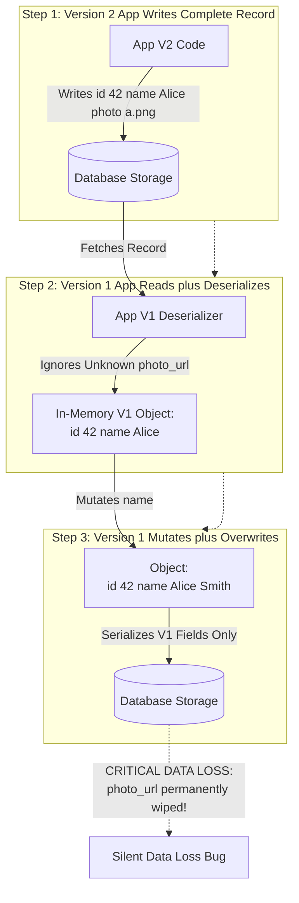
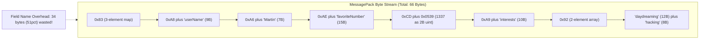
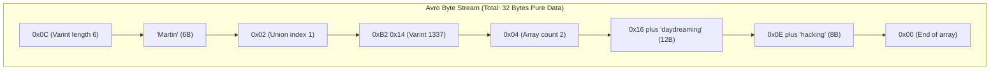
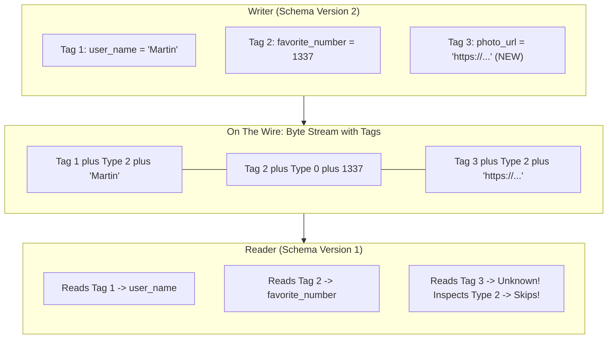
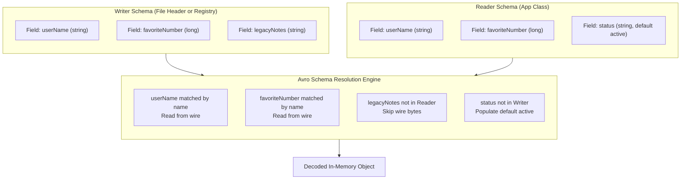
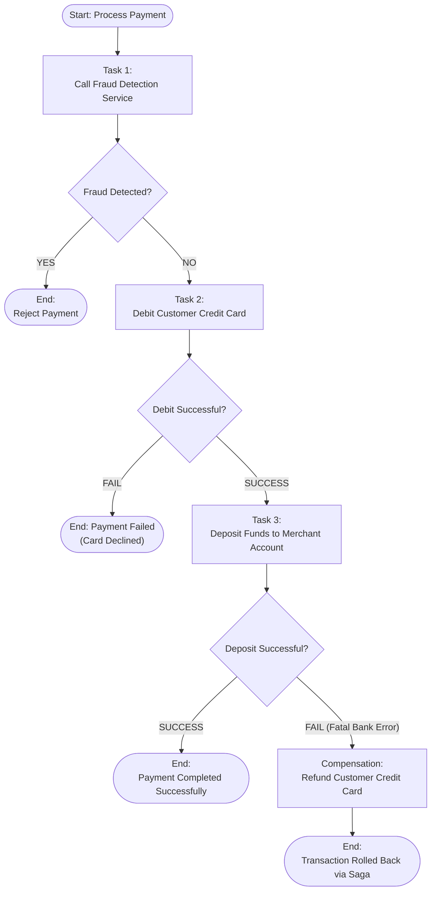

# Chapter 5: Encoding and Evolution — Definitive Technical Summary
*From: Designing Data-Intensive Applications (2nd Edition) by Martin Kleppmann and Chris Riccomini*
*Source PDF: pp. 185–220 (673-page PDF) — figures below cite PDF pages.*

> [!NAV] **Chapter Navigation**
> ⬅️ **Previous:** [[chapter-04-storage-and-retrieval|Chapter 04: Storage and Retrieval]] | 🏠 **Index:** [[00-Master-Reading-Dashboard|Master Dashboard]] | ➡️ **Next:** [[chapter-06-replication|Chapter 06: Replication]]


---

## 1. Executive Summary & Core Engineering Problem

> *"In the context of APIs, if you want an older client to be able to successfully call a newer service, you need backward compatibility on the request and forward compatibility on the response. For a newer client to call an older service, you need forward compatibility on the request and backward compatibility on the response."*
> — **Martin Kleppmann**, *Designing Data-Intensive Applications*

- **Core Thesis:** Applications evolve, but code cannot upgrade atomically. Rolling deploys (servers), app-store lag (phones, months behind), and 5–20-year-old DB rows mean old and new code + data coexist. Encodings must guarantee **backward compat** (new code reads old data) *and* **forward compat** (old code reads new data without crash or silent truncation).
- **Problem Statement:** Alice ships service V2 adding `photo_url`. Bob's V1 instance still runs on 25/50 nodes. V1 reads Alice's `{id:42,name:"Alice",photo_url:"a.png"}`, decodes into V1 object lacking `photo_url`, fixes `name`, writes back — permanently erasing `photo_url` (Figure 5-1, PDF p.186). At $50{,}000\ \text{req/sec}$, JSON (800B/event, 40 MB/s, $\$8{,}294$/mo egress) vs Protobuf (220B, 11 MB/s, $\$2{,}281$/mo) decides whether NICs and 40 CPU cores saturate on string parsing.
- **Historical & Industry Context:** `java.io.Serializable`/pickle/Marshal (language lock-in + RCE + no versioning) → XML 1990s / JSON 2000s (readable, schemaless) → Protobuf (Google 2008)/Thrift (Facebook 2007)/Avro (Hadoop 2009, Cutting) for compact evolution → 2020s Schema Registry + gRPC/HTTP-2 + durable execution (Temporal/Cadence/Restate) making encoding the substrate for exactly-once sagas.

---

## 2. In-Depth Technical Concepts & Internal Mechanics

### 2.1 Compatibility Invariants: Backward vs Forward (pp.185–187 — Figure 5-1)
- **Plain-English Intuition:** You cannot reboot the world to upgrade. For hours (rolling servers) to years (mobile + DB rows), V1 and V2 run side by side. New code handles old data easily (knows history + defaults); old code handling new data is hard (must ignore + preserve unknowns).
- **Definitions:** *Backward:* $V_N$ reads $V_{N-1}$ (fill defaults for missing fields). *Forward:* $V_{N-1}$ reads $V_N$ (skip/preserve unknown fields). API rule: old client → new server needs backward-on-request + forward-on-response; new client → old server needs the reverse.
- **Read-Modify-Write Trap (Figure 5-1, PDF p.186):** V2 writes `{42,"Alice","a.png"}`; V1 reads → drops `photo_url` (no field in struct) → writes `{42,"Alice Smith"}` → loss. Rule: decoders must retain `UnknownFieldSet` (Protobuf v3) and re-emit verbatim. Registry modes enforce this: `BACKWARD` (consumers first), `FORWARD` (producers first), `FULL` (any order, only optional+default changes), `NONE` (lock-step downtime, poison-pill risk).

| Mode | Rule | Allowed Change | Deploy Order |
| :--- | :--- | :--- | :--- |
| **BACKWARD** | $V_N$ reads $V_{N-1}$ | Add optional+default; drop required | Consumers first |
| **FORWARD** | $V_{N-1}$ reads $V_N$ | Drop defaulted; add skippable | Producers first |
| **FULL** | Both directions | Only optional+default add/drop | Any order |
| **NONE** | No check | Anything (type changes) | Stop-the-world |

---

### 2.2 In-Memory vs Bytes: Why Encoding Exists (p.187) + Language-Specific Formats (p.188)
- **Two Representations:** RAM = pointers, trees, hash tables (fast CPU, private addresses). Wire/disk = flat byte sequence (portable, no pointers). `encode/marshal/serialize` RAM→bytes; `decode/parse/unmarshal` bytes→RAM. Zero-copy exceptions (Cap'n Proto/FlatBuffers mmap) and compressed-on-disk execution (Ch.4 JIT) skip conversion, but most systems convert.
- **Why `Serializable`/pickle/Marshal/Kryo Fail (4 reasons, p.188):** (1) *Language lock-in* — Python pickle unreadable in Go/Java, blocks org integration. (2) *RCE* — instantiating arbitrary classes on decode; crafted bytes → shell (Commons Collections, Rails YAML, WebLogic — CWE-502 [1–3]). (3) *No versioning* — rename field → `InvalidClassException`; forward/backward afterthought [4]. (4) *Bloat/slow* — class names + reflection metadata; Java serialization notorious [5]. Use only for transient caches, never wire/storage. LSN-tagged WALs already show the alternative: explicit versioned bytes.

---

### 2.3 Textual Formats: JSON, XML, CSV + JSON Schema + Binary Variants (pp.189–192 — Figure 5-2)
- **Why Text Won:** JSON/XML/CSV are human-readable, editor-friendly, universal. Cross-org agreement outweighs prettiness. CSV = tabular only, no nesting, vague escaping (commas/newlines, RFC 4180 [9] unevenly implemented), no schema — app hardcodes column indices; adding a column breaks readers manually.
- **XML — 6 Evolution Pain Points (expanded):** (1) *Verbosity/complexity* — closing tags + namespaces + WS-* bloat (`<userName>Martin</userName>` vs `"userName":"Martin"`), criticized as poor S-expr copy [6]. (2) *Number ambiguity* — digits are text; `42` vs `"42"` distinguished only via external XSD. (3) *Binary hack* — raw bytes forbidden; Base64 inflates $+33\%$ (4 chars/3 bytes) + schema must flag it. (4) *Heavyweight schemas* — XSD/JSON Schema support regex/range validators but are hard to learn/implement; without them apps hardcode coercion. (5) *Evolution brittleness* — open vs closed models, remote refs, conditional `if/else` make forward/backward reasoning hard [10–12]. (6) *Niche persistence* — still dominant for inter-org documents and legacy SOAP, but inner-service high-throughput replaced by binary IDLs.
- **JSON Number/Binary Traps:** JSON splits string/number but not int/float nor precision. JS IEEE-754 loses $>2^{53}$ ($9{,}007{,}199{,}254{,}740{,}991$); X/Twitter sends 64-bit post IDs twice (number + decimal string) [7–8]. Binary strings → Base64 $+33\%$.
- **JSON Schema (pp.190–191):** Standard primitives + `minimum/maximum` validators; `additionalProperties:true` (default) = open model (forbids only invalid values on known fields) vs `false` = closed. Integer-keyed map needs `patternProperties: {"^[0-9]+$":{"type":"string"}}` (Example 5-1) because JSON keys are strings. Supports `if/else`, `$ref` remote, named types — powerful but unwieldy to resolve/evolve [10–11]; same for XSD [12]. Lives in OpenAPI, Confluent/Apicurio registries, Postgres `pg_jsonschema`, MongoDB `$jsonSchema`.
- **Binary JSON (MessagePack/CBOR/BSON/BJSON/UBJSON/Smile + WBXML/Fast Infoset):** More compact, sometimes faster, extend types (int vs float, raw bytes) but keep JSON model + **repeat field names per record**. Example 5-2 `{userName:"Martin",favoriteNumber:1337,interests:["daydreaming","hacking"]}` = 81B JSON → 66B MessagePack (Figure 5-2, PDF p.192: `0x83` 3-map, `0xA8` 8-char str, ASCII `userName`, `0xA6 Martin`, …). 31/66B ($47\%$) is key strings — only $18\%$ saving for loss of readability. Hence §2.4–2.5 strip names entirely.

---

### 2.4 Protocol Buffers & Thrift: Tag-Based Encoding (pp.193–195 — Figures 5-3, 5-4)
- **Core Idea:** `.proto`/`.thrift` schema assigns **integer tags**; wire carries tags, never names. Same Example 5-2 → **33B** ($41\%$ of JSON):
  ```protobuf
  syntax = "proto3";
  message Person { string user_name = 1; int64 favorite_number = 2; repeated string interests = 3; }
  ```
  Codegen emits classes per language; schema is simple (fields+types, no regex validators). Thrift mirrors this [14].
- **Wire Anatomy (Figure 5-3, PDF pp.193–194):** Each field = `header + payload`. `Header = (tag<<3)|wire_type` (1B, packs tag+type). Types: 0 varint, 1 fixed64, 2 length-delimited, 5 fixed32. Strings = varint len + UTF-8. `repeated` = tag repeated per element (no explicit array type).
- **Varint + ZigZag (Figure 5-3 detail):** 7 payload bits/byte, MSB continuation. 1337 (`0x0539` = `00000101 00111001`) → chunks `0001010`(10) + `0111001`(57) → `[0xB9,0x0A]` 2B vs 8B. $-64$–$63$ in 1B. Negatives: two's-complement $-1$ = 32 1-bits → 10B varint; ZigZag $(n\ll1)\oplus(n\gg31)$ maps $0\to0,-1\to1,1\to2$ → $-1$ in 1B (`sint32/64`).
- **Evolution Invariants:** Never change tag (wire identity; names free to rename); add only optional/defaulted tags (old code reads wire_type → skips length without crash, preserves bytes → forward compat, fixes Fig 5-1); never reuse deleted tag (`reserved 3;`); type changes only if documented (32→64-bit fills zeros forward, truncates backward).

---

### 2.5 Apache Avro: No-Tag Resolution (pp.196–201 — Figures 5-4, 5-5, 5-6)
- **Extreme Compactness (Figure 5-4, PDF p.196):** Avro strips names *and* tags → **32B** pure concatenated values (varint + len-prefixed UTF-8). Decode walks schema field order; bytes alone are typeless. Mismatch = misdecode. IDL + JSON schema (specifies fields/types only, no validators):
  ```idl
  record Person { string userName; union { null, long } favoriteNumber = null; array<string> interests; }
  ```
- **Writer vs Reader Schemas (Figure 5-5, PDF p.197):** Writer = compiling app's version; reader = reading app's version + writer's version fetched out-of-band. Resolution matches **by name** (order-free), drops writer-only fields, fills reader-only fields from `default`. Alice V1 `[user_id:42,user_name:"Martin"]` → Bob V2 `[user_name,user_id,email default "none@example.com"]` resolves despite reorder + missing `email`.
- **Rules (Figure 5-6 Compatibility Matrix, PDF p.198):** Forward = writer newer than reader; backward = writer older. Add/remove only fields **with defaults** (`union{null,long}` + `default:null`; bare `null` default illegal unless first branch — explicitness avoids billion-dollar null [19]). Type changes only if convertible; renames via `aliases` (backward but not forward); union-branch add = backward only.
- **Where Is Writer Schema?** (1) *Big files* (millions of rows, Ch.11): once in file header (Avro object container). (2) *DB rows* (mixed versions): version int per record + version table (Kafka Schema Registry [20], Espresso [21]: 5B prefix `0x00` + 4B schema ID, cached forever). (3) *RPC*: negotiate at connect, use for session (Avro RPC p.180). Registry doubles as docs + compat gate [22]. Dynamic schemas = Avro superpower: dump RDBMS → generate Avro JSON schema per table automatically on each run; Protobuf would need hand-assigned tags per column change.
- **Merits of Schemas (p.201):** Protobuf/Avro simpler than XSD/JSON Schema → wide language support; lineage from ASN.1 (1984, DER/X.509, tag evolution [24–27]) minus its complexity. Proprietary DB protocols (ODBC/JDBC) same idea. Benefits: $0.2\times$–$0.5\times$ size (no names), living docs (decode requires schema), registry-gated compat, codegen type-checking. Keep concurrent versions minimal.

#### 2.5.1 Schema Evolution in Depth — Compatibility Matrix (pp.196–201)
- **Why schema evolution matters:** The book's term *schema evolution* appears throughout pp.195–201 because rolling upgrades + 5-year-old DB rows + archive files force old and new schemas to coexist. Relational `ALTER TABLE` pretends one schema rules; in practice storage holds many versions. Schema evolution is the discipline of changing schemas without stop-the-world rewrites.
- **Forward vs backward vs full (recap with book wording p.199):** With Avro, *forward compatibility* means the writer can use a newer schema than the reader (old code reads new data). *Backward compatibility* means the writer can use an older schema than the reader (new code reads old data). Protobuf §2.4 uses tags to achieve the same; Avro uses name-matching + defaults. Both need the same deploy reasoning as §2.1.
- **Full compatibility matrix (Figure 5-6, PDF p.198 + text pp.199–200):**

| Change | Backward (old writer → new reader) | Forward (new writer → old reader) | Book rule |
| :--- | :--- | :--- | :--- |
| Add field **with default** (e.g. `union{null,long} favoriteNumber = null`) | ✅ reader fills default | ✅ old reader ignores | Allowed — the only safe add |
| Add field **without default** | ❌ new reader cannot fill missing value | ✅ (old reader ignores) | Breaks backward — forbidden |
| Remove field **with default** (reader still declares it) | ✅ reader fills default from its own schema | ✅ writer simply omits | Allowed if removed field had default on reader side |
| Remove field **without default** | ✅ | ❌ old reader expects value, writer omits | Breaks forward — forbidden |
| Change type with Avro promotion (int→long, int→float, string→bytes, etc.) | ✅ convertible | ⚠️ only if truncation-safe (long→int may truncate) | Check promotion table [17–18] |
| Rename field (no alias) | ❌ name match fails → default/missing | ❌ name match fails | Breaks both — use `aliases` |
| Rename field **with `aliases:["oldName"]`** | ✅ alias matches old writer field | ❌ old reader knows only old name | Backward only |
| Add union branch (e.g. add `string` to `union{null,long}`) | ✅ old writer uses old branch, new reader understands | ❌ new writer may emit new branch old reader cannot parse | Backward only |
| Remove union branch | ⚠️ fails if old data used removed branch | ✅ | Forward only (if no live data uses it) |
| Change `required`→`optional` / add `default` | ✅ | ✅ | Moves toward FULL |
| Change tag number (Protobuf) / field order (Avro) | ✅ order-free by name (Avro); tag-stable (Protobuf) | ✅ | Safe — names/tags are identity, order is not |
| Reuse deleted Protobuf tag | ❌ silent corruption (`0x1A` now means different field) | ❌ | Never — `reserved N;` forever |

- **Protobuf rules restated (p.195):** Never change tag; never reuse (`reserved 3;`); add only optional/defaulted; type widening 32→64 fills zeros forward but truncates backward; `repeated` stays repeated. Tag + wire-type header lets old parsers skip unknown fields by length — the forward-compat mechanism that fixes Figure 5-1.
- **Avro null-union explicitness (p.199):** `union { null, long } field = null` required; bare `field: long = null` illegal. `null` allowed as default only if first branch. Verbose but prevents Hoare's billion-dollar null [19] from sneaking in via implicit nullability.
- **Schema resolution algorithm (Figure 5-6, PDF p.198):** Reader + writer schemas compared field-by-field by **name**: (1) both have field → decode per writer type, cast/promote to reader type; (2) writer-only → skip bytes using writer type; (3) reader-only → inject `default` from reader schema; (4) type mismatch without promotion → `SchemaResolutionException` → DLQ, never silent. Order differences irrelevant. This is why Avro needs both schemas at decode time, unlike Protobuf which decodes tags alone.

#### 2.5.2 Where Does the Reader Get the Writer Schema? (pp.199–200)
- **Large file with many records (Ch.11 object container):** Schema stored once in file header. Millions of rows amortize the cost. Reader opens file, reads header, uses it as writer schema. Ideal for warehouse dumps + archival (Parquet/Avro container).
- **Database with individually written records:** Different rows written at different times with different versions. Solution: version prefix per record + schema-version table. Kafka Confluent Schema Registry [20] + LinkedIn Espresso [21]: `0x00 + int32 schema_id` (5B) per message; reader extracts ID, fetches writer schema from registry cache (fetch once, cache forever), then resolves against its compiled reader schema. Registry also enforces `BACKWARD/FORWARD/FULL/NONE` on publish — compat gate before poison pills deploy.
- **RPC over a connection:** Negotiate schema version at handshake, use for session lifetime. Avro RPC (p.180) does this. No per-message overhead. Breaks if long-lived connections span a deploy — reconnect or version each call.
- **Why a schema-version DB anyway:** Even when header/negotiation suffices, keep a registry: living documentation, audit trail, pre-deploy compat check [22]. Use incrementing int or schema hash as version.
- **Dynamically generated schemas — Avro's superpower (pp.200–201):** Dump RDBMS table → auto-generate Avro JSON schema from catalog (`column name → field name`, `SQL type → Avro type`) on every run, write Avro container [23]. Schema change (add/drop column) just generates a new writer schema; name-matching resolves against old readers. With Protobuf, tags must be hand-assigned and stable; auto-generator must never reuse a tag, requiring persistent tag-mapping state. That operational burden is why Avro was built for Hadoop [16], while Protobuf was built for hand-curated RPC IDLs.

#### 2.5.3 Merits of Schemas + History (p.201)
- **Simplicity wins:** Protobuf/Avro IDLs describe only fields+types, no regex/range validators. Result: codegen in Java/Python/Go/Rust/C++ stays tractable, unlike XSD/JSON Schema validators that few implement fully.
- **Lineage:** ASN.1 (1984) [24–25] + DER (X.509 certs) [26] already did tag-based evolution [27] but with spec complexity and poor docs — cautionary tale. ODBC/JDBC proprietary encodings prove the pattern inside DB drivers.
- **Four benefits (book list):** (1) compactness (omit names); (2) documentation that cannot drift (decode requires schema); (3) compat checking via schema DB; (4) codegen type-checking in static languages. Counter-balance: keep concurrent versions minimal — every live version multiplies test matrix and Fig 5-1 risk.
- **Worked rolling upgrade (synthesis pp.196–201):** Day 0 `Person v1 {userName, favoriteNumber}` with Registry `FULL`. Day 1 adds `email` with default → `FULL`-compatible; deploy consumers first, then producers; V1 readers skip `email` bytes. Day 8 renames `userName→displayName` with `aliases:["userName"]` → backward ✅, forward ❌; `FULL` rejects, team keeps both names one release. Day 15 widens `int→long` (promotion) → backward ✅, forward ⚠️ truncation; audit max value first. Every schema PR states writer/reader versions, mode, deploy order, rollback.

---

### 2.6 Dataflow Through Databases: Data Outlives Code (pp.202–203)
- **Rolling + Time Skew:** 20 nodes V1 + 20 nodes V2 simultaneously; DB holds 5-ms-old rows (V2) beside 5-year-old rows (V1-retired). Deploy replaces code in minutes; data persists years. Hence forward *and* backward compat required.
- **Lazy Migration:** Rewriting TBs is expensive → LSM compacts to latest format in background (Ch.4); Postgres ≥11 / MySQL ≥8 `ADD COLUMN … DEFAULT const` is $O(1)$ catalog-only, old pages fill nulls in RAM on read. Single-valued→multi-valued or table splits need app-level rewrite [28–29] (open research: Cambria lenses).
- **Archival:** Snapshots/dumps for backup/warehouse use latest schema uniformly; Avro container or Parquet columnar (Ch.4 compression p.139) ideal — immutable, analytics-friendly (Ch.11).

---

### 2.7 Dataflow Through Services: REST vs RPC (pp.204–210)
- **Services vs DBs:** Services expose app-specific APIs (encapsulation, per-team ownership [30]), not arbitrary queries (Ch.3). Independently deployable microservices → old/new servers+clients coexist → encodings must stay compatible; internal migrations then free.
- **Web Services:** HTTP transport; clients = mobile/JS (public internet), same-org microservices (private net), cross-org backends (public APIs: cards, OAuth). REST (Fielding [31–32]): URLs + HTTP caching/auth/content-negotiation; RESTful = principles, not enforcement.
- **OpenAPI + Codegen (expanded, pp.205–206):** **Schemas:** Developers describe endpoints/docs/versions/models in JSON/YAML IDL (Example 5-3 `openapi:3.0.0 /ping → {message:string}`); Protobuf IDL serves gRPC. **Codegen:** Frameworks (Spring Boot/FastAPI/gRPC) own routing/metrics/auth; FastAPI generates OpenAPI from code (Example 5-4 `PongResponse`), gRPC generates stubs from IDL — both emit client SDKs/docs/GUIs, verify compat (Swagger). Version via URL (`/v2`) or `Accept` header or per-API-key server-side pin [43–44]; breaking change = parallel versions indefinitely.
- **RPC Flaws (pp.207–208):** EJB/RMI (Java-only), DCOM (MS-only), CORBA (no compat [34]), SOAP/WS-* (cross-vendor but complexity/compat failures [35–37]) all chase **location transparency** (1970s [38], refuted [39–40]). Local vs remote differ: (1) *Unpredictability* — nanosecond deterministic vs ms–seconds + loss/slowness; must retry. (2) *Timeout ambiguity* — local returns/throws/hangs; remote may have executed with lost response (Ch.9). (3) *Retry duplication* — harmless locally, double-charges remotely without **idempotence keys** [41] (Ch.12). (4) *Latency variance* — same call ms vs seconds. (5) *Pointers vs bytes* — registers vs encode/copy/decode; large/mutable hurts. (6) *Cross-language types* — JS $>2^{53}$ ints corrupt (p.165). Conclusion: don't pretend remote = local; REST's explicit state transfer corrects this.
- **Discovery & Balancing (pp.208–210):** Client needs live endpoints: static IP (brittle) → HW balancers (single VIP, health-shift) → SW (NGINX/HAProxy) → DNS multi-A (cached, stale on churn) → registry (etcd/ZooKeeper + heartbeats + shard/DC metadata, Ch.7/437) → **mesh** (sidecar/client-lib per host: local encryption/TLS, observability, Istio/Linkerd on K8s; DBs/queues need bespoke). 
- **RPC Evolution Rule (p.210):** Assume servers update first, clients second → need **backward on requests, forward on responses** only. Inherits encoding's rules (gRPC=Protobuf, Avro RPC=Avro; REST JSON: add optional params + response fields = compatible).
- **SOAP — one line:** SOAP/WS-* (envelope + WSDL + WS-Security/Transactions) promised cross-vendor interop but collapsed under spec complexity and versioning fragility — use OpenAPI/JSON or gRPC/Protobuf for new APIs.
- **OpenAPI in practice (Examples 5-3/5-4, pp.205–206):** Example 5-3 `openapi:3.0.0` YAML declares `info.title/version`, `servers.url`, `paths./ping.get.responses.200.content.application/json.schema{type:object, properties:{message:{type:string, example:Pong!}}}`. Example 5-4 FastAPI implements it: `class PongResponse(BaseModel): message:str="Pong!"` + `@app.get("/ping", response_model=PongResponse)`. Two workflows: (a) IDL-first (gRPC/Swagger): write IDL → generate server stubs + client SDKs + docs + GUI; (b) code-first (FastAPI/Spring): annotate code → generate OpenAPI. Both give versioned contracts, mock servers, and Swagger compat checks. Keep OpenAPI versioned (`/v1`, `Accept: application/vnd.api.v2+json`, or per-API-key pin [43–44]); breaking change = run v1+v2 side-by-side indefinitely, never force-flag clients.
- **REST vs RPC versioning (p.210):** No standard; URL version, header negotiation, and server-side per-key pin all used (Stripe [44] pins per API key, admin UI upgrades). Cross-org RPC forces longest compat horizon — provider cannot force client upgrade.

---

### 2.8 Durable Execution and Workflows (pp.211–213 — Figure 5-7)
- **Problem (Figure 5-7, PDF p.211 — BPMN payment workflow):** Fraud-check → debit card → deposit to bank; each owned by different service (tasks = Temporal *activities* / durable functions). Sequential RPCs span seconds–days; crash between debit and deposit = charged without deposit; 2PC can't span third-party gateways.
- **Engine:** Orchestrator schedules (time/human/webhook triggers, parallelism, retries, placement); executors run tasks. Varieties: Airflow/Dagster/Prefect (ETL DAGs), Camunda/Orkes (BPMN GUI for non-engineers), Temporal/Restate (durable). Example 5-5 Temporal Python: `await execute_activity(check_fraud,…15s) → debit_credit_card…`.
- **Exactly-Once via WAL Replay:** Log every RPC + state change to durable WAL (Postgres/Cassandra) [46–47]; on failure re-execute, skip completed calls returning cached results — *pretends* to call. Alice charged $\$150$ (`ch_777` logged) → worker OOMs → new worker replays from line 1, returns cached `ch_777` without touching bank, resumes live at deposit. Requires: **idempotent** downstream APIs with unique keys [48] (else replay duplicates); deterministic code (same inputs→outputs) — no `Math.random()`/`Date.now()`/threading (use workflow virtual time; Temporal Workflow Check lints); ordered-call brittleness — reordering breaks replay [49]; version with `getVersion()` or deploy side-by-side, never edit live workflow [50] (details Ch.9).
- **Example 5-5 walkthrough (p.212):** `@workflow.defn class PaymentWorkflow: @workflow.run async def run(payment): is_fraud = await execute_activity(check_fraud, payment, start_to_close_timeout=15s); if is_fraud: return Fraudulent; credit_card_response = await execute_activity(debit_credit_card, ...)` — each `execute_activity` is WAL-logged with timeout; crash between debit and deposit replays fraud-check from log (no second fraud call) and resumes at deposit. Orchestrator handles time/human/webhook triggers, parallelism, retries, placement; executors run tasks.
- **Determinism pitfalls (p.213):** `random()`, wall-clock, thread interleavings, and dict-iteration order break replay equality. Frameworks ship deterministic stdlibs + static checkers; still, code-change brittleness (insert a new RPC mid-workflow) shifts all downstream log indices → undefined. Rule: new workflow version = new code bundle; old invocations drain on old code.
- **XML/CSV evolution recap (pp.189–191, keep 6+ points):** (1) Verbosity/complexity; (2) number-as-text ambiguity; (3) binary-via-Base64 $+33\%$; (4) heavyweight XSD/JSON Schema validators; (5) open-vs-closed evolution brittleness (`additionalProperties`, remote `$ref`, `if/else`); (6) CSV column-index + escaping fragility (RFC 4180 [9]); plus (7) niche persistence — inter-org docs/SOAP legacy remain, inner-service replaced by IDL binaries. JSON Schema open model (`additionalProperties:true` default) = permissive forward compat; closed model = strict but brittle — choose open for evolution, closed only for security boundaries.

---

### 2.9 Event-Driven Architectures & Actors (pp.213–215)
- **What is event-driven (p.213):** A request is called an *event* or *message*. Unlike RPC, the sender usually does **not** wait for the recipient. Events go via an intermediary — *message broker* / *event broker* / *message queue* / *message-oriented middleware* [51] — which stores the message temporarily. Sync RPC can be emulated by waiting on a reply channel, but the default is async fire-and-forget.
- **Broker benefits (5 from book p.213):** (1) *Buffering* — absorbs overload/outage (recipient down 2 h, producer keeps appending). (2) *Redelivery* — auto-redelivers to crashed process, prevents loss. (3) *No discovery* — senders publish to named queue/topic, never track recipient IPs (contrasts §2.7 mesh/DNS churn). (4) *Fan-out* — one `order_placed` → fraud + analytics + billing + notifications simultaneously. (5) *Decoupling* — publishers blind to consumers; new consumer subscribes without producer change. Past → present: TIBCO/WebSphere/webMethods → RabbitMQ/ActiveMQ/HornetQ/NATS/Redpanda/Kafka → Kinesis/Service Bus/Pub-Sub (Ch.12 compares throughput/ordering/durability).
- **Patterns & bytes (p.214):** *Queue (point-to-point):* one-of-many consumes (work queue). *Topic (pub/sub):* every subscriber gets a copy. Payload = opaque bytes + metadata; use Protobuf/Avro/JSON + Schema Registry compat checks [20,22]; AsyncAPI = OpenAPI for messages (documents topics, schemas, compat). Durability varies: delete-on-ack (RabbitMQ classic) vs infinite retention for event sourcing (Kafka log, p.101). Republishers must preserve unknown fields (Fig 5-1 trap) — ETL that decodes to objects and re-emits without `UnknownFieldSet` silently truncates downstream.
- **Event logs as state (p.214, forward to Ch.12):** Broker with infinite retention = event log: system of record, consumers derive views by replay. Requires the same backward/forward compat as DBs (§2.6) because log holds years of versions. Schema Registry gates every publish.
- **Backpressure & flow control:** Fast producers overwhelm slow consumers (50K ev/s in, 5K ev/s out → unbounded queue → OOM/disk-full). Mitigations: broker buffers + consumer lag monitoring (Kafka consumer lag alert), blocking publish when full (bounded queue), load-shedding (drop low-priority), scaling consumers (add partitions/consumers), and reactive pull (consumer polls at its pace, Ch.12). The book's buffer benefit assumes bounded overload; sustained overload needs provisioning, not just queuing.
- **Idempotent consumers (link to durable execution + Ch.12):** Brokers give at-least-once (redelivery → duplicates). Consumers must be *idempotent*: unique message/event IDs + dedup table (`processed_ids` with unique constraint), upsert-by-key instead of blind insert, versioned writes. Stripe-style idempotence keys [41] originated here. Without this, retry after timeout double-charges (RPC flaw §2.7 repeats in events).
- **Actors (Erlang/OTP, Akka, Orleans [52]):** Single-process concurrency without threads: per-entity actors, private state, one-message-at-a-time mailboxes (loss possible even locally). Distributed transparently: same send, encode→net→decode if remote. Location transparency fits better than RPC (loss already assumed; only latency differs). Broker+actors fused; rolling upgrades still need forward/backward compat via this chapter's encodings — V2 actor sending new field to V1 actor must not crash it.
- **Summary (pp.215–216):** Rolling upgrades demand both compat directions; language-specific = no compat; textual = ad-hoc compat + vague types; binary IDL = defined compat + compact but opaque; dataflow (DB encode/decode, RPC request/response, events sender/recipient) all inherit these rules — with care, rapid evolution + frequent deploys are safe. The chapter's closing triad: *Databases* (writer encodes, reader decodes), *RPC/REST* (client encodes request, server decodes + encodes response), *Event-driven* (sender encodes, recipient decodes).

---

## 3. Important Figures, Diagrams & Visual Architecture

> 📕 **Original figures quick index (source PDF, 673 pages):** open the PDF at the cited page to verify each reconstruction.
>
> | Book Fig | PDF page | What to compare |
> |---|---|---|
> | Fig 5-1 | PDF p.186 | Backward/forward compat |
> | Fig 5-2 | PDF p.192 | MessagePack |
> | Fig 5-3 | PDF p.193 | Protobuf bytes + varint |
> | Fig 5-4 | PDF p.196 | Avro bytes |
> | Fig 5-5 | PDF p.197 | Writer vs reader schema |
> | Fig 5-6 | PDF p.198 | Avro resolution |
> | Fig 5-7 | PDF p.211 | Workflow BPMN |

### Figure 5-1: The Forward Compatibility Data Truncation Bug
- **Figure Reference:** `Figure 5-1: When an older version of the application updates data previously written by a newer version, the newer field may be lost`
- **Original PDF:** Fig 5-1 → PDF p.186 — open the PDF at page 186 to compare with the Mermaid reconstruction below.
- **Visual Flow & Description:** V2 writes `{42,Alice,a.png}`; V1 deserializes dropping `photo_url`, mutates `name`, overwrites DB → silent loss during rolling deploy.
- **Mermaid Flowchart:**



- **Key Takeaway:** Preserve unknown fields verbatim; `UnknownFieldSet` + `FULL` registry.

---

### Figure 5-2: MessagePack Binary JSON Encoding Layout
- **Figure Reference:** `Figure 5-2: Our record encoded using MessagePack`
- **Original PDF:** Fig 5-2 → PDF p.192 — open the PDF at page 192 to compare with the Mermaid reconstruction below.
- **Visual Flow & Description:** 66B stream (`0x83` 3-map, `0xA8 userName`, `0xA6 Martin`, `0xAE favoriteNumber`, `0xCD 0x0539`, `0xA9 interests`, `0x92` 2-array); 34B key overhead.
- **Mermaid Flowchart:**



- **Key Takeaway:** Schema-less binary saves only ~18% — names dominate.

---

### Figure 5-3: Protocol Buffers Binary Encoding Layout
- **Figure Reference:** `Figure 5-3: Our record encoded using Protocol Buffers`
- **Original PDF:** Fig 5-3 → PDF p.193 — open the PDF at page 193 to compare with the Mermaid reconstruction below.
- **Visual Flow & Description:** 33B: `(tag<<3|type)` headers (`0x0A` tag1/str, `0x10` tag2/varint `0xB9 0x0A`=1337, `0x1A` tag3/str ×2).
- **Mermaid Flowchart:**



```mermaid
flowchart LR
  subgraph PB["Protocol Buffers Byte Stream (Total: 33 Bytes)"]
    direction LR
    H1["0x0A (Tag 1, Type 2: string)"]
    L1["0x06 (Length: 6)"]
    V1["'Martin' (6B UTF-8)"]
    H2["0x10 (Tag 2, Type 0: varint)"]
    V2["0xB9 0x0A (1337 as 2B Varint)"]
    H3["0x1A (Tag 3, Type 2: string)"]
    L3["0x0B (Length: 11)"]
    V3["'daydreaming' (11B)"]
    H4["0x1A (Tag 3, Type 2: string)"]
    L4["0x07 (Length: 7)"]
    V4["'hacking' (7B)"]
  end
  H1 --> L1 --> V1 --> H2 --> V2 --> H3 --> L3 --> V3 --> H4 --> L4 --> V4
```

- **Key Takeaway:** 1B tag headers cut 59% vs JSON; wire-type enables skipping.

---

### Figure 5-4: Apache Avro Binary Encoding Layout
- **Figure Reference:** `Figure 5-4: Our record encoded using Avro`
- **Original PDF:** Fig 5-4 → PDF p.196 — open the PDF at page 196 to compare with the Mermaid reconstruction below.
- **Visual Flow & Description:** 32B pure values: varint lens, union index, array count + terminator; zero tags/names.
- **Mermaid Flowchart:**



- **Key Takeaway:** Minimum bytes; schema required out-of-band.

---

### Figure 5-5: Protocol Buffers Tag-Based Schema Evolution
- **Figure Reference:** `Figure 5-5: In Protocol Buffers, encoding and decoding can use different versions of a schema`
- **Original PDF:** Fig 5-5 → PDF p.197 — open the PDF at page 197 to compare with the Mermaid reconstruction below.
- **Visual Flow & Description:** Writer V2 emits tags 1,2,3; reader V1 decodes 1,2, skips 3 via wire-type length.
- **Mermaid Flowchart:**



- **Key Takeaway:** Wire types make future fields skippable — forward compat.

---

### Figure 5-6: Apache Avro Schema Resolution
- **Figure Reference:** `Figure 5-6: An Avro reader resolving differences between the writer's schema and the reader's schema`
- **Original PDF:** Fig 5-6 → PDF p.198 — open the PDF at page 198 to compare with the Mermaid reconstruction below.
- **Visual Flow & Description:** Match by name, skip writer-only `legacyNotes`, default reader-only `status='active'`.
- **Mermaid Flowchart:**



- **Key Takeaway:** Names + defaults decouple evolution from wire.

---

### Figure 5-7: Durable Execution Workflow (Payment Saga Pattern)
- **Figure Reference:** `Figure 5-7: A workflow expressed using Business Process Model and Notation`
- **Original PDF:** Fig 5-7 → PDF p.211 — open the PDF at page 211 to compare with the Mermaid reconstruction below.
- **Visual Flow & Description:** Fraud → debit → deposit with refund compensation on bank failure; Temporal WAL replay prevents double-charge.
- **Mermaid Flowchart:**



- **Key Takeaway:** Persisted transitions + compensations = exactly-once sagas.

---

### Durable Execution Event History Replay Sequence
- **Visual Flow & Description:** Worker 1 debits ($100, `ch_777` logged) then OOMs; worker 2 replays log, returns cached charge, resumes live at deposit — idempotent keys prevent double-spend.
- **Mermaid Sequence Diagram:**


- **Key Takeaway:** Replay replaces network with log lookups — no duplicate side effects.

---

## 4. Real-World Systems, Case Studies & Code Examples

### 4.1 Industry Implementations & Architectural Divergence
- **gRPC (Protobuf/HTTP-2):** K8s/Istio default; multiplexed streams, deadlines/cancellation propagation, bidirectional streaming; $3\times$ smaller than JSON.
- **Kafka + Schema Registry:** 5B prefix (`0x00` + 4B ID) + `BACKWARD/FULL_TRANSITIVE` gates; prevents poison pills; cached schemas = zero per-message overhead.
- **Iceberg/Delta Lakehouse:** Parquet/ORC + footer schemas; add/drop/rename without multi-TB rewrites; time-travel + transactions.
- **Temporal/Step Functions/Cadence:** Event-log WAL in Cassandra/Postgres/MySQL; deterministic replay = exactly-once business logic; idempotent activities via unique keys.

---

### 4.2 Production Implementation: Protocol Buffers Varint & Zigzag Encoder/Decoder

```python
import struct
from typing import Tuple

class ProtobufVarintCodec:
    """Varint + ZigZag + tag header (field_tag<<3|wire_type)."""

    @staticmethod
    def encode_zigzag32(n: int) -> int:
        return ((n << 1) ^ (n >> 31)) & 0xFFFFFFFF

    @staticmethod
    def decode_zigzag32(n: int) -> int:
        return (n >> 1) ^ -(n & 1)

    @staticmethod
    def encode_varint(value: int) -> bytes:
        if value < 0:
            raise ValueError("Use zigzag for signed ints.")
        out = bytearray()
        while True:
            b = value & 0x7F
            value >>= 7
            if value:
                out.append(b | 0x80)
            else:
                out.append(b)
                break
        return bytes(out)

    @staticmethod
    def decode_varint(stream: bytes, offset: int = 0) -> Tuple[int, int]:
        res, shift, cur = 0, 0, offset
        while True:
            byte = stream[cur]
            cur += 1
            res |= (byte & 0x7F) << shift
            if not byte & 0x80:
                break
            shift += 7
            if shift >= 64:
                raise ValueError("Malformed varint.")
        return res, cur

    @classmethod
    def encode_field_header(cls, tag: int, wire: int) -> bytes:
        return cls.encode_varint((tag << 3) | (wire & 0x07))

    @classmethod
    def decode_field_header(cls, s: bytes, o: int) -> Tuple[int, int, int]:
        raw, no = cls.decode_varint(s, o)
        return raw >> 3, raw & 0x07, no
```

---

### 4.3 Production Implementation: Deterministic Workflow Replay Engine

```python
from typing import List, Dict, Any, Callable

class WorkflowExecutionHistory:
    def __init__(self):
        self.events: List[Dict[str, Any]] = []

    def append(self, event_type: str, data: Any):
        self.events.append({"type": event_type, "data": data})

class ReplayContext:
    """Return cached activity if in log, else execute live + log."""
    def __init__(self, history: List[Dict[str, Any]]):
        self.history = history
        self.idx = 0

    def execute_activity(self, name: str, fn: Callable, *args) -> Any:
        if self.idx < len(self.history):
            ev = self.history[self.idx]
            if ev["type"] == f"ActivityCompleted:{name}":
                self.idx += 1
                return ev["data"]
            raise RuntimeError(f"NonDeterministic: expected {ev['type']} got {name}")
        res = fn(*args)
        self.history.append({"type": f"ActivityCompleted:{name}", "data": res})
        self.idx += 1
        return res

def payment_workflow(ctx: ReplayContext, user_id: str, amount: float):
    if not ctx.execute_activity("check_fraud", lambda u, a: a < 1000.0, user_id, amount):
        return {"status": "REJECTED"}
    cid = ctx.execute_activity("debit_card", lambda u, a: f"ch_{u}_{int(a)}", user_id, amount)
    dep = ctx.execute_activity("deposit_merchant", lambda c: f"dep_for_{c}", cid)
    return {"status": "SUCCESS", "charge_id": cid, "deposit_id": dep}
```

---

### 4.4 Production War Story: The Kafka Topic Poison Pill Outage
- **Context:** Neo-bank, Kafka + Avro + Registry (`BACKWARD`), 20 consumers, 64 partitions, $30{,}000\ \text{events/sec}$, 30B wire.
- **Incident:** Upstream adds `TRANSFER` to `TransactionType[PURCHASE,REFUND]` → registry rejects (forward-incompatible: old readers crash on unknown enum). Engineer forces `NONE`, deploys producer.
- **Cascade:** First `TRANSFER` → `AvroTypeException` → crash → restart → same offset → crash; 20 instances rebalance-storm in 3 s; 4M backlog, 4.5 h payment halt; incident cost $\sim\$120$K + SLA credits.
- **Fix:** RBAC on compat overrides (VP approval), `FULL_TRANSITIVE` everywhere, try/catch → DLQ (`transactions.DLQ`) + commit offset; enums → strings + app validation.

---

### 4.5 Production Implementation: Avro Writer→Reader Resolution + Idempotent Event Consumer

```python
from typing import Dict, Any, List, Optional

def avro_resolve(writer_schema: List[Dict[str, Any]],
                 reader_schema: List[Dict[str, Any]],
                 wire_values: Dict[str, Any]) -> Dict[str, Any]:
    """Figure 5-6 in code: match by name, skip writer-only, default reader-only."""
    w_by_name = {f["name"]: f for f in writer_schema}
    out: Dict[str, Any] = {}
    for rf in reader_schema:
        n = rf["name"]
        if n in wire_values and n in w_by_name:
            out[n] = wire_values[n]  # promotion check omitted for brevity
        elif "default" in rf:
            out[n] = rf["default"]
        else:
            raise ValueError(f"Backward-incompatible: missing {n} with no default")
    # writer-only fields in wire_values are implicitly skipped (forward compat)
    return out

class IdempotentKafkaConsumer:
    """At-least-once broker + idempotent consumer = effectively-once (p.214)."""
    def __init__(self):
        self.seen = set()  # production: UNIQUE(request_id) in DB, not RAM
        self.state: Dict[str, Any] = {}

    def handle(self, event: Dict[str, Any]) -> Optional[str]:
        eid = event["event_id"]
        if eid in self.seen:
            return None  # duplicate redelivery after crash/timeout — skip
        # Preserve unknown fields verbatim (Fig 5-1 rule for republishers):
        preserved = dict(event.get("_unknown_fields", {}))
        self.seen.add(eid)
        self.state[event["key"]] = {**event["data"], **preserved}
        return event["key"]
```

- **Backpressure wiring:** `max.poll.records=500`, `fetch.max.bytes=8MB`, consumer lag dashboard (`log_end_offset - consumer_offset`); autoscale on sustained lag >10K; DLQ on `SchemaResolutionException` + commit to avoid poison-pill stall.

---

## 5. Architectural Trade-Off Matrix

| Format | Wire & Size | CPU | Schema | Evolution | Zero-Copy | Best Fit | Failure |
| :--- | :--- | :--- | :--- | :--- | :--- | :--- | :--- |
| **JSON/XML** | Text $1\times$; Base64 $+33\%$ | $10\times$ string/float parse (~2 ms/req) | Optional XSD/JSON Schema | Ad-hoc ignore+branch | No | Public APIs, browsers | $>2^{53}$ truncation; bloat |
| **MessagePack/BSON** | Binary doc $0.8\times$ (66B) | $2\times$–$3\times$ vs JSON | None (names in payload) | Schema-on-read | No | MongoDB, caches | 51% key overhead |
| **Protobuf/Thrift** | Tags $0.4\times$ (33B) | Bitwise varint (~50 µs) | Strict `.proto`/`.thrift` | Tags+wire skip/preserve | No | gRPC sync RPC | Tag reuse = silent corruption |
| **Avro** | Pure data $0.39\times$ (32B) | Linear scan (~40 µs) | Strict + Registry (5B ID) | Name resolution+defaults | No | Kafka/Iceberg streams | Ungated change = poison pill |
| **FlatBuffers/Cap'n Proto** | Pointers $0.6\times$ | Zero ($0$ ns mmap) | Strict IDL | Offsets+tables | Yes | HFT/games/IoT ns | Unchecked offsets = RCE |

### Compatibility & Dataflow Matrix (pp.196–215 synthesis)

| Dimension | Protobuf (tags) | Avro (names+defaults) | JSON + Schema | Event-driven implication |
| :--- | :--- | :--- | :--- | :--- |
| **Identity** | Tag number | Field name | Field name | Tag rename free; name rename needs alias |
| **Forward compat** | Skip by wire-type length | Ignore writer-only field | `additionalProperties:true` + ignore | Old consumer must skip, never crash |
| **Backward compat** | Fill default for missing tag | Fill `default` for missing name | Default in code | New consumer must handle 5-year-old rows |
| **Breaking change** | Tag reuse, required add, type shrink | No-default add/drop, branch removal | `additionalProperties:false` + required add | Registry `FULL` blocks; else poison pill |
| **DB dataflow** | Decode old pages with defaults | Version ID → writer schema → resolve | App fills nulls on read | LSM compaction rewrites to latest lazily |
| **RPC dataflow** | Backward on request, forward on response | Same (Avro RPC negotiates) | Optional params + new response fields | Servers first, clients second |
| **Event dataflow** | Preserve `UnknownFieldSet` on republish | Preserve unknown fields on republish | Preserve unknown JSON keys | Truncation forks downstream views |

### Concrete Decision Heuristics

```text
Public browsers / third parties? YES -> JSON/HTTPS + OpenAPI.
NO (internal):
  ns zero-copy? YES -> FlatBuffers/Cap'n Proto.
  Sync RPC? YES -> Protobuf + gRPC (HTTP/2 mux).
  Async streams / lakehouse? YES -> Avro + Registry (names, minimal bytes).
Event-driven specifics:
  Need infinite retention / replay (event sourcing p.101)? YES -> Kafka log + Avro + Registry FULL.
  Work queue, delete-on-ack OK? YES -> RabbitMQ/Redis Streams + Protobuf/JSON.
  Per-entity concurrency (game session, device twin)? YES -> Actors (Orleans/Akka) + Protobuf.
  Consumer slower than producer? Bound queues + lag SLO + autoscale + DLQ; never unbounded buffer.
```

---

## 6. Jargon Buster & Key Terminology

- **Backward/Forward Compatibility:** New reads old (defaults) / old reads new (skip+preserve) without crash/loss. Book p.186: backward = newer code reads older data; forward = older code reads newer data. API corollary: old client→new server needs backward-on-request + forward-on-response.
- **Schema evolution:** Discipline of changing schemas (add/drop/rename/type-change) while old code+data coexist. Protobuf does it with stable tags; Avro with names+defaults; JSON Schema with open/closed models + validators. Term appears 8+ times pp.195–201 for a reason — every deploy is a migration.
- **Writer/Reader Schema + Resolution (schema resolution):** Avro decode uses two schemas: writer (exact bytes version, from header/registry/negotiation) + reader (local code expectation). Engine matches by name, skips writer-only, defaults reader-only, promotes convertible types. Zero wire tags/names.
- **Compatibility modes (Registry):** `BACKWARD` (consumers first), `FORWARD` (producers first), `FULL` (any order, only optional+default changes), `FULL_TRANSITIVE` (against all history, not just latest), `NONE` (stop-the-world, poison-pill risk). Enforced on publish in Confluent/Apicurio [20,22].
- **Wire Type:** 3-bit Protobuf framing flag (0 varint, 1 fixed64, 2 length-delimited, 5 fixed32) enabling unknown-field skips.
- **Varint / ZigZag:** 7-bits+continuation variable bytes; signed→unsigned interleave so $-1$ fits 1B.
- **Field tag / `reserved`:** Integer identity in Protobuf (never reuse; `reserved 3;` tombstones deleted tags). Contrast Avro name identity + `aliases` for renames.
- **Union + default (Avro):** `union{null,long} f = null` — explicit nullable with default; `null` first-branch rule prevents implicit null bugs.
- **Schema Registry / 5B Prefix:** Central version store; `0x00` + 4B ID per Kafka record, cached in RAM. Doubles as docs + compat gate + audit trail.
- **OpenAPI / AsyncAPI:** YAML/JSON IDLs for REST vs message topics; drive docs, SDK codegen, compat checks. OpenAPI Example 5-3 (`openapi:3.0.0 /ping`); AsyncAPI same for Kafka topics. Swagger UI tests endpoints live.
- **XML/CSV traps:** Verbosity, number-as-text ambiguity, Base64 $+33\%$ binary hack, XSD complexity, vague CSV escaping (RFC 4180 [9] uneven), column-index brittleness.
- **SOAP:** Envelope+WSDL+WS-* XML stack; interop promise sunk by complexity — legacy only.
- **Service discovery / Load balancing / Service mesh:** DNS multi-A → etcd/ZooKeeper registry + heartbeats → sidecar mesh (Istio/Linkerd) with local TLS + observability. Solves §2.7 endpoint churn that brokers avoid via named topics.
- **RPC Illusion / Location transparency:** False transparency of remote as local (partitions, timeout ambiguity, retry duplication, type skew). Waldo et al. [39–40]; REST corrects by explicit state transfer.
- **Durable Execution / Saga / Workflow (BPMN Fig 5-7):** WAL-logged workflow replay for exactly-once; multi-step locals + compensations (refunds) for rollback. Temporal/Restate/Cadence; Airflow/Dagster/Prefect for ETL DAGs; Camunda/Orkes BPMN for non-engineers.
- **Event-driven architecture:** Async fire-and-forget via broker; queue (one-of-many) vs topic/pub-sub (all-subscribers). Benefits: buffer, redelivery, no discovery, fan-out, decoupling. Needs backpressure + idempotent consumers + preserved unknown fields.
- **Backpressure / Flow control:** Slowing producers when consumers lag (bounded queues, pull-based poll, autoscale on lag). Prevents OOM/disk-full under sustained overload.
- **Idempotent consumer / Idempotence key:** Reapply-safe handler (unique event ID + dedup table + upsert). Stripe keys [41]; Ch.12 detail. Required because brokers redeliver (at-least-once).
- **Actor model:** Per-entity single-threaded mailbox actors (Erlang/Akka/Orleans); location-transparent send; loss assumed even locally, so remote gap smaller than RPC.
- **Poison Pill / DLQ:** Incompatible message halting partitions; quarantine topic + offset commit as antidote. Registry `FULL` prevents; DLQ contains.

---

## 7. System Design & Practical Engineering Takeaways

### 7.1 Production Engineering Checklist
1. **Never reuse Protobuf tags:** `reserved 3;` forever; reuse silently maps `phone`→`email` with same `0x1A` header.
2. **Default every new field:** Avro/Protobuf/JSON Schema additions need defaults or `BACKWARD` breaks on 5-year-old rows.
3. **DLQ every consumer:** Catch deserialization → `*.DLQ` + commit; else one bad enum rebalances 64 partitions.
4. **Preserve unknowns in proxies:** Gateways/routers/republishers set `preserveUnknownFields=true` (or retain `_unknown_fields`) or trigger Fig 5-1 erasure.
5. **Ban nondeterminism in workflows:** No `Date.now()`/`random()`/threads in Temporal code; wrap I/O in activities with idempotence keys + `getVersion()` for edits.
6. **Gate schemas in CI:** Registry `FULL_TRANSITIVE` check on every IDL PR; block `NONE` overrides without VP approval; generate docs/SDKs from the same IDL (OpenAPI/AsyncAPI/Protobuf).
7. **Bound event-driven queues:** Set explicit retention + `max.poll` + lag SLO (e.g. p99 lag <30 s); autoscale consumers; shed low-priority on saturation — buffering is not capacity.
8. **Make consumers idempotent:** Unique `event_id` + `UNIQUE` dedup table + upsert-by-key; replay-safe under redelivery and workflow replay.

---

### 7.2 System Design Interview Strategy
- **Lead with evolution:** "Internal sync → Protobuf/gRPC ($3\times$ smaller, tag compat, HTTP/2); async → Avro + Registry (5B ID, `FULL_TRANSITIVE`); public → JSON + OpenAPI." Quantify: 50K ev/s × (800B→220B) saves $29$ MB/s, $\$6{,}013$/mo, 40 cores.
- **Explain registries:** 4B schema ID decouples bytes from schema; compat gate blocks poison pills before deploy.
- **Propose durable for sagas:** Checkout/booking/dispatch → Temporal replay (cached `ch_777`, no double-charge) over cron/2PC.

---

### 7.3 Mastery Self-Assessment Questions

#### Question 1 (Conceptual Depth)
*Why is Avro smaller than Protobuf, and how does it stay in sync with zero tags/names?*
- **Answer:** Protobuf spends 1B/field on `(tag<<3|type)` headers (10B for 10 fields). Avro sends pure values (32B vs 33B). Sync via out-of-band writer schema (file header once per 50M rows; 4B registry ID per Kafka event, cached) + reader schema; resolution matches by name, reorders transparently, skips writer-only fields, defaults reader-only fields — zero per-message metadata.

#### Question 2 (Failure Scenario)
*Team reuses tag 3 (`email`→`phone`, both `string`, header `0x1A`) in 50/50 rolling deploy. Bit-level behavior?*
- **Answer:** Wire identical: `(3<<3)|2=26=0x1A` + len + bytes. Old node decodes `"555-0199"` into `email` → MTA bounce; new node decodes `"alice@example.com"` into `phone` → corrupt directory. No parse error — silent semantic corruption. Fix: `reserved 3; string phone=4;`.

#### Question 3 (Trade-Off & Capacity Estimation)
*50K ev/s, 800B JSON vs 220B Protobuf. Bandwidth, egress @\$0.08/GB, CPU?*
- **Answer:** 129.6B ev/mo. JSON: 40 MB/s (320 Mbps), 103.68 TB/mo → $\$8{,}294$/mo, 40–60 cores JSON parsing. Protobuf: 11 MB/s (88 Mbps), 28.51 TB → $\$2{,}281$/mo, 8–12 cores varint. Saves $72.5\%$ BW, $\$6{,}013$/mo ($\$72$K/yr), ~40 cores.

#### Question 4 (Schema Evolution — Avro Resolution)
*Writer V1 `{userName:string, favoriteNumber:long}` writes 10M rows. Reader V2 `{userName:string, favoriteNumber:union{null,long}=null, email:string="none@example.com"}` reads them, then V2 writes new rows that V1 must read. Which directions are compatible and what happens bit-by-bit?*
- **Answer:** V1→V2 is backward: V2 matches `userName`+`favoriteNumber` by name, injects `email="none@example.com"` default for missing field — 10M old rows decode. V2→V1 is forward: V1 matches the two known names, skips `email` bytes using writer-schema length prefix — no crash. Both require the no-default rule respected: because `email` and `favoriteNumber` have defaults, both directions hold (`FULL`). If `email` had no default, V1→V2 would throw (new reader cannot fill), breaking backward. Registry `FULL` would have rejected that schema PR.

#### Question 5 (Event-Driven Failure)
*Kafka topic `orders` (Avro, `FULL`), 3 consumers (fraud, warehouse, billing). Billing team deploys a republisher that decodes to POJOs without unknown-field preservation and re-emits to `billing_enriched`. Producer then adds optional `coupon_code` with default. What breaks and how do backpressure + idempotence interact?*
- **Answer:** Producer add-with-default is `FULL`-compatible — fraud/warehouse (preserving consumers) ignore `coupon_code` and continue. Billing republisher drops it (POJO has no field, no `UnknownFieldSet` retention) → `billing_enriched` permanently loses coupons (Fig 5-1 event variant) even though the log still has them. Fix: retain `_unknown_fields` or pass through bytes. Separately: if billing falls behind (lag 500K), broker buffers (retention) absorb the spike — backpressure surfaces as lag, triggering autoscale; on crash-recovery the broker redelivers last 2K events, so billing's sink must be idempotent (`event_id` dedup + upsert) or double-bills. DLQ + offset-commit prevents one malformed `coupon_code` from stalling all partitions.

#### Question 6 (REST Evolution — OpenAPI)
*Public REST `GET /users/{id}` returns `{id, name}` (JSON). Need to add `email`, deprecate `name→display_name`, and support mobile clients 6 months behind. Compatible plan?*
- **Answer:** Add `email` as optional (nullable + omitted when unknown) — old clients ignore unknown JSON keys (forward). Keep `name` alongside `display_name` for two releases (alias period); document both in OpenAPI, mark `name deprecated:true`. Never rename in place — mobile V1 parses `name`, V2 prefers `display_name` with fallback. Version only on breaking change (`/v2` + per-key pin [44]); otherwise evolve additively under `FULL`-like JSON rules (`additionalProperties:true`, optional params). Validate with Swagger compat check in CI.

#### Question 7 (Durable Execution — Determinism)
*Temporal workflow `run(order)` calls `check_fraud`, `debit_card`, `deposit_merchant` in order. Dev inserts a new `apply_coupon` call between debit and deposit and uses `datetime.now()` for idempotence key. What breaks on replay of 10K in-flight workflows?*
- **Answer:** Two breaks: (1) Log-index shift — old histories have `[fraud, debit, deposit]`; new code expects `[fraud, debit, coupon, deposit]` at index 2, hits `deposit` record when expecting `coupon` → `NonDeterministicError`, workflows stall. Fix: `getVersion("coupon-step", 1, 2)` branch or deploy v2 side-by-side, drain v1. (2) Nondeterministic key — `now()` differs on replay, so cached `ch_777` lookup misses and debit re-fires → double-charge. Fix: deterministic key from `order_id` (`f"debit-{order_id}"`) + workflow virtual time. Both are p.213 rules: ordered-call brittleness [49] + determinism [49–50].

---

### 7.4 Byte-Level Reference — Figures 5-2 to 5-4 Side by Side (pp.192–196)

| Record `{userName:"Martin", favoriteNumber:1337, interests:["daydreaming","hacking"]}` | JSON (81B) | MessagePack (66B, Fig 5-2) | Protobuf (33B, Fig 5-3) | Avro (32B, Fig 5-4) |
| :--- | :--- | :--- | :--- | :--- |
| Names on wire? | Yes, every record | Yes, every record | No — tags 1,2,3 | No — pure values |
| Overhead source | Quotes, braces, commas | `0x83/0xA8/0xAE` prefixes + 34B key strings | 1B `(tag<<3|type)` per field | Len prefixes + union index + array count only |
| `1337` encoding | 4 ASCII chars | `0xCD 0x0539` (uint16) | `0xB9 0x0A` varint (2B) | `0xB2 0x14` varint zigzag variant |
| Decode needs | Nothing (self-describing) | Nothing | `.proto` (tags→names) | Writer + reader schemas |
| Evolution | Ad-hoc ignore | Ad-hoc ignore | Tag skip/preserve | Name match + defaults |
| When to use | Public/debug | Cache (marginal win) | RPC/gRPC | Logs/lakehouse |

- **Takeaway for interviews:** Quote the ladder 81→66→33→32B; explain *why* each step drops bytes (names→tags→nothing) and what you pay (readability→schema dependency→dual-schema resolution). Tie to §2.1: the cheapest bytes are worthless if V1 drops `photo_url` on rewrite.

---

### 7.5 Production Rollout Runbook — Schema Change (pp.195–215 synthesis)

1. **Propose:** IDL diff + compat matrix row (add-with-default? rename-alias? type-promotion?) + writer/reader version numbers.
2. **Gate:** Registry `FULL_TRANSITIVE` CI check; Swagger/Buf breaking-change detector; require `reserved`/alias/default evidence in PR.
3. **Deploy order:** Consumers/readers first for `BACKWARD` adds; producers/writers first for `FORWARD` drops; either for `FULL`. DBs: dual-read (try V2, fallback V1) during mixed-version window.
4. **Observe:** Lag (Kafka consumer lag), DLQ rate, `SchemaResolutionException` logs, workflow `NonDeterministicError` counters, mobile crash-by-version.
5. **Rollback:** Keep old view/schema live; replay from log (Kafka retention / Avro container) to rebuild; never edit live Temporal workflow — `getVersion()` + side-by-side.
6. **Clean:** After 99%+ clients migrate (mobile: months), remove deprecated field in a second `FULL`-compatible PR; tombstone tag with `reserved`.

---

### 7.6 Appendix — Copy-Paste IDL Skeletons (Examples 5-1/5-3/5-4 + Protobuf)

```yaml
# Example 5-1: JSON Schema integer-keys-to-strings (p.190)
$schema: "http://json-schema.org/draft-07/schema#"
type: object
patternProperties:
  "^[0-9]+$":
    type: string
additionalProperties: false
```

```yaml
# Example 5-3: OpenAPI Ping/Pong (p.206)
openapi: 3.0.0
info:
  title: Ping, Pong
  version: 1.0.0
servers:
  - url: http://localhost:8080
paths:
  /ping:
    get:
      summary: Given a ping, returns a pong message
      responses:
        '200':
          description: A pong
          content:
            application/json:
              schema:
                type: object
                properties:
                  message:
                    type: string
                    example: Pong!
```

```python
# Example 5-4: FastAPI implementation (p.206)
from fastapi import FastAPI
from pydantic import BaseModel

app = FastAPI(title="Ping, Pong", version="1.0.0")

class PongResponse(BaseModel):
    message: str = "Pong!"

@app.get("/ping", response_model=PongResponse,
         summary="Given a ping, returns a pong message")
async def ping():
    return PongResponse()
```

```protobuf
// Protobuf Person (p.193) — note stable tags, never reuse
syntax = "proto3";
message Person {
  string user_name = 1;
  int64 favorite_number = 2;
  repeated string interests = 3;
  // reserved 4, 5; // tombstones for deleted tags
}
```

```json
// Avro JSON schema twin (p.196) — names are identity, order is free
{
  "type": "record",
  "name": "Person",
  "fields": [
    {"name": "userName", "type": "string"},
    {"name": "favoriteNumber", "type": ["null", "long"], "default": null},
    {"name": "interests", "type": {"type": "array", "items": "string"}}
  ]
}
```

- **Review checklist for every IDL PR:** tags stable? defaults present? aliases for renames? union branches backward-only? registry mode stated? deploy order stated? unknown-field preservation tested? DLQ + idempotence covered? OpenAPI/AsyncAPI docs regenerated?
- **Schema evolution mantra (pp.195–201):** schema evolution is deploy safety; schema evolution needs the matrix above; schema evolution without registry gates is hope. Every schema evolution PR cites its matrix row.
- **Schema evolution vs schemaless:** schema evolution gives JSON flexibility with guarantees; schemaless without discipline gives silent truncation.
- **Schema evolution further reading:** Kleppmann's schema-evolution guide [15] + Avro spec [17–18].

---

> [!NAV] **Chapter Navigation**
> ⬅️ **Previous:** [[chapter-04-storage-and-retrieval|Chapter 04: Storage and Retrieval]] | 🏠 **Index:** [[00-Master-Reading-Dashboard|Master Dashboard]] | ➡️ **Next:** [[chapter-06-replication|Chapter 06: Replication]]
