# Chapter 6: Replication — Definitive Technical Summary
*From: Designing Data-Intensive Applications (2nd Edition) by Martin Kleppmann and Chris Riccomini*
*Source PDF: pp. 221–274 — figures below cite PDF pages.*

> [!NAV] **Chapter Navigation**
> ⬅️ **Previous:** [[chapter-05-encoding-and-evolution|Chapter 05: Encoding and Evolution]] | 🏠 **Index:** [[00-Master-Reading-Dashboard|Master Dashboard]] | ➡️ **Next:** [[chapter-07-sharding|Chapter 07: Sharding]]

---

## 1. Executive Summary & Core Engineering Problem

> *"The major difference between a thing that might go wrong and a thing that cannot possibly go wrong is that when a thing that cannot possibly go wrong goes wrong, it usually turns out to be impossible to get at or repair."*
> — **Douglas Adams**, *Mostly Harmless (1992)*

- **Core Thesis:** Replication — keeping a copy of the same data on multiple machines connected via a network — exists for four reasons: geographic proximity (lower latency), high availability (survive node/zone/region loss), durability (survive permanent loss), and read scalability (more read throughput). But the moment replicated data *changes*, you must choose one of three families: **Single-Leader** (one writer, total order, but failover + lag anomalies), **Multi-Leader** (every region/device writes locally, but concurrent conflicts need resolution), or **Leaderless / Dynamo-style** (any node accepts writes via quorums, but reads need repair and causality tracking). The 2nd edition adds two modern twists: **object-storage-backed replication with zero-disk architectures**, and **sync engines / local-first software** that push multi-leader all the way into the browser.
- **Problem Statement:** Alice signs up on a single-leader database. The leader assigns her `user_id = 501`, acks her browser, then its power supply dies before replicating to the follower. The orchestrator promotes the follower — whose auto-increment counter is still at 500 — and Bob signs up. Bob also gets `user_id = 501`. When the old leader rejoins, Alice's private rows collide with Bob's. Meanwhile in a leaderless store with `N=3, W=2, R=2`, Carol relies on Last-Write-Wins with NTP clocks: her cart addition loses silently because another node's clock runs 80 ms fast. Both outages look "successful" to clients.
- **Historical & Industry Context:** 1970s–1990s: primary-backup with synchronous log shipping over LANs (PostgreSQL WAL shipping, Oracle Data Guard). 2000s: async read-replica pools for geo scale (MySQL master–slave); Amazon Dynamo (2007) revives leaderless for datacenter-outage survival (→ Cassandra, Riak, ScyllaDB). 2010s: Raft/Paxos automate failover (CockroachDB, TiDB, etcd); Spanner proves strongly-consistent scale. 2020s (2nd-edition inflection): cloud object stores (S3/GCS) absorb durability with conditional-write leadership + zero-disk Kafka-compatible systems (WarpStream, Redpanda Serverless, SlateDB, Turbopuffer); collaborative apps (Google Docs, Figma, Linear) and sync engines (Firestore, Realm, Ditto, PouchDB/CouchDB, Automerge, Yjs) make every device a leader.
- **Backups vs Replication:** Replicas reflect *current* writes fast; backups store *old* snapshots so you can go back in time. Accidentally `DELETE` a table and replication faithfully deletes it everywhere — only a backup (snapshot + archived replication log, e.g. WAL-G for Postgres/MySQL/SQL Server, Litestream for SQLite) saves you.

---

## 2. In-Depth Technical Concepts & Internal Mechanics

### 2.1 Single-Leader Replication, Sync vs Async, and Setting Up New Followers
- **Plain-English Intuition:** Elect one machine the boss (**Leader**). All writes go to the boss. The boss writes to disk and streams the change log to helpers (**Followers**). Anyone can read from helpers, but only the boss takes writes. If the dataset is sharded (Chapter 7), each shard has its own leader — different shards may have leaders on different nodes.
- **Sync vs Async (Figure 6-2):** When Alice updates her profile image, the leader forwards the change to followers. Three options:
  1. *Fully synchronous:* Leader waits for **all** followers before acking. Follower guaranteed up-to-date; but one crashed/GC-paused follower blocks **all** writes.
  2. *Fully asynchronous:* Leader acks after local disk write, replicates in background. Leader never blocks; but un-replicated writes are lost if the leader dies unrecoverably — a confirmed write is not durable.
  3. *Semi-synchronous (production standard):* One follower is synchronous, rest async. Guarantees two durable copies (leader + sync follower). If the sync follower dies or lags, an async follower is promoted to sync. Variant: majority quorums (3 of 5 including leader) updated synchronously — the bridge to Chapter 10 consensus.
- **Follower lag reality:** Normally <1 s, but can stretch to minutes under capacity pressure, recovery, or network faults. There is no bound — hence *eventual consistency*.
- **Setting up new followers (zero-downtime):** Copying live files is incoherent (different parts at different times) and locking the DB kills availability. The protocol:
  1. Take a consistent snapshot of the leader without full lock (built-in or Percona XtraBackup).
  2. Copy snapshot to the new follower (or download snapshot + archived log from object store).
  3. Follower reconnects at the snapshot's exact log position — PostgreSQL LSN, MySQL binlog coordinates/GTIDs — and replays the backlog.
  4. Once backlog is drained it has *caught up* and streams live. Steps 1–2 double as the backup/disaster-recovery path.
- **Databases backed by object storage (2nd-edition new):** S3/GCS/Blob for live queries, not just archives. Wins: cheap infrequent-access tiers, multi-zone/multi-region durability without inter-zone fees, conditional-write (CAS) for transactions + leader election, shared Parquet/Iceberg lakes for integration. Costs: higher latency + per-API-call fees (forces batching), immutable objects (random writes expensive), no POSIX (FUSE shims lack nonsequential writes/symlinks). Responses: tiered storage (hot on SSD/NVMe, cold on objects), WAL on low-latency devices (EBS, Neon Safekeepers), or full **zero-disk architecture** — all data on objects, disks only as cache, nodes stateless (WarpStream, Bufstream, cloud warehouses).

### 2.2 Node Outages: Catch-Up, Failover, Fencing, and Split-Brain
- **Follower failure (easy):** Each follower logs the last transaction applied. On restart it asks the leader for everything since that offset and replays. Pain is performance: high write throughput × long outage = heavy catch-up load on both sides. The leader must either retain un-acked logs (risk disk-full) or delete them (follower then needs a full backup restore).
- **Leader failure (hard — failover):**
  1. *Detect:* Heartbeats; if the leader is silent ~30 s it is declared dead (planned maintenance uses graceful handoff instead).
  2. *Elect:* Majority election (Raft/Paxos) or controller node (ZooKeeper/Consul, `pg_auto_failover`). Best candidate = replica with the most up-to-date log (highest LSN) to minimize loss — a consensus problem (Chapter 10).
  3. *Reconfigure:* Clients rerouted (see Chapter 7 routing); the old leader, if it returns, must rejoin as follower.
- **What goes wrong (Alice/Bob failover story):**
  1. Leader `L1` counter at 500. Alice signs up → `user_id=501`, acked, not yet replicated. `L1` dies.
  2. Orchestrator promotes lagging follower `F1` (counter still 500). Bob signs up → also `user_id=501`.
  3. `L1` returns with Alice at 501. Without discarding `L1`'s un-replicated writes, Alice's and Bob's rows share a key. GitHub's real incident reused auto-increment keys across MySQL + Redis and leaked one user's private data to another.
  4. *Split-brain:* A partition lets both `L1` and `L2` believe they are leader and accept divergent writes with no merge process → corruption. Mitigation: **fencing** — each new leader gets a monotonically increasing fencing token; storage rejects writes with stale tokens (see "Distributed Locks and Leases" p. 373); aggressive form is STONITH (power off the old leader via PDU/IPMI). Too-short timeouts cause flapping failovers under load spikes; too-long timeouts extend outage. Some teams therefore fail over manually.
  5. *Rule:* Prefer the follower closest to the old leader (sync follower, or highest LSN under async). A follower days behind is catastrophic.

#### Concept Comparison: Replication Log Implementations
| Method | What ships | Pros | Cons / Risks | Used in |
| :--- | :--- | :--- | :--- | :--- |
| **Statement-based** | SQL `INSERT/UPDATE/DELETE` text | Compact | `NOW()`, `RAND()`, auto-increment, `UPDATE…WHERE` order, triggers/UDF side effects diverge | MySQL <5.1, VoltDB (requires determinism) |
| **WAL shipping (physical)** | Byte-level disk-block diffs | Fast, exact file copy | Tied to engine version + OS; leader/follower must match → no rolling zero-downtime upgrades | PostgreSQL, Oracle |
| **Logical / row-based** | Row events: insert (all columns), delete (PK), update (PK + old/new), + commit marker | Version-tolerant, parseable by CDC (Debezium/Kafka → warehouse/index/cache, Chapter 12) | Heavier than WAL; needs PK or full old row | MySQL binlog, Postgres logical decoding |
| **Trigger-based** | App-level audit rows in shadow tables | Flexible, DB-agnostic | 2–3× write overhead, lock contention | Legacy CDC shims |

### 2.3 Problems with Replication Lag and Stronger Guarantees
Read-scaling (many async followers absorbing reads) only works async — sync to all followers means one down node halts writes. Async followers are *eventually consistent*: stop writing, wait, and they converge. Three user-visible anomalies:

#### 1. Reading Your Own Writes (Figure 6-3)
- *Anomaly:* Alice posts a comment (→ leader), refreshes, hits a 2-s-lagging follower — comment missing. She reposts a duplicate.
- *Guarantee (read-after-write / read-your-writes):* You always see your own submissions; others' may lag.
- *Fixes:* Read user-editable objects (own profile) from leader/sync follower; route all reads to leader for N seconds after last update (or if follower lag >1 min); client remembers last-write LSN/timestamp and waits for replica to catch up; cross-device needs centralized timestamps; multi-region must route to the leader's region.

#### 2. Monotonic Reads (Figure 6-4)
- *Anomaly:* Bob (user 2345) reads Alice's new comment from a fresh follower, refreshes, lands on a staler follower — comment vanishes. Time moves backward.
- *Guarantee:* Once you see a value, you never see an older one.
- *Fix:* Sticky routing — hash `user_id` to one replica (fail over only if it dies).

#### 3. Consistent Prefix Reads (Figure 6-5)
- *Anomaly:* Mr. Poons asks *"How far can you see?"* (slow shard), Mrs. Cake answers *"10 seconds"* (fast shard). An observer hears the answer *before* the question — causality inversion. Fatal in sharded DBs where each shard orders independently with no global order.
- *Guarantee:* Causally ordered writes are observed in that order.
- *Fix:* Co-locate causally related writes on one shard; otherwise explicitly track causal dependencies (version vectors, "happens-before" p. 238).

#### Concept Comparison: Lag Anomalies
| Anomaly | User sees | Root cause | Mitigation |
| :--- | :--- | :--- | :--- |
| **Read-after-write violation** | Own update missing on reload | Read hit lagging follower | Leader reads for own data; LSN-gated reads |
| **Monotonic-read violation** | Sees post, refresh loses it | Two reads hit different-lag followers | Sticky replica per user |
| **Consistent-prefix violation** | Answer before question | Shards replicate at different speeds | Same-shard causality; dependency tracking |

- **Solutions for lag (big picture):** If hours of lag is "no problem," eventual is fine. Otherwise enforce stronger reads in app code (leader/sync reads) — complex and error-prone — or adopt a linearizable + ACID (NewSQL) store and program as if single-node (Chapters 8, 10). Weaker models survive partitions with lower overhead, so the rest of the chapter embraces them.
- **Regions vs AZs:** A *region* = datacenters in one geography; each datacenter = *availability zone*. Same-region zones have fast links (spread nodes across zones to survive zonal loss); cross-region survives regional loss but pays latency/throughput/billing costs.

### 2.4 Multi-Leader Replication: Geo, Topologies, and Local-First Sync Engines
- **Why:** Single-leader forces every write through one region — inter-region RTT on the write path, write outage if that region or link dies. Multi-leader (active/active, bidirectional) lets each leader accept writes and forward to peers; each leader is also a follower of the others. Sync multi-leader ≈ single-leader (a cut link blocks writes), so the chapter means **async** multi-leader.
- **Geo multi-leader (Figure 6-6):** A leader per region, leader–follower inside the region (across AZs), leader-to-leader across regions async. Wins: local write latency, per-region availability during partitions. Cost: much weaker consistency — two regions can concurrently overdraw an account or claim one username; no global constraint enforcement (Bailis et al.). Supported by MySQL, Oracle, SQL Server, YugabyteDB, Redis Enterprise, EDB Postgres Distributed, pglogical — often as a retrofit with sharp edges (auto-increment, triggers, constraints), "dangerous territory" if avoidable.
- **Topologies (Figure 6-7):** Two leaders: only peer-to-peer. Three+: (a) *circular* (each node → one peer, forwards + tags visited node IDs to break loops), (b) *star/tree* (root relays), (c) *all-to-all* (every → every). Ring/star die if one node dies (manual reconfig); all-to-all survives but fast/slow links cause **overtaking** (Figure 6-8): A inserts row 10 on L1, B reads it on L2 and updates it, yet L3 receives the UPDATE before the INSERT ("update row that doesn't exist"). Timestamps can't fix this (clocks untrustworthy, Chapter 9) — need version vectors ("Detecting Concurrent Writes" p. 237). Many systems lack this; test guarantees before trusting docs.
- **Sync engines & local-first (2nd-edition new):** Your calendar on phone + laptop: each device is a leader (local SQLite/IndexedDB), syncing hours/days later — multi-leader taken to the extreme over an awful network. Same for real-time collaboration (Google Docs/Sheets, Figma multiplayer, Linear): each open tab is a replica; local keystrokes render in <16 ms without server round-trip, remote edits stream in. A **sync engine** library captures local changes, sends or buffers them, receives + merges remote changes into the UI. **Offline-first** = editable offline; **local-first** = offline-first + survivable even if the vendor's servers vanish (open sync protocol, multiple providers — Git is local-first without real-time). Pros: instant UI, no offline mode (offline = huge delay), declarative local reads/writes (no per-RPC error handling), reactive remote updates. Cons: must pre-download the working set — fine for your files, wrong for Amazon's catalog. Lineage: Lotus Notes (1980s), calendar sync, now Firestore/Realm/Ditto (proprietary) and PouchDB/CouchDB, Automerge, Yjs (open). Games' *netcode* solves the same problem differently — out of scope.

### 2.5 Dealing with Conflicting Writes
Wiki page title `A`: User 1 sets `B` on L1, User 2 sets `C` on L2 concurrently (Figure 6-9). *Concurrent* means neither knew of the other — wall-clock simultaneity is irrelevant (offline edits hours apart still conflict). Single-leader never has this.

#### Concept Comparison: Conflict Handling
| Strategy | How | Pros | Cons | When |
| :--- | :--- | :--- | :--- | :--- |
| **Avoidance** | Pin each record/user to one home leader/region; odd/even auto-increment splits | Zero conflicts normally | Breaks on region failover/user move; offline clients can't avoid | Single-writer-per-key geo apps |
| **Last-write-wins (LWW)** | Max timestamp wins; ties by value | Trivial, convergent | Random winner among concurrent writes = silent loss; sensitive to clock skew (fix: logical/HLC clocks p. 417) | Insert-only unique keys; Cassandra/ScyllaDB default |
| **Manual (siblings)** | Store both `B` and `C`; client reads set, merges, writes back | No silent loss | API becomes set-valued; user-merge UI burden; naive union resurrects deletes (Figure 6-10: union of `[Book]` minus Book plus `[Book,DVD]` minus DVD → both reappear); concurrent resolvers can diverge (`B/C` vs `C/B` → `B/C/C/B`) | CouchDB |
| **Automatic (CRDT/OT)** | Deterministic merge preserving intent (text diffs, OR-Sets with tombstones, PN-counters, per-key merge) | Convergent (strong eventual consistency), no user interruption | Can't enforce invariants (cap list at 5 → must drop); type-restricted | Collaborative/local-first apps |

- **CRDTs vs OT (Figure 6-11):** Both start `ice`. One side prepends `n` → `nice`, other appends `!` → `ice!`; merged `nice!`. *OT* (Google Docs, ShareDB): ship index operations (`insert n@0`, `insert !@3`), transform the late operation's index (`3→4`). *CRDT* (Redis Enterprise, Riak, Cosmos DB, Automerge, Yjs): give each character an immutable ID (`i=1A, c=2A…`), new char `4B` stores predecessor ID (`3A`) or nil for head; concurrent inserts at one spot order by ID — no transformation. Lists/arrays generalize; maps merge per key. Eg-walker blends both.
- **Subtle conflicts:** Same-field collision is obvious; overlapping meeting-room bookings (two inserts, no field collision) still conflict — availability checks race. No ready-made answer; Chapters 8 and 13 build toward detection/resolution.

### 2.6 Leaderless (Dynamo-Style) Replication and Quorum Math
- **Model:** No leader; client (or coordinator, which unlike a leader imposes no order) writes/reads several replicas in parallel. Dynamo (2007, paper-only; DynamoDB today is single-leader Multi-Paxos), Riak, Cassandra, ScyllaDB.
- **Node down without failover (Figure 6-12):** `N=3`. Client writes to all 3; 2 ack (one rebooting) → success (client ignores the miss). Reads also fan out; versions disambiguate (newest timestamp wins). Catch-up via: **read repair** (reader pushes newest version to stale replica — best for hot keys), **hinted handoff** (healthy replica stashes hints for the down node, replays on return — covers cold keys), **anti-entropy** (background Merkle-tree diff + copy, unordered, delayed — unlike leader log).
- **Quorums:** `N` = replicas per key (sharding in Chapter 7 means one key lives on `N` nodes, not all nodes). `W` = acks needed for success, `R` = responses needed for a read. Requests go to all `N` in parallel; `W/R` = how many successes we wait for.
$$W + R > N$$
Overlap guarantees at least one read replica saw the latest write (Figure 6-13). Common: `N=3, W=2, R=2` (tolerate 1 down) or `N=5, W=3, R=3` (tolerate 2); read-heavy `W=N, R=1` (one down node kills writes); write-heavy `W=1, R=N` inverted. `W<N` keeps writes alive with a node down; `R<N` keeps reads alive.
- **Quorum ≠ guarantee (limitations):** `W+R>N` still confuses: restored node from stale replica can drop below `W`; rebalancing (Chapter 7) skews who holds the `N`; concurrent write+read may or may not see the write (later read can regress — p. 411); failed writes (<W acks) aren't rolled back (later reads may/may not see them); LWW wall-clock skew silently drops writes (Cassandra/ScyllaDB, "Synchronized Clocks" p. 362); concurrent writes arrive in opposite orders → multi-leader-like conflict (next section). Dynamo-style is eventual-consistency-optimized; tune `W/R` as stale-read probability (PBS), not absolute truth.
- **Monitoring staleness:** Leader-based: `leader_position − follower_position` = lag. Leaderless: no total order — hint counts and PBS-style probes are weak proxies, but "eventual" must still be quantified for ops.
- **Performance vs single-leader:** Single-leader reads-from-leader are fresh but bottlenecked on leader capacity, pay failover downtime, and amplify leader slowness. Leaderless has no failover; parallel fan-out + **request hedging** (use fastest responses) shrugs off slow nodes/gray failures (degraded-but-not-dead, HotOS). Costs: hint storage + replay load under stress; larger `W/R` raises tail latency (more chances to hit a slow node — seldom beyond 4-of-7 or 5-of-9); total partition can still deny quorum — mitigated by **sloppy quorums** (Riak/Dynamo) / `ANY` (Cassandra/ScyllaDB): any reachable node takes the write, reads may miss it until handoff.
- **Multi-region leaderless:** Cassandra/ScyllaDB client picks a local **coordinator**, which fans out within its region + one hop per remote region (avoids N× cross-region). Consistency levels: global quorum, per-region quorum, or local-only (fast, staler). Riak keeps client traffic in-region (`N` = in-region replicas) and replicates regions async like multi-leader.

### 2.7 Detecting Concurrent Writes: Happens-Before, Version Vectors, Dotted Vectors
- **No total order (Figure 6-14):** A writes `X=A` to nodes 1–2, B writes `X=B` to nodes 2–3. Node 1 sees only `A`, node 3 only `B`, node 2 sees `A` then `B`. Blind overwrite = permanent divergence. Fix with any prior merge strategy (LWW in Cassandra/ScyllaDB; siblings/CRDTs in Riak) — but first *detect* concurrency.
- **Happens-before (Lamport):** `A → B` if `B` knew/depended on `A`. Else concurrent (`A ∥ B`). Figure 6-8's insert→update is ordered (causal); Figure 6-14's pair is concurrent (neither knew). Three outcomes for any pair: `A→B`, `B→A`, or concurrent. Physical simultaneity is irrelevant — relativity analogy: like light-speed limits, a slow/broken network can make hours-apart operations concurrent.
- **Single-replica version numbers (Figure 6-15, shopping cart):** Server versions every key; reads return siblings + version; writes must echo the prior version and merge prior siblings (CRDT/user input). Server overwrites ≤ incoming version, keeps > as concurrent. Omit the version → concurrent with everything → pure sibling. Five-step trace (milk/eggs/flour/ham/bacon): C1 adds milk→v1 `[milk]`; C2 (unaware) adds eggs→v2 siblings `[milk],[eggs]`; C1 adds flour on v1→v3 `[milk,flour]` overwrites v1 but keeps v2 `[eggs]`; C2 merges v2 + ham→v4 `[eggs,milk,ham]` overwrites `[eggs]`, concurrent with v3; C1 merges v3 + bacon→v5 overwrites v3, concurrent with v4. Nothing lost, old versions eventually overwritten. Dataflow DAG is Figure 6-16.
- **Version vectors (multi-replica):** One counter per replica per key; each replica bumps its own and tracks seen counters. The vector decides overwrite vs sibling. **Dotted version vectors** (Riak 2.0) refine this. Vectors ride with reads and must be returned on writes (Riak *causal context*); safe to read one replica and write another (may create siblings, never silent loss). Note: *version vectors* ≠ *vector clocks* (subtle; Schwarz/Mattern, Baquero) — vectors are the right structure for replica-state comparison.

---

## 3. Important Figures, Diagrams & Visual Architecture

> 📕 **Original figures quick index (source PDF):** open the PDF at the cited page to verify each reconstruction.
>
> | Book Fig | PDF page | What to compare |
> |---|---|---|
> | Fig 6-1 | PDF p.223 | Single-leader chain |
> | Fig 6-2 | PDF p.224 | Sync vs async follower |
> | Fig 6-3 | PDF p.234 | Read-after-write |
> | Fig 6-4 | PDF p.236 | Monotonic reads (user 2345) |
> | Fig 6-5 | PDF p.237 | Consistent prefix (Poons/Cake) |
> | Fig 6-6 | PDF p.240 | Multi-leader regions |
> | Fig 6-7 | PDF p.242 | Topologies (ring/star/all-to-all) |
> | Fig 6-8 | PDF p.243 | Overtaking / causality |
> | Fig 6-9 | PDF p.246 | Concurrent title B vs C |
> | Fig 6-10 | PDF p.249 | Shopping-cart union anomaly |
> | Fig 6-11 | PDF p.251 | OT vs CRDT on `ice` |
> | Fig 6-12 | PDF p.254 | Quorum write + read repair |
> | Fig 6-13 | PDF p.256 | `W+R>N` overlap proof |
> | Fig 6-14 | PDF p.261 | Dynamo concurrent X=A/B |
> | Fig 6-15 | PDF p.264 | Cart versions 1–5 |
> | Fig 6-16 | PDF p.265 | Causal DAG arrows |

### Figure 6-1: Single-Leader Replication
- **Figure Reference:** `Figure 6-1: Single-leader replication directs all writes to a designated leader`
- **Original PDF:** Fig 6-1 → PDF p.223 — open the PDF at page 223 to compare with the Mermaid reconstruction below.
- **Visual Flow & Description:** Clients send writes only to the leader; leader persists locally and streams binlog/WAL to followers; reads go to leader or any follower.
- **Mermaid Flowchart:**

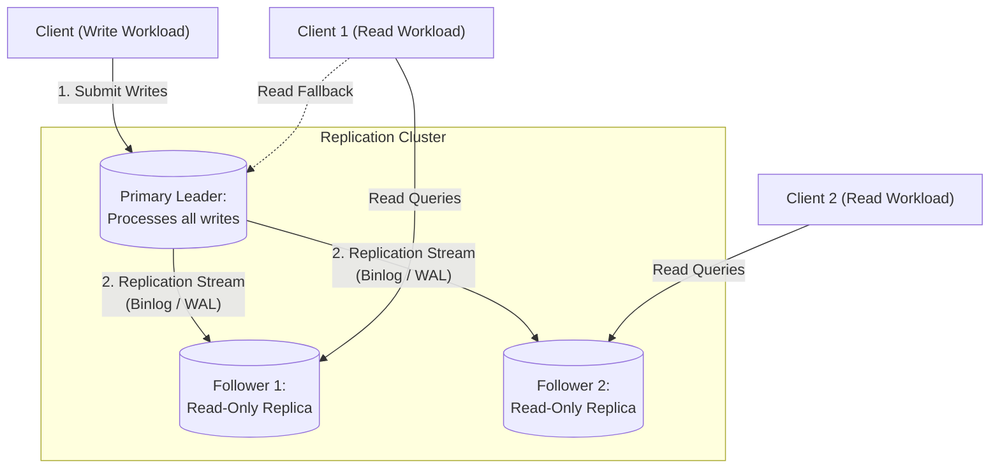

- **Key Takeaway:** One writer gives total order; async followers give read scale at the cost of lag.

---

### Figure 6-2: Synchronous vs Asynchronous Replication
- **Figure Reference:** `Figure 6-2: Leader-based replication with one synchronous and one asynchronous follower`
- **Original PDF:** Fig 6-2 → PDF p.224 — open the PDF at page 224 to compare with the Mermaid reconstruction below.
- **Visual Flow & Description:** Leader blocks on sync Follower 1, streams to async Follower 2 in background with visible delay.
- **Mermaid Sequence Diagram:**

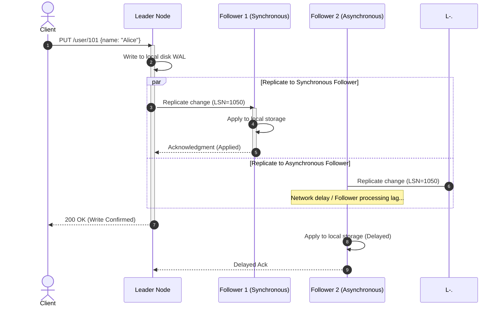

- **Key Takeaway:** Semi-sync = two durable copies without letting one slow follower halt the world.

---

### Figure 6-3: Reading Your Own Writes
- **Figure Reference:** `Figure 6-3: Inconsistencies when a user writes then reads from a stale replica`
- **Original PDF:** Fig 6-3 → PDF p.234 — open the PDF at page 234 to compare with the Mermaid reconstruction below.
- **Visual Flow & Description:** Alice POSTs to leader, gets 200 OK, reloads from a 2-s-lagging follower — her update is missing.
- **Mermaid Flowchart:**

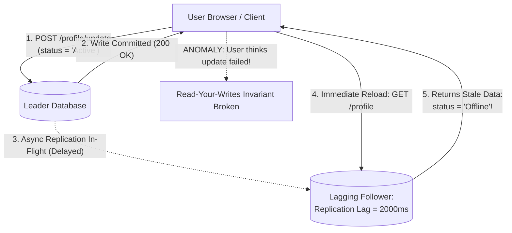

- **Key Takeaway:** Route own-writes reads to leader or gate on LSN.

---

### Figure 6-4: Monotonic Reads (Time Moves Backward)
- **Figure Reference:** `Figure 6-4: When a user first reads from a fresh replica, then from a stale replica, time appears to go backward`
- **Original PDF:** Fig 6-4 → PDF p.236 — open the PDF at page 236 to compare with the Mermaid reconstruction below.
- **Visual Flow & Description:** User 2345 queries twice: first a fresh follower (sees user 1234's comment), then a lagging follower (comment gone).
- **Mermaid Sequence Diagram:**

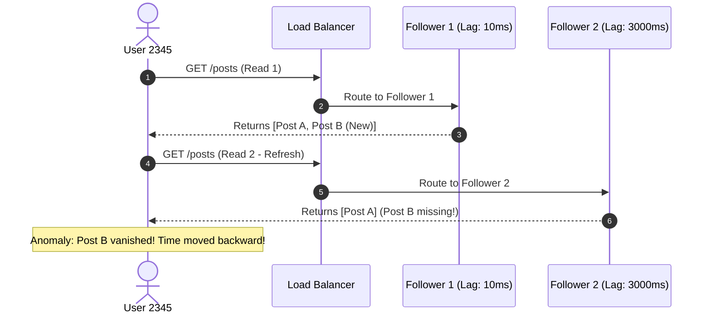

- **Key Takeaway:** Hash `user_id` → one replica for monotonicity.

---

### Figure 6-5: Consistent Prefix Reads
- **Figure Reference:** `Figure 6-5: If some shards are replicated slower than others, an observer may see the answer before the question`
- **Original PDF:** Fig 6-5 → PDF p.237 — open the PDF at page 237 to compare with the Mermaid reconstruction below.
- **Visual Flow & Description:** Mr. Poons's question rides a slow follower, Mrs. Cake's answer rides a fast one; observer hears *"About 10 seconds"* before *"How far can you see?"*.
- **Mermaid Flowchart:**

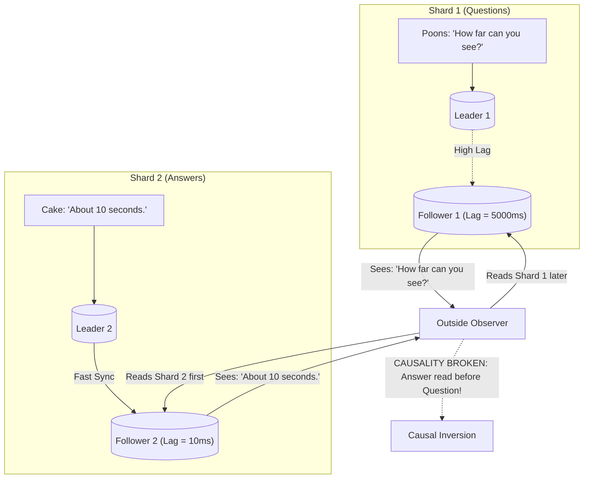

- **Key Takeaway:** Independent shard orderings break causality; co-locate related writes.

---

### Figure 6-6: Multi-Leader Across Regions
- **Figure Reference:** `Figure 6-6: Multi-leader replication across multiple regions`
- **Original PDF:** Fig 6-6 → PDF p.240 — open the PDF at page 240 to compare with the Mermaid reconstruction below.
- **Visual Flow & Description:** Leader per region (with local AZ followers); leaders replicate across WAN async.
- **Mermaid Flowchart:**

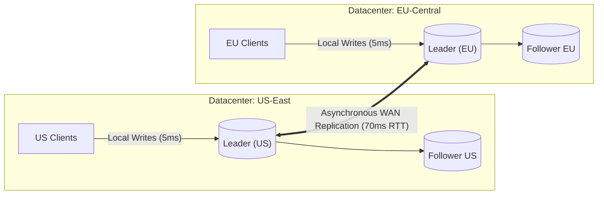

- **Key Takeaway:** Hides inter-region RTT from writers; sacrifices global constraints.

---

### Figure 6-7: Multi-Leader Topologies
- **Figure Reference:** `Figure 6-7: Three example topologies for multi-leader replication`
- **Original PDF:** Fig 6-7 → PDF p.242 — open the PDF at page 242 to compare with the Mermaid reconstruction below.
- **Visual Flow & Description:** (a) circular, (b) star/tree with root relay, (c) all-to-all. Ring/star forward with visited-ID tags.
- **Mermaid Flowchart:**

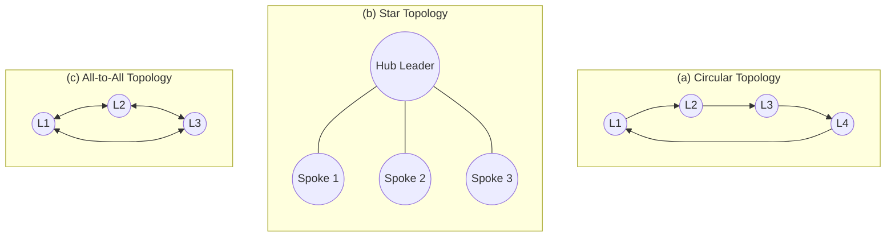

- **Key Takeaway:** Dense topologies survive single-node loss but need overtaking protection.

---

### Figure 6-8: Writes Arriving in the Wrong Order
- **Figure Reference:** `Figure 6-8: With multi-leader replication, writes may arrive in the wrong order at some replicas`
- **Original PDF:** Fig 6-8 → PDF p.243 — open the PDF at page 243 to compare with the Mermaid reconstruction below.
- **Visual Flow & Description:** A inserts row 10 on L1; B reads it on L2 and updates it; L3 gets UPDATE before INSERT.
- **Mermaid Sequence Diagram:**

```mermaid
sequenceDiagram
  autonumber
  actor CA as Client A
  actor CB as Client B
  participant L1 as Leader 1
  participant L2 as Leader 2
  participant L3 as Leader 3

  CA->>L1: 1. INSERT title = "Database Book" (Row 10)
  L1->>L2: Replicate INSERT (Fast Link)
  L2-->>CB: 2. Read Row 10
  CB->>L2: 3. UPDATE title = "DDIA 2nd Edition" (Row 10)

  par Normal Network Path
    L2->>L3: 4. Replicate UPDATE (Row 10) arrives FIRST!
    activate L3
    Note over L3: ERROR: Cannot UPDATE Row 10; row does not exist!
    deactivate L3
  and Delayed Network Path
    L1-.->L3: 5. Replicate INSERT (Row 10) arrives SECOND (Delayed)!
  end
```

- **Key Takeaway:** Causality needs version vectors, not wall-clock timestamps.

---

### Figure 6-9: Concurrent Write Conflict
- **Figure Reference:** `Figure 6-9: A write conflict caused by two leaders concurrently updating the same record`
- **Original PDF:** Fig 6-9 → PDF p.246 — open the PDF at page 246 to compare with the Mermaid reconstruction below.
- **Visual Flow & Description:** Page title `A`: User 1 → `B` on L1, User 2 → `C` on L2. Neither knew of the other.
- **Mermaid Flowchart:**

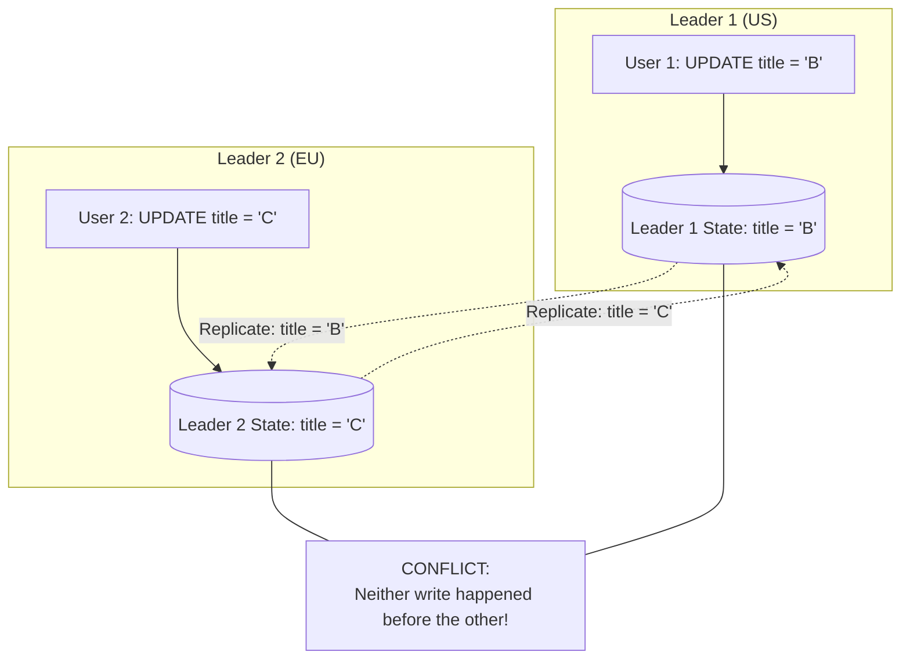

- **Key Takeaway:** Concurrency = unawareness, not simultaneity; needs deterministic merge.

---

### Figure 6-10: Shopping-Cart Union Anomaly
- **Figure Reference:** `Figure 6-10: An example of Amazon's shopping cart anomaly: if conflicts are merged by taking the union, deleted items may reappear`
- **Original PDF:** Fig 6-10 → PDF p.249 — open the PDF at page 249 to compare with the Mermaid reconstruction below.
- **Visual Flow & Description:** Device 1 removes Book, Device 2 concurrently removes DVD (starting from `{Book, DVD, Soap}`-like state). Naive union of siblings resurrects both deleted items; correct merge tracks deletions (tombstones) → `{Soap}`.
- **Mermaid Flowchart:**

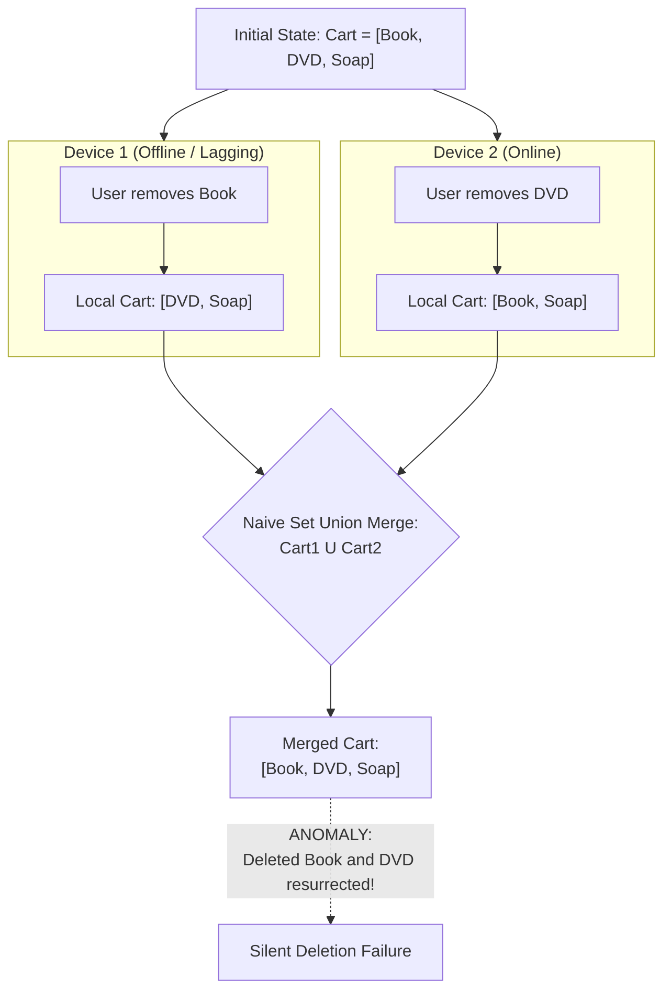

- **Key Takeaway:** Merge must track deletes as tombstones, not just surviving members.

---

### Figure 6-11: OT vs CRDT on Text
- **Figure Reference:** `Figure 6-11: How two concurrent insertions into a string are merged by OT and a CRDT, respectively`
- **Original PDF:** Fig 6-11 → PDF p.251 — open the PDF at page 251 to compare with the Mermaid reconstruction below.
- **Visual Flow & Description:** Both start `ice`. One prepends `n` → `nice`, other appends `!` → `ice!`. OT shifts index `3→4`; CRDT orders by char IDs (`1A, 2A…`, new `4B` after `3A`). Both converge `nice!`.
- **Mermaid Flowchart:**

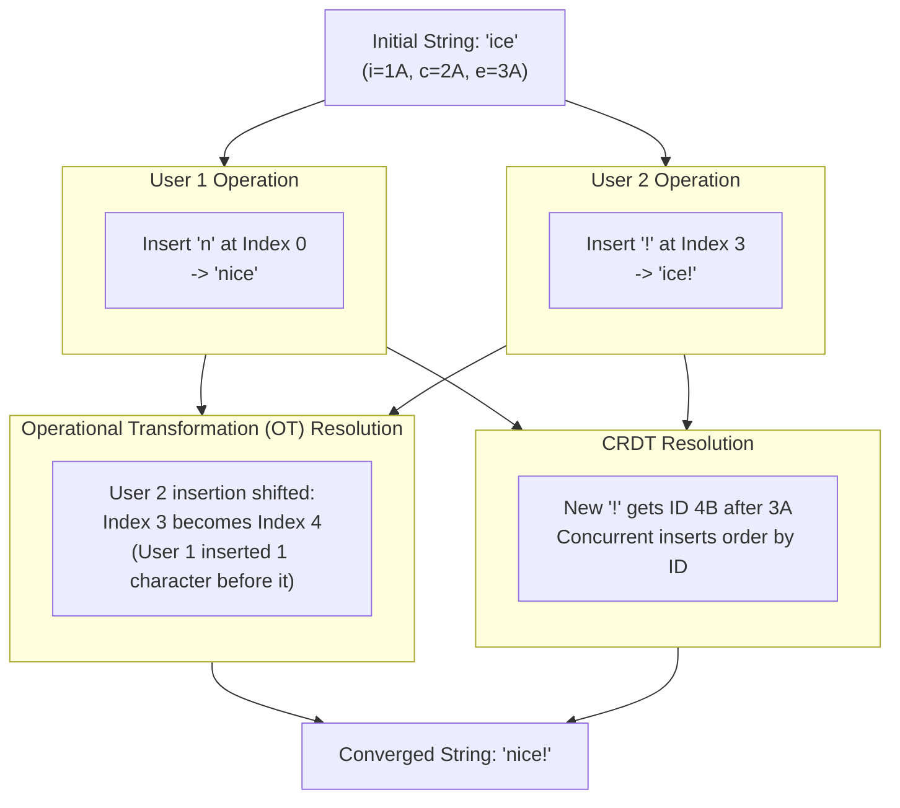

- **Key Takeaway:** OT transforms positions; CRDTs make positions immutable IDs.

---

### Figure 6-12: Leaderless Quorum Write + Read Repair
- **Figure Reference:** `Figure 6-12: Writing to a majority of replicas, reading from a majority, and forwarding the latest value to an unavailable replica`
- **Original PDF:** Fig 6-12 → PDF p.254 — open the PDF at page 254 to compare with the Mermaid reconstruction below.
- **Visual Flow & Description:** User 1234 writes to 3 nodes (1 down, 2 ack → success). User 2345 reads 2 nodes (v6 + stale v5), returns v6, writes v6 back to the stale node.
- **Mermaid Flowchart:**

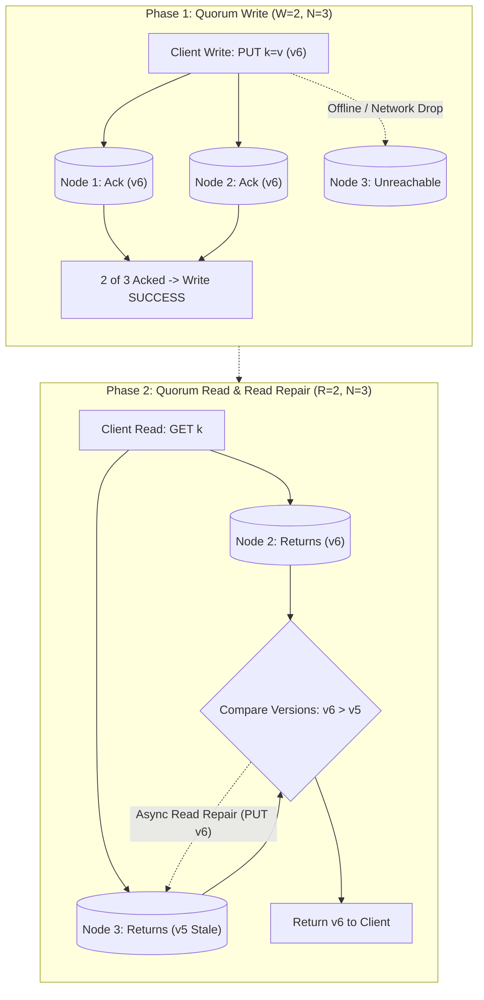

- **Key Takeaway:** No failover — availability via overlapping majorities + lazy healing.

---

### Figure 6-13: Quorum Intersection (`W+R>N`)
- **Figure Reference:** `Figure 6-13: If w + r > n, at least one of the r replicas you read from must have seen the most recent successful write`
- **Original PDF:** Fig 6-13 → PDF p.256 — open the PDF at page 256 to compare with the Mermaid reconstruction below.
- **Visual Flow & Description:** `N=5, W=3, R=3`: write set `{1,2,3}`, read set `{3,4,5}` — node 3 guarantees freshness (pigeonhole principle).
- **Mermaid Flowchart:**

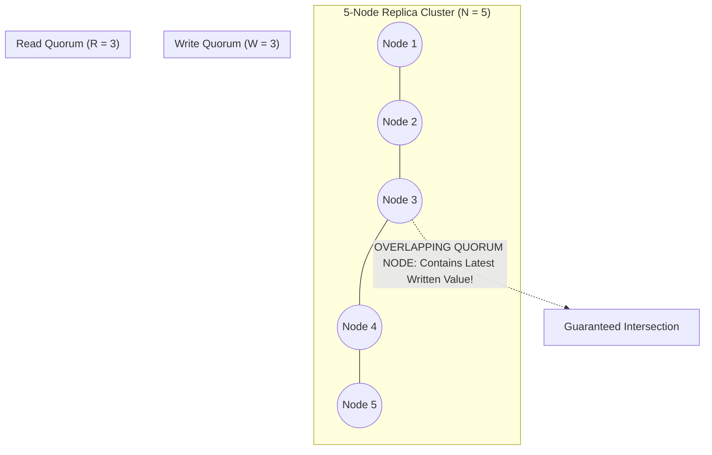

- **Key Takeaway:** `W+R>N` = overlap; majorities are the common case, not the only case.

---

### Figure 6-14: Concurrent Dynamo Writes Have No Order
- **Figure Reference:** `Figure 6-14: Concurrent writes in a Dynamo-style datastore: there is no well-defined ordering`
- **Original PDF:** Fig 6-14 → PDF p.261 — open the PDF at page 261 to compare with the Mermaid reconstruction below.
- **Visual Flow & Description:** A writes `X=A` to nodes 1–2; B writes `X=B` to nodes 2–3. Node 1 = `A`, node 3 = `B`, node 2 = `A` then `B`. No global order.
- **Mermaid Flowchart:**

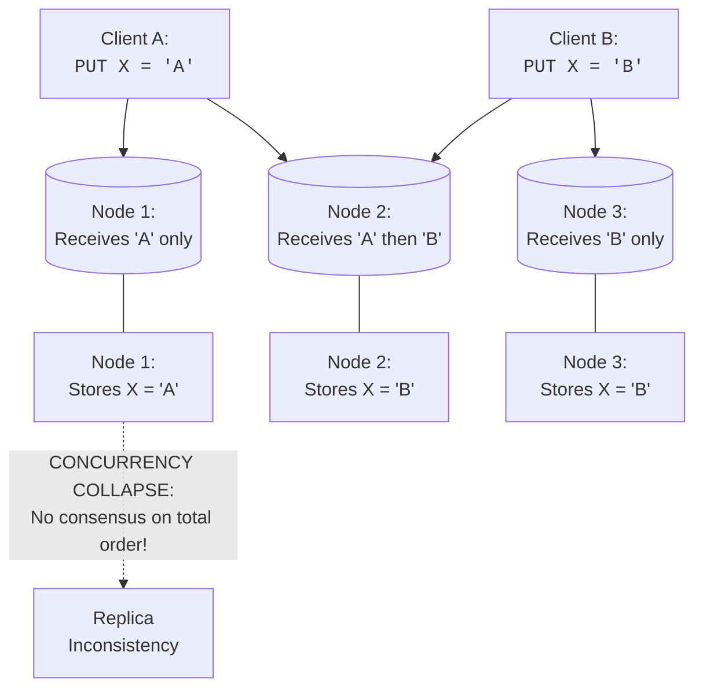

- **Key Takeaway:** Leaderless accepts divergence; vectors + merge restore convergence.

---

### Figure 6-15: Capturing Causal Dependencies (Cart Versions)
- **Figure Reference:** `Figure 6-15: Capturing causal dependencies between two clients concurrently editing a shopping cart`
- **Original PDF:** Fig 6-15 → PDF p.264 — open the PDF at page 264 to compare with the Mermaid reconstruction below.
- **Visual Flow & Description:** Single-replica version numbers 1–5 across milk/eggs/flour/ham/bacon writes; each write echoes its base version; server keeps concurrent siblings.
- **Mermaid Flowchart:**

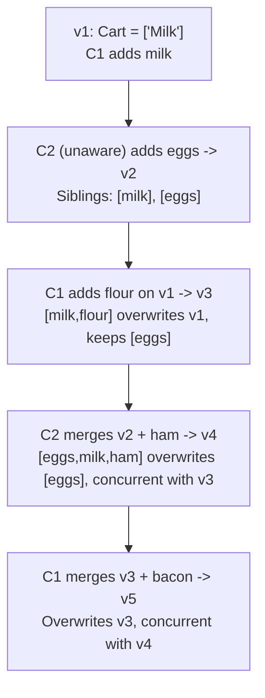

- **Key Takeaway:** Base-version echo lets the server separate overwrites from concurrent siblings.

---

### Figure 6-16: Causal-Dependency Graph
- **Figure Reference:** `Figure 6-16: A graph of the causal dependencies in Figure 6-15`
- **Original PDF:** Fig 6-16 → PDF p.265 — open the PDF at page 265 to compare with the Mermaid reconstruction below.
- **Visual Flow & Description:** DAG arrows = "knew about / depended on". Branching = concurrency; joining = merge. Clients stay perpetually slightly stale yet no writes are lost.
- **Mermaid Flowchart:**

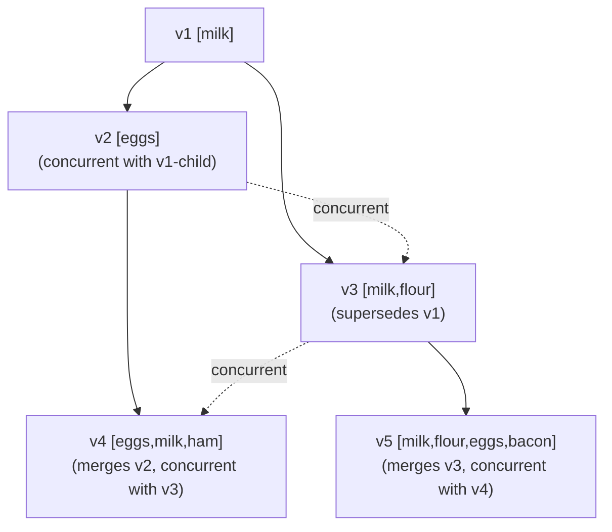

- **Key Takeaway:** Causality is a DAG; version vectors generalize these arrows to N replicas (dotted vectors in Riak 2.0).

---

## 4. Real-World Systems, Case Studies & Code Examples

### 4.1 Industry Implementations & Architectural Divergence
- **MySQL InnoDB Primary-Replica:** Row-based binlog (+GTIDs), async + semi-sync plugin, orchestrator-driven failover. GitHub lesson: fence before promote.
- **PostgreSQL + pglogical / EDB:** WAL shipping (version-coupled) vs logical decoding (version-tolerant, CDC-friendly). WAL-G/Litestream bridge to object-store backups.
- **MongoDB Replica Sets:** Single-leader with Raft-like election, oplog streaming of idempotent ops.
- **Cassandra / ScyllaDB:** Leaderless, `N/W/R` per keyspace/query (`ONE`, `LOCAL_QUORUM`, `QUORUM`, `ANY` sloppy), Murmur3 rings, read repair + hinted handoff + Merkle anti-entropy, LWW by commit timestamp.
- **CouchDB / PouchDB:** Multi-leader sync-engine heritage, sibling-preserving manual merge.
- **Automerge & Yjs (local-first CRDTs):** JSON/text CRDTs with fractional indices + state vectors for Figma-like collaboration; ShareDB as the OT counterpart; Redis Enterprise / Cosmos DB as server-side CRDT stores.

---

### 4.2 Production Implementation: Vector Clock & Causality Tracker

```python
from typing import Dict, List, Any

class VectorClock:
    """
    Distributed Vector Clock to detect happens-before
    vs concurrent sibling mutations across replicas.
    """
    def __init__(self, clock_dict: Dict[str, int] = None):
        self.clock: Dict[str, int] = dict(clock_dict) if clock_dict else {}

    def increment(self, node_id: str) -> "VectorClock":
        new_clock = dict(self.clock)
        new_clock[node_id] = new_clock.get(node_id, 0) + 1
        return VectorClock(new_clock)

    def dominates(self, other: "VectorClock") -> bool:
        all_keys = set(self.clock.keys()).union(set(other.clock.keys()))
        strictly_greater = False
        for k in all_keys:
            v_self = self.clock.get(k, 0)
            v_other = other.clock.get(k, 0)
            if v_self < v_other:
                return False
            if v_self > v_other:
                strictly_greater = True
        return strictly_greater

    def is_concurrent_with(self, other: "VectorClock") -> bool:
        return not self.dominates(other) and not other.dominates(self) and self.clock != other.clock

class DistributedRecord:
    def __init__(self, value: Any, vclock: VectorClock):
        self.value = value
        self.vclock = vclock

def reconcile_concurrent_writes(
    existing_records: List[DistributedRecord],
    incoming_record: DistributedRecord
) -> List[DistributedRecord]:
    """Keep concurrent siblings; discard dominated (overwritten) versions."""
    surviving: List[DistributedRecord] = []
    incoming_is_obsolete = False
    for record in existing_records:
        if record.vclock.dominates(incoming_record.vclock):
            incoming_is_obsolete = True
            surviving.append(record)
        elif incoming_record.vclock.dominates(record.vclock):
            continue
        else:
            surviving.append(record)
    if not incoming_is_obsolete:
        surviving.append(incoming_record)
    return surviving
```

---

### 4.3 Production Implementation: Quorum Read Repair Coordinator

```python
from typing import List, Optional, Tuple, Any

class ReplicaNode:
    def __init__(self, node_id: str):
        self.node_id = node_id
        self.storage: dict = {}

    def get(self, key: str) -> Optional[Tuple[Any, int]]:
        return self.storage.get(key)

    def put(self, key: str, value: Any, timestamp_ms: int):
        self.storage[key] = (value, timestamp_ms)

class QuorumCoordinator:
    """Dynamo-style quorum reads (R) with async read repair."""
    def __init__(self, replicas: List[ReplicaNode]):
        self.replicas = replicas
        self.N = len(replicas)

    def quorum_read(self, key: str, R: int) -> Any:
        if R > self.N:
            raise ValueError("Read quorum R cannot exceed N.")
        responses = [(replica, replica.get(key)) for replica in self.replicas[:R]]
        valid = [(node, res) for node, res in responses if res is not None]
        if not valid:
            return None
        winner_node, (winner_val, highest_ts) = max(valid, key=lambda item: item[1][1])
        for node, res in responses:
            if res is None or res[1] < highest_ts:
                node.put(key, winner_val, highest_ts)
        return winner_val
```

---

### 4.4 Production War Story: The GitHub MySQL Failover Outage
- **Context:** Active-passive MySQL with heartbeat orchestrator and passive failover replica.
- **Incident:** 15-s network blip isolated the primary from the orchestrator but not from app servers. Orchestrator declared it dead.
- **Cascade:** Replica promoted while old primary still accepted writes (split-brain window: pooled TCP connections lingered). Both issued auto-increment keys independently.
- **Disaster:** Overlapping primary keys joined against Redis state → private data surfaced to wrong users; forensic key-remap across millions of rows, ~24-h degradation (see also the 2012 "Downtime Last Saturday" double-shutdown caution).
- **Lessons:** STONITH/fencing before promotion; Raft-based orchestrator elections; semi-sync or group-replication (Paxos) so commits require a second copy; pick max-LSN follower and reject far-behind candidates.

---

## 5. Architectural Trade-Off Matrix

| Replication Architecture | Write Latency | Read Scalability | Conflict Handling | Failover / Availability | Best Fit | Catastrophic Mode |
| :--- | :--- | :--- | :--- | :--- | :--- | :--- |
| **Single-Leader Async** | Minimal (local ack) | Excellent (follower pool) | None (total order) | Failover; un-replicated writes lost | Read-heavy web (>90% reads) | Discarded writes; lag anomalies |
| **Single-Leader Semi-Sync** | Bounded by sync follower RTT | Excellent | None | RPO=0 (2 copies); stalls if sync follower down | Ledgers, compliance | One slow node halts writes |
| **Multi-Leader** | Local (<5 ms in-region) | Local reads | Extreme (LWW/CRDT/OT/manual) | Survives region loss; online through partitions | Geo-active, collaboration, offline/local-first | Silent LWW loss; constraint violations |
| **Leaderless Strong (`W+R>N`)** | Waits for `W` acks | Waits for `R` responses | High (vectors + siblings) | Tolerates `N-W`/`N-R` down; hedging vs gray failure | Write-available telemetry, carts | Sloppy quorums break overlap; sibling explosion |
| **Leaderless Weak (`W+R≤N`)** | Blazing (`W=1`) | Blazing (`R=1`) | High, often ignored | Max availability | Ephemeral metrics/logs | Frequent stale reads, drops |

### Concrete Decision Heuristics

```text
Decision Tree for Replication Strategy:
1. Does the workload require multi-region active writes or offline operation on mobile/client devices?
   ├── YES:
   │    ├── Is the data collaborative text, sets, or state counters? -> Use Multi-Leader with CRDTs / OT (Yjs / Automerge).
   │    └── Can writes be routed to a deterministic home datacenter by key? -> Use Multi-Leader with Conflict Avoidance.
   └── NO (Single-datacenter or centralized cloud deployments):
        ├── Is the workload heavily Write-Heavy (>40% writes) or requires extreme partition availability over linearizability?
        │    └── YES: Use Leaderless Quorum Store (Cassandra / ScyllaDB with W=QUORUM, R=QUORUM).
        └── Is the workload Read-Dominant (>80% reads) requiring complex relational joins and deterministic ACID transactions?
             ├── Requires Zero Data Loss (RPO=0) at all costs? -> Use Single-Leader with Semi-Synchronous Replication.
             └── Tolerates minimal transient failover lag for high throughput? -> Use Single-Leader with Asynchronous Follower Pool.
```

---

## 6. Jargon Buster & Key Terminology

- **Replication Lag:** Delay between leader commit and follower apply; unbounded under stress.
- **Read-After-Write (Read-Your-Writes):** You always see your own updates on reload.
- **Monotonic Reads:** Successive reads by one user never move backward in time.
- **Consistent Prefix Reads:** Causally ordered writes are observed in that order.
- **Split-Brain:** Two nodes both believe they are leader and diverge.
- **Fencing Token / STONITH:** Monotonic epoch rejecting zombie leaders; ultimate form powers off the old leader.
- **Quorum (`W+R>N`):** Write acks + read responses overlap on ≥1 node. `N` total, `W` write threshold, `R` read threshold.
- **Sloppy Quorum / `ANY`:** Foster nodes outside home `N` take writes during partitions; overlap suspended until handoff.
- **Hinted Handoff / Read Repair / Anti-Entropy:** Push-on-return, fix-on-read, and background Merkle-diff healing.
- **Happens-Before / Concurrent:** `B` knew of `A` vs neither knew of the other (Lamport).
- **Version Vector / Dotted Version Vector:** Per-replica-per-key counters (Riak 2.0) separating overwrites from siblings; distinct from vector clocks.
- **CRDT / OT:** Convergent merge types (immutable IDs) vs index-transforming collaborative edits; both give strong eventual consistency.
- **Sync Engine / Local-First:** Background bidirectional replication with local persistence; local-first survives vendor shutdown.
- **Zero-Disk Architecture:** All durable data on object storage; compute nodes stateless caches.

---

## 7. System Design & Practical Engineering Takeaways

### 7.1 Production Engineering Checklist
1. **Never auto-failover without fencing:** Wire STONITH/IPMI/cloud-IAM revocation before promotion; prefer Raft-based orchestrators.
2. **Pin reads for monotonicity:** Hash session/user ID to one replica; gate post-write reads on LSN for 60 s.
3. **Monitor lag + staleness:** Leader lag via heartbeat tables (not `Seconds_Behind_Master`); leaderless via hint backlog + PBS probes with alerts.
4. **Tombstone deletes:** Never bare-delete in multi-leader/leaderless; store deletion markers or deletes resurrect (Figure 6-10).
5. **Distrust wall clocks for LWW:** NTP skew flips winners; use logical/HLC clocks or vectors where loss matters.
6. **Pre-plan object-store costs:** Batch to amortize per-call fees; keep WAL on low-latency volumes even in zero-disk designs.

---

### 7.2 System Design Interview Strategy
- **Nail failover explicitly:** *"Semi-sync with one sync follower gives RPO=0; on crash we promote the max-LSN follower after fencing the old primary."*
- **Show quorum math:** *"N=3, W=2, R=2 tolerates 1 down each way with 4>3 overlap; N=5, W=3, R=3 tolerates 2."* Contrast `W=N,R=1` (reads fast, any down node kills writes).
- **Volunteer lag fixes:** *"Own-profile reads from leader for 60 s post-write; sticky replica per user; same-shard causality."*
- **Name the merge:** *"Counter → PN-CRDT, cart → OR-Set with tombstones, text → Yjs/Automerge or OT; show tombstone + vector."*

---

### 7.3 Mastery Self-Assessment Questions

#### Question 1 (Conceptual Depth)
*Why does `W+R>N` fail to guarantee linearizability in Cassandra-like stores?*
- **Answer:**
  1. *Concurrent writes* arrive in different orders — overlap still yields mixed values without total order (Paxos).
  2. *Sloppy quorums* park writes on foster nodes outside home `N`; home-`R` reads miss them until handoff.
  3. *Sub-`W` partial writes* persist where they landed despite client-visible failure.
  4. *Read-repair races* let a second reader see stale data before async repair lands; concurrent read+write may or may not observe the write.

#### Question 2 (Failure Scenario & Edge Cases)
*3-node async MySQL: N1 primary, N2 lag 150 ms, N3 lag 2,500 ms. Switch isolates N1 from orchestrator; tool promotes N3. Diagnose and fix.*
- **Answer:**
  - *Defects:* Promoted most-lagging replica (max loss); no fencing (N1 may still take writes → split-brain).
  - *Corruption:* 2.5 s of acked trades missing on N3; new trades reuse auto-increment IDs; on heal, ID collisions + lost balances corrupt ledgers + downstream Redis joins.
  - *Fix:* Poll LSNs, promote N2 (max LSN) with lag-threshold veto; fence N1 (IAM revoke/IPMI) first; upgrade to semi-sync or group replication.

#### Question 3 (Trade-Off & Capacity Estimation)
*Leaderless `N=5`: 120k reads/s, 15k writes/s. Compare (A) `W=3,R=3` vs (B) `W=5,R=1`.*
- **Answer:**
  - *(A):* Tolerates 2 down each way (`5-3`); overlap `6>5`. Fan-out: writes `15k×3=45k`, reads `120k×3=360k`, total `405k` → **81k QPS/node**.
  - *(B):* Writes tolerate **0** down (one GC pause fails all writes); reads tolerate 4; overlap `6>5`. Fan-out: writes `75k`, reads `120k`, total `195k` → **39k QPS/node** (−51.8%).
  - *Verdict:* (B) halves load but has zero write fault tolerance — unshippable where reboots happen. Choose (A) or `LOCAL_QUORUM`.

---

> [!NAV] **Chapter Navigation**
> ⬅️ **Previous:** [[chapter-05-encoding-and-evolution|Chapter 05: Encoding and Evolution]] | 🏠 **Index:** [[00-Master-Reading-Dashboard|Master Dashboard]] | ➡️ **Next:** [[chapter-07-sharding|Chapter 07: Sharding]]
