# Chapter 6: Replication — Definitive Technical Summary
*From: Designing Data-Intensive Applications (2nd Edition) by Martin Kleppmann and Chris Riccomini*
*Source PDF: pp. 221–274 (673-page PDF) — figures below cite PDF pages.*

> [!NAV] **Chapter Navigation**
> ⬅️ **Previous:** [[chapter-05-encoding-and-evolution|Chapter 05: Encoding and Evolution]] | 🏠 **Index:** [[00-Master-Reading-Dashboard|Master Dashboard]] | ➡️ **Next:** [[chapter-07-sharding|Chapter 07: Sharding]]


---

## 1. Executive Summary & Core Engineering Problem

- **Core Thesis:** Replication—maintaining copies of the same data across multiple storage nodes connected via a network—is required to achieve high availability, geographic latency minimization, and read throughput scalability. However, because networks are inherently asynchronous, physical clocks drift, and hardware nodes fail unpredictably, maintaining consistency across distributed replicas forces an unavoidable architectural choice between three primary models: **Single-Leader Replication** (which establishes a total order of writes at the cost of leader failover complexity and replication lag anomalies), **Multi-Leader Replication** (which enables multi-region write availability and offline local-first sync at the cost of concurrent write conflict resolution), and **Leaderless Replication** (which maximizes write availability via quorums and hinted handoff at the cost of non-linearizable reads and client-side vector clock reconciliation).
- **Problem Statement:** Naive replication strategies collapse under network partitions, follower lag, and concurrent mutations. A classic production catastrophe occurs in an e-commerce platform during asynchronous single-leader failover: the primary database crashes immediately after acknowledging payment authorizations, but before the corresponding replication stream is flushed to followers. An automated failover orchestrator promotes an out-of-sync follower. The old leader reboots, rejoins the cluster, and its discarded writes collide with newly assigned primary keys in the promoted leader, resulting in split-brain data corruption, duplicate balance deductions, and orphaned records. Similarly, in leaderless quorum stores ($N=3, W=2, R=2$), relying on Last-Write-Wins (LWW) with NTP-synchronized server clocks silently overwrites concurrent updates submitted within a 10-millisecond clock-skew window, permanently destroying customer shopping cart additions without raising exceptions.
- **Historical & Industry Context:** Relational database systems in the 1980s and 1990s pioneered primary-backup replication using synchronous physical log shipping over dedicated local-area networks. The global expansion of web applications in the 2000s made cross-datacenter WAN latency (typically 70--250 ms round-trip) incompatible with synchronous replication, popularizing asynchronous read-replica pools (MySQL master-slave). To survive entire datacenter blackouts without dropping writes, Amazon introduced the leaderless Dynamo model (2007), inspiring Apache Cassandra and Riak. In the 2010s, consensus algorithms (Raft, Paxos) and distributed transactional engines (Google Spanner) standardized automated failover. The 2020s (2nd Edition inflection) brought the rise of **Local-First Software** (collaborative apps like Figma and linear sync engines like Replicache/Automerge) and Conflict-free Replicated Data Types (CRDTs), which push multi-leader replication all the way to client web browsers and mobile edge devices.

---

## 2. In-Depth Technical Concepts & Internal Mechanics

### 2.1 Single-Leader Replication Architecture & Replication Stream Mechanics
- **Foundational Theory:** Every write to the database must be processed by exactly one designated node: the **Leader** (master, primary). The leader writes the mutation to its local storage and streams the data change to all **Followers** (read replicas, slaves) via a replication log or change data capture (CDC) stream (Figure 6-1).
- **Synchronous vs. Asynchronous Replication (Figure 6-2):**
  - *Fully Synchronous:* The leader waits for confirmations from *all* followers before acknowledging the client write. 
    - *Invariant:* Guarantees zero data loss ($RPO = 0$) and up-to-date followers.
    - *Fatal Flaw:* If a single follower hangs (due to a GC pause, disk flush, or network glitch), the entire cluster's write pipeline halts indefinitely.
  - *Fully Asynchronous:* The leader acknowledges the client immediately after writing to its local WAL, streaming changes to followers asynchronously.
    - *Advantage:* High write throughput; unimpacted by slow followers.
    - *Fatal Flaw:* Durability hazard. If the leader experiences an unrecoverable hardware failure before bytes reach the network socket, acknowledged writes are permanently lost.
  - *Semi-Synchronous Compromise (Standard Enterprise Topology):* Exactly one follower is configured as synchronous, while remaining followers are asynchronous. If the synchronous follower becomes unresponsive, an asynchronous follower is dynamically promoted to synchronous status, guaranteeing at least two durable copies of every acknowledged write.
- **Replication Log Implementation Mechanisms:**
  1. *Statement-Based Replication (RDBMs Historical - MySQL < 5.1):* The leader logs every SQL statement executed (`INSERT INTO users ...`). 
     - *Fatal Flaws:* Non-deterministic functions (`NOW()`, `RAND()`, `UUID()`) evaluate to different values on followers; statements relying on existing state (auto-incrementing IDs, `WHERE clause` without unique ordering) execute out of order; triggers and stored procedures generate diverging side effects.
  2. *Write-Ahead Log (WAL) Shipping (PostgreSQL, Oracle):* The leader ships raw binary physical disk page byte diffs directly to followers.
     - *Advantage:* Fast execution; identical binary bit-for-bit replica state.
     - *Fatal Flaws:* Tightly coupled to physical storage engine internals. Followers must run the exact same DBMS version and OS architecture, making zero-downtime rolling database upgrades impossible.
  3. *Logical (Row-Based) Log Replication (MySQL Binlog Row Format, MongoDB Oplog):* Ships logical row-level mutations decoupled from physical disk pages:
     - `INSERT`: Full column values for the new row.
     - `DELETE`: Primary key or unique identifier of the removed row.
     - `UPDATE`: Primary key + old and new values of changed columns.
     - *Advantage:* Backward and forward compatible across major database versions; easily parsed by external systems for Change Data Capture (Debezium / Kafka).
  4. *Trigger-Based Replication (Application Layer - Bucardo, GoldenGate):* Uses relational triggers to record data changes into an audit shadow table, which an external process polls and replicates. Highly flexible, but incurs severe $2\times\text{--}3\times$ write overhead and lock contention.

---

### 2.2 Leader Outages, Failover Mechanics, and the Split-Brain Hazard
- **Follower Outages (Catch-up Recovery):**
  - Follower stores the last Log Sequence Number (LSN) or binlog coordinate processed.
  - Upon reboot, it connects to the leader, requests the replication stream starting at `offset = last_LSN`, and catches up sequentially.
- **Leader Outages & Automated Failover Steps:**
  1. *Failure Detection:* Nodes exchange heartbeats (e.g., UDP pings every 1 second). If a leader does not respond within a configured timeout (e.g., 30 seconds), it is presumed dead.
  2. *Leader Election:* A new leader is chosen via consensus (Raft/Paxos) or designated by an external coordination service (Apache ZooKeeper / Consul). The node with the most up-to-date replication log (highest LSN) must be elected to minimize data loss.
  3. *Cluster Reconfiguration:* Routing tiers and service discovery are updated to route writes to the new primary. The old leader (if it recovers) must be forcibly demoted to a follower.
- **Critical Failover Hazards & Failure Modes:**
  - *Discarded Writes & Key Collisions (The GitHub MySQL Failover Incident):*
    - Leader 1 crashes before replicating `auto_increment` IDs 501--510 to Follower A.
    - Follower A is promoted to Leader 2. Its local auto-increment counter is at 501.
    - New client writes receive IDs 501--510 on Leader 2.
    - Leader 1 reboots. Its old un-replicated records with IDs 501--510 conflict with new records on Leader 2, corrupting foreign key joins and leaking private customer data across unrelated accounts.
  - *Split-Brain Catastrophe:*
    - Network partition divides the cluster into two isolated network islands.
    - Nodes on Island B believe Leader 1 is dead and elect Leader 2.
    - Both Leader 1 and Leader 2 accept concurrent writes. Because both generate conflicting mutation streams without synchronization, data divergence becomes irrecoverable without manual forensic auditing.
  - *Fencing Tokens:* Absolute mitigation against split-brain. The coordination service increments an epoch counter (fencing token) on each failover ($e = 101, 102, \dots$). Storage engines reject any write accompanied by an older fencing token.

---

### 2.3 Replication Lag Anomalies & Consistency Guarantees
When clients read from asynchronous followers, replication lag (the duration between a write committing on the leader and applying on the follower) introduces severe consistency anomalies:

#### 1. Read-After-Write Consistency (Reading Your Own Writes - Figure 6-3)
- *The Anomaly:* A user submits a comment or updates their profile. The write commits to the leader. The user refreshes their browser; the read request is load-balanced to a lagging follower (lag = 3 seconds). The user does not see their update, assumes it was lost, and resubmits, generating duplicate mutations.
- *Guaranteed Invariant:* A user will always see their own submitted updates, while updates from other users may be delayed.
- *Architectural Mitigations:*
  1. *Leader Routing for User-Editable Fields:* If querying data that the user has permission to edit (e.g., user profile), always route the query to the leader. Route other reads to followers.
  2. *Time-Based Window Tracking:* Track the timestamp of the client's last write. For 60 seconds following a write, route all user reads to the leader or to followers whose `replication_lag < (current_time - write_time)`.
  3. *Client-Side Logical Timestamps:* The client tracks the LSN of its last write. Replicas reject read requests until their local applied LSN catches up to the client's LSN.

#### 2. Monotonic Reads (Time Traveling Backward - Figure 6-4)
- *The Anomaly:* User reads from Follower A (lag = 100 ms) and observes post $P$. User refreshes page; load balancer routes query to Follower B (lag = 4,000 ms). Post $P$ disappears. To the user, time appears to have jumped backward.
- *Guaranteed Invariant:* If a user makes several reads in sequence, they will never observe data in a state earlier than what they observed in previous reads.
- *Architectural Mitigation:* **Deterministic Replica Sticky Routing**. Hash the user's ID to deterministically pin their read queries to the same replica instance (`replica_idx = hash(user_id) % num_replicas`). If that replica fails, reroute to a fresh instance.

#### 3. Consistent Prefix Reads (Causality Inversion - Figure 6-5)
- *The Anomaly:* In a partitioned or sharded database, replication across shards is independent. User A asks: *"How many stars are in the sky?"* (Shard 1). User B answers: *"Billions."* (Shard 2). An outside observer queries Shard 2 (which is up to date) and Shard 1 (which has high lag). The observer reads the answer *"Billions"* *before* seeing the question!
- *Guaranteed Invariant:* If a sequence of writes occurs in a causal order, anyone reading those writes will observe them in the exact same causal order.
- *Architectural Mitigation:* Route causally dependent records to the same physical partition, or implement causal vector timestamps across shard boundaries.

---

### 2.4 Multi-Leader Replication Topologies & Conflict Resolution
- **Multi-Leader Use Cases:**
  1. *Multi-Datacenter Deployments (Figure 6-6):* A leader resides in each geographic datacenter (e.g., US-East, EU-Central, AP-South). Local writes commit immediately with sub-5 ms latency; inter-datacenter replication occurs asynchronously over WAN.
  2. *Offline Clients & Local-First Software:* Laptops, tablets, and phones act as local database leaders (SQLite / IndexedDB). Applications execute reads and writes locally with zero network connection. When internet connectivity is restored, local mutation logs sync bi-directionally with cloud leaders.
  3. *Real-Time Collaborative Editing (Google Docs, Figma):* Mutations occur locally in memory and replicate concurrently across peer clients.
- **Multi-Leader Topologies (Figure 6-7):**
  - *Circular Topology (Figure 6-7a):* Each node forwards writes to its neighbor in a ring ($A \to B \to C \to A$). Vulnerable to a single node failure breaking the entire replication loop.
  - *Star Topology (Figure 6-7b):* Central coordinator node forwards writes to all spoke nodes. Bottlenecked by the central node; failure isolates spokes.
  - *All-to-All Topology (Figure 6-7c):* Every leader forwards writes directly to every other leader. Maximum fault tolerance, but susceptible to **causality inversion and message overtaking** (Figure 6-8): an update can arrive at a remote node *before* the corresponding insert due to network route latency variance.
- **Handling Concurrent Write Conflicts (Figure 6-9):**
  Two leaders concurrently update the title of page 42: Leader 1 sets title to `"B"`, while Leader 2 sets title to `"C"`. Because both writes were accepted locally, a conflict exists when replication messages cross.
- **Resolution Strategies:**
  1. *Conflict Avoidance:* Ensure all writes for a given record are routed to the exact same leader (e.g., hashing `user_id` to route all user mutations to the US-East datacenter). Breaks down if a datacenter fails and traffic must failover.
  2. *Last Write Wins (LWW):* Assign a wall-clock timestamp to each write; the write with the highest timestamp wins; older writes are dropped silently.
     - *Fatal Flaw:* **Physical clocks cannot be perfectly synchronized across distributed servers** (NTP clock drift is typically 10--100 ms). LWW causes silent data loss and causality violation.
  3. *Custom Application Logic:*
     - *On Write:* When a conflict is detected, invoke an application webhook to resolve it immediately.
     - *On Read:* Preserve all conflicting versions as **siblings**. When the client reads the record, return all siblings, requiring the application/user to merge them (Figure 6-10).
  4. *Conflict-free Replicated Data Types (CRDTs):* Mathematical data structures (PN-Counters, OR-Sets, LWW-Element-Sets, Tree-Doc) that merge concurrent updates deterministically across all replicas without requiring locks or central coordination.
  5. *Operational Transformation (OT):* Algorithm used in collaborative text editing (Google Docs). Deconstructs text edits into position offsets and shifts indices concurrently to maintain intent across typing streams (Figure 6-11).

---

### 2.5 Leaderless Replication (Dynamo-Style) & Quorum Intersection
- **The Leaderless Model:** Pioneered by Amazon Dynamo (2007); implemented in Apache Cassandra, ScyllaDB, and Riak. The database has **no designated leader**. Clients write to and read from multiple replicas directly, or submit requests to an arbitrary coordinator node that forwards them on their behalf (Figure 6-12).
- **Configurable Quorums ($N, W, R$):**
  - $N$: The total number of replicas configured for the keyspace (typically $N = 3$ or $N = 5$).
  - $W$: The number of replica acknowledgments required for a write to be considered successful.
  - $R$: The number of replicas queried for a read operation.
- **The Quorum Intersection Condition (Figure 6-13):**
  $$W + R > N$$
  If $W + R > N$, the set of nodes written to and the set of nodes read from **must overlap in at least one node**. That overlapping node is guaranteed to return the latest value (or highest version number), ensuring read freshness.
  - *Standard Configuration:* $N = 3, W = 2, R = 2$ (tolerates 1 failed node).
  - *Read-Heavy Optimization:* $N = 5, W = 5, R = 1$ (high-throughput (see metrics in same paragraph) reads; any node failure breaks writes).
  - *Write-Heavy Optimization:* $N = 5, W = 1, R = 5$ (high-throughput (see metrics in same paragraph) writes; any node failure breaks reads).
- **Anti-Entropy & Consistency Repair Mechanisms:**
  1. *Read Repair (Figure 6-12):* When a client reads from $R$ replicas, it compares the returned version timestamps. If Node 1 and Node 2 return version 6, but Node 3 returns stale version 5, the client (or coordinator) sends an asynchronous write to Node 3 updating it to version 6.
  2. *Anti-Entropy Background Process:* A continuous background worker compares datasets across replicas to detect missing data. Uses **Merkle Trees** (hierarchical cryptographic hash trees) to compare gigabytes of data over WAN using minimal network bandwidth (transmitting only hashes of diverging sub-ranges).
- **Sloppy Quorums and Hinted Handoff:**
  - *Scenario:* A network partition isolates the client from the designated $N$ home replicas for a key.
  - *Sloppy Quorum:* The database allows writes to be accepted by $W$ healthy nodes that are *outside* the designated $N$ replicas (temporary foster nodes).
  - *Hinted Handoff:* When the network heals and home replicas recover, the foster nodes forward the buffered writes to the primary home replicas.
  - *Trade-off:* Sloppy quorums provide extreme write availability, but **break the $W + R > N$ quorum guarantee**; clients reading $R$ home replicas will not observe writes stored on foster nodes until hinted handoff completes.

---

### 2.6 Causality Tracking: Happens-Before, Version Vectors, and Siblings
- **The Concurrency Invariant:**
  - Two operations $A$ and $B$ are **concurrent** if neither operation knew about the other when it was performed (neither "happened before" the other) (Figure 6-14).
  - In a distributed system without synchronized clocks, physical timestamps cannot determine causality.
- **The "Happens-Before" Formalism:**
  - Operation $A$ *happened before* operation $B$ ($A \to B$) if:
    1. $B$ was executed on the same node after $A$; or
    2. $B$ knew the result of $A$ (e.g., $B$ read the value written by $A$); or
    3. Transitivity: $A \to C$ and $C \to B \implies A \to B$.
  - If neither $A \to B$ nor $B \to A$, then $A$ and $B$ are **concurrent** ($A \parallel B$).
- **Capturing Causal Dependencies with Version Numbers (Figure 6-15 & 6-16):**
  1. The server maintains a version number for every key, incremented on every write.
  2. When a client reads a key, the server returns all current values and the associated version number.
  3. When a client updates a key, it **must return the version number** it read previously.
  4. When the server receives a write with version $V$:
     - It overwrites all stored values with version $\le V$.
     - It preserves all existing values with version $> V$ (because those represent concurrent writes!).
     - Stored values that are concurrent are retained as **siblings** (Figure 6-15).
- **Version Vectors (Vector Clocks):**
  - When data is distributed across multiple replicas without a single coordinator, a single integer version counter is insufficient.
  - A **Version Vector** is a collection of version counters, one for each replica node:
    $$V = [ \text{Node}_1: c_1, \text{Node}_2: c_2, \dots, \text{Node}_M: c_M ]$$
  - *Comparison Invariant:*
    - Version vector $V_A$ dominates (happened before) $V_B$ if and only if:
      $$\forall k, V_A[k] \ge V_B[k] \quad \text{and} \quad \exists k, V_A[k] > V_B[k]$$
    - If neither dominates, the writes are **concurrent**, and siblings must be created and merged by client logic.

---

## 3. Important Figures, Diagrams & Visual Architecture

> 📕 **Original figures quick index (source PDF, 673 pages):** open the PDF at the cited page to verify each reconstruction.
>
> | Book Fig | PDF page | What to compare |
> |---|---|---|
> | Fig 6-1 | PDF p.223 | Single-leader |
> | Fig 6-2 | PDF p.224 | Sync vs async follower |
> | Fig 6-3 | PDF p.234 | Read-after-write |
> | Fig 6-4 | PDF p.237 | Monotonic reads |
> | Fig 6-5 | PDF p.238 | Consistent prefix |
> | Fig 6-6 | PDF p.240 | Multi-leader regions |
> | Fig 6-7 | PDF p.242 | Tree topologies |
> | Fig 6-8 | PDF p.243 | Write conflict |
> | Fig 6-9 | PDF p.246 | LWW title |
> | Fig 6-10 | PDF p.250 | Shopping-cart merge |
> | Fig 6-11 | PDF p.251 | OT vs CRDT string |
> | Fig 6-12 | PDF p.254 | Quorum R+W |
> | Fig 6-13 | PDF p.256 | W+R>N proof |
> | Fig 6-14 | PDF p.262 | Dynamo concurrent writes |
> | Fig 6-15 | PDF p.264 | Causal deps |
> | Fig 6-16 | PDF p.265 | Happened-before arrows |


### Figure 6-1: Single-Leader Replication Architecture
- **Figure Reference:** `Figure 6-1: Single-leader replication directs all writes to a designated leader (reconstructed from text p. 200)`
- **Original PDF:** Fig 6-1 → PDF p.223 — open the PDF at page 223 to compare with the Mermaid reconstruction below.
- **Visual Flow & Description:** Shows clients submitting write operations strictly to the primary leader node. The leader records writes locally and streams replication updates to read-only followers. Clients issue read queries to either leader or followers.
- **Mermaid Flowchart:**

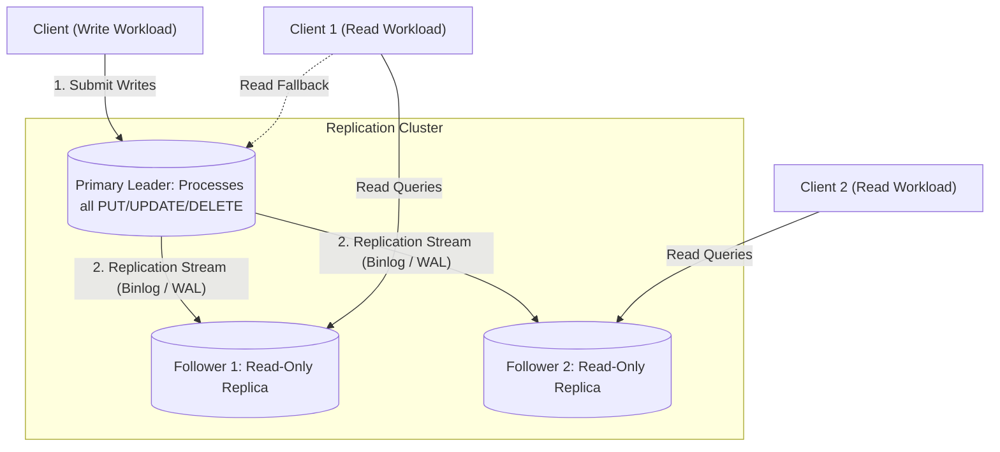

- **Key Takeaway:** Centralizing writes on a single leader guarantees a total order of transactions, but follower replication lag introduces read inconsistency across replicas.

---

### Figure 6-2: Synchronous vs. Asynchronous Leader-Based Replication
- **Figure Reference:** `Figure 6-2: Leader-based replication with one synchronous and one asynchronous follower (reconstructed from text p. 202)`
- **Original PDF:** Fig 6-2 → PDF p.224 — open the PDF at page 224 to compare with the Mermaid reconstruction below.
- **Visual Flow & Description:** Demonstrates the latency and durability trade-offs across replica links. The leader blocks write acknowledgment until Follower 1 (synchronous) responds, while streaming changes to Follower 2 (asynchronous) in the background.
- **Mermaid Sequence Diagram:**

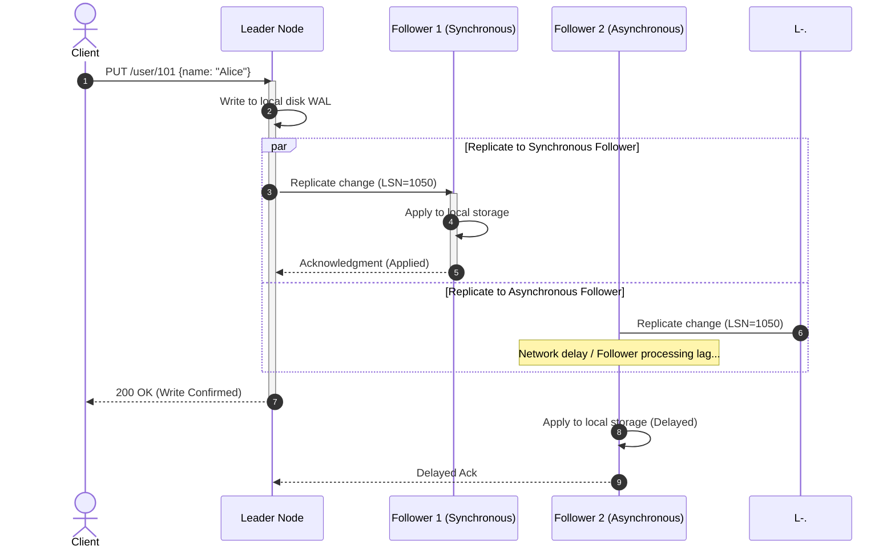

- **Key Takeaway:** Semi-synchronous replication guarantees zero data loss ($RPO = 0$) across at least two nodes while preventing a single slow asynchronous follower from blocking client writes.

---

### Figure 6-3: Reading Your Own Writes (Read-After-Write) Anomaly
- **Figure Reference:** `Figure 6-3: Inconsistencies can arise when a user makes a write, followed by a read from a lagging replica (reconstructed from text p. 211)`
- **Original PDF:** Fig 6-3 → PDF p.234 — open the PDF at page 234 to compare with the Mermaid reconstruction below.
- **Visual Flow & Description:** A user submits an update to the leader. Immediately afterward, their browser reloads and reads from Follower 2, which has a 2-second replication lag. The user observes stale data, creating the illusion of lost data.
- **Mermaid Flowchart:**

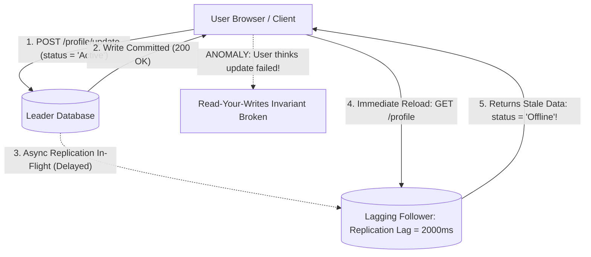

- **Key Takeaway:** Systems using asynchronous read replicas must enforce read-after-write consistency by routing recent write authors to the leader or tracking client LSNs.

---

### Figure 6-4: Monotonic Reads Anomaly (Time Traveling Backward)
- **Figure Reference:** `Figure 6-4: Reading from a fresh replica then a stale replica causes time to move backward (reconstructed from text p. 213)`
- **Original PDF:** Fig 6-4 → PDF p.237 — open the PDF at page 237 to compare with the Mermaid reconstruction below.
- **Visual Flow & Description:** User 2345 makes two consecutive read queries. Query 1 hits Follower 1 (low lag) and sees a new post. Query 2 hits Follower 2 (high lag) and does not see the post, making time appear to move backward.
- **Mermaid Sequence Diagram:**

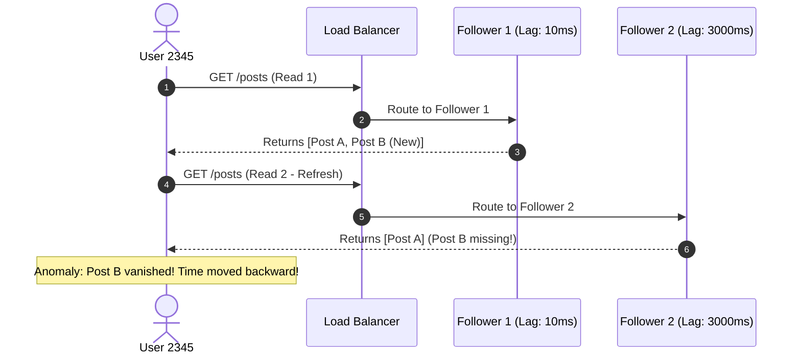

- **Key Takeaway:** Monotonic read consistency requires pinning a user's reads to the same replica instance via consistent hashing on the user identifier.

---

### Figure 6-5: Consistent Prefix Reads Anomaly
- **Figure Reference:** `Figure 6-5: If some shards replicate slower than others, an observer sees causal inversion (reconstructed from text p. 215)`
- **Original PDF:** Fig 6-5 → PDF p.238 — open the PDF at page 238 to compare with the Mermaid reconstruction below.
- **Visual Flow & Description:** Observer listens to a conversation partitioned across two shards. Shard 2 replicates faster than Shard 1, so the observer reads the answer before ever seeing the question.
- **Mermaid Flowchart:**

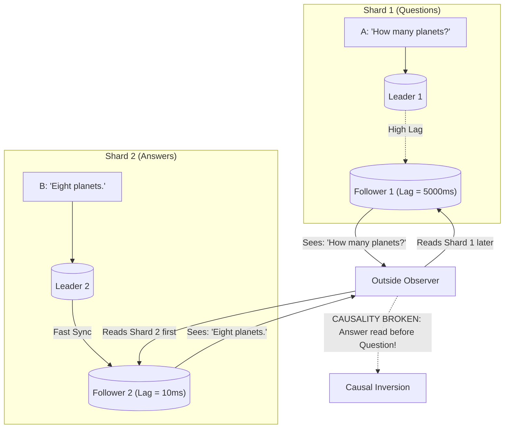

- **Key Takeaway:** Independent sharding without cross-partition total order breaks causal prefix order unless causally linked writes share the same partition key.

---

### Figure 6-6: Multi-Leader Multi-Region Deployment
- **Figure Reference:** `Figure 6-6: Multi-leader replication across multiple geographical regions (reconstructed from text p. 217)`
- **Original PDF:** Fig 6-6 → PDF p.240 — open the PDF at page 240 to compare with the Mermaid reconstruction below.
- **Visual Flow & Description:** Displays a multi-datacenter deployment. Each datacenter runs a local leader and follower pool. Writes commit locally with sub-10 ms latency, while leaders synchronize across WAN asynchronously.
- **Mermaid Flowchart:**

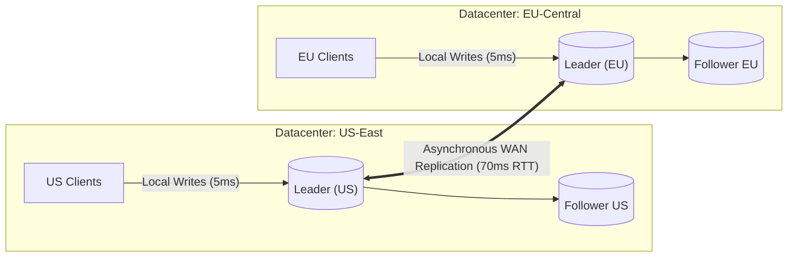

- **Key Takeaway:** Multi-leader replication isolates local write latency from trans-oceanic network RTT, but introduces concurrent write conflicts when two regions modify the same key.

---

### Figure 6-7: Multi-Leader Replication Topologies
- **Figure Reference:** `Figure 6-7: Three example topologies for multi-leader replication (reconstructed from text p. 219)`
- **Original PDF:** Fig 6-7 → PDF p.242 — open the PDF at page 242 to compare with the Mermaid reconstruction below.
- **Visual Flow & Description:** Compares Circular (a), Star (b), and All-to-All (c) replication topologies, highlighting the single point of failure in circular/star vs. the message overtaking hazard in all-to-all.
- **Mermaid Flowchart:**

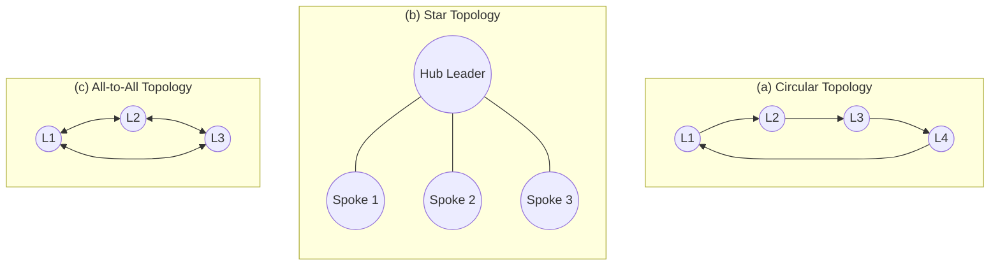

- **Key Takeaway:** All-to-all topology is the most resilient against node crashes, but requires vector clocks to detect message overtaking across divergent network links.

---

### Figure 6-8: Causality Violation via Network Message Overtaking
- **Figure Reference:** `Figure 6-8: With multi-leader replication, writes may arrive in the wrong order at some replicas (reconstructed from text p. 220)`
- **Original PDF:** Fig 6-8 → PDF p.243 — open the PDF at page 243 to compare with the Mermaid reconstruction below.
- **Visual Flow & Description:** Client A inserts a row on Leader 1. Client B reads the row on Leader 2 and updates it. Due to network routing latency, Leader 3 receives Client B's update *before* receiving Client A's insert.
- **Mermaid Sequence Diagram:**

```mermaid
sequenceDiagram
  autonumber
  actor CA as Client A
  actor CB as Client B
  participant L1 as Leader 1
  participant L2 as Leader 2
  participant L3 as Leader 3

  CA->>L1: 1. INSERT title = "Database Book" (Row 10)
  L1->>L2: Replicate INSERT (Fast Link)
  L2-->>CB: 2. Read Row 10
  CB->>L2: 3. UPDATE title = "DDIA 2nd Edition" (Row 10)

  par Normal Network Path
    L2->>L3: 4. Replicate UPDATE (Row 10) arrives FIRST!
    activate L3
    Note over L3: ERROR: Cannot UPDATE Row 10; row does not exist!
    deactivate L3
  and Delayed Network Path
    L1-.->L3: 5. Replicate INSERT (Row 10) arrives SECOND (Delayed)!
  end
```

- **Key Takeaway:** Asynchronous multi-leader replication cannot guarantee write ordering without explicit causal dependency tracking (version vectors).

---

### Figure 6-9: Concurrent Multi-Leader Write Conflict
- **Figure Reference:** `Figure 6-9: A write conflict caused by two leaders concurrently updating the same record (reconstructed from text p. 223)`
- **Original PDF:** Fig 6-9 → PDF p.246 — open the PDF at page 246 to compare with the Mermaid reconstruction below.
- **Visual Flow & Description:** User 1 updates title to `"B"` on Leader 1; User 2 concurrently updates title to `"C"` on Leader 2. When the replication stream crosses, both leaders encounter a conflicting state.
- **Mermaid Flowchart:**

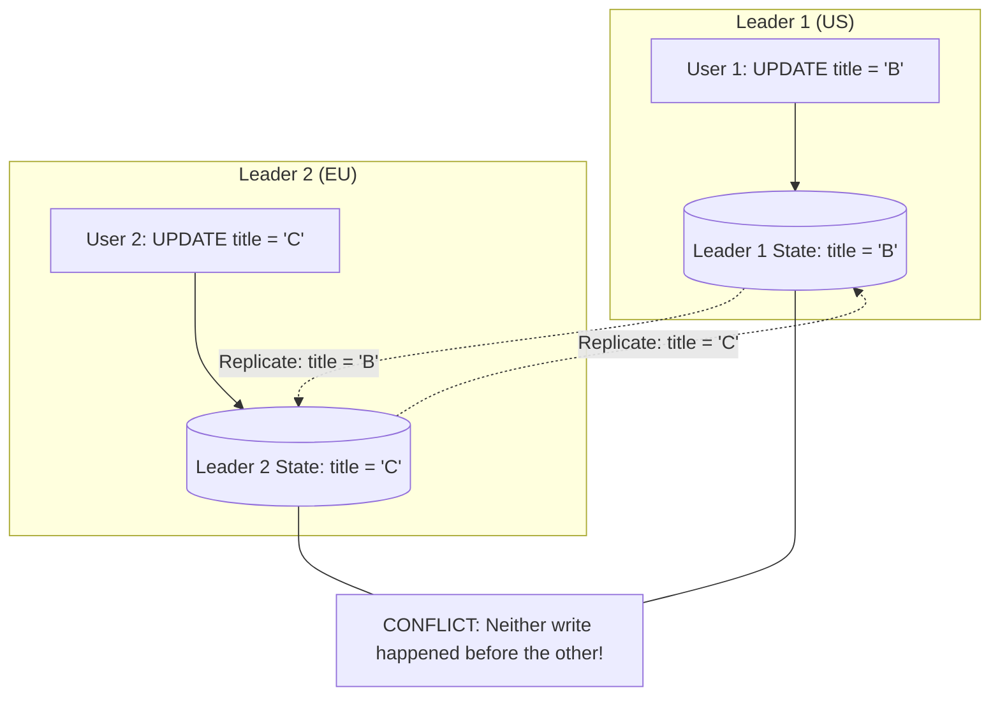

- **Key Takeaway:** Multi-leader writes are inherently concurrent; systems must converge to identical state via deterministic conflict resolution (LWW, CRDTs, or custom merge).

---

### Figure 6-10: Amazon Shopping Cart Sibling Anomaly (Resurrected Items)
- **Figure Reference:** `Figure 6-10: Amazon's shopping cart anomaly: deletions merged by taking union of items resurrect deleted entries (reconstructed from text p. 226)`
- **Original PDF:** Fig 6-10 → PDF p.250 — open the PDF at page 250 to compare with the Mermaid reconstruction below.
- **Visual Flow & Description:** Device 1 removes an item from the cart. Device 2 concurrently adds a new item. If conflict resolution merges states by taking the set union of carts without tombstones, the deleted item resurrects!
- **Mermaid Flowchart:**

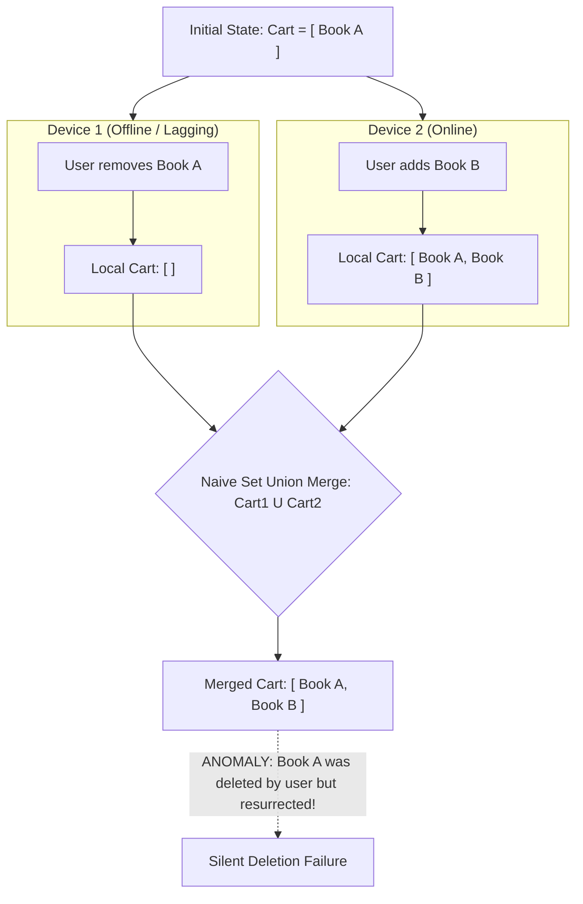

- **Key Takeaway:** Merging state without tracking deletions causes deleted items to resurrect; distributed systems must represent deletions explicitly using tombstones.

---

### Figure 6-11: Collaborative Text Editing: Operational Transformation vs. CRDTs
- **Figure Reference:** `Figure 6-11: How two concurrent insertions into a string are merged by OT and a CRDT (reconstructed from text p. 228)`
- **Original PDF:** Fig 6-11 → PDF p.251 — open the PDF at page 251 to compare with the Mermaid reconstruction below.
- **Visual Flow & Description:** Starting with string `"ice"`, User 1 inserts `"t"` at position 0 to make `"tice"`. User 2 concurrently inserts `"a"` at position 3 to make `"icea"`. OT shifts offsets; a sequence CRDT assigns unique immutable fractional IDs to characters.
- **Mermaid Flowchart:**

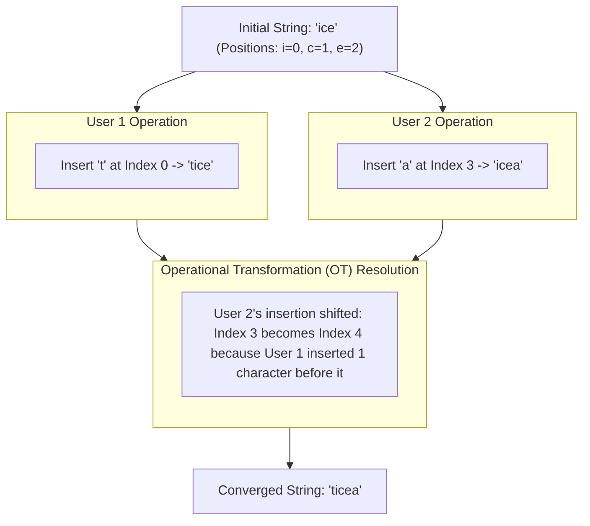

- **Key Takeaway:** Collaborative text editing requires preserving user intent by transforming character index offsets (OT) or assigning immutable fractional position IDs (CRDTs).

---

### Figure 6-12: Leaderless Quorum Read and Read Repair
- **Figure Reference:** `Figure 6-12: Writing to a majority of replicas, reading from a majority, and forwarding read repair (reconstructed from text p. 231)`
- **Original PDF:** Fig 6-12 → PDF p.254 — open the PDF at page 254 to compare with the Mermaid reconstruction below.
- **Visual Flow & Description:** Shows a client executing a quorum write ($N=3, W=2$). Node 3 is down, but the write succeeds on Nodes 1 and 2. Later, Client reads from Nodes 2 and 3 ($R=2$). The client detects Node 3 has stale version 5 and issues an asynchronous Read Repair.
- **Mermaid Flowchart:**

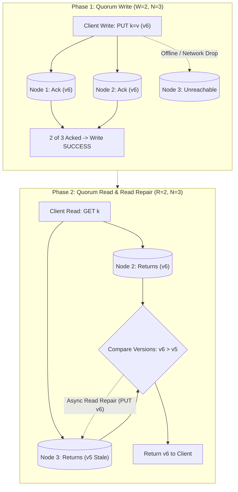

- **Key Takeaway:** Leaderless architectures achieve high availability by accepting writes even when nodes are down, relying on quorum overlap and read repair to heal stale replicas.

---

### Figure 6-13: The Quorum Intersection Condition ($W + R > N$)
- **Figure Reference:** `Figure 6-13: If w + r > n, at least one of the r replicas read from must have seen the write (reconstructed from text p. 233)`
- **Original PDF:** Fig 6-13 → PDF p.256 — open the PDF at page 256 to compare with the Mermaid reconstruction below.
- **Visual Flow & Description:** Illustrates the Pigeonhole Principle applied to distributed quorums ($N=5, W=3, R=3$). The overlap between write and read nodes guarantees at least one replica contains the latest update.
- **Mermaid Flowchart:**

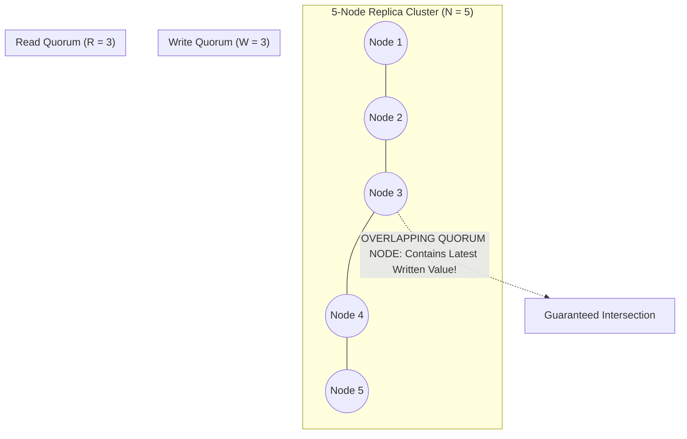

- **Key Takeaway:** When $W + R > N$, quorum intersection guarantees that stale reads are mathematically impossible, provided writes are executed sequentially.

---

### Figure 6-14: Concurrent Writes in Leaderless Datastores (No Total Order)
- **Figure Reference:** `Figure 6-14: Concurrent writes in a Dynamo-style datastore have no well-defined order (reconstructed from text p. 238)`
- **Original PDF:** Fig 6-14 → PDF p.262 — open the PDF at page 262 to compare with the Mermaid reconstruction below.
- **Visual Flow & Description:** Client 1 writes $X=A$ to Nodes 1 and 2. Client 2 concurrently writes $X=B$ to Nodes 2 and 3. Node 2 receives $A$ then $B$; Node 1 only has $A$; Node 3 only has $B$. There is no global order.
- **Mermaid Flowchart:**

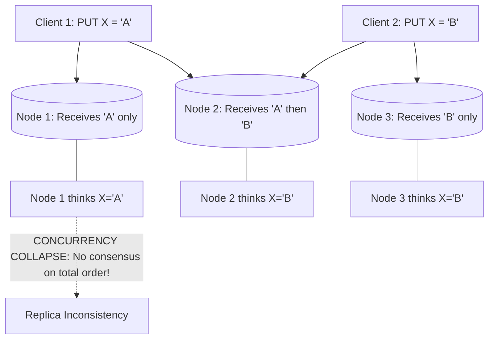

- **Key Takeaway:** Leaderless stores accept concurrent writes without coordination, requiring vector clocks and sibling reconciliation to resolve ordering ambiguity.

---

### Figure 6-15 & 6-16: Capturing Causality and Version Vectors
- **Figure Reference:** `Figure 6-15: Capturing causal dependencies between concurrent clients and their DAG representation (reconstructed from text pp. 241-243)`
- **Original PDF:** Fig 6-15 → PDF p.264 — open the PDF at page 264 to compare with the Mermaid reconstruction below. & 6-16
- **Visual Flow & Description:** Tracks two clients concurrently updating a shopping cart. When a client submits an update without knowing about a concurrent update, siblings are created. A client merge reconciles siblings into a single causal successor.
- **Mermaid Flowchart:**

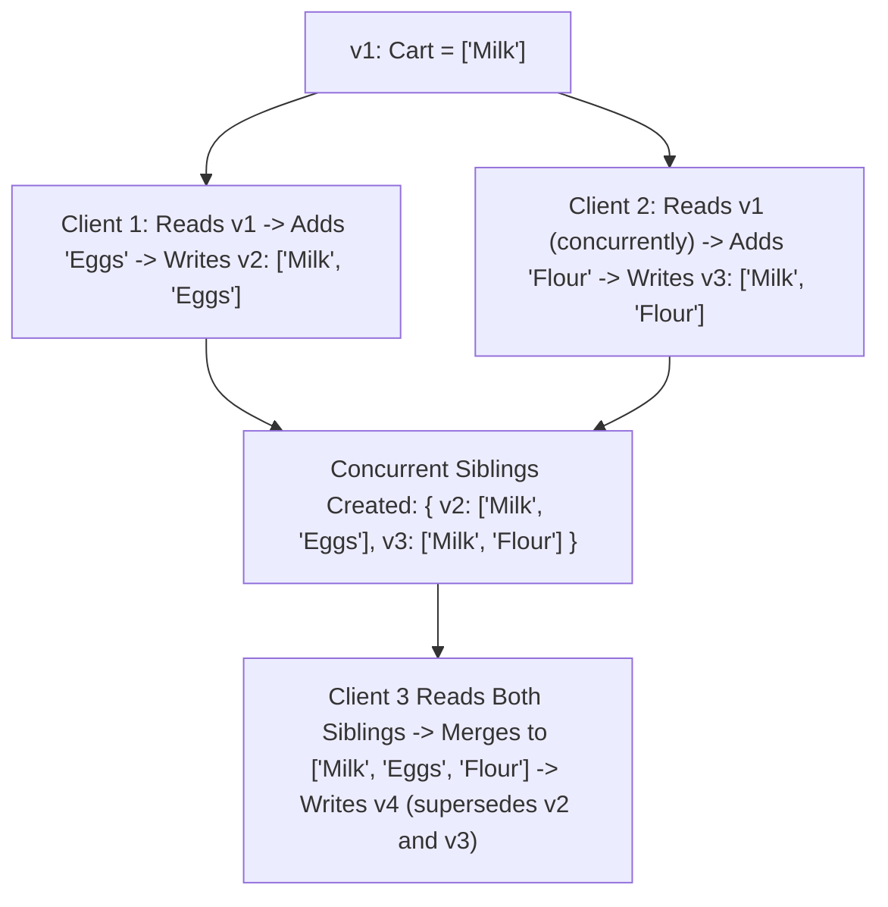

- **Key Takeaway:** Causality forms a Directed Acyclic Graph (DAG); systems track versions to detect concurrent mutations, preserving siblings until an application merge unifies them.

---

## 4. Real-World Systems, Case Studies & Code Examples

### 4.1 Industry Implementations & Architectural Divergence
- **MySQL InnoDB Primary-Replica:** Canonical single-leader implementation. Uses binary log (binlog) row-based replication. Supports asynchronous and semi-synchronous replication (via the `semisync` plugin).
- **MongoDB Replica Sets:** Single-leader replication managed via an automated Raft-like election algorithm. Uses an internal capped collection (`oplog.rs`) to stream idempotent document transformations.
- **Apache Cassandra & ScyllaDB:** Canonical leaderless Dynamo-style stores. Configurable $N, W, R$ per keyspace and query (`LOCAL_QUORUM`, `QUORUM`, `ONE`). Uses Murmur3 token rings, Bloom filters, and SSTables. Implements background anti-entropy via Merkle trees and on-demand read repairs.
- **Automerge & Yjs (Local-First CRDTs):** High-performance client-side CRDT engines for collaborative applications. Automerge implements JSON-like document CRDTs; Yjs provides ultra-fast text editing and array sync using fractional indexing and state vectors.

---

### 4.2 Production Implementation: Vector Clock & Causality Tracker

```python
from typing import Dict, List, Tuple, Any

class VectorClock:
    """
    Implements a distributed Vector Clock to detect happens-before
    relationships and concurrent sibling mutations across replicas.
    """
    def __init__(self, clock_dict: Dict[str, int] = None):
        self.clock: Dict[str, int] = dict(clock_dict) if clock_dict else {}

    def increment(self, node_id: str) -> "VectorClock":
        new_clock = dict(self.clock)
        new_clock[node_id] = new_clock.get(node_id, 0) + 1
        return VectorClock(new_clock)

    def dominates(self, other: "VectorClock") -> bool:
        """
        Returns True if self strictly happened-after other (self > other).
        True iff self >= other for all nodes and self > other for at least one.
        """
        all_keys = set(self.clock.keys()).union(set(other.clock.keys()))
        strictly_greater = False

        for k in all_keys:
            v_self = self.clock.get(k, 0)
            v_other = other.clock.get(k, 0)
            if v_self < v_other:
                return False
            if v_self > v_other:
                strictly_greater = True

        return strictly_greater

    def is_concurrent_with(self, other: "VectorClock") -> bool:
        """Returns True if self and other are concurrent (neither dominates)."""
        return not self.dominates(other) and not other.dominates(self) and self.clock != other.clock

class DistributedRecord:
    def __init__(self, value: Any, vclock: VectorClock):
        self.value = value
        self.vclock = vclock

def reconcile_concurrent_writes(
    existing_records: List[DistributedRecord], 
    incoming_record: DistributedRecord
) -> List[DistributedRecord]:
    """
    Reconciles an incoming write against existing versioned siblings.
    Discards obsolete records dominated by incoming write; preserves concurrent siblings.
    """
    surviving: List[DistributedRecord] = []
    incoming_is_obsolete = False

    for record in existing_records:
        if record.vclock.dominates(incoming_record.vclock):
            # Incoming record is older than existing record; discard incoming
            incoming_is_obsolete = True
            surviving.append(record)
        elif incoming_record.vclock.dominates(record.vclock):
            # Existing record is obsolete; do not keep it
            continue
        else:
            # Records are concurrent; preserve existing sibling
            surviving.append(record)

    if not incoming_is_obsolete:
        surviving.append(incoming_record)

    return surviving
```

---

### 4.3 Production Implementation: Quorum Read Repair Coordinator

```python
import time
from typing import List, Optional, Tuple, Any

class ReplicaNode:
    def __init__(self, node_id: str):
        self.node_id = node_id
        # key -> (value, timestamp_ms)
        self.storage: dict = {}

    def get(self, key: str) -> Optional[Tuple[Any, int]]:
        return self.storage.get(key)

    def put(self, key: str, value: Any, timestamp_ms: int):
        self.storage[key] = (value, timestamp_ms)

class QuorumCoordinator:
    """
    Executes Dynamo-style quorum reads (R) with automated Read Repair
    across a cluster of N replica nodes.
    """
    def __init__(self, replicas: List[ReplicaNode]):
        self.replicas = replicas
        self.N = len(replicas)

    def quorum_read(self, key: str, R: int) -> Any:
        if R > self.N:
            raise ValueError("Read quorum R cannot exceed cluster replica count N.")

        # Query R replicas
        responses: List[Tuple[ReplicaNode, Optional[Tuple[Any, int]]]] = []
        for replica in self.replicas[:R]:
            val = replica.get(key)
            responses.append((replica, val))

        # Filter out None responses
        valid_responses = [(node, res) for node, res in responses if res is not None]
        if not valid_responses:
            return None  # Key does not exist on any queried replica

        # Find the winner with the highest physical timestamp (LWW)
        winner_node, (winner_val, highest_ts) = max(
            valid_responses, 
            key=lambda item: item[1][1]
        )

        # Trigger asynchronous Read Repair on stale replicas
        for node, res in responses:
            if res is None or res[1] < highest_ts:
                # Dispatch background write repair
                node.put(key, winner_val, highest_ts)

        return winner_val
```

---

### 4.4 Production War Story: The GitHub MySQL Master Failover Outage
- **The Context:** GitHub operated an active-passive MySQL replication topology for its core relational data tier. An automated orchestrator monitored the primary master via periodic heartbeats. A passive replica was configured to take over in the event of primary failure.
- **The Incident:** During a routine network maintenance window, a transient 15-second network glitch interrupted traffic between the active MySQL primary and the monitoring orchestrator. The primary continued processing local application transactions, but the orchestrator presumed the master dead and initiated an emergency failover.
- **The Cascade:** The orchestrator promoted a replica to master and updated internal DNS records. However, because client connection pooling did not immediately tear down active TCP connections to the old master, the old master continued accepting write transactions for several seconds concurrently with the newly promoted master (**Split-Brain**).
- **The Disaster:** When the old master was finally isolated, the two databases had diverged: auto-incrementing primary keys had been independently issued for distinct pull requests, comments, and commit status checks. Merging the data required writing custom forensic python scripts to reconstruct chronological event order and remap conflicting foreign keys across millions of rows, causing a 24-hour service degradation.
- **Remediation & Architecture Lessons:**
  1. *Fencing Tokens & STONITH:* Implemented fencing primitives (Shoot The Other Node In The Head - STONITH) using power distribution unit (PDU) network switches to forcefully power off a dead primary before promoting a follower.
  2. *Raft-Based Orchestration:* Replaced ad-hoc heartbeat scripts with GitHub's open-source `orchestrator` tool using Raft consensus to prevent split-brain leader promotions.

---

## 5. Architectural Trade-Off Matrix

| Replication Architecture | Write Path Latency | Read Path Latency | Scalability Bottleneck | Conflict Resolution Complexity | Fault Tolerance & Failover | Best Workload Fit | Catastrophic Failure Mode |
| :--- | :--- | :--- | :--- | :--- | :--- | :--- | :--- |
| **Single-Leader: Asynchronous** | Minimal (Local write; sub-5 ms) | Sub-millisecond (Scale reads via follower pool) | Single leader CPU & disk write throughput | Zero (Leader defines canonical total order) | Requires failover; un-replicated writes lost on leader crash | Read-dominant web applications ($>90\%$ reads); strict ACID | Discarded writes on failover; replication lag anomalies |
| **Single-Leader: Synchronous** | High (Bounded by slowest follower network RTT) | Sub-millisecond | Bounded by slowest node in synchronous set | Zero (Total order maintained) | Zero data loss ($RPO = 0$); stalls if any sync follower halts | Financial ledgers; zero-data-loss compliance workloads | Single lagging follower halts all write processing globally |
| **Multi-Leader (Multi-DC / Active-Active)** | Minimal local write ($<5\ \text{ms}$ in local DC) | Minimal (Read from local DC leader/replicas) | Cross-datacenter conflict resolution CPU | **Extreme** (Requires LWW, CRDTs, or custom application merges) | Survives entire DC blackout; local DCs continue operating | Multi-region global applications; collaborative editing; offline clients | Concurrent write conflicts; LWW wall-clock skew data loss |
| **Leaderless: Strong Quorum ($W+R > N$)** | Moderate (Waits for $W$ concurrent acknowledgments) | Moderate (Waits for $R$ concurrent responses) | Network packet fan-out; slowest replica in quorum | High (Requires version vectors and sibling handling) | High availability; tolerates $(N - W)$ concurrent node crashes | Write-heavy telemetry; caching layers; shopping carts | Sloppy quorums violate linearizability; sibling explosion |
| **Leaderless: Weak Quorum ($W+R \le N$)** | Blazing ($W=1$; fire-and-forget) | Blazing ($R=1$; read nearest node) | Background anti-entropy Merkle tree sync | High (Stale reads and silent overwrites frequent) | Maximum availability; system operates under massive partitions | Ephemeral metrics; logging; non-critical counter tracking | Severe data loss; arbitrary dirty reads of obsolete states |

---

### Concrete Decision Heuristics

```text
Decision Tree for Replication Strategy:
1. Does the workload require multi-region active writes or offline operation on mobile/client devices?
   ├── YES:
   │    ├── Is the data collaborative text, sets, or state counters? -> Use Multi-Leader with CRDTs / OT (Yjs / Automerge).
   │    └── Can writes be routed to a deterministic home datacenter by key? -> Use Multi-Leader with Conflict Avoidance.
   └── NO (Single-datacenter or centralized cloud deployments):
        ├── Is the workload heavily Write-Heavy (>40% writes) or requires extreme partition availability over linearizability?
        │    └── YES: Use Leaderless Quorum Store (Cassandra / ScyllaDB with W=QUORUM, R=QUORUM).
        └── Is the workload Read-Dominant (>80% reads) requiring complex relational joins and deterministic ACID transactions?
             ├── Requires Zero Data Loss (RPO=0) at all costs? -> Use Single-Leader with Semi-Synchronous Replication.
             └── Tolerates minimal transient failover lag for high throughput? -> Use Single-Leader with Asynchronous Follower Pool.
```

---

## 6. Jargon Buster & Key Terminology

- **Replication Lag:** The duration of time between a write transaction committing on the leader and that mutation applying on an asynchronous follower replica.
- **Read-After-Write Consistency (Read-Your-Writes):** A consistency guarantee ensuring that a user will always see their own submitted updates upon reloading data.
- **Monotonic Reads:** A consistency guarantee ensuring that if a user reads data in sequence, they will never observe data in an earlier state than what was returned in previous reads.
- **Consistent Prefix Reads:** A consistency guarantee ensuring that if a series of writes occurs in a specific causal order, any concurrent reader will observe those writes in the exact same causal order.
- **Split-Brain:** A catastrophic distributed condition where two distinct nodes simultaneously believe they are the authoritative primary leader, accepting conflicting writes that permanently diverge data.
- **Fencing Token:** A monotonically increasing integer counter issued by a consensus coordinator that invalidates older, zombie leaders attempting to commit mutations to shared storage.
- **Quorum ($W + R > N$):** A distributed voting protocol where the number of nodes required to acknowledge a write ($W$) plus the number of nodes queried for a read ($R$) exceeds total cluster replicas ($N$), guaranteeing overlap.
- **Sloppy Quorum:** A leaderless configuration where writes are accepted by temporary foster nodes when the designated home replicas are unreachable during a network partition.
- **Hinted Handoff:** An operational mechanism where foster nodes buffer writes accepted during a sloppy quorum and stream them back to primary home replicas once the network heals.
- **Version Vector (Vector Clock):** A distributed vector of per-node version numbers used to determine whether two independent mutations possess a causal happens-before relationship or are concurrent siblings.
- **Conflict-free Replicated Data Type (CRDT):** An abstract data type designed to replicate across multiple network nodes, allowing local mutations without coordination and converging deterministically to identical state.

---

## 7. System Design & Practical Engineering Takeaways

### 7.1 Production Engineering Checklist
1. **Never Deploy Asynchronous Failover Without Fencing (STONITH):** Ensure automated failover orchestrators (e.g., Orchestrator, Patroni) can forcibly fence or power down an unresponsive primary via IPMI or cloud API before promoting a follower.
2. **Pin User Reads to Replicas via Hash Routing:** Prevent monotonic read inversions and time-traveling anomalies by hashing the client's session ID to route their queries deterministically to the same read replica.
3. **Monitor Replication Lag in Milliseconds, Not Seconds:** In MySQL or PostgreSQL, monitor replica lag using high-resolution heartbeat tables (e.g., Pt-Heartbeat) rather than relying on `Seconds_Behind_Master`, which only measures SQL thread transaction timestamps.
4. **Enforce Tombstone Tracking on Distributed Deletions:** When implementing multi-leader or leaderless synchronization, never delete records by simply removing keys from local dictionaries. Always store an explicit tombstone record with a deletion timestamp to prevent resurrected items.
5. **Never Rely on NTP Server Clocks for Last-Write-Wins (LWW):** Physical clock drift (NTP skew) across cloud servers makes LWW non-deterministic. If absolute ordering is required, use hybrid logical clocks (HLC) or state-based vector clocks.

---

### 7.2 System Design Interview Strategy
- **Address Failover Data Loss Proactively:** When proposing a primary-replica database in an interview, do not treat failover as magic. State: *"We will configure semi-synchronous replication with at least one synchronous replica to ensure an $RPO=0$ guarantee. If the primary crashes, failover promotes the synchronized follower to prevent lost writes."*
- **Explain Quorum Calculations with Concrete Numbers:** When designing Amazon Dynamo or Cassandra storage, calculate quorum trade-offs explicitly: *"For $N=3$, we select $W=2, R=2$. This allows the system to tolerate 1 node failure for writes and 1 node failure for reads while maintaining strong quorum intersection ($W + R = 4 > 3$)."*
- **Propose Sticky Routing for Replication Lag:** When asked how to prevent users from seeing stale profiles immediately after editing, explain the dual-routing heuristic: *"We route profile reads for the editing user to the leader for 60 seconds post-mutation, while routing general read traffic across asynchronous followers."*

---

### 7.3 Mastery Self-Assessment Questions

#### Question 1 (Conceptual Depth)
*Why does a quorum configuration where $W + R > N$ fail to provide true linearizability (strict real-time consistency) in leaderless distributed datastores like Apache Cassandra?*
- **Answer:** 
  While $W + R > N$ guarantees that the read set and write set overlap on at least one physical replica, it does **not** guarantee linearizability due to several edge conditions:
  1. *Concurrent Write Overwriting:* If two writes occur concurrently, replicas may receive them in different orders. A quorum read can return a mix of values unless an absolute total order (such as Paxos consensus) is enforced.
  2. *Sloppy Quorums & Hinted Handoff:* Under network partitions, writes are accepted by foster nodes outside the $N$ home replicas. A subsequent quorum read of $R$ home replicas will not intersect with the foster nodes, returning stale data until hinted handoff completes.
  3. *Torn Writes & Partial Failures:* If a write succeeds on 1 node but fails on the second (failing to achieve $W=2$), the client receives a failure acknowledgment. However, the value remains on that 1 node. A subsequent reader may or may not see this value, violating linearizability.
  4. *Read Repair Race Conditions:* A reader detecting a stale value triggers an asynchronous read repair. If a concurrent reader reads the same key before the repair completes, it can observe the stale value again, causing time to move backward.

#### Question 2 (Failure Scenario & Edge Cases)
*A financial exchange cluster operates a 3-node MySQL group using asynchronous replication. Node 1 is the primary. Node 2 has a replication lag of 150 ms; Node 3 has a replication lag of 2,500 ms. A network switch failure isolates Node 1 from the client pool and orchestrator. The automated failover tool immediately promotes Node 3 to master. Diagnose the architectural defects in this failover execution, analyze the data corruption that will occur, and prescribe the correct failover protocol.*
- **Answer:**
  - *Architectural Defects:*
    1. *Incorrect Replica Selection:* The orchestrator promoted Node 3 (the most lagging replica with 2,500 ms lag) instead of Node 2 (which had only 150 ms lag).
    2. *Lack of Fencing:* Node 1 was isolated from the orchestrator but not verified dead, leaving it vulnerable to accepting writes if clients could reach it through alternative network paths (split-brain).
  - *Data Corruption Analysis:*
    - Node 3 was missing 2.5 seconds of committed financial transactions that had already been acknowledged to clients.
    - When promoted to master, Node 3 accepted new transactions, issuing overlapping auto-incrementing trade IDs.
    - When the network partition healed, transactions committed on Node 1 during those 2.5 seconds were completely lost or collided with new trade IDs on Node 3, causing irreversible balance discrepancies and corrupting foreign-key financial ledgers.
  - *Prescribed Protocol:*
    1. The failover tool must poll all accessible replicas to identify the node with the **highest Log Sequence Number (LSN)** (Node 2) and reject promotion of nodes whose lag exceeds a safety threshold.
    2. Before promoting Node 2, the orchestrator must execute a fencing barrier (e.g., revoking Node 1's cloud IAM permissions or issuing an IPMI reboot) to guarantee Node 1 cannot accept writes.
    3. The system should be upgraded to **Semi-Synchronous Replication** or **MySQL Group Replication (Paxos-based)** so that transactions cannot commit on the primary without being hardened on at least one replica.

#### Question 3 (Trade-Off & Capacity Estimation)
*A social media platform deploys a leaderless key-value cluster across 5 data nodes ($N = 5$). The service handles $120,000\ \text{read queries/sec}$ and $15,000\ \text{write operations/sec}$. Compare the node-level network query fan-out, per-node QPS load, and maximum node failure tolerance under two configurations: (A) Strong Quorum: $W = 3, R = 3$, vs. (B) Read-Optimized Quorum: $W = 5, R = 1$. Show exact calculations.*
- **Answer:**
  - *Configuration A: Strong Quorum ($N=5, W=3, R=3$)*
    - *Fault Tolerance:* 
      - Write tolerance: Can tolerate $N - W = 5 - 3 = \mathbf{2\ \text{failed nodes}}$.
      - Read tolerance: Can tolerate $N - R = 5 - 3 = \mathbf{2\ \text{failed nodes}}$.
      - Quorum Intersection: $W + R = 3 + 3 = 6 > 5$ (Fresh reads guaranteed).
    - *Cluster Network Fan-Out & QPS Load:*
      - Total Write Messages: $15,000\ \text{writes/sec} \times 3\ \text{replicas} = 45,000\ \text{node writes/sec}$.
      - Total Read Messages: $120,000\ \text{reads/sec} \times 3\ \text{replicas} = 360,000\ \text{node reads/sec}$.
      - Total Cluster Operations: $45,000 + 360,000 = 405,000\ \text{ops/sec}$.
      - Average Load Per Node: $\frac{405,000\ \text{ops/sec}}{5\ \text{nodes}} = \mathbf{81,000\ \text{QPS per node}}$.
  - *Configuration B: Read-Optimized Quorum ($N=5, W=5, R=1$)*
    - *Fault Tolerance:*
      - Write tolerance: Can tolerate $N - W = 5 - 5 = \mathbf{0\ \text{failed nodes}}$! If a single node in the cluster fails or experiences a GC pause, **all client writes fail globally**.
      - Read tolerance: Can tolerate $N - R = 5 - 1 = \mathbf{4\ \text{failed nodes}}$.
      - Quorum Intersection: $W + R = 5 + 1 = 6 > 5$ (Fresh reads guaranteed).
    - *Cluster Network Fan-Out & QPS Load:*
      - Total Write Messages: $15,000\ \text{writes/sec} \times 5\ \text{replicas} = 75,000\ \text{node writes/sec}$.
      - Total Read Messages: $120,000\ \text{reads/sec} \times 1\ \text{replica} = 120,000\ \text{node reads/sec}$.
      - Total Cluster Operations: $75,000 + 120,000 = 195,000\ \text{ops/sec}$.
      - Average Load Per Node: $\frac{195,000\ \text{ops/sec}}{5\ \text{nodes}} = \mathbf{39,000\ \text{QPS per node}}$.
  - *Quantitative Trade-off Summary:*
    - Configuration B cuts per-node load by **$51.8\%$** ($39,000$ vs $81,000$ QPS), drastically reducing CPU and network socket overhead.
    - However, Configuration B has a catastrophic write availability profile: **zero fault tolerance for writes**. In production, normal node reboots or rolling updates would cause complete service write outages. Therefore, Configuration A ($W=3, R=3$) or a local datacenter quorum ($W=\text{LOCAL\_QUORUM}$) is the only viable production architecture.


---
> [!NAV] **Chapter Navigation**
> ⬅️ **Previous:** [[chapter-05-encoding-and-evolution|Chapter 05: Encoding and Evolution]] | 🏠 **Index:** [[00-Master-Reading-Dashboard|Master Dashboard]] | ➡️ **Next:** [[chapter-07-sharding|Chapter 07: Sharding]]