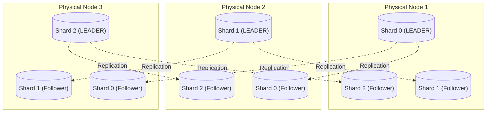
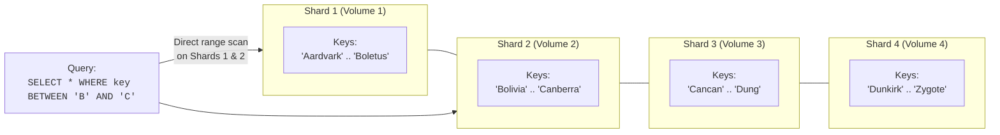
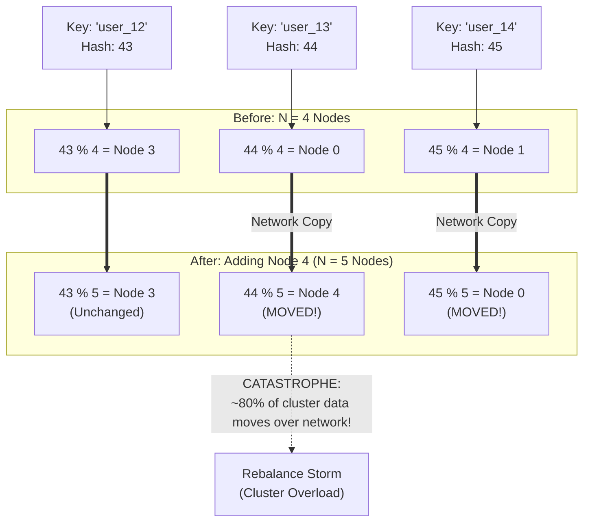
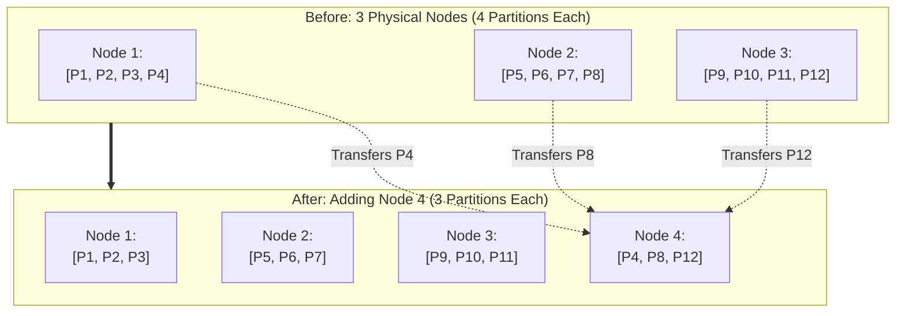
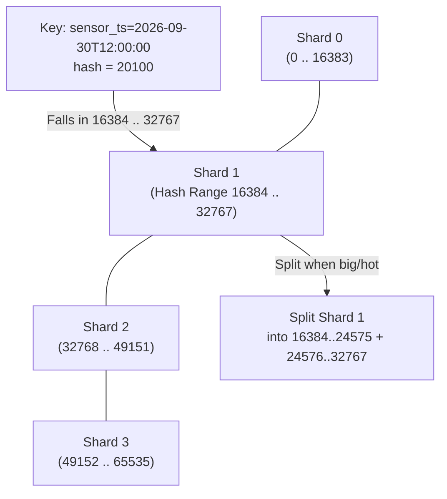
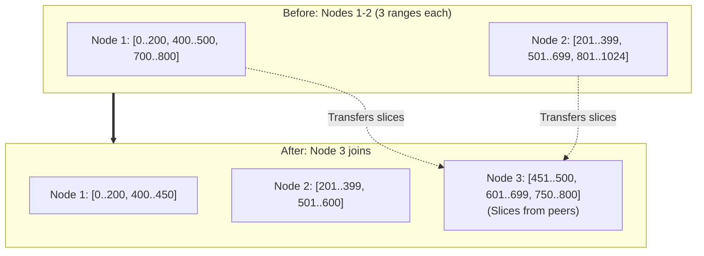
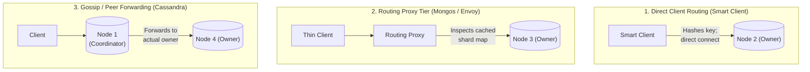
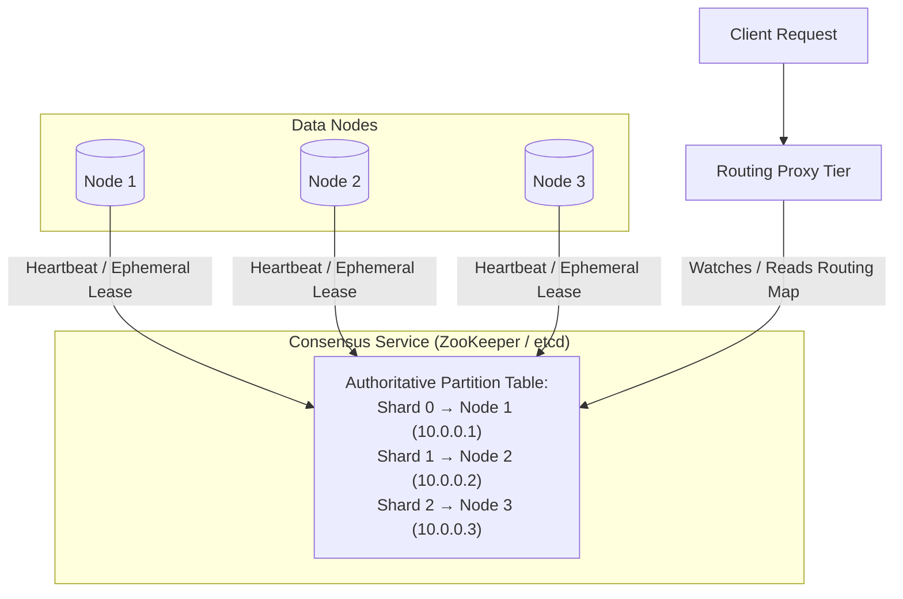
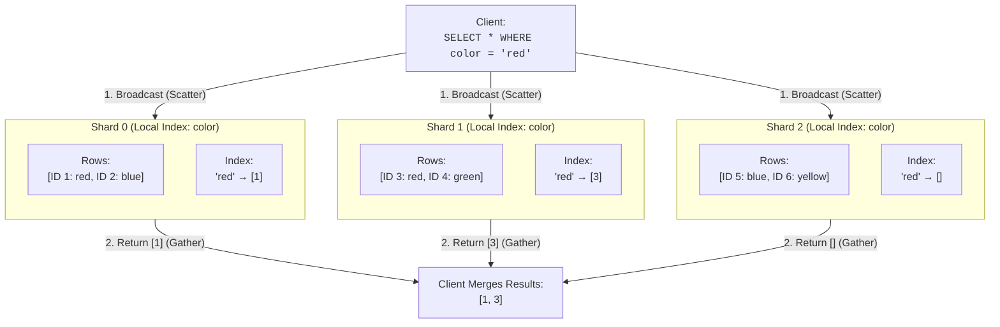
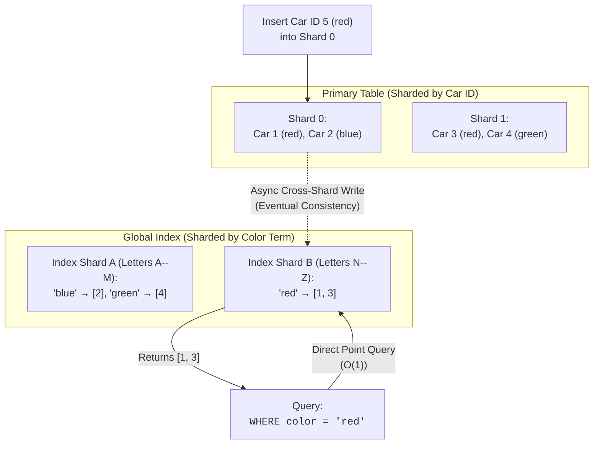

# Chapter 7: Sharding — Definitive Technical Summary
*From: Designing Data-Intensive Applications (2nd Edition) by Martin Kleppmann and Chris Riccomini*
*Source PDF: pp. 275–300 — figures below cite PDF pages.*

> [!NAV] **Chapter Navigation**
> ⬅️ **Previous:** [[chapter-06-replication|Chapter 06: Replication]] | 🏠 **Index:** [[00-Master-Reading-Dashboard|Master Dashboard]] | ➡️ **Next:** [[chapter-08-transactions|Chapter 08: Transactions]]

---

## 1. Executive Summary & Core Engineering Problem

> *"Clearly, we must break away from the sequential and not limit the computers. We must state definitions and provide for priorities and descriptions of data. We must state relationships, not procedures."*
> — **Grace Murray Hopper**, *Management and the Computer of the Future (1962)*

- **The Big Picture:** A distributed database spreads data two ways: **Replication** (Chapter 6 — same data on many nodes) and **Sharding / Partitioning** (this chapter — different data on different nodes, each record on exactly one shard). Each shard is a small database; sharding + replication together means each shard is replicated (Figure 7-1). Replication logic from Chapter 6 applies per shard, so this chapter ignores replication for clarity.
- **Core Thesis:** When data or write throughput exceeds one machine, you must shard for horizontal scale-out (shared-nothing, p. 51): divide so each shard takes a fair share and nodes work in parallel. But sharding breaks single-node illusions — cross-shard writes need distributed transactions (Chapter 8, slow/bottlenecked), secondary-index or join queries become scatter-gather broadcasts, and skew creates hot spots that pin a whole cluster on one node.
- **Problem Statement:** Alice shards by `hash(key) % N` with 10 nodes. Adding node 11 changes the divisor: ~91% of keys remap and 45 TB of a 50 TB fleet copies at once. Meanwhile Bob shards SaaS tenants by `tenant_id`: one enterprise tenant generating 40% of traffic lands on one node — its p99 jumps 15 ms → 12,000 ms while peers sit 90% idle. Both clusters are "balanced" by hash yet operationally collapsed.
- **Historical & Industry Context:** Vertical SMP (Sun, Exadata) → web-scale horizontal sharding: Bigtable (2006) range splits, Dynamo/Cassandra (2007–08) consistent-hash rings, MongoDB `mongos` + config servers, Redis/VoltDB/FoundationDB per-core sharding for NUMA. 2020s convergence: Distributed SQL (CockroachDB Ranges, TiDB Regions, YugabyteDB tablets) marries auto range-sharding to Raft; warehouses disaggregate compute from sharded object storage (BigQuery, Snowflake micro-partitions, Delta Lake).
- **Terminology:** *Shard = partition = range/region/vBucket/vnode/token-range/tablet* (Kafka, CockroachDB, HBase/TiDB, Couchbase, Riak, Cassandra, Bigtable/Yugabyte/Scylla). Postgres distinguishes: *partitioning* = split one table into files on one machine (fast whole-partition deletes), *sharding* = split across machines (Citus). "Shard" likely from Ultima Online's shattered crystal (parallel game worlds) — or apocryphally *System for Highly Available Replicated Data*. *Partitioning* here ≠ network partition (netsplit, Chapter 9).

---

## 2. In-Depth Technical Concepts & Internal Mechanics

### 2.1 Pros and Cons of Sharding + Combining with Replication
- **Why shard:** Only for data volume or write throughput beyond one node (one modern machine handles a lot — prefer single-shard if you can). Read-only pressure alone = read scaling (Chapter 6), not sharding.
- **How scale-out works:** Pick a **partition key**; all records with one key live on one shard. Know the key → single-shard point lookup (fast). Don't know it → search all shards (slow). The scheme is hard to change, painful for relational secondary-index/join patterns ("Sharding and Secondary Indexes" p. 268), and multi-shard writes need distributed transactions.
- **With replication (Figure 7-1):** Each shard has one leader + followers spread so every node leads some shards and follows others — no idle hot standbys. A write for key `K` routes to the leader of `K`'s shard, persists, streams to its followers.
- **Single-machine sharding:** Redis, VoltDB, FoundationDB run one single-threaded process per core (NUMA-aware) and shard across cores for parallelism — same math, no network.

### 2.2 Sharding for Multitenancy
SaaS (email marketing: each business = tenant with isolated sign-ups/deliveries) often shards by tenant — one shard per tenant or many small tenants grouped into one shard (separate DBs or logical slices, "Embedded Storage Engines" p. 125). Wins:
- *Resource isolation:* One tenant's heavy report doesn't steal another's CPU when on different shards.
- *Permission isolation:* Physically separate datasets survive access-control bugs.
- *Cell-based architecture:* Services + storage per tenant-set grouped into independent cells; faults stay in-cell (AWS Well-Architected).
- *Per-tenant backup/restore:* Restore one tenant's shard without touching others (accidental delete recovery).
- *Regulatory compliance:* GDPR/CCPA export/delete = operate on that person's shard.
- *Data residence:* Pin a tenant's shard to its jurisdiction's region.
- *Gradual schema rollout:* Migrate one tenant at a time (detect breakage early; hard transactionally, "Schema flexibility" p. 80).
- **Challenges:** Assumes each tenant fits one node — a giant tenant needs *intra-tenant* sharding (back to scalability sharding). Many tiny tenants → per-shard overhead; grouping them reintroduces tenant-migration as they grow. Cross-tenant joins span shards.

### 2.3 Sharding of Key-Value Data: Skew, Hot Shards, Hot Keys
Goal: 10 nodes ≈ 10× data + 10× throughput; add/remove a node → rebalance evenly. **Skew** = unfair split (some shards bigger/busier). Extreme: 9 nodes idle, 1 bottlenecked. A disproportionately loaded shard = **hot shard / hot spot**; a single overloaded key (celebrity user ID, viral action ID) = **hot key**. The router is `partition_key → shard`: key-value = key/prefix; relational = a column (not necessarily PK). It must support rebalancing to relieve hot spots.

### 2.4 Sharding by Key Range (Figure 7-2)
- **Mechanism:** Contiguous key intervals per shard like encyclopedia volumes (`A–B`, `C–D`…). Title → volume whose range contains it. Boundaries need not be even — Volume 1 covers `A,B`, Volume 12 covers `T–Z` — they adapt to density. Chosen manually (Vitess on MySQL) or automatically (Bigtable/HBase, MongoDB range option, CockroachDB, RethinkDB, FoundationDB; YugabyteDB both).
- **Storage:** Keys sorted inside each shard (B-tree/SSTables, Chapter 4) → range scans trivial; concatenated keys fetch related rows in one query ("Multidimensional Indexes" p. 145). Sensor example: key = timestamp → "all March readings" is one scan.
- **Hot-shard trap:** Timestamp-first keys funnel all live writes to the *current-time* shard (this month's shard at 100%, rest at 0%). Fix: prefix `sensor_id + timestamp` (order by sensor, then time) — spreads writes, but multi-sensor time-range reads become one range query *per sensor*.
- **Rebalancing:** Start empty (optionally **pre-split** into guessed ranges — HBase/MongoDB — needs prior distribution knowledge). As data/throughput grows, split a shard into contiguous subranges on multiple nodes; merge tiny adjacent shards after deletes (like B-tree top-level, "B-Trees" p. 125). Auto-split triggers: size (HBase default 10 GB) or sustained write rate — so a *hot but small* shard still splits to spread load. Cost: rewriting all data like an LSM compaction, on an already-hot shard — can tip it over.

### 2.5 Sharding by Hash of Key: Modulo Disaster, Fixed Partitions, Hash Ranges
Hash first when adjacency doesn't matter (tenant IDs). A good 32-bit hash (MD5 in MongoDB, Murmur3 in Cassandra/ScyllaDB — *not* `Java hashCode`/`Ruby #hash`, unstable across processes) turns similar inputs into uniform `0…2³²−1`.

#### Concrete Step-by-Step Example: The Modulo-`N` Disaster (Figure 7-3)
1. `node = hash(key) % N`. With `N=10`, key hash 100 → node 0.
2. Add node 11: `100 % 11 = 1` (**MOVED**). Only `1/11 ≈ 9%` stay; **~91% of the fleet copies at once** (50 TB → 45 TB over the wire). Figure 7-3 shows the same with 3→4 nodes (hash 3 moves 0→3, 6 moves, 9 moves…).
3. **Verdict:** Never use bare `mod N` for elastic data — rebalancing cost dwarfs the new capacity.

#### How Modern Systems Avoid It
1. **Fixed number of shards (Figure 7-4):** Pre-create e.g. 1,000 shards for 10 nodes (100/node); key → `hash % 1000` (stable), shards → nodes (mutable). New node steals whole shards (Figure 7-4: 12 shards, 3 nodes → 4 nodes each give 1). Only shard→node mapping moves — no rehashing; reads/writes use the old map during transfer. Pick counts divisible by many factors; overweight powerful nodes with more shards (Citus, Riak, Elasticsearch, Couchbase). Limits: nodes ≤ shards; wrong initial count → expensive reshard (split + rewrite + extra disk, sometimes blocking writes); fixed fraction per shard means shard size tracks total data (too big = costly recovery, too small = overhead).
2. **Hash-range sharding (Figure 7-5):** Shard = *range of hash values* (e.g. 16-bit `0…65535`: shard0 `0–16383`…). Timestamps hash uniformly yet split like key ranges (split when big/hot). Cost: range queries on the partition key scatter (keys nearby in key-space are far in hash-space) — unless compound keys share the partition prefix (`(user_id, created_at)`: hash `user_id` → node, sort by `created_at` inside → per-user ranges stay fast). Used by YugabyteDB, DynamoDB, optionally MongoDB. Warehouses echo it: BigQuery partition key + cluster columns, Snowflake micro-partitions + cluster keys, Delta Lake manual/auto + cluster keys (range + compression wins).
3. **Cassandra/ScyllaDB variant (Figure 7-6):** Hash space split into `~16/node` (Cassandra) or `256/node` (ScyllaDB) randomly-bounded ranges, several per node so size variance evens out. New node (Figure 7-6: node 3 joins) takes slices from many peers in parallel — minimal, balanced transfer.
4. **Consistent hashing proper:** Maps keys→shards with (a) roughly equal counts, (b) minimal moves on shard-count change. (Note: *consistent* here ≠ replica/ACID consistency.) Alternatives: HRW/rendezvous, jump consistent hashing — new node takes scattered individual keys rather than split subranges; preference is workload-dependent (Karger et al., Gryski, Thaler/Ravishankar, Lamping/Veach).

### 2.6 Skewed Workloads and Relieving Hot Spots — Celebrity Keys and Salting
Uniform hashing ≠ uniform load. A celebrity post (user ID or action ID as partition key) draws millions of reads+writes to one key — 3% of Twitter's servers once served Justin Bieber alone.
- **Range-based escape:** Put the hot key in a shard by itself, even a dedicated machine.
- **Application-level salting (hot-spot fix):** Append randomness to split *writes*:
  1. *Bottleneck:* `user_9001` (celebrity) takes 50k comments/s on one shard → 100% CPU, crash.
  2. *Salt:* `salted = "user_9001_" + random(0,99)` (two digits → 100 physical keys on different shards; even one digit → 10 helps). 50k/s ÷ 100 = 500/s per shard — survivable.
  3. *Read price:* No single-shard lookup remains — readers must **scatter-gather all 100 keys and merge**. Write load splits; read load does not shrink.
  4. *Bookkeeping:* Salt only the `<0.01%` hot keys (track which keys are split; promote/demote as virality decays — viral for days, calm after). Writes-hot vs reads-hot need different tactics (write-splitting doesn't help read storms).
- **Managed heat:** Large clouds automate this (*heat management / adaptive capacity* — DynamoDB/S3): detect, split, throttle. Details beyond the book; the principle stands: monitor per-key rates, isolate heat, pay scatter-gather only where earned.

### 2.7 Operations: Automatic vs Manual Rebalancing + Request Routing
- **Who moves shards?** Fully automatic (split + migrate on thresholds; DynamoDB minutes-scale autoscale), fully manual (admin-configured), or hybrid (Couchbase/Riak propose, human commits). Auto is convenient but moves terabytes while serving writes — near max throughput, splitting can't keep up. Worse with failure detection: an overloaded-slow node is declared dead → rebalance floods healthy nodes + network → they too miss heartbeats → **cascading false-failure storm**. Human-in-the-loop is slower but predictable; pre-rebalance before known surges (Cyber Monday, World Cup); throttle to 1–2 concurrent migrations, off-peak windows, hysteresis (15 min down before moving).
- **Request routing (Figure 7-7):** `key → shard → IP:port`. Three shapes:
  1. *Any-node + forward:* Client hits arbitrary node (round-robin LB); owner handles or forwards + returns.
  2. *Routing tier:* Stateless shard-aware proxy (`mongos`, Vitess, Envoy) forwards; client stays thin.
  3. *Smart client:* Client caches the map, connects directly (1 hop, fat SDK per language).
- **Hard subproblems:** Who decides shard→node without split-brain on coordinator failover? How do routers learn map changes? How are in-flight requests handled during cutover (old node draining while new serves)?
- **Coordination (Figure 7-8):** ZooKeeper/etcd via consensus (Chapter 10): nodes hold ephemeral leases; ZK keeps authoritative shard→node table; routers/clients subscribe and update on change. HBase/SolrCloud use ZK, K8s uses etcd, MongoDB uses config servers + `mongos`, Kafka/Yugabyte/TiDB/Scylla embed Raft. Gossip alternative (Riak): peer dissemination, weaker consistency, possible split-brain shard maps — tolerable for leaderless weak guarantees. IPs themselves change slowly → DNS suffices; the fast-changing layer is the shard map. Note: this is per-key OLTP routing; OLAP (Chapter 11) fans out to many shards for joins/aggregations by design.

#### Concept Comparison: Sharding Schemes
| Scheme | Key → Shard | Range queries | Hot-spot risk | Rebalance cost | Used in |
| :--- | :--- | :--- | :--- | :--- | :--- |
| **Key range** | Contiguous key intervals | **Optimal** (local scans) | **Severe** (monotonic keys → 1 node) | Split half-range to new node | Bigtable, HBase, CockroachDB |
| **Modulo hash** | `hash % N` | None (scatter) | Low (uniform) | **Catastrophic** (`N/(N+1)` moves) | Never for elastic data |
| **Fixed partitions** | `hash % P` (stable P), shards→nodes mutable | None | Low | Move whole files (`1/(N+1)` data) | Elasticsearch, Couchbase, Riak, Citus |
| **Hash-range / consistent + vnodes** | Hash intervals / token ring | Poor (needs compound keys) | Low + celebrity still bites | Parallel slices from all peers | Cassandra, ScyllaDB, DynamoDB |

#### Concept Comparison: Request Routing
| Mechanism | Path | Hops | Client | Trade-off |
| :--- | :--- | :--- | :--- | :--- |
| **Smart client** | Direct to owner | 1 | Fat (topology + hashing) | Fastest; SDK per language (Cassandra, Redis Cluster) |
| **Routing tier** | Via proxy | 2 (+1–3 ms) | Thin | Simple apps; scale the proxy (`mongos`, Vitess) |
| **Gossip forward** | Any node → owner | 1–2 | Thin | No proxy; burns intra-cluster bandwidth |

### 2.8 Sharding and Secondary Indexes: Local vs Global
Key-value routing assumes the partition key is known. Secondary indexes (`WHERE color='red'`, `user 123's actions`, full-text `hogwash`) don't map neatly. Rolling your own value→ID map in app code risks races + partial-failure skew ("Multi-object transactions" p. 287) — prefer engine indexes. Two shardings:

#### 1. Local / Document-Partitioned Index (Figure 7-9)
Each shard indexes only its own rows (used-car site sharded by listing ID: shard0 `0–499`, shard1 `500–999…`; each maintains `color:red → [local IDs]` postings automatically). Alice lists her red Honda (ID 3 → shard 1); Bob searches `color='red'` without knowing IDs.
- *Write:* `O(1)` local — Alice's insert updates row + index on one machine, zero cross-network.
- *Read without partition key:* **Scatter-gather** — Bob's query broadcasts to all shards, merges. Red cars in Figure 7-9 live on both shard 0 and 1, so both must answer. Cheap if you know the PK or need just *some* rows (any shard); ruinous at scale otherwise: it doesn't gain throughput with more shards (every shard does every query) and amplifies tail latency — with 100 shards at 1% slow each, `1−0.99¹⁰⁰ ≈ 63%` of queries wait on a straggler (GC/stall, "Response Time Metrics" p. 41).
- *Users:* MongoDB, Riak, Cassandra, Elasticsearch, SolrCloud, VoltDB.

#### 2. Global / Term-Partitioned Index (Figure 7-10)
One logical global index over all shards, itself sharded by *term* (indexed value): `color a–r → index-shard 0`, `s–z → index-shard 1` (make `…f | h…` similarly); or hash-of-term. `color:red` postings from *every* primary shard co-locate under one term shard. This kind of global index is also called a term-partitioned global index (book p.294, after full-text-search terminology p.146 where a term is a searchable keyword).
- *Read (single term) from the global index:* `O(1)` — route `color='red'` to its term shard, fetch the term-partitioned postings list without broadcast. The global index uses the term as partition key, so a single-condition query (`color=red`) touches exactly one global index shard (range of terms `a–r` or hash-of-term bucket), unlike a local index that must scatter-gather all primary shards.
- *Term-partitioned postings layout:* Each global index shard stores `term → postings list [primary IDs]` for its term range (e.g. global index shard 0 holds `color a–r: red → [1,3,5…]`, plus `make a–f: honda → […]`; shard 1 holds `s–z` terms and `make h–z`). Postings are primary keys, not full rows — the global index entry points back to the primary shard owning each ID. Coverage matters: a covering global index duplicates selected attributes (e.g. `color,make,price`) in the global index row so `SELECT color,price WHERE color='red'` is satisfied from the single global index shard without fetching primaries; a non-covering global index forces a second hop to primary shards for every hit.
- *Read price remains — scatter-gather for ANDs:* Postings are IDs; fetching *records* still hits every primary shard owning those IDs. Multi-term `AND` (`red AND Honda`, multi-word text) intersects postings that likely live on different global index shards (`red` on shard B, `honda` on shard A) — the coordinator must fetch both term-partitioned postings lists over the network and intersect them. Cheap for short lists (hundreds of IDs), network-heavy for long ones (millions of IDs shuffled to one node — send + intersect cost dominates, "Full-Text Search" p.146, [29]). Hence the book rule: a global index shines for selective single-term point lookups with short postings; it degrades to distributed scatter-gather as soon as conjunctions span shards or postings grow long.
- *Write amplification on update to the global index:* A single primary insert/update/delete (Alice lists red Honda car 5 on primary shard 0) can touch many global index shards — one global index write per indexed term (color, make, tokens of description, each on possibly different term shards). Updating `color:red→blue` = delete ID from `red` postings on one global index shard + insert into `blue` postings (maybe another shard) + primary write. Write amplification ≈ 1 + number_of_indexed_terms; a document with 20 tokens fans out to ~20 global index shards. This makes it harder to keep the global index in sync — options are (a) distributed transaction atomically updating primary + all global index shards (Chapter 8), or (b) asynchronous replication with lag.
- *DynamoDB async global index vs CockroachDB transactional global index:* DynamoDB GSIs reflect async — base-table write commits immediately, a background replicator propagates to each global index shard within ~50–200 ms (often <1 s, unbounded under hot-partition throttling); reads from the global index may be stale (Alice sees her car by ID instantly via strongly-consistent primary read, Bob's `color='red'` global index search lags — same shape as Chapter 6 replication lag p.209). DynamoDB uniquely offers both local and global secondary indexes so you can mix per-partition freshness with cross-partition search. CockroachDB/TiDB/YugabyteDB offer transactional global indexes — primary + global index shards updated in one distributed transaction (consensus + 2PC internally), so the global index is always consistent, at higher write latency (extra round-trips + contention) and lower availability under partition. Choice: need fresh secondary reads + can pay write cost → transactional global index; need cheap writes + tolerate stale search → async global index.
- *Rule of thumb:* Writes dominate + secondary reads rare → local (eat scatter-gather). Secondary reads dominate + postings short + need single-shard term lookup → global index (eat write amplification and async lag or transactional cost). Monitor global index lag (`UserDelay`, `OnlineIndexBackfill` metrics), global index throttling (DynamoDB `OnlineIndexConsumption`), and global index storage (term-partitioned skew when one term like `status=active` holds 90% of postings creates a hot global index shard — salt or split hot terms).

#### Concept Comparison: Secondary Indexes
| Trait | Local (document-partitioned) | Global (term-partitioned) |
| :--- | :--- | :--- |
| **Scope** | Per-shard index of local rows | One index sharded by term |
| **Write** | **Fast local** (no network) | **Slow/distributed** (many term shards or async lag) |
| **Single-term read** | **Scatter-gather all shards** | **Point lookup** (1 term shard) |
| **Record fetch / AND** | Merge per-shard hits | Still multi-shard record fetch; cross-shard postings intersection |
| **Consistency** | Consistent with local row | Often eventually consistent (async) |
| **Fit** | Write-heavy, rare secondary reads | Read-heavy secondary point lookups |

---

## 3. Important Figures, Diagrams & Visual Architecture

> 📕 **Original figures quick index (source PDF):** open the PDF at the cited page to verify each reconstruction.
>
> | Book Fig | PDF page | What to compare |
> |---|---|---|
> | Fig 7-1 | PDF p.275 | Replication+sharding leaders |
> | Fig 7-2 | PDF p.280 | Key-range encyclopedia |
> | Fig 7-3 | PDF p.283 | Mod-N remap storm |
> | Fig 7-4 | PDF p.283 | Fixed shards new node |
> | Fig 7-5 | PDF p.285 | Hash-range intervals |
> | Fig 7-6 | PDF p.286 | Cassandra token ranges |
> | Fig 7-7 | PDF p.290 | Three routing paths |
> | Fig 7-8 | PDF p.291 | ZooKeeper shard map |
> | Fig 7-9 | PDF p.292 | Local index scatter-gather |
> | Fig 7-10 | PDF p.294 | Global term-partitioned index |

### Figure 7-1: Combining Replication and Sharding
- **Figure Reference:** `Figure 7-1: Combining replication and sharding: each node acts as leader for some shards and follower for others`
- **Original PDF:** Fig 7-1 → PDF p.275 — open the PDF at page 275 to compare with the Mermaid reconstruction below.
- **Visual Flow & Description:** 3 nodes × 3 shards, RF=3. Node 1 leads Shard 0 and follows 1–2; Node 2 leads 1; Node 3 leads 2 — symmetric load, no idle standby.
- **Mermaid Flowchart:**



- **Key Takeaway:** Spread leadership so every machine does useful write work.

---

### Figure 7-2: Sharding by Key Range
- **Figure Reference:** `Figure 7-2: A print encyclopedia is sharded by key range`
- **Original PDF:** Fig 7-2 → PDF p.280 — open the PDF at page 280 to compare with the Mermaid reconstruction below.
- **Visual Flow & Description:** Titles sorted into volumes (`Aardvark–Boletus`, `Bolivia–Canberra`…); uneven letter coverage keeps volumes even. `BETWEEN 'B' AND 'C'` scans volumes 1–2 only.
- **Mermaid Flowchart:**



- **Key Takeaway:** Adjacency = fast ranges; monotonic appends = hot shard.

---

### Figure 7-3: Hash Modulo `N` — The Rebalance Storm
- **Figure Reference:** `Figure 7-3: Assigning keys to nodes by hashing the key and taking it modulo the number of nodes`
- **Original PDF:** Fig 7-3 → PDF p.283 — open the PDF at page 283 to compare with the Mermaid reconstruction below.
- **Visual Flow & Description:** 3→4 nodes changes the divisor; hashes 3, 6, 9… all relocate. Only `1/(N+1)` stay.
- **Mermaid Flowchart:**



- **Key Takeaway:** `mod N` couples placement to cluster size — elastic scaling becomes full migration.

---

### Figure 7-4: Fixed Partitions Absorb a New Node
- **Figure Reference:** `Figure 7-4: Adding a new node to a database cluster with multiple shards per node`
- **Original PDF:** Fig 7-4 → PDF p.283 — open the PDF at page 283 to compare with the Mermaid reconstruction below.
- **Visual Flow & Description:** 12 fixed partitions on 3 nodes (4 each). Node 4 takes `P4, P8, P12` — one file-set per donor. Key→partition never rehashes; only partition→node moves (`1/(N+1)` data).
- **Mermaid Flowchart:**



- **Key Takeaway:** Decouple logical shards from physical nodes; move sealed files, not records.

---

### Figure 7-5: Hash-Range Sharding
- **Figure Reference:** `Figure 7-5: Assigning a contiguous range of hash values to each shard`
- **Original PDF:** Fig 7-5 → PDF p.285 — open the PDF at page 285 to compare with the Mermaid reconstruction below.
- **Visual Flow & Description:** 16-bit hash `0…65535`: shard0 `0–16383`, shard1 `16384–32767`… Similar timestamps scatter uniformly yet shards split by interval when big/hot.
- **Mermaid Flowchart:**



- **Key Takeaway:** Range-like elasticity without key-order hot spots; partition-key range scans still scatter.

---

### Figure 7-6: Cassandra/ScyllaDB Token Ranges
- **Figure Reference:** `Figure 7-6: Cassandra and ScyllaDB split the range of possible hash values into contiguous ranges with random boundaries`
- **Original PDF:** Fig 7-6 → PDF p.286 — open the PDF at page 286 to compare with the Mermaid reconstruction below.
- **Visual Flow & Description:** Ring `0–1024` (illustrative; real `2⁶⁴`) cut into ~3 ranges/node with random boundaries; each node holds several ranges. Node 3 joins → node 1 surrenders parts of two ranges, node 2 parts of one — fair share, parallel streams.
- **Mermaid Flowchart:**



- **Key Takeaway:** Many random ranges per node smooth variance and parallelize growth.

---

### Figure 7-7: Three Ways to Route a Request
- **Figure Reference:** `Figure 7-7: Three ways of routing a request to the right node`
- **Original PDF:** Fig 7-7 → PDF p.290 — open the PDF at page 290 to compare with the Mermaid reconstruction below.
- **Visual Flow & Description:** Direct smart-client hash, proxy-tier forward, or any-node gossip forward.
- **Mermaid Flowchart:**



- **Key Takeaway:** 1-hop smart clients trade SDK complexity for latency; proxies trade a hop for simplicity.

---

### Figure 7-8: ZooKeeper/etcd Shard Map
- **Figure Reference:** `Figure 7-8: Using ZooKeeper to keep track of the assignment of shards to nodes`
- **Original PDF:** Fig 7-8 → PDF p.291 — open the PDF at page 291 to compare with the Mermaid reconstruction below.
- **Visual Flow & Description:** Nodes heartbeat ephemeral znodes; ZK holds authoritative `shard → node`; routers subscribe and refresh on change. Split-brain-safe via consensus; gossip systems (Riak) skip it and risk divergent maps.
- **Mermaid Flowchart:**



- **Key Takeaway:** Consensus-backed maps make routing linearizable across failovers.

---

### Figure 7-9: Local Secondary Indexes (Scatter-Gather)
- **Figure Reference:** `Figure 7-9: With local secondary indexes, each shard indexes only the records it contains`
- **Original PDF:** Fig 7-9 → PDF p.292 — open the PDF at page 292 to compare with the Mermaid reconstruction below.
- **Visual Flow & Description:** Sharded by car ID (shard0 `0–499`, shard1 `500–999…`); each holds `color:red → [local IDs]` postings. `WHERE color='red'` broadcasts (red lives on shards 0+1), merges postings.
- **Mermaid Flowchart:**



- **Key Takeaway:** `O(1)` writes, `O(shards)` reads — tail latency grows with fan-out.

---

### Figure 7-10: Global Secondary Indexes (Term-Partitioned)
- **Figure Reference:** `Figure 7-10: A global secondary index reflects data from all shards and is itself sharded by the indexed value`
- **Original PDF:** Fig 7-10 → PDF p.294 — open the PDF at page 294 to compare with the Mermaid reconstruction below.
- **Visual Flow & Description:** Primary by car ID; index by term: colors `a–r → index-shard 0`, `s–z → index-shard 1` (make `…f | h…`); red postings from all primary shards co-locate. `color='red'` = one term-shard lookup; inserting red car 5 = primary write + async cross-shard index write.
- **Mermaid Flowchart:**



- **Key Takeaway:** `O(1)` term reads for `O(terms)` distributed writes — plus record-fetch fan-out and cross-shard `AND` intersections still apply.

---

## 4. Real-World Systems, Case Studies & Code Examples

### 4.1 Industry Implementations & Architectural Divergence
- **Cassandra / ScyllaDB:** Murmur3 token ring, 16/256 vnodes per node, `PARTITION KEY` → token; local secondary indexes (scatter-gather, avoid high cardinality); coordinator fan-out with per-DC quorum levels.
- **MongoDB:** Range + hash sharding; `mongos` stateless proxies caching metadata from 3-node config replica set; balancer migrates chunks (throttle it).
- **CockroachDB / TiDB / YugabyteDB:** 64 MiB Ranges/Regions/tablets, each a Raft group ×3/×5; auto-split + global secondary indexes (transactional at write cost).
- **Elasticsearch / Couchbase / Riak / Citus:** Fixed pre-partitioning (index creation sets primary shards; `_reindex` to change); heterogeneous weighting by shard count.
- **DynamoDB:** Hash-range + both index types; GSIs async (stale) with adaptive capacity / heat management for hot partitions.
- **Bigtable / HBase:** Range sharding with pre-splitting + size/throughput-triggered splits.

---

### 4.2 Production Implementation: Consistent Hash Ring with Virtual Nodes

```python
import hashlib
import bisect
from typing import Dict, List, Optional

class ConsistentHashRing:
    """Consistent hashing with virtual nodes + binary-search routing."""
    def __init__(self, replicas_per_node: int = 128):
        self.replicas_per_node = replicas_per_node
        self.ring: List[int] = []
        self.token_to_node: Dict[int, str] = {}
        self.nodes: set = set()

    def _hash(self, key: str) -> int:
        digest = hashlib.md5(key.encode("utf-8")).hexdigest()
        return int(digest, 16)

    def add_node(self, node_id: str) -> None:
        if node_id in self.nodes:
            return
        self.nodes.add(node_id)
        for i in range(self.replicas_per_node):
            vnode_key = f"{node_id}#vnode_{i}"
            token = self._hash(vnode_key)
            self.token_to_node[token] = node_id
            bisect.insort(self.ring, token)

    def remove_node(self, node_id: str) -> None:
        if node_id not in self.nodes:
            return
        self.nodes.remove(node_id)
        tokens_to_remove = [t for t, n in self.token_to_node.items() if n == node_id]
        for token in tokens_to_remove:
            del self.token_to_node[token]
            self.ring.remove(token)

    def get_node(self, key: str) -> Optional[str]:
        """Nearest token clockwise in O(log K); wraps at ring end."""
        if not self.ring:
            return None
        token = self._hash(key)
        idx = bisect.bisect_right(self.ring, token)
        if idx == len(self.ring):
            idx = 0
        return self.token_to_node[self.ring[idx]]
```

---

### 4.3 Production Implementation: Dynamic Shard Split Coordinator

```python
from typing import List, Tuple, Optional

class ShardRange:
    def __init__(self, shard_id: int, start_key: Optional[str], end_key: Optional[str]):
        self.shard_id = shard_id
        self.start_key = start_key
        self.end_key = end_key
        self.records: List[Tuple[str, str]] = []

    @property
    def byte_size(self) -> int:
        return sum(len(k.encode()) + len(v.encode()) for k, v in self.records)

    def contains(self, key: str) -> bool:
        if self.start_key is not None and key < self.start_key:
            return False
        if self.end_key is not None and key >= self.end_key:
            return False
        return True

class DynamicRangeShardedDatabase:
    """Range sharding with B-tree-like median splits past a byte threshold."""
    def __init__(self, split_threshold_bytes: int = 1024):
        self.split_threshold_bytes = split_threshold_bytes
        self.next_shard_id = 1
        self.shards: List[ShardRange] = [ShardRange(self.next_shard_id, None, None)]
        self.next_shard_id += 1

    def _find_shard(self, key: str) -> ShardRange:
        for shard in self.shards:
            if shard.contains(key):
                return shard
        raise RuntimeError("No shard found covering key space!")

    def put(self, key: str, value: str):
        shard = self._find_shard(key)
        for idx, (k, v) in enumerate(shard.records):
            if k == key:
                shard.records[idx] = (key, value)
                break
        else:
            shard.records.append((key, value))
            shard.records.sort(key=lambda item: item[0])
        if shard.byte_size > self.split_threshold_bytes and len(shard.records) >= 2:
            self._split_shard(shard)

    def _split_shard(self, old_shard: ShardRange):
        mid = len(old_shard.records) // 2
        split_key = old_shard.records[mid][0]
        left_shard = ShardRange(self.next_shard_id, old_shard.start_key, split_key)
        self.next_shard_id += 1
        left_shard.records = old_shard.records[:mid]
        right_shard = ShardRange(self.next_shard_id, split_key, old_shard.end_key)
        self.next_shard_id += 1
        right_shard.records = old_shard.records[mid:]
        idx = self.shards.index(old_shard)
        self.shards[idx:idx+1] = [left_shard, right_shard]
```

---

### 4.4 Production War Story: The Automated Rebalancing Cascade
- **Context:** 60-node MongoDB, 150 TB click events, range sharding with balancer on.
- **Incident:** Cyber Monday surge thermally throttles Node 14; heartbeats miss timeout.
- **Cascade:** Balancer declares Node 14 dead, migrates its 40 chunks (~2.5 TB). Transfer saturates ToR bandwidth; Nodes 15–17 starve serving migration instead of writes and also miss heartbeats.
- **Meltdown:** Balancer declares *them* dead too — multi-TB migrations fan out, ingestion halts 6 h.
- **Lessons:** 1–2 concurrent migrations max, off-peak windows only, 15-min flap damping before moving, hashed/fixed-partition tables for event streams instead of volatile ranges.

---

## 5. Architectural Trade-Off Matrix

| Sharding Strategy | Range Efficiency | Hotspot Risk | Rebalance Cost | Best Fit | Catastrophic Mode |
| :--- | :--- | :--- | :--- | :--- | :--- |
| **Key range (Bigtable, CockroachDB)** | **Optimal** (local scans) | **Severe** (monotonic keys → 1 node) | Moderate (half-partition copy) | Ordered series, non-monotonic keys | Monotonic PK pins cluster |
| **Modulo hash (`% N`)** | None (scatter) | Low (uniform) | **Disastrous** (`N/(N+1)` moves) | Fixed-size static clusters | Add node = full migration |
| **Fixed partitions (ES, Riak)** | None | Low | Low (whole-file move) | KV, search indices | Nodes > partitions |
| **Consistent + vnodes (Cassandra)** | Poor (needs compound keys) | Low (celebrity still bites) | Minimal (parallel slices) | Elastic ingest, autoscale | Celebrity shard melts |
| **Local secondary index** | N/A (scatter-gather) | No cross-shard writes | Moves with base partition | Write-heavy, rare secondary reads | Secondary reads tail-spike |
| **Global secondary index** | **Optimal** (1 term shard) | Write fan-out per term | Independent term moves | Read-heavy secondary lookups | Insert = distributed write/lag |

### Concrete Decision Heuristics

```text
Decision Tree for Sharding Architecture:
1. Does the core query workload require efficient range scans over the primary key (e.g., BETWEEN X AND Y)?
   ├── YES: Use Key Range Sharding with Dynamic Splits (CockroachDB / TiDB).
   │    └── CRITICAL RULE: Never use monotonic timestamps or auto-incrementing integers as raw primary keys; prepend hash salts!
   └── NO (Point lookups by unique key dominate):
        ├── Is the cluster deployed on elastic cloud infrastructure with frequent auto-scaling nodes?
        │    └── YES: Use Consistent Hashing with Virtual Nodes (Cassandra / ScyllaDB with 128 vnodes).
        └── Is the storage engine based on full-text search or document collections?
             └── YES: Use Fixed Pre-Partitioning (Elasticsearch / Couchbase, sizing P = 5 * max anticipated nodes).
2. For Secondary Indexes:
   ├── If Write Throughput is priority and secondary reads are infrequent -> Use Local Secondary Index (accept scatter-gather reads).
   └── If Read Latency is priority and secondary reads are frequent -> Use Global Secondary Index (accept cross-shard async write lag).
```

---

## 6. Jargon Buster & Key Terminology

- **Sharding (Partitioning):** Splitting one dataset into disjoint shards on distinct nodes for horizontal scale.
- **Partition Key:** Column/key prefix deciding shard placement; same key = same shard.
- **Skew / Hot Spot / Hot Key / Hot Shard:** Uneven data/load; overloaded shard; overloaded single key; overloaded node.
- **Key Salting:** Random prefix/suffix fan-out for hot keys (writes split, reads scatter-gather).
- **Scatter-Gather:** Broadcast to all shards + merge; tail-latency amplifier.
- **Pre-Splitting / Split / Merge:** Seeding ranges, dividing hot/big shards, coalescing tiny ones.
- **Virtual Node (Vnode):** Multiple ring tokens per physical node for evenness + parallel rebalance.
- **Consistent Hashing:** Equal spread + minimal moves on membership change (≠ consistency models).
- **Document-Partitioned (Local) Index:** Per-shard index of local rows.
- **Term-Partitioned (Global) Index:** Cross-shard index sharded by indexed value.
- **Global index:** A single logical secondary index covering all primary shards, itself sharded by term (range `a–r | s–z` or hash-of-term); single-term read is one global index shard lookup, multi-term AND needs cross-shard postings intersection, writes fan out to one global index shard per term (transactional or async).
- **Term-partitioned:** Sharding strategy where the indexed term/value is the partition key (vs document-partitioned where the primary key is); co-locates all IDs for one term on one global index shard for `O(1)` term reads.
- **Postings List:** ID list per indexed term.
- **Request Routing / Routing Tier / Coordinator:** Key→shard→node resolution; stateless proxy; gossip forwarder.
- **Cell-Based Architecture:** Per-tenant-set service+storage fault domain.

---

## 7. System Design & Practical Engineering Takeaways

### 7.1 Production Engineering Checklist
1. **Never `hash % N` for elastic data:** Use vnodes or fixed pre-partitioning; audit for bare modulo in reviews.
2. **Pre-split ranges:** 16–64 initial ranges on HBase/Bigtable/CockroachDB; never monotonic raw PKs (salt timestamps/sequences).
3. **Throttle rebalancers:** ≤1–2 concurrent moves, off-peak, 15-min down-confirmation; pre-scale before known surges.
4. **Salt only heat:** 1–2 digit suffixes for `<0.01%` celebrity keys; track hot-key registry with promotion/decay; remember reads still fan out.
5. **Scope secondary reads:** Never paginate/sort local indexes across >50 shards without the partition key; prefer global terms for hot search paths and budget their write lag.

---

### 7.2 System Design Interview Strategy
- **Justify the shard key from access patterns:** *"95% filter by `user_id`, so `user_id` is the partition key — point reads hit one shard, not scatter-gather. Per-user time ranges use compound `(user_id, created_at)`."*
- **Volunteer the celebrity fix:** *"Viral `user_id` would melt one shard; we salt it across 20–100 suffixed keys and scatter-gather merges on read, with heat detection + decay."*
- **Quantify rebalancing:** *"Modulo 20→25 moves 80% (6.4 TB of 8 TB); fixed 1,000 partitions moves 20% (1.6 TB) — 4× less, as sealed files."*
- **Capacity template:**

$$\text{Shard Count} = \left\lceil \frac{\text{Total Data Volume in 3 Years}}{\text{Max Target Shard Size (e.g., 50 GB)}} \right\rceil$$

$$\text{Cluster Nodes} = \left\lceil \frac{\text{Total Shards} \times \text{Replication Factor}}{\text{Target Shards Per Physical Node}} \right\rceil$$

---

### 7.3 Mastery Self-Assessment Questions

#### Question 1 (Conceptual Depth)
*Why does a Local Secondary Index scale writes linearly yet amplify read tail latency, while a Global Secondary Index inverts the trade-off?*
- **Answer:**
  Local co-locates row + index on one node: inserts/updates/deletes are single-node WAL/SSTable operations, `O(1)`, no network — throughput scales with node count. But the index is fragmented: `WHERE status='PENDING'` must scatter-gather all `M` shards; with per-shard stall probability `p`, slow-query probability is `1−(1−p)^M` → exponential in cluster size.
  Global partitions the index by term: `PENDING` lives on one term shard (`O(1)` read, no broadcast). Writes now fan out — row to shard A, each term entry to its own shard (2PC or async lag, e.g. DynamoDB 50–200 ms stale globals). Record fetches still span primaries, and multi-term `AND`s intersect cross-shard postings (cheap short, costly long).

#### Question 2 (Failure Scenario & Edge Cases)
*Cassandra `PRIMARY KEY (device_type, recorded_at)` with 5k temp + 10k pressure sensors OOMs Node 4 while peers sit 80% free after 6 months. Diagnose and fix.*
- **Answer:**
  - *Defect:* Partition key = low-cardinality `device_type` (2 values → 2 tokens). All temperature → Node 4, all pressure → Node 7; rest idle.
  - *Failure:* One partition grows unbounded (100 GB+), must fit in heap during compaction → OOM. Single partitions never span nodes.
  - *Fix:* High-cardinality compound key `PRIMARY KEY ((device_id, date), recorded_at)` — per-device-per-day partitions `<5 MB`, uniform spread, bounded compaction.

#### Question 3 (Trade-Off & Capacity Estimation)
*2B orders, 4 TB now, 8 TB at scale event. 20→25 nodes. Compare (A) `order_id % N` vs (B) 1,000 fixed partitions.*
- **Answer:**
  - *Total at event:* `8,000 GB`.
  - *(A) Modulo:* Stay probability `gcd(20,25)/25 = 5/25 = 20%`; moved `80%` → `8,000×0.80 = 6,400 GB (6.4 TB)` record-by-record under live traffic.
  - *(B) Fixed:* `1,000/20=50`/node → `1,000/25=40`/node; 5 new nodes × 40 = 200 partitions move; each old node gives 10. Moved `200/1,000=20%` → `1,600 GB (1.6 TB)` as sealed files.
  - *Verdict:* Fixed wins **4×** less I/O with file-granular moves — the elastic default.

---

> [!NAV] **Chapter Navigation**
> ⬅️ **Previous:** [[chapter-06-replication|Chapter 06: Replication]] | 🏠 **Index:** [[00-Master-Reading-Dashboard|Master Dashboard]] | ➡️ **Next:** [[chapter-08-transactions|Chapter 08: Transactions]]
