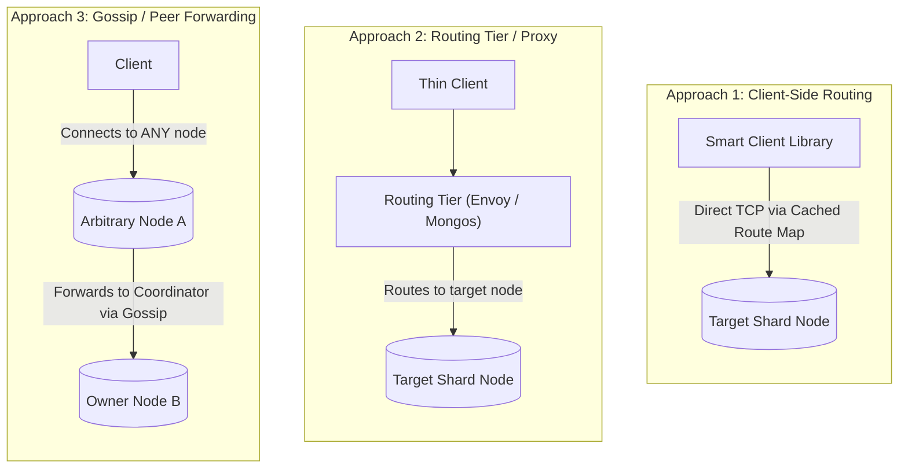
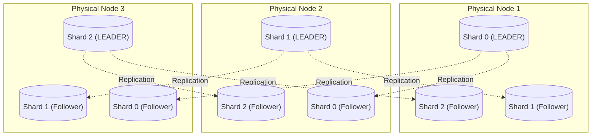
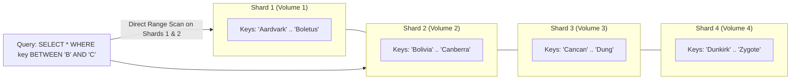
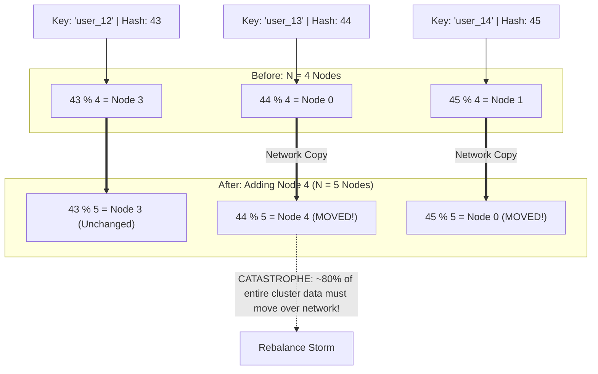
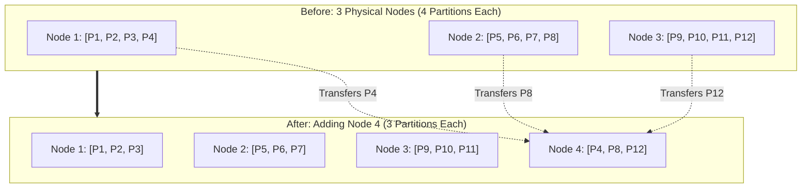
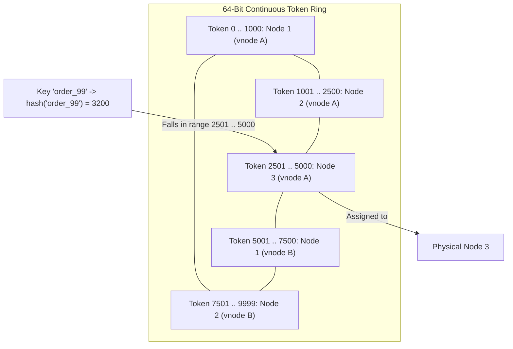
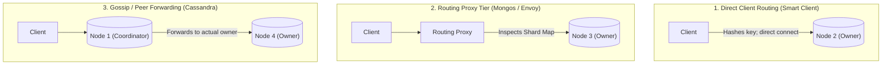
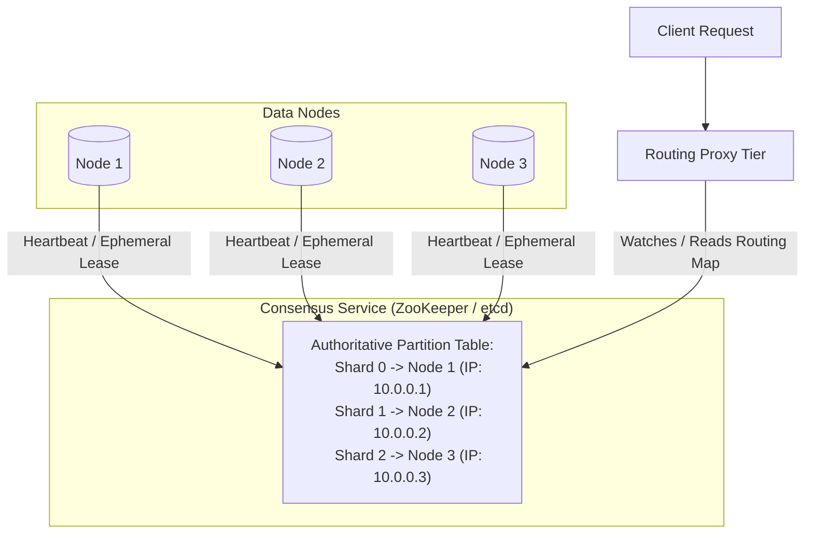
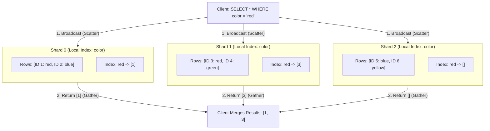
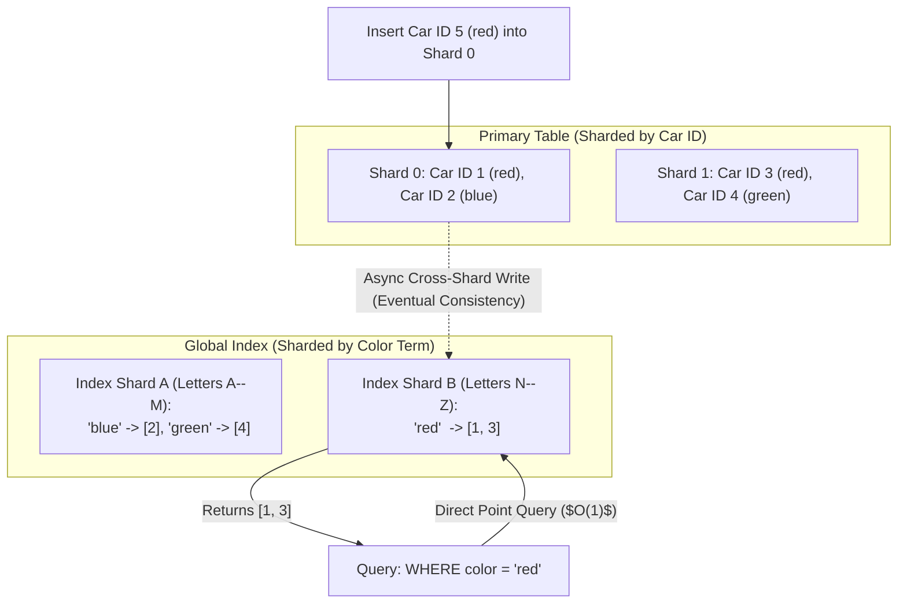

# Chapter 7: Sharding — Definitive Technical Summary
*From: Designing Data-Intensive Applications (2nd Edition) by Martin Kleppmann and Chris Riccomini*
*Source PDF: pp. 275–300 (673-page PDF) — figures below cite PDF pages.*

> [!NAV] **Chapter Navigation**
> ⬅️ **Previous:** [[chapter-06-replication|Chapter 06: Replication]] | 🏠 **Index:** [[00-Master-Reading-Dashboard|Master Dashboard]] | ➡️ **Next:** [[chapter-08-transactions|Chapter 08: Transactions]]


---

## 1. Executive Summary & Core Engineering Problem

- **Core Thesis:** When datasets expand beyond the storage capacity, memory bandwidth, or CPU processing limits of a single machine, data must be partitioned into discrete, independent subsets known as **shards** (partitions). Sharding enables horizontal scalability by allowing independent database nodes to process disjoint subsets of a workload without central coordination. However, sharding fundamentally breaks single-node relational abstractions: multi-row atomic transactions become distributed two-phase commits, secondary index queries degrade into high-latency scatter-gather broadcasts across all nodes, and non-uniform access patterns trigger severe **hotspots** that bottleneck entire clusters on a single saturated machine.
- **Problem Statement:** Naive sharding schemes collapse under real-world data skew and cluster rebalancing. For instance, sharding records using standard modulo hashing (`node = hash(key) % N`) causes a catastrophic cluster-wide data reshuffling during scaling events: when adding an 11th node to a 10-node cluster, $\approx 91\%$ of all existing keys must be physically migrated over the network, saturating datacenter switches and exhausting disk I/O channels. Similarly, sharding a multi-tenant platform by tenant identifier causes extreme memory and CPU starvation when a single "super-tenant" (e.g., an enterprise customer generating $40\%$ of global platform traffic) lands on a single node, causing p99 latencies for other tenants on that machine to spike from 15 ms to $>12,000\ \text{ms}$ while sibling nodes remain 90% idle.
- **Historical & Industry Context:** Early databases scaled vertically through high-end SMP hardware (Sun, Oracle Exadata). The explosive data growth of web-scale applications in the late 2000s forced the adoption of horizontal sharding across commodity servers. Google Bigtable (2006) introduced range-based dynamic splits, Apache Cassandra (2008) standardized consistent hashing token rings with virtual nodes, and MongoDB implemented routing tiers (`mongos`) backed by centralized coordination (config servers). In the 2020s (2nd Edition inflection), Distributed SQL engines (CockroachDB, TiDB, YugabyteDB) converged automatic range-based sharding with consensus-replicated Raft groups, while modern cloud data warehouses disaggregated compute from sharded cloud object storage.

---

## 2. In-Depth Technical Concepts & Internal Mechanics

### 2.1 Combining Sharding and Replication
- **Foundational Theory:** Sharding and replication are almost always combined in production distributed databases:
  - **Sharding:** Divides the global dataset into distinct disjoint subsets. Each record belongs to exactly one shard.
  - **Replication:** Copies each shard across multiple physical machines to ensure high availability and read scalability.
- **Node-Shard Assignment Matrix (Figure 7-1):**
  - In a cluster of $M$ nodes hosting $P$ shards with replication factor $R=3$:
    - Each shard consists of 1 Leader replica and 2 Follower replicas.
    - Each physical node acts as the **Leader for some shards** and a **Follower for other shards**.
  - *Data Path:* A write for key $K$ is routed to the leader node of the specific shard owning $K$. The leader commits the write locally and replicates it to the follower nodes assigned to that same shard.

---

### 2.2 Sharding for Multitenancy & The Noisy Neighbor Problem
- **Foundational Theory:** In Software-as-a-Service (SaaS) architectures, systems must isolate data and workloads across thousands of business tenants.
- **Architectural Patterns for Multitenant Sharding:**
  1. *Database-per-Tenant:* Each customer gets a dedicated database instance or isolated schema.
     - *Advantage:* Absolute physical isolation, trivial per-tenant backup/restore.
     - *Bottleneck:* Massive resource bloat. Operating 10,000 distinct PostgreSQL databases exhausts OS file descriptors, connection pools, and memory page caches.
  2. *Shared-Process, Tenant-Sharded:* All tenants share the same table schemas; rows are partitioned by a `tenant_id` shard key.
- **The "Noisy Neighbor" Hazard & Hotspots:**
  - Tenant sizes follow power-law distributions (Zipf's law): 1% of tenants generate 80% of data volume and query traffic.
  - If a large enterprise tenant shares a physical shard node with 500 small SMB tenants, the enterprise tenant's heavy analytical queries monopolize disk I/O and CPU cores, starving small tenants.
- **Mitigation: Dynamic Tiered Relocation:**
  - Monitor per-tenant resource utilization (QPS, IOPS, disk bytes).
  - Automatically migrate high-volume tenants out of shared clusters into dedicated, isolated single-tenant shard nodes (tenant un-pooling).

---

### 2.3 Sharding by Key Range (Ordered Index Sharding)
- **Foundational Theory:** Assigns a contiguous range of keys (from minimum to maximum) to each shard, analogous to volumes of a printed encyclopedia (e.g., Volume 1: `A--B`, Volume 2: `C--D`, Figure 7-2).
- **Under-the-Hood Mechanics (Bigtable, HBase, CockroachDB):**
  - Shard boundaries are dynamically chosen based on data volume, rather than evenly spaced across the alphabet.
  - The database maintains a hierarchical tree index (a distributed B-tree) mapping key ranges to node IP addresses.
- **Advantages:**
  - *Blazing Efficient Range Queries:* Scanning keys within an interval (`WHERE user_id BETWEEN 1000 AND 2000`) routes to a single shard (or contiguous subset of shards). Records within a shard are stored in sorted order (SSTables), allowing sequential disk scans without scatter-gather overhead.
- **The Sequential Write Hotspotting Catastrophe:**
  - *The Scenario:* The shard key is a timestamp (e.g., IoT sensor telemetry `sensor_id + timestamp` or auto-incrementing integer IDs).
  - *The Failure:* All current writes have the current timestamp. Because keys are monotonically increasing, **100% of all write traffic routes to the single shard responsible for the latest time range**.
  - Sibling nodes in the cluster sit completely idle ($0\%$ CPU/disk load) while the active shard node saturates its write buffer and disk queue, bottlenecking cluster ingestion at the throughput of a single machine.
  - *Architectural Mitigation:* Prefix keys with a non-monotonically increasing value (e.g., hash of `sensor_id`).

---

### 2.4 Sharding by Hash of Key & The Modulo Rebalancing Disaster
- **Foundational Theory:** To eliminate data skew and hotspotting, a hash function is applied to the key, mapping keys uniformly across the integer domain.
- **Hash Function Properties:**
  - Must be deterministic (same key always yields same hash).
  - Must be uniformly distributed (e.g., 32-bit Murmur3, MD5, or CityHash).
  - Cryptographic security is unnecessary; computational speed is critical.
- **The Modulo Hashing Anti-Pattern (`hash(key) % N` - Figure 7-3):**
  - *The Formula:* `node_id = hash(key) % N`, where $N$ is the number of nodes.
  - *The Catastrophe:* When the cluster expands from $N = 10$ to $N = 11$ nodes:
    - Probability that an existing key retains its original node mapping:
      $$P(\text{stay}) = \frac{1}{N+1} = \frac{1}{11} \approx 9.09\%$$
    - Fraction of total database records that must physically move across the network:
      $$\text{Keys Moved} = 1 - P(\text{stay}) = \frac{N}{N+1} = \frac{10}{11} \approx \mathbf{90.91\%}$$
  - In a 100 TB database, adding a single node forces **90.9 TB of data** to copy over the network, bringing production systems to their knees.
- **Compound Keys in Cassandra:**
  - Partition key determines the physical node via hashing (`hash(partition_key)`).
  - Clustering columns determine the sorted order within the shard's local SSTable.
  - *Example:* `PRIMARY KEY (user_id, created_at)`. All records for `user_id` land on the same shard node, but within that node, records are stored sorted by `created_at`, enabling fast local range queries for a single user.

---

### 2.5 Modern Partitioning Strategies: Dynamic Splits vs. Consistent Hashing
To avoid the modulo rebalancing disaster, modern distributed databases use one of three strategies:

#### 1. Dynamic Partitioning (HBase, RethinkDB, CockroachDB)
- When a shard grows past a configured size threshold (typically 10 GiB to 64 GiB), it automatically **splits into two half-sized shards**, shifting half of the key range to a new node (analogous to a B-tree page split).
- Conversely, if small adjacent shards shrink due to deletions, they merge.
- *Advantage:* Number of shards automatically adapts to total data volume.
- *Cold-Start Bottleneck:* A newly created table starts with exactly **one shard**. All initial writes hit a single node until enough data accumulates to trigger the first split.
  - *Mitigation:* **Pre-splitting**. The database administrator manually defines initial boundary keys (e.g., 16 pre-split ranges).

#### 2. Fixed Number of Partitions (Elasticsearch, Couchbase, Riak - Figure 7-4)
- When the cluster is initialized, the system creates a high fixed number of logical partitions (e.g., $P = 1,024$).
- Physical nodes are assigned multiple partitions (e.g., 10 nodes host $\approx 102$ partitions each).
- When a new 11th node joins the cluster, it simply takes a few whole partitions from existing nodes until balance is restored ($\approx 9$ partitions move).
- Only whole partition files are transferred across nodes; individual keys within partitions are never rehashed.
- *Constraint:* $P$ must be chosen substantially larger than any anticipated node count, but cannot be arbitrarily large (each partition carries memory and metadata overhead).

#### 3. Consistent Hashing & Virtual Nodes (Cassandra, ScyllaDB - Figure 7-5 & 7-6)
- The hash function output space is treated as a continuous circular ring (e.g., 64-bit integer ring: $0$ to $2^{64}-1$).
- **Virtual Nodes (Vnodes):** Instead of assigning a physical node a single continuous slice of the token ring, each physical node is assigned hundreds of discrete token points scattered uniformly across the ring (e.g., 128 or 256 tokens per machine).
- *Benefits of Vnodes:*
  1. *Uniform Distribution:* Eliminates statistical variance, ensuring disk space utilization across nodes remains within $5\%$ of average.
  2. *Heterogeneous Hardware:* A machine with $2\times$ the CPU and NVMe storage can be assigned $2\times$ as many vnodes.
  3. *Blazing Parallel Rebalancing:* When a new node joins, it acquires a small slice of tokens from *every existing node in the cluster*, allowing the entire cluster to stream data in parallel without saturating any single donor node.

---

### 2.6 Skewed Workloads & The "Celebrity" Hotspot Problem
- **The Failure Mode:** Even with uniform hashing, if an application exhibits extreme read/write affinity for a single primary key (e.g., a social media celebrity with 100 million followers or an active breaking-news item), all requests for that key land on the exact same shard node.
- **The Architectural Mitigation: Key Salting / Suffixing:**
  - The application detects high-volume keys and appends a random two-digit suffix:
    $$\text{Salted Key} = \text{original\_key} + \text{"\_"} + \text{random}(0, K-1)$$
  - Writes are scattered across $K$ distinct shards (e.g., $K = 100$), multiplying write throughput by $100\times$.
  - *The Read Trade-off:* Reading the data now requires a **scatter-gather query across all $K$ shards**, reading from each shard and merging results in application memory.

---

### 2.7 Request Routing Architectures
When a client submits a read or write request, how does it locate the specific node holding the required shard? Three primary architectural models exist (Figure 7-7):



1. **Client-Side Partition Routing:** The client library maintains a local cache of the cluster partition map. It hashes the key locally and connects directly to the target shard node via persistent TCP sockets. Eliminates extra network hops, achieving sub-millisecond routing latency.
2. **Routing Tier / Load Balancer Proxy (e.g., `mongos` in MongoDB):** Clients connect to a stateless proxy layer. The proxy queries the coordination cluster to determine shard locations, forwards the request, and streams results back. Decouples client complexity, but introduces an extra network round-trip ($+1\text{--}3\ \text{ms}$).
3. **Peer-to-Peer Gossip Routing (Apache Cassandra):** Clients connect to *any* arbitrary cluster node. If the contacted node does not own the requested shard, it acts as a coordinator, forwarding the request to the correct node over internal datacenter links.

- **Coordination Services (ZooKeeper / etcd - Figure 7-8):**
  - Many distributed databases (HBase, Kafka, Solr, Druid) rely on an external consensus service (ZooKeeper or etcd) to maintain the authoritative shard-to-node routing table.
  - Nodes register ephemeral leases with ZooKeeper. When a node crashes, its lease expires, and ZooKeeper notifies the routing tier via event watchers to reconfigure routing paths.

---

### 2.8 Sharding and Secondary Indexes
While primary key lookups route directly to a single shard, indexing non-primary attributes introduces severe architectural trade-offs:

#### 1. Local Secondary Index (Document-Partitioned Index - Figure 7-9)
- Each shard independently maintains a secondary index covering **only the records stored within that specific shard**.
- *Write Path:* Blazing fast ($O(1)$ local operation). Modifying a row requires updating the table and the secondary index on the same local machine.
- *Read Path:* **Scatter-Gather**. A query filtering on the secondary index (`WHERE color = 'red'`) must be broadcast in parallel to **every single shard in the cluster**. The client/proxy waits for all shards to respond and merges the result sets.
- *Tail Latency Amplification:* If a cluster has 100 shards and each shard has a 1% probability of experiencing a 100 ms GC pause, the probability that a scatter-gather query hits at least one slow node is:
  $$P(\text{slow}) = 1 - (1 - 0.01)^{100} = 1 - (0.99)^{100} \approx \mathbf{63.4\%}$$
  More than half of all secondary index read queries experience tail latency spikes!

#### 2. Global Secondary Index (Term-Partitioned Index - Figure 7-10)
- The secondary index spans the entire database and is itself sharded independently by the indexed attribute (term).
- *Read Path:* Blazing fast ($O(1)$ point lookup). A query for `WHERE color = 'red'` routes directly to the single shard hosting the `'red'` term index.
- *Write Path:* Complex, slow, and expensive. An insert on Shard 1 modifying a row whose color is `'red'` must execute a cross-network write to Shard 42 (which hosts the `'red'` global index).
- *Consistency Model:* In production, global secondary indexes are almost always **asynchronously updated** (eventually consistent). Updating a row takes effect immediately, but the global secondary index reflects the change after a propagation delay of 10--500 ms.

---

## 3. Important Figures, Diagrams & Visual Architecture

> 📕 **Original figures quick index (source PDF, 673 pages):** open the PDF at the cited page to verify each reconstruction.
>
> | Book Fig | PDF page | What to compare |
> |---|---|---|
> | Fig 7-1 | PDF p.276 | Replication+sharding |
> | Fig 7-2 | PDF p.280 | Partition by title |
> | Fig 7-3 | PDF p.283 | Mod-N hashing |
> | Fig 7-4 | PDF p.283 | Node removal |
> | Fig 7-5 | PDF p.285 | Hash-range shards |
> | Fig 7-6 | PDF p.286 | Cassandra token range |
> | Fig 7-7 | PDF p.290 | Routing (coord/ZK/gossip) |
> | Fig 7-8 | PDF p.291 | Scatter-gather |
> | Fig 7-9 | PDF p.293 | Local secondary index |
> | Fig 7-10 | PDF p.294 | Global secondary index |


### Figure 7-1: Combining Replication and Sharding
- **Figure Reference:** `Figure 7-1: Combining replication and sharding: each node acts as leader for some shards and follower for others (reconstructed from text p. 250)`
- **Original PDF:** Fig 7-1 → PDF p.276 — open the PDF at page 276 to compare with the Mermaid reconstruction below.
- **Visual Flow & Description:** Illustrates a 3-node cluster hosting 3 shards with replication factor 3. Node 1 is Leader for Shard 0 and Follower for Shards 1 and 2, balancing CPU and disk load symmetrically across machines.
- **Mermaid Flowchart:**



- **Key Takeaway:** Distributing shard leaders evenly across nodes prevents hot standby waste and ensures all physical machines participate actively in write processing.

---

### Figure 7-2: Sharding by Key Range
- **Figure Reference:** `Figure 7-2: A print encyclopedia is sharded by key range (reconstructed from text p. 253)`
- **Original PDF:** Fig 7-2 → PDF p.280 — open the PDF at page 280 to compare with the Mermaid reconstruction below.
- **Visual Flow & Description:** Shows ordered string keys partitioned across volume boundaries. Range scans are optimal, but sequential append patterns concentrate writes on the trailing partition.
- **Mermaid Flowchart:**



- **Key Takeaway:** Key range sharding keeps contiguous keys physically adjacent, enabling high-performance range queries at the risk of sequential write hotspots.

---

### Figure 7-3: The Modulo Rebalancing Disaster (`hash(key) % N`)
- **Figure Reference:** `Figure 7-3: Assigning keys to nodes by hashing the key modulo N (reconstructed from text p. 255)`
- **Original PDF:** Fig 7-3 → PDF p.283 — open the PDF at page 283 to compare with the Mermaid reconstruction below.
- **Visual Flow & Description:** Highlights what occurs when adding Node 4 to a 4-node cluster. Changing the divisor from 4 to 5 alters the destination node for almost every key, triggering massive network copying.
- **Mermaid Flowchart:**



- **Key Takeaway:** Modulo hashing is fatal for elastic storage; adding a single machine invalidates the location of $N/(N+1)$ records across the fleet.

---

### Figure 7-4: Fixed Number of Partitions (Pre-Partitioning)
- **Figure Reference:** `Figure 7-4: Adding a new node to a database cluster with multiple fixed shards per node (reconstructed from text p. 257)`
- **Original PDF:** Fig 7-4 → PDF p.283 — open the PDF at page 283 to compare with the Mermaid reconstruction below.
- **Visual Flow & Description:** Displays a cluster with 12 fixed partitions. When Node 4 joins, it adopts 1 partition from each of the 3 existing nodes, rebalancing the cluster with minimal data migration.
- **Mermaid Flowchart:**



- **Key Takeaway:** Fixed pre-partitioning decouples logical data chunks from physical machines, allowing nodes to rebalance by transferring whole partitions without rehashing keys.

---

### Figure 7-5 & 7-6: Consistent Hashing with Virtual Nodes (Token Ring)
- **Figure Reference:** `Figure 7-5: Splitting the hash range across a continuous token ring using virtual nodes (reconstructed from text pp. 258-260)`
- **Original PDF:** Fig 7-5 → PDF p.285 — open the PDF at page 285 to compare with the Mermaid reconstruction below. & 7-6
- **Visual Flow & Description:** Illustrates an integer hash ring ($0$ to $2^{64}-1$). Each physical node owns multiple virtual node tokens scattered across the circumference. When a key is hashed, it walks clockwise to find the first token.
- **Mermaid Flowchart:**



- **Key Takeaway:** Virtual nodes smooth out statistical hash variance and allow parallel rebalancing where a new node pulls small token ranges from every existing peer concurrently.

---

### Figure 7-7: Three Ways of Routing Requests
- **Figure Reference:** `Figure 7-7: Three ways of routing a request to the right node (reconstructed from text p. 263)`
- **Original PDF:** Fig 7-7 → PDF p.290 — open the PDF at page 290 to compare with the Mermaid reconstruction below.
- **Visual Flow & Description:** Compares Client-Side routing (direct), Proxy routing tier (intermediate load balancer), and Peer-to-Peer Gossip routing (arbitrary entry point).
- **Mermaid Flowchart:**



- **Key Takeaway:** Direct client routing minimizes latency, proxy tiers insulate client applications, and gossip forwarding simplifies client configuration.

---

### Figure 7-8: Coordination via ZooKeeper / etcd
- **Figure Reference:** `Figure 7-8: Using ZooKeeper to keep track of the assignment of shards to nodes (reconstructed from text p. 264)`
- **Original PDF:** Fig 7-8 → PDF p.291 — open the PDF at page 291 to compare with the Mermaid reconstruction below.
- **Visual Flow & Description:** Depicts physical nodes maintaining heartbeats and ephemeral znode leases in ZooKeeper. The routing tier watches ZooKeeper and updates its internal routing table dynamically.
- **Mermaid Flowchart:**



- **Key Takeaway:** External consensus services maintain an authoritative, linearizable record of partition assignments, ensuring routing consistency across failovers.

---

### Figure 7-9: Local Secondary Indexes (Scatter-Gather)
- **Figure Reference:** `Figure 7-9: With local secondary indexes, each shard indexes only its local records (reconstructed from text p. 266)`
- **Original PDF:** Fig 7-9 → PDF p.293 — open the PDF at page 293 to compare with the Mermaid reconstruction below.
- **Visual Flow & Description:** Shows a database sharded by `user_id`, with a local secondary index on `color`. A query searching for `color = 'red'` must execute a scatter-gather broadcast to all shards.
- **Mermaid Flowchart:**



- **Key Takeaway:** Local secondary indexes make writes $O(1)$ and local, but degrade read queries into expensive scatter-gather operations that amplify tail latency.

---

### Figure 7-10: Global Secondary Indexes (Term-Partitioned)
- **Figure Reference:** `Figure 7-10: A global secondary index is itself sharded independently by term (reconstructed from text p. 267)`
- **Original PDF:** Fig 7-10 → PDF p.294 — open the PDF at page 294 to compare with the Mermaid reconstruction below.
- **Visual Flow & Description:** The primary table is sharded by primary key, while the secondary index is sharded across separate nodes partitioned by term (`color`). Reads are $O(1)$ point queries, but writes require cross-shard updates.
- **Mermaid Flowchart:**



- **Key Takeaway:** Global secondary indexes deliver fast, targeted read lookups, but turn simple single-row inserts into distributed, multi-shard write operations.

---

## 4. Real-World Systems, Case Studies & Code Examples

### 4.1 Industry Implementations & Architectural Divergence
- **Apache Cassandra (Consistent Hashing & Vnodes):** Uses a 64-bit Murmur3 token ring. Every table defines a `PARTITION KEY` used to compute the token. Each node manages 128 virtual nodes by default. Secondary indexes are local by default (scatter-gather), which Datastax recommends avoiding at high cardinality.
- **MongoDB (Range & Hash Sharding via Config Replica Sets):** Supports both range-based and hashed sharding. The cluster architecture uses stateless `mongos` routing proxies that cache metadata from a dedicated 3-node `config` replica set.
- **CockroachDB & TiDB (Distributed SQL / Multi-Raft Range Sharding):** Automatically shards relational tables into 64 MiB key ranges called "Ranges" (CockroachDB) or "Regions" (TiDB). Each range forms an independent Raft consensus group replicated across 3 or 5 nodes. Shards split dynamically when exceeding 64 MiB.
- **Elasticsearch (Fixed Sharding):** Tables (indices) specify a fixed primary shard count at creation time (e.g., 5 primary shards). Primary shards cannot be modified without a full index re-creation (`_reindex` API).

---

### 4.2 Production Implementation: Consistent Hash Ring with Virtual Nodes

```python
import hashlib
import bisect
from typing import Dict, List, Optional

class ConsistentHashRing:
    """
    Production-grade Consistent Hash Ring implementing Virtual Nodes (vnodes)
    with MD5 cryptographic hashing and binary search token routing.
    """
    def __init__(self, replicas_per_node: int = 128):
        self.replicas_per_node = replicas_per_node
        self.ring: List[int] = []                    # Sorted list of token integers
        self.token_to_node: Dict[int, str] = {}      # token -> physical_node_id
        self.nodes: set = set()

    def _hash(self, key: str) -> int:
        """Computes a 128-bit integer digest using MD5."""
        digest = hashlib.md5(key.encode("utf-8")).hexdigest()
        return int(digest, 16)

    def add_node(self, node_id: str) -> None:
        """Adds a physical node and registers its virtual node tokens."""
        if node_id in self.nodes:
            return
        self.nodes.add(node_id)
        for i in range(self.replicas_per_node):
            vnode_key = f"{node_id}#vnode_{i}"
            token = self._hash(vnode_key)
            self.token_to_node[token] = node_id
            bisect.insort(self.ring, token)

    def remove_node(self, node_id: str) -> None:
        """Removes a physical node and purges all of its virtual node tokens."""
        if node_id not in self.nodes:
            return
        self.nodes.remove(node_id)
        tokens_to_remove = []
        for token, assigned_node in self.token_to_node.items():
            if assigned_node == node_id:
                tokens_to_remove.append(token)
        for token in tokens_to_remove:
            del self.token_to_node[token]
            self.ring.remove(token)

    def get_node(self, key: str) -> Optional[str]:
        """
        Maps an application key to the responsible physical node
        by finding the nearest token clockwise on the ring in O(log K) time.
        """
        if not self.ring:
            return None
        token = self._hash(key)
        # Binary search for the first token >= key's token
        idx = bisect.bisect_right(self.ring, token)
        # If at the end of the ring, wrap around to token 0 (circular ring)
        if idx == len(self.ring):
            idx = 0
        winning_token = self.ring[idx]
        return self.token_to_node[winning_token]
```

---

### 4.3 Production Implementation: Dynamic Shard Split Coordinator

```python
from typing import List, Tuple, Optional

class ShardRange:
    def __init__(self, shard_id: int, start_key: Optional[str], end_key: Optional[str]):
        self.shard_id = shard_id
        self.start_key = start_key  # None means -infinity
        self.end_key = end_key      # None means +infinity
        self.records: List[Tuple[str, str]] = []  # sorted (key, value) pairs

    @property
    def byte_size(self) -> int:
        return sum(len(k.encode()) + len(v.encode()) for k, v in self.records)

    def contains(self, key: str) -> bool:
        if self.start_key is not None and key < self.start_key:
            return False
        if self.end_key is not None and key >= self.end_key:
            return False
        return True

class DynamicRangeShardedDatabase:
    """
    Demonstrates dynamic range-based sharding with automatic B-tree-like splits
    when a partition exceeds configured byte size thresholds.
    """
    def __init__(self, split_threshold_bytes: int = 1024):
        self.split_threshold_bytes = split_threshold_bytes
        self.next_shard_id = 1
        # Initialize with a single root shard covering [-infinity, +infinity]
        self.shards: List[ShardRange] = [ShardRange(self.next_shard_id, None, None)]
        self.next_shard_id += 1

    def _find_shard(self, key: str) -> ShardRange:
        for shard in self.shards:
            if shard.contains(key):
                return shard
        raise RuntimeError("No shard found covering key space!")

    def put(self, key: str, value: str):
        shard = self._find_shard(key)
        # Insert key maintaining sorted order
        for idx, (k, v) in enumerate(shard.records):
            if k == key:
                shard.records[idx] = (key, value)
                break
        else:
            shard.records.append((key, value))
            shard.records.sort(key=lambda item: item[0])

        # Check for dynamic split condition
        if shard.byte_size > self.split_threshold_bytes and len(shard.records) >= 2:
            self._split_shard(shard)

    def _split_shard(self, old_shard: ShardRange):
        """Splits an overflowing shard into two sibling shards at the median key."""
        mid = len(old_shard.records) // 2
        split_key = old_shard.records[mid][0]

        left_shard = ShardRange(self.next_shard_id, old_shard.start_key, split_key)
        self.next_shard_id += 1
        left_shard.records = old_shard.records[:mid]

        right_shard = ShardRange(self.next_shard_id, split_key, old_shard.end_key)
        self.next_shard_id += 1
        right_shard.records = old_shard.records[mid:]

        # Replace old shard with the two new shards in the routing table
        idx = self.shards.index(old_shard)
        self.shards[idx:idx+1] = [left_shard, right_shard]
```

---

### 4.4 Production War Story: The Automated Rebalancing Cascade
- **The Context:** An advertising attribution company maintained a 60-node MongoDB cluster storing 150 TB of click event data. The collection was sharded using range-based sharding with automated balancing enabled (`sharding.balancer.enabled = true`).
- **The Incident:** During a massive Cyber Monday traffic surge, Node 14 experienced severe CPU thermal throttling, causing its query response times to degrade. The internal heartbeat check between the balancer and Node 14 exceeded the ping timeout.
- **The Cascade:** The automated balancer marked Node 14 dead and immediately scheduled the migration of its 40 assigned chunks (totaling $\approx 2.5\ \text{TB}$) to healthy peer nodes.
- **The Catastrophe:** The migration process initiated concurrent background dump queries and network socket streams. Transferring 2.5 TB across the cluster consumed $>85\%$ of internal top-of-rack (ToR) network switch bandwidth. Sibling nodes (Nodes 15, 16, and 17) spent their I/O cycles receiving migration streams instead of servicing client writes.
- **The Total Meltdown:** Because client write requests queued up, Nodes 15, 16, and 17 also missed their heartbeat pings. The balancer concluded they were dead too, and launched simultaneous multi-terabyte migrations from those nodes as well! The entire 60-node cluster entered a fatal **cascading rebalance storm**, collapsing ingestion globally for 6 hours.
- **Remediation & Architecture Lessons:**
  1. *Ban Unconstrained Automated Rebalancing:* Restricted the balancer to run strictly during off-peak maintenance windows (e.g., 02:00--05:00 UTC) with strict concurrency limits (`activeMigrations = 1`).
  2. *Hysteresis & Flap Damping:* Configured orchestrator timeouts to require 15 consecutive minutes of node failure before initiating chunk migrations.
  3. *Switch to Hashed Sharding with Fixed Partitions:* Transitioned event tables from volatile range sharding to hashed sharding with virtual nodes to eliminate large chunk relocations.

---

## 5. Architectural Trade-Off Matrix

| Sharding Strategy | Range Query Efficiency | Write Skew & Hotspot Risk | Rebalancing Mechanics & Overhead | Rebalancing Network Traffic | Best Workload Fit | Catastrophic Failure Mode |
| :--- | :--- | :--- | :--- | :--- | :--- | :--- | :--- |
| **Key Range Sharding (Bigtable, CockroachDB)** | **Optimal** (Contiguous local sequential disk scans) | **Severe** (Monotonic keys concentrate writes on 1 node) | Dynamic splits/merges when size threshold breached | Moderate (Splits copy half a partition to new node) | Ordered timeseries with non-monotonic keys; multi-attribute ranges | Monotonically increasing primary keys bottleneck cluster on 1 node |
| **Modulo Hashing (`hash % N`)** | Unusable (Scatter-gather across all nodes) | Low (Uniform mathematical hash distribution) | Catastrophic (Adding 1 node rehashes $N/(N+1)$ keys) | **Disastrous** ($\sim 90\%$ of total database copied over network) | Static clusters with fixed, unchanging node counts | Adding or removing a node triggers total network rebalance collapse |
| **Fixed Number of Partitions (Elasticsearch, Riak)** | Unusable (Keys scattered uniformly) | Low (Uniform distribution across fixed buckets) | Whole partition reassignment to new nodes | Low (Transfers whole partition files without rehashing keys) | General-purpose key-value stores; search indices | Cluster node count exceeding pre-allocated partition count |
| **Consistent Hashing + Vnodes (Cassandra, ScyllaDB)** | Poor (Requires compound keys for local ranges) | Low (Virtual nodes eliminate hash imbalance) | Parallel multi-node token slice redistribution | Minimal (All nodes stream small slices to new node in parallel) | High-velocity write ingestion; elastic cloud autoscaling | Celebrity key creates localized hot shard despite uniform hashing |
| **Local Secondary Index (Document-Partitioned)** | N/A (Index queries require Scatter-Gather) | Zero cross-shard write coordination | Local to shard; moves with base table partition | Bound to base table partition movement | Write-heavy tables where secondary index reads are rare | High-frequency secondary index queries suffer massive tail latency spikes |
| **Global Secondary Index (Term-Partitioned)** | **Optimal** (Routes point read to 1 target shard) | High write lock and network contention | Independent sharding of index terms | Cross-shard distributed write transactions | Read-heavy queries requiring fast secondary index point lookups | Single row insert requires cross-shard 2PC or asynchronous lag |

---

### Concrete Decision Heuristics

```text
Decision Tree for Sharding Architecture:
1. Does the core query workload require efficient range scans over the primary key (e.g., BETWEEN X AND Y)?
   ├── YES: Use Key Range Sharding with Dynamic Splits (CockroachDB / TiDB).
   │    └── CRITICAL RULE: Never use monotonic timestamps or auto-incrementing integers as raw primary keys; prepend hash salts!
   └── NO (Point lookups by unique key dominate):
        ├── Is the cluster deployed on elastic cloud infrastructure with frequent auto-scaling nodes?
        │    └── YES: Use Consistent Hashing with Virtual Nodes (Cassandra / ScyllaDB with 128 vnodes).
        └── Is the storage engine based on full-text search or document collections?
             └── YES: Use Fixed Pre-Partitioning (Elasticsearch / Couchbase, sizing P = 5 * max anticipated nodes).
2. For Secondary Indexes:
   ├── If Write Throughput is priority and secondary reads are infrequent -> Use Local Secondary Index (accept scatter-gather reads).
   └── If Read Latency is priority and secondary reads are frequent -> Use Global Secondary Index (accept cross-shard async write lag).
```

---

## 6. Jargon Buster & Key Terminology

- **Sharding (Partitioning):** The architectural process of splitting a large database into smaller, independent subsets (shards), each hosted on a distinct storage node to scale horizontally.
- **Hotspot:** A condition where a disproportionately high volume of read or write traffic is directed to a single shard node, saturating its resources while sibling nodes remain idle.
- **Skew:** An unbalanced distribution of data volume or query load across shards, causing some partitions to be orders of magnitude larger or busier than others.
- **Key Salting:** An engineering technique where an application appends a random or pseudo-random prefix/suffix to a primary key to scatter writes across multiple distinct shards.
- **Scatter-Gather:** A query execution pattern where a coordinator broadcasts a query to all shards in parallel and merges their individual result sets before returning the response.
- **Virtual Node (Vnode):** A technique in consistent hashing where each physical server is assigned multiple discrete tokens across the hash ring to ensure uniform data distribution and simplify rebalancing.
- **Dynamic Partitioning:** A sharding strategy where partition counts grow and shrink dynamically via splits and merges based on physical data volume thresholds.
- **Document-Partitioned Index (Local Index):** A secondary index structure where each shard indexes only the records stored locally within that shard.
- **Term-Partitioned Index (Global Index):** A secondary index structure that spans all data in the cluster and is itself partitioned by the indexed values (terms).
- **Request Routing:** The architectural mechanism by which a client or intermediate proxy determines which specific node holds the requested shard.

---

## 7. System Design & Practical Engineering Takeaways

### 7.1 Production Engineering Checklist
1. **Never Shard Using Modulo Arithmetic (`hash % N`):** Always implement Consistent Hashing with virtual nodes or fixed pre-partitioning to prevent catastrophic rebalance storms during scaling operations.
2. **Pre-Split Key-Range Sharded Tables:** When creating new tables in HBase, Bigtable, or CockroachDB, pre-split the keyspace into at least 16--64 initial ranges to prevent cold-start single-node write bottlenecks.
3. **Restrict Automated Rebalancers with Strict Throttles:** Configure cluster orchestrators to allow at most 1--2 concurrent partition migrations, and restrict balancing operations to off-peak traffic hours.
4. **Avoid High-Cardinality Scatter-Gather Queries:** Never execute pagination or sorting queries over local secondary indexes across $>50$ shards without providing the partition key in the `WHERE` clause.
5. **Mitigate Celebrity Keys via Suffix Salting:** For extreme write hotspots (e.g., breaking news, celebrity accounts), salt keys with a 2-digit random suffix (`key_00` to `key_99`) and execute client-side scatter-gather merges during reads.

---

### 7.2 System Design Interview Strategy
- **Justify Shard Key Selection from Access Patterns:** Never pick a shard key randomly. Justify it: *"We select `user_id` as the partition key because 95% of queries filter on a single user's data. This guarantees point reads route to a single shard rather than triggering expensive scatter-gather broadcasts."*
- **Address Hotspots Proactively:** Score major points by volunteering the celebrity/hotspot vulnerability: *"If a user becomes a viral sensation, their `user_id` shard will saturate. We will mitigate this by salting hot partition keys with random integer suffixes across 20 virtual shards."*
- **Capacity Estimation Template for Sharding:**
  $$\text{Shard Count} = \left\lceil \frac{\text{Total Data Volume in 3 Years}}{\text{Max Target Shard Size (e.g., 50 GB)}} \right\rceil$$
  $$\text{Cluster Nodes} = \left\lceil \frac{\text{Total Shards} \times \text{Replication Factor}}{\text{Target Shards Per Physical Node}} \right\rceil$$

---

### 7.3 Mastery Self-Assessment Questions

#### Question 1 (Conceptual Depth)
*Why does a Local Secondary Index (Document-Partitioned) scale writes linearly while making read queries vulnerable to tail latency amplification, and why does a Global Secondary Index (Term-Partitioned) invert this trade-off?*
- **Answer:** 
  A **Local Secondary Index** co-locates the index entries with the base table records on the exact same physical shard node. When a row is inserted, updated, or deleted, the storage engine writes the row and updates the local secondary index within the same node's local storage engine (e.g., same WAL and SSTable/B-Tree page). Zero cross-network calls are required. Thus, write throughput scales strictly linearly with node count ($O(1)$ local operations).
  However, because the index is fragmented locally across all shards, querying the index (`WHERE status = 'PENDING'`) requires a **Scatter-Gather** pattern: the query coordinator must broadcast the request across every single shard in the cluster. If the cluster has $M$ shards and each shard has an independent probability $p$ of experiencing a transient delay (GC pause, disk flush), the probability of the entire query being delayed is $1 - (1 - p)^M$. As $M$ grows, tail latency amplifies exponentially.
  A **Global Secondary Index** inverts this trade-off by partitioning the index independently by the indexed attribute (term). A query for `WHERE status = 'PENDING'` routes to the single shard hosting the `'PENDING'` index range ($O(1)$ read path, zero scatter-gather). However, writing a new row now requires a distributed write: the row data is written to Shard A, while the secondary index entry must be written across the network to Shard B, introducing distributed locking, cross-datacenter latency, or asynchronous eventual consistency lag.

#### Question 2 (Failure Scenario & Edge Cases)
*An engineering team implements an IoT telemetry platform on Apache Cassandra with a compound primary key: `PRIMARY KEY (device_type, recorded_at)`. The system ingests data from 5,000 temperature sensors and 10,000 pressure sensors. After 6 months in production, the cluster begins crashing with Out-Of-Memory (OOM) errors on Node 4, while other nodes have 80% free disk space. Diagnose the architectural defect, explain the data layout failure, and prescribe the remediation.*
- **Answer:**
  - *Architectural Defect:* The partition key is `device_type`. In Cassandra, the hash of the partition key determines the physical node.
  - *Data Layout Failure:*
    - Because there are only two distinct `device_type` values (`"temperature"` and `"pressure"`), the entire multi-terabyte dataset hashes to **exactly two partition tokens** across the entire cluster.
    - All temperature data routes to Node 4; all pressure data routes to Node 7. Sibling nodes in the cluster receive zero writes.
    - Over 6 months, millions of rows accumulated under the single partition key `"temperature"`. In Cassandra, a single partition cannot span multiple nodes and must be managed in memory during compaction. The single partition grew beyond 100 GB, exceeding JVM heap limits during compaction and triggering fatal OOM crashes.
  - *Prescribed Remediation:*
    1. *Redesign the Partition Key:* Change the partition key to include a high-cardinality unique identifier, such as `device_id`:
       `PRIMARY KEY ((device_id, date), recorded_at)`
    2. *Bucketing:* By making `(device_id, date)` the composite partition key, each day's telemetry for each individual sensor lands on a distinct shard, bounding maximum partition size to $< 5\ \text{MB}$ and distributing ingestion uniformly across all nodes in the cluster.

#### Question 3 (Trade-Off & Capacity Estimation)
*An e-commerce order system stores 2 billion orders. Total dataset size is 4 TB uncompressed. An engineer proposes sharding the database across 20 nodes using standard modulo hashing (`order_id % 20`). One year later, order volume doubles, requiring an expansion to 25 nodes. Calculate: (A) The percentage and physical gigabytes of data that must be transferred across the network during rebalancing under modulo hashing, vs. (B) The data transferred under a Fixed Partitioning architecture with 1,000 logical partitions. Show exact mathematical derivations.*
- **Answer:**
  - *Total Data Volume at Scaling Event:*
    - Initial volume: 4 TB. After doubling: $4\ \text{TB} \times 2 = 8\ \text{TB} = 8,000\ \text{GB}$.
  - *Approach A: Modulo Hashing (`order_id % N`)*
    - Number of initial nodes $N_1 = 20$. Expanded nodes $N_2 = 25$.
    - The probability that an integer $K$ has the same remainder modulo 20 and modulo 25:
      $$K \equiv X \pmod{20} \quad \text{and} \quad K \equiv X \pmod{25} \iff K \equiv X \pmod{\text{lcm}(20, 25)}$$
      $$\text{lcm}(20, 25) = 100$$
    - The number of matching remainders in every block of 100 is:
      $$\text{Matches} = \text{gcd}(20, 25) = 5$$
    - Fraction of keys that remain on the same physical node:
      $$P(\text{stay}) = \frac{\text{gcd}(20, 25)}{25} = \frac{5}{25} = \frac{1}{5} = \mathbf{20\%}$$
    - Fraction of total keys that must move across the network:
      $$\text{Keys Moved} = 1 - P(\text{stay}) = 1 - 0.20 = \mathbf{80\%}$$
    - Physical Data Transferred:
      $$\text{Data Moved} = 8,000\ \text{GB} \times 0.80 = \mathbf{6,400\ \text{GB}} \ (6.4\ \text{TB})$$
      Transferring 6.4 TB under live production traffic creates massive network congestion, disk thrashing, and high outage risk.
  - *Approach B: Fixed Partitioning (1,000 Partitions)*
    - Total partitions $P = 1,000$.
    - Under 20 nodes: Each node hosts $\frac{1,000}{20} = 50\ \text{partitions}$.
    - Under 25 nodes: Each node should host $\frac{1,000}{25} = 40\ \text{partitions}$.
    - The 5 new nodes require a total of:
      $$5\ \text{nodes} \times 40\ \text{partitions} = 200\ \text{partitions}$$
    - Each existing node gives up exactly $50 - 40 = 10\ \text{partitions}$ to the new nodes.
    - Fraction of total database partitions transferred:
      $$\text{Fraction Moved} = \frac{200\ \text{partitions}}{1,000\ \text{partitions}} = \frac{5}{25} = \mathbf{20\%}$$
    - Physical Data Transferred:
      $$\text{Data Moved} = 8,000\ \text{GB} \times 0.20 = \mathbf{1,600\ \text{GB}} \ (1.6\ \text{TB})$$
  - *Quantitative Comparison:*
    - Modulo hashing moves **$6.4\ \text{TB}$** (80% of cluster data).
    - Fixed partitioning moves only **$1.6\ \text{TB}$** (20% of cluster data).
    - Fixed partitioning yields a **$4\times$ reduction in network I/O** and moves data strictly as sealed partition files, preventing record-by-record rehashing stalls.


---
> [!NAV] **Chapter Navigation**
> ⬅️ **Previous:** [[chapter-06-replication|Chapter 06: Replication]] | 🏠 **Index:** [[00-Master-Reading-Dashboard|Master Dashboard]] | ➡️ **Next:** [[chapter-08-transactions|Chapter 08: Transactions]]