# Chapter 8: Transactions — Definitive Technical Summary
*From: Designing Data-Intensive Applications (2nd Edition) by Martin Kleppmann and Chris Riccomini*
*Source PDF: pp. 301–368 (673-page PDF) — figures below cite PDF pages.*

> [!NAV] **Chapter Navigation**
> ⬅️ **Previous:** [[chapter-07-sharding|Chapter 07: Sharding]] | 🏠 **Index:** [[00-Master-Reading-Dashboard|Master Dashboard]] | ➡️ **Next:** [[chapter-09-the-trouble-with-distributed-systems|Chapter 09: The Trouble with Distributed Systems]]

---

## 1. Executive Summary & Core Engineering Problem

> *"Some authors have claimed that general two-phase commit is too expensive to support, because of the performance or availability problems that it brings. We believe it is better to have application programmers deal with performance problems due to overuse of transactions as bottlenecks arise, rather than always coding around the lack of transactions."*
> — **James Corbett et al.**, *Spanner: Google's Globally-Distributed Database* (2012)

- **The Big Picture (Kleppmann's Framing):** In the harsh reality of data systems many things go wrong: software or hardware fails mid-write, the application crashes halfway through a series of operations, the network cuts the app off from the database or one node from another, concurrent clients overwrite each other, clients read half-updated state, race conditions surprise you. Fault-tolerance is a lot of work and requires rigorous testing. For decades **transactions** have been the mechanism of choice for simplifying this: group several reads and writes into one logical unit that either **commits** as a whole or **aborts/rolls back** as a whole. On abort the app can safely retry without worrying about partial failure.
- **Core Thesis:** Transactions are not a law of nature; they were invented (IBM System R, 1975, still recognisable in MySQL/PostgreSQL/Oracle/SQL Server 50 years later) to let applications ignore partial failure and concurrency and push safety into the database. But **ACID is a marketing term**: one vendor's ACID ≠ another's. Serializability costs performance, so production systems default to weak isolation (Read Committed, Snapshot Isolation) that prevents only some anomalies and leaves read skew, lost update, write skew and phantoms to the application. Late-2000s NoSQL abandoned transactions for scale; 2010s NewSQL (CockroachDB, TiDB, Spanner, FoundationDB, YugabyteDB) proved sharding + consensus can provide ACID at scale — but not every system must be transactional.
- **Problem Statement:** Assuming "ACID" means safe causes money loss, audit failure and data corruption. Canonical disaster — hospital on-call (Fig 8-8): invariant "≥1 doctor on call". Alice and Bob are both on call. Both concurrently `SELECT COUNT(*) WHERE on_call=true` → see 2 → both `UPDATE` their own row to `false` → both commit under Snapshot Isolation with no row conflict → **0 doctors on call**, no error. Same pattern double-books meeting rooms, overbooks flights, lets two users claim `alice` username, lets balances go negative.
- **Historical & Industry Context:** Jim Gray / System R formalised transactions; Härder/Reuter coined ACID (1983); Gray et al. defined lock granularity and predicate locks (1976). 1970s–2000s: Two-Phase Locking the only serializable standard. 2000s NoSQL: transactions "unscalable", redefined to single-object linearizable CAS (Aerospike, Cassandra LWT). 2008 Cahill/Fekete/Roe: Serializable Snapshot Isolation → PostgreSQL 9.1, CockroachDB, FoundationDB. 2000s RAM cheap + short OLTP → single-thread serial execution (VoltDB/H-Store, Redis, Datomic). 2010s–2020s: Raft/Multi-Paxos + 2PC inside one engine = distributed ACID without XA blocking. Post Office Horizon scandal cited as what happens without ACID accounting.

---

## 2. In-Depth Technical Concepts & Internal Mechanics

### 2.1 Deconstructing ACID: Atomicity, Consistency, Isolation, Durability

| Letter | Myth | Reality (book pp. 303–308 / PDF pp. 303–308) |
| :--- | :--- | :--- |
| **A – Atomicity (Abortability)** | "Concurrent users don't interfere" | **Crash safety for multi-write batches.** If a fault occurs after some writes (crash, network cut, disk full, constraint violation), abort and discard/undo all writes so far. Retry is safe because aborted = changed nothing. Better name would be *abortability*. Covers: process crash, TCP drop, power loss, `CHECK` failure. |
| **C – Consistency (Invariants)** | "DB guarantees correctness" | **Application property.** Credits==debits, foreign keys valid, ≥1 doctor on call. DB enforces only declared `FOREIGN KEY / UNIQUE / CHECK / NOT NULL`, triggers, materialized views. Complex invariants (≥1 doctor, no overlapping bookings, balance≥0) cannot be declared in most engines — app must define transactions to preserve them. Overloaded word: replica consistency (Ch.6), consistent snapshot (happens-before), consistent hashing (Ch.7), CAP consistency (=linearizability, Ch.10) are different. |
| **I – Isolation (Concurrency)** | "ACID = serializable" | **Concurrent txns isolated.** Textbook = serializability: committed result same as if run serially one-at-a-time. Real engines default to weaker levels. Oracle's "serializable" is really snapshot isolation [10,14]. |
| **D – Durability (No forgetting)** | "Commit = safe forever" | **Promise committed writes survive.** Single-node: WAL + `fsync` + checksums + crash recovery (Ch.4 p.127). Replicated: copied to N nodes before ack. No perfect durability: all disks+backups destroyed = loss. |

**Replication vs Durability — nothing is perfect:**
- Disk write but machine dies → inaccessible until fixed; replicas stay available.
- Correlated fault (power, bug on specific input) kills all replicas; in-memory-only loss.
- Async replication: recent leader writes lost on failover (Ch.6 p.204).
- SSDs violate `fsync` promises; firmware bugs (fail after exactly 32,768h); PostgreSQL misused `fsync` for 20 years [19–21]; FS/engine interactions corrupt files after crash [22,23]; corruption spreads replica→replica [24].
- Bit-rot: data rots undetected; replicas+recent backups also rotten → need historical backup. 30–80% of SSDs develop ≥1 bad block in 4 years; HDDs fewer bad sectors but more total failures.
- Worn SSD without power loses data in weeks–months (temperature dependent).
- **Use together:** disk + remote replication + backups. Take guarantees with salt.

### 2.2 Single-Object vs Multi-Object Operations

> **Recap:** Atomicity = abort discards partial writes. Isolation = concurrent txn sees all-or-none of another's writes, not a subset. Both assume **multi-object** (rows/documents/records).

**Fig 8-2 context — denormalized unread counter:** `SELECT COUNT(*) FROM emails WHERE recipient_id=2 AND unread_flag=true` too slow → add `unread_count` column. New mail = `INSERT email` + `increment counter`. Without isolation User 2 sees new mail but counter still 0. With accounting: balance vs payment. Without isolation record appears in one secondary index but not another (Ch.7 p.268).

| Aspect | Single-object write | Multi-object transaction |
| :--- | :--- | :--- |
| Example | 20 kB JSON doc, one K-V pair, one row | Order + 5 line items; email + counter; primary row + secondary index |
| Atomicity need | Torn page? Half-sent 10 kB fragment spliced with old value? Partial read mid-write? | Crash between email insert and counter update → out of sync |
| How provided | Log for crash recovery + per-object latch/lock; one thread per object | `BEGIN`…`COMMIT` on one TCP connection; abort on TCP drop. Non-relational multi-put ≠ transaction (may succeed on some keys, fail on others) |
| Extra ops | Atomic `increment`, conditional write / CAS (`UPDATE … WHERE value=old`) — removes Fig 8-1 read-modify-write. Aerospike "strong", Cassandra LWT = linearizable single-object only | Foreign-key validity across tables; graph edges; denormalized sync; index maintenance |

> Strictly, "atomic increment" means *isolated/serializable* increment in ACID terms, but everyone says atomic.

**Do we need multi-object?** Sometimes single-object suffices. But: relational FKs, document denormalization (join-less DBs force it), secondary indexes — all need coordinated writes. Without transactions error handling explodes (Ch.13 alternatives).

### 2.3 Handling Errors and Aborts — Retry Is the Point

ACID philosophy: rather violate atomicity/isolation/durability → abandon txn entirely than leave half-finished. Leaderless ("best effort": do as much as possible, app recovers) differs.

- ORMs (Rails ActiveRecord, Django) usually **don't retry** — exception bubbles, user input discarded. Shame: rollback exists to enable safe retry.
- **Retry only transient errors:** deadlock, isolation violation, network blip, failover. Never retry permanent `constraint violation`.
- **Hazards:** (1) Txn actually committed but ack lost → retry duplicates unless app-level dedup/idempotence. (2) Overload/contention → retry worsens storm → cap retries + exponential backoff + treat overload separately (Ch.2 p.38). (3) Side effects outside DB (send email) happen even if abort → need 2PC across systems or outbox/idempotence. (4) Client crash while retrying = intended writes lost.

### 2.4 Read Committed — No Dirty Reads, No Dirty Writes

Strongest weak level most engineers meet. Default in Oracle, PostgreSQL, SQL Server. Guarantees:

| Guarantee | Meaning | Fig |
| :--- | :--- | :--- |
| **No dirty reads** | Read only committed data. Txn's writes invisible until commit, then all-at-once | Fig 8-4: U1 sets `x=3` (old 2) uncommitted; U2 `GET x` still returns 2; only after `COMMIT` sees 3 |
| **No dirty writes** | Overwrite only committed data. Second writer to same row waits for first to commit/abort (row lock held to end) | Fig 8-5: Aaliyah and Bryce buying same car — listing table vs invoice table. Without it sale awarded to Bryce but invoice sent to Aaliyah (mixed writes). Prevented |

**Why prevent?** Dirty read of Fig 8-2 email without counter confuses users and lets txns decide on half-state. If aborting txn's writes were visible, readers of rolled-back data would cascade-abort.

**Implementation:**
- Dirty writes: **row-level exclusive locks** held to commit/abort. One holder per row.
- Dirty reads: option A — brief shared read lock (Db2, SQL Server `read_committed_snapshot=off`). Bad: one long write stalls all readers → knock-on operability failure. Option B (common) — keep old committed + new uncommitted (Fig 8-4), readers get old value; switch on commit. See MVCC §2.5.
- Does **not** prevent Fig 8-1 counter race (second write after first committed → not dirty) — need §2.6.
- `READ UNCOMMITTED`: prevents dirty writes only, returns latest even if uncommitted. Saves version storage, slightly fewer lost updates, but dirty reads allowed.

### 2.5 Snapshot Isolation, Repeatable Read and MVCC

Read Committed still has **read skew / nonrepeatable read** (Fig 8-6):

| Step | Alice ($1000 = $500 checking + $500 saving) | Transfer $100 saving→checking |
| :--- | :--- | :--- |
| 1 | Reads checking → $500 (before) | — |
| 2 | — | Deduct saving $500→$400, add checking $500→$600, COMMIT |
| 3 | Reads saving → $400 (after) | — |
| Result | Sees $500+$400=**$900**, $100 vanished | — |

Committed at read time, so allowed under Read Committed. Transient for Alice (reload fixes) but permanent for **backups** (hours-long copy mixes old+new parts → restore bakes in missing money) and **analytics/integrity scans** (nonsense if observing different times).

**Snapshot Isolation fix:** each txn reads from **consistent snapshot at start**. Later commits invisible. Long read-only queries (backup/analytics) easy to reason. Supported (variants) by PostgreSQL, MySQL InnoDB, Oracle, SQL Server, TiDB, Aurora DSQL, BigQuery — behaviour differs [30,42,43].

- Oracle/TiDB/Aurora DSQL choose SI as *highest* level.
- Readers never block writers, writers never block readers — no lock contention between long reads and writes.

**MVCC (PostgreSQL Fig 8-7):**
- `txid` always-increasing per txn start. Every write tagged with writer `txid`.
- Row has `inserted_by` + `deleted_by` (empty until delete). Delete = mark, not remove. Update = delete + insert. E.g. txn 13 deducts $100 from acct 2: old row `balance $500 deleted_by 13`, new row `balance $400 inserted_by 13`. Versions in same heap, linked list newest↔oldest. GC removes versions invisible to all.
- **Visibility (snapshot S, reader R):**
  1. Ignore writes by txns in-progress at R start (even if they later commit).
  2. Ignore writes by txns with `txid` > R start (started later), even if committed.
  3. Ignore writes by aborted txns (GC later; no eager cleanup needed).
  4. All else visible. I.e. row visible iff inserter committed before R started AND deleter not committed before R started.
- Txn 12 reading acct 2 sees $500 because deleter 13 started after 12 (rule 2).
- Long txn pins snapshot → holds old versions → overhead.
- **Indexes:** entry points to one version (oldest/newest) + chain to visible version. Filter by txid. GC removes index entries with row. PostgreSQL optimises same-page updates to avoid index churn; others store diffs not full copies.
- **Immutable B-trees (CouchDB/Datomic/LMDB):** copy-on-write — new copies of modified pages up to new root. Root = snapshot. No txid filtering; background compaction/GC.
- **Naming confusion:** SQL standard (System R 1975, pre-SI) defines `REPEATABLE READ`, not SI. PostgreSQL calls SI "repeatable read" (meets standard so claims compliance). MySQL "repeatable read" = weaker MVCC, not true SI [43]. Db2 "repeatable read" = serializable [10]. Oracle "serializable" = SI. Standard ambiguous [38]; formal definitions [39,40] unsatisfied by most. Nobody knows what repeatable read means — check engine docs.

### 2.6 Preventing Lost Updates (Fig 8-1: 42 → 43 not 44)

Read-modify-write in app: `SELECT value (42)` → `+1` → `UPDATE 43`. Two concurrent → one clobbered. Instances: counter/balance, JSON list append (parse→modify→writeback), wiki full-page overwrite.

| Solution | How | When best / caveat |
| :--- | :--- | :--- |
| **Atomic write** `UPDATE counters SET value=value+1 WHERE key='foo'`; MongoDB/Redis atomic doc/list ops | DB exclusively locks object or single-threads op | Best if expressible. ORM trap: easy to do unsafe RMW instead [51–53]. Wiki arbitrary edit needs CRDT/OT (Ch.6 p.227) |
| **Explicit lock** `SELECT … FOR UPDATE` (Ex 8-1: game `figures WHERE name='robot' … FOR UPDATE`, validate move, `UPDATE position='c4'`) | App locks rows, does RMW, others wait | Flexible (game rules not SQL). Must not forget lock anywhere. Multi-object → deadlock → auto-detect + app retry |
| **Auto-detect + abort/retry** | Allow parallel, abort on lost update, app retries | PostgreSQL repeatable-read, Oracle serializable, SQL Server snapshot auto-detect. **MySQL InnoDB repeatable-read does NOT** [30,43]. Authors argue true SI must prevent lost updates, so MySQL ≠ SI. No app change needed, less error-prone, but needs retry harness |
| **Conditional write / CAS / optimistic locking** `UPDATE wiki_pages SET content='new' WHERE id=1234 AND content='old'` or `version=old_version`; check row-count, retry | Only if unchanged since read. CPU CAS analogue | For DBs without txns. MVCC exception: `WHERE` sees later-committed values even if snapshot wouldn't. Needs version column if comparing full content expensive |
| **Replication conflict resolution** | Multi-leader/leaderless can't lock (no single copy). Allow siblings, merge after | Works if commutative (counter increment, set-add → CRDT). Non-commutative CAS can't merge. LWW loses updates (Ch.6 p.224) |

- **Compare-and-set in SQL — Fig 8-1 counter 42→44 (book p.323):** The textbook compare-and-set guard for the lost-update race is to predicate the write on the previously read value, so the second writer's precondition fails instead of clobbering:
```sql
-- Session A and B both read value=42
SELECT value FROM counters WHERE key='hits'; -- returns 42 in both sessions
-- Session A succeeds (42 still current):
UPDATE counters SET value = 43 WHERE key='hits' AND value = 42; -- row-count 1 → commit
-- Session B now retries: its compare-and-set fails (value is 43, not 42), so it must re-read and retry:
UPDATE counters SET value = 43 WHERE key='hits' AND value = 42; -- row-count 0 → compare-and-set conflict
```
With a version column (optimistic locking, safer than comparing wide content) the same compare-and-set pattern is `UPDATE wiki_pages SET content='new', version=version+1 WHERE id=1234 AND version=7`. Book notes (p.323) that many MVCC engines make an exception so the `WHERE` clause of `UPDATE/DELETE` sees later-committed values even when the snapshot would not — precisely to make this compare-and-set check work. Without that exception the compare-and-set would falsely succeed on a stale snapshot.
- **Compare-and-set retry loop (application code, no txn required):** A compare-and-set operation is single-row linearizable on most stores (Postgres, MySQL, Cassandra LWT `IF`, DynamoDB `ConditionExpression`, etcd `mod_revision`, ZooKeeper version). Canonical loop:
```python
def cas_increment(db, key, max_retries=10):
    for attempt in range(max_retries):
        old = db.execute("SELECT value, version FROM counters WHERE key=%s", (key,))[0]
        # old = (42, v7) on first try
        n = db.execute(
            "UPDATE counters SET value=%s, version=version+1 WHERE key=%s AND version=%s",
            (old.value + 1, key, old.version))
        if n.rowcount == 1:
            return old.value + 1  # compare-and-set succeeded
        # compare-and-set failed: someone else won — back off + re-read
        time.sleep(random.uniform(0, 0.005 * (2 ** attempt)))
    raise SerializationError("compare-and-set retry storm — add FOR UPDATE or serializable")
```
Three compare-and-set facts from the book: (1) compare-and-set is the database analogue of the CPU `CMPXCHG` instruction and of `compare-and-swap` in shared-memory concurrency; (2) compare-and-set prevents lost update without holding a lock across user think time (unlike `SELECT FOR UPDATE`), at the cost of client retries; (3) compare-and-set cannot be merged in multi-leader/leaderless replication — concurrent compare-and-set writes to different replicas create siblings that still need CRDT/merge or last-write-wins (which reintroduces loss).

### 2.7 Write Skew, Phantoms and Materializing Conflicts

Lost/dirty writes = same object. **Write skew = read same objects, update different objects, break global invariant.** Generalisation of lost update.

**Hospital (Fig 8-8) step-by-step (Alice/Bob = Aaliyah/Bryce in book):**

| Step | Txn 1 (Alice sick) | Txn 2 (Bob sick) |
| :--- | :--- | :--- |
| Start | `BEGIN` (snapshot S1) | `BEGIN` (snapshot S2) |
| Check | `SELECT COUNT(*) WHERE on_call=true` → 2, safe | `SELECT COUNT(*) WHERE on_call=true` → 2, safe |
| Write | `UPDATE doctors SET on_call=false WHERE id=Alice` | `UPDATE doctors SET on_call=false WHERE id=Bob` |
| Commit | SUCCESS (different row, no lock conflict) | SUCCESS |
| Result | **0 on call**, invariant violated, zero errors | — |

Serially second would see 1 and refuse. Concurrently both see 2.

**Why hard:**
- Single-object atomics don't help (multi-object).
- SI lost-update detection doesn't fire (different rows) — not in PG repeatable-read, MySQL RR, Oracle serializable, SQL Server snapshot [30]. Need true serializable (§2.8).
- Constraints: need multi-object constraint (≥1 doctor). Most DBs lack; triggers/materialized views possible [12] but hard.
- Second-best without serializable: `SELECT … WHERE on_call=true AND shift_id=1234 FOR UPDATE` + update. Locks all depended rows.

**More write-skew instances:**
- **Meeting room (Ex 8-2):** `SELECT COUNT(*) WHERE room=123 AND end>'12:00' AND start<'13:00'` → 0 → `INSERT booking 12:00–13:00`. Two concurrent both see 0, both insert → double-booked. Needs serializable.
- **Multiplayer:** Ex 8-1 lock stops same-figure race but not two figures → same square or rule violation. Uniqueness may help else skew.
- **Username claim:** check-then-insert same name concurrently → duplicate unless `UNIQUE` constraint (second aborts — simple fix).
- **Double-spend:** insert spend, sum account, check ≥0. Two concurrent spends each see positive alone but negative together.

**Phantoms:** steps 1-SELECT (search condition) → 2-decide → 3-INSERT/UPDATE/DELETE changes precondition so re-running SELECT differs (one fewer doctor, room now booked, square taken, name taken, less money). Order can vary (write→select→abort/commit). Doctor case row existed so `FOR UPDATE` works. Other four check *absence* — `SELECT FOR UPDATE` locks nothing [58]. Write changes search result = **phantom** [4]. SI avoids phantoms for read-only, but read-write phantoms → write skew. ORM SQL prone [52,53].

**Materializing conflicts (last resort):** invent lock object. Meeting rooms: pre-create `slots(room,time_15min)` for 6 months. Txn `SELECT FOR UPDATE` slot rows for desired range → check overlap → insert booking. Slots carry no booking info, just conflict points. Turns phantom into concrete row lock [14]. Hard to design, leaks concurrency into data model — prefer serializable.

### 2.8 Serializability — Three Techniques

> Weak levels hard to understand, inconsistently named, no static-analysis/deterministic-test tools. Researcher answer since 1970s: **use serializable** — parallel execution ≡ some serial order → if correct singly, correct concurrently. Why not everyone? Performance. Three options:

#### (a) Actual Serial Execution (Fig 8-9) — VoltDB/H-Store, Redis, Datomic

Remove concurrency: one txn at a time, single thread → serializable by definition. Feasible since 2000s because: (1) RAM cheap → active set in memory (Ch.4 p.133), no disk wait; (2) OLTP txns short, few reads/writes (Ch.1 p.3); long analytics read-only on SI snapshot outside loop. Avoids lock coordination; sometimes faster than concurrent.

- **Must use stored procedures, not interactive:** early DBs imagined whole user flow (search→itinerary→pay) as one txn, but humans slow → huge idle concurrency. Web keeps txns short (one HTTP request). Still interactive = app↔DB round-trips per statement. Single-thread + network wait = dreadful throughput (thread idle). So: single-statement or submit whole code ahead as stored proc (Fig 8-9: interactive N round-trips vs proc in-memory no I/O).
- **Stored proc reputation:** vendor dialects (PL/SQL, T-SQL, PL/pgSQL) ugly, no libs; hard to debug/version/test/monitor; one bad proc hurts shared DB; multitenant untrusted code risky [64]. Overcome: VoltDB Java/Groovy, Datomic Java/Clojure, Redis Lua, MongoDB JS; GraphQL proxy validation use-case; VoltDB replicates by re-executing deterministic proc on each replica (needs deterministic APIs for time — Ch.5 p.187; = state machine replication, Ch.10).
- **Sharding to scale:** single core bottleneck; read-only elsewhere on SI. Shard so each txn single-shard → per-core thread, linear scale [61]. Cross-shard needs lockstep → vastly slower (VoltDB ~1,000 cross-shard writes/s, not scalable [63]; research [65]). Feasibility = data layout (K-V easy, secondary indexes hard — Ch.7 p.268).
- **When viable:** every txn small/fast (one slow stalls all), active set in memory (cold to disk ok if never touched serially), write throughput single-core or single-shardable.

#### (b) Two-Phase Locking (2PL / SS2PL) — MySQL InnoDB serializable, SQL Server, Db2 RR

> Not 2PC. 2PL=isolation, 2PC=atomic commit (p.324). Ignore name similarity. Two-phase locking is about isolation; two-phase commit is about atomic commit — different problems despite similar names.

- **Two-phase locking fundamentals (book pp.337–338):** Locks prevent dirty writes; two-phase locking is much stronger: readers need **shared (S)**, writers **exclusive (X)**. A read object → B writer waits; A written → B reader waits (Fig 8-4 old-version read unacceptable under two-phase locking). **Writers block readers and vice versa** — opposite of SI mantra. Because two-phase locking blocks both directions it protects lost update + write skew + phantoms (with predicate locks below).
- **Two-phase locking lock modes S/X and compatibility matrix:** Per-object S/X is a multi-reader single-writer lock. Read→S (many concurrent ok unless X held). Write→X (no other holder). Read→write upgrades (S→X, deadlock-prone if two holders upgrade concurrently). The two-phase locking compatibility matrix is:

| Requested ↓ / Held → | No lock | S (shared) | X (exclusive) |
| :--- | :--- | :--- | :--- |
| **S (read)** | Granted (two-phase locking growing phase) | Granted (multi-reader) | **Wait** — reader blocks behind writer |
| **X (write)** | Granted | **Wait** — writer blocks behind readers | **Wait** — writer blocks behind writer |
| **S→X upgrade** | — | Granted if sole holder else **Wait + deadlock risk** | **Wait** |

Under two-phase locking all locks are held to commit/abort. Phase 1 growing (acquire), phase 2 shrinking (release), no overlap → "two-phase". This strict two-phase locking (SS2PL) variant is what MySQL InnoDB serializable, SQL Server serializable, and Db2 repeatable-read implement.
- **Two-phase locking deadlock detection (p.339):** Deadlock (A waits B, B waits A, or longer cycle A→B→C→A via S/X waits) → the engine builds a waits-for graph and auto-detects a cycle, then aborts one victim (usually youngest/cheapest) → app must retry. Two-phase locking deadlocks are far more frequent than read-committed row-lock deadlocks because S-locks also block. Production guards: `innodb_lock_wait_timeout`, statement timeouts, consistent lock order (always lock rows in PK order), keep two-phase locking transactions short, and never do user round-trips while holding two-phase locking locks. Minimal lock-manager sketch:
```python
class TwoPhaseLockingManager:
    """Simplified two-phase locking: S/X with growing/shrinking phases."""
    COMPAT = {('S','S'): True, ('S','X'): False, ('X','S'): False, ('X','X'): False}
    def __init__(self): self.held = {}  # obj -> [(txid, mode)]
    def acquire(self, txid, obj, mode):
        if txid in getattr(self, '_shrinking', set()):
            raise RuntimeError("two-phase locking: no acquire after release")
        for other, m in self.held.get(obj, []):
            if other != txid and not self.COMPAT[(mode, m)]:
                return False  # would block in real two-phase locking; record edge txid->other
        self.held.setdefault(obj, []).append((txid, mode))
        return True
    def release_all(self, txid):
        for obj in list(self.held): self.held[obj] = [(t,m) for t,m in self.held[obj] if t != txid]
```
- **Performance of two-phase locking:** Worst of serializable options since 1970s — the reason weak levels exist. Lock overhead + reduced concurrency: any potential race → wait. Full-table read (backup/analytics/integrity Ch.8 p.293) takes table S-lock under two-phase locking → waits for writers, then blocks all writers for duration → writes unavailable, unstable p99 (Ch.2 p.37), one slow txn halts system. Timeouts/slow-query monitoring essential. Deadlocks more frequent than read-committed → wasted retry work.
- **Two-phase locking predicate locks (to stop phantoms, p.340):** lock all objects matching search, even future inserts. `SELECT * WHERE room=123 AND end>'12:00' AND start<'13:00'` → shared predicate lock under two-phase locking; writer checks old/new value against predicates, waits if match. Prevents all skew → serializable. Conceptually the predicate lock belongs to the search condition, not to existing rows — so inserts that would match (phantoms) also block.
- **Two-phase locking index-range / next-key locking (practical approximation, p.341):** predicate matching many locks costly. Approximate with larger set (room 123 any time, or any room noon–1pm — safe: matching original ⇒ matches approximation). Attach shared lock to index entry/range used for search (room_id index → lock entry 123; time index → lock noon–1pm range). Writer updating same index part hits lock, waits. Less precise (locks extra) but cheap. No suitable index → table S-lock (safe, slow). InnoDB `next-key` = record lock + gap lock; `REPEATABLE READ` uses it to block phantom inserts, `SERIALIZABLE` extends two-phase locking S-locks to plain `SELECT`s.

#### (c) Serializable Snapshot Isolation (SSI) — PostgreSQL serializable, SQL Server Hekaton, HyPer, CockroachDB, FoundationDB, BadgerDB

Bleak choice (slow serializable vs racy weak) broken 2008 [55,67]: full serializability ~ snapshot cost.

- **Optimistic vs pessimistic:** 2PL pessimistic (if possibly dangerous, wait — like mutex). Serial execution extreme pessimism (whole DB/shard X-lock, compensate with speed). SSI optimistic (continue hoping ok; at commit check violation → abort+retry only non-serializable). Old idea [70,71]: bad under high contention (many aborts; retries worsen saturated system) but better with spare capacity + low contention. Commutative atomics (counter increments unread in txn) reduce conflicts.
- Base = SI consistent snapshot + conflict detector → abort set.
- **Outdated premise pattern (write-skew root):** txn reads → decides → writes; snapshot premise ("2 doctors on call") may change before commit. DB doesn't know how app uses query → assume any query-result change may invalidate writes (causal dependency). Must detect acted-on-stale-premise → abort.
- **Case 1 — stale MVCC read (Fig 8-10, PDF p.344):** Txn 43 sees Aaliyah `on_call=true` because Txn 42 uncommitted; by 43 commit, 42 committed → premise false. Phantom inserts worse. Fix: track ignored writes via visibility rules; at commit if any ignored now committed → abort. Don't abort immediately: 43 may be read-only (no skew risk), may never write, 42 may abort/still-uncommitted → unnecessary abort. Preserves long snapshot reads.
- **Case 2 — writes affecting prior reads (Fig 8-11, PDF p.345, dangerous structures):** like 2PL index-range but **non-blocking tripwire (SIREAD)**. Txns 42+43 `SEARCH WHERE shift=1234` → record in index 1234 (or table if no index; kept only while concurrents live). Writer scans indexes for recent readers of affected range; instead of blocking, notifies "data may be stale". Fig 8-11: 43 notifies 42 and vice versa. 42 commits first ok (43 not yet committed); 43 commit sees conflicting 42 committed → aborts.
- **Performance:** granularity trade-off (fine = precise aborts but bookkeeping; coarse = fast but false aborts). PostgreSQL proves some overwrites still serializable to cut aborts [14,56]. Big win vs 2PL: no blocking, predictable latency, lock-free snapshot reads for read-heavy. Vs serial: not single-core; FoundationDB distributes detection multi-machine, multi-shard R/W serializable. Vs SI: small checking overhead; debate whether always use SSI [69,72]. Abort rate key: long R/W txns conflict → keep R/W short (long read-only ok); less slow-txn sensitive than 2PL/serial.

### 2.9 Distributed Transactions — Atomic Commit Problem

Single-node: leader executes, followers apply log. Single-node atomicity = storage engine: WAL writes then `commit` record; crash recovery commits iff commit record on disk. Deciding moment = disk finishing commit record; single disk controller makes atomic.

Distributed (multi-shard, global secondary index Ch.7 p.268): concurrency like single-node (sharded serial, distributed 2PL/SSI checkers [8]) but **atomicity new**: sending `commit` to all nodes independently → mixed outcome (Fig 8-12, PDF p.348): constraint conflict on some, network loss/timeout on others, crash before commit record → some commit some abort. Once committed visible under read-committed+ (Fig 8-12: User 2 reads DB2 data whose DB1 commit failed → can't retro-abort without cascading). Need **all commit or all abort**.

#### Two-Phase Commit (2PC) — Figs 8-13/8-14

Classic two-phase commit [13,73,74]; internal two-phase commit + XA/JTA/WS-AtomicTransaction [75–77]. The two-phase commit flow (Fig 8-13 success) splits commit into prepare + commit phases — hence the name two-phase commit:

| Phase | Coordinator (Narayana, JOTM, BTM, MSDTC; often lib in app/JEE container) | Participants (DB nodes) |
| :--- | :--- | :--- |
| Normal R/W | Issues global txn ID; app does single-node txn per participant tagged with ID; anyone can abort on crash/timeout | Execute reads/writes |
| **1 Prepare** | Sends `PREPARE(id)` to all; tracks votes. Fail/timeout → send `ABORT` | Ensure commitable under all circumstances: fsync data, check conflicts/constraints. `YES` = promise to commit if asked, surrender abort right (not yet committed) |
| **2 Commit/Abort** | If all YES → write `COMMIT` to local log (**commit point**), then send `COMMIT`; else `ABORT`. Retry sends forever. Decision irrevocable | Commit/abort on receipt; crashed YES-voter commits on recovery |

Marriage analogy for two-phase commit: officiant asks each "I do?"; both yes → pronounce married (broadcast); any no → abort [78]. Points of no return in two-phase commit: YES vote + coordinator decision (single-node lumps as log write). Faint after "I do" → query officiant by ID or wait two-phase commit retry.

**Two-phase commit coordinator failure (Fig 8-14, PDF p.351):** fail before prepare → safe abort. After YES vote participant in two-phase commit is **in doubt/uncertain**: cannot unilaterally commit (other may abort) nor abort (coordinator may have committed) — timeout doesn't help. Must wait for two-phase commit coordinator recovery. Recovery reads the two-phase commit log; no commit record → abort. Commit point = coordinator's single-node atomic commit. Disk loss of the two-phase commit log → cannot auto-recover; admin manual commit/rollback; truncated tail may resurrect committed as aborted → violates atomicity.

**Three-phase commit (3PC) vs two-phase commit [13,79]:** nonblocking alternative to two-phase commit but assumes bounded delay/response — false with unbounded network/pause (Ch.9) → no atomicity. Practical fix for two-phase commit blocking: fault-tolerant consensus coordinator (Ch.10) replicating the two-phase commit coordinator log via Raft/Paxos so a new coordinator can resume in-doubt two-phase commit transactions.

#### Heterogeneous (XA) vs Database-Internal

- **Internal:** YugabyteDB, TiDB, FoundationDB, Spanner, VoltDB, Cassandra, MySQL NDB — same software → any protocol, optimised, fast, reliable.
- **Heterogeneous:** different vendors / DB+MQ → must share protocol → hard. Focus here.

**Exactly-once via heterogeneous txn:** atomically commit MQ ack + DB writes → redeliver on abort → effectively once (abort discards side effects). Needs same protocol everywhere; email server without 2PC → duplicate sends on retry. See §2.10 for no-2PC alternative.

**XA (X/Open XA 1991) — heterogeneous two-phase commit:** C API (not network protocol) for two-phase commit across vendors; JTA/JDBC/JMS bindings in Java EE. Driver calls XA to join a two-phase commit transaction, sends info to server, exposes prepare/commit/abort callbacks. The two-phase commit coordinator (often in-app lib) tracks participants, collects two-phase commit votes, logs the two-phase commit decision on local disk. App crash = two-phase commit coordinator gone; YES-voters stuck in two-phase commit in-doubt; must restart app server, replay two-phase commit log via XA callbacks (DB can't call coordinator, only via driver).

- **Holding locks while in doubt in two-phase commit (Fig 8-13 shaded):** row X-locks (read-committed) + S-locks (two-phase locking serializable) held from two-phase commit PREPARE to commit/abort → 20-min two-phase commit coordinator outage = 20-min lock hold; lost two-phase commit log = forever until manual. Block writers (and readers by level) → app unavailable.
- **Two-phase commit recovery pain:** theory clean two-phase commit log replay; practice orphaned two-phase commit in-doubts [85,86] (two-phase commit log lost/corrupt/bug) survive DB reboot (must preserve to protect atomicity) → admin examines each two-phase commit transaction, finds committed/aborted participant, forces same elsewhere under outage pressure. **Heuristic decisions** (unilateral commit/abort without two-phase commit coordinator [75]) = euphemism for probably breaking atomicity — only catastrophic escape for a stuck two-phase commit.
- **Why XA two-phase commit is problematic:** single-node two-phase commit coordinator SPOF + its local two-phase commit log as durable as DB; even replicated coordinator doesn't help — coordinator↔participants communicate only via app code/drivers → app is SPOF (fix needs replicated/restartable app like durable execution Ch.5 p.187, no tool does). Lowest-common-denominator two-phase commit: no cross-system deadlock detection, no SSI (needs cross-system conflict protocol). Keeping heterogeneous stores consistent needs different solution (§2.10, Ch.12).

**Database-internal fixes:** replicate coordinator + auto-failover, direct coordinator↔shard RPC (no app in path), replicate shards (fewer aborts), couple commit with distributed concurrency (deadlock detection, cross-shard consistent reads). Consensus replicates both (Ch.10). Levels: SI [6], SSI [5,8] across shards.

### 2.10 Exactly-Once Revisited — Idempotence Without 2PC

Don't need cross-system atomicity for exactly-once:

1. Each message unique ID; DB table `processed_ids`. `BEGIN`; if ID present → `ACK` + drop (already done).
2. Else `INSERT ID` + process (more writes, same txn); `COMMIT`.
3. On commit success → `ACK` broker.
4. On ACK success → `DELETE ID` (separate txn; crash before delete = harmless leftover).
- Crash before commit → abort → broker retries. Crash after commit before ACK → retry sees ID → drops. Concurrent retry before abort → `UNIQUE` on ID blocks double-insert.
- Records idence → safe retry. Kafka Streams same pattern (Ch.12). Internal distributed txns still help scale (IDs one shard, data others, atomic across shards).

---

## 3. Important Figures, Diagrams & Visual Architecture

> 📕 **Original figures quick index (source PDF, 673 pages):** open the PDF at the cited page to verify each reconstruction.
>
> | Book Fig | PDF page | What to compare |
> |---|---|---|
> | Fig 8-1 | PDF p.306 | Counter race 42→43 |
> | Fig 8-2 | PDF p.309 | Dirty read: mail vs counter |
> | Fig 8-3 | PDF p.309 | Abort discards writes |
> | Fig 8-4 | PDF p.314 | No dirty reads (x=2 vs 3) |
> | Fig 8-5 | PDF p.316 | Dirty writes: car Aaliyah/Bryce |
> | Fig 8-6 | PDF p.318 | Read skew $500/$400 |
> | Fig 8-7 | PDF p.320 | MVCC xmin/xmax |
> | Fig 8-8 | PDF p.327 | Write-skew doctors |
> | Fig 8-9 | PDF p.334 | Interactive vs stored proc |
> | Fig 8-10 | PDF p.344 | Stale MVCC read (42/43) |
> | Fig 8-11 | PDF p.345 | SSI tripwire |
> | Fig 8-12 | PDF p.348 | Partial commit |
> | Fig 8-13 | PDF p.349 | 2PC success |
> | Fig 8-14 | PDF p.351 | Coordinator crash in-doubt |

### Figure 8-1: Race Condition — Concurrent Counter Increment
- **Figure Reference:** `Figure 8-1: A race condition between two clients concurrently incrementing a counter`
- **Original PDF:** Fig 8-1 → PDF p.306
- **Visual Flow:** Both read 42, both compute 43, both write 43. Should be 44.
- **Mermaid Sequence Diagram:**

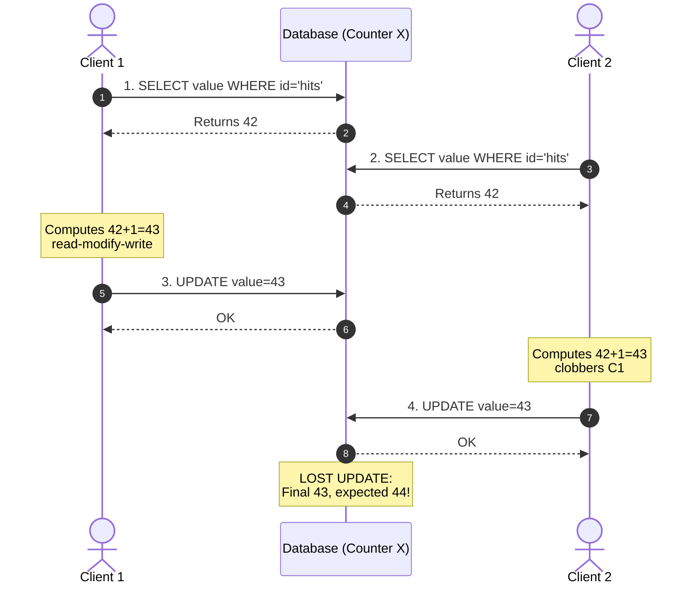

- **Key Takeaway:** RMW needs atomic op, `FOR UPDATE`, CAS or auto-detect.

---

### Figure 8-2: Violating Isolation — Dirty Read (Mailbox + Counter)
- **Figure Reference:** `Figure 8-2: Violating isolation: one transaction reads another's uncommitted writes`
- **Original PDF:** Fig 8-2 → PDF p.309
- **Visual Flow:** Txn A inserts mail + increments counter. User 2 reads between: sees mail but counter 0.
- **Mermaid Sequence Diagram:**

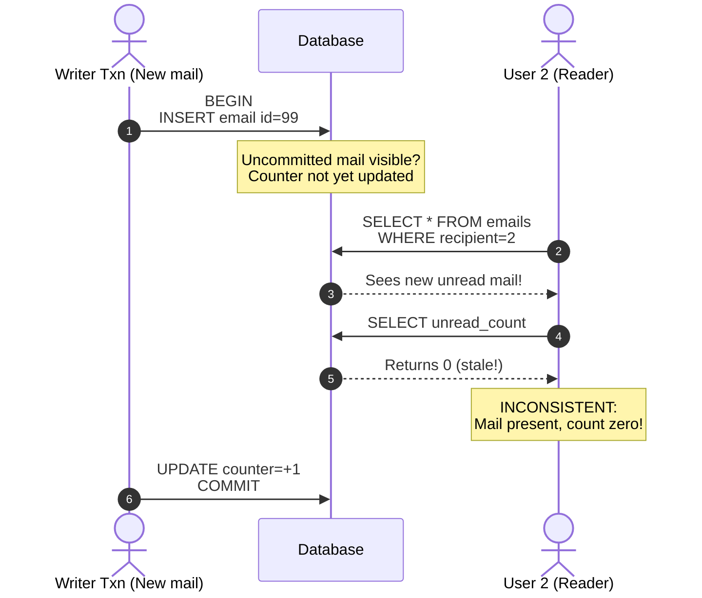

- **Key Takeaway:** Need isolation all-or-none across objects; same for balances, indexes.

---

### Figure 8-3: Atomicity — Abort Undoes Prior Writes
- **Figure Reference:** `Figure 8-3: Atomicity ensures if error occurs prior writes undone`
- **Original PDF:** Fig 8-3 → PDF p.309
- **Visual Flow:** Insert mail ok, counter update fails (disk full / constraint) → whole txn rolled back, mail disappears.
- **Mermaid Sequence Diagram:**

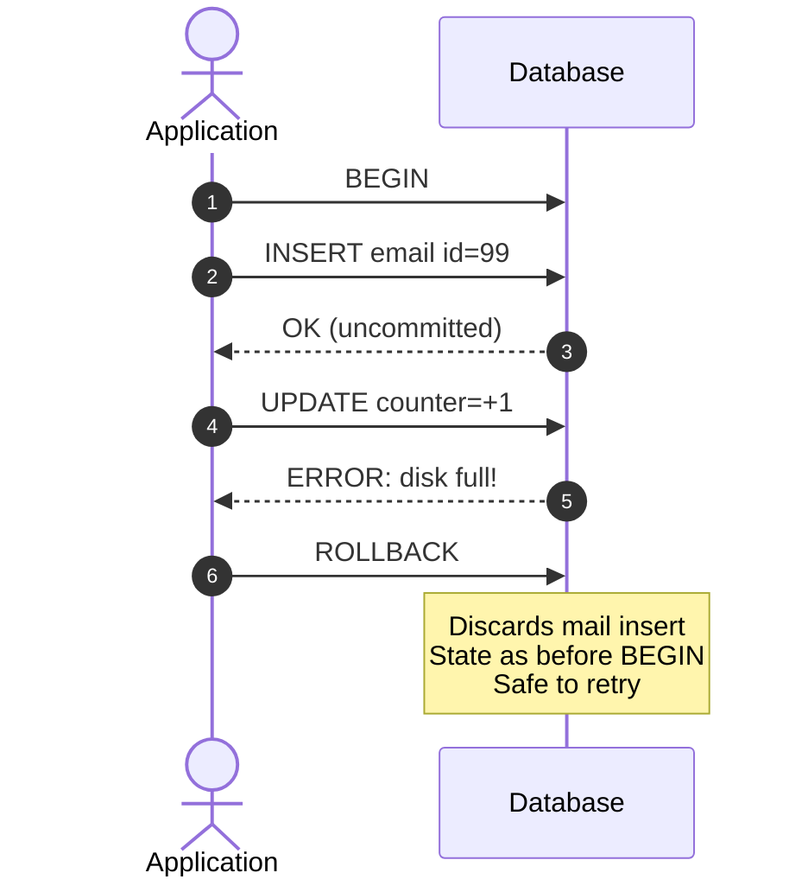

- **Key Takeaway:** Abortability lets app retry without deduping partial effects.

---

### Figure 8-4: No Dirty Reads — Read Committed
- **Figure Reference:** `Figure 8-4: No dirty reads: user 2 sees new x only after commit`
- **Original PDF:** Fig 8-4 → PDF p.314
- **Mermaid Sequence Diagram:**

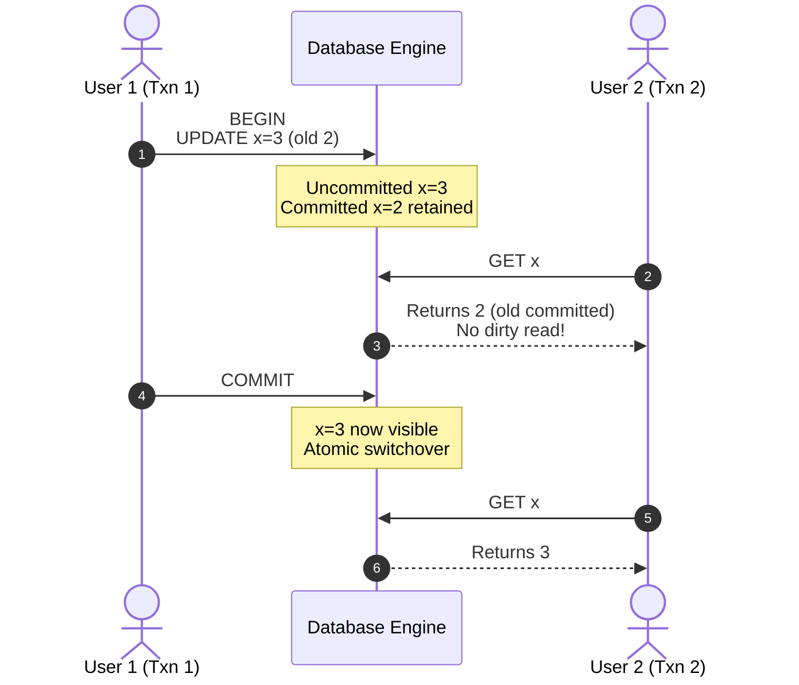

- **Key Takeaway:** Old+new versions or read locks hide uncommitted.

---

### Figure 8-5: Dirty Writes Mixed Up — Car Sale
- **Figure Reference:** `Figure 8-5: With dirty writes conflicting writes mixed up`
- **Original PDF:** Fig 8-5 → PDF p.316
- **Visual Flow:** Aaliyah and Bryce buy same car. Listings table wins to Bryce, invoices to Aaliyah → sale to Bryce but bill to Aaliyah.
- **Mermaid Sequence Diagram:**

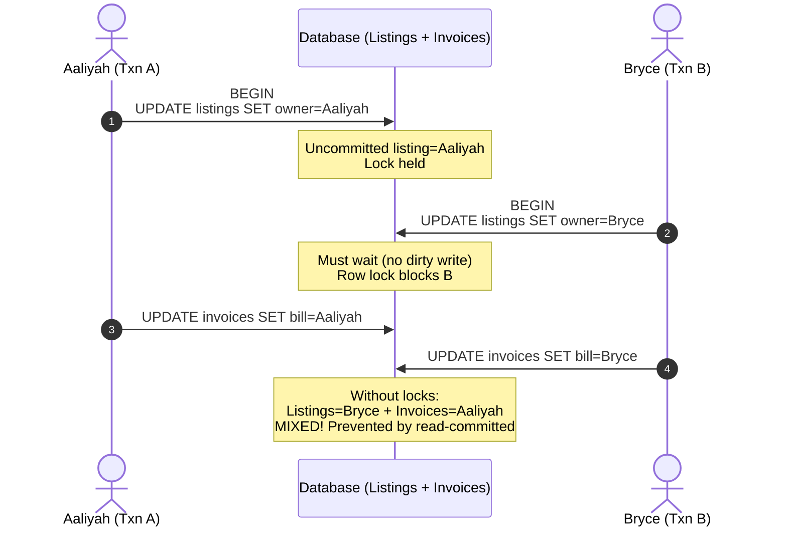

- **Key Takeaway:** Row X-locks to commit order writes per row; multi-row still needs stronger.

---

### Figure 8-6: Read Skew — Aaliyah $900
- **Figure Reference:** `Figure 8-6: Read skew: Aaliyah observes inconsistent state`
- **Original PDF:** Fig 8-6 → PDF p.318
- **Mermaid Flowchart:**

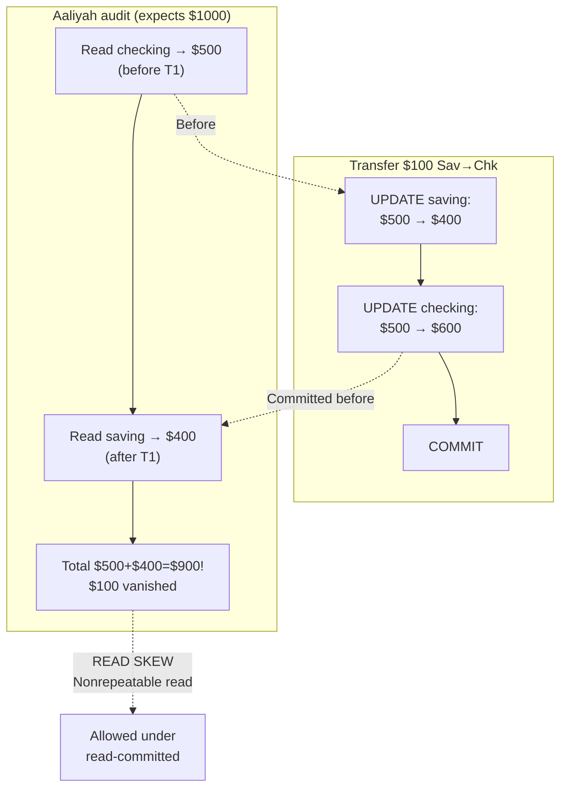

- **Key Takeaway:** Snapshot isolation freezes snapshot at start → both reads $500.

---

### Figure 8-7: MVCC Snapshot Isolation (PostgreSQL)
- **Figure Reference:** `Figure 8-7: Implementing snapshot isolation using MVCC`
- **Original PDF:** Fig 8-7 → PDF p.320
- **Mermaid Flowchart:**

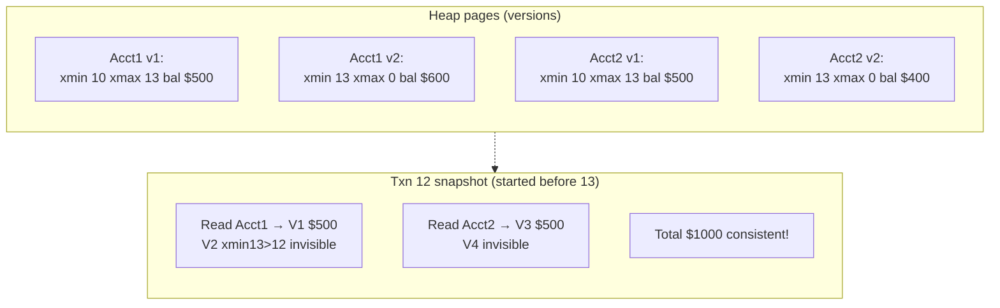

- **Key Takeaway:** `xmin/xmax` + 4 visibility rules → readers never block writers.

---

### Figure 8-8: Write Skew — On-Call Doctors
- **Figure Reference:** `Figure 8-8: A write skew causing application bug`
- **Original PDF:** Fig 8-8 → PDF p.327
- **Mermaid Sequence Diagram:**

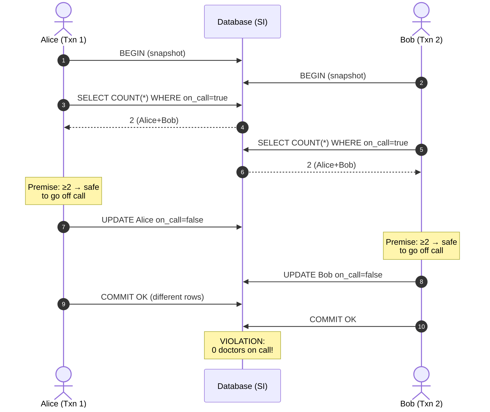

- **Key Takeaway:** Different rows → no conflict detected; needs serializable or `FOR UPDATE` or constraint.

---

### Figure 8-9: Interactive vs Stored Procedure
- **Figure Reference:** `Figure 8-9: Difference between interactive txn and stored procedure`
- **Original PDF:** Fig 8-9 → PDF p.334
- **Mermaid Sequence Diagram:**

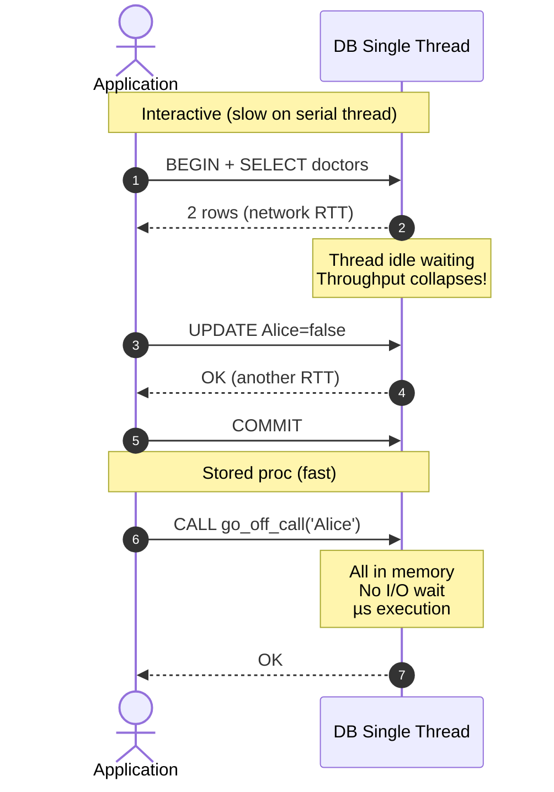

- **Key Takeaway:** Serial execution requires single-statement/procs; network stalls kill it.

---

### Figure 8-10: Detecting Stale MVCC Reads (SSI)
- **Figure Reference:** `Figure 8-10: Detecting when txn reads outdated MVCC snapshot`
- **Original PDF:** Fig 8-10 → PDF p.344
- **Mermaid Sequence Diagram:**

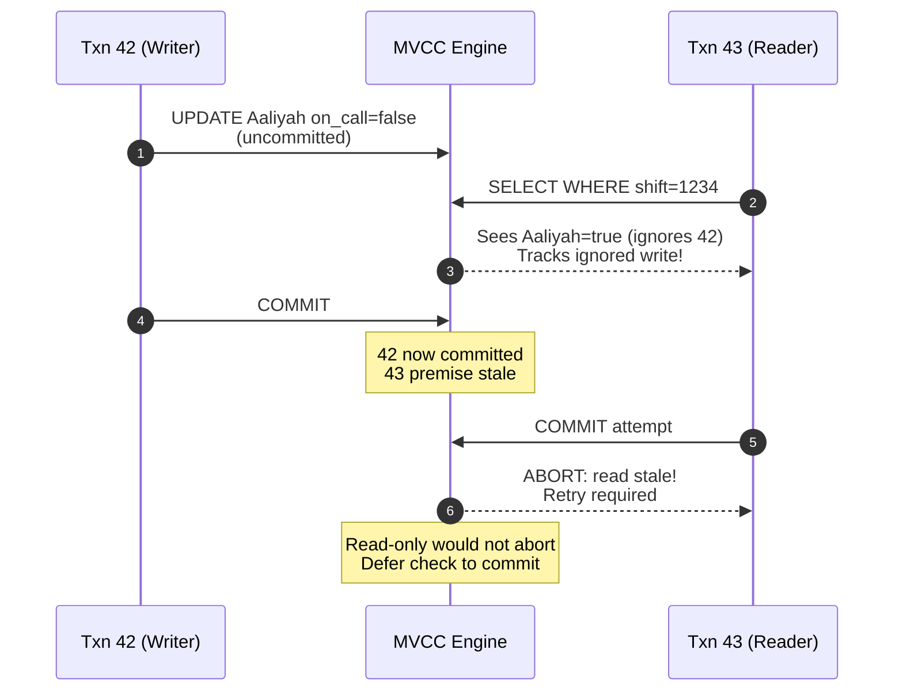

- **Key Takeaway:** SSI tracks ignored writes; aborts only if they commit before reader commits and reader also wrote.

---

### Figure 8-11: SSI — Writes Affecting Prior Reads (Tripwire)
- **Figure Reference:** `Figure 8-11: In SSI detecting when one txn modifies another's reads`
- **Original PDF:** Fig 8-11 → PDF p.345
- **Mermaid Flowchart:**

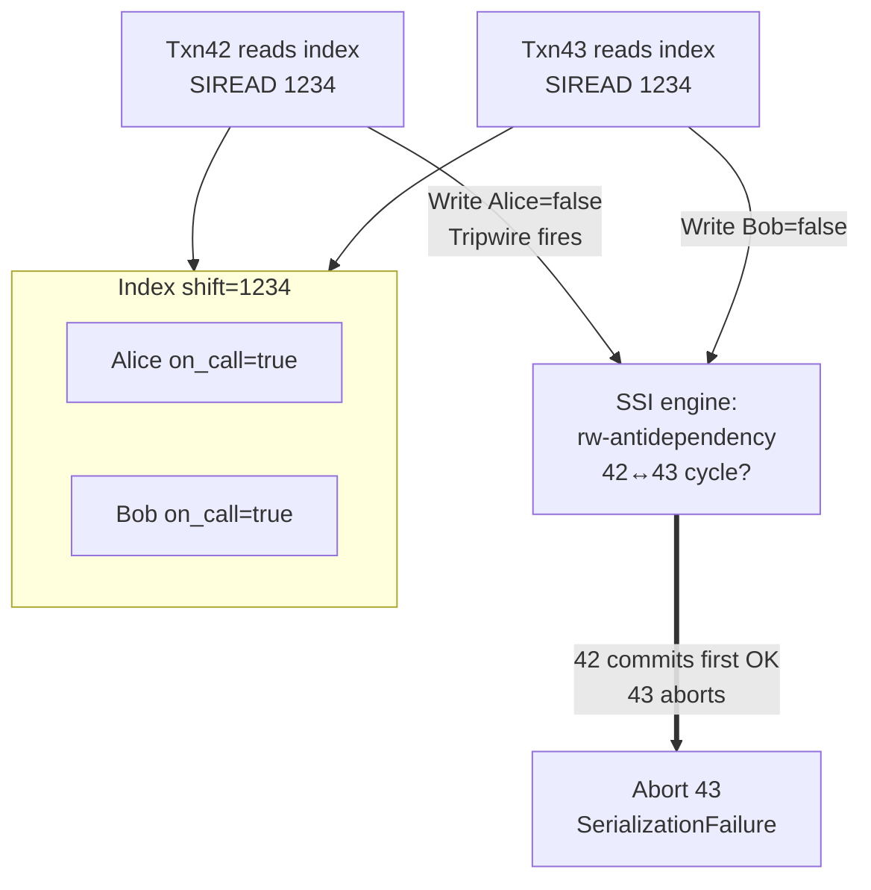

- **Key Takeaway:** Non-blocking SIREAD + cycle detect → serializable without blocking.

---

### Figure 8-12: Partial Commit Across Nodes
- **Figure Reference:** `Figure 8-12: When txn involves multiple nodes may commit on some fail on others`
- **Original PDF:** Fig 8-12 → PDF p.348
- **Mermaid Sequence Diagram:**

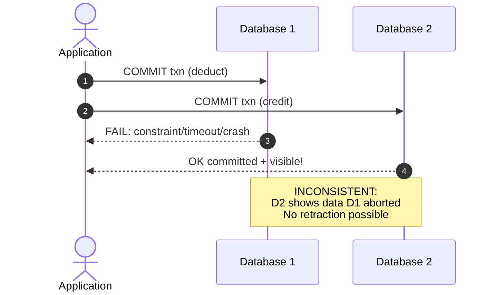

- **Key Takeaway:** One-phase commit cannot be atomic; need 2PC.

---

### Figure 8-13: Successful 2PC
- **Figure Reference:** `Figure 8-13: Successful execution of 2PC`
- **Original PDF:** Fig 8-13 → PDF p.349
- **Mermaid Sequence Diagram:**

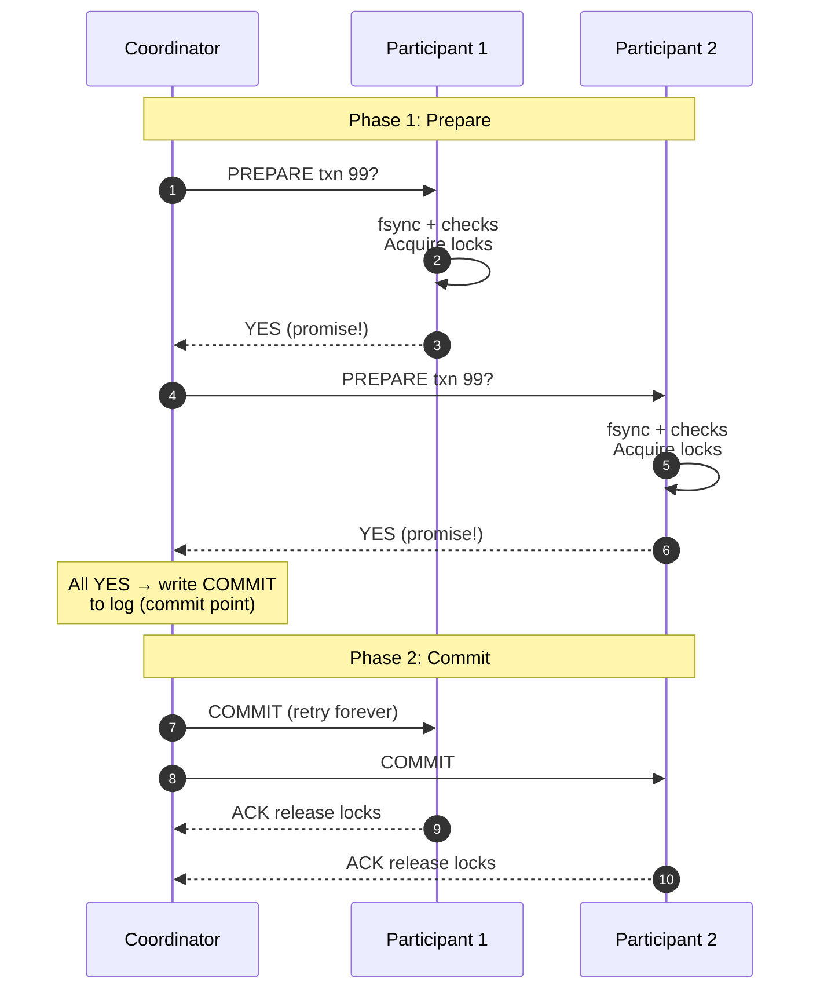

- **Key Takeaway:** YES = irrevocable promise; coordinator log decides.

---

### Figure 8-14: Coordinator Crash — In-Doubt
- **Figure Reference:** `Figure 8-14: Coordinator crashes after participants vote yes`
- **Original PDF:** Fig 8-14 → PDF p.351
- **Mermaid Sequence Diagram:**

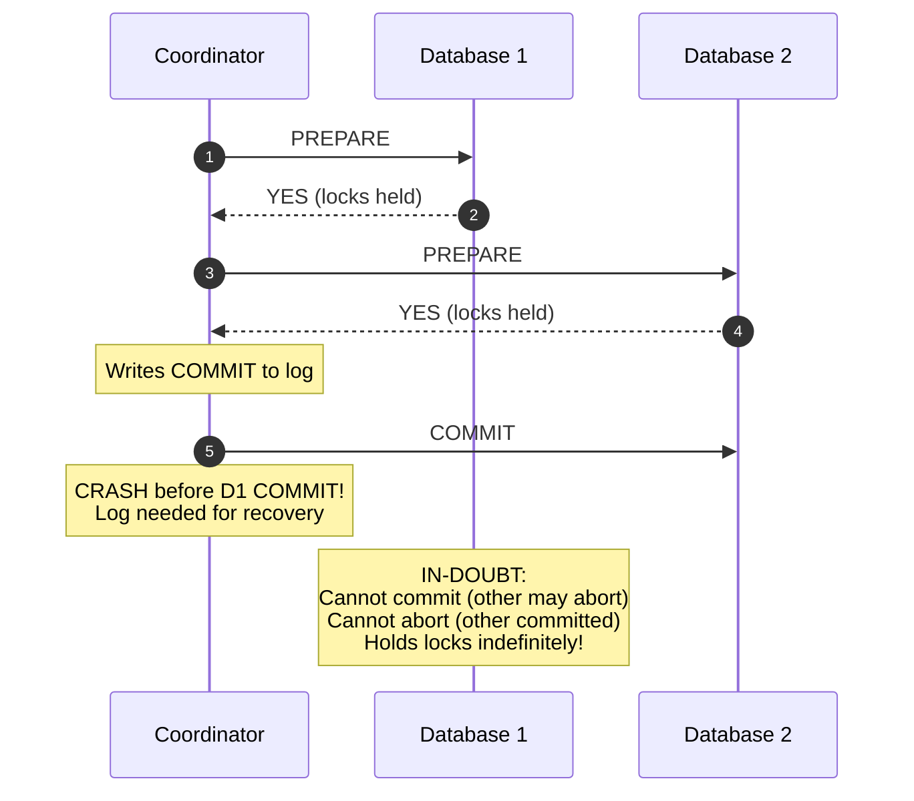

- **Key Takeaway:** Blocking protocol; participants wait for coordinator recovery; lost log = manual surgery.

---

## 4. Real-World Systems, Case Studies & Code Examples

### 4.1 Industry Implementations

- **PostgreSQL (MVCC + SSI):** Default Read Committed. Repeatable Read = SI (auto lost-update detect). Serializable = SSI with SIREAD, reduced false aborts. Aggressive `autovacuum` needed (`scale_factor 0.05` on hot tables).
- **MySQL InnoDB (MVCC + 2PL):** Default Repeatable Read ≠ SI (no lost-update detect, locking reads). Serializable = 2PL next-key locks → deadlocks. Use `SELECT … FOR UPDATE` / `UNIQUE` + retry.
- **Oracle / SQL Server:** Oracle "serializable" = SI; SQL Server snapshot + Hekaton SSI. Db2 RR = serializable 2PL.
- **CockroachDB / YugabyteDB / TiDB / Spanner / FoundationDB:** NewSQL internal 2PC + consensus-replicated coordinator/shards, direct RPC, SSI/SI across shards. CockroachDB HLC + SSI; Spanner TrueTime + strict serializable; FoundationDB distributed SSI conflict detection; VoltDB sharded serial procs (~1k cross-shard w/s).
- **VoltDB / Redis / Datomic:** In-memory serial procs, >100k txn/s/core, deterministic replication (VoltDB).
- **XA coordinators:** Narayana (JBoss), Atomikos/BTM, JOTM, MSDTC; WS-AtomicTransaction for SOAP; JMS/JDBC XA drivers.

### 4.2 Production Implementation: MVCC Engine

```python
from typing import Dict, List, Optional, Tuple, Any

class RowVersion:
    def __init__(self, value: Any, xmin: int, xmax: int = 0):
        self.value = value
        self.xmin = xmin
        self.xmax = xmax

class MVCCDatabase:
    def __init__(self):
        self.next_txid = 1
        self.storage: Dict[str, List[RowVersion]] = {}
        self.active: set = set()
        self.committed: set = set()

    def begin(self) -> Tuple[int, set]:
        txid = self.next_txid; self.next_txid += 1
        snap = set(self.active)
        self.active.add(txid)
        return txid, snap

    def commit(self, txid: int):
        self.active.remove(txid); self.committed.add(txid)

    def abort(self, txid: int):
        self.active.remove(txid)

    def get(self, key: str, txid: int, snap: set) -> Optional[Any]:
        for v in reversed(self.storage.get(key, [])):
            xmin_ok = (v.xmin == txid) or (v.xmin in self.committed and v.xmin not in snap)
            if not xmin_ok: continue
            xmax_deleted = (v.xmax != 0 and v.xmax != txid and v.xmax in self.committed and v.xmax not in snap)
            if not xmax_deleted: return v.value
        return None

    def put(self, key: str, value: Any, txid: int):
        vs = self.storage.setdefault(key, [])
        for v in vs:
            if v.xmax == 0: v.xmax = txid
        vs.append(RowVersion(value, txid, 0))
```

### 4.3 Production Implementation: 2PC + XA-Style Recovery + Heuristic

```python
import uuid
from typing import Dict, List

class Participant:
    def __init__(self, name: str):
        self.name = name; self.prepared: Dict[str, dict] = {}; self.data: Dict[str, int] = {}
    def prepare(self, tx: str, writes: dict) -> bool:
        for v in writes.values():
            if isinstance(v, (int, float)) and v < 0: return False
        self.prepared[tx] = writes  # fsync + locks in real engine
        return True
    def commit(self, tx: str):
        self.data.update(self.prepared.pop(tx, {}))
    def abort(self, tx: str):
        self.prepared.pop(tx, None)
    # Emergency hatch: heuristic — breaks atomicity!
    def heuristic_abort(self, tx: str): self.prepared.pop(tx, None)

class Coordinator:  # Narayana/JOTM/BTM analogue: log on local disk
    def __init__(self, parts: List[Participant]):
        self.parts = parts; self.log: Dict[str, str] = {}
    def execute(self, writes: Dict[Participant, dict]) -> bool:
        tx = str(uuid.uuid4())
        votes = {p: p.prepare(tx, w) for p, w in writes.items()}
        ok = all(votes.values()) and len(votes) == len(self.parts)
        self.log[tx] = "COMMIT" if ok else "ABORT"  # commit point: must fsync
        for p in writes:
            (p.commit if ok else p.abort)(tx)  # retry forever on timeout in prod
        return ok
    def recover(self, participants: List[Participant]):
        # After crash: read log; no record → abort; else re-send decision
        for tx, dec in self.log.items():
            for p in participants:
                if tx in p.prepared: (p.commit if dec == "COMMIT" else p.abort)(tx)
```

JTA/XA sketch: `XAResource.prepare(xid)->XA_OK`, `commit(xid, false)`, `rollback(xid)`; coordinator `UserTransaction.begin/commit`; driver joins via `enlistResource`.

### 4.4 Production Implementation: Idempotent Exactly-Once (No XA)

```python
def process_message(db, broker, msg_id: str, payload: dict):
    with db.transaction() as tx:  # single-node txn only
        if tx.exists("processed_ids", msg_id):
            broker.ack(msg_id); return  # duplicate → drop
        tx.insert("processed_ids", msg_id)  # UNIQUE constraint guards races
        tx.apply(payload)  # business writes, same txn
        tx.commit()
    broker.ack(msg_id)  # crash before ack → retry sees ID
    # separate txn: db.delete("processed_ids", msg_id)
```

### 4.5 Production War Story: New-Year Overbooking (Write-Skew Phantom)

PostgreSQL `REPEATABLE READ`: `SELECT COUNT(*) WHERE room=101 AND date='2026-12-31'` → 0 → `INSERT booking`. Two concurrent both see 0 (different rows → no lost-update fire) → both commit → same suite twice, $15k relocation. Fix: `UNIQUE(room_id,date)` (physical) + `SERIALIZABLE` (SSI aborts second) or materialized slot locks.

---

## 5. Architectural Trade-Off Matrix

| Isolation / Protocol | Dirty reads | Dirty writes | Read skew | Lost update | Write skew / Phantoms | Throughput | Catastrophic mode |
| :--- | :--- | :--- | :--- | :--- | :--- | :--- | :--- |
| **Read Uncommitted** | ❌ | Protected (writes locked) | ❌ | ❌ | ❌ | Highest (no versions) | Cascading aborts on dirty reads |
| **Read Committed** | Protected | Protected | ❌ | ❌ | ❌ | High (readers don't block writers for versions) | Audit skew, Fig 8-1 race |
| **Snapshot Isolation** | Protected | Protected | Protected | Depends (PG/Oracle yes, MySQL no) | ❌ | High (MVCC, no read locks) | Silent write skew (Fig 8-8) |
| **Serial 1-thread** | Protected | Protected | Protected | Protected | Protected | Extreme/core, zero concurrency | One slow proc stalls all; cross-shard 1k/s |
| **2PL** | Protected | Protected | Protected | Protected | Protected (next-key) | Collapse under contention | Deadlocks, table-lock backup stall |
| **SSI** | Protected | Protected | Protected | Protected | Protected (SIREAD cycle) | Near-SI if low contention | Abort storms if long R/W |
| **2PC / XA** | Atomic commit, not isolation | — | — | — | — | Poor (2 RTT + fsyncs) | In-doubt locks, orphaned XA, heuristic split |

Table 8-1 (book p.335): Read uncommitted all possible; Read committed only dirty prevented; SI prevents dirty+skew+phantoms (straight), lost update depends; Serializable prevents all. Dirty writes prevented by almost all (omitted from table).

```text
Decision Tree:
1. Multi-shard / heterogeneous (DB+MQ)?
   YES → Need atomic? → Internal DB: consensus 2PC (Spanner/Cockroach). Heterogeneous high-TPS → Saga + idempotent outbox, avoid XA. Low-TPS admin → XA/Narayana + manual runbook.
   NO → RAM-fit + short procs + single-shardable? → Serial (VoltDB). Else need skew/phantom proof? → SSI if available else SI + UNIQUE + FOR UPDATE. Else SI.
```

---

## 6. Jargon Buster & Key Terminology

- **Atomicity / Abortability:** Abort discards all partial writes; safe retry.
- **Consistency (ACID):** App invariants (balanced books, ≥1 doctor); DB enforces only declared constraints.
- **Isolation / Serializability:** Concurrent ≡ some serial order.
- **Durability:** Committed never forgotten (WAL+fsync+checksums+replication+backups).
- **Dirty Read/Write:** See uncommitted / overwrite uncommitted.
- **Read Skew / Nonrepeatable:** Different times see different commits; fixed by snapshot.
- **Lost Update:** RMW clobber same object.
- **Write Skew:** Read same, write disjoint, break invariant.
- **Phantom:** Write changes another's search set; absence can't be `FOR UPDATE`-locked.
- **MVCC / xmin/xmax:** Multi-version + txid visibility; readers never block writers.
- **Predicate / Index-Range (Next-Key):** Lock search condition / index gap vs phantom.
- **SSI / SIREAD:** Optimistic SI + tripwire + cycle abort.
- **2PL / SS2PL / two-phase locking:** S/X held to commit; growing then shrinking phases; two-phase locking deadlocks need waits-for detection + retry.
- **Compare-and-set:** Conditional `UPDATE ... WHERE value=old` / `version=old`; compare-and-set succeeds only if unchanged, else row-count 0 → re-read + retry; CPU `CMPXCHG` analogue for lock-free lost-update prevention.
- **Stored Procedure Serial:** One thread, no interactive waits.
- **2PC / two-phase commit / Coordinator / Commit Point / In-Doubt / Orphaned / Heuristic:** Two-phase commit prepare promise, coordinator two-phase commit log decision, wait on two-phase commit coordinator crash, manual if two-phase commit log lost, unilateral heuristic breaks two-phase commit atomicity.
- **XA / JTA / Narayana / JOTM / BTM / MSDTC / WS-AtomicTransaction:** Heterogeneous two-phase commit via drivers; app-local two-phase commit log.
- **Materializing Conflicts:** Fake lock rows to turn phantom concrete.
- **Idempotent Exactly-Once:** `processed_ids` + UNIQUE + ack-after-commit; no cross-system atomicity needed.

---

## 7. System Design & Practical Engineering Takeaways

### 7.1 Production Engineering Checklist
1. **UNIQUE for uniqueness:** Never `SELECT COUNT==0 → INSERT` under SI; add `UNIQUE(room,date)`, `UNIQUE(username)`.
2. **Default to SSI for invariants:** Booking, on-call, ledger, double-spend → `SERIALIZABLE`; harness `SerializationFailure` retry with jittered backoff.
3. **Tune vacuum:** `autovacuum_vacuum_scale_factor=0.05` on hot tables; offload 20-min reports to replica (else 20k/s×1200s×200B≈4.8GB + indexes≈6.2GB bloat, horizon pinned).
4. **2PL timeouts:** `innodb_lock_wait_timeout=5`, statement timeouts, slow-query kill; avoid full-table S-lock analytics on primary.
5. **No XA on hot path:** >1k TPS heterogeneous → Saga/outbox/idempotence; keep XA manual runbook (`XA RECOVER`, compare with peer, `XA COMMIT/ROLLBACK xid`), monitor `prepared` count, alert orphaned.

### 7.2 System Design Interview Strategy
- Dissect ACID: "Atomicity via WAL undo, Durability via fsync+quorum, Isolation via MVCC SI, skew via SSI/UNIQUE." Note CAP-C ≠ ACID-C.
- Explain PG RR vs MySQL RR: PG auto lost-update abort; MySQL needs `FOR UPDATE`.
- Sketch MVCC bloat: `WriteBW=QPS×RowB×(1+WAL)×RF`; `Bloat=Upd/s×RowB×OldestTxnAge`; 2PC latency = 2 RTT + 2 fsyncs; serial scale by shard.

### 7.3 Mastery Self-Assessment Questions

#### Question 1 (Conceptual Depth)
*Why does 2PL guarantee serializability but collapse throughput, while SSI gives same guarantee at MVCC speed?*
- **Answer:** 2PL pessimistic: `S` on read blocks `X`, `X` blocks `S/X`, range locks gaps; queues cascade, deadlocks, table scans stall writes. SSI optimistic MVCC: no physical read locks, `SIREAD` tripwires record read predicates; only rw-antidependency cycle at commit aborts. Rare conflicts → near-zero overhead; contended long R/W → aborts/retries.

#### Question 2 (Failure Scenario)
*$10M 2PC DB+mainframe, both YES, coordinator mobo dies + WAN cut. State? Why can't DBA abort? Recovery?*
- **Answer:** DB in-doubt (YES logged, X-locks held). Unilateral abort risks DB-abort vs mainframe-commit → $10M created; unilateral commit risks opposite. Recovery: mount coordinator disk, read log commit/abort, re-send; if disk gone out-of-band compare IDs with mainframe admin, `XA COMMIT/ROLLBACK`; heuristic only to unblock at atomicity cost.

#### Question 3 (Capacity)
*20k cancels/s, 200B rows, 50ms txns, 20-min SI report. Dead-tuple rate? Bloat?*
- **Answer:** 20k dead/s (UPDATE=delete+insert), churn 4MB/s. Horizon pinned at report start → vacuum blocked 1200s → 24M dead tuples → 4.8GB tuples + 2 indexes×30B≈1.44GB → **≥6.24GB** + pointers/fragmentation. Offload analytics.

---
> [!NAV] **Chapter Navigation**
> ⬅️ **Previous:** [[chapter-07-sharding|Chapter 07: Sharding]] | 🏠 **Index:** [[00-Master-Reading-Dashboard|Master Dashboard]] | ➡️ **Next:** [[chapter-09-the-trouble-with-distributed-systems|Chapter 09: The Trouble with Distributed Systems]]
