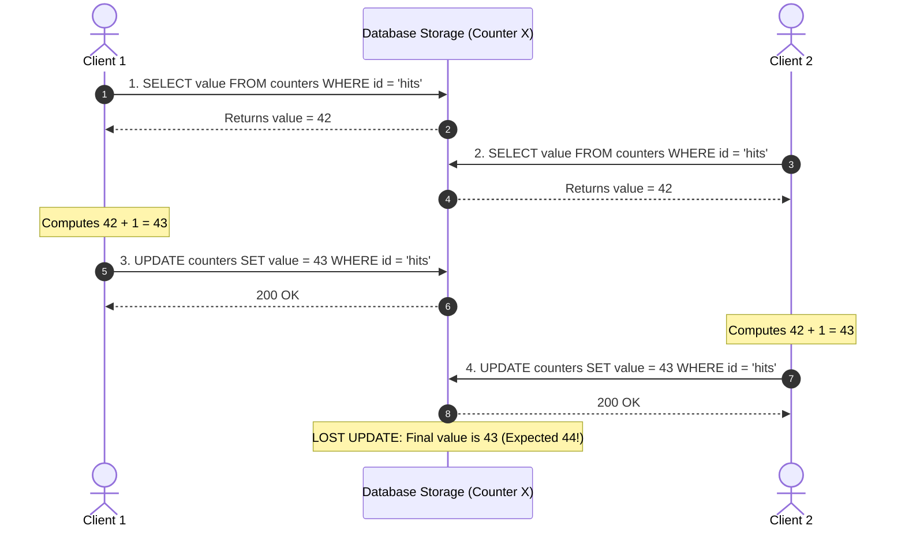
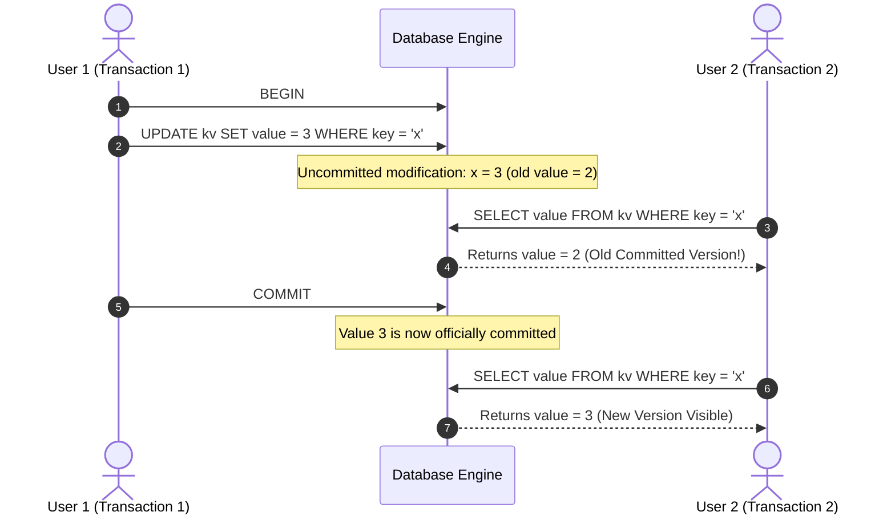
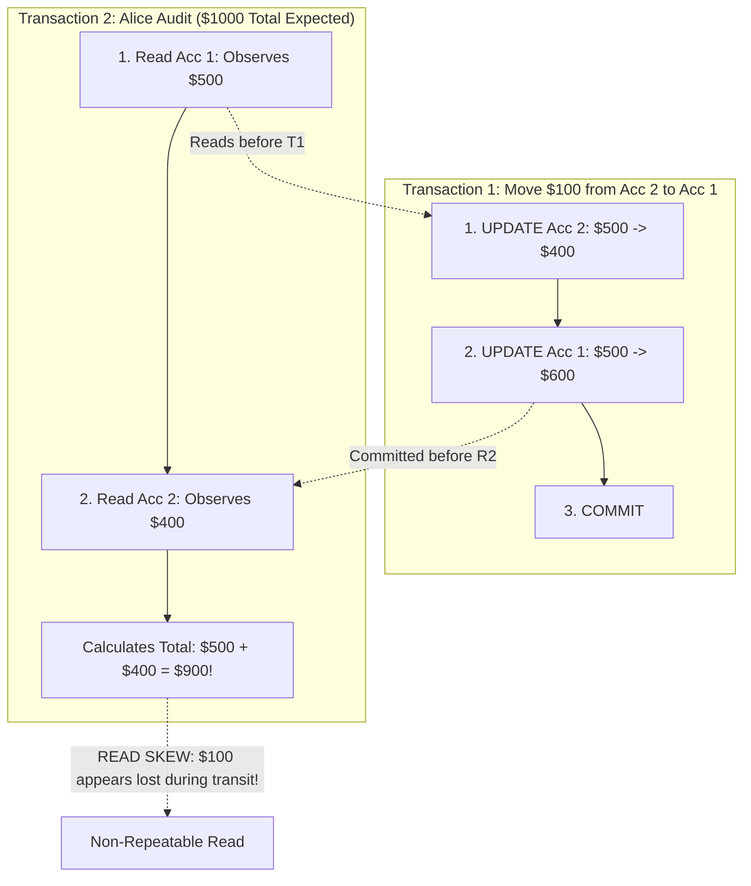
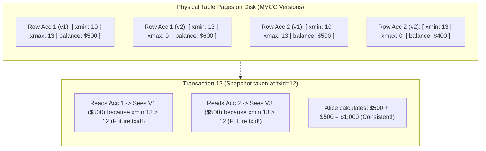
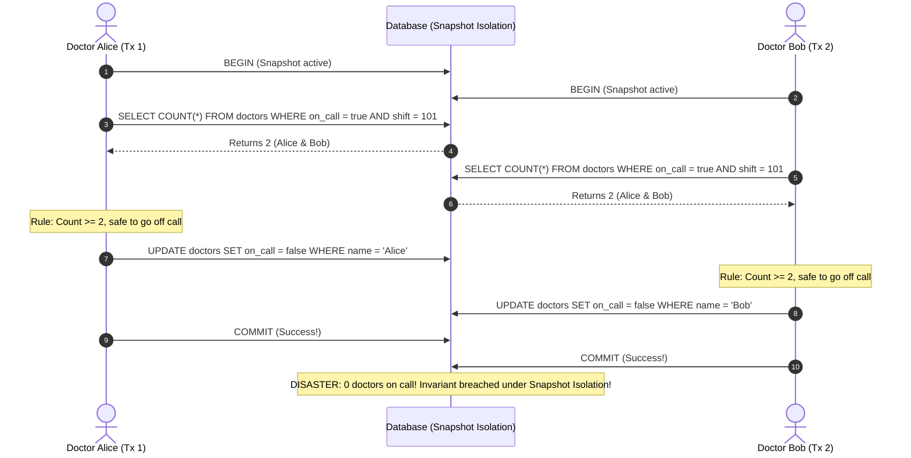
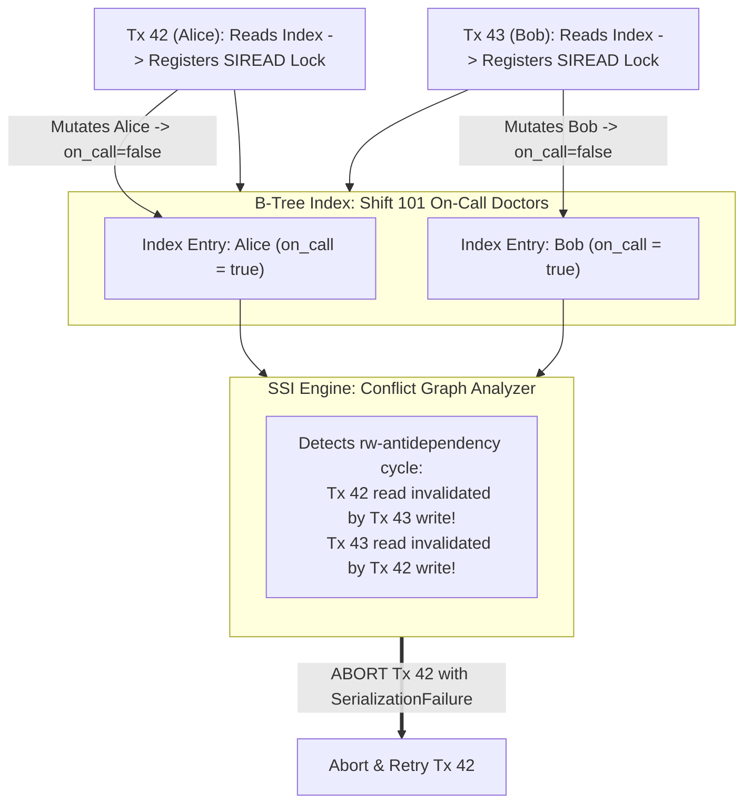

# Chapter 8: Transactions — Definitive Technical Summary
*From: Designing Data-Intensive Applications (2nd Edition) by Martin Kleppmann and Chris Riccomini*
*Source PDF: pp. 301–368 (673-page PDF) — figures below cite PDF pages.*

> [!NAV] **Chapter Navigation**
> ⬅️ **Previous:** [[chapter-07-sharding|Chapter 07: Sharding]] | 🏠 **Index:** [[00-Master-Reading-Dashboard|Master Dashboard]] | ➡️ **Next:** [[chapter-09-the-trouble-with-distributed-systems|Chapter 09: The Trouble with Distributed Systems]]


---

## 1. Executive Summary & Core Engineering Problem

- **Core Thesis:** Transactions are an essential abstraction designed to simplify application development by bundling a sequence of database reads and writes into a single logical unit of execution. Under the transactional guarantee, software engineers can treat complex distributed failures, race conditions, process crashes, and disk errors as a binary outcome: either the entire operation succeeds (**Commit**) or it completely fails and safely resets (**Abort**). However, the classic acronym **ACID** (Atomicity, Consistency, Isolation, Durability) obscures severe real-world trade-offs: full serializability imposes catastrophic lock contention and throughput collapse, forcing databases to default to **weak isolation levels** (Read Committed, Snapshot Isolation) that silently expose applications to subtle concurrency anomalies like read skew, lost updates, and write skew.
- **Problem Statement:** Developing applications under the assumption that a database provides "ACID" without verifying the configured isolation level leads to catastrophic financial, clinical, and operational failures. A classic production disaster occurs in hospital on-call scheduling (Figure 8-8): an operational rule mandates that at least one doctor must remain on call at all times. Two doctors, Alice and Bob, both feel unwell and concurrently request to go off call. Under Snapshot Isolation (the default "strong" isolation level in PostgreSQL, Oracle, and CockroachDB), Alice's transaction reads the on-call count ($2$), sees it is safe to leave, and sets her status to off-call. Bob's transaction concurrently reads the same snapshot ($2$), concludes it is safe, and sets his status to off-call. Both transactions commit successfully without lock conflicts. The database enters an illegal state with **zero doctors on call**, yet neither the application nor the database threw an exception (**Write Skew**).
- **Historical & Industry Context:** The transactional abstraction was formalized in the 1970s by Jim Gray and implemented in IBM System R. For decades, relational databases treated Two-Phase Locking (2PL) as the gold standard for serializability, accepting heavy latency penalties and deadlock aborts. The NoSQL movement of the 2000s initially abandoned multi-object transactions entirely to maximize horizontal scale. In the 2010s, modern hardware realities (abundant multi-core RAM and NVMe storage) enabled two breakthroughs: in-memory serial execution engines (VoltDB, Redis) and **Serializable Snapshot Isolation (SSI)** (Cahill et al., 2008), implemented in PostgreSQL 9.1 and CockroachDB, which delivers true serializability with the optimistic read throughput of MVCC. In the 2020s (2nd Edition inflection), Distributed SQL engines combined consensus algorithms (Raft/Paxos) with distributed transaction protocols to provide ACID semantics across globally sharded clusters without the blocking coordinator hazards of legacy XA Two-Phase Commit.

---

## 2. In-Depth Technical Concepts & Internal Mechanics

### 2.1 Deconstructing ACID: Definitions, Myths, and Invariants
- **Atomicity (Abortability):**
  - *The Myth:* Atomicity means operations happen concurrently without interference. (False: that is Isolation).
  - *The Technical Reality:* Atomicity is about **fault recovery**. If an execution encounters an error mid-transaction (syntax error, disk full, network timeout, deadlocks, power loss), the database aborts the transaction and **discards all partial writes** made by that transaction (Figure 8-3). The database state reverts to exactly what it was before the transaction began.
- **Consistency (Application Invariants):**
  - *The Myth:* Consistency is a database-enforced mechanical guarantee.
  - *The Technical Reality:* In ACID, consistency means the application's business rules and invariants (e.g., in a double-entry ledger, the sum of debits must equal the sum of credits) are preserved. The database can enforce simple constraints (foreign keys, uniqueness, `CHECK` constraints), but overall business consistency is strictly the **application's responsibility**. (Note: "Consistency" in ACID is entirely different from "Consistency" in CAP theorem, where it denotes linearizability).
- **Isolation (Concurrency Control):**
  - Concurrently executing transactions must not step on each other's toes. Formally, **Serializability** guarantees that the net result of running concurrent transactions is identical to running them sequentially, one at a time, in some total order.
- **Durability (Persistence Guarantees):**
  - Once a transaction commits successfully, its data will not be lost, even if a hardware crash or power outage occurs immediately afterward.
  - *Mechanics:* In single-node databases, durability requires writing transaction log records to a non-volatile Write-Ahead Log (WAL) on disk and issuing an explicit `fsync` system call. In distributed databases, it requires replicating the commit to a quorum of nodes.

---

### 2.2 Single-Object vs. Multi-Object Operations
- **Single-Object Operations:**
  - Modern storage engines provide hardware-assisted atomicity and isolation for single-record mutations (e.g., updating a 20 KiB JSON document or a single table row).
  - *Mechanisms:* Slotted page locks, compare-and-swap (CAS) memory instructions, and log sequence numbers ensure that a 16 KiB page write is never read as a half-written "torn page".
- **Multi-Object Operations (The Real Need for Transactions):**
  - Real-world operations span multiple records, tables, or secondary indexes:
    1. *Relational Foreign Keys:* Inserting an order row and several order-line items must be coordinated.
    2. *Denormalized Views & Caches:* Updating an email inbox must atomically update the message table and increment the unread counter (Figure 8-2).
    3. *Secondary Indexes:* Updating a customer email requires writing the heap/clustered table and updating the secondary B-tree index. If a crash occurs between the two writes, the secondary index points to corrupted garbage.

---

### 2.3 Weak Isolation Levels: Read Committed
- **Foundational Theory:** The most basic transactional isolation level. Read Committed provides two strict guarantees:
  1. **No Dirty Reads:** When reading from the database, you will only see data that has already been committed (no uncommitted writes from other transactions) (Figure 8-4).
  2. **No Dirty Writes:** When writing to the database, you will only overwrite data that has already been committed (Figure 8-5).
- **Under-the-Hood Implementation Mechanics:**
  - *Preventing Dirty Writes:* The database acquires **row-level exclusive locks** on every modified row. If Transaction A updates row 42, it holds the lock until commit or abort. If Transaction B attempts to update row 42, it blocks until Transaction A releases the lock.
  - *Preventing Dirty Reads (The MVCC Read Solution):*
    - *Naive Approach (Read Locks):* Require readers to acquire shared read locks. *Fatal Flaw:* A single long-running read query blocks all concurrent writes to those rows, destroying write throughput.
    - *Production Approach:* For every row undergoing mutation, the database retains both the **old committed value** and the **new uncommitted value** written by the active transaction (Figure 8-4). While the transaction is in-flight, all other concurrent transactions are given the old committed value. Once committed, the new value becomes visible.

---

### 2.4 Snapshot Isolation & Multi-Version Concurrency Control (MVCC)
- **The Read Skew (Non-Repeatable Read) Anomaly (Figure 8-6):**
  - Alice has \$1,000 split across two bank accounts (\$500 in Account 1, \$500 in Account 2).
  - Transaction 1 transfers \$100 from Account 2 to Account 1.
  - Transaction 2 (Alice) runs an audit query to check her total wealth:
    1. Alice reads Account 1: observes \$500 (before transfer applies).
    2. Transaction 1 executes: deducts \$100 from Account 2, adds \$100 to Account 1, and **commits**.
    3. Alice reads Account 2: observes \$400 (after transfer applied).
  - *The Anomaly:* Alice sees a total balance of \$900 (\$500 + \$400). To her, \$100 appears to have vanished into thin air.
  - While acceptable for short single-record queries, read skew is disastrous for backups, analytical reporting, and multi-table integrity audits.
- **Snapshot Isolation Definition:**
  - Each transaction reads from a **consistent snapshot** of the database taken at the exact instant the transaction started. The transaction sees all data that was committed at the time it began; writes committed by other transactions *after* the snapshot time are invisible.
  - *Core Invariant:* **Readers never block writers, and writers never block readers.**
- **Under-the-Hood MVCC Layout (PostgreSQL Engine - Figure 8-7):**
  - The storage engine maintains multiple physical versions of each row simultaneously.
  - Every transaction is assigned a monotonically increasing 32-bit or 64-bit integer **Transaction ID (`txid`)**.
  - Every table row on disk carries hidden metadata headers:
    ```text
    [ xmin: 8B | xmax: 8B | infomask: 2B | t_ctid: 6B | ... user columns ... ]
    ```
    - `xmin`: The `txid` of the transaction that inserted (created) this row version.
    - `xmax`: The `txid` of the transaction that deleted or updated this row version (initially 0).
  - *Update Path:* An `UPDATE` does not overwrite the row in place. It marks `xmax` of the existing row with the current `txid`, and inserts a brand-new row version with `xmin = current_txid`.
  - *Visibility Rules:* A transaction with ID $T$ reading the database evaluates each row version. A row version is visible to $T$ iff:
    1. At the start of $T$, the `xmin` transaction had already committed.
    2. The `xmin` transaction is not marked as aborted.
    3. The `xmax` is either 0 (not deleted) OR the `xmax` transaction had not yet committed when $T$ started.
- **Garbage Collection (Vacuuming):**
  - When old row versions have an `xmax` older than the oldest active transaction in the cluster, background vacuum workers (e.g., PostgreSQL `VACUUM`) physically purge dead tuples and reclaim disk pages.

---

### 2.5 Preventing Lost Updates
- **The Lost Update Problem (Figure 8-1):**
  - Two clients concurrently execute a read-modify-write cycle on the same record:
    1. Client 1 reads counter $X = 42$.
    2. Client 2 reads counter $X = 42$.
    3. Client 1 writes $X = 43$.
    4. Client 2 writes $X = 43$ (overwriting Client 1's update).
  - One increment operation is permanently lost.
- **Defensive Solutions:**
  1. *Atomic Write Operations:*
     ```sql
     UPDATE counters SET value = value + 1 WHERE id = 'hits';
     ```
     Executed by acquiring an exclusive row latch, updating the value directly in the buffer pool, and logging to the WAL, eliminating client-side race windows.
  2. *Explicit Pessimistic Locking (`SELECT ... FOR UPDATE`):*
     ```sql
     BEGIN;
     SELECT value FROM counters WHERE id = 'hits' FOR UPDATE;
     -- Application modifies value in memory
     UPDATE counters SET value = 43 WHERE id = 'hits';
     COMMIT;
     ```
     Forces concurrent readers attempting `FOR UPDATE` to block until the lock is released.
  3. *Automatic Lost Update Detection (PostgreSQL / Oracle):*
     Snapshot isolation in PostgreSQL automatically detects concurrent writes to the same row. If Transaction B attempts to mutate a row that was updated by Transaction A after B's snapshot began, Transaction B is aborted with an error: `ERROR: could not serialize access due to concurrent update`.
  4. *Compare-and-Set (CAS / Optimistic Concurrency Control):*
     ```sql
     UPDATE counters SET value = 43 WHERE id = 'hits' AND value = 42;
     ```
     If another transaction updated `value` first, the query affects 0 rows, prompting an application retry.

---

### 2.6 Write Skew and Phantoms
- **Foundational Theory:** Write skew is the subtlest and most dangerous concurrency anomaly. It is **not** a dirty write, nor is it a lost update:
  - In a lost update, two transactions mutate the **same row**.
  - In write skew, two transactions read the **same set of rows**, but make mutations to **different rows**, breaking a global cross-row invariant (Figure 8-8).
- **The Mathematical Pattern of Write Skew:**
  1. A `SELECT` query checks for rows satisfying a precondition ($C$).
  2. Depending on the query result, the application code makes a business decision.
  3. The application executes an `INSERT`, `UPDATE`, or `DELETE` that alters the precondition ($C$).
  4. Concurrently, a second transaction evaluates the exact same precondition ($C$) and executes a mutation to a *different* record.
  5. Both transactions commit successfully under Snapshot Isolation, violating the invariant.
- **Real-World Manifestations:**
  - *On-Call Doctors:* Precondition: $\text{count}(\text{doctors on call}) \ge 2$. Alice goes off call; Bob goes off call. Invariant breached ($\text{count} = 0$).
  - *Meeting Room Booking:* Precondition: $\text{count}(\text{bookings for Room A at 2 PM}) = 0$. Two users concurrently book Room A for 2 PM. Both queries see 0 bookings; both insert a reservation; double booking occurs!
  - *Username Registration:* Precondition: username does not exist. Two users concurrently register `"alice"`.
  - *Multiplayer Game:* Moving two pieces to the same board coordinates concurrently.
- **The Phantom Phenomenon:**
  - A write in one transaction changes the result of a search query in another transaction.
  - Snapshot isolation prevents phantoms for read-only queries, but cannot prevent phantoms from causing write skew.
- **Mitigation: Materializing Conflicts:**
  - If no rows exist to lock (e.g., locking a non-existent meeting room booking), you can artificially materialize physical rows (e.g., pre-inserting a table of 15-minute time slots for each room) and execute `SELECT ... FOR UPDATE` on the slot row. Highly complex and leak-prone; true **Serializability** is the only robust solution.

---

### 2.7 Serializability: 2PL, Stored Procedures, and SSI

To eliminate write skew and all concurrency anomalies, systems must enforce **Serializability**. Three architectural implementations exist:

#### 1. Actual Serial Execution (Single-Threaded In-Memory Engines: VoltDB, Redis - Figure 8-9)
- *Theory:* The fastest way to handle concurrency is to eliminate concurrency entirely. Execute transactions sequentially on a single CPU thread.
- *Why It Works in Modern Systems:*
  - RAM is vast and cheap; active OLTP working sets fit in memory.
  - Transactions avoid disk I/O waits during execution (WAL logging is batched/pipelined).
  - Eliminates all locking, latching, and two-phase commit overhead.
- *Strict Constraints:*
  - Transactions must be submitted as **Stored Procedures** (Figure 8-9). Interactive multi-statement transactions (`BEGIN` $\to$ network hop $\to$ query $\to$ network hop $\to$ `COMMIT`) hold the thread idle during network I/O, destroying throughput.
  - A single slow transaction halts the entire database.

#### 2. Two-Phase Locking (2PL - MySQL InnoDB, SQL Server)
- *Theory:* For decades, the dominant serializability algorithm.
- *Locking Rules:*
  - To read an object, a transaction must acquire a **Shared Lock ($S$)**. Multiple transactions can hold shared locks concurrently.
  - To mutate an object, a transaction must acquire an **Exclusive Lock ($X$)**. Only one transaction can hold an exclusive lock.
  - *The Blocking Rule:* If Object $O$ has an $S$-lock, writers are blocked. If Object $O$ has an $X$-lock, all other readers and writers are blocked. **Readers block writers, and writers block readers.**
- *The Two Phases:*
  - *Growing Phase:* Locks are acquired as operations execute; no locks are released.
  - *Shrinking Phase:* All acquired locks are held until the **end of the transaction** (`COMMIT` or `ABORT`) and released simultaneously (Strict 2PL).
- *Preventing Phantoms: Predicate Locks & Index-Range Locks:*
  - *Predicate Lock:* Locks all records matching an arbitrary condition (e.g., `WHERE room_id = 123 AND start_time >= '14:00'`), even rows that do not yet exist! Extremely expensive to evaluate in practice.
  - *Index-Range Locks (Next-Key Locking):* The engine locks a range of index keys (e.g., all B-tree entries for `room_id = 123`). Any attempt to insert a new row within that index interval is blocked until the transaction completes.
- *The Collapse of 2PL at Scale:*
  - High probability of deadlocks; database engine must continuously run cycle-detection on the wait-for graph, aborting and rolling back victim transactions.
  - Severe queueing delays drive p99 and p99.9 latencies exponentially higher under moderate lock contention.

#### 3. Serializable Snapshot Isolation (SSI - PostgreSQL, CockroachDB)
- *Theory:* An **optimistic concurrency control** algorithm. Transactions execute under standard Snapshot Isolation with zero locking. The engine tracks read-write conflicts at runtime; if a non-serializable interleaving is detected, the transaction is safely aborted and retried.
- *Tracking Conflict Graphs (Figures 8-10 & 8-11):*
  - The database must detect when a transaction executes writes that invalidate the premises of another transaction's prior reads.
  - *Mechanism 1: Detecting Stale MVCC Reads (Figure 8-10):* Transaction 43 reads rows. Concurrently, Transaction 42 writes to those rows. When Transaction 43 prepares to commit, the engine checks whether any read row versions have been superseded by committed writes; if so, Transaction 43 is aborted.
  - *Mechanism 2: Detecting Writes That Affect Prior Reads (Figure 8-11):* When Transaction 42 executes an index scan, the engine places a lightweight lock-free tracking lock (a "SIREAD" lock) on the B-tree index entries. When Transaction 43 inserts a row into that index range, it notices the SIREAD lock and notifies Transaction 42 that its read premise has been invalidated.
- *Performance Advantage:* Readers never block writers, and writers never block readers. Under low-to-moderate contention, SSI achieves throughput comparable to raw Snapshot Isolation while mathematically guaranteeing complete freedom from write skew and phantoms.

---

### 2.8 Distributed Transactions & Two-Phase Commit (2PC)
- **The Distributed Atomic Commitment Problem:**
  - A transaction updates data across multiple distinct database shards, partitions, or message queues (Figure 8-12).
  - If Node 1 commits successfully, but Node 2 fails due to a unique constraint violation or disk-full error, the system enters an inconsistent state.
  - Single-node `COMMIT` is non-reversible; distributed systems require an atomic commitment protocol.
- **Two-Phase Commit (2PC) Algorithm (Figure 8-13):**
  - Managed by a centralized **Coordinator** (transaction manager) orchestrating multiple **Participant** nodes.
  - *Phase 1: Prepare Phase*
    1. Coordinator assigns a globally unique transaction ID.
    2. Coordinator sends a `PREPARE` message to all participants.
    3. Each participant executes the transaction locally: writes undo and redo logs to disk, acquires all local locks, and verifies invariants.
    4. If successful, participant writes `VOTE_COMMIT` to its local WAL and replies `YES`.
    5. *The Irreversible Invariant:* By voting `YES`, the participant gives up the right to abort; it **promises** to commit if instructed, no matter what happens (even surviving subsequent crashes).
  - *Phase 2: Commit Phase*
    1. Coordinator collects votes.
    2. If **all** participants voted `YES`: Coordinator writes `COMMIT` to its local WAL (the decision is now irrevocable) and sends `COMMIT` requests to all participants.
    3. If **any** participant voted `NO` (or timed out): Coordinator writes `ABORT` to its local WAL and sends `ABORT` requests to all participants.
    4. Participants apply mutations, release all held locks, and reply `ACK`.
    5. Coordinator marks transaction completed in its WAL.
- **The In-Doubt (Uncertain) Coordinator Failure Disaster (Figure 8-14):**
  - *The Scenario:* All participants vote `YES` in Phase 1. The coordinator writes `COMMIT` to its log, but **crashes before sending the Phase 2 commit messages**.
  - *The Dilemma:*
    - Participant 1 has voted `YES`. It cannot abort unilaterally, because the coordinator may have decided to commit.
    - Participant 1 cannot commit unilaterally, because another participant may have voted `NO` causing an abort.
    - Participant 1 is **In-Doubt**. It must hold all exclusive row locks indefinitely.
  - *The Production Collapse:* Because participants hold row locks on hot records, all subsequent transactions attempting to touch those rows queue up and block. The entire database freezes until the coordinator recovers its WAL or an operator manually resolves the in-doubt transaction.

---

## 3. Important Figures, Diagrams & Visual Architecture

> 📕 **Original figures quick index (source PDF, 673 pages):** open the PDF at the cited page to verify each reconstruction.
>
> | Book Fig | PDF page | What to compare |
> |---|---|---|
> | Fig 8-1 | PDF p.306 | Counter race |
> | Fig 8-2 | PDF p.309 | Dirty read |
> | Fig 8-3 | PDF p.309 | Aborted writes |
> | Fig 8-4 | PDF p.314 | No dirty reads |
> | Fig 8-5 | PDF p.316 | Dirty writes |
> | Fig 8-6 | PDF p.318 | Read skew |
> | Fig 8-7 | PDF p.320 | Snapshot isolation MVCC |
> | Fig 8-8 | PDF p.327 | Write-skew doctors |
> | Fig 8-9 | PDF p.334 | In-memory commit |
> | Fig 8-10 | PDF p.344 | Stale MVCC read |
> | Fig 8-11 | PDF p.345 | Index-range lock |
> | Fig 8-12 | PDF p.348 | Multi-node commit |
> | Fig 8-13 | PDF p.349 | 2PC prepare |
> | Fig 8-14 | PDF p.351 | 2PC coordinator fail |


### Figure 8-1: Race Condition in Concurrent Counter Increment
- **Figure Reference:** `Figure 8-1: A race condition between two clients concurrently incrementing a counter (reconstructed from text p. 272)`
- **Original PDF:** Fig 8-1 → PDF p.306 — open the PDF at page 306 to compare with the Mermaid reconstruction below.
- **Visual Flow & Description:** Shows two clients reading counter value 42 concurrently. Both increment to 43 and write back. The counter ends at 43 instead of 44, losing an update.
- **Mermaid Sequence Diagram:**



- **Key Takeaway:** Read-modify-write cycles require atomic database operations or explicit locking to prevent concurrent overwrites.

---

### Figure 8-4: Read Committed Isolation: Eliminating Dirty Reads
- **Figure Reference:** `Figure 8-4: No dirty reads: User 2 sees the new value only after User 1 commits (reconstructed from text p. 279)`
- **Original PDF:** Fig 8-4 → PDF p.314 — open the PDF at page 314 to compare with the Mermaid reconstruction below.
- **Visual Flow & Description:** User 1 updates $x=3$ within an uncommitted transaction. User 2 reads $x$ and receives the older committed value 2. User 2 observes $x=3$ only after User 1 commits.
- **Mermaid Sequence Diagram:**



- **Key Takeaway:** Read Committed ensures uncommitted mutations remain invisible to concurrent transactions, preventing dirty reads without requiring shared read locks.

---

### Figure 8-6: Read Skew (Non-Repeatable Read) Anomaly
- **Figure Reference:** `Figure 8-6: Read skew: Alice observes the database in an inconsistent state during an account transfer (reconstructed from text p. 282)`
- **Original PDF:** Fig 8-6 → PDF p.318 — open the PDF at page 318 to compare with the Mermaid reconstruction below.
- **Visual Flow & Description:** A transfer moves \$100 from Account 2 to Account 1. Alice reads Account 1 before the transfer and Account 2 after the transfer, seeing an apparent total of \$900 instead of \$1,000.
- **Mermaid Flowchart:**



- **Key Takeaway:** Read skew causes temporary inconsistency to appear permanent to concurrent readers; Snapshot Isolation eliminates this by locking reads to a consistent point in time.

---

### Figure 8-7: MVCC Snapshot Isolation in PostgreSQL
- **Figure Reference:** `Figure 8-7: Implementing snapshot isolation using multiversion concurrency control (reconstructed from text p. 284)`
- **Original PDF:** Fig 8-7 → PDF p.320 — open the PDF at page 320 to compare with the Mermaid reconstruction below.
- **Visual Flow & Description:** Depicts table rows on disk with `xmin` and `xmax` transaction headers. Transaction 13 deducts \$100 from Account 2, creating a new row version. Transaction 12's snapshot sees only older committed versions.
- **Mermaid Flowchart:**



- **Key Takeaway:** MVCC assigns monotonic transaction IDs to row versions, allowing long-running queries to evaluate point-in-time snapshots with zero lock contention.

---

### Figure 8-8: Write Skew in On-Call Hospital Scheduling
- **Figure Reference:** `Figure 8-8: A write skew causing an application bug (reconstructed from text p. 291)`
- **Original PDF:** Fig 8-8 → PDF p.327 — open the PDF at page 327 to compare with the Mermaid reconstruction below.
- **Visual Flow & Description:** Shows Alice and Bob concurrently going off call. Both transactions query active doctors, receive count 2, and update their own status. Both commit, leaving zero doctors on call.
- **Mermaid Sequence Diagram:**



- **Key Takeaway:** Write skew bypasses row-level write locks because concurrent transactions mutate different physical rows, requiring true Serializability (SSI or 2PL) to detect.

---

### Figure 8-11: Serializable Snapshot Isolation (SSI) Conflict Detection
- **Figure Reference:** `Figure 8-11: In SSI, detecting when one transaction modifies another transaction's read premises (reconstructed from text p. 306)`
- **Original PDF:** Fig 8-11 → PDF p.345 — open the PDF at page 345 to compare with the Mermaid reconstruction below.
- **Visual Flow & Description:** Shows transactions 42 and 43 reading an index range. When Transaction 43 writes a row affecting the index range read by Transaction 42, the engine detects the conflict and aborts Transaction 42.
- **Mermaid Flowchart:**



- **Key Takeaway:** SSI detects non-serializable interleavings optimistically by tracking index-range read dependencies, preventing write skew without blocking readers.

---

### Figure 8-13 & 8-14: Two-Phase Commit (2PC) & The In-Doubt Coordinator Crash
- **Figure Reference:** `Figure 8-13: Successful 2PC execution vs. In-Doubt participant hang during coordinator crash (reconstructed from text pp. 310-312)`
- **Original PDF:** Fig 8-13 → PDF p.349 — open the PDF at page 349 to compare with the Mermaid reconstruction below. & 8-14
- **Visual Flow & Description:** Illustrates 2PC flow. Phase 1 collects votes. In Phase 2, the coordinator crashes after all nodes vote YES. Database 1 is stuck in an in-doubt state, holding locks indefinitely.
- **Mermaid Sequence Diagram:**

```mermaid
sequenceDiagram
  autonumber
  participant C as Transaction Coordinator
  participant D1 as Database Participant 1
  participant D2 as Database Participant 2

  Note over C,D2: Phase 1: Prepare Phase
  C->>D1: PREPARE (Can you commit Tx 99?)
  activate D1
  D1->>D1: Write Undo/Redo to disk; Acquire Row Locks
  D1-->>C: VOTE_COMMIT (YES - Promised!)
  deactivate D1

  C->>D2: PREPARE (Can you commit Tx 99?)
  activate D2
  D2->>D2: Write Undo/Redo to disk; Acquire Row Locks
  D2-->>C: VOTE_COMMIT (YES - Promised!)
  deactivate D2

  Note over C: Coordinator writes COMMIT to local WAL
  Note over C: CRASH! Coordinator dies before sending Commit RPCs!

  Note over D1,D2: Phase 2: Stalled In-Doubt
  Note over D1: Participant 1 is IN-DOUBT!
  Note over D1: Cannot Abort (C might have committed)
  Note over D1: Cannot Commit (Waiting for instruction)
  Note over D1: Exclusive row locks held INDEFINITELY!
```

- **Key Takeaway:** 2PC is a blocking protocol; if the coordinator crashes during Phase 2, participants must hold exclusive locks until the coordinator recovers.

---

## 4. Real-World Systems, Case Studies & Code Examples

### 4.1 Industry Implementations & Architectural Divergence
- **PostgreSQL (MVCC + SSI):** Default isolation is Read Committed. Supports true Serializable isolation via Serializable Snapshot Isolation (SSI). Tracks SIREAD locks in memory without acquiring physical row read locks.
- **MySQL InnoDB (MVCC + 2PL):** Default isolation is Repeatable Read. Does **not** detect write skew or lost updates under Repeatable Read. Implements `SERIALIZABLE` via strict Two-Phase Locking (2PL) using shared next-key locks, causing high deadlock rates under concurrency.
- **CockroachDB & YugabyteDB (Distributed SQL / Multi-Raft SSI):** Eliminates centralized coordinators by running distributed transactions over Raft consensus groups. CockroachDB implements pure serializability using an optimistic, latch-free variant of SSI backed by Hybrid Logical Clocks (HLC).
- **VoltDB & Redis (In-Memory Serial Execution):** VoltDB executes stored procedures sequentially on dedicated single-threaded CPU partitions. Eliminates all locking and latching overhead, achieving $>100,000\ \text{tx/sec}$ per core on in-memory working sets.

---

### 4.2 Production Implementation: Multi-Version Concurrency Control (MVCC) Engine

```python
from typing import Dict, List, Optional, Tuple, Any

class RowVersion:
    def __init__(self, value: Any, xmin: int, xmax: int = 0):
        self.value = value
        self.xmin = xmin  # txid that created this version
        self.xmax = xmax  # txid that deleted/superseded this version (0 = active)

class MVCCDatabase:
    """
    In-memory storage engine demonstrating Multi-Version Concurrency Control (MVCC)
    with Snapshot Isolation visibility rules matching PostgreSQL.
    """
    def __init__(self):
        self.next_txid = 1
        self.storage: Dict[str, List[RowVersion]] = {}
        self.active_transactions: set = set()
        self.committed_transactions: set = set()

    def begin_transaction(self) -> Tuple[int, set]:
        txid = self.next_txid
        self.next_txid += 1
        # Snapshot captures active transactions at the time this tx begins
        snapshot = set(self.active_transactions)
        self.active_transactions.add(txid)
        return txid, snapshot

    def commit(self, txid: int):
        self.active_transactions.remove(txid)
        self.committed_transactions.add(txid)

    def abort(self, txid: int):
        self.active_transactions.remove(txid)

    def get(self, key: str, txid: int, snapshot: set) -> Optional[Any]:
        """Evaluates MVCC visibility rules for key at transaction snapshot."""
        versions = self.storage.get(key, [])
        for version in reversed(versions):
            # Rule 1: xmin must be committed before our snapshot began (or created by ourself)
            xmin_valid = (version.xmin == txid) or (
                version.xmin in self.committed_transactions and version.xmin not in snapshot
            )
            if not xmin_valid:
                continue

            # Rule 2: xmax must be unassigned, aborted, or committed AFTER our snapshot
            xmax_deleted = (
                version.xmax != 0 and
                version.xmax != txid and
                version.xmax in self.committed_transactions and
                version.xmax not in snapshot
            )
            if not xmax_deleted:
                return version.value

        return None

    def put(self, key: str, value: Any, txid: int):
        """Appends a new row version, marking previous active version as superseded."""
        versions = self.storage.setdefault(key, [])
        # Mark current active version's xmax with current txid
        for version in versions:
            if version.xmax == 0:
                version.xmax = txid

        # Insert new version with xmin = current txid
        versions.append(RowVersion(value=value, xmin=txid, xmax=0))
```

---

### 4.3 Production Implementation: Two-Phase Commit (2PC) Coordinator

```python
import uuid
from typing import List, Dict, Any

class ParticipantNode:
    def __init__(self, name: str):
        self.name = name
        self.in_doubt = False
        self.locked_records: Dict[str, Any] = {}

    def prepare(self, tx_id: str, write_data: Dict[str, Any]) -> bool:
        """Phase 1: Validate invariants, write WAL, acquire locks."""
        # Simulated invariant check: reject negative balances
        for k, v in write_data.items():
            if isinstance(v, (int, float)) and v < 0:
                return False  # Vote NO
        self.locked_records[tx_id] = write_data
        self.in_doubt = True
        return True  # Vote YES (irrevocable promise)

    def commit(self, tx_id: str):
        """Phase 2: Commit mutations and release locks."""
        if tx_id in self.locked_records:
            del self.locked_records[tx_id]
        self.in_doubt = False

    def abort(self, tx_id: str):
        """Phase 2: Discard staged mutations and release locks."""
        if tx_id in self.locked_records:
            del self.locked_records[tx_id]
        self.in_doubt = False

class TwoPhaseCommitCoordinator:
    """Orchestrates atomic distributed transactions across participants."""
    def __init__(self, participants: List[ParticipantNode]):
        self.participants = participants
        self.coordinator_log: Dict[str, str] = {}

    def execute_transaction(self, multi_node_writes: Dict[ParticipantNode, Dict[str, Any]]) -> bool:
        tx_id = str(uuid.uuid4())
        
        # --- PHASE 1: PREPARE ---
        votes = {}
        for participant, data in multi_node_writes.items():
            votes[participant] = participant.prepare(tx_id, data)

        # Decide: Commit only if ALL participants vote YES
        all_yes = all(votes.values()) and len(votes) == len(self.participants)

        # --- PHASE 2: COMMIT OR ABORT ---
        if all_yes:
            # Irrevocably record decision to coordinator WAL
            self.coordinator_log[tx_id] = "COMMIT"
            for participant in multi_node_writes.keys():
                participant.commit(tx_id)
            return True
        else:
            self.coordinator_log[tx_id] = "ABORT"
            for participant in multi_node_writes.keys():
                participant.abort(tx_id)
            return False
```

---

### 4.4 Production War Story: The Silent Write-Skew Overbooking Outage
- **The Context:** A hotel booking platform operated on PostgreSQL under its default configuration. The reservation flow allowed guests to reserve suites. Business rules mandated that Presidential Suite #1 could never be booked by more than one customer for the same date.
- **The Architecture:** The engineering team wrapped reservations in transactions:
  ```sql
  BEGIN TRANSACTION ISOLATION LEVEL REPEATABLE READ;
  SELECT count(*) FROM bookings WHERE room_id = 101 AND date = '2026-12-31';
  -- If count == 0:
  INSERT INTO bookings (room_id, date, customer_id) VALUES (101, '2026-12-31', 42);
  COMMIT;
  ```
- **The Catastrophe:** On New Year's Eve, two users concurrently clicked "Book Suite" for room 101 within 20 milliseconds of each other. 
  - Both transactions evaluated the `SELECT count(*)` under their respective snapshots; both observed count `0`.
  - Both transactions inserted their reservation rows.
  - Because each transaction inserted a *new* row rather than updating an existing row, PostgreSQL's lost-update detection was **not triggered**.
  - Both transactions committed successfully (**Write Skew / Phantom**).
- **The Fallout:** Two high-profile VIP guests arrived at the resort demanding the same suite. The platform had to pay \$15,000 in relocation accommodations and suffered severe brand embarrassment.
- **Remediation & Architecture Lessons:**
  1. *Relational Unique Constraints:* Added a unique composite constraint: `ALTER TABLE bookings ADD CONSTRAINT uq_room_date UNIQUE (room_id, date);`. Unique constraints enforce physical index uniqueness regardless of transaction isolation level.
  2. *Upgrade to True Serializability:* Upgraded critical booking workflows to `TRANSACTION ISOLATION LEVEL SERIALIZABLE` (activating PostgreSQL's SSI engine), which automatically aborts the second transaction with a serialization failure.

---

## 5. Architectural Trade-Off Matrix

| Isolation Level / Concurrency Architecture | Dirty Reads Prevented | Dirty Writes Prevented | Read Skew Prevented | Lost Updates Prevented | Write Skew & Phantoms Prevented | Throughput & Contention Profile | Catastrophic Failure Mode |
| :--- | :--- | :--- | :--- | :--- | :--- | :--- | :--- |
| **Read Committed** | **YES** (Reads committed versions only) | **YES** (Row-level exclusive write locks) | **NO** (Consecutive reads return different values) | **NO** (Overwrites concurrent updates) | **NO** (Phantoms alter query results) | **High** (Readers never block writers; lock-free reads) | Non-repeatable reads during financial audits |
| **Snapshot Isolation (Repeatable Read)** | **YES** | **YES** | **YES** (Point-in-time snapshot view) | **YES** (In Postgres/Oracle; NO in MySQL InnoDB) | **NO** (Concurrent transactions mutate disjoint rows) | **High** (MVCC eliminates read locks; zero read blocking) | Silent write skew (on-call schedule / overbooking bugs) |
| **Two-Phase Locking (2PL)** | **YES** | **YES** | **YES** | **YES** | **YES** (Via next-key index-range locks) | **Severe Collapse** (Readers block writers; writers block readers) | Cascading deadlock aborts; tail latency explosion |
| **Actual Serial Execution (VoltDB, Redis)** | **YES** | **YES** | **YES** | **YES** | **YES** (Single-threaded total order) | **Extreme Single-Core Throughput** ($>100\text{k}\ \text{QPS}$); zero concurrency | Long-running stored procedure freezes entire database |
| **Serializable Snapshot Isolation (SSI)** | **YES** | **YES** | **YES** | **YES** | **YES** (Optimistic SIREAD conflict tracking) | **High** (Near Snapshot Isolation speed under low contention) | High abort/retry rates under intense write contention |
| **Two-Phase Commit (2PC / XA)** | N/A (Guarantees Atomic Commit across nodes) | N/A | N/A | N/A | N/A | **Very Poor** (Multiple network RTTs + disk fsync per phase) | Coordinator crash leaves participants in-doubt holding locks |

---

### Concrete Decision Heuristics

```text
Decision Tree for Transactional Concurrency Strategy:
1. Does the transaction span multiple physical database shards or heterogeneous systems (DB + Message Queue)?
   ├── YES:
   │    ├── Requires absolute atomic commitment? -> Use Two-Phase Commit (2PC) with Raft-replicated coordinator.
   │    └── Can business logic tolerate eventual consistency? -> Use Saga Pattern with Compensating Transactions.
   └── NO (Single-node or Distributed SQL with co-located data):
        ├── Is the entire active working set small enough to fit entirely in server RAM?
        │    └── YES and transactions can be written as short stored procedures? -> Use In-Memory Serial Execution (VoltDB).
        └── NO (Standard persistent disk-backed storage):
             ├── Does the application require absolute protection against Write Skew and Phantoms?
             │    ├── Database supports SSI (PostgreSQL / CockroachDB)? -> Use SERIALIZABLE (SSI).
             │    └── Database only supports 2PL for serializability (MySQL InnoDB)? -> Use Snapshot Isolation + explicit UNIQUE constraints / SELECT FOR UPDATE.
             └── Read-heavy analytics and standard CRUD dominate? -> Use Snapshot Isolation (Repeatable Read via MVCC).
```

---

## 6. Jargon Buster & Key Terminology

- **Atomicity:** The ability of a transaction to abort on failure and completely discard all partial writes, returning state to the pre-transaction baseline.
- **Dirty Read:** A concurrency anomaly where a transaction observes uncommitted data written by another in-flight transaction that may ultimately abort.
- **Dirty Write:** A concurrency anomaly where a transaction overwrites uncommitted data previously written by another active transaction.
- **Read Skew (Non-Repeatable Read):** A concurrency anomaly where a transaction reads different values for the same record at different points in time due to concurrent committed updates.
- **Write Skew:** A concurrency anomaly where two transactions concurrently read the same data, observe an invariant is satisfied, and write to *disjoint* sets of rows, causing the combined state to violate the invariant.
- **Phantom:** A condition where a write in one transaction changes the set of rows returned by a search query in another transaction.
- **Multi-Version Concurrency Control (MVCC):** A database architecture where multiple physical versions of each row are maintained simultaneously, allowing readers to query consistent point-in-time snapshots without locking writers.
- **Two-Phase Locking (2PL):** A pessimistic concurrency control algorithm where transactions acquire shared locks for reads and exclusive locks for writes, holding all locks until commit or abort.
- **Serializable Snapshot Isolation (SSI):** An optimistic concurrency control algorithm that executes transactions under Snapshot Isolation while tracking read-write conflicts in memory, aborting transactions that form dependency cycles.
- **Two-Phase Commit (2PC):** A distributed atomic commitment protocol where a coordinator collects prepare votes from participants before issuing an irrevocable global commit.
- **In-Doubt Transaction:** A state in 2PC where a participant has voted `YES` in Phase 1, but the coordinator crashes before Phase 2, forcing the participant to hold locks indefinitely.

---

## 7. System Design & Practical Engineering Takeaways

### 7.1 Production Engineering Checklist
1. **Never Rely on Application Code for Uniqueness Invariants:** Always enforce uniqueness via database-level `UNIQUE` constraints or unique secondary indexes. Application-level `SELECT count(*) == 0` checks under Snapshot Isolation are vulnerable to phantoms and write skew.
2. **Set Aggressive Statement Timeouts on 2PL Databases:** If using `SERIALIZABLE` in MySQL InnoDB, enforce `innodb_lock_wait_timeout = 5` (seconds) to prevent deadlock queues from saturating connection pools.
3. **Budget for Vacuuming Overhead in MVCC Engines:** In PostgreSQL, ensure `autovacuum` is aggressively tuned (e.g., lower `autovacuum_vacuum_scale_factor = 0.05`). Heavy update workloads generate dead tuple bloat, degrading table scan performance and exhausting disk space.
4. **Implement Exponential Backoff Retries for SSI and CAS:** Because Serializable Snapshot Isolation (SSI) and Compare-and-Swap (CAS) abort on conflict, wrap client-side transaction executions in an automated retry harness with jittered exponential backoff.
5. **Avoid Heterogeneous XA Two-Phase Commit in High-Throughput Paths:** Never use 2PC across microservices for high-volume pipelines ($>1,000\ \text{tx/sec}$). Coordinator crashes freeze locks; replace 2PC with asynchronous **Sagas** and idempotent message queues.

---

### 7.2 System Design Interview Strategy
- **Dissect "ACID" Immediately:** When an interviewer asks *"How do you guarantee ACID?"*, demonstrate Staff-level depth: *"ACID is not a single feature. We will implement Atomicity via WAL undo logging, Durability via synchronous WAL fsync, and Isolation via MVCC Snapshot Isolation. For critical invariants subject to write skew, we will enforce database-level unique constraints or upgrade to Serializable Snapshot Isolation."*
- **Explain Why MySQL and PostgreSQL Behave Differently under Repeatable Read:** Show deep engine knowledge: *"PostgreSQL's Repeatable Read uses pure MVCC and aborts concurrent updates to prevent lost updates, whereas MySQL InnoDB uses locking reads (`SELECT FOR UPDATE`) and does not detect write skew."*
- **Capacity Sketching for MVCC Table Bloat:**
  $$\text{Disk Write Bandwidth} = \text{Write QPS} \times \text{Avg Row Bytes} \times (1 + \text{WAL Write Factor}) \times \text{Replication Factor}$$
  $$\text{MVCC Storage Overhead} = \text{Updates/sec} \times \text{Avg Row Bytes} \times \text{Max Transaction Duration (sec)}$$

---

### 7.3 Mastery Self-Assessment Questions

#### Question 1 (Conceptual Depth)
*Why does Two-Phase Locking (2PL) provide complete serializability while decimating throughput under write contention, and how does Serializable Snapshot Isolation (SSI) deliver the exact same serializable guarantee with the throughput profile of MVCC?*
- **Answer:** 
  **Two-Phase Locking (2PL)** is a pessimistic algorithm enforcing a strict invariant: *readers block writers, and writers block readers*. When a transaction executes a read, it acquires a shared ($S$) lock; when it executes a write, it acquires an exclusive ($X$) lock. To prevent phantoms, it must acquire index-range (next-key) locks across entire ranges of the B-tree. If Transaction A holds an $X$-lock on a row or range, all concurrent transactions attempting to read or write that data are placed into operating system sleep queues. Under write contention, lock queues cascade, deadlocks multiply, and throughput collapses.
  **Serializable Snapshot Isolation (SSI)** achieves true serializability **optimistically** using MVCC: *readers never block writers, and writers never block readers*. Transactions read consistent historical snapshots without acquiring physical locks. To prevent write skew and phantoms, SSI tracks causal dependencies in memory using lightweight tracking locks ("SIREAD" locks) that merely record who read what. If a transaction writes to an index range that was read by another active transaction, the engine notes an anti-dependency edge ($T_1 \xrightarrow{rw} T_2$). Only if the engine detects a **cycle of dependencies** ($T_1 \xrightarrow{rw} T_2 \xrightarrow{rw} T_1$) at commit time does it abort a transaction. In typical workloads where conflicts are rare, SSI incurs almost zero locking overhead, achieving orders of magnitude higher throughput than 2PL.

#### Question 2 (Failure Scenario & Edge Cases)
*A fintech payments cluster uses Two-Phase Commit (2PC) to transfer funds between a relational database and a legacy mainframe ledger. During Phase 2 of a $10 million corporate transfer, after both participants have voted YES, the coordinator server suffers an unrecoverable motherboard failure. Simultaneously, a network administrator disconnects the cross-datacenter switch. Describe the state of the database participant, explain why the database administrator cannot simply abort the transaction, and specify the recovery procedure.*
- **Answer:**
  - *State of the Participant:* The database participant is stuck in an **In-Doubt (Uncertain)** state. In Phase 1, it wrote a `VOTE_COMMIT` record to its local WAL, promising to obey the coordinator. It holds exclusive row locks on the corporate sender's account.
  - *Why the DBA Cannot Unilaterally Abort:* The database administrator cannot manually issue a `ROLLBACK` command. Because all participants voted `YES`, the coordinator may have written `COMMIT` to its local WAL and transmitted a commit message to the mainframe ledger before the motherboard failed. If the DBA aborts the database transaction while the mainframe commits, \$10 million will be deposited into the recipient's account without being deducted from the sender's account, creating an immediate \$10 million financial deficit. Conversely, if the DBA manually commits and the mainframe aborted, the sender loses \$10 million.
  - *Recovery Procedure:*
    1. The DBA must perform **transaction recovery surgery** by inspecting the coordinator's durable transaction log on disk (or mounting the failed coordinator's disk volume to a spare machine) to determine whether the coordinator decided to `COMMIT` or `ABORT` before crashing.
    2. If the coordinator disk is destroyed, the DBA must manually communicate out-of-band with the mainframe ledger administrator, compare local transaction IDs, determine whether the mainframe committed or aborted, and force the database participant to commit or abort manually using XA recovery commands (`XA COMMIT 'tx_id'` or `XA ROLLBACK 'tx_id'`).

#### Question 3 (Trade-Off & Capacity Estimation)
*A high-frequency cryptocurrency exchange executes 20,000 order cancellations and matching trades per second. The system is deployed on PostgreSQL using MVCC. Each order row occupies 200 bytes. The average transaction commits within 50 milliseconds, but a background financial reconciliation report runs every hour, taking 20 minutes to complete under Snapshot Isolation. Calculate: (A) The rate of dead tuple generation per second, and (B) The minimum additional disk bloat accumulated during the 20-minute reporting window before autovacuum can reclaim space. Show exact derivations.*
- **Answer:**
  - *Dead Tuple Generation Rate:*
    - Update/Cancel Rate = $20,000\ \text{mutations/sec}$.
    - In PostgreSQL MVCC, an `UPDATE` marks the old row version with `xmax` and appends a new row version; a `DELETE` marks `xmax`.
    - Every mutation produces exactly one dead tuple version.
    - Generation Rate = $\mathbf{20,000\ \text{dead tuples/sec}}$.
    - Data Churn Rate:
      $$\text{Churn} = 20,000\ \text{tuples/sec} \times 200\ \text{bytes} = 4,000,000\ \text{bytes/sec} = \mathbf{4\ \text{MB/s}}$$
  - *MVCC Horizon & Bloat Accumulation:*
    - *The MVCC Invariant:* Autovacuum **cannot** remove any dead tuple whose `xmax` is greater than or equal to the `xmin` of the **oldest active transaction** in the entire database.
    - The background reporting transaction began at time $T_0$ and runs for 20 minutes ($1,200$ seconds).
    - Throughout these 20 minutes, the reporting transaction's snapshot horizon remains pinned at $T_0$.
    - Consequently, **autovacuum is completely blocked from reclaiming any dead tuple generated during this 20-minute window**, because those tuples might still be visible to the reporting query!
  - *Quantitative Disk Bloat Calculation:*
    - Window Duration: $20\ \text{minutes} \times 60\ \text{seconds/minute} = 1,200\ \text{seconds}$.
    - Total Dead Tuples Accumulated:
      $$\text{Total Dead Tuples} = 20,000\ \text{tuples/sec} \times 1,200\ \text{seconds} = \mathbf{24,000,000\ \text{dead tuples}}$$
    - Disk Space Bloat (Raw Tuples):
      $$\text{Tuple Bloat} = 24,000,000 \times 200\ \text{bytes} = 4,800,000,000\ \text{bytes} \approx \mathbf{4.8\ \text{GB}}$$
    - Accounting for line pointer arrays (4 bytes per tuple) and B-tree secondary index entries (assuming 2 secondary indexes on the orders table, each adding $\sim 30$ bytes per index tuple):
      $$\text{Index Bloat} = 24,000,000 \times (2 \times 30\ \text{bytes}) = 1,440,000,000\ \text{bytes} \approx 1.44\ \text{GB}$$
      $$\text{Total Minimum Bloat} = 4.8\ \text{GB} + 1.44\ \text{GB} = \mathbf{6.24\ \text{GB}}$$
    - *Architectural Lesson:* Long-running read queries on high-throughput OLTP systems induce massive table and index bloat, degrading buffer pool hit ratios and forcing disk page fragmentation. Long analytical queries must be offloaded to dedicated read replicas.


---
> [!NAV] **Chapter Navigation**
> ⬅️ **Previous:** [[chapter-07-sharding|Chapter 07: Sharding]] | 🏠 **Index:** [[00-Master-Reading-Dashboard|Master Dashboard]] | ➡️ **Next:** [[chapter-09-the-trouble-with-distributed-systems|Chapter 09: The Trouble with Distributed Systems]]