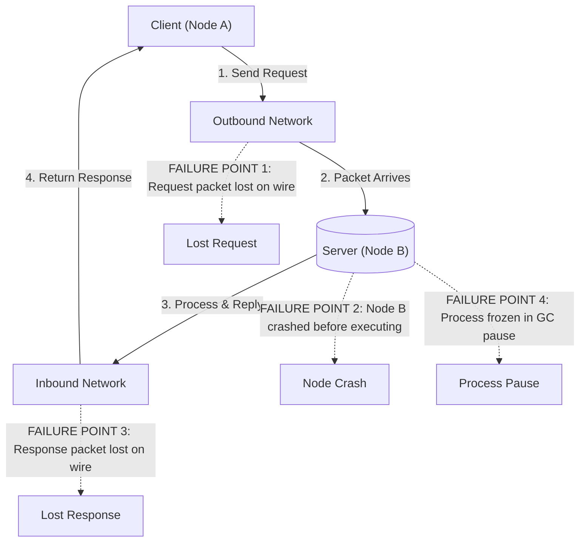
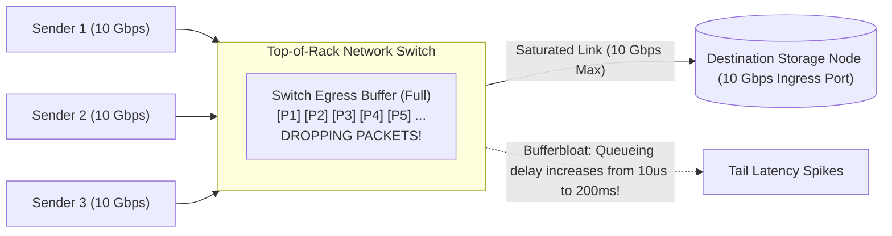
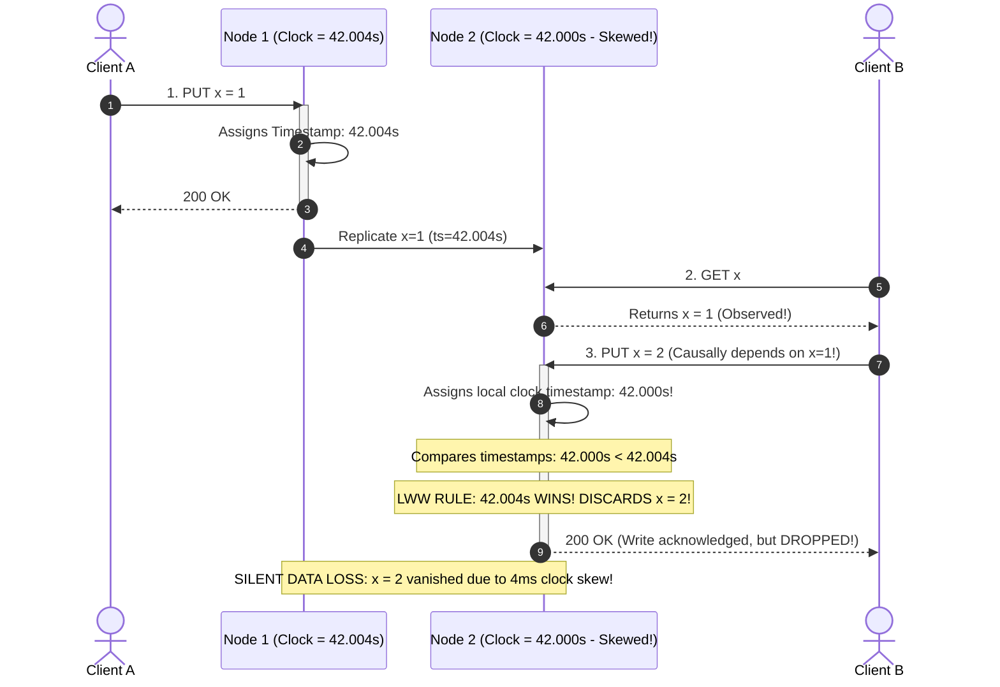
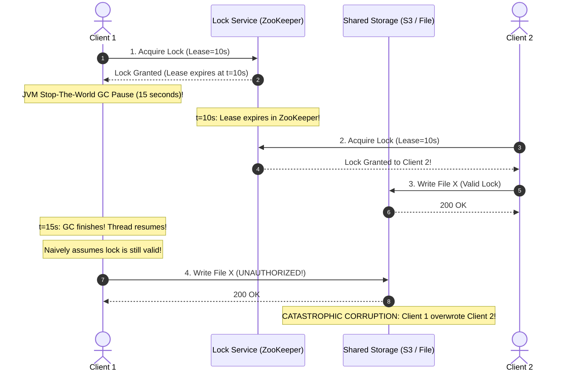
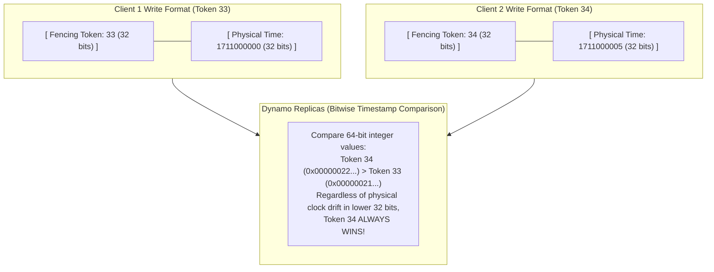

# Chapter 9: The Trouble with Distributed Systems — Definitive Technical Summary
*From: Designing Data-Intensive Applications (2nd Edition) by Martin Kleppmann and Chris Riccomini*
*Source PDF: pp. 369–424 (673-page PDF) — figures below cite PDF pages.*

> [!NAV] **Chapter Navigation**
> ⬅️ **Previous:** [[chapter-08-transactions|Chapter 08: Transactions]] | 🏠 **Index:** [[00-Master-Reading-Dashboard|Master Dashboard]] | ➡️ **Next:** [[chapter-10-consistency-and-consensus|Chapter 10: Consistency and Consensus]]


---

## 1. Executive Summary & Core Engineering Problem

- **Core Thesis:** Writing software for distributed systems is fundamentally different from writing software on a single computer. On a single machine, the hardware operates deterministically: if internal components fail, the entire system crashes completely (fail-stop). In a distributed system, engineers face the brutal reality of **partial failures**: some components, network switches, or nodes will fail unpredictably while the rest of the system continues executing. Because networks have **unbounded latency**, physical clocks exhibit **unbounded drift**, and processes experience **unbounded pauses** (e.g., GC stops-the-world), a distributed system cannot distinguish between a dead node, an unresponsive network switch, a severe garbage collection pause, or a delayed message. Correct distributed algorithms cannot rely on physical time or single-node assumptions; they must be built on explicit system models, quorum consensus, and monotonic fencing mechanisms.
- **Problem Statement:** Relying on physical time or un-fenced distributed locks guarantees silent data corruption. A classic distributed systems catastrophe occurs when using Redis or Apache ZooKeeper for distributed locking (Figure 9-4): Client 1 acquires a 10-second lease to write exclusively to shared storage. Suddenly, Client 1's JVM triggers an unexpected Stop-the-World garbage collection pause lasting 15 seconds. While Client 1 is frozen, its lease expires in ZooKeeper. Client 2 queries ZooKeeper, observes the lease is free, acquires it, and safely writes File $X$. Client 1's GC pause concludes; its application thread wakes up, naively assumes it still holds the valid lock, and writes File $X$, permanently overwriting and corrupting Client 2's data. Because Client 1 had no hardware awareness of its own temporal freeze and storage lacked **fencing tokens**, distributed locking collapsed.
- **Historical & Industry Context:** In the 1980s and 1990s, supercomputing relied on massive parallel processing (MPP) mainframes with specialized interconnects (Infiniband) where any component failure halted the entire compute job. The emergence of web-scale commodity cloud infrastructure in the 2000s forced a paradigm shift: assembling reliable distributed data systems out of cheap, unreliable commodity hardware connected via asynchronous Ethernet. In 2012, Google published Spanner, proving that specialized hardware (GPS receivers and atomic clocks) could bound physical clock drift to $<7\ \text{ms}$ (TrueTime API), enabling globally distributed serializability. However, for systems on standard cloud infrastructure (AWS, Azure, GCP), the late 2010s and 2020s (2nd Edition inflection) established that formal verification (TLA+) and randomized fault-injection testing (Jepsen) are non-negotiable requirements for distributed correctness.

---

## 2. In-Depth Technical Concepts & Internal Mechanics

### 2.1 Faults and Partial Failures: The Distributed Reality
- **Foundational Theory:** A single machine is deterministic: operations either complete according to CPU instruction specs or the machine halts completely. In distributed systems, **partial failure** is the defining characteristic:
  - Some components fail while others remain healthy.
  - The healthy components cannot determine whether the failed component crashed, is running slowly, or is cut off by a severed network cable.
- **The Philosophy of Building Reliable Systems from Unreliable Hardware:**
  - Distributed computing does not attempt to eliminate faults; it treats faults as statistical certainties.
  - *Analogies in Computing:*
    1. *IP over Ethernet:* IP packets are unreliable (dropped, reordered, duplicated). TCP constructs an abstraction of a reliable, ordered, deduplicated stream on top of unreliable IP.
    2. *DRAM & ECC:* DRAM chips suffer from cosmic-ray bit flips. Error-Correcting Code (ECC) memory detects and corrects single-bit errors in hardware.
    3. *Consensus Protocols:* Raft and Paxos provide linearizable state machines on top of nodes that crash and networks that partition.

---

### 2.2 Unreliable Networks & The Asynchronous Model
- **The Fundamental Network Dilemma (Figure 9-1):**
  - Node A sends a message to Node B over an asynchronous network. Node A waits, but receives no response.
  - *Indistinguishable Failure States:*
    1. The request message was lost on the wire (cable severed / switch buffer dropped packet).
    2. The request is queued in an OS buffer or network switch and has not yet reached Node B.
    3. Node B crashed while processing the request.
    4. Node B processed the request successfully, but the return response was lost on the wire.
    5. Node B processed the request, but the response packet is delayed in a buffer and will arrive minutes later.
  - *The Mathematical Impossibility:* **The sender cannot distinguish between a dead node and a delayed network.**
- **Network Queueing Delays & Bufferbloat (Figure 9-2):**
  - Why is network delay variable and unbounded?
    1. *Switch Buffer Queueing:* When multiple network ports send packets to the same destination switch port simultaneously, packets queue in switch memory buffers. If the buffer fills, packets are dropped (tail drop).
    2. *Operating System Socket Buffers:* When a packet hits the destination host, the OS places it in a TCP receive queue. If the application CPU is saturated, the packet sits in kernel memory.
    3. *TCP Flow Control & Congestion Control:* TCP enforces congestion avoidance (slow start, AIMD). If packet loss occurs, TCP throttles transmission rates, multiplying application-observed latency.
- **Fault Detection & Dynamic Timeouts:**
  - Systems use **heartbeats** (periodic pings) to detect failed nodes.
  - *The Timeout Dilemma:*
    - *Short Timeout (e.g., 100 ms):* Fast failure recovery; but high probability of **false positives** (declaring a healthy node dead due to a transient network spike or GC pause), triggering unnecessary, expensive failovers.
    - *Long Timeout (e.g., 30 sec):* Zero false positives; but the system takes 30 seconds to detect a genuine node crash, degrading availability SLAs.
  - *Phi-Accrual Failure Detectors (Hayashibara et al., implemented in Cassandra and Akka):*
    - Instead of a static timeout, the system continuously measures the historical distribution of heartbeat inter-arrival times ($RTT$).
    - Computes a dynamic probability metric ($\Phi$):
      $$\Phi = - \log_{10} \left( P_{\text{later}}(t - t_{\text{last}}) \right)$$
    - If $\Phi = 8$, the probability of seeing a delay this large from a living node is $10^{-8}$. Applications adjust actions dynamically: $\Phi \ge 8 \implies$ throttle traffic; $\Phi \ge 12 \implies$ declare node dead and trigger failover.

---

### 2.3 Unreliable Physical Clocks & The Danger of Wall Time
Modern computers have two distinct types of internal clocks:

#### 1. Time-of-Day Clocks (Wall Clocks)
- Returns the current calendar date and time (e.g., `System.currentTimeMillis()` in Java, `clock_gettime(CLOCK_REALTIME)` in Linux).
- Measures time since the Unix Epoch (January 1, 1970 UTC).
- Periodically synchronized with Network Time Protocol (NTP) servers.
- *The Fatal Flaw for Distributed Systems:* **Time-of-day clocks can jump backward or forward unexpectedly.**
  - If the local quartz oscillator runs fast, NTP steps the clock backward, or slews it.
  - If an NTP server reports a leap second, clocks can freeze, jump, or desynchronize.
  - *Never use Time-of-Day clocks to measure elapsed time or duration!*

#### 2. Monotonic Clocks
- Returns an arbitrary elapsed time counter (e.g., `System.nanoTime()`, `clock_gettime(CLOCK_MONOTONIC)`).
- Guaranteed to **never jump backward** and strictly moves forward at a constant rate.
- Ideal for measuring durations, timeouts, and p99 response latencies on a single machine.
- *Constraint:* Absolute values are completely meaningless across machines (cannot compare monotonic clocks of Node A and Node B).

#### 3. Clock Skew and the Failure of Last-Write-Wins (LWW - Figure 9-3)
- Consider two nodes in a multi-leader or leaderless cluster with unsynchronized clocks (Figure 9-3):
  - Node 1 clock is at $t = 42.004\ \text{sec}$. Client A writes $x = 1$.
  - Node 2 clock has drifted backward; it is at $t = 42.000\ \text{sec}$.
  - Client B reads $x = 1$, and subsequently writes $x = 2$ on Node 2.
  - Node 2 assigns its local timestamp: $42.000\ \text{sec}$.
  - *The Catastrophe:* Under Last-Write-Wins (LWW), Node 1's write carries timestamp $42.004$, while Client B's subsequent write carries $42.000$. The database compares timestamps, concludes that $42.004 > 42.000$, and **discards Client B's write as "older"**, even though Client B's write causally happened *after* Client A's write!
  - LWW silently corrupts causal mutations whenever clock drift exceeds mutation interval.

---

### 2.4 Google Spanner's TrueTime API
- **Foundational Theory:** In standard distributed systems, you cannot determine if Timestamp $A$ happened before Timestamp $B$ if $|t_A - t_B| < \text{NTP drift}$.
- **Google Spanner's Architecture:**
  - Installs dedicated **atomic clocks (rubidium oscillators)** and **GPS receivers** in every Google datacenter.
  - Replaces scalar clock queries with an explicit **confidence interval**:
    $$\text{TrueTime.now}() = [t_{\text{earliest}}, t_{\text{latest}}]$$
    Where the true physical time is mathematically guaranteed to fall within the interval, bounded by maximum uncertainty $\epsilon$:
    $$\epsilon = \frac{t_{\text{latest}} - t_{\text{earliest}}}{2} \quad (\text{typically } 1\ \text{ms to } 7\ \text{ms})$$
- **The TrueTime Wait Rule (Linearizable Commit Wait):**
  - When Transaction A commits, Spanner assigns it a commit timestamp $t_A = t_{\text{latest}}$.
  - The transaction intentionally **sleeps for $2\epsilon$** before releasing its locks and acknowledging the client!
  - By waiting $2\epsilon$, Spanner guarantees that any future transaction $B$ will receive a timestamp $t_B > t_A$.
  - Achieves globally distributed linearizable transactions without a single central timestamp oracle.

---

### 2.5 Process Pauses & The Stop-the-World Hazard
- **The Process Pause Phenomenon:**
  - A thread executing application code can be suspended at any arbitrary instruction for an unbounded duration without the thread's knowledge.
  - *Causes of Process Freezes in Production:*
    1. *Garbage Collection (GC):* JVM "Stop-the-World" pauses where all execution threads are halted to compact the heap (frequently lasting several seconds, sometimes minutes).
    2. *Hypervisor CPU Stealing:* In virtualized cloud environments (AWS EC2, GCP Compute), the hypervisor suspends a virtual machine to run another VM on the same core ("steal time").
    3. *Operating System Paging:* If memory is over-allocated, a thread accessing a memory address triggers a page fault, blocking the process while the OS reads memory off disk.
    4. *POSIX Signals:* Sending `SIGSTOP` (e.g., via `docker pause` or debugging) suspends execution until `SIGCONT`.
- **The Distributed Lock Collapse (Figure 9-4 & 9-5):**
  - *Flawed Pattern:*
    ```python
    lease = zookeeper.acquire_lock("my_resource", timeout_sec=10)
    if lease.is_valid():
        # DANGER: What if a 15-second GC pause happens right here?
        write_critical_file_to_storage()
    ```
  - When the thread awakens after a 15-second GC pause, `lease.is_valid()` was evaluated *before* the pause! The lease has expired in ZooKeeper, another node owns the lock, and the write corrupts storage.
  - *Core Invariant:* **A node cannot assume its lock or lease is valid simply because local code checked the clock.**

---

### 2.6 The Solution to Leases: Monotonic Fencing Tokens
- **Foundational Theory:** Because a client cannot prevent process pauses or delayed network packets, **the storage service itself must enforce access rights** using monotonically increasing tokens.
- **Under-the-Hood Fencing Mechanics (Figure 9-6):**
  1. The lock server (ZooKeeper / etcd) grants a lock along with a **Fencing Token**: a strictly monotonically increasing integer counter ($33, 34, 35, \dots$) incremented on every grant.
  2. Client 1 acquires the lock and receives Token **33**.
  3. Client 1 enters an unexpected 20-second GC pause. Its lease expires.
  4. Client 2 acquires the lock and receives Token **34**.
  5. Client 2 writes to storage, including its token: `PUT /data, token=34`. Storage records: `highest_token_seen = 34`. Storage commits the write.
  6. Client 1 wakes up from its GC pause. Believing it still owns the lock, it sends: `PUT /data, token=33`.
  7. Storage inspects the token:
     $$\text{Token 33} < \text{Highest Token Seen (34)}$$
     Storage **unconditionally rejects the write**, returning `403 Forbidden (StaleToken)`.
  8. Data corruption is completely averted.
- **Fencing Tokens in Leaderless Datastores (Figure 9-7):**
  - In Cassandra or Dynamo, the fencing token can be packed into the high-order bits of the write timestamp: `(fencing_token << 32) | physical_time`. Any write from a superseded leaseholder is rejected because its high bits are lower than the incumbent's tokens.

---

### 2.7 Knowledge, Truth, and Quorums: The Majority Rules
- **The Concept of Truth in Distributed Systems:**
  - A node cannot trust its own internal state. A node might believe it is the primary leader, but if the rest of the cluster has declared it dead, it is effectively dead.
  - **Truth is defined by quorum consent.** A node has authority if and only if a **majority (quorum)** of nodes agree.
- **Why Majority Quorums?**
  - In a cluster of $N$ nodes, a majority is defined as $\lfloor N/2 \rfloor + 1$.
  - *Invariant:* Any two majorities **must overlap in at least one node**.
  - If $N = 5$, a majority is 3. Two concurrent majorities of 3 nodes cannot exist in a 5-node cluster (since $3 + 3 = 6 > 5$).
  - Prevents split-brain by guaranteeing that only one candidate can ever be elected leader at any given term or epoch.

---

### 2.8 Byzantine Faults vs. Crash-Recovery Models
- **System Models Defined:**
  1. *Timing Models:*
     - *Synchronous Model:* Network delay, process pauses, and clock drift are bounded by known constants. (Unrealistic for production cloud systems).
     - *Asynchronous Model:* No timing assumptions. No clocks, unbounded network delay, unbounded process pauses. (Algorithms cannot use timeouts).
     - *Partially Synchronous Model (Production Standard):* The system behaves synchronously *most of the time*, but experiences periods of unbounded network delay, packet drops, and process pauses. Algorithms must guarantee safety under all conditions, and liveness once the network returns to synchronous behavior.
  2. *Node Failure Models:*
     - *Crash-Stop:* A node executes correctly until it fails, after which it never recovers.
     - *Crash-Recovery:* Nodes can crash at any time and resume execution later. Nodes possess durable non-volatile storage (WAL) that survives reboots.
     - *Byzantine Fault Model:* Nodes may deliberately lie, forge messages, compute corrupt values, or actively collude maliciously.
- **Weak Byzantine Faults in Production:**
  - While enterprise datacenters assume non-Byzantine behavior (nodes are not controlled by malicious hackers), "weak" Byzantine faults happen routinely in production:
    - Faulty network cards generating corrupt packets that slip past weak TCP 16-bit checksums.
    - Bit flips in non-ECC memory corrupting in-memory data structures.
    - Misconfigured NTP servers leaping clocks by 50 years.
  - *Defensive Mitigations:* End-to-end cryptographic checksums (CRC32, SHA-256), TLS on all internal RPCs, and sanity checking inputs.

---

## 3. Important Figures, Diagrams & Visual Architecture

> 📕 **Original figures quick index (source PDF, 673 pages):** open the PDF at the cited page to verify each reconstruction.
>
> | Book Fig | PDF page | What to compare |
> |---|---|---|
> | Fig 9-1 | PDF p.372 | Timeout ambiguity |
> | Fig 9-2 | PDF p.378 | Switch congestion |
> | Fig 9-3 | PDF p.387 | Clock timestamp 42.004 |
> | Fig 9-4 | PDF p.398 | Broken distributed lock |
> | Fig 9-5 | — (not located) |  |
> | Fig 9-6 | PDF p.399 | Monotonic seq writes |
> | Fig 9-7 | PDF p.401 | Fencing tokens |


### Figure 9-1: The Fundamental Network Ambiguity
- **Figure Reference:** `Figure 9-1: If you send a request and don't get a response, it's impossible to distinguish why (reconstructed from text p. 327)`
- **Original PDF:** Fig 9-1 → PDF p.372 — open the PDF at page 372 to compare with the Mermaid reconstruction below.
- **Visual Flow & Description:** Tracks a client sending a request to Node B. Shows the 4 distinct points where failure could occur, proving the mathematical impossibility of distinguishing between a dead node and a dropped network packet.
- **Mermaid Flowchart:**



- **Key Takeaway:** A network timeout indicates only that no response was received; it gives zero information regarding whether the remote server executed the mutation.

---

### Figure 9-2: Network Queueing at Switch Buffers
- **Figure Reference:** `Figure 9-2: Multiple machines sending traffic to the same destination switch port cause queueing delays (reconstructed from text p. 331)`
- **Original PDF:** Fig 9-2 → PDF p.378 — open the PDF at page 378 to compare with the Mermaid reconstruction below.
- **Visual Flow & Description:** Shows 3 application nodes transmitting line-rate traffic into a top-of-rack network switch destined for a single storage node. The switch port buffer saturates, triggering packet drops and tail latency spikes.
- **Mermaid Flowchart:**



- **Key Takeaway:** Unbounded network delays are driven primarily by buffer queueing at operating system sockets and physical network switches under traffic bursts.

---

### Figure 9-3: Clock Skew and the Failure of Last-Write-Wins (LWW)
- **Figure Reference:** `Figure 9-3: Relying on timestamps for ordering events causes data loss when clocks drift (reconstructed from text p. 338)`
- **Original PDF:** Fig 9-3 → PDF p.387 — open the PDF at page 387 to compare with the Mermaid reconstruction below.
- **Visual Flow & Description:** Shows Client A writing $x=1$ on Node 1 (timestamp 42.004). Client B reads $x=1$ and updates $x=2$ on Node 2 (clock drifted back to 42.000). The database drops Client B's write because its timestamp is lower.
- **Mermaid Sequence Diagram:**



- **Key Takeaway:** Last-Write-Wins turns microscopic clock drift into silent, irrecoverable causal data loss; physical wall-clock timestamps cannot order distributed events.

---

### Figure 9-4: Distributed Lock Corruption via Process Pause (GC Pause)
- **Figure Reference:** `Figure 9-4: An incorrect distributed lock: Client 1 pauses in GC, lease expires, Client 2 writes, Client 1 wakes up and corrupts (reconstructed from text p. 347)`
- **Original PDF:** Fig 9-4 → PDF p.398 — open the PDF at page 398 to compare with the Mermaid reconstruction below.
- **Visual Flow & Description:** Client 1 acquires a 10-second lease from ZooKeeper, then enters an unexpected 15-second GC pause. Client 2 acquires the expired lease and writes. Client 1 wakes up and overwrites Client 2's data.
- **Mermaid Sequence Diagram:**



- **Key Takeaway:** Applications cannot verify their own temporal lease validity; code execution can be preempted for arbitrary durations between checking a lock and executing a write.

---

### Figure 9-6: Enforcing Correctness via Monotonic Fencing Tokens
- **Figure Reference:** `Figure 9-6: Making access to storage safe by allowing writes only in the order of increasing fencing tokens (reconstructed from text p. 349)`
- **Original PDF:** Fig 9-6 → PDF p.399 — open the PDF at page 399 to compare with the Mermaid reconstruction below.
- **Visual Flow & Description:** Shows ZooKeeper assigning monotonically increasing tokens (33 and 34). Storage tracks the highest token seen. When Client 1 attempts to write with stale Token 33, storage rejects it.
- **Mermaid Sequence Diagram:**

```mermaid
sequenceDiagram
  autonumber
  actor C1 as Client 1
  participant ZK as Lock Service (ZooKeeper)
  participant Storage as Storage Node (Tracks highest_token)
  actor C2 as Client 2

  C1->>ZK: 1. Acquire Lock
  ZK-->>C1: Lock Granted + Fencing Token = 33
  
  Note over C1: Client 1 enters 20-second GC Pause!
  Note over ZK: Lease expires in ZooKeeper

  C2->>ZK: 2. Acquire Lock
  ZK-->>C2: Lock Granted + Fencing Token = 34
  
  C2->>Storage: 3. PUT /data (Fencing Token = 34)
  activate Storage
  Note over Storage: highest_token was 0. 34 > 0 -> ACCEPT!
  Note over Storage: Sets highest_token = 34
  Storage-->>C2: 200 OK (Write Committed)
  deactivate Storage

  Note over C1: GC Pause ends; Client 1 resumes!
  C1->>Storage: 4. PUT /data (Fencing Token = 33)
  activate Storage
  Note over Storage: Token 33 < highest_token (34)!
  Storage-->>C1: 403 FORBIDDEN (Stale Fencing Token!)
  deactivate Storage

  Note over Storage: SUCCESS: Data protected from stale write!
```

- **Key Takeaway:** Fencing tokens shift authorization enforcement to the storage service itself, converting timing bugs into deterministic rejection of stale tokens.

---

### Figure 9-7: Fencing Tokens in Leaderless Datastores
- **Figure Reference:** `Figure 9-7: Using fencing tokens to protect writes in a leaderless replicated datastore (reconstructed from text p. 350)`
- **Original PDF:** Fig 9-7 → PDF p.401 — open the PDF at page 401 to compare with the Mermaid reconstruction below.
- **Visual Flow & Description:** Demonstrates packing fencing tokens into the most significant bits of Cassandra/Dynamo write timestamps. A write with Token 34 automatically overrides and rejects all writes tagged with Token 33.
- **Mermaid Flowchart:**



- **Key Takeaway:** Embedding monotonic fencing tokens into high-order timestamp bits eliminates physical clock drift vulnerability in leaderless LWW stores.

---

## 4. Real-World Systems, Case Studies & Code Examples

### 4.1 Industry Implementations & Architectural Divergence
- **Google Spanner (TrueTime & Atomic Clocks):** Eliminates distributed time ambiguity by outfitting datacenters with GPS receivers and Rubidium atomic clocks. Provides the `TrueTime.now()` API returning $[t_{\text{earliest}}, t_{\text{latest}}]$ with bounded uncertainty ($\epsilon \le 7\ \text{ms}$). Enforces a $2\epsilon$ commit wait to guarantee external consistency (linearizability) globally.
- **CockroachDB & YugabyteDB (Hybrid Logical Clocks - HLC):** Because standard cloud providers lack GPS/atomic clock hardware, CockroachDB implements Hybrid Logical Clocks (HLC). Combines physical time with Lamport logical counters. If clock drift between nodes exceeds a configured maximum (e.g., $500\ \text{ms}$), nodes crash themselves deliberately to prevent data corruption.
- **Apache ZooKeeper & etcd (Linearizable Coordination & Fencing):** Use consensus (Zab in ZooKeeper, Raft in etcd) to maintain linearizable state. ZooKeeper assigns a monotonically increasing `zxid` to every state change, and provides a 64-bit `cversion` and sequential node counters that serve directly as production fencing tokens.
- **Cassandra & Akka (Phi-Accrual Failure Detectors):** Instead of fragile static heartbeat timeouts, Cassandra implements the Hayashibara $\Phi$-accrual failure detector, continuously calculating failure probabilities based on network inter-arrival time distributions to adapt to transient network load.

---

### 4.2 Production Implementation: Phi-Accrual Failure Detector

```python
import math
import time
from typing import List

class PhiAccrualFailureDetector:
    """
    Production-grade Phi-Accrual Failure Detector matching Apache Cassandra.
    Maintains a sliding window of heartbeat inter-arrival intervals and computes
    phi = -log10(P_later(t - t_last)) assuming normal distribution.
    """
    def __init__(self, threshold: float = 8.0, window_size: int = 100):
        self.threshold = threshold
        self.window_size = window_size
        self.intervals: List[float] = []
        self.last_heartbeat_timestamp: float = time.time()

    def record_heartbeat(self):
        """Called when a heartbeat ping is received from the monitored node."""
        now = time.time()
        interval = now - self.last_heartbeat_timestamp
        self.last_heartbeat_timestamp = now
        
        self.intervals.append(interval)
        if len(self.intervals) > self.window_size:
            self.intervals.pop(0)

    def phi(self) -> float:
        """Computes current suspicion level phi based on elapsed time since last ping."""
        if len(self.intervals) < 2:
            return 0.0  # Insufficient data to determine failure

        now = time.time()
        time_diff = now - self.last_heartbeat_timestamp
        
        # Calculate mean and standard deviation of historical intervals
        mean = sum(self.intervals) / len(self.intervals)
        variance = sum((x - mean) ** 2 for x in self.intervals) / len(self.intervals)
        std_dev = math.sqrt(variance) if variance > 0 else 0.001

        # Cumulative distribution function (CDF) for normal distribution
        # y = (time_diff - mean) / std_dev
        y = (time_diff - mean) / std_dev
        # Error function approximation for P_later (probability of seeing delay >= time_diff)
        e = math.exp(-y * (1.5976 + 0.070566 * (y ** 2))) if y > -3 else 1.0
        p_later = e / (1.0 + e)
        p_later = max(p_later, 1e-12)  # Avoid math domain error

        return -math.log10(p_later)

    def is_available(self) -> bool:
        """Returns False if suspicion level breaches threshold (node presumed dead)."""
        return self.phi() < self.threshold
```

---

### 4.3 Production Implementation: Monotonic Fencing Storage Target

```python
from typing import Dict, Any, Tuple

class FencedStorageService:
    """
    Storage service that protects against zombie writers, delayed network packets,
    and post-GC pause overwrites by validating monotonic fencing tokens.
    """
    def __init__(self):
        self.data_store: Dict[str, Any] = {}
        self.highest_token_seen: int = 0

    def put(self, key: str, value: Any, fencing_token: int) -> Tuple[bool, str]:
        """
        Executes a write only if the provided fencing token is strictly greater
        than any fencing token previously processed by this storage engine.
        """
        if fencing_token <= self.highest_token_seen:
            # Stale writer detected! Reject mutation to prevent data corruption.
            return False, (
                f"REJECTED: Stale fencing token {fencing_token}. "
                f"Storage has already committed mutations with token {self.highest_token_seen}."
            )

        # Token is valid and monotonic; commit write and update state
        self.highest_token_seen = fencing_token
        self.data_store[key] = value
        return True, "COMMITTED"
```

---

### 4.4 Production War Story: The Leap Second Cluster Meltdown
- **The Context:** On June 30, 2012, international time authorities scheduled a **Leap Second** at 23:59:59 UTC to keep astronomical time aligned with atomic clocks. Across the tech industry, major web services operated large Java and Python clusters on Linux running NTP daemon synchronization.
- **The Incident:** When 23:59:60 occurred, the standard Linux kernel received the leap second notification from NTP. Because POSIX standards mandate that time cannot represent 60 seconds in a minute, the Linux kernel handled the leap second by abruptly **stepping the system clock backward by 1 second** (`23:59:59` repeated twice).
- **The Cascade:** 
  - In Java applications, threads sleeping on `futex` system calls or high-resolution timers (`LockSupport.parkNanos()`) were scheduled to awaken at a specific absolute timestamp.
  - When the kernel clock stepped backward by 1 second, the kernel calculated that the timer deadline was now in the past. Due to a critical bug in the Linux kernel timer subsystem (specifically `hrtimer`), the kernel entered an infinite busy-wait loop attempting to process the expired timer.
- **The Disaster:** Within seconds of the clock jump, every CPU core across thousands of Linux servers spiked to $100\%$ utilization in kernel space. Cassandra nodes, Elasticsearch clusters, Hadoop workers, and MySQL databases stopped processing queries. In-flight transactions timed out, load balancers marked entire clusters dead, and major global platforms (including Reddit, LinkedIn, and Qantas Airlines) suffered catastrophic multi-hour outages.
- **Remediation & Architecture Lessons:**
  1. *NTP Leap Smearing:* Google and AWS introduced **Leap Smearing**: instead of stepping the clock by 1 full second at midnight, NTP servers slowly accelerate or decelerate clock ticks by tiny fractions (a few microseconds per second) across a 24-hour window, making the leap second completely invisible to operating systems and application runtimes.
  2. *Ban Time-of-Day Clocks for Internal Logic:* Enforced strict architectural rules that all timers, thread sleeps, and deadline calculations must use `CLOCK_MONOTONIC`.

---

## 5. Architectural Trade-Off Matrix

| System Component / Technique | Primary Advantage | Primary Vulnerability / Hazard | Clock Sensitivity | Network Delay Sensitivity | Best Workload Fit | Catastrophic Failure Mode |
| :--- | :--- | :--- | :--- | :--- | :--- | :--- | :--- |
| **NTP Wall-Clock Synchronization** | Familiar calendar timestamps; universal OS support | 10--100 ms drift; sudden backwards clock jumps | **Extreme** (Subject to leap seconds and network jitter) | Moderate (Asymmetric network delay skews clock offsets) | Human logging; metric display; coarse data retention TTL | Last-Write-Wins (LWW) silently discards causally newer writes |
| **Google TrueTime API (Spanner)** | Bounds clock uncertainty $\epsilon \le 7\ \text{ms}$; linearizable commit wait | Proprietary hardware dependency; $2\epsilon$ latency penalty per write | High (Hardware-assisted: GPS + Rubidium atomic clocks) | Minimal (Atomic clocks tick accurately during network disconnects) | Global mission-critical Distributed SQL; financial ledgers | Hardware antenna failure on GPS receivers causes $\epsilon$ to balloon, stalling writes |
| **Hybrid Logical Clocks (HLC)** | Zero specialized hardware; tracks causality and physical time | Nodes must abort/crash if clock drift exceeds max bound | Moderate (Combines NTP with Lamport logical counters) | Low | Multi-region Distributed SQL (CockroachDB, YugabyteDB) | Node with massive physical clock drift poisons all connected nodes |
| **Static Heartbeat Timeouts** | Simplest failure detection; trivial configuration | High false positive rate under bursty network or GC pauses | Minimal | **Extreme** (Transient network congestion triggers false failovers) | Predictable, low-latency private LAN clusters | Cascading leader re-elections and split-brain promotions |
| **Phi-Accrual Failure Detector** | Adapts dynamically to changing network distributions; low false positives | Requires sliding window memory; warmup phase on boot | Minimal | Low (Calculates statistical delay probabilities) | Elastic cloud clusters; inter-datacenter links (Cassandra) | Sudden pathological network disconnect takes time to build high $\Phi$ score |
| **Monotonic Fencing Tokens** | 100% protection against zombie writers and GC pauses | Requires storage service cooperation to validate tokens | **Zero** (Completely independent of physical time) | **Zero** (Delayed network packets rejected by storage) | Distributed locking; master lease renewal; leader election | Storage engine failing to check token allows zombie write through |

---

### Concrete Decision Heuristics

```text
Decision Tree for Distributed Correctness & Timing:
1. Does the distributed algorithm require establishing a causal or linearizable order of events?
   ├── Can you deploy dedicated atomic clocks and GPS receivers in every datacenter?
   │    └── YES: Use TrueTime with linearizable commit-wait (Google Spanner model).
   └── NO (Standard public cloud VMs: AWS, GCP, Azure):
        ├── Is physical time required, or is logical causality sufficient?
        │    ├── Physical Time Required: Use Hybrid Logical Clocks (HLC) with strict drift bounds (fail-fast if drift > 500ms).
        │    └── Logical Causality Sufficient: Use Vector Clocks, Lamport Timestamps, or Raft Epochs/Terms.
2. For Distributed Locking & Leases:
   ├── CRITICAL INVARIANT: NEVER trust a local process lease check!
   └── MANDATORY ARCHITECTURE: Always acquire a strictly monotonic Fencing Token from the lock service (ZooKeeper / etcd),
       and pass the token to the storage service on every mutation. The storage service MUST reject tokens <= highest_token_seen.
```

---

## 6. Jargon Buster & Key Terminology

- **Partial Failure:** A characteristic condition of distributed systems where some software or hardware components fail while other components continue operating, without the system being able to deterministically identify the failure.
- **Fail-Stop:** A hardware or process model where a component operates strictly correctly until it encounters a failure, after which it halts execution permanently and visibly.
- **Time-of-Day Clock (Wall Clock):** A clock that measures elapsed time since a fixed historical epoch (e.g., UTC Jan 1, 1970), synchronized via NTP, and susceptible to sudden jumps backward or forward.
- **Monotonic Clock:** An operating system clock that strictly advances forward at a constant rate, never jumping backward, designed specifically for measuring durations and timeouts on a local machine.
- **Clock Drift:** The gradual divergence of a physical quartz clock oscillator from true physical time due to temperature variations, hardware age, and vibration.
- **TrueTime:** Google Spanner's proprietary time API that returns an explicit confidence interval $[t_{\text{earliest}}, t_{\text{latest}}]$ guaranteed to contain true physical time, backed by atomic clocks and GPS receivers.
- **Process Pause (Stop-The-World):** An involuntary suspension of an application process's execution threads caused by garbage collection, hypervisor scheduling, or memory swapping.
- **Fencing Token:** A strictly monotonically increasing integer counter issued by a distributed coordination service alongside a lock grant, used by storage targets to reject requests from expired zombie leaseholders.
- **Phi-Accrual Failure Detector:** An adaptive failure detector that calculates a continuous suspicion metric ($\Phi$) from historical heartbeat inter-arrival distributions, avoiding fragile static timeouts.
- **Byzantine Fault:** A failure mode where a node exhibits arbitrary, erratic, or malicious behavior—transmitting forged messages, corrupting state, or lying about its execution.
- **Partially Synchronous Model:** A distributed system timing model that assumes the system behaves synchronously most of the time, but allows for unpredictable periods of unbounded network delay and process pauses.

---

## 7. System Design & Practical Engineering Takeaways

### 7.1 Production Engineering Checklist
1. **Never Use `System.currentTimeMillis()` for Timeouts or Benchmarks:** Always use monotonic clocks (`System.nanoTime()` in Java, `time.monotonic()` in Python, `CLOCK_MONOTONIC` in C/Go) to calculate timeouts and elapsed execution latencies.
2. **Implement Fencing Tokens on Every Distributed Lock Target:** Never assume an acquired distributed lock (Redis Redlock, ZooKeeper znode) protects storage. Storage systems must validate an incrementing fencing token on every write to block zombie processes post-GC.
3. **Configure NTP with Leap Smearing:** Configure internal NTP servers across all cluster nodes to smear leap seconds across 24 hours, preventing abrupt 1-second backward clock steps that crash JVM and Linux kernel timer loops.
4. **Tune Garbage Collection to Bound STW Pauses Below Lock Timeouts:** If using distributed leases with a 10-second expiration, tune your JVM garbage collector (e.g., ZGC or Shenandoah) to guarantee maximum Stop-the-World pauses remain $< 50\ \text{ms}$. A single 12-second pause breaks lease validity.
5. **Always Use Odd Node Counts for Consensus Clusters:** Deploy consensus groups (ZooKeeper, Raft, etcd) with odd node counts ($3, 5, \text{or } 7$). A 4-node cluster requires 3 nodes for a majority, offering the exact same fault tolerance as a 3-node cluster ($F=1$) while doubling failure probability.

---

### 7.2 System Design Interview Strategy
- **Demonstrate Distributed Realism:** When asked to design a distributed cache or master election, never say *"The master checks its lease and writes."* Immediately call out: *"Because of GC pauses and network delays, a master cannot know if its lease expired. We must implement monotonic fencing tokens generated by etcd/ZooKeeper, and validate them at the storage layer."*
- **Attack Last-Write-Wins (LWW):** If an interviewer suggests using physical timestamps to resolve conflicts in Cassandra or Dynamo, explain the fatal flaw: *"Physical clocks drift by 10--100 ms under NTP. LWW with wall clocks silently overwrites causally newer writes. We should either use Hybrid Logical Clocks or preserve siblings via version vectors."*
- **Capacity Sketching for Heartbeat Failure Detectors:**
  $$\text{Heartbeat Bandwidth} = \frac{\text{Cluster Nodes} \times (\text{Cluster Nodes} - 1) \times \text{Ping Packet Bytes}}{\text{Heartbeat Interval (sec)}}$$
  $$\text{False Failover Risk} = 1 - (1 - P(\text{transient delay} > \text{timeout}))^{\text{Total Nodes}}$$

---

### 7.3 Mastery Self-Assessment Questions

#### Question 1 (Conceptual Depth)
*Why is the Redlock algorithm (distributed locking over multiple independent Redis instances) considered vulnerable to safety violations in partially synchronous networks without hardware fencing tokens?*
- **Answer:** 
  The Redlock algorithm attempts to implement a distributed lock over $N$ independent Redis nodes without a consensus algorithm (like Raft or Paxos). A client acquires the lock by requesting it from all $N$ nodes sequentially. If it acquires a majority within a timeout, it calculates the remaining validity time:
  $$\text{Validity Time} = \text{Initial Lease Duration} - \text{Elapsed Acquisition Time} - \text{Clock Drift}$$
  This algorithm fails under real-world conditions (as famously analyzed by Martin Kleppmann) because it relies on **synchronous timing assumptions**:
  1. *Unbounded Process Pauses:* A client can acquire the lock, verify its validity time, and immediately enter an unexpected 15-second GC pause or OS thread preemption. During the pause, the lease expires across the Redis nodes. Another client acquires the lock and begins mutating shared storage. When the first client wakes up, its local variables tell it the lock is valid, and it issues a concurrent write to storage, corrupting data.
  2. *Unbounded Clock Jumps:* If one of the independent Redis nodes experiences an NTP clock jump forward (or an operator steps the clock), its local lease expires prematurely, allowing a second client to acquire the lock while the first client is still executing within its promised validity window.
  3. *Lack of Fencing Tokens:* Redis simply returns a boolean success or random string. It does **not** generate a strictly monotonically increasing fencing token that storage can validate. Without storage-side fencing token enforcement, no distributed locking protocol can guarantee mutual exclusion against zombie writers.

#### Question 2 (Failure Scenario & Edge Cases)
*An engineering team implements an active-passive PostgreSQL cluster with automated failover managed by a Python daemon. The daemon pings the primary master every 1 second over the corporate LAN. If 3 consecutive pings fail (timeout = 3 seconds), the daemon initiates an API call to promote the passive standby to primary. During a database backup, the primary host initiates an aggressive memory page writeback, causing the Linux kernel to stall all application I/O and network processing for 4.2 seconds. Analyze the chain of failures that occurs.*
- **Answer:**
  - *Chain of Failure Events:*
    1. *Transient Kernel Stall:* The 4.2-second memory writeback freeze prevents the primary host's kernel from processing incoming network packets.
    2. *False Failure Detection:* The monitoring daemon sends pings at seconds 1, 2, and 3. All three pings time out because the host is stalled. The daemon reaches its 3-second threshold and presumes the primary master is dead.
    3. *Split-Brain Leader Promotion:* The daemon issues an automated promotion command to the passive standby. The standby replays its remaining WAL and opens its port for read-write client transactions as the new primary.
    4. *Incumbent Recovery:* At second 4.3, the original primary's kernel stall ends. The primary is completely unaware that it was declared dead. Its local PostgreSQL process continues running normally.
    5. *Dual Write Disaster:* Clients with cached DNS records or existing connection pools continue submitting write transactions to the old primary, while clients obtaining new DNS records submit write transactions to the new primary.
    6. *Permanent Divergence:* Both database instances commit disjoint transactions, issuing identical primary keys to different records. When the split-brain is discovered, the WAL streams cannot be reconciled, forcing the engineering team to halt the business and manually audit divergent data.
  - *Architectural Lessons:*
    - A 3-second static timeout on commodity networks is dangerously aggressive and guarantees false positives.
    - Automated failover must enforce **STONITH (fencing)**: the orchestrator must forcefully power off or isolate the old primary before promoting the standby.

#### Question 3 (Trade-Off & Capacity Estimation)
*A globally distributed database cluster spans 3 datacenters: New York, London, and Tokyo. The network round-trip times (RTT) are: NY--London = 70 ms, London--Tokyo = 150 ms, NY--Tokyo = 180 ms. An architect must choose between two distributed commit strategies for a multi-region serializable banking service: (A) A centralized leader in New York executing Two-Phase Locking (2PL) requiring synchronous replication to a majority (NY + London), vs. (B) Google Spanner's TrueTime architecture with local consensus and a commit wait duration of $2\epsilon$, where $\epsilon = 6\ \text{ms}$. Calculate the minimum latency penalty imposed on a transaction originating in London under both approaches. Show exact step-by-step network round-trips.*
- **Answer:**
  - *Scenario A: Centralized Leader in New York with 2PL*
    - The transaction originates from a client in **London**.
    - The centralized primary leader is located in **New York**.
    - *Step 1 (Client to Leader):* London client transmits transaction commands (`BEGIN`, `UPDATE`, `COMMIT`) to New York leader.
      $$\text{Hop 1 (London } \to \text{ NY)} = \frac{70\ \text{ms RTT}}{2} = 35\ \text{ms}$$
    - *Step 2 (Leader Synchronous Replication):* To achieve durability and lock consensus across a majority, the New York leader must replicate the write to a majority of nodes (itself + London).
      $$\text{Replication RTT (NY } \to \text{ London } \to \text{ NY)} = \mathbf{70\ \text{ms}}$$
    - *Step 3 (Leader to Client Ack):* New York leader acknowledges the commit back to the London client.
      $$\text{Hop 3 (NY } \to \text{ London)} = \frac{70\ \text{ms RTT}}{2} = 35\ \text{ms}$$
    - *Total Minimum Latency for Approach A:*
      $$\text{Total Latency}_A = 35\ \text{ms} + 70\ \text{ms} + 35\ \text{ms} = \mathbf{140\ \text{ms}}$$
      (Assuming zero lock contention and a single round-trip batched transaction).
  - *Scenario B: Google Spanner TrueTime Model*
    - In Spanner, each shard (split) runs an independent Paxos consensus group. The leader for the European customer's account shard is hosted locally in **London**.
    - *Step 1 (Client to Local Leader):* London client connects to local London leader.
      $$\text{Latency} \approx 0\ \text{ms} \ (<1\ \text{ms in local region})$$
    - *Step 2 (Paxos Consensus across Majority):* The London leader executes Paxos across a majority of replicas (e.g., London + New York).
      $$\text{Paxos Round-Trip (London } \to \text{ NY } \to \text{ London)} = \mathbf{70\ \text{ms}}$$
    - *Step 3 (TrueTime Commit Wait):* To guarantee external consistency (linearizability) without global lock coordination, the leader must wait out the physical clock uncertainty interval ($2\epsilon$):
      $$\text{Wait Duration} = 2 \times \epsilon = 2 \times 6\ \text{ms} = \mathbf{12\ \text{ms}}$$
    - *Step 4 (Acknowledge Local Client):* Local client in London is acknowledged.
      $$\text{Latency} \approx 0\ \text{ms}$$
    - *Total Minimum Latency for Approach B:*
      $$\text{Total Latency}_B = 70\ \text{ms (Paxos RTT)} + 12\ \text{ms (TrueTime Wait)} = \mathbf{82\ \text{ms}}$$
  - *Quantitative Comparison:*
    - Approach A: **140 ms** (severely degraded by client-to-leader WAN hops).
    - Approach B: **82 ms** (a **$41.4\%$ latency reduction**).
    - Spanner's localized leaders combined with TrueTime commit-wait eliminate cross-oceanic client routing hops while maintaining absolute linearizable serializability.


---
> [!NAV] **Chapter Navigation**
> ⬅️ **Previous:** [[chapter-08-transactions|Chapter 08: Transactions]] | 🏠 **Index:** [[00-Master-Reading-Dashboard|Master Dashboard]] | ➡️ **Next:** [[chapter-10-consistency-and-consensus|Chapter 10: Consistency and Consensus]]