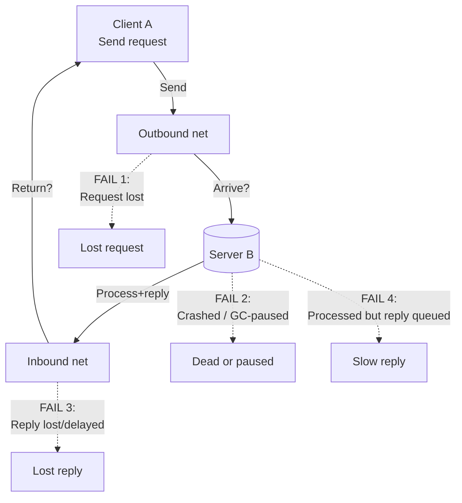
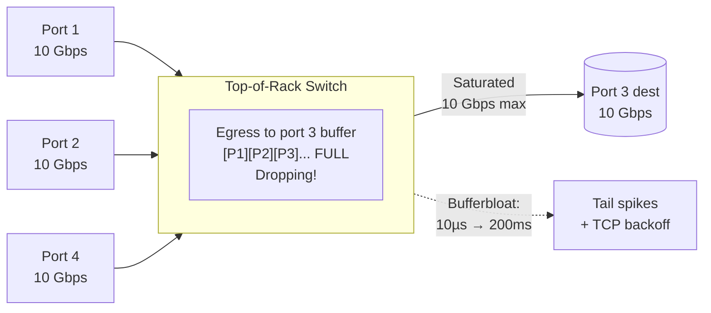
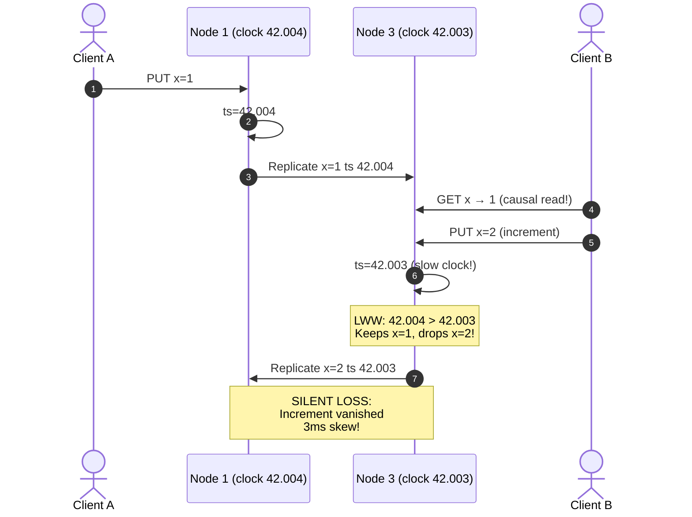
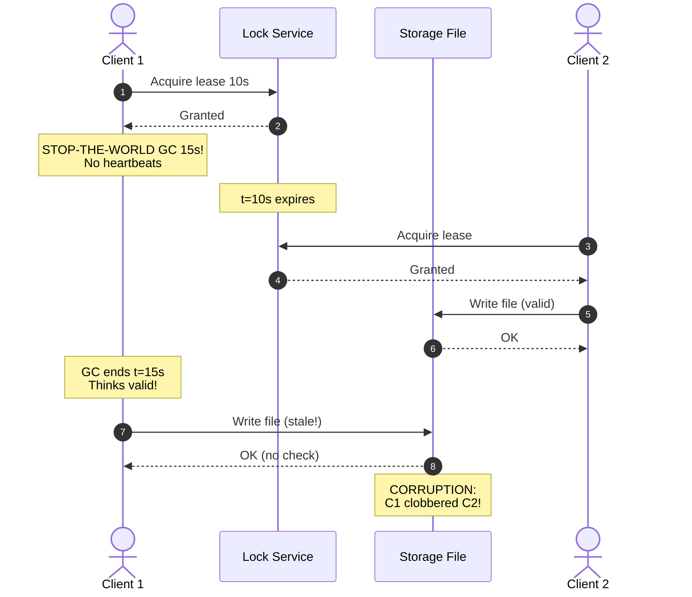
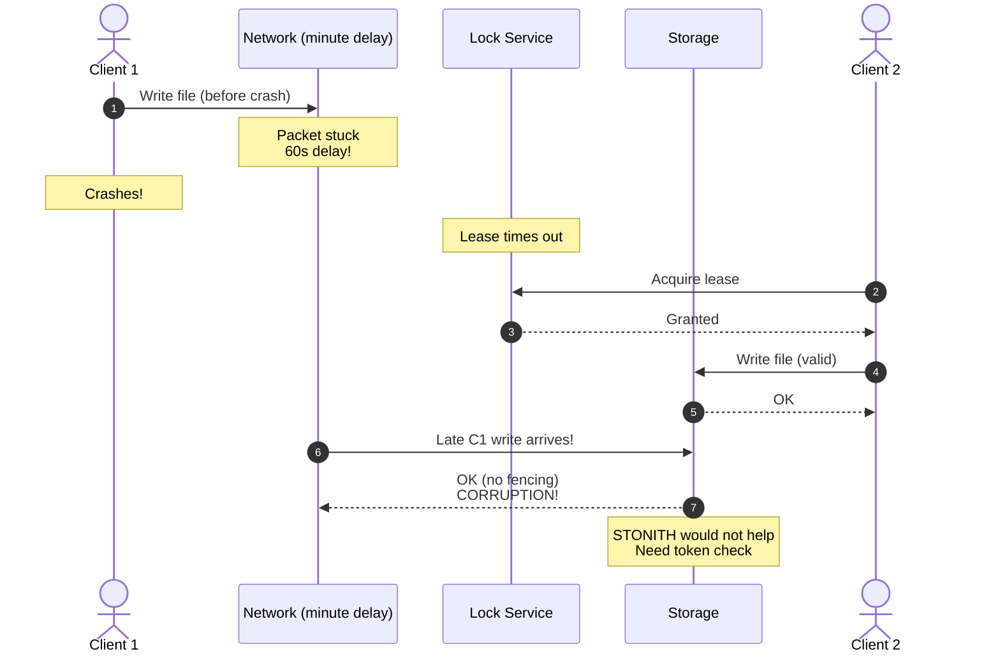
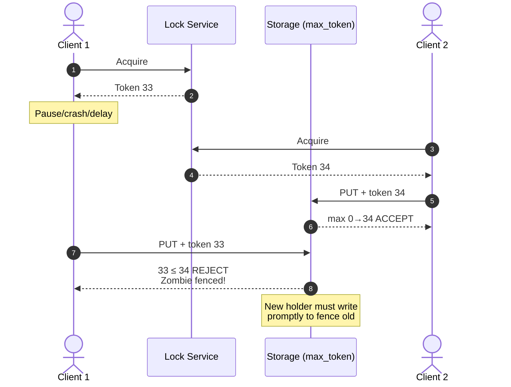
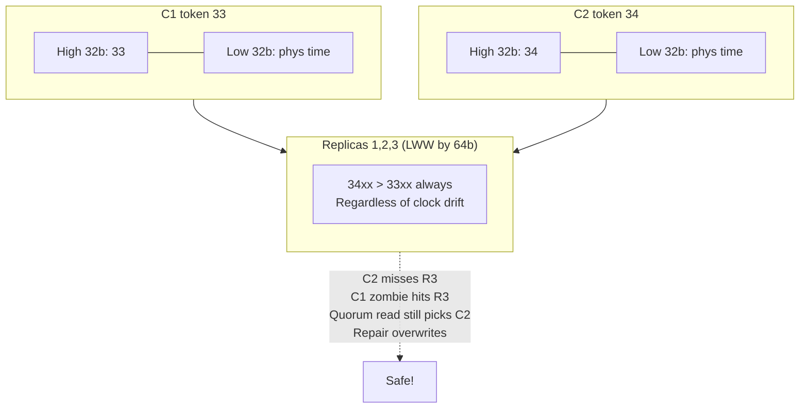

# Chapter 9: The Trouble with Distributed Systems — Definitive Technical Summary
*From: Designing Data-Intensive Applications (2nd Edition) by Martin Kleppmann and Chris Riccomini*
*Source PDF: pp. 369–424 (673-page PDF) — figures below cite PDF pages.*

> [!NAV] **Chapter Navigation**
> ⬅️ **Previous:** [[chapter-08-transactions|Chapter 08: Transactions]] | 🏠 **Index:** [[00-Master-Reading-Dashboard|Master Dashboard]] | ➡️ **Next:** [[chapter-10-consistency-and-consensus|Chapter 10: Consistency and Consensus]]

---

## 1. Executive Summary & Core Engineering Problem

> *"They're funny things, Accidents. You never have them till you're having them."*
> — **A.A. Milne**, *The House at Pooh Corner* (1928)

- **The Big Picture:** On one computer behaviour is deterministic: same op → same result; hardware fault → total crash (fail-stop, blue-screen, kernel panic). Computers hide fuzzy physics behind idealised perfection. In shared-nothing distributed systems (each machine own memory/disk, only network connects, even object storage over network) faults are **partial and nondeterministic**: one switch drops, two servers leak, 98 run fine; you cannot tell crashed vs GC-paused vs cut cable. Anything that can go wrong will — one-in-a-million happens daily at scale. Paranoia pays; test faults deliberately.
- **Core Thesis:** Networks have **unbounded delay**, clocks have **unbounded drift**, processes have **unbounded pauses**. Sender cannot distinguish lost request vs dead node vs lost reply vs delayed reply (Fig 9-1). Wall clocks jump backward (NTP step, leap second, DST) and drift 10–500ms; monotonic clocks can't be compared across nodes. Threads freeze seconds–minutes (GC, hypervisor steal, swap, SIGSTOP) without noticing. Correct algorithms therefore cannot rely on physical time or single-node judgement; they need **quorums, fencing tokens, partially-synchronous models, safety/liveness separation, formal verification + fault injection**.
- **Problem Statement:** Trusting lease checks or wall-clock LWW corrupts data. Classic: Client 1 holds ZooKeeper 10s lease on `orders.csv`, enters 15s JVM stop-the-world GC; lease expires; Client 2 acquires, writes Order #99; Client 1 wakes, thinks lock valid, overwrites → corruption (Fig 9-4). Same with delayed network write after crash (Fig 9-5). Without storage-side **fencing tokens** (33→34, reject ≤max) mutual exclusion is impossible. Similarly 4ms NTP skew + LWW silently drops causally-later `x=2` (Fig 9-3).
- **Historical & Industry Context:** 1980s MPP/Infiniband: any fault halted job. 2000s commodity Ethernet + cloud → reliable from unreliable (TCP over IP, ECC, Raft/Paxos). Telephone circuits (ISDN 4000 frames/s, 16 bits/250µs reserved) gave bounded delay at low utilisation; packet Ethernet/IP gives high utilisation at unbounded delay — cost/benefit, not law of nature. 2012 Spanner TrueTime (GPS+atomic, ε≤7ms, 2ε commit-wait) proved bounded clocks possible with hardware. 2010s–2020s standard: HLC (CockroachDB), phi-accrual detectors (Cassandra/Akka), TLA+/Elle/Jepsen/DST (AWS, FoundationDB, TigerBeetle, CockroachDB, TiDB, Kafka) non-negotiable. Coda Hale anecdote (partitions, PDU/switch/rack/DC/backbone/power failures, truck into HVAC) sets tone.

---

## 2. In-Depth Technical Concepts & Internal Mechanics

### 2.1 Faults and Partial Failures — Why Distributed ≠ Single-Computer

| Single computer | Distributed shared-nothing |
| :--- | :--- |
| Deterministic; good software fully functional or entirely broken | Nondeterministic partial failure: some parts broken, rest fine; op sometimes works, sometimes fails |
| Crash preferred over wrong result (fail-stop) | No fail-stop: can't tell dead vs slow vs partitioned |
| ECC, TCP already hide some faults | Must build reliability from unreliable parts: IP→TCP stream, ECC bits, Raft/Paxos survival |

Power: tolerate partial → rolling upgrades (reboot one node, service continues) → more reliable than single node. But must enumerate unlikely faults and inject them in test.

### 2.2 Unreliable Networks — Sender's Dilemma (Fig 9-1)

Client A → B, no response. Indistinguishable:

| # | Possibility | Example |
| :--- | :--- | :--- |
| 1 | Request lost | Cable unplugged, full switch buffer, misconfigured switch |
| 2 | Request queued/delayed | Overloaded network/recipient, VM pause, TCP backoff |
| 3 | Remote crashed | Power down, kernel panic |
| 4 | Remote paused but alive | Long GC (Ch.9 p.366), VM suspend/migrate |
| 5 | Reply lost | Switch misconfig, asymmetric fault (A→B ok, B→A drops [20–22]) |
| 6 | Reply delayed | Congestion, overloaded sender, noisy neighbour |

Only info: no response yet. Timeout = give up waiting, still don't know if request will still arrive. Retry may duplicate.

**TCP limits (why "reliable" isn't enough):**
- Packets ≤KB; TCP breaks streams, retransmits on ACK timeout, reorders, checksums, does congestion/flow/backpressure [5]. Socket write → OS buffer → congestion window → switches/routers → receiver OS buffer → ACK → app notify [6]. Same for QUIC/SCTP/uTP.
- Can't tell outbound vs ACK loss; can't plug cable; configurable timeout then error to app. Dedup+retransmit per-connection only — app reconnect+resend duplicates.
- Closed with error (crash/partition): unknowable how much remote processed [6]. Kernel ACK ≠ app handled (app may crash after recv). Need app-level positive response (end-to-end argument [7]).
- Useful framing: length-header + message (HTTP/RPC, Ch.5 p.180).

**Network faults in practice [8–23]:**
- Medium DC: ~12 faults/month (½ single machine, ½ whole rack) [9]. Redundant gear doesn't stop human misconfig [10].
- WAN fibre cut by cows [11], beavers [12], sharks [13–14], scavenging/sabotage/misconfig [15–17].
- Cross-region RTT minutes at p99 [18 Table 3]; intra-DC >1 min during switch upgrade reconfig [19]. Assume arbitrary delay.
- Partial: A↔B, B↔C ok but A↔C not [20,21]; NIC drops inbound but sends outbound [22]; one direction working ⇏ opposite.
- Brief interruption → long repercussions [8,20,23]; untested handling → deadlock after recovery [24] or data deletion [25]. At least know recovery path; ideally chaos-test (p.385).
- "Partition/netsplit" = cut off part; same as other interruptions; unrelated to sharding-partition (Ch.7).

**Fault detection:**
- Fast paths (unreliable): RST/FIN if port closed (process crashed); crash-notification script (HBase [26]); switch management query (no internet/shared-DC); ICMP unreachable (router also limited).
- Generally assume **no response**. Retry few times, timeout, declare dead. Too short → false positives (alive deemed dead); too long → outage wait. Balance.

### 2.3 Timeouts, Queueing and Sync vs Async

**How long timeout?** Fictitious bounded network (packet ≤d or lost) + bounded handler (≤r) → `2d+r` perfect timeout. Real async networks unbounded + handlers unbounded (GC/queue) → no correct value. Low timeout: transient spike → false failover, double-execution (e.g. send email twice, Ch.10/12), load transfer → cascading failure (overloaded node slow → declared dead → load to others → all declare each other dead, Ch.2 p.38). High timeout: users wait/errors during real crash.

**Queueing = main variability [27]:**
- Switch: N senders → same egress port → buffer queues one-by-one (Fig 9-2); full → drop → resend though network fine.
- Host: all cores/threads busy → OS queues; VM paused tens ms for other VM → hypervisor buffers [29]; TCP rate-limit queues at sender.
- TCP loss hidden as delay (timeout + retransmit ACK wait).
- **UDP trade-off:** VoIP/video use UDP — no flow/retransmit, still queued/scheduling delay, but avoids retransmit jitter. Delayed data worthless → fill silence, human retries ("repeat please?").
- Near capacity queues explode; spare capacity drains. Public cloud multitenant shares links/switches/NIC/CPU → noisy neighbour saturates → highly variable [30,31]. Choose timeouts experimentally (measure RTT distribution across machines/time); better auto-adjust by jitter (phi-accrual [32,33], TCP RTO [5]).

**Synchronous vs asynchronous networks (book pp.379–381):**
- **Synchronous network model:** Phone circuit ISDN 4000 fps, 16 bits/250µs each direction [35]; fixed bandwidth reserved end-to-end for call duration [34]; no queueing → bounded delay (every packet delivered within known bound `d` or lost). Different from TCP connection (opportunistic, idle uses ~0). In a synchronous network a `2d+r` timeout is provably correct — no response within `2d+r` means the remote is faulty.
- **Asynchronous network model (our reality):** Ethernet/IP packet switching optimised for bursty traffic (web/email/file want ASAP, no fixed rate). An asynchronous network tries to deliver as quickly as possible but offers no upper bound — an asynchronous network packet may arrive in 100µs or 60s (cross-region p99 minutes [18], intra-DC >1 min during reconfig [19]). File over circuit needs bandwidth guess: too low slow + waste, too high setup fails; by contrast TCP on an asynchronous network dynamically adapts to available capacity. The book's core claim (p.379): datacenter + internet are asynchronous networks by cost choice, not by nature — static reservation would give bounded delay but waste idle capacity.
- **Why the asynchronous network breaks timeouts:** Because an asynchronous network has unbounded delay, no timeout value is correct. Low timeout on an asynchronous network: transient queue spike → false failover, double-execution, cascading failure. High timeout on an asynchronous network: real crashes take minutes to detect. Hence timeouts on an asynchronous network must be chosen experimentally from RTT distributions, never derived from spec.
- **Asynchronous network failure detectors — from static timeout to phi-accrual:** A failure detector on an asynchronous network cannot distinguish crashed vs slow vs partitioned (Fig 9-1 sender's dilemma). Static timeout (`3 × 1s ping misses → dead`) is brittle on an asynchronous network with jitter. The phi-accrual failure detector [32,33] (Cassandra `dynamic_snitch`, Akka `akka.cluster.failure-detector`) models inter-arrival times on the asynchronous network as a normal distribution, computes suspicion `Φ = -log10(P(later arrival))`, and thresholds adaptively (Φ≥8 suspect, Φ≥12 dead). On a quiet asynchronous network Φ stays ~0; on a degraded asynchronous network Φ ramps smoothly; TCP RTO [5] does the same exponential-weighted adaptation. Rule: use phi-accrual (or equivalent adaptive detector) for any asynchronous network spanning AZs/regions or multitenant cloud; reserve static timeouts for a tightly-controlled synchronous-like LAN with bounded delay.
- **Latency vs utilisation on an asynchronous network:** wire 10k call slots statically split: alone still 1 slot (expensive, predictable). Internet as asynchronous network dynamically jostles per-moment (cheap, queued). CPU same: dynamic sharing → run-queue waits [36] but better use; static → guarantees but waste (Ch.9 p.369 RT). Cloud VMs same. Guarantees possible with static partition (dedicated HW/bandwidth) but costly. Variable delay on an asynchronous network = cost choice.
- Hybrids for taming the asynchronous network: ATM (1980s vs Ethernet, phone cores), InfiniBand link-layer flow control (less queue, still congestion [37,38]), QoS prioritisation/admission, L4S, Linux `tc`. Not enabled in multitenant clouds/internet → assume the asynchronous network with unbounded delay. BGP/peering = circuit-like at network level, long timescale, buyable bandwidth — but per-packet path is still an asynchronous network.

### 2.4 Clocks — Monotonic vs Time-of-Day, Sync and Accuracy

Apps ask durations (timed out? p99? QPS/5min? dwell?) vs points (published? reminder? TTL? log timestamp?). Network transit makes ordering hard; quartz per-machine drifts.

| Type | API | Meaning | Jumps back? | Use / Danger |
| :--- | :--- | :--- | :--- | :--- |
| **Time-of-day / wall** | `CLOCK_REALTIME`, `System.currentTimeMillis`, epoch ms since 1970 UTC (no leap) | Calendar; NTP-synced ideally same across nodes | **YES:** NTP step if far ahead, leap 59/61s minute [49], DST (use UTC) | Human display, expiry, logs. **Never for elapsed:** negative durations [40]. Coarse on old Windows (10ms [41]) |
| **Monotonic clock** | `CLOCK_MONOTONIC/BOOTTIME`, `System.nanoTime`, `time.monotonic` | Stopwatch since boot (arbitrary); per-CPU timers reconciled by OS (pinch of salt [44]) | NO jump; NTP may *slew* a monotonic clock rate ≤0.05% | Timeouts, benchmarks with a monotonic clock. **Meaningless cross-node.** Good resolution (µs) |
| **TrueTime / ClockBound** | `TrueTime.now()->[earliest,latest]` | Confidence interval, GPS+atomic | NO (monotonic window) | Global snapshots if ε small |
| **Logical** | Lamport/HLC counters (Ch.10) | Causality, not seconds | NO | Ordering (see §2.5, Ch.10) |

- **`System.nanoTime` (monotonic clock) vs `System.currentTimeMillis` (wall) — book pp.383–384:** Use the monotonic clock (`System.nanoTime`, `CLOCK_MONOTONIC`, `time.monotonic`) for durations — timeouts, p99 latency, retry deadlines — because a monotonic clock never jumps backward. Use wall time (`System.currentTimeMillis`, `CLOCK_REALTIME`) only for points — calendar display, log timestamps, TTL expiry. Mixing them is the classic bug: `elapsed = System.currentTimeMillis()-start` goes negative on NTP step or leap-second jump [40], while a monotonic clock difference is always ≥0 (modulo the per-CPU reconciliation caveat [43,44] — take the monotonic clock guarantee with a pinch of salt on multi-socket servers). A monotonic clock value is meaningless across nodes (different boot epochs), so never compare a monotonic clock reading from node A with a monotonic clock reading from node B for ordering — that needs wall + bounds or logical clocks.
- **NTP slew vs step for the monotonic clock and wall (pp.383–385):** NTP disciplines both clocks but differently. If offset is small, NTP *slews* the monotonic clock — speeds/slows its rate by up to 0.05% until aligned; the monotonic clock never jumps, only its frequency wobbles. If offset is large (far-ahead clock, long firewall partition), NTP *steps* the wall clock — forcibly resets `CLOCK_REALTIME` forward/backward [39]; observers see time jump. The monotonic clock still does not step, which is why all elapsed-time code must use the monotonic clock. Operational fallout of ignoring this: lease-expiry checks against wall time (`lease.expiry - currentTimeMillis`) inherit step jumps; the same check against a monotonic clock (`nanoTime` deadline) survives steps but still needs cross-node sync for the expiry origin.
- **Leap seconds, DST, and the monotonic clock (pp.384–385):** A leap second makes a UTC minute 59 or 61 s [49]; POSIX `CLOCK_REALTIME` either repeats a second (step back) or smears it. Either way wall time jumps or stalls — 2012/2017 leap-second steps sent Java `parkNanos`/futex/hrtimer into 100% busy-loop (Cloudflare/Reddit/LinkedIn/Qantas [40,50]). A monotonic clock is immune to leap jumps (it counts SI seconds since boot, not calendar), so sleeps/deadlines on a monotonic clock ride through the leap safely. Fix stack: (1) all timers on a monotonic clock, (2) NTP servers smearing the leap over 24 h [51–53] so wall observers see gradual slew not a step, (3) UTC everywhere (no DST jumps), (4) monitor offset and alert >100 ms. Leap seconds abolished from 2035, but the monotonic-clock-vs-wall discipline remains because NTP steps can still jump wall time at any deploy.

**Sync/accuracy pitfalls:**
- Quartz drift temp-dependent; Google assumes 200ppm → 6ms/30s, 17s/day [45]. Best possible bound.
- Far-ahead → refuse sync or forcibly reset → forward/back jump [39].
- Firewalled NTP unnoticed → large skew.
- Internet NTP ≥35ms min error [46], spikes ~1s; congested → give up. Single stranger time risky; query several, drop outliers, but hours-off servers seen [47,48].
- Leap seconds crash systems [40,50]; fix smearing (lie gradually over day) [51–53]; leap abolished 2035. Cloudflare 2012/2017 leap → futex/hrtimer busy-loop 100% [40].
- VMs: virtualized clock + steal-time jumps forward on resume [29]; NTP unaware → false accuracy [55]; shared core pauses.
- Untrusted devices (mobile/embedded): user sets wrong time to cheat [56].
- High accuracy possible with cost: MiFID II 100µs UTC for HFT [57], GPS+atomic+PTP+monitoring [58,59]; GPS jammable (military zones [60]); cloud microsecond clocks emerging [61] but misconfig/firewall still balloons error.

### 2.5 Relying on Sync — LWW Hazard (Fig 9-3), Confidence, Spanner Snapshots

Incorrect clocks go unnoticed (CPU/net fail obviously; clock drifts silently → subtle loss [62,63]). If requiring sync, monitor offsets, evict far-drifters.

**Timestamps for ordering (dangerous):** Multi-leader DB tags replicate writes with origin wall time. Example Fig 9-3 (skew <3ms, better than practical): A writes `x=1` on node1 ts 42.004 → replicate node3; B reads 1, increments to `x=2` on node3 ts 42.003 (lagging clock). Causally `2` after `1` but timestamp earlier. LWW keeps max ts → node2 drops `2`, increment lost. Fix needs read-before-write for max ts (extra RTT) — Cassandra/ScyllaDB skip for speed [62].

| LWW-clock problem | Effect |
| :--- | :--- |
| Lagging node | Cannot overwrite until skew elapsed → silent drops, unbounded [63,65] |
| Sequential vs concurrent | Indistinguishable; need version vectors (Ch.6 p.237) |
| Same-ms collision | Needs random tiebreaker → causality violation [62] |

"Recent" = local clock, may be wrong. Packet sent at 100ms can arrive at 99ms by clocks — impossible ordering. NTP accuracy limited by RTT itself → error never << delay → can't guarantee order. Use logical counters for order (Ch.6 p.237, Ch.10 p.417).

**Confidence intervals:** µs resolution ≠ accuracy (ms drift even LAN NTP per minute; tens ms internet, 100ms spikes). Think range, not point (e.g. 95% 10.3–10.5s [67]). Width from GPS/atomic quality or quartz-since-sync + server uncertainty + RTT. Most APIs hide it (`clock_gettime` no error bar: 5ms or 5 years?). TrueTime/ClockBound return `[earliest,latest]`; width grows since sync.

**Global snapshots (Spanner [68,69]):** MVCC needs monotonic txn ID reflecting causality (B overwriting A ⇒ ID_B>ID_A, Ch.8 p.293); distributed counter bottleneck (Ch.10 p.417). Use wall timestamps if sync good? Uncertainty problem. Spanner: if intervals `A=[Ae,Al]`, `B=[Be,Bl]` disjoint (`Ae<Al<Be<Bl`) then B definitely after A. Deliberately waits confidence length before committing R/W so readers' intervals don't overlap → causality. Needs small ε → GPS/atomic per DC (~7ms [45]). Not strictly required — interval matters, HW just shrinks wait; YugabyteDB+ClockBound on AWS [70], others [71,72].

### 2.6 Process Pauses — Leases, GC and Zombie Writes (Figs 9-4/9-5)

Single-leader per shard: how know still leader? **Lease** (lock with timeout [73]): only holder writes; renew periodically; fail stops renew → other takes over. Every process pause analysis starts from this lease loop — a process pause between check and use breaks it.

```text
while (true) {
  req = getIncomingRequest();
  // Ensure that the lease always has at least 10 seconds remaining
  if (lease.expiryTimeMillis - System.currentTimeMillis() < 10000) lease = lease.renew();
  if (lease.isValid()) process(req);
}
```

Wrong: (1) compares remote-set lease expiry with local wall (needs sync); (2) even local monotonic fails — an arbitrary process pause between `isValid()` check and `process()` defeats the 10s buffer (a 15s process pause means the lease expires mid-`process`). Thread gets no notice of the process pause; it checks the clock only on the next loop — by then the process pause has already caused unsafe work. Book p.390–391: no in-code gap is safe because a process pause can strike at any instruction.

**Process pause causes (book pp.390–394 — every one is a real process pause source):** lock/queue contention (worse many cores [74] — a process pause waiting on a mutex); JVM stop-the-world GC process pause (minutes historically [75], still noticeable — see GC paragraph below); VM suspend/resume/migrate process pause (arbitrary length [76]); laptop-lid process pause; OS/hypervisor context-switch + steal-time process pause under load; synchronous disk process pause (classloader fault, EBS variability [31]), page-fault/swap/thrash process pause (often disable paging on servers to bound the process pause); `SIGSTOP`/`Ctrl-Z` process pause (even accidental ops stops the process cold). A process pause preempts the thread without notification — the paused thread does not know a process pause happened until it next reads a clock.

> Node must assume a process pause anywhere; rest declares it dead during the process pause, then it wakes unaware. Like single-machine threading (mutexes/atomics/queues) but no shared memory — only unreliable messages. This process pause rule is the distributed analogue of "assume arbitrary thread interleaving".

**Real-time guarantees vs process pause?** Hard RT (aircraft/rockets/robots/cars, airbag vs GC) needs RTOS, WCET libs, no dynamic alloc (or RT GC + bounded work), massive testing — expensive, lower throughput (timeliness > speed), not economical for data systems. So data systems must suffer the process pause and clock instability that come from non-real-time environments (p.393).

**Taming the GC process pause [79–82]:** modern collectors shrink the GC process pause to ms (CMS/G1/ZGC/Epsilon/Shenandoah; Go concurrent MAS); Swift ARC, Rust/Mojo lifetimes avoid the GC process pause entirely; pool/reuse, off-heap; treat a GC process pause like a brief planned outage (drain → GC → resume [80,81]); short-lived only + rolling restarts before old-gen fills (LMAX [82]). Every technique reduces the GC process pause, never eliminates the process pause — a 50 ms GC process pause still exceeds a 10 ms lease buffer if timed adversarially, so fencing (§2.7) remains mandatory.

**Fig 9-4 GC process pause vs Fig 9-5 delayed-write-after-crash (both p.398, both break lease expiry):**

| Fig | Trigger | Sequence |
| :--- | :--- | :--- |
| 9-4 incorrect lock from GC process pause (HBase [85,86]) | 15s GC stop-the-world process pause | C1 holds 10s lease → GC process pause freezes heartbeats → lease expiry passes → C2 acquires → writes file → C1's process pause ends, C1 wakes thinking lease valid, overwrites → corruption. The process pause outlived the lease. |
| 9-5 delayed message, no process pause | No process pause; C1 crash + asynchronous network delay (minutes [19]) | C1 sends write just before crash, packet delayed in network → lease expiry passes → C2 acquires lease + writes → old delayed write arrives late → same corruption as the process pause case, proving lease expiry alone never suffices. |

Lesson spanning both figures: lease expiry without fencing is unsafe against either a process pause (Fig 9-4) or a delayed packet (Fig 9-5). A new holder must fence the old holder with a token (§2.7); STONITH alone cannot fix the Fig 9-5 delayed write because the zombie is already dead. Any design review must ask "what if a 60s process pause hits here?" and "what if this packet is delayed past lease expiry?" — if the answer is corruption, add fencing.

### 2.7 Fencing Tokens — Making Leases Safe (Figs 9-6/9-7)

Zombie = former holder unaware it lost lease. Can't prevent zombies → **fence** them (ensure harmless). STONITH/shoot-head (disconnect/VM kill/power off [9,87]) ineffective vs delays (Fig 9-5), can kill each other [19], too late after corruption.

Robust: **fencing token** (Chubby sequencer [88], Kafka epoch, Paxos ballot/Raft term — Ch.10) — increasing number per grant; client includes on every storage write.

| Step (Fig 9-6) | C1 token 33 | C2 token 34 |
| :--- | :--- | :--- |
| Grant | 33, then GC pause | 34 after expiry |
| Write | Late write token 33 | Immediate write token 34 → store `max=34`, OK |
| Check | `33 ≤ 34` → **403 StaleToken** rejected | — |

Similar to OCC (Ch.8 p.318) but permanent, not retryable. ZooKeeper `zxid/cversion` [85], etcd `revision+leaseID` [89], Hazelcast `FencedLock` [90] serve as tokens. Storage needs conditional/CAS check (S3 conditional writes, Azure conditional headers, GCS preconditions). Redlock debate [91,92] vs S3-leader-election [93]: single conditional store can replace lock service, but token reuses across replicas/services.

**With replicas (Fig 9-7):** leaderless LWW store: client writes each replica with client timestamp. Put token in high bits: `34… > 33…` regardless of low-bit clock. C2 quorum-misses replica3; zombie C1 later succeeds there, ignored on 1+2. Quorum read prefers C2, repair overwrites C1. Old holder fenced everywhere.

### 2.8 Knowledge, Truth, Lies — Majority, Byzantine, Models, Verification

Node knows others only via messages; no shared memory/variable/common knowledge [83]; can't even agree time. State assumptions as **system model**, prove algorithm within it — reliable from few guarantees, but nontrivial.

**Majority rules:** asymmetric fault (receives all, sends none [22]) → others declare dead though alive ("I'm not dead!" unheard); self-detects via missing ACKs but helpless. Pause 1min → buried then resurrects unaware. Moral: don't trust single node — **quorum voting** (Ch.6 p.231, Ch.10). Quorum-dead = dead even if feels alive; step down. Usually majority (>½): 3 tolerates 1, 5 tolerates 2; only one majority → no conflicting majorities.

**Distributed locks/leases misuse [84]:** need single holder for leader/shard, exclusive object, de-dup work. Pause → simultaneous holders: wasted work ok, but split-brain leader / corrupted object catastrophic.

**Byzantine faults:** fencing stops inadvertent zombies, not deliberate fake token. Book assumes unreliable but honest (slow/dead/stale, but truthful to knowledge). Byzantine = lie: contradictory votes, forged msgs. Generals problem [94] (two-generals impossibility [95] → consensus Ch.10). Name from "excessively complicated/bureaucratic" Byzantium, not history [96,97]; Albanian avoided [97].

| Byzantine relevant? | Example |
| :--- | :--- |
| YES | Aerospace radiation bit-flips (plane/rocket/ISS [98,99] need HW support); multi-party cheating (Bitcoin/blockchain agree without centre [100]); P2P no authority [103,104] |
| NO (this book) | Single-org DC (trusted, low radiation; orbit DCs considered [101]); tenants isolated by firewall/virt/ACL, not BFT; BFT expensive [102], needs HW [98]; same software everywhere → bug hits all (need 4 independent impls for 1 fault: >⅔ honest, e.g. 4 nodes tolerate 1); attacker compromising one likely all → use auth/ACL/TLS/firewall. Browser clients malicious → validate/sanitize/escape (SQLi/XSS), server authoritative, not BFT |

**Weak lying guards (non-BFT pragmatics):** app checksums (TCP/UDP miss corruptions [105–107]; TLS helps); sanitize/range/size checks even internal (parsers [105]); NTP multi-server majority outlier exclusion [39].

**System models:**

| Timing | Assumption | Realistic? |
| :--- | :--- | :--- |
| Synchronous | Bounded net/pause/clock error (not zero, just known bound [108]) | No — unbounded occurs |
| Partially synchronous | Sync mostly, sometimes unbounded | **YES — most useful** |
| Asynchronous | No timing, no clock/timeouts | Too restrictive, but for impossibility (FLP) |

| Node | Assumption |
| :--- | :--- |
| Crash-stop / fail-stop [109] | Crash → gone forever |
| Crash-recovery | Crash → restart after unknown time; stable disk survives, RAM lost |
| Limping / gray / fail-slow [110–114] | Slow but alive: 1Gb→1Kb driver bug, GC-bound, worn SSD, heat/vibration/PSU/firmware; health-check ok but useless; partial thread death |
| Byzantine | Anything including deception |

Partial-sync + crash-recovery + stable storage = workhorse (allows unbounded delay/pause/slow).

**Correctness: safety vs liveness [115,116]:** e.g. fencing tokens: uniqueness + monotonic sequence (safety) + availability (liveness, "eventually"). Safety violated at point (duplicate token operation — irreversible). Liveness may be pending (sent but no reply — hopeful). Require safety always even if all crash/network dead (never wrong); liveness caveated (majority alive, network eventually recovers; partial-sync eventually synchronous). Sorting invariant analogy.

**Model→reality gap:** stable storage may corrupt/wipe [117] or firmware miss disks [118] → quorum amnesia breaks correctness; need "mostly survives but sometimes lost" model — harder. Theory declares some things impossible; impl still handles (`printf+s exit`, human cleanup [119] — CS vs engineering [Kreps]). Models distil manageable faults.

**Formal methods & randomized testing:**
- Prove mathematically, but impl may diverge; still catches timing-hidden bugs. Combine with empirical: property/fuzz/deterministic sim (AWS, FoundationDB, TigerBeetle [120–123]).
- **Model checking (TLA+, Gallina, FizzBee):** spec core ideas, checker explores states/invariants. Infinite states → approximate/bound messages; longer-run bugs missed. Used CockroachDB/TiDB/Kafka [124–126]; TLA+ found VR data-loss ambiguity [127]. Risk spec↔code drift [128]; equivalence needs instrumentation [129].
- **Fault injection:** pause/kill (`kill`), unmount, firewall partition in prod-like (or prod — Chaos Monkey [130], chaos engineering Ch.3 p.43). Coordinators+scripts decide/trigger; inspect. Cumbersome → frameworks (Jepsen [131] integrations+injectors) remarkably effective [132,133]; analyses [Jepsen site]. Detects deadlock-after-recovery, data wipe cases.
- **Deterministic simulation testing (DST):** like model checker but on real code. Mocks net/I/O/clocks, controls order/timing/failures, explores randomized executions, replays exact failure order (vs fault injection). Requires determinism via: *app-level* (FoundationDB Flow [134], TigerBeetle event-loop+mock clocks [135]), *runtime-level* (single-thread async: FrostDB patched Go [136], Rust MadSim Tokio/S3/Kafka), *machine-level* (custom hypervisor: Antithesis all clocks/net/storage deterministic, containers inside). Benefits: branch subexecutions, faster-than-wall (mock timeouts), broad path cover.
- **Power of determinism:** nondeterminism = concurrency/delay/pause/jump/crash. Determinism simplifies: event-source replay (Ch.4 p.101), durable workflows need deterministic definitions (Ch.5 p.187), SMR same deterministic txn sequence (statement replication Ch.6 p.206, serial procs Ch.8 p.311, Ch.10 p.433).

---

## 3. Important Figures, Diagrams & Visual Architecture

> 📕 **Original figures quick index (source PDF, 673 pages):** open the PDF at the cited page to verify each reconstruction.
>
> | Book Fig | PDF page | What to compare |
> |---|---|---|
> | Fig 9-1 | PDF p.372 | Timeout ambiguity (lost req/dead/lost reply) |
> | Fig 9-2 | PDF p.378 | Switch queue ports 1,2,4→3 |
> | Fig 9-3 | PDF p.387 | Clock 42.004 vs 42.003 LWW drops x=2 |
> | Fig 9-4 | PDF p.398 | GC pause lock corruption |
> | Fig 9-5 | PDF p.398 | Delayed write after crash (lease expiry) |
> | Fig 9-6 | PDF p.399 | Fencing tokens 33→34 |
> | Fig 9-7 | PDF p.401 | Token in high bits, leaderless quorum |

### Figure 9-1: Sender Can't Tell Why No Response
- **Figure Reference:** `Figure 9-1: If you send request and don't get response impossible to distinguish`
- **Original PDF:** Fig 9-1 → PDF p.372
- **Mermaid Flowchart:**



- **Key Takeaway:** Timeout only says no reply; retry risks duplication.

---

### Figure 9-2: Switch Queueing — Ports 1,2,4 → 3
- **Figure Reference:** `Figure 9-2: Several machines sending to same destination fills switch queue`
- **Original PDF:** Fig 9-2 → PDF p.378
- **Mermaid Flowchart:**



- **Key Takeaway:** Bursts → queue → drop → retransmit delay; primary unbounded-delay source.

---

### Figure 9-3: LWW Loses Causally-Later Write (42.004 vs 42.003)
- **Figure Reference:** `Figure 9-3: Relying on timestamps for ordering causes loss`
- **Original PDF:** Fig 9-3 → PDF p.387
- **Mermaid Sequence Diagram:**



- **Key Takeaway:** Wall-clock "recent" ≠ causal; need version vectors or HLC/TrueTime.

---

### Figure 9-4: Broken Lock — GC Pause (No Fencing)
- **Figure Reference:** `Figure 9-4: Incorrect lock: client 1 pauses, lease expires, corrupts file`
- **Original PDF:** Fig 9-4 → PDF p.398
- **Mermaid Sequence Diagram:**



- **Key Takeaway:** Lease check→use gap + pause = split-brain; storage must enforce.

---

### Figure 9-5: Delayed Write After Crash — Same Corruption, No Pause
- **Figure Reference:** `Figure 9-5: Delayed message from former leaseholder arrives after takeover`
- **Original PDF:** Fig 9-5 → PDF p.398 (dashboard omits — added here; text p.374)
- **Mermaid Sequence Diagram:**



- **Key Takeaway:** Even without pause, network delay alone breaks lease; fencing required (renumber check: 9-5 is delay case, 9-6 fix, 9-7 quorum fix).

---

### Figure 9-6: Fencing Tokens Fix (33→34)
- **Figure Reference:** `Figure 9-6: Making storage safe by increasing fencing tokens`
- **Original PDF:** Fig 9-6 → PDF p.399
- **Mermaid Sequence Diagram:**



- **Key Takeaway:** Monotonic token + storage `max` check converts timing bug to deterministic reject. `zxid/cversion`, etcd `revision`, Hazelcast `FencedLock`, Chubby sequencer, Kafka/Raft epoch same idea.

---

### Figure 9-7: Fencing in Leaderless Quorums (High Bits)
- **Figure Reference:** `Figure 9-7: Using fencing tokens to protect leaderless writes`
- **Original PDF:** Fig 9-7 → PDF p.401
- **Mermaid Flowchart:**



- **Key Takeaway:** Token in MSB makes new holder win even with clock skew and partial quorum.

---

## 4. Real-World Systems, Case Studies & Code Examples

### 4.1 Industry Implementations

- **Spanner TrueTime:** GPS+atomic per DC, `[earliest,latest]` ε≤7ms, 2ε commit-wait → external consistency globally; needs antenna monitoring (ε balloons on failure → stall).
- **CockroachDB/YugabyteDB HLC:** NTP+Lamport hybrid; fail-fast if drift >500ms (deliberate crash to avoid poisoning); Yugabyte+ClockBound on AWS.
- **ZooKeeper (Zab) / etcd (Raft):** Linearizable coordination, `zxid/cversion` or `revision` as fencing, ephemeral nodes + watches for membership; observers (non-voting) for stale-fast reads.
- **Cassandra/Akka phi-accrual:** Adaptive suspicion from inter-arrival distribution, not static timeout; survives elastic/inter-DC jitter.
- **MiFID II HFT:** 100µs UTC via PTP+GPS+monitoring — proof accuracy costs.
- **Leap-smearing (Google/AWS):** spread leap second over 24h, avoid kernel futex meltdown (Reddit/LinkedIn/Qantas 2012).
- **Jepsen/Elle/Chaos Monkey/DST:** Jepsen partitions/kills/corrupts ([Jepsen analyses]), Elle infers isolation anomalies from histories (Kingsbury-Alvaro VLDB), Chaos Monkey prod faults, FoundationDB Flow / TigerBeetle event-loop / FrostDB Go-patch / MadSim Tokio / Antithesis hypervisor for deterministic replay.

### 4.2 Production Implementation: Phi-Accrual Detector

```python
import math, time
from typing import List
class PhiAccrual:
    def __init__(self, threshold=8.0, window=100):
        self.th=threshold; self.win=window; self.iv:List[float]=[]; self.last=time.time()
    def heartbeat(self):
        now=time.time(); self.iv.append(now-self.last); self.last=now
        if len(self.iv)>self.win: self.iv.pop(0)
    def phi(self)->float:
        if len(self.iv)<2: return 0.0
        diff=time.time()-self.last
        mean=sum(self.iv)/len(self.iv)
        var=sum((x-mean)**2 for x in self.iv)/len(self.iv)
        sd=math.sqrt(var) if var>0 else 1e-3
        y=(diff-mean)/sd
        e=math.exp(-y*(1.5976+0.070566*y*y)) if y>-3 else 1.0
        p=max(e/(1+e),1e-12)
        return -math.log10(p)
    def alive(self)->bool: return self.phi()<self.th
```

Cassandra: Φ≥8 route elsewhere, Φ≥12 failover. TCP RTO same adaptive idea.

### 4.3 Production Implementation: Fenced Store + Quorum Vote

```python
from typing import Dict, Any, Tuple
class FencedStore:
    def __init__(self): self.data:Dict[str,Any]={}; self.max_token=0
    def put(self,key:str,val:Any,tok:int)->Tuple[bool,str]:
        if tok<=self.max_token: return False, f"STALE {tok} ≤ {self.max_token}"
        self.max_token=tok; self.data[key]=val; return True,"COMMITTED"

class Quorum:
    @staticmethod
    def majority(n:int)->int: return n//2+1
    @staticmethod
    def is_dead(votes:int,n:int)->bool: return votes>=n//2+1
    # 3 nodes tolerate 1, 5 tolerate 2; overlapping majorities prevent split decisions
```

Leaderless 64-bit stamp: `(token<<32)|phys_ms`; compare as int.

### 4.4 TLA+ Snippet (Fencing Safety) & Jepsen Sketch

```tla
---- MODULE Fencing ----
VARIABLES maxToken, granted
TypeOK == maxToken \in Nat
Safety == \A w1,w2 \in Writes: Committed(w1) /\ Committed(w2) /\ w1#w2 => Token(w1)#Token(w2)
Monotonic == \A r1,r2 \in Grants: CompletesBefore(r1,r2) => Token(r1)<Token(r2)
====
```

Jepsen (Clojure): `nemesis partition-random-halves`, `checker linearizable`, `workload cas-register`; Elle: infer `read-skew/lost-update` from observed histories without code access. DST: mock clock/net, explore interleavings, replay seed on failure.

### 4.5 Production War Story: Leap-Second Meltdown (2012-06-30 23:59:60)

POSIX can't represent :60 → kernel stepped back 1s → Java `parkNanos`/futex deadline in past → `hrtimer` busy-loop → all cores 100% kernel → Cassandra/ES/Hadoop/MySQL stall → LBs marked dead (Reddit/LinkedIn/Qantas hours). Fix: leap smearing + `CLOCK_MONOTONIC` for all timers/sleeps/deadlines; monitor NTP offset.

---

## 5. Architectural Trade-Off Matrix

| Technique | Advantage | Hazard | Clock | Net sensitive? | Fit | Catastrophe |
| :--- | :--- | :--- | :--- | :--- | :--- | :--- |
| **NTP wall** | Calendar, ubiquitous | 10–100ms drift, jumps | Extreme | Moderate (asymmetric skews) | Logs, TTL display | LWW drops newer |
| **Monotonic** | Never back, µs | Local only | Zero cross-node | Zero | Timeouts, p99 | Cross-node ordering nonsense |
| **TrueTime** | ε≤7ms linearizable wait | HW + 2ε latency | HW GPS/atomic | Minimal | Global ledgers | Antenna fail → stall |
| **HLC** | No HW, causal+phys | Crash if drift>bound | Moderate | Low | Cockroach multi-region | Bad clock poisons all |
| **Static timeout** | Simple | False positives | Minimal | Extreme | Stable LAN | Split-brain flapping |
| **Phi-accrual** | Adaptive, low FP | Window+warmup | Minimal | Low | Elastic/WD (Cassandra) | Slow ramp on hard cut |
| **Fencing token** | Zombie-proof | Needs store check | Zero | Zero | Locks/leader | Missing check = corrupt |
| **Majority quorum** | One decision, F=(N-1)/2 | Minority halts | Zero | Needs partial sync | Election/commit | 4 nodes = 3-node tolerance, more failure surface |
| **TLA+/Jepsen/DST** | Finds deep bugs pre-prod | Spec-drift, harness cost | Mocked | Controlled | Infra | Untested path → outage |

Odd nodes only (3/5/7): 4 needs 3 same as 3 but higher failure prob.

```text
Decision Tree:
1. Order needed? GPS/atomic feasible? → YES TrueTime+2ε. NO → phys needed? HLC+drift-crash : Lamport/vector/Raft-term.
2. Lock/lease? NEVER trust local check! → ZK/etcd token + store max check on every mutation. Single conditional store may replace lock service.
3. Failure detect? Static only on predictable LAN; else phi-accrual. Failover must STONITH/fence old primary before promote.
```

---

## 6. Jargon Buster & Key Terminology

- **Partial Failure:** Some parts broken, rest fine, nondeterministic; defining distributed trait.
- **Fail-Stop / Crash-Stop / Crash-Recovery / Limping (gray/fail-slow):** Never returns / returns with disk / slow-but-alive (1Kb NIC, GC-bound, worn SSD).
- **Wall vs Monotonic clock:** Calendar wall clock (jumps) vs monotonic clock stopwatch (forward, local); never use wall for elapsed, never compare a monotonic clock across nodes.
- **Monotonic clock API:** A monotonic clock is `CLOCK_MONOTONIC/BOOTTIME`, `System.nanoTime`, `time.monotonic`; reading a monotonic clock twice gives elapsed time immune to NTP steps and leap jumps.
- **Monotonic clock slew:** NTP may slew a monotonic clock rate ±0.05% but never steps a monotonic clock; wall steps while a monotonic clock only changes frequency.
- **Monotonic clock limit:** A monotonic clock is meaningless cross-node (different epochs); ordering across nodes needs wall+confidence or logical clocks, not a monotonic clock comparison.
- **Monotonic clock rule:** Every timeout, deadline, and p99 measurement must use a monotonic clock; every timestamp shown to humans may use wall.
- **Asynchronous network:** An asynchronous network offers no bounded delay — packets arrive whenever capacity allows; all cloud/internet paths are an asynchronous network, so timeouts must be measured not specified.
- **Asynchronous network detector:** Failure detection on an asynchronous network needs adaptive phi-accrual, not a fixed timeout, because an asynchronous network conflates slow with dead.
- **Drift/Skew/Slew/Smear:** Rate error / offset between nodes / gradual rate adjust / spread leap over day.
- **TrueTime/ClockBound/HLC:** Interval clock / AWS interval / phys+Lamport hybrid.
- **Sender's Dilemma / Timeout / Phi (Φ):** Can't distinguish loss/dead/delay on an asynchronous network; only sure detector; `-log10(P_later)` suspicion.
- **Circuit vs Packet / Bufferbloat / Noisy Neighbour:** Reserved synchronous vs contention asynchronous network; queue delay explosion; shared-tenant interference.
- **Process pause / Steal Time / Thrashing:** A process pause from GC/hypervisor/swap freeze; other-VM CPU causes a process pause; paging collapse is a prolonged process pause.
- **Process pause lease rule:** A process pause can outlive any lease — never trust a pre-process-pause lease check; every mutation after a possible process pause must be fenced.
- **Lease / Zombie / Fencing Token / STONITH:** Timed lock / unaware ex-holder after a process pause / monotonic grant number / shoot-to-fence (insufficient alone against a process pause or delay).
- **Quorum / Majority:** Votes to reduce single-node trust; >½ gives one decision.
- **Byzantine / Generals:** Arbitrary lying; agreement with traitors; needs >⅔ honest, costly.
- **Sync / Partial-Sync / Async:** Bounded / mostly-bounded / no timing.
- **Safety ("nothing bad", point violation) vs Liveness ("eventually good", hopeful):** Uniqueness vs availability; safety always, liveness caveated.
- **TLA+/Model Checking / Jepsen / Elle / Fault Injection / DST / Determinism:** Spec exhaustive search / partition fault framework / isolation inference / prod chaos / mock-order replay / remove nondeterminism to simplify.

---

## 7. System Design & Practical Engineering Takeaways

### 7.1 Production Engineering Checklist
1. **Monotonic clock for durations:** `nanoTime/monotonic/CLOCK_MONOTONIC` monotonic clock for timeouts/latency; wall only for display/TTL with UTC; never compute elapsed with wall, always with a monotonic clock.
2. **Fence every lock target:** ZK `zxid`/etcd `revision` → `PUT key,val,token`, reject `≤max`; new holder writes promptly; S3 conditional writes for leader election.
3. **Smear + monitor NTP:** Internal smearing NTP, alert offset>100ms, evict far-drifters; PTP/GPS where MiFID-like needs.
4. **Bound pauses below leases:** ZGC/Shenandoah <50ms if lease 10s; drain-before-GC/rolling restarts; disable swap on servers; handle SIGSTOP drills.
5. **Odd quorums + STONITH:** 3/5/7 voters, observers for scale; power-off/isolate old primary before promote; `min-replicas-to-write` guards.

### 7.2 System Design Interview Strategy
- Start: "Dead vs slow indistinguishable on an asynchronous network → timeouts + quorum + fencing with a monotonic clock for measurement, not wall time." Redlock critique: validity−elapsed−drift fails on process pause/jump, no store token → unsafe; fix with consensus + fencing.
- Kill LWW: "10–100ms drift → newer dropped; use HLC/vector/siblings or linearizable CAS."
- Sketch: `HeartbeatBW=N(N-1)B/interval`; `P(false)=1-(1-P(delay>timeout))^N`; `F=(N-1)/2`; Spanner London example 140ms central 2PL vs 82ms local-Paxos+12ms 2ε (41% cut).

### 7.3 Mastery Self-Assessment Questions

#### Question 1 (Conceptual Depth)
*Why is Redlock unsafe in partial-sync without fencing?*
- **Answer:** Sequential majority in N independents, `validity=lease−elapsed−drift`. Pause after validating (15s GC) → expiry → other acquires → both write (local var stale). Clock jump expires early. No monotonic token storage can check → zombie writes through. Needs Raft/Zab + store `max` enforcement.

#### Question 2 (Failure Scenario)
*1s ping, 3 misses → promote standby; 4.2s page-writeback stall. Chain?*
- **Answer:** Stall → 3 timeouts → false dead → promote → original unaware (no clock notice) → dual primaries (DNS/pool split) → divergent PKs/WAL irreconcilable → halt+audit. Lessons: 3s too aggressive, need phi-accrual, STONITH old primary, `synchronous_commit` + fencing.

#### Question 3 (Capacity)
*NY-London 70ms, London-Tokyo 150ms, NY-Tokyo 180ms. London txn: (A) NY leader 2PL majority NY+London vs (B) Spanner local London + Paxos + 2ε ε=6ms.*
- **Answer:** A: London→NY 35ms + NY↔London 70ms + NY→London 35ms = **140ms**. B: local ~0 + London↔NY Paxos 70ms + 12ms wait = **82ms** (41.4% less). Local leaders avoid WAN hops while linearizable.

---
> [!NAV] **Chapter Navigation**
> ⬅️ **Previous:** [[chapter-08-transactions|Chapter 08: Transactions]] | 🏠 **Index:** [[00-Master-Reading-Dashboard|Master Dashboard]] | ➡️ **Next:** [[chapter-10-consistency-and-consensus|Chapter 10: Consistency and Consensus]]
