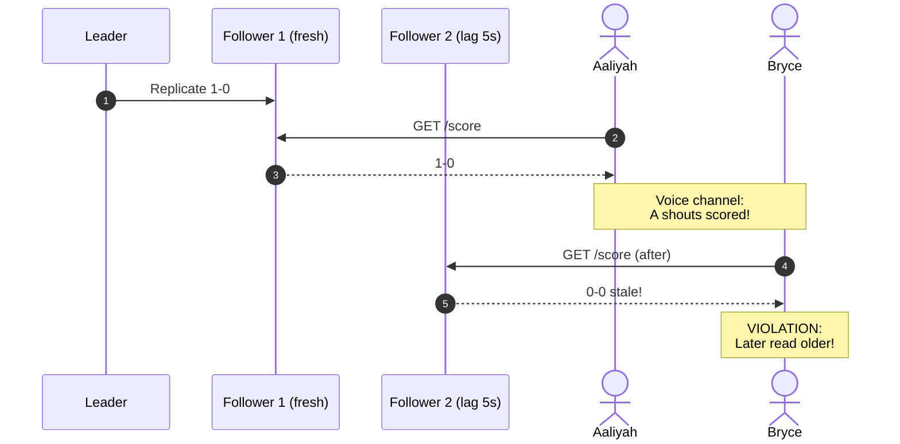
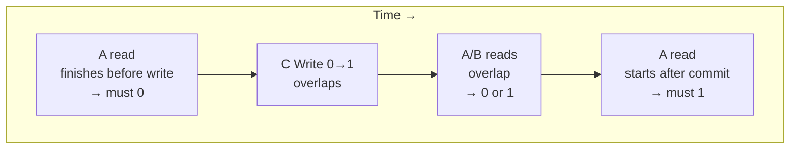
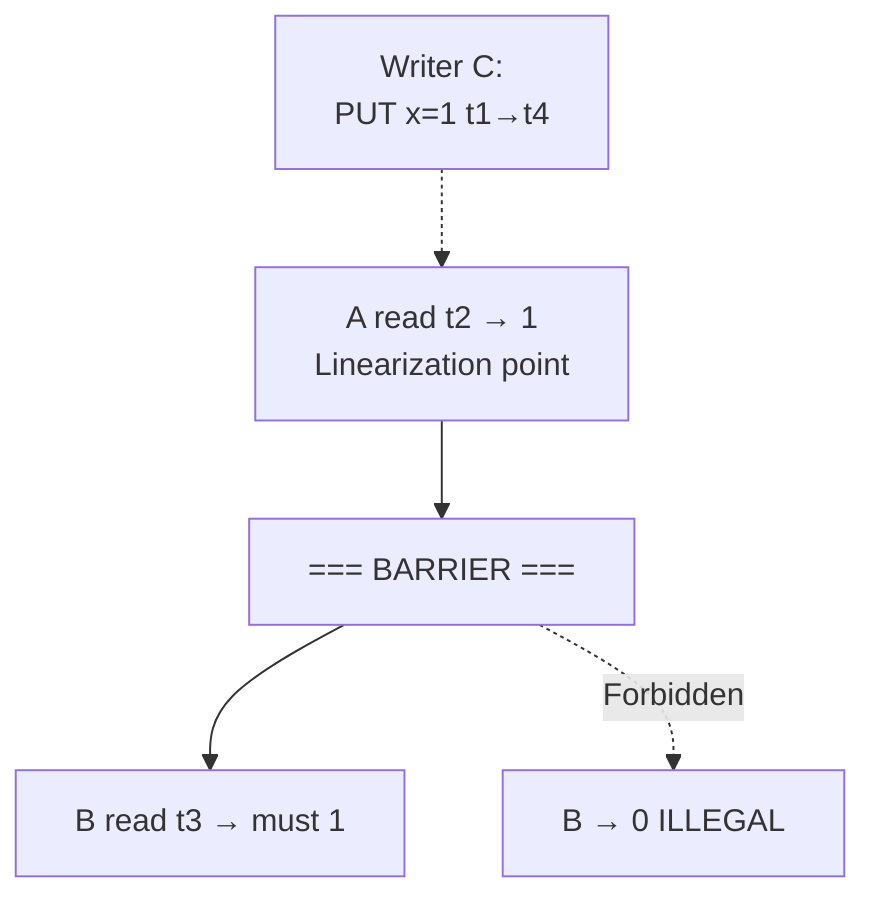
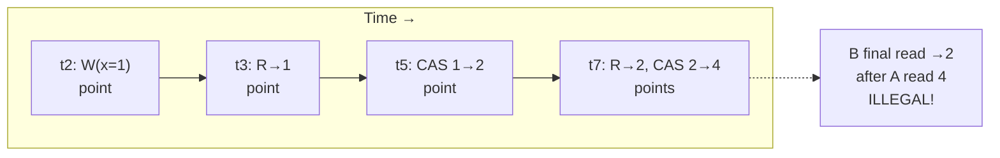
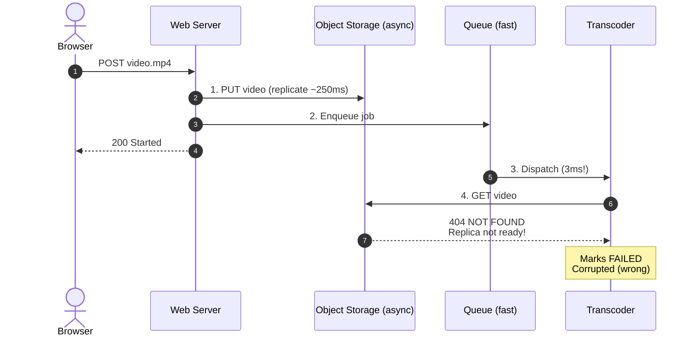
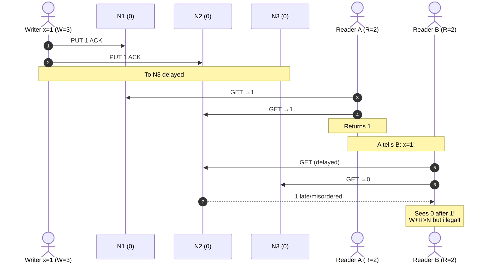
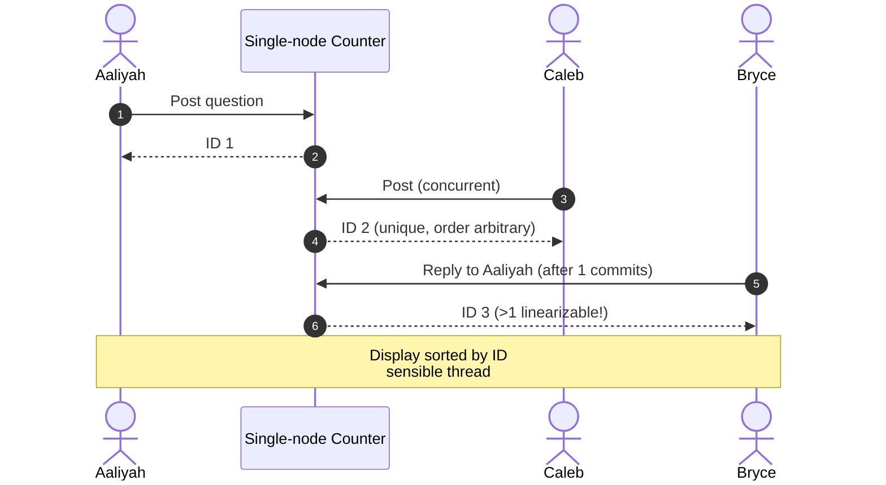
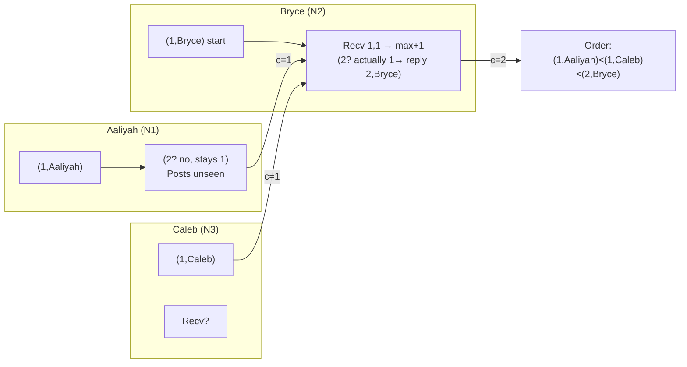
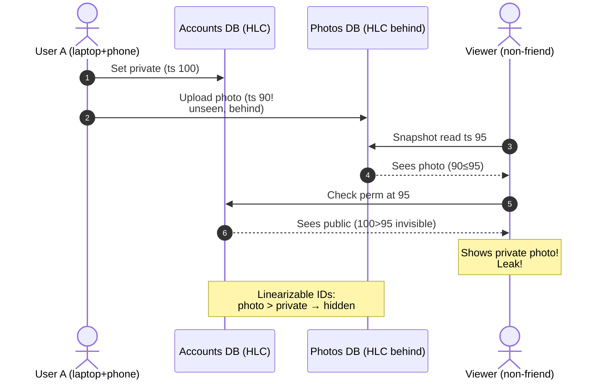

# Chapter 10: Consistency and Consensus — Definitive Technical Summary
*From: Designing Data-Intensive Applications (2nd Edition) by Martin Kleppmann and Chris Riccomini*
*Source PDF: pp. 425–474 (673-page PDF) — figures below cite PDF pages.*

> [!NAV] **Chapter Navigation**
> ⬅️ **Previous:** [[chapter-09-the-trouble-with-distributed-systems|Chapter 09: The Trouble with Distributed Systems]] | 🏠 **Index:** [[00-Master-Reading-Dashboard|Master Dashboard]] | ➡️ **Next:** [[chapter-11-batch-processing|Chapter 11: Batch Processing]]

---

## 1. Executive Summary & Core Engineering Problem

> *"An ancient adage warns, 'Never go to sea with two chronometers; take one or three.'"*
> — **Frederick P. Brooks Jr.**, *The Mythical Man-Month* (1995)

- **The Big Picture:** Two clocks disagree → don't know which right; three → majority vote. That's **consensus**: group agrees irrevocably, tolerating faults (Ch.9). Replication alone risks stale reads and conflicting writes (Ch.6). Two philosophies: *eventual* (expose replication, app resolves — multi-leader/leaderless) vs *strong* (behave as single node, system hides replication). Strong costs performance and outages on faults, but right when replicas have fast reliable links. This chapter: define strong precisely (**linearizability**), connect ID/timestamp generation, achieve fault-tolerant linearizability via **consensus**. Theory hard; informal here, literature for proofs.
- **Core Thesis:** Almost every high-level distributed feature — leader election, locks, unique constraints, multi-partition atomic txns, linearizable registers — reduces to consensus. Weaker models (eventual/causal) trade correctness for latency/availability, but shared-state actions (reserve seat, claim `alice`, prevent overdraft) need linearizability: illusion of single copy, operations atomic at discrete points. Consensus = total order broadcast = state-machine replication = CAS = atomic commit (interconvertible). FLP proves deterministic async consensus with 1 crash impossible; partial synchrony (timeouts) + majorities + epochs make it practical (Raft/Multi-Paxos/Zab).
- **Problem Statement:** Without linearizability, multiple channels race. Video platform (Fig 10-5): web writes 500MB to S3 (async multi-DC replicate ~250ms), immediately enqueues RabbitMQ/Kafka transcode job (3ms delivery); worker `GET` routes to not-yet-replicated S3 replica → `404` → marks upload corrupted though file arrives 240ms later. Same for push-notification→fetch from lagging replica, Alice shouts score → Bob sees 0-0 (Fig 10-1). Fix: linearizable store or version/ETag + retry, not fire-and-forget.
- **Historical & Industry Context:** 1980s Lamport Paxos (impenetrable), 1985 FLP impossibility, 2006 Chubby (theory→practice gap), 2014 Raft understandable (leader+log). 2020s: Raft/Multi-Paxos backbone for CockroachDB/TiDB/YugabyteDB, etcd/K8s, Kafka KRaft; Spanner Multi-Paxos+TrueTime strict serializable; FoundationDB SSI. Single-node fetch-and-add trivial, distributed needs quorum; LWW+wall clocks fail (Ch.9).

---

## 2. In-Depth Technical Concepts & Internal Mechanics

### 2.1 Linearizability — Recency on a Single Register

> Behave as if single copy, all ops atomic. As soon as one client completes write, all clients must see it — **recency**, not just eventual. Strongest common single-object model (aka atomic/strong/immediate/external consistency [1–3]).

**Fig 10-1 non-linearizable fans:** Aaliyah refreshes, sees France 1–0, shouts; Bryce reloads *after* hearing → lagging replica 0–0. Same-time different results excusable (unknown server times); strictly-after stale = violation. Extra channel (voice) exposes it — same as file+queue (Fig 10-5).

**What makes linearizable (Figs 10-2/10-3/10-4):** Register `x` (K-V key/row/doc). Bar = send→recv; processing somewhere inside (net delay unknown). `Read(x)=>v`, `Write(x,v)=>r`, `CAS(x,old,new)=>r`.

| Fig | Rule |
| :--- | :--- |
| 10-2 concurrent allowed | Initial 0, C writes 1 while A/B poll. A's first read completes before write → must 0. A's last begins after write completes → must 1. Overlapping reads → 0 **or** 1 (unknown order). |
| 10-3 barrier | Concurrent reads must not flip-flop: if A reads 1, any read starting after A returns (B) must 1 even if write ongoing. Establishes atomic flip point. |
| 10-4 linearization points | Each op takes effect instantaneously at point inside its bar; points order forward in time, sequence valid (every read returns most recent write). Details: B read returns 1 though sent before D `0`→A `1` (net reorder ok, all concurrent); B sees 1 before A gets `OK` (ACK delayed ok); no isolation (C reads 1 then 2 as B changes; B/C CAS succeed, D CAS `0` fails as no longer 0); **final B shaded illegal:** concurrent with C CAS 2→4 would allow 2 alone, but A already read 4 before B started → B must ≥4, returning 2 forbidden. Testable by recording timings and searching valid order (expensive [6,7] — Knossos/Elle). |

Includes read-after-write, monotonic, prefix (Ch.6 p.209) and more.

### 2.2 Linearizability vs Serializability vs Sequential Consistency

| Model | Scope | Real-time? | Allows stale? | Prevents write skew? |
| :--- | :--- | :--- | :--- | :--- |
| **Linearizability** | Single register R/W | **YES** (finish→start ⇒ see newer) | NO | NO (multi-object races allowed) |
| **Serializability** (Ch.8 p.308) | Multi-object txn isolation | NO (any serial order, even 3-day snapshot) | YES | YES |
| **Sequential consistency** [8] | Multi-object ops, all clients same order | NO (order need not respect wall time) | YES (stale allowed if ordered) | Depends |
| **Strict / Strong-1SR** [11,12] | Both | YES | NO | YES (Spanner/FoundationDB; CockroachDB serializable + some recency but not strict [13,14]) |

Isolation and consistency largely independent [17,18]: weaker isolation + linearizable, or serializable + weaker consistency possible. Causal/eventual weaker still (Ch.6).

### 2.3 Relying on Linearizability — When Required

1. **Locking & leader election:** Single-leader must have one leader. Lease acquire must be linearizable else two holders → split-brain. ZooKeeper/etcd via consensus (Ch.10 end); Curator recipes atop; Oracle RAC per-page linearizable locks on interconnect; leases need fencing (Ch.9 p.373). Note: ZooKeeper writes linearizable but reads may be stale (no leader check) [20]; etcd ≥3 linearizable reads by default (ReadIndex/lease check).
2. **Constraints & uniqueness:** Username/email/path, CAS `set if not taken`, balance/stock/seat (`balance≥0`, `stock>0`). Two concurrent `alice` → one must error. Like lock/lease. Loose constraints (overbook + rebook+compensate, Ch.13 p.571) may avoid linearizability; hard relational `UNIQUE`/FK needs it (FK/attribute without linearizability possible [22]).
3. **Cross-channel (Fig 10-5):** File+queue, push+fetch, voice+DB. Without recency, fast channel wins over slow replication. Linearizability simplest; alternative if you control channel: read-your-write tracking (Ch.6 p.210) at complexity cost.
4. **Overbooking/depletion:** Last seat, CAS-guarded decrement.

**Cross-channel timeline (YouTube/Vimeo):** `t0` Alice POST 500MB; `t120ms` S3 us-east-1a 200 OK (async to 1b ~250ms); `t122ms` AMQP `job_881`; `t125ms` worker dequeues (3ms); `t127ms` GET to 1b → 404; `t132ms` mark FAILED + email; `t370ms` replica ready but job deleted. Fixes: linearizable S3 (read-after-write since 2020), or include `versionID/size/ETag` in message + backoff retry not fail.

### 2.4 Implementing Linearizable Systems & CAP

| Replication | Linearizable? | Why |
| :--- | :--- | :--- |
| **Single-leader** | Potentially, if all R/W on leader **and** you know leader | Delusional lease-holder serves (Ch.9 p.373) violates [23]; async failover loses commits (durability+linearizability). Sharding per-leader doesn't affect single-object; cross-shard txns different (Ch.8 p.323) |
| **Consensus (Raft/Paxos/Zab)** | Yes, carefully | Zab [24], Raft [25] with failover prevent split-brain. But follower/leader-without-check reads stale on new leader |
| **Multi-leader** | No | Concurrent async writes → conflicts (Ch.6 p.222) |
| **Leaderless Dynamo** | Probably not, even `W+R>N` | LWW wall clocks skew (Ch.9 p.362). Fig 10-6 race: `N=3 W=3 R=2`, writer to N1+N2 (`x=1`), A reads N1+N2 →1, B reads N2+N3 (N2 delayed/reordered) →0 after A saw 1. To fix: synchronous read-repair before return [26] + read-before-write for greater timestamp [27,28]. Riak skips sync for speed; Cassandra waits but clock loses. **CAS needs consensus** [30] — never assume Dynamo linearizable |

**Cost — Fig 10-7 partition:** Regions can't connect, intra-region ok. Multi-leader continues both, queues for heal. Single-leader: follower-region linearizable R/W must synchronously go to leader region; partitioned followers can serve stale reads only. Any linearizable DB same, not just leader-follower.

- **CAP [31–34] (Brewer 2000):** Partitioned + need linearizability ⇒ replicas wait/error (CP, unavailable); else each processes independently, available but non-linearizable (AP). Narrow formal scope: one model (linearizability) + one fault (partition, <8% Google [39]), nothing on delay/dead nodes. Sparked NoSQL [38]. **PACELC [40,46,47]:** If Partition choose A/C, Else Latency/C. Superseded by precise results [42,43], historic now.
- **Unhelpful CAP:** "Pick 2 of 3" misleading [34] — partition not chosen, happens; no network = no HA either. Healthy net gives both; fault forces choice [44]. CP/AP flawed: consistency=linearizability only, availability idiosyncratic [32] vs usual [45]; many HA miss CAP-availability; some neither CP nor AP [46,47]. Don't dwell.
- **Delay cost:** Even CPU RAM not linearizable [48] (per-core cache/store buffer, async to mem; barrier/fence [49] needed; cache speed essential [50]). Not CAP — perf, not fault tolerance [46]. Same distributed: linearizable = higher latency always, not just faults. Attiya-Welch [51]: latency ≥ delay uncertainty; highly variable net ⇒ high linearizable latency inevitably. Weaker much faster (Ch.13 avoids linearizability).

### 2.5 ID Generators, UUIDs, Snowflake and Ordering

Single-node autoincrement (64/32b, risky 4B limit) orders creation (Fig 10-8 chat: Aaliyah 1, Caleb concurrent ?, Bryce reply 3). It's linearizable fetch-and-add: if Aaliyah completes before Bryce starts, Bryce ID greater. Concurrent unordered but unique. In-mem easy via CPU atomic; persist+replicate for crash (else duplicates). Problems: SPOF, cross-region RTT for ID, bottleneck.

| Option | Bits / Example | Ordering | Notes |
| :--- | :--- | :--- | :--- |
| **Sharded** (even/odd, shard bits) | Compact | **Lost:** 16 vs 17 different nodes, ahead unknown | Simple, no coord |
| **Block prealloc** (A 1–1000, B 1001–2000) | Compact | **Lost:** later msg in 1–1000 after 1001–2000 | Fewer coord RTTs, still unordered |
| **Random UUIDv4** (122 rand, RFC9562 [52]) | 128b `xxxxxxxx-xxxx-4xxx` | Random, tells nothing | Local, no comm, collision negligible; DB index fragmentation |
| **UUIDv1** (time+MAC/rand) | 60b timestamp + node | Rough time-order, MAC privacy leak | Deprecated for privacy; clock regression duplicates |
| **UUIDv7** (new, DB-friendly) | 48b unixms + 74 rand | Time-ordered, monotonic per ms | Best generic unique; Postgres `uuidv7()`; needs monotonic rand on same-ms |
| **ULID** [54] | 48b ms + 80 rand, base32 lexicographic | Lexicographically sortable | Web-friendly, monotonic; `01J…` |
| **Snowflake** [53] (X) | 41b ms + 10b worker (5 DC+5 node) + 12b seq (4096/ms/node) | Per-node ordered, global approx | 64b, ~4M IDs/s/cluster; needs worker-ID coord (ZK), clock rollback wait; Flake/Hazelcast, Mongo ObjectID (time+machine+pid+ctr) similar [55], app or DB impl [55] |
| **DB sequence / Timestamp oracle** (TiDB/Percolator [59]) | 64b counter | **Linearizable** | Single node + persist+replicate; batch allocate (persist batch, hand out, prefetch next; skip on crash, no dups) |

All except single-node/oracle/TrueTime unique but weaker order than autoincrement. Wall-clock IDs unlikely linearizable: fast-clock earlier vs slow-clock later inverted; single-node jumps misorder. Reduce with GPS/atomic but want no HW → logical clocks next.

**Snowflake layout:** `0 | 41ms since epoch (~69y) | 10 worker | 12 seq`. Same-ms increments seq; overflow waits next ms. Worker via config/coordination; clock moves back → stall until caught up.

### 2.6 Logical Clocks — Lamport, HLC, Vector

Physical (wall/monotonic) measure seconds; logical count events. Requirements: compact unique, totally ordered (compare any two), causal (`A→B ⇒ TS(A)<TS(B)`, happens-before Ch.6 p.238). Single-node meets; distributed above don't.

**Lamport [56] (Fig 10-9):** Pair `(counter, nodeID)` (name/UUID). Start 0. Local event: `counter++`. Send includes current. Receive: `local=max(local,msg)+1`. Compare counter then lexicographic nodeID. Example: Aaliyah (1,Aaliyah) and Caleb (1,Caleb) concurrent (mutually unseen); Bryce receives both (→1), replies (2,Bryce). Order `(1,Aaliyah)<(1,Caleb)<(2,Bryce)`. Total order consistent with causality, **not linearizable** (only greater than seen; unseen may be lower). Can't validate `alice` now — would need poll all nodes; unreachable blocks.

**Hybrid Logical Clocks [57] (HLC):** Phys µs/s + Lamport. On see greater, forward to match (fast clock propagates). Generate increments even if phys jumps back (monotonic, small ahead). Almost wall-clock + happens-before, no HW, roughly synced. CockroachDB uses.

**Lamport/HLC vs vector:** MVCC snapshot IDs need causality [58]; concurrent timestamps ordered arbitrarily. Same counter ⇒ concurrent provable (Aaliyah/Caleb), different ⇒ unknown (concurrent or ordered). To detect concurrency need **vector clocks** (Ch.6 p.237): per-node counter, store all with write. `A>B` on one node and `B>A` on another ⇒ concurrent. Cost: O(N) integers per stamp vs few bytes. Use when concurrency detection matters (sibling merge); else Lamport/HLC.

### 2.7 Linearizable ID Generators (Fig 10-10)

Lamport/HLC causal but not linearizable: request A completes before B begins (no comm) ⇒ B must have greater ID fails (photos DB behind accounts DB).

**Fig 10-10 leak:** A laptop sets account private (accounts DB, HLC high), then phone uploads embarrassing photo (photos DB, counter behind → lower ts). Viewer snapshot between photo ts and private ts → sees account public at read time → shows photo to non-friend. Fixes: photos DB read account first (forgettable), device tracks latest (fails laptop+phone), **linearizable IDs** (photo > private guaranteed).

- **Single-node linearizable:** atomic increment + persist + single-leader replicate. TiDB timestamp oracle. Optimise batch persist/replicate (skip on crash/failover, no dups/out-of-order). Can't shard/multi-region (all to one region) but simple job, high TPS.
- **Spanner TrueTime (Ch.9 p.365):** phys interval + wait uncertainty → later gets greater without comm, cross-region ordered. Needs tight sync + interval compute.
- **Logical insufficient for constraints:** lowest-ts-wins needs hear all to know lowest; failed/unreachable halts. Need consensus for fault-tolerant locks/leases.

### 2.8 Consensus — Many Faces Are One

Single-node easy, fault-tolerant hard: leader failover without split-brain? paused ex-leader? crashed counter? CAS across nodes? All **consensus**: multiple nodes agree single value, infamously hard [60,61]. Now ready after replication (Ch.6), txns (Ch.8), models (Ch.9), linearizability. Algorithms: Viewstamped [62,63], Paxos [60,64–66], Raft [25,67,68], Zab [20,24] similar not same [70,71]; non-Byzantine (arbitrary delay/drop, crash/restart/partition, honest). BFT (>⅓ honest [28,72], blockchains [73]) out of scope (Ch.9 p.377).

**FLP [74]:** No deterministic async algorithm always terminates with 1 crash. Doesn't mean never — means not always. Timeouts (suspect, maybe wrong) [75] or randomness [76] solve. Practice achieves consensus.

**Many faces (interconvertible, profound):**
- **Single-value:** propose IDs (leader/lease/seat), decide one. Properties [28]: uniform agreement (no differ), integrity (no double-decide), validity (decided was proposed, rules out always-null), termination/liveness (non-crashed eventually decide; cf. Ch.9 p.382). Multi-value = per-seat runs. Dictator trivial without fault tolerance; fault tolerance needs majority functioning [75] (quorum Ch.6 p.231). Safety always even majority dead (halt not corrupt) [77].
- **CAS as consensus:** linearizable CAS → consensus: init null, each `CAS(null,proposal)`; decided = set value. Consensus → CAS: same-expected CAS proposals via consensus, set decided, losers error. Equivalent [30,75]. Object-store conditional writes (Ch.6 p.202) example.
- **Shared logs / total order broadcast [28,78,79]:** log with multi-node append: eventual append (non-crashed requester eventually reads own), reliable (one reads ⇒ all non-crashed eventually), append-only (immutable prefix), agreement (same prefix before e), validity (read was requested). Broadcast→log (deliver=append). Log→consensus: each proposes to log, first entry decides [30]. Consensus→log: slot per entry, separate consensus per slot, propose to undecided slot, append decided in order, retry losers on later slot. Single-leader without failover fails liveness on crash.
- **Fetch-and-add as consensus:** FAA counter ≈ linearizable ID. CAS→FAA: read, `CAS(v,v+1)` retry (slower contended). FAA→consensus? Init 0, each FAA, reader 0 wins — but others don't know winner; winner message may crash before send → hang, can't fallback (0 may return). So FAA **consensus number 2** [30]: solves 2 nodes (exchange proposals, 0 decides own, 1 decides other's), not N. CAS/logs infinite.
- **Atomic commitment as consensus:** 2PC problem (Ch.8 p.323) vs consensus: consensus any proposed ok, atomic must abort if any abort-vote. Props [80]: uniform (no commit/abort split), integrity, validity (commit ⇒ all voted commit; abort-vote ⇒ abort), nontriviality (all commit + no timeout ⇒ commit; forbids always-abort), termination. Consensus→atomic: broadcast votes, propose commit iff got all commits else abort (timeout→abort); consensus decides uniformly (commit vs abort both ok if all voted commit but timeout split). Atomic→consensus: each starts txn on quorum, single-node CAS register if unset, vote commit iff CAS won, atomic decides; commit=decided, abort=retry. Equivalent.

### 2.9 Consensus in Practice — Logs, Leaders, Quorums

Most useful = **shared logs** (total order). Raft/VR/Zab native; Paxos single-value but Multi-Paxos extension log.

- **Uses:** DB replication as SMR [82] (same deterministic writes same order → same state; event sourcing Ch.4 p.101; stream Ch.12); serializable txns as deterministic stored-proc log entries [83,84] (Calvin [83], Tango [84]); sharded per-shard logs scale but limit cross-shard (snapshots/FKs need extra [85]); adapt to single-value (first entry), per-seat (first with seat#), FAA counter (sum entries), fencing (`zxid` [20]).
- **Single-leader → consensus:** dictator easy; manual failover downtime violates termination. Need auto yet agree leader else split-brain. Solution: **epoch** (Paxos ballot, VR view, Raft term) — unique leader per epoch, higher epoch prevails. Timeout→ new epoch vote; before append check no higher leader via quorum (usually majority [88]; Flexible Paxos overlap only [88]). Two votes: leader election + per-entry; quorums overlap: proposal success includes one node from latest election [88]; no higher epoch seen ⇒ safe append [28,89]. Looks like 2PC (Ch.8 p.324) but any node can elect with quorum vs only coordinator unanimous.
- **Subtleties:** Per-entry quorum replication before ack (no loss on failover). New leader must be up-to-date (no overwrite confirmed) else violate append-only — Raft only elects log-≥-majority [71], Paxos any + catch-up. Weakening (Kafka unclean, async follower) gains speed/availability but loses theory → loss/corruption on faults (Ch.9). Old-leader uncommitted proposals need care [25,71,89]. Linearizable reads need quorum too (etcd ReadIndex). Fixed voters; reconfig to add/remove/region-move supported.
- **Pros/cons:** "Single-leader done right" — auto failover, no loss/split despite Ch.9. Unsafe without proven algorithm [90] (still other bugs). Cost: strict majority (3/1,5/2) to operate; every op quorum → adding nodes slows; minority partition blocks; timeout tuning hard (large slow recovery, small election storms); Raft single-link flaps bounce leadership (pre-vote [67]), Paxos leader issues → EPaxos/Odyssey leaderless [86,87].

### 2.10 Coordination Services — ZooKeeper/etcd + Fencing

Consensus for every DB heavy; **coordination services** (ZooKeeper, etcd, Consul — Chubby model [19,60]) hold small in-mem (+disk durable) state via consensus for others (K8s→etcd, Spark/Flink HA→ZK). Not high-write/general DB.

| Primitive | How |
| :--- | :--- |
| **Locks/leases** | Fault-tolerant CAS: concurrent acquirers one wins |
| **Fencing support** | Monotonic log ID per entry: ZK `zxid/cversion`, etcd `revision` (Ch.9 p.374). Client includes on storage writes; store rejects stale (see §2.3, Ch.9 Fig 9-6/9-7) |
| **Failure detection** | Session heartbeats; timeout → release ephemeral nodes (leases survive temp disconnect, die on long) |
| **Notifications** | Watch keys; join/fail pushes vs polling |

Plus consensus-free helpers but useful alongside.

- **Config:** timeouts/pools as K-V, load+subscribe vs poll file/URL; consensus overkill but convenient if already running.
- **Work allocation:** choose leader/primary (DB, scheduler), shard→node rebalance on join/fail via atomics+ephemerals+watches (+Curator). Auto without human, still hard; better than hand consensus. Fixed 3/5 outsourced vs 1000s-node quorum (inefficient). Slow-changing (IP→shard7 minutes/hours); fast state → DB/BookKeeper [93,94].
- **Service discovery:** register endpoints, track via detection/notify (Ch.5 p.184). Consensus overkill — need fast/available, not linearizable; cache + bypass-on-fail + TTL/DNS layers. ZK observers (non-voting replicas, stale but available, scale reads).

---

## 3. Important Figures, Diagrams & Visual Architecture

> 📕 **Original figures quick index (source PDF, 673 pages):** open the PDF at the cited page to verify each reconstruction.
>
> | Book Fig | PDF page | What to compare |
> |---|---|---|
> | Fig 10-1 | PDF p.427 | Fans Aaliyah/Bryce stale |
> | Fig 10-2 | PDF p.428 | Concurrent R/W old/new |
> | Fig 10-3 | PDF p.429 | Barrier after read 1 |
> | Fig 10-4 | PDF p.430 | Points, CAS, illegal B |
> | Fig 10-5 | PDF p.434 | Storage+queue race |
> | Fig 10-6 | PDF p.436 | Quorum still non-linearizable |
> | Fig 10-7 | PDF p.437 | Partition CP/AP |
> | Fig 10-8 | PDF p.442 | Chat IDs 1,3 |
> | Fig 10-9 | PDF p.445 | Lamport (1,Aaliyah) |
> | Fig 10-10 | PDF p.447 | Private-then-photo leak |

### Figure 10-1: Non-Linearizable Score
- **Figure Reference:** `Figure 10-1: This system is not linearizable, causing fans confused`
- **Original PDF:** Fig 10-1 → PDF p.427
- **Mermaid Sequence Diagram:**



- **Key Takeaway:** External channel exposes replica lag.

---

### Figure 10-2: Concurrent Read/Write May Return Old or New
- **Figure Reference:** `Figure 10-2: If read concurrent with write may return old or new`
- **Original PDF:** Fig 10-2 → PDF p.428
- **Mermaid Flowchart:**



- **Key Takeaway:** Overlap freedom + before/after constraints define linearizability base.

---

### Figure 10-3: Recency Barrier
- **Figure Reference:** `Figure 10-3: After one read returns new, all following must`
- **Original PDF:** Fig 10-3 → PDF p.429
- **Mermaid Flowchart:**



- **Key Takeaway:** One observation of new pins future.

---

### Figure 10-4: Linearization Points + Illegal Read
- **Figure Reference:** `Figure 10-4: Points at which reads/writes appear to take effect — final B not linearizable`
- **Original PDF:** Fig 10-4 → PDF p.430
- **Mermaid Flowchart:**



- **Key Takeaway:** Model ops as instant inside bars, order forward, sequence valid; B violates barrier.

---

### Figure 10-5: Cross-Channel Transcoder Race
- **Figure Reference:** `Figure 10-5: Web server and transcoder via storage+queue`
- **Original PDF:** Fig 10-5 → PDF p.434
- **Mermaid Sequence Diagram:**



- **Key Takeaway:** Fast queue beats slow store; need linearizable store or ETag retry.

---

### Figure 10-6: Quorum Yet Non-Linearizable (Dynamo)
- **Figure Reference:** `Figure 10-6: Nonlinearizable execution despite quorum`
- **Original PDF:** Fig 10-6 → PDF p.436
- **Mermaid Sequence Diagram:**



- **Key Takeaway:** Overlap ≠ recency; need sync repair + timestamp read.

---

### Figure 10-7: Partition — Consistency vs Availability
- **Figure Reference:** `Figure 10-7: Network interruption forcing choice`
- **Original PDF:** Fig 10-7 → PDF p.437
- **Mermaid Flowchart:**

```mermaid
flowchart TD
  subgraph D1["DC1 majority (3)"]
    L1[("Leader")]
    F1[("F1")]
    F2[("F2")]
    L1 --- F1 --- F2
  end
  subgraph D2["DC2 minority (2)"]
    F3[("F3")]
    F4[("F4")]
    F3 --- F4
  end
  D1 <==. "PARTITION<br/>Fibre cut" .==> D2
  CL["Client DC2 PUT"] --> D2
  D2 --> CH{"Choice"}
  CH -->|"CP"| RJ["503 reject<br/>Keep linearizable"]
  CH -->|"AP"| AC["Accept local<br/>Diverge"]
```

- **Key Takeaway:** Partitioned linearizable must unavailability minority.

---

### Figure 10-8: Chat ID Generator (Autoincrement Order)
- **Figure Reference:** `Figure 10-8: ID generator assigns autoincrement IDs to chat`
- **Original PDF:** Fig 10-8 → PDF p.442
- **Mermaid Sequence Diagram:**



- **Key Takeaway:** Linearizable counter orders causal after-completes; concurrent any unique order.

---

### Figure 10-9: Lamport Total Order
- **Figure Reference:** `Figure 10-9: Lamport timestamps total order consistent with causality`
- **Original PDF:** Fig 10-9 → PDF p.445
- **Mermaid Flowchart:**



- **Key Takeaway:** `max+1` + nodeID tiebreak ⇒ `A→B ⇒ L(A)<L(B)` total order, no recency.

---

### Figure 10-10: Nonlinearizable IDs Leak Private Photo
- **Figure Reference:** `Figure 10-10: Private-then-share with nonlinearizable IDs exposes photo`
- **Original PDF:** Fig 10-10 → PDF p.447
- **Mermaid Sequence Diagram:**



- **Key Takeaway:** Per-shard Lamport/HLC can't order cross-shard causal sequence; need linearizable oracle/TrueTime.

---

## 4. Real-World Systems, Case Studies & Code Examples

### 4.1 Industry Implementations

- **etcd (Raft):** K8s brain, 3/5 quorum, `revision` fencing, ReadIndex linearizable reads, observers for scale.
- **ZooKeeper (Zab):** Hadoop/HBase/Kafka-old, `zxid/cversion` fencing, ephemeral+watch, Curator recipes.
- **Kafka KRaft:** Brokers own Raft metadata, millions partitions, unclean election option trades safety.
- **Spanner (Multi-Paxos+TrueTime):** Splits each Paxos group, strict serializable via 2ε, no read-lock.
- **CockroachDB/TiKV (Raft+HLC/SSI):** Geo-distributed SQL, SSI across shards, timestamp oracle batching.
- **Snowflake/ULID/UUIDv7:** X 64b IDs, web ULIDs, PG `uuidv7()` — time-ordered without coord.
- **Jepsen/Elle/Knossos:** Record histories, search valid linearizable/isolation orderings; found etcd/Consul/Mongo stale-read bugs.

### 4.2 Production Implementation: Snowflake + UUIDv7 + Vector Clock

```python
import time, random
EPOCH=1704067200000
def snowflake(worker: int, seq: int)->int:
    ts=int(time.time()*1000)-EPOCH
    return (ts<<22)|(worker<<12)|seq  # 41|10|12
    # worker: 5b DC+5b node via ZK; seq 0-4095/ms; clock back → wait

def uuidv7()->str:
    ms=int(time.time()*1000); rnd=random.getrandbits(74)
    # 48b ms + 4b ver(0111) + 12b + 2b var + 62b rand (RFC9562)
    return f"{ms:012x}-7{rnd>>70:03x}-{(2<<14|(rnd>>56 & 0x3fff)):04x}-{rnd & ((1<<62)-1):016x}"

class VectorClock:
    def __init__(self,n:int,i:int): self.v=[0]*n; self.i=i
    def tick(self): self.v[self.i]+=1; return tuple(self.v)
    def merge(self,other): self.v=[max(a,b) for a,b in zip(self.v,other)]; self.v[self.i]+=1
    @staticmethod
    def concurrent(a,b)->bool: return any(x>y for x,y in zip(a,b)) and any(y>x for x,y in zip(a,b))
    # concurrent ⇒ siblings to merge (CRDT), else causal order
```

DB sequence batch: persist `next_batch=cur+1000`, replicate, hand out in-mem, prefetch before exhaust (skip on crash, no dups).

### 4.3 Production Implementation: Lamport + Raft Vote

```python
from typing import Tuple, List, Optional
class Lamport:
    def __init__(self,nid:str): self.n=nid; self.c=0
    def tick(self)->Tuple[int,str]: self.c+=1; return (self.c,self.n)
    def witness(self,rc:int)->Tuple[int,str]: self.c=max(self.c,rc)+1; return (self.c,self.n)

class RaftNode:
    def __init__(self,nid:str,peers:List[str]):
        self.id=nid; self.peers=peers; self.term=0; self.voted:Optional[str]=None; self.state="FOLLOWER"
    def start(self):
        self.state="CANDIDATE"; self.term+=1; self.voted=self.id
        return {"term":self.term,"cand":self.id,"votes":[self.id]}
    def vote(self,term:int,cand:str):
        if term>self.term: self.term=term; self.state="FOLLOWER"; self.voted=None
        if term==self.term and (self.voted is None or self.voted==cand):
            self.voted=cand; return self.term,True
        return self.term,False
    def won(self,m:int,n:int)->bool:
        if len(m)>=n//2+1: self.state="LEADER"; return True
        return False
    # Leader appends, replicates to majority, commits, heartbeats; follower log ≥ majority to elect (Raft) or catch-up (Paxos)
```

5-node election: S1 crash, timeouts 175/210/260/290ms, S2 term1→2 self-vote + S3/S4 (up-to-date check) =3 majority → leader, AppendEntries index46 majority → commit, next heartbeat advances followers; split 2-2 → randomise 150–300ms retry.

### 4.4 Production Implementation: Fencing-Aware CAS / Lock

```python
class CoordLock:
    def __init__(self): self.holder=None; self.token=0
    def acquire(self,owner:str)->int: self.token+=1; self.holder=owner; return self.token
    # store: put(k,v,tok) rejects tok<=max (Ch.9). zxid/cversion/revision same.
```

### 4.5 Production War Story: Split-Brain DNS Flap

Streaming Redis active-passive AZ-A/B, 3 Sentinel (2 in B). Fibre asymmetric 45s: B can't reply → 2/3 quorum declares A dead → promotes B replica → DNS to B. A alive serves 40% (cached DNS/pools), B 60% → divergent writes 30min → heal → A wiped to sync B → **4.2M sessions lost**. Fix: etcd ephemeral lease (primary `SIGKILL` if unrefreshable 5s) + `min-replicas-to-write 1` + `max-lag 5` + fencing tokens on storage.

---

## 5. Architectural Trade-Off Matrix

| Primitive | Linearizable? | Partition | Latency | Complexity | Split-brain | Fit | Catastrophe |
| :--- | :--- | :--- | :--- | :--- | :--- | :--- | :--- |
| **Raft/etcd/Paxos** | YES total order | Minority halts (CP) | Majority RTT+fsync | High | Zero (overlap) | Coord, locks, discovery | Minority unavailable |
| **Single-leader async** | NO (lag) | Follower can't write | Local <5ms | Low | High (zombie) | Read-heavy 90% reads | Lagging promote drops commits |
| **Multi-leader** | NO (diverge) | Both write (AP) | Local | Extreme resolve | N/A (intended) | Global writes, offline | LWW silent loss |
| **Dynamo W+R>N** | NO (race Fig10-6) | Sloppy+handoff (AP) | W acks | Moderate vectors+repair | Minimal | Carts, telemetry | Stale concurrent reads |
| **Lamport/HLC/vector** | NO (post-hoc) | Never blocks | O(1) | Low `(c,nid)` / O(N) vector | Zero | Tracing, causal log | Can't claim `alice` live |
| **Snowflake/UUIDv7/ULID** | NO (approx) | Local | Zero | Low worker coord | Zero | IDs without RTT | Clock rollback dup/stall |

```text
Decision Tree:
1. Uniqueness/over-allocate (user/order/balance/seat)?
   YES → tolerate WAN? YES consensus (etcd/Cockroach/Spanner). NO → partition space (US 1-1M, EU 1M-2M) local.
   NO → causal enough? YES Lamport/vector. Need max avail/TPS? YES Cassandra LOCAL_QUORUM.
```

---

## 6. Jargon Buster & Key Terminology

- **Linearizability / Linearization Point:** Single-copy illusion, instant effect inside bar; forward order, valid reads.
- **Recency / Barrier:** Later-starting read ≥ earlier-observed; time never goes back.
- **Serializability vs Sequential:** Multi-txn serial equivalence (no time) vs same order all clients (no time); strict = both + time.
- **Total Order Broadcast / Shared Log / SMR:** Same sequence all nodes / append-only agreed log / deterministic replay → same state.
- **Consensus / FLP / Epoch-Term-Ballot:** Agree one value; async deterministic impossible with 1 crash (timeouts/random fix); monotonic leadership era, higher wins.
- **CAS / FAA (consensus ∞ vs 2):** Compare-set decides N; increment decides 2 (0-winner needs tell, crash hangs).
- **Atomic Commitment (2PC) / Nontriviality:** All commit/abort together; commit iff all yes (forbids always-abort).
- **CAP / PACELC:** Partition A/C, Else L/C; historic, narrow.
- **Snowflake / UUIDv1/v4/v7 / ULID / Oracle:** 41+10+12 time-worker-seq / time-MAC / random / unixms-rand / ms-rand lexicographic / single counter batch.
- **Lamport / HLC / Vector:** `(c,nid) max+1` / phys+Lamport monotonic / per-node array, concurrent iff each greater somewhere.
- **Quorum / ReadIndex / Fencing Token:** Majority overlap; leader freshness check; monotonic grant to reject zombies.
- **Coordination (ZooKeeper/etcd, ephemeral, watch, observer):** Small consensus state, session leases, push notify, non-voting scale reads.

---

## 7. System Design & Practical Engineering Takeaways

### 7.1 Production Engineering Checklist
1. **Never Dynamo for uniqueness:** `W+R>N` ≠ linearizable (Fig10-6); auctions/locks/single-winner → etcd/ZK LWT-Paxos CAS.
2. **Bind channels:** S3 version/ETag/size in SQS payload; 404/mismatch → backoff retry, not fail.
3. **Odd quorums 3/5/7:** 4 needs 3 same as 3 +33% failure surface; observers for read scale.
4. **Ephemeral + fencing:** Lease TTL + `zxid/revision` on every mutation; primary self-kill if unrenewable.
5. **Randomise Raft timeouts 150–300ms:** Single winner, avoid split storms; pre-vote for flaky links; linearizable reads via quorum.

### 7.2 System Design Interview Strategy
- Distinguish instantly: "Serializability multi-op isolation, Linearizability single-register recency, Strict both (Spanner)." Total order = consensus essence: "etcd Raft log as atomic broadcast."
- Sketch: `F=(N-1)/2`; `Latency=client-leader + leader-quorum WAN + fsync`; 5-node 2-region 40/90ms example 42ms normal (local+Region2) → 92ms Region2 dead (Region3), available with 119% inflation.

### 7.3 Mastery Self-Assessment Questions

#### Question 1 (Conceptual Depth)
*Why does Lamport give total causal order yet can't register `alice` live without total order broadcast?*
- **Answer:** `(c,nid)` with `max+1` guarantees `A→B⇒L(A)<L(B)` total order post-hoc. Concurrent `alice` on A `(42,A)` and B `(42,B)` — A can't know B's lower-or-equal without querying all; unreachable blocks. Total order broadcast delivers same sequence everywhere; first delivered wins, others reject — that's consensus.

#### Question 2 (Failure Scenario)
*Cassandra N=3 W=2 R=2, $100, A $110, B $120, one reads $120 then another $110. Diagnose?*
- **Answer:** Linearizability violation: concurrent quorums + LWW/clock + incomplete repair. A on N1+N2, B on N2+N3, readers overlap differently, second sees older after newer observed. Fix: LWT Paxos `IF bid>cur` or etcd/Raft CAS for auction state.

#### Question 3 (Capacity)
*Raft N=5 R1(L+F1) R2(F2+F3) R3(F4), RTT R1-R2 40ms R1-R3 90ms fsync 2ms 5k w/s. Commit normal? R2 dead?*
- **Answer:** Quorum 3. Normal: leader R1 + local F1 2.5ms + fastest R2 42ms (20+2+20) → **42ms** (parallel). R2 dead: survivors 3/5 available, need R3 92ms (90+2) → **92ms**, +119% but no loss/failover.

---
> [!NAV] **Chapter Navigation**
> ⬅️ **Previous:** [[chapter-09-the-trouble-with-distributed-systems|Chapter 09: The Trouble with Distributed Systems]] | 🏠 **Index:** [[00-Master-Reading-Dashboard|Master Dashboard]] | ➡️ **Next:** [[chapter-11-batch-processing|Chapter 11: Batch Processing]]
