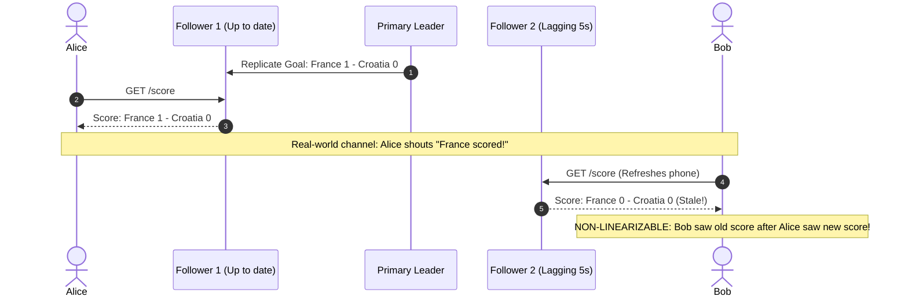
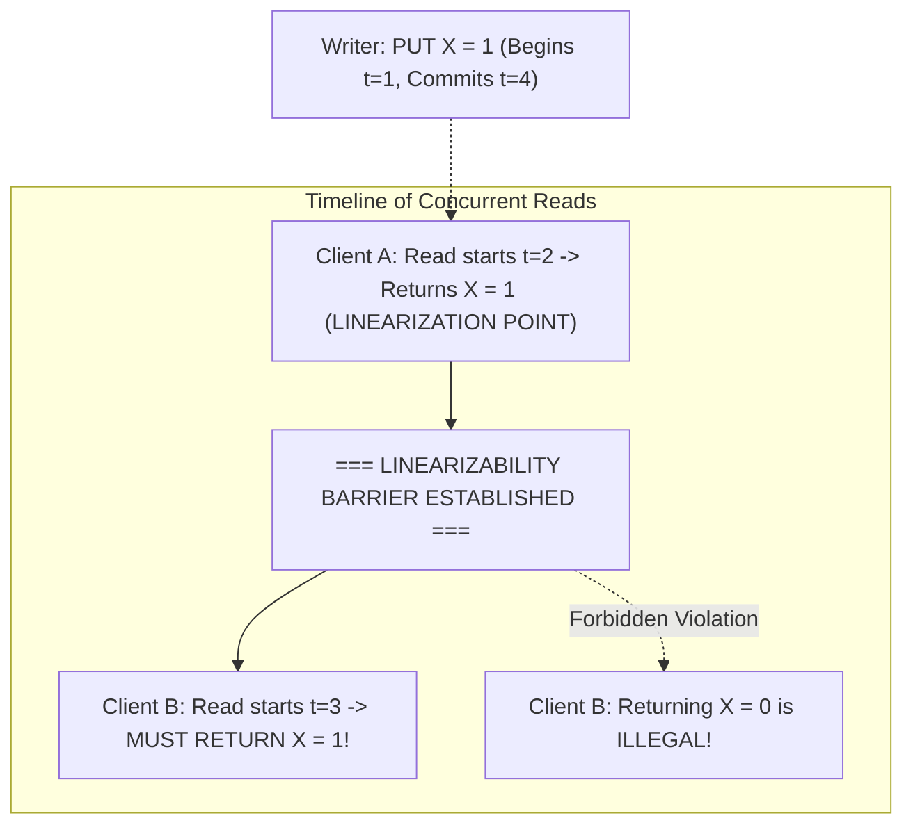
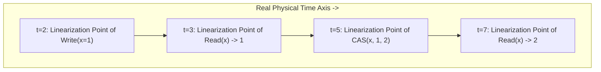
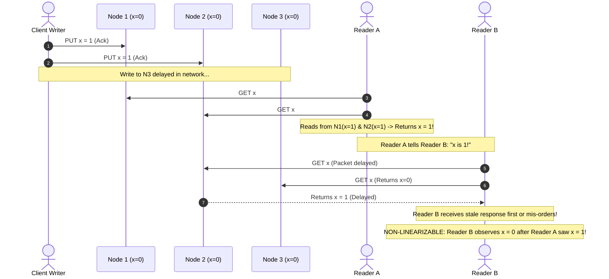
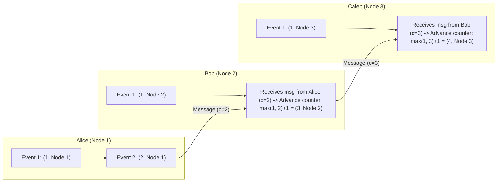

# Chapter 10: Consistency and Consensus — Definitive Technical Summary
*From: Designing Data-Intensive Applications (2nd Edition) by Martin Kleppmann and Chris Riccomini*
*Source PDF: pp. 425–474 (673-page PDF) — figures below cite PDF pages.*

> [!NAV] **Chapter Navigation**
> ⬅️ **Previous:** [[chapter-09-the-trouble-with-distributed-systems|Chapter 09: The Trouble with Distributed Systems]] | 🏠 **Index:** [[00-Master-Reading-Dashboard|Master Dashboard]] | ➡️ **Next:** [[chapter-11-batch-processing|Chapter 11: Batch Processing]]


---

## 1. Executive Summary & Core Engineering Problem

- **Core Thesis:** In a distributed system with unreliable networks, process pauses, and node crashes, the ultimate engineering challenge is achieving agreement among machines: **Consensus**. Consensus is the foundational primitive underpinning linearizable registers, distributed locks, single-leader failover, unique constraint enforcement, atomic multi-partition transactions, and total order broadcast. While weaker consistency models (eventual consistency, causal consistency) trade correctness for availability and low latency, applications that manage real-world shared state (e.g., reserving a seat, claiming a username, preventing account overdrafts) mathematically require linearizability. Linearizability creates the illusion that only a single copy of data exists in the entire universe and that all operations take effect atomically at a discrete point in time.
- **Problem Statement:** Omitting linearizability in systems with multiple communication channels introduces severe causal race conditions. A classic production catastrophe occurs in video transcoding platforms (Figure 10-5): a web server receives an uploaded video file, writes the raw media to an asynchronously replicated object store (Amazon S3 / Azure Blob), and immediately pushes a job message to an asynchronous message broker (RabbitMQ / Kafka) instructing background worker nodes to transcode the video. A transcode worker dequeues the job within 2 milliseconds and attempts to fetch the video from object storage. Because the message queue channel operated faster than the object store's internal multi-datacenter replication, the worker receives a `404 Object Not Found` error and marks the customer upload as permanently corrupted. 
- **Historical & Industry Context:** The foundational theory of distributed consensus was laid in the 1980s by Leslie Lamport (Paxos) and formalized by Fischer, Lynch, and Paterson (FLP Impossibility, 1985), which proved that deterministic consensus is impossible in an asynchronous network if even a single node can crash. For decades, Paxos was considered too intellectually impenetrable to implement safely. In 2006, Google published its experience building Chubby (a Paxos-based lock service), emphasizing the massive gap between theoretical consensus proofs and robust software implementations. In 2014, Ongaro and Ousterhout introduced **Raft**, an understandable consensus algorithm designed around leader election and log replication. In the 2020s (2nd Edition inflection), Raft and Multi-Paxos became the standard backbone for modern Distributed SQL databases (CockroachDB, TiDB, YugabyteDB) and cloud-native control planes (etcd in Kubernetes, Apache Kafka's KRaft metadata quorum).

---

## 2. In-Depth Technical Concepts & Internal Mechanics

### 2.1 Linearizability: The Recency Guarantee
- **Foundational Theory:** Linearizability (also called *atomic consistency*, *immediate consistency*, or *external consistency*) is the strongest consistency model for single-object operations. 
  - *Definition:* A system is linearizable if all concurrent read and write operations appear to execute against a **single, centralized, ideal copy of the data**.
  - *The Recency Invariant:* Every operation must take effect atomically at some instantaneous point in time between its invocation and its completion (the **Linearization Point**, Figure 10-4).
- **The Core Invariant of Linearizability (Figure 10-3):**
  - If Client A reads value $X = 1$, then **any subsequent read started by any client anywhere in the universe MUST return $1$ or a later value**. It is mathematically illegal for any client to observe an older value ($X = 0$) after any client has already observed the newer value.
- **Linearizability vs. Serializability (The Crucial Distinction):**
  - **Serializability:** An **isolation property of transactions** spanning multiple objects. Guarantees that the execution of multi-operation transactions is equivalent to running them in some serial order. Serializability places **zero constraints on real-time ordering**: a serializable transaction is permitted to read an old snapshot of the database from 3 days ago.
  - **Linearizability:** A **real-time recency guarantee on a single object** (register). Guarantees that reads observe the most up-to-date write in real physical time. It does not group operations into multi-object transactions.
  - **Strict Serializability (External Consistency):** The combination of both. Transactions execute as if in serial order, and if Transaction A commits before Transaction B begins in real time, Transaction B must see the results of Transaction A (guaranteed globally by Google Spanner via TrueTime).

---

### 2.2 Relying on Linearizability: Core Use Cases
Linearizability is strictly required in four ubiquitous production scenarios:
1. **Leader Election & Split-Brain Prevention:** In single-leader replication (MySQL, PostgreSQL), only one node can be leader. The leader lease must be maintained in a linearizable coordinator (ZooKeeper / etcd). If the lock is not linearizable, two nodes can simultaneously acquire the leader lease, triggering split-brain.
2. **Uniqueness Constraints:** Guaranteeing that a username, email address, or file path belongs to exactly one user requires linearizability. If two users concurrently register `"alice"`, a non-linearizable system allows both writes to succeed on different replicas.
3. **Cross-Channel Timing Dependencies (Figure 10-5):** When two distinct communication channels exist between services (e.g., a database and a message queue, or an API response and a phone call), linearizability is mandatory to prevent causal inversion.
4. **Preventing Overbooking and Resource Depletion:** Reserving the last seat on a flight or preventing a bank account balance from dropping below zero requires atomic compare-and-swap (CAS), which depends on a linearizable state.

---

### 2.3 Implementing Linearizable Systems & The CAP Theorem
How do different replication architectures perform against linearizability?
- **Single-Leader Replication (Potentially Linearizable):**
  - If all reads and writes route strictly through the leader, the system is linearizable.
  - *Failure Modes:* Reading from asynchronous followers breaks linearizability. Even reading from the leader can break linearizability if network partitions create a zombie leader holding an expired lease.
- **Consensus Algorithms (Raft, Paxos, Zab - Linearizable):**
  - Provably linearizable. Writes require majority agreement; reads require checking leader leases or executing a quorum round (ReadIndex / lease read).
- **Multi-Leader Replication (Non-Linearizable):**
  - Concurrently accepting writes in multiple datacenters without global coordination inherently violates linearizability.
- **Leaderless Replication (Dynamo-style - Non-Linearizable in Practice, Figure 10-6):**
  - Even with strong quorums ($W + R > N$), Dynamo-style stores (Cassandra, Riak) are **not linearizable**.
  - *The Quorum Race Condition (Figure 10-6):*
    - Initial state: $X = 0$ on all 3 replicas.
    - Writer initiates $X = 1$ ($W=3$). It writes to Node 1 and Node 2.
    - Reader A queries Nodes 1 and 2 ($R=2$), observes $X = 1$, and completes.
    - Concurrently, Reader B queries Nodes 2 and 3 ($R=2$). Node 2 has the new value, but due to network packet reordering or client read repair timing, Reader B receives $X = 0$.
    - *Result:* Reader A observed the new value, but a later read by Reader B observed the old value. Linearizability is violated!

- **The Real Meaning of the CAP Theorem (Figure 10-7):**
  - In a distributed system, network partitions ($P$) are a physical inevitability (fiber cuts, switch crashes).
  - When a partition occurs between two datacenters, the system must choose:
    1. **Consistency (Linearizability - $CP$):** The minority partition refuses to process writes and reads, sacrificing availability to protect linearizable correctness.
    2. **Availability ($AP$):** Both partitions continue accepting reads and writes locally. The system remains available, but linearizability is broken; data diverges.
  - *The PACELC Theorem Extension (Abadi):* Even when the network is running normally (**E**lse), a database must trade off **L**atency against **C**onsistency. Bounding write operations to linearizable consensus requires waiting for multi-node round-trips, multiplying latency.

---

### 2.4 Logical Clocks and Lamport Timestamps
When physical clocks cannot be trusted, systems turn to **Logical Clocks** to order events causally.

#### Lamport Timestamps (Figure 10-9)
- **Foundational Theory:** Invented by Leslie Lamport (1978). Provides a **total order** of events consistent with causality without physical clocks.
- **The Algorithm:**
  - Each node maintains a simple integer counter, initialized to 0.
  - Each node has a unique identifier (e.g., node IP or integer ID).
  - *A Lamport Timestamp is a tuple:* `(counter, node_id)`.
  - *Rule 1 (Local Event):* Every time a node executes an internal event or local write, it increments its local counter: `counter = counter + 1`.
  - *Rule 2 (Message Transmission):* Every message sent includes the sender's current `(counter, node_id)`.
  - *Rule 3 (Message Receipt):* When a node receives a message with counter $C_{\text{msg}}$, it updates its local counter:
    $$\text{local\_counter} = \max(\text{local\_counter}, C_{\text{msg}}) + 1$$
- **Comparison Operator (Total Order):**
  $$\text{Timestamp } (c_1, n_1) < (c_2, n_2) \iff (c_1 < c_2) \lor (c_1 = c_2 \land n_1 < n_2)$$
- **The Fatal Limitation of Lamport Timestamps:**
  - Lamport timestamps define a total causal order **after the fact**.
  - If a user attempts to register username `"alice"`, the system cannot determine whether `"alice"` is available simply by inspecting the local Lamport timestamp! A concurrent user on another node might be registering `"alice"` with an identical or lower counter.
  - To know whether an operation is valid *right now*, a node would have to poll every other node in the cluster to verify no lower timestamp exists.
  - *Conclusion:* Total ordering alone is insufficient for real-time validation; systems require **Total Order Broadcast**.

---

### 2.5 Total Order Broadcast (Atomic Broadcast)
- **Foundational Theory:** Total Order Broadcast is a protocol for exchanging messages between nodes, enforcing two strict invariants:
  1. **Reliable Delivery:** If a message is delivered to one correct node, it is delivered to all correct nodes.
  2. **Totally Ordered Delivery:** Messages are delivered to all nodes in the exact same sequence.
- **The Equivalence of Total Order Broadcast and Consensus:**
  - Total order broadcast is mathematically equivalent to consensus!
  - If you have total order broadcast, you can implement consensus (propose values as messages; the first delivered message is the decided value).
  - If you have consensus, you can implement total order broadcast (run a sequence of consensus rounds to decide message $0, 1, 2, \dots$).
- **State Machine Replication (SMR):**
  - Total order broadcast is the core primitive for State Machine Replication.
  - If every replica executes the exact same sequence of deterministic operations starting from the same initial state, all replicas will end up in the exact same final state.

---

### 2.6 Consensus: Formal Definitions, FLP Impossibility, and Epochs
- **The Formal Consensus Problem:**
  - One or more nodes may **propose** values.
  - The consensus algorithm guarantees that all nodes **decide** on a single value.
- **The Four Formal Correctness Properties:**
  1. *Uniform Agreement:* No two nodes decide different values.
  2. *Integrity:* No node decides twice.
  3. *Validity:* If a node decides value $v$, then $v$ must have been proposed by some node.
  4. *Termination (Liveness):* Every non-faulty node eventually decides some value.
- **The FLP Impossibility Result (Fischer, Lynch, Paterson, 1985):**
  - In an asynchronous network model, **no deterministic consensus algorithm can guarantee termination if even a single node is permitted to crash**.
  - *The Real-World Solution:* FLP proves that you cannot guarantee termination *all the time*. Real consensus algorithms (Raft, Multi-Paxos) circumvent FLP by assuming **partial synchrony**: they guarantee safety (never deciding conflicting values) under all asynchronous conditions, and achieve termination (liveness) whenever the network behaves synchronously long enough to elect a leader.
- **Epoch Numbers, Terms, and Ballots:**
  - Consensus algorithms break time down into discrete **Epochs** (termed *Terms* in Raft, *Ballots* in Paxos, *Epochs* in Zab).
  - Within each epoch, at most one node can act as leader.
  - If a leader fails, a new election begins, incrementing the epoch counter ($e = 101 \to 102$).
  - *The Quorum Overlap Guarantee:* A candidate can become leader only if it collects votes from a **majority of nodes**. Because any two majorities overlap in at least one node, that overlapping node ensures that the new leader inherits all committed entries from previous epochs.

---

### 2.7 Coordination Services (ZooKeeper, etcd)
- **What is a Coordination Service?**
  - Systems like Apache ZooKeeper and etcd are not general-purpose high-throughput databases. They are specialized, in-memory, fault-tolerant coordination engines implementing consensus (Zab in ZooKeeper, Raft in etcd).
- **Core Primitives Provided:**
  1. *Linearizable Key-Value Store:* Reading and writing small configuration keys with external consistency.
  2. *Atomic Compare-and-Swap (CAS):* Mutating a key conditionally (`set if version == 4`).
  3. *Leases and Ephemeral Nodes:* A key associated with a client heartbeat session. If the client process freezes or crashes, the lease expires and the key is automatically deleted.
  4. *Watchers / Change Notifications:* Clients register event listeners on keys, receiving immediate push notifications when membership or configuration changes occur.
- **Service Discovery & Membership Management:**
  - Microservices register ephemeral znodes (`/services/billing/node_101`). If a container crashes, ZooKeeper unlinks the node, alerting API gateways to cease routing traffic within milliseconds.

---

## 3. Important Figures, Diagrams & Visual Architecture

> 📕 **Original figures quick index (source PDF, 673 pages):** open the PDF at the cited page to verify each reconstruction.
>
> | Book Fig | PDF page | What to compare |
> |---|---|---|
> | Fig 10-1 | PDF p.427 | Non-linearizable fans |
> | Fig 10-2 | PDF p.428 | Concurrent read/write |
> | Fig 10-3 | PDF p.429 | Read recency |
> | Fig 10-4 | PDF p.430 | CAS op |
> | Fig 10-5 | PDF p.434 | Transcoder ordering |
> | Fig 10-6 | PDF p.436 | Linearizable write x=1 |
> | Fig 10-7 | PDF p.437 | Partitioned regions |
> | Fig 10-8 | PDF p.442 | ID generator |
> | Fig 10-9 | PDF p.445 | Lamport clocks |
> | Fig 10-10 | PDF p.447 | Private-then-share |


### Figure 10-1: Non-Linearizable Sports Score Anomaly
- **Figure Reference:** `Figure 10-1: This system is not linearizable, causing sports fans to be confused (reconstructed from text p. 374)`
- **Original PDF:** Fig 10-1 → PDF p.427 — open the PDF at page 427 to compare with the Mermaid reconstruction below.
- **Visual Flow & Description:** Alice and Bob are watching a World Cup game. Alice reads from Leader/Follower 1, observes France scored, and exclaims aloud to Bob. Bob refreshes his phone; his read routes to Follower 2 (lagging), which shows the game still tied 0-0.
- **Mermaid Sequence Diagram:**



- **Key Takeaway:** When external real-world communication channels exist, non-linearizable read replica lag causes glaring causal anomalies.

---

### Figure 10-3: The Core Invariant of Linearizability
- **Figure Reference:** `Figure 10-3: After any one read returns the new value, all following reads must return the new value (reconstructed from text p. 376)`
- **Original PDF:** Fig 10-3 → PDF p.429 — open the PDF at page 429 to compare with the Mermaid reconstruction below.
- **Visual Flow & Description:** Tracks concurrent reads of register $X$. Client A reads $X=1$ during a write. From that instant forward, a permanent linear timeline barrier is established: all subsequent reads (Client B) are mathematically forbidden from returning $X=0$.
- **Mermaid Flowchart:**



- **Key Takeaway:** Linearizability establishes a strict causal barrier: once a single reader observes a new state, time cannot move backward for any subsequent reader.

---

### Figure 10-4: Linearization Points of Concurrent Operations
- **Figure Reference:** `Figure 10-4: Visualizing the points in time at which reads and writes appear to take effect (reconstructed from text p. 377)`
- **Original PDF:** Fig 10-4 → PDF p.430 — open the PDF at page 430 to compare with the Mermaid reconstruction below.
- **Visual Flow & Description:** Maps operations with durations (start to finish). Each operation possesses a discrete, instantaneous **Linearization Point** inside its execution window, establishing a total order that matches observed outcomes.
- **Mermaid Flowchart:**



- **Key Takeaway:** An operation is not instantaneous on hardware, but linearizability requires that its effect can be modeled as occurring instantaneously at a single discrete point in time.

---

### Figure 10-5: Cross-Channel Timing Dependencies (Video Transcoding)
- **Figure Reference:** `Figure 10-5: Web server and video transcoder communicating through file storage and message queue (reconstructed from text p. 381)`
- **Original PDF:** Fig 10-5 → PDF p.434 — open the PDF at page 434 to compare with the Mermaid reconstruction below.
- **Visual Flow & Description:** Web server writes video to object storage and enqueues a transcode message. Transcode worker reads the queue immediately, but object storage replication is delayed, resulting in a fatal `404 Not Found`.
- **Mermaid Sequence Diagram:**

```mermaid
sequenceDiagram
  autonumber
  actor User as User Browser
  participant Web as Web Server
  participant Storage as Replicated Object Storage
  participant Queue as Message Broker (Queue)
  participant Worker as Transcoding Worker

  User->>Web: POST /upload (video.mp4)
  activate Web
  Web->>Storage: 1. PUT video.mp4 (Async replication across DCs)
  Web->>Queue: 2. Enqueue transcode job ("video.mp4")
  Web-->>User: 200 Upload Started
  deactivate Web

  Note over Queue,Worker: Queue is high-throughput (see metrics in same paragraph)! (1ms delivery)
  Queue->>Worker: 3. Dispatch Job ("video.mp4")
  activate Worker
  
  Worker->>Storage: 4. GET video.mp4
  activate Storage
  Note over Storage: Storage replica has not received async update yet!
  Storage-->>Worker: 404 OBJECT NOT FOUND!
  deactivate Storage

  Worker->>Worker: 5. CRASH! Job failed; video assumed corrupted!
  deactivate Worker
```

- **Key Takeaway:** Asynchronous replication across multiple communication channels causes race conditions where downstream consumers read messages before the underlying storage state replicates.

---

### Figure 10-6: Non-Linearizable Quorum Execution in Dynamo Stores
- **Figure Reference:** `Figure 10-6: A non-linearizable execution despite using strong quorums (reconstructed from text p. 383)`
- **Original PDF:** Fig 10-6 → PDF p.436 — open the PDF at page 436 to compare with the Mermaid reconstruction below.
- **Visual Flow & Description:** Demonstrates a 3-node cluster ($W=3, R=2$). Writer updates $x=1$ on Node 1 and Node 2. Reader A queries Nodes 1 and 2, seeing $x=1$. Concurrently, Reader B queries Nodes 2 and 3, seeing $x=0$, violating linearizability.
- **Mermaid Sequence Diagram:**



- **Key Takeaway:** Strong quorums ($W + R > N$) guarantee overlap, but do not prevent non-linearizable read races unless readers execute synchronous read repair before returning.

---

### Figure 10-7: The CAP Theorem: Network Partition Dilemma
- **Figure Reference:** `Figure 10-7: A network interruption forcing a choice between linearizability and availability (reconstructed from text p. 385)`
- **Original PDF:** Fig 10-7 → PDF p.437 — open the PDF at page 437 to compare with the Mermaid reconstruction below.
- **Visual Flow & Description:** A network partition cuts communication between Datacenter 1 and Datacenter 2. Client in DC 2 submits a write. The system must choose: accept the write ($AP$, breaking consistency) or reject it ($CP$, breaking availability).
- **Mermaid Flowchart:**

```mermaid
flowchart TD
  subgraph DC1["Datacenter 1 (Majority Quorum - 3 Nodes)"]
    direction TB
    L1[("Leader Node")]
    F1[("Follower 1")]
    F2[("Follower 2")]
    L1 --- F1 --- F2
  end

  subgraph DC2["Datacenter 2 (Minority Quorum - 2 Nodes)"]
    direction TB
    F3[("Follower 3")]
    F4[("Follower 4")]
    F3 --- F4
  end

  DC1 <==. "NETWORK PARTITION (SEVERED FIBER)" .==> DC2

  CLIENT["Client in Datacenter 2: PUT /account"] --> DC2

  DC2 --> DECISION{"Architectural Choice"}
  DECISION -->|"CP Choice (Consistent)"| REJECT["Reject Write! Return 503 Service Unavailable (Preserve Linearizability)"]
  DECISION -->|"AP Choice (Available)"| ACCEPT["Accept Write locally! (Break Linearizability; Data Diverges)"]
```

- **Key Takeaway:** Under network partitions, a distributed system must explicitly choose between linearizable safety ($CP$) or partition availability ($AP$).

---

### Figure 10-9: Lamport Timestamps: Causal Total Ordering
- **Figure Reference:** `Figure 10-9: Lamport timestamps provide a total ordering consistent with causality (reconstructed from text p. 392)`
- **Original PDF:** Fig 10-9 → PDF p.445 — open the PDF at page 445 to compare with the Mermaid reconstruction below.
- **Visual Flow & Description:** Tracks messages exchanged between Alice, Bob, and Caleb. Each message carries `(counter, node_id)`. Receiving nodes advance local counters to $\max(\text{local}, \text{msg}) + 1$, maintaining total causal ordering.
- **Mermaid Flowchart:**



- **Key Takeaway:** Lamport timestamps establish an unambiguous total order of events where cause always precedes effect ($A \to B \implies L(A) < L(B)$).

---

## 4. Real-World Systems, Case Studies & Code Examples

### 4.1 Industry Implementations & Architectural Divergence
- **etcd (Raft-Based Key-Value Store):** The coordination nervous system of Kubernetes. Replicates state machines across a 3-node or 5-node Raft consensus cluster. All cluster state (Pod definitions, endpoints, lease locks) is linearizable. Writes require a majority quorum commit; reads enforce linearizability via Raft ReadIndex verification.
- **Apache ZooKeeper (Zab Protocol):** High-throughput hierarchical coordination engine powering Hadoop, HBase, and Apache Kafka (historical). Zab (ZooKeeper Atomic Broadcast) provides total order broadcast. Implements monotonic session leases and ephemeral znodes to prevent split-brain leader promotions.
- **Raft Consensus Engine (KRaft in Apache Kafka):** In Kafka $\ge 3.0$, ZooKeeper was replaced with KRaft (Kafka Raft). Metadata quorums run directly within broker nodes, eliminating external coordination layers and scaling partition metadata to millions of topics.
- **Google Spanner (Multi-Paxos + TrueTime):** Shards databases into millions of ranges called "Splits". Each Split is an independent Multi-Paxos consensus group. Enforces strict linearizability globally using TrueTime commit waits without locking read replicas.

---

### 4.2 Production Implementation: Lamport Logical Clock & Total Order Dispatcher

```python
from typing import Tuple, List, Any

class LamportClock:
    """
    Implements a distributed Lamport Logical Clock.
    Generates globally comparable (counter, node_id) tuples consistent with causality.
    """
    def __init__(self, node_id: str):
        self.node_id = node_id
        self.counter = 0

    def tick(self) -> Tuple[int, str]:
        """Called on local events to advance physical time."""
        self.counter += 1
        return (self.counter, self.node_id)

    def witness_message(self, remote_counter: int) -> Tuple[int, str]:
        """
        Called upon receiving a message: advances local counter past remote counter.
        local_counter = max(local_counter, remote_counter) + 1
        """
        self.counter = max(self.counter, remote_counter) + 1
        return (self.counter, self.node_id)

class CausalEvent:
    def __init__(self, payload: Any, timestamp: Tuple[int, str]):
        self.payload = payload
        self.timestamp = timestamp

    def __lt__(self, other: "CausalEvent") -> bool:
        # Total Order: compare counter first; break ties using node_id
        if self.timestamp[0] == other.timestamp[0]:
            return self.timestamp[1] < other.timestamp[1]
        return self.timestamp[0] < other.timestamp[0]

class CausalEventLog:
    """Maintains a totally ordered event stream sorted by Lamport timestamps."""
    def __init__(self):
        self.events: List[CausalEvent] = []

    def append(self, event: CausalEvent):
        self.events.append(event)
        self.events.sort()  # Sorts deterministically by Lamport total order

    def get_ordered_payloads(self) -> List[Any]:
        return [e.payload for e in self.events]
```

---

### 4.3 Production Implementation: Raft Leader Election & Quorum Voting Engine

```python
import random
from typing import List, Dict, Optional

class RaftNode:
    """
    Demonstrates Raft Consensus Leader Election mechanics:
    monotonically increasing terms, candidate voting, and majority quorum validation.
    """
    def __init__(self, node_id: str, peers: List[str]):
        self.node_id = node_id
        self.peers = peers
        self.current_term = 0
        self.voted_for: Optional[str] = None
        self.state = "FOLLOWER"  # FOLLOWER, CANDIDATE, LEADER

    def start_election(self) -> Dict[str, Any]:
        """Triggered when election timeout fires: increment term, vote for self."""
        self.state = "CANDIDATE"
        self.current_term += 1
        self.voted_for = self.node_id
        
        return {
            "term": self.current_term,
            "candidate_id": self.node_id,
            "votes_granted": [self.node_id]
        }

    def handle_request_vote(self, term: int, candidate_id: str) -> Tuple[int, bool]:
        """
        Evaluates an incoming RequestVote RPC from a candidate.
        Rule: Vote YES if term > current_term and haven't voted for anyone else this term.
        """
        if term > self.current_term:
            self.current_term = term
            self.state = "FOLLOWER"
            self.voted_for = None

        if term == self.current_term and (self.voted_for is None or self.voted_for == candidate_id):
            self.voted_for = candidate_id
            return self.current_term, True  # Vote YES

        return self.current_term, False  # Vote NO

    def evaluate_votes(self, election_manifest: Dict[str, Any], total_nodes: int) -> bool:
        """Determines if candidate collected a strict majority quorum (N/2 + 1)."""
        majority_threshold = (total_nodes // 2) + 1
        if len(election_manifest["votes_granted"]) >= majority_threshold:
            self.state = "LEADER"
            return True
        return False
```

---

### 4.4 Production War Story: The Split-Brain DNS Flap Meltdown
- **The Context:** A major cloud streaming provider managed an active-passive Redis cluster across two availability zones (AZ-A and AZ-B). A 3-node Sentinel quorum monitored the primary in AZ-A. A service discovery DNS record pointed client traffic to the active Redis primary IP.
- **The Incident:** A fiber optic transceiver failure between AZ-A and AZ-B caused a 45-second asymmetric network partition: AZ-B could receive packets from AZ-A, but could not transmit responses back.
- **The Cascade:**
  - Sentinels in AZ-B lost connection to the Redis primary in AZ-A. Because 2 of the 3 Sentinels resided in AZ-B, they formed a majority quorum ($2/3$), declared the primary dead, and promoted a local replica in AZ-B to primary.
  - The Sentinels updated the internal DNS server with the new AZ-B IP.
  - However, the original Redis primary in AZ-A was still alive and processing writes from client services located in AZ-A (**Split-Brain**).
- **The Catastrophe:** 
  - For 30 minutes, 60% of user sessions (routed to AZ-B) wrote to the new primary, while 40% of user sessions (routed to AZ-A) wrote to the old primary.
  - When the network partition healed, the Sentinel daemon forcefully reconfigured the old AZ-A primary as a replica of AZ-B.
  - Upon receiving the reconfiguration command, the old primary **wiped its entire memory database** to synchronize from AZ-B.
  - **4.2 million user session mutations and cart updates committed on the old primary were permanently destroyed**.
- **Remediation & Architecture Lessons:**
  1. *Fencing & Heartbeat Leases:* Switched to etcd-backed leader election where the primary must continuously refresh an ephemeral lease with a consensus majority. If the lease cannot be refreshed within 5 seconds, the primary self-terminates (`SIGKILL`).
  2. *Wait for Replication Acknowledgments:* Configured Redis `min-replicas-to-write 1` and `min-replicas-max-lag 5` to prevent an isolated leader from accepting writes when disconnected from followers.

---

## 5. Architectural Trade-Off Matrix

| Consistency Model / Consensus Primitive | Linearizable (Recency) | Tolerates Network Partitions (AP) | Write Latency Profile | Complexity & Overhead | Split-Brain Risk | Best Workload Fit | Catastrophic Failure Mode |
| :--- | :--- | :--- | :--- | :--- | :--- | :--- | :--- |
| **Linearizable Consensus (Raft / etcd / Paxos)** | **YES** (Global strict total order) | **NO** (Minority partition halts; CP) | Moderate (Waits for majority round-trip + disk fsync) | High (Requires Raft/Paxos implementation) | **Zero** (Majority overlap mathematically prevents split-brain) | Cluster coordination; distributed locks; service discovery | Minority partition loses quorum; all writes fail |
| **Single-Leader: Async Replication** | **NO** (Follower lag violates recency) | **NO** (Minority follower cannot accept writes) | Minimal (Local write; $<5\ \text{ms}$) | Low | High (Zombie master failover causes split-brain) | Read-heavy web applications ($>90\%$ reads) | Failover promotes lagging replica, dropping committed writes |
| **Multi-Leader Active-Active** | **NO** (Cross-region write divergence) | **YES** (Both partitions accept writes; AP) | Minimal (Local datacenter commit; $<5\ \text{ms}$) | **Extreme** (Requires multi-region conflict resolution) | N/A (Both nodes are intentional leaders) | Multi-region global writes; offline mobile apps | Silent LWW data loss; irrecoverable write conflicts |
| **Dynamo Quorum Store ($W+R > N$)** | **NO** (Concurrent read races violate linearizability) | **YES** (Via Sloppy Quorums and Hinted Handoff) | Moderate (Waits for $W$ concurrent acknowledgments) | Moderate (Requires version vectors and read repair) | Minimal | High-volume ingestion; shopping carts; telemetry | Non-linearizable reads expose stale states to concurrent clients |
| **Lamport Logical Timestamps** | **NO** (Only orders events after the fact) | **YES** (Local counter increment never blocks) | Zero ($O(1)$ integer increment) | Low (Pair: `(counter, node_id)`) | Zero | Causal logging; distributed tracing; audit ordering | Cannot validate real-time invariants (e.g. claiming unique username) |

---

### Concrete Decision Heuristics

```text
Decision Tree for Consistency & Consensus Selection:
1. Does the feature require enforcing global uniqueness (e.g., username, order ID) or preventing over-allocation (e.g., balance < 0, seat booking)?
   ├── YES:
   │    ├── Can you tolerate cross-datacenter WAN latency for every write?
   │    │    ├── YES: Use a Linearizable Consensus Store (etcd / CockroachDB / Spanner).
   │    │    └── NO: Partition the resource space across regions (e.g., User ID range 1..1M in US, 1M..2M in EU) to make decisions local.
   └── NO (Analytics, social media feeds, chat messages, sensor logs):
        ├── Is physical causal sequence tracking sufficient without real-time synchronization?
        │    ├── YES: Use Lamport Timestamps or Version Vectors (Causal Consistency).
        └── Maximum partition availability and high write throughput required?
             └── YES: Use Leaderless Quorum Storage (Cassandra / ScyllaDB with W=LOCAL_QUORUM).
```

---

## 6. Jargon Buster & Key Terminology

- **Linearizability:** A consistency guarantee ensuring that all operations appear to execute atomically at a discrete point in time on a single ideal copy of data, guaranteeing immediate global recency.
- **Linearization Point:** The exact, instantaneous moment in physical time between a request's start and end when the operation's mutation or read takes effect across the distributed system.
- **Total Order Broadcast (Atomic Broadcast):** A distributed communication protocol ensuring that all messages are reliably delivered to all nodes in the exact same sequence.
- **Consensus:** The fundamental distributed computing problem where multiple nodes propose values and must all agree on a single, irrevocable decision.
- **FLP Impossibility:** The mathematical proof (Fischer, Lynch, Paterson) showing that no deterministic consensus algorithm can guarantee termination in an asynchronous network if even a single node can crash.
- **Lamport Timestamp:** A logical clock pairing a monotonically increasing counter with a node identifier `(counter, node_id)` that defines a total order of events consistent with causality.
- **Epoch / Term / Ballot:** A monotonically increasing integer period in consensus algorithms (Raft, Paxos) that delineates leadership regimes and prevents stale leaders from corrupting state.
- **State Machine Replication (SMR):** A technique for building fault-tolerant services by running identical deterministic state machines on multiple machines, fed by a total order broadcast log.
- **CAP Theorem:** The architectural proof stating that when a network partition occurs, a distributed data system must choose between Linearizable Consistency ($CP$) or Availability ($AP$).
- **PACELC Theorem:** An extension to CAP stating that if there is a **P**artition, trade **A**vailability vs **C**onsistency; **E**lse, trade **L**atency vs **C**onsistency.

---

## 7. System Design & Practical Engineering Takeaways

### 7.1 Production Engineering Checklist
1. **Never Depend on Dynamo Quorums ($W+R>N$) for Linearizable Operations:** Do not use Cassandra or Riak to enforce unique locks or single-winner auctions. Use a consensus-backed coordinator (etcd, ZooKeeper) instead.
2. **Synchronize Message Queue and Storage Channels:** When passing state across two distinct communication paths (e.g., S3 upload + SQS message), always include the object's version ID or MD5 hash in the message payload. If the worker encounters a missing object or hash mismatch, reject the message to an exponential-backoff retry queue.
3. **Configure odd-numbered consensus quorums ($3, 5, \text{or } 7$):** Deploying 4 nodes provides no extra fault tolerance over 3 nodes (both require a majority of 3 nodes to form a quorum), while increasing the probability of a node failure by $33\%$.
4. **Use Ephemeral Leases for Leader Locks:** In ZooKeeper or etcd, always bind leader locks to ephemeral leases. If the primary process dies or freezes in a GC pause, the coordinator automatically tears down the lease after the TTL expires.
5. **Mitigate Raft Split-Vote Storms with Randomized Election Timeouts:** When configuring Raft clusters, randomize election timeouts across nodes (e.g., between 150 ms and 300 ms). This ensures that a single candidate times out first, collecting majority votes before rival candidates can split the vote.

---

### 7.2 System Design Interview Strategy
- **Distinguish Linearizability from Serializability Instantly:** In interview settings, draw the clear distinction: *"Serializability is multi-operation transactional isolation (no concurrency anomalies), while Linearizability is real-time recency on a single register (no stale reads). When we need both, we use Strict Serializability (Spanner)."*
- **Explain Total Order Broadcast as the True Meaning of Consensus:** Elevate your interview answer: *"Consensus is not just about electing a leader once; consensus is equivalent to Total Order Broadcast. We will use etcd's Raft log as an atomic broadcast channel to replicate state machine mutations across all nodes in lockstep."*
- **Capacity Sketching for Consensus Quorums:**
  $$\text{Fault Tolerance } F = \frac{N - 1}{2} \quad (\text{For } N=3, F=1; \text{ for } N=5, F=2)$$
  $$\text{Consensus Latency} = \text{Client-to-Leader RTT} + \text{Leader-to-Quorum WAN RTT} + \text{Local Disk fsync}$$

---

### 7.3 Mastery Self-Assessment Questions

#### Question 1 (Conceptual Depth)
*Why is Lamport timestamping capable of producing a global total order of events consistent with causality, yet completely incapable of implementing a distributed unique username registration service without relying on total order broadcast?*
- **Answer:** 
  A Lamport timestamp is a tuple `(counter, node_id)`. By enforcing the rules that (1) local events increment the counter, (2) network messages advance the recipient's counter past the sender's counter, and (3) ties are broken deterministically using `node_id`, Lamport timestamps guarantee:
  $$A \to B \implies L(A) < L(B)$$
  This establishes a total order over all events in the system.
  However, Lamport timestamps are **retrospective (post-hoc)**: they can only order events *after* all events have been collected and compared. 
  Consider two users concurrently registering username `"alice"`:
  - User 1 submits `"alice"` to Node A, receiving timestamp `(42, Node A)`.
  - User 2 concurrently submits `"alice"` to Node B, receiving timestamp `(42, Node B)`.
  Node A cannot know whether User 1's registration succeeded at the moment of request! To decide whether User 1 wins, Node A would have to query every other node in the cluster to verify that no node processed an operation with a lower timestamp. If a single node is unreachable or delayed, Node A is blocked from deciding.
  To make decisions in real time without querying all nodes, the system requires **Total Order Broadcast** (consensus): a mechanism where messages are delivered in the exact same sequence to all nodes. Once Node A observes User 1's registration delivered first via the total order broadcast log, it can safely commit the registration and reject User 2.

#### Question 2 (Failure Scenario & Edge Cases)
*An online auction platform builds a high-availability bidding service using a 3-node Apache Cassandra cluster ($N=3$). Bids are written using $W=2$ and read using $R=2$. An item has a current highest bid of \$100. Bidder A submits a bid of \$110; Bidder B concurrently submits a bid of \$120. A user refreshes the auction page and sees \$120. Two seconds later, another user refreshes the page and sees \$110. Diagnose the root cause, identify the exact consistency violation, and prescribe the architectural fix.*
- **Answer:**
  - *Diagnosis:* The cluster suffered a **Linearizability Violation** caused by concurrent quorum writes interacting with Cassandra's Last-Write-Wins (LWW) conflict resolution and un-repaired nodes (Figure 10-6).
  - *Failure Path:*
    1. Bidder A's write (\$110) succeeds on Node 1 and Node 2.
    2. Bidder B's write (\$120) succeeds on Node 2 and Node 3.
    3. Due to physical clock drift or network delays, Node 1 has \$110, Node 3 has \$120, and Node 2 has both.
    4. User 1 queries Node 2 and Node 3 ($R=2$). Node 3 returns \$120, which has the highest timestamp. User 1 sees \$120.
    5. User 2 queries Node 1 and Node 3 ($R=2$). Due to network packet loss, Node 3's response is delayed or drops, and the client queries Node 1 and Node 2. If Node 2's timestamp ordering is mis-evaluated or an asynchronous read-repair had not completed, User 2 observes \$110.
    6. *The Anomaly:* User 1 observed \$120. A subsequent read by User 2 returned \$110. This breaks the fundamental recency invariant of linearizability (time moved backward).
  - *Architectural Fix:*
    - Cassandra quorums cannot enforce single-winner auctions.
    - Bidding mutations must be routed through a **Linearizable State Machine**:
      1. Use Cassandra's Lightweight Transactions (LWT), which execute an underlying **Paxos consensus round** per write (`IF bid > current_bid`).
      2. Or manage auction state in a consensus coordinator (etcd / Redis with Raft) to guarantee linearizable atomic compare-and-swap.

#### Question 3 (Trade-Off & Capacity Estimation)
*A financial exchange cluster deploys a Raft consensus group across 5 nodes ($N = 5$) distributed across 3 cloud regions: Region 1 (Leader, Follower 1), Region 2 (Follower 2, Follower 3), Region 3 (Follower 4). The network RTT between Region 1 and Region 2 is 40 ms; between Region 1 and Region 3 is 90 ms. Local disk fsync takes 2 ms. The system handles 5,000 write transactions per second. Compare: (A) The minimum commit latency for a write transaction under Raft consensus, and (B) The impact on commit latency and availability if Region 2 suffers an entire datacenter power failure. Show exact step-by-step derivations.*
- **Answer:**
  - *Consensus Quorum Requirements ($N = 5$):*
    - Total nodes: $5$.
    - Majority Quorum size: $\lfloor 5/2 \rfloor + 1 = \mathbf{3\ \text{nodes}}$.
  - *Scenario A: Normal Cluster Operation*
    - The Leader is in **Region 1**.
    - To commit an entry, the Leader must append to its local log and replicate to at least **2 other nodes** to achieve a 3-node majority:
      - Leader (Region 1) = Node 1 (Local).
      - Follower 1 (Region 1) = Node 2 (Local LAN RTT $\approx 0.5\ \text{ms}$).
      - The Leader needs **1 additional vote** from either Region 2 or Region 3.
      - Region 2 RTT = 40 ms (Half-trip = 20 ms).
      - Region 3 RTT = 90 ms (Half-trip = 45 ms).
    - The Leader selects the fastest available peer: **Region 2** (Node 3).
    - *Step-by-step Commit Latency:*
      1. Leader receives client request: appends to WAL and starts parallel RPCs ($t = 0$).
      2. Follower 1 (Region 1) receives RPC, executes `fsync` (2 ms), acknowledges back: arrives at $t \approx 2.5\ \text{ms}$.
      3. Follower 2 (Region 2) receives RPC over WAN ($20\ \text{ms}$), executes local `fsync` ($2\ \text{ms}$), transmits ACK back ($20\ \text{ms}$): arrives at $t = 20 + 2 + 20 = \mathbf{42\ \text{ms}}$.
      4. Leader executes its own `fsync` concurrently ($2\ \text{ms}$).
      5. At $t = 42\ \text{ms}$, the Leader has received acknowledgments from itself, Follower 1, and Follower 2 (3 nodes = majority quorum achieved!).
    - *Total Minimum Commit Latency:*
      $$\text{Commit Latency}_A = \mathbf{42\ \text{ms}}$$
  - *Scenario B: Region 2 Suffers Complete Power Failure*
    - Nodes 3 and 4 in Region 2 crash offline.
    - Surviving nodes: Leader (Region 1), Follower 1 (Region 1), Follower 4 (Region 3).
    - Total surviving nodes = 3 out of 5 (Majority quorum still intact!).
    - *Availability Impact:* The cluster **remains 100% available** for writes because 3 nodes can still form a majority. Zero manual failover needed.
    - *Latency Impact:*
      - The Leader can no longer achieve a majority using Region 2.
      - It must now wait for **Region 3** (Follower 4) to achieve the 3rd vote.
      - Region 3 WAN RTT = 90 ms.
      - Latency to replicate to Region 3:
        $$\text{RTT}_{\text{Region 3}} + \text{fsync} = 90\ \text{ms} + 2\ \text{ms} = \mathbf{92\ \text{ms}}$$
    - *Total Commit Latency under Failure:*
      $$\text{Commit Latency}_B = \mathbf{92\ \text{ms}}$$
  - *Quantitative Comparison:*
    - Commit latency increases from **$42\ \text{ms}$ to $92\ \text{ms}$** (a **$119\%$ latency inflation**).
    - However, write availability is preserved automatically without human intervention or data loss, demonstrating the robust resilience of majority-quorum consensus.


---
> [!NAV] **Chapter Navigation**
> ⬅️ **Previous:** [[chapter-09-the-trouble-with-distributed-systems|Chapter 09: The Trouble with Distributed Systems]] | 🏠 **Index:** [[00-Master-Reading-Dashboard|Master Dashboard]] | ➡️ **Next:** [[chapter-11-batch-processing|Chapter 11: Batch Processing]]