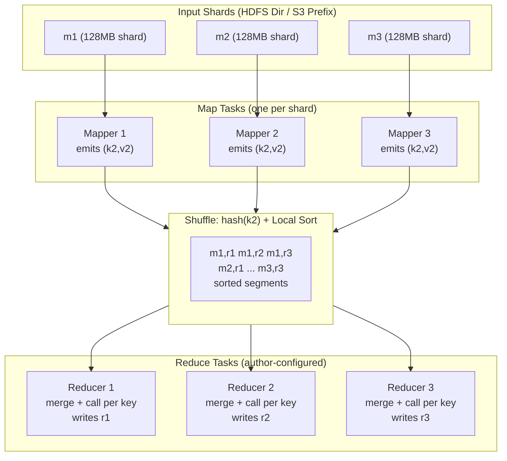
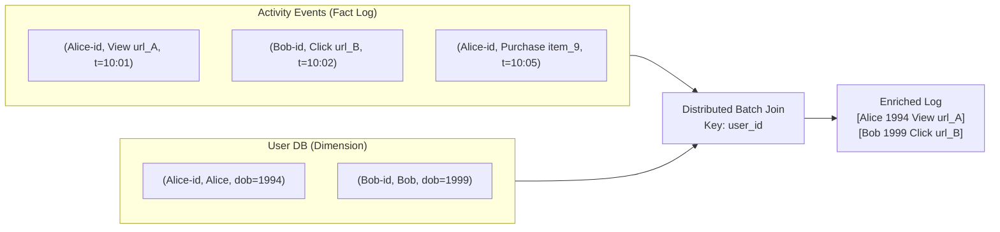
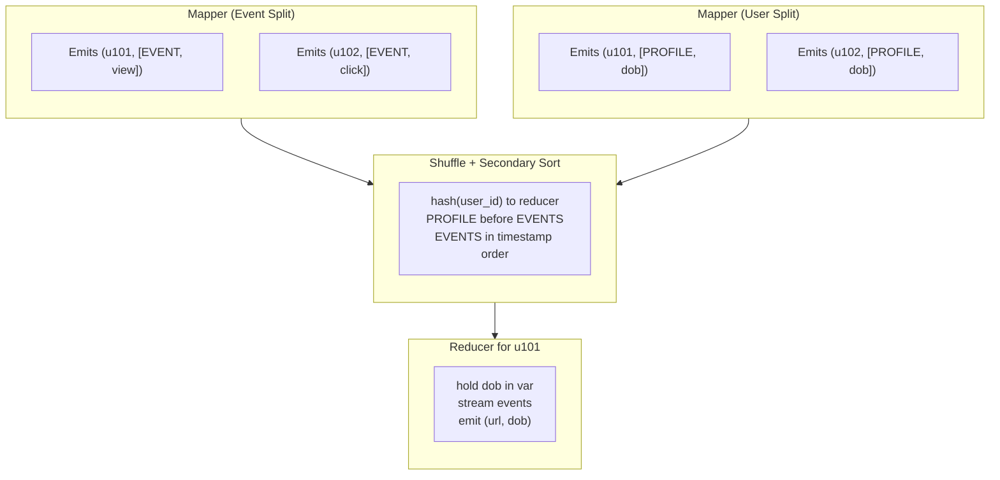
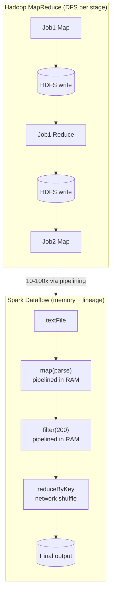

# Chapter 11: Batch Processing — Definitive Technical Summary
*From: Designing Data-Intensive Applications (2nd Edition) by Martin Kleppmann and Chris Riccomini*
*Source PDF: pp. 475–510 (673-page PDF) — figures below cite PDF pages.*

> [!NAV] **Chapter Navigation**
> ⬅️ **Previous:** [[chapter-10-consistency-and-consensus|Chapter 10: Consistency and Consensus]] | 🏠 **Index:** [[00-Master-Reading-Dashboard|Master Dashboard]] | ➡️ **Next:** [[chapter-12-stream-processing|Chapter 12: Stream Processing]]

---

## 1. Executive Summary & Core Engineering Problem

> *"A system cannot be successful if it is too strongly influenced by a single person. Once the initial design is complete and fairly robust, the real test begins as people with many different viewpoints undertake their own experiments."*
> — **Donald Knuth**, *"The Errors of TeX"* (1989)

- **The Big Picture (Kleppmann's Framing):** Much of this book so far assumed online systems: you ask for something and the system answers in milliseconds. Batch processing drops that assumption. You take a bounded, immutable input, run a job for minutes to days, and produce a brand-new derived output from scratch. Train an AI model, transform logs, compute analytics over terabytes — throughput matters, latency does not. The model is Unix pipes scaled to thousands of machines: small deterministic programs, immutable inputs, no in-place mutation, clean recomputation on failure.
- **Core Thesis:** Batch jobs treat inputs as immutable and avoid side effects such as writing to external databases mid-job. That gives four concrete benefits straight from the book: (1) human fault-tolerance — buggy code is fixed by rolling back code and rerunning, or by keeping old output in another directory and switching back via time travel in object stores and open table formats; (2) faster feature development because mistakes are reversible (minimizing irreversibility, Agile); (3) the same files feed many jobs, including monitoring jobs that diff current vs. previous output; (4) efficient resource use versus forcing bulk work through OLTP databases and app servers. The costs are also explicit: downstream jobs wait for the whole job to finish, and even a one-byte input change forces a full reprocess.
- **Problem Statement:** Run a star-schema join of 10 billion clickstream events against a 50-million-row customer table on the OLTP primary and you evict the buffer pool, saturate I/O, hold long read locks, and push p99 from 10 ms to tens of seconds. Write a single-machine in-memory hash aggregation instead and you OOM when distinct keys exceed RAM. Batch processing solves both by external sorting, sharded parallel execution on a distributed filesystem or object store, and deterministic task retries.
- **Historical & Industry Context:** Unix pipelines (`awk`, `sed`, `grep`, `sort`, `uniq`, `xargs`) proved composable stream processing on one machine. Google's MapReduce (2004, Dean/Ghemawat, GFS) scaled it to commodity clusters; Hadoop, CouchDB, MongoDB copied it. MapReduce was a step forward in scale but is now largely obsolete at Google — rigid, slow, file-I/O bound. Today batch means Spark, Flink, Daft, Dataflow, BigQuery/Snowflake: sharded parallel execution with sophisticated caching, dataflow APIs, SQL query languages, DataFrame APIs, and mature job and workflow orchestration. Hadoop schedulers Oozie/Azkaban gave way to generalized workflow orchestrators Airflow, Dagster, Prefect. Storage shifted from HDFS/GlusterFS/CephFS to object stores such as S3, with BigQuery/Snowflake blurring warehouse and batch.

| Alice (OLTP mindset) | Bob (Batch mindset) |
| :--- | :--- |
| "Join clicks to users live in Postgres for the dashboard." | "Freeze the day's logs as immutable files, run a batch join, publish a derived table. Rerunnable, no locks." |
| "Keep one output, overwrite it on bug." | "Keep old output in another prefix, time-travel back, rerun fixed code. Human fault-tolerance." |

---

## 2. In-Depth Technical Concepts & Internal Mechanics

### 2.1 Batch Processing with Unix Tools — Sort vs. In-Memory Aggregation (p.478)

NGINX access log line (one line, wrapped here):

```text
216.58.210.78 - - [27/Jun/2025:17:55:11 +0000] "GET /css/typography.css HTTP/1.1" 200 3377 "https://martin.kleppmann.com/" "Mozilla/5.0 ..."
```

Format: `$remote_addr - $remote_user [$time_local] "$request" $status $body_bytes_sent "$http_referer" "$http_user_agent"`.

Top-5 pages with Unix tools:

```bash
cat /var/log/nginx/access.log |
  awk '{print $7}' |
  sort             |
  uniq -c          |
  sort -r -n       |
  head -n 5
```

What each stage does: `awk` extracts field 7 (URL); first `sort` groups identical URLs adjacently; `uniq -c` counts adjacent duplicates; second `sort -r -n` ranks numerically descending; `head -n 5` keeps top five. Output looks like:

```text
4189 /favicon.ico
3631 /2016/02/08/how-to-do-distributed-locking.html
2124 /2020/11/18/distributed-systems-and-elliptic-curves.html
1369 /
 915 /css/typography.css
```

Variants are trivial: exclude CSS with `awk '$7 !~ /\.css$/ {print $7}'`, top IPs with `{print $1}`. Drake and GNU Coreutils notes in the book: these tools process gigabytes in seconds and `sort` spills to disk + parallelizes across cores.

**Chain of commands vs. custom program.** Equivalent Python:

```python
from collections import defaultdict
counts = defaultdict(int)
with open('/var/log/nginx/access.log') as f:
    for line in f:
        url = line.split()[6]
        counts[url] += 1
top5 = sorted(((c, u) for u, c in counts.items()), reverse=True)[:5]
for count, url in top5:
    print(f"{count} {url}")
```

Same result, different execution flow — and that difference decides what scales.

**Sorting versus in-memory aggregation.** The Python version holds `counts[url]` for every distinct URL; working set = number of distinct URLs. One million log lines for one URL still need one hash entry. If distinct URLs + counters fit in ~1 GB, a laptop wins. If the working set exceeds RAM, the hash table thrashes/OOMs while the Unix pipeline keeps working: GNU `sort` sorts chunks in memory, writes sorted segment files, then merges them — the same log-structured merge principle from storage engines, with sequential disk access. Bottleneck becomes disk read bandwidth, not memory.

Limit: Unix tools run on one machine. Too large for local disk/memory needs distributed batch frameworks — distributed OS with filesystem + scheduler + piped programs.

### 2.2 Batch Processing in Distributed Systems — Filesystems, Object Stores, Orchestration (p.481)

Think of distributed batch frameworks as a distributed operating system: filesystem, job scheduler, programs exchanging data via filesystem or network.

#### 2.2.1 Distributed filesystems (p.482)

OS stack refresher from the book: block drivers → page cache → filesystem (ext4/XFS: blocks, inodes, dirs) → VFS. Distributed filesystems mirror it:

- Files split into blocks spread over machines. DFS blocks are huge: HDFS default 128 MB, JuiceFS/object stores ~4 MB, vs. ext4 4,096 bytes. Big blocks = less metadata on petabyte datasets + amortized seeks.
- No partial-block write penalty at DFS level (DFS sits atop OS filesystems; a 900 MB file on 128 MB blocks = seven full blocks + one 4 MB tail).
- Blocks are read over the network from daemons: HDFS DataNodes, GlusterFS glusterfsd processes (book calls them data nodes). Daemons expose remote block read/write against local files.
- Distributed page cache: data-node OS page cache keeps hot blocks in RAM; JuiceFS adds client-side + local-disk tiers.
- Metadata: Hadoop NameNode; DeepSeek 3FS persists metadata to a KV store like FoundationDB. Tracks locations, permissions, free space.
- Protocol = VFS analogue: pluggable. S3 API adopted by MinIO, Cloudflare R2, Tigris, Backblaze B2 — any S3-compatible store plugs into batch engines. POSIX via FUSE or NFS; NFS originally single-server, now EFS/Archil expose NFS endpoints over distributed metadata + data nodes.
- Shared-nothing vs. NAS/SAN: NAS/SAN = centralized appliance, Fibre Channel, shared-disk. DFS = commodity boxes + datacenter network, shared-nothing. Commodity fails more, so blocks are replicated or erasure-coded (Reed–Solomon, like RAID over network, lower overhead than 3x replication — Quantcast FS, HDFS EC, S3 internals). Replicas also let schedulers place tasks where data lives.

#### 2.2.2 Object stores (p.484) — the modern default

Object storage (Amazon S3, Google Cloud Storage, Azure Blob, OpenStack Swift) is now the popular batch substrate. Line with DFS is blurry: FUSE drivers mount S3 as filesystems; JuiceFS/Ceph expose both APIs. But semantics differ — verify behavior, don't assume POSIX.

- Addressing: `s3://my-photo-bucket/2025/04/01/birthday.png` — globally unique bucket + key unique within bucket.
- API: `GET`/`PUT`. Objects are immutable once written; update = full `PUT` rewrite like a KV store. Azure Blob and S3 Express One Zone support appends; most stores don't. No `fopen`/`fseek` handles.
- No real directories: slashes are key conventions. Prefix list = recursive `ls -R`, including subpaths. No empty directories — delete all keys under `.../04/01` and `01` vanishes from `.../04` listings; convention is a zero-byte placeholder object to preserve the "directory".
- No hard links, symlinks, file locks; renames are nonatomic copy-to-new-key + delete-old. Renaming a "directory" means renaming every object under the prefix individually.
- Size/latency tuning: KV stores (Ch.4) = KB values, frequent ms reads/writes. Distributed filesystems and object stores = MB–GB objects, less frequent large reads. Gap is closing: S3 Express One Zone offers single-ms latency and KV-like pricing.
- Locality vs. disaggregation: HDFS lets tasks run where the replica lives, saving network when code < data. Object stores separate storage and compute — more bandwidth burned, but modern fabrics are fast enough and CPU/memory scale independently of storage. This decoupling is why lakehouses work.

| Dimension | HDFS-style DFS | Cloud object store (S3/GCS/Azure Blob) |
| :--- | :--- | :--- |
| **API** | POSIX-ish, handles, seeks, atomic renames | `GET`/`PUT`/`DELETE`, immutable objects, prefix lists |
| **Directories** | Real inodes | Key-prefix convention, zero-byte placeholders |
| **Rename** | Atomic | Copy + delete per object |
| **Locality** | Compute-to-data, replica-aware scheduling | Compute/storage decoupled, network-attached |
| **Scale lever** | Add DataNodes (storage+compute together) | Scale VMs and buckets independently |
| **Fit** | Spinning-disk era, 1 Gbps networks | 100/400 Gbps fabrics, ephemeral compute |

#### 2.2.3 Distributed job orchestration and workflow orchestration (p.485)

Single-machine `awk | sort | uniq` needs a kernel: spawn processes, pipe stdout→stdin, allocate memory, schedule CPU, enforce limits. Distributed jobs need an orchestrator. A job-start request carries: task count; per-task memory/CPU/disk; job ID; credentials; input/output params; hardware needs (GPUs, disk types); code location. Orchestrators such as Kubernetes and Hadoop YARN combine that with cluster state via:

- **Task executors:** per-node daemons (YARN NodeManager, Kubernetes kubelet). Fetch code, start tasks, heartbeat liveness, track status/resources, reap finished/failed tasks. Enforce isolation via Linux cgroups so one task can't steal CPU or read another's data.
- **Resource manager:** global view — hardware inventory, task statuses, rack locality, node health. Centralization risks scale/availability bottlenecks; YARN stores state in ZooKeeper, Kubernetes in etcd (coordination services).
- **Scheduler:** matches job requests to nodes (e.g., 10 tasks on a GPU image). Terminology varies but components recur. Application-specific sub-schedulers cooperate with the central scheduler for domain needs like autoscaling read replicas at query thresholds — YARN ApplicationMasters, Kubernetes operators.
- **Resource allocation — fairness vs. efficiency:** Five nodes, 160 cores, two jobs each wanting 100 cores. Options: 80 tasks each + backfill; gang-schedule one job fully then the other; or gamble on future arrivals. Gang scheduling idles nodes waiting for 100 free cores and can deadlock/starve; naive FIFO lets later jobs steal cores; preemption (kill low-priority tasks for high-priority ones) wastes restarted work. At hundreds to millions of requests optimal scheduling is NP-hard (Karp, Ullman). Real schedulers use heuristics: FIFO, dominant resource fairness (DRF), priority queues, capacity/quota, bin-packing.
- **Spot/preemptible capacity:** Schedulers may kill tasks deliberately. Low-priority VMs (EC2 spot, Azure spot, GCP preemptible) are cheap spare capacity but preempted far more often than hardware fails (Borg lesson). Batch fits well because jobs aren't time-sensitive and rerun cleanly — but the system must expect kills.

**Scheduling workflows (the missing piece in most summaries — workflow orchestration).** The Unix example chains commands via pipes. Distributed batch does the same across jobs: output of one job feeds several others owned by different teams; Spark writes HDFS then a Python step triggers Trino SQL to S3; one stage shards by key A for the next stage that needs key B. Unix pipes use small in-memory buffers with backpressure (producer blocks when consumer lags). Spark/Flink support direct task-to-task handoff over memory/network similarly. But the norm is decoupled: job N writes the distributed filesystem or object store, job N+1 reads it later, running at different times. A workflow scheduler waits for all input producers to succeed before launching the consumer.

Per-job schedulers (YARN ResourceManager, Spark built-in scheduler) don't manage these DAGs. That is the role of workflow schedulers / workflow orchestration platforms: Airflow, Dagster, Prefect (modern generalized successors to Hadoop-centric Oozie, Azkaban). The book stresses scale: 50–100-job workflows are common; many teams consume each other's outputs across systems, so management features (retries, lineage, backfill, SLAs) matter. This is orchestration at two levels: job orchestration places tasks on nodes; workflow orchestration orders jobs in a DAG.

**Handling faults.** Long parallel jobs will see failures: commodity hardware faults, network blips, or preemptions. Because batch jobs regenerate output from scratch, recovery deletes partial output and reruns the task elsewhere — and crucially at task granularity, not whole-job restart. Intermediate-as-input is trickier: MapReduce writes intermediate data to the DFS and only lets consumers read after the producer commits — safe under preemption but write-heavy. Spark keeps intermediates in memory (spilling to local disk if needed), writes only final output to the DFS, and tracks lineage to recompute lost partitions. Flink checkpoints task snapshots periodically. Dataflow engines detail follows.

### 2.3 Batch Processing Models — MapReduce, Dataflow Engines, Shuffle, Joins, Query Languages, DataFrames

Batch frameworks process data via MapReduce and dataflow engines. Dataflow largely replaced MapReduce in practice, but MapReduce explains modern designs. Both grew SQL, DataFrame, and programmatic APIs so app engineers, analytics engineers, analysts, and nontechnical users can all process data for the use cases at the end.

#### 2.3.1 MapReduce (p.490)

Same shape as the log example: (1) split input files into records (line = record; Hadoop reads HDFS/S3 in Parquet/Avro); (2) mapper extracts key+value per record (`awk '{print $7}'` = URL key, empty value); (3) sort all pairs by key (implicit — mapper output is always sorted before reducers); (4) reducer iterates sorted groups; adjacent equal keys combine with little state (`uniq -c`). Need a second sort/rank? Write a second MapReduce job consuming the first job's output. Mapper prepares sortable form; reducer processes sorted groups.

Contracts:

- **Mapper:** called per input record, emits zero+ key-value pairs, stateless across records, many mappers in parallel over shards.
- **Reducer:** framework groups all values per key, calls reducer with an iterator over that key's values; different keys in parallel.

Functional roots: Lisp `map`/`fold`, now Python/Rust/Java higher-order functions. SQL operators map onto it. Pure functions (input → output, no mutable state) allow parallel calls and free retry on another node. Raw APIs are laborious (hand-rolled joins) and slow: file-based I/O blocks pipelining — downstream jobs wait for upstream completion.

#### 2.3.2 Dataflow engines (p.492)

Spark, Flink fix MapReduce by handling an entire workflow as one job, not subjobs. They model dataflow explicitly — research lineage Dryad, Nephele. Low-level per-record callbacks plus higher-level `join`/`group by`, sharded parallelism, network copy task→task. Unlike strict map/reduce alternation, operators compose flexibly from relational blocks: join on field, group by key, filter, count/sum. Shuffles implement them internally.

Advantages over MapReduce: sort only where needed, not between every map/reduce; fuse adjacent non-resharding operators (map/filter) into one task to cut copies; locality optimization from declared dependencies (place consumer where producer is, shared-memory handoff); intermediates in memory/local disk, not replicated DFS writes (MapReduce only did this for mapper output); pipelined start (operators run when input ready, no stage barrier); process reuse (no fresh JVM per task). Same computations, much faster.

#### 2.3.3 Shuffling data (p.493) — Figure 11-1

Unix and MapReduce both rest on sorting. Petabyte sorts need distributed sort with sharded input and output: the shuffle. Name is confusing — not random deck-shuffle, but sorted repartitioning. Foundational for joins/aggregations; Hadoop MapReduce, Spark, Flink, Daft, Dataflow, BigQuery all implement it; BigQuery even uses in-memory + external sort services with replication for resilience.

Hadoop shuffle walkthrough (concepts transfer): input sharded `m1, m2, m3` (HDFS files/objects sharing dir/prefix). One map task per shard streams records to the mapper. Reduce side also sharded; reducer count is author-configured, independent of mapper count. Mappers emit key-value pairs; same key must reach same reducer. Each mapper writes one local file per reducer (`m1,r2` = mapper 1's data for reducer 2), choosing the file by key hash (hash-of-key sharding). While writing, each file is sorted — in-memory sorted structures flushed as segments, merged progressively (log-structured technique). After mappers finish, reducers fetch their files over the network, merge them mergesort-style preserving order so same keys are consecutive across mappers, then the reducer function sees one key + iterator per call. Reducer outputs (`r1, r2, r3`) become output shards on DFS/object store.

#### 2.3.4 Joins and grouping (p.495) — Figures 11-2, 11-3

Sorted data makes distributed joins/aggregations cheap. Canonical batch join (Figure 11-2): left = activity/clickstream events (fact table), right = user database (dimension) — a star schema. Question: which pages skew young vs. old via date-of-birth? Both tables sharded, too large for one machine.

Sort-merge join: mapper A emits page views keyed by user ID; mapper B emits `(user_id → date_of_birth)`. Shuffle co-locates same user ID on one reducer. Secondary sort orders the user record first, then that user's events in timestamp order. Reducer holds one DOB in a variable, streams events, emits `(URL, DOB)` per view — one user record in memory, no network calls. Next job regroups by URL: shuffle on URL, reducers count views per age bracket = group-by + aggregation. General, handles arbitrary sharding, but hot keys (celebrity user) bottleneck one reducer.

Broadcast / partitioned variants (needed to use the right algorithm, and what optimizers choose among):

| Strategy | When | How | Cost |
| :--- | :--- | :--- | :--- |
| **Sort-merge (reduce-side)** | Both sides huge, unpartitioned | Shuffle both on join key, secondary sort, streaming merge | Heavy shuffle + sort, skew-sensitive |
| **Broadcast hash (map-side)** | One side fits in RAM | Ship small table to every mapper, hash-join streaming | Zero shuffle of big side, memory-bound |
| **Partitioned/bucketed map join** | Both pre-sharded same key+hash | Join co-located partitions locally | Zero shuffle, requires layout discipline |

#### 2.3.5 Query languages (p.497) and warehouse convergence

Petabyte clusters of 10,000+ machines are now operable; focus moved to programming model. MapReduce, dataflow, warehouses all embraced SQL — legacy warehouse language, ETL/analyst lingua franca, interactive terminal/GUI exploration for PMs, finance, analysts. Beyond productivity, SQL enables optimizer efficiency: Hive, Trino, Spark, Flink cost-based optimizers pick join algorithms and reorder joins to minimize intermediate state (query → syntax tree → physical operators). Niches persist: Pig (stepwise relational, precursor to DataFrames/Morel), `jq`/JMESPath/JSONPath for JSON, Gremlin/TinkerPop for batch graph traversals.

Warehouses and batch converged: warehouses were appliance SQL over relational data; MapReduce offered scale + arbitrary code/formats. Now batch speaks SQL on Parquet with vectorized execution (compilation/vectorization), warehouses run on cloud with batch scheduling/fault-tolerance/shuffle on DFS. Cross-pollination: BigQuery DataFrames, Snowpark+Pandas; Airflow/Prefect/Dagster orchestrating warehouse queries. Choice is cost/convenience, not capability — large enterprises run many systems; small firms one. Caveats: iterative PageRank, complex ML, image/video/audio AI pipelines resist SQL; row-by-row logic fights columnar formats; warehouses cost more than Spark/Flink for huge jobs.

#### 2.3.6 DataFrames (p.499)

Data scientists live in R/Pandas DataFrames (see data models): row collections, uniformly typed columns, stepwise `filter`/`join`/`sort`/`aggregate` calls instead of one big SQL string. Originally local in-memory — limited to single-machine datasets. Distributed DataFrame APIs in Spark, Flink, Daft bring familiar calls to cluster data. Behavior differs: local frames are indexed/ordered; distributed frames generally aren't — migration surprises. Execution differs too: Pandas runs eagerly per call; Spark builds a query plan from all calls, optimizes, then runs on its dataflow engine. Daft splits client/server (small ops locally, big ops remotely); Arrow gives both sides a shared columnar model.

### 2.4 Batch Use Cases — ETL, Analytics, ML, Serving Derived Data (p.500)

Batch fits bulk data where freshness doesn't matter — broader than it sounds: accounting/inventory reconciliation, manufacturing demand forecasting, ecommerce/media/social recommendations, US banking/ACH almost entirely batch.

#### 2.4.1 Extract–Transform–Load — ETL and ELT

Data warehousing ETL/ELT: extract from prod DB, transform, load downstream (book uses "ETL" for both). Batch parallelism shines — filtering, projection, and many warehouse transforms are embarrassingly parallel. Workflow schedulers make ETL schedulable, orchestrated, debuggable: retries on transient faults, failed-job marking, Airflow source/sink/query operators for MySQL, PostgreSQL, Snowflake, Spark, Flink, dozens more — tight scheduler↔engine integration simplifies data integration. Debugging is humane: inspect failed files, fix transform or upstream producer, rerun. Ownership decentralized via data mesh, data contracts, data fabric so product teams publish safely. Engines converged: ETL and analytics both run SparkSQL/Trino/DuckDB — blurring app/data/analytics engineering and business analysis.

ETL vs. ELT nuance from the chapter: classic ETL transforms before loading into the warehouse; ELT loads raw then transforms inside the warehouse/lakehouse with the same batch SQL engines. Either way the orchestration guarantees (retry, atomic output swap, backfill) are what keep pipelines trustworthy.

#### 2.4.2 Analytics — pre-aggregation and ad hoc on the lakehouse

OLAP scans group/aggregate massively; batch systems run it alongside other batch work. Analysts write SQL; engines read/write DFS/object store; Iceberg + Unity-style catalogs map tables→files (lakehouse). Two styles: pre-aggregation (rollups into OLAP cubes/data marts, materialized views, push to Druid/Pinot on a schedule via workflow schedulers) and ad hoc (iterative business/ debugging questions where fast execution cuts analyst wait). SQL unlocks Tableau/Power BI/Looker/Superset via SparkSQL/Presto/Trino/Hive connectors — all ultimately batch jobs.

#### 2.4.3 Machine learning — features, training, batch inference, graphs, LLMs

ML uses batch to explore patterns, engineer features, train, and batch-infer: feature engineering (filter/transform raw → numeric model inputs), model training (training data in, weights out), batch inference (score large sets / test sets offline when real-time isn't needed). Spark MLlib, FlinkML bundle engineering/stats/classifiers. Recommenders/rankers add graph processing: traverse edge-by-edge, join vertex→neighbor, propagate until convergence — bulk synchronous parallel (BSP)/Pregel (Giraph, GraphX, Gelly). LLM data prep/training is batch: DFS/object-store web text → extract plain text from HTML, fix malformed text, drop low-quality/irrelevant/duplicates, tokenize → embeddings. Purpose-built batch ML frameworks Kubeflow/Flyte/Ray (OpenAI uses Ray for ChatGPT) integrate PyTorch/TensorFlow/XGBoost for engineering/training/inference/fine-tuning. Interactive Jupyter/Hex notebooks front it via DataFrame APIs or SQL cells executed sequentially.

#### 2.4.4 Serving derived data — from batch outputs to live traffic

Batch builds precomputed datasets — recommendations, reports, ML features — served from DBs, KV stores, search engines. Don't write row-by-row from batch tasks via client libraries: per-record network RTT kills throughput even batched; parallel tasks overwhelm the serving DB and hurt live queries; external side effects break all-or-nothing job semantics (partial outputs visible, retries duplicate). Better patterns:

- **Via streams:** batch pushes precomputed sets to Kafka topics; Elasticsearch, Pinot, Druid, Venice, ClickHouse ingest from Kafka. Streams absorb sequential bulk writes, buffer so downstream throttles without hurting prod traffic, fan out one job to many consumers, and form a DMZ security boundary between batch and prod networks. All-or-nothing still needs work: consumers must hide data (read-committed-like invisibility) until the job-completion notification arrives.
- **Bulk import / build-then-swap:** build a whole DB inside the job, bulk-load files from DFS/object/local FS: TiDB Lightning, Pinot Hadoop import, RocksDB SST bulk-import. Fast, atomic version swaps; harder incrementally — hybrid stores (Venice: batch row updates + full swaps) cover both bootstrap and incremental.

---

## 3. Important Figures, Diagrams & Visual Architecture

> 📕 **Original figures quick index (source PDF, 673 pages):** open the PDF at the cited page to verify each reconstruction.
>
> | Book Fig | PDF page | What to compare |
> |---|---|---|
> | Fig 11-1 | PDF p.494 | MapReduce 3 mappers × 3 reducers, shuffle files |
> | Fig 11-2 | PDF p.495 | Activity events × user profiles star-schema join |
> | Fig 11-3 | PDF p.496 | Sort-merge join on user ID, secondary sort |

### Figure 11-1: MapReduce Execution Dataflow (PDF p.494)
- **Figure Reference:** `Figure 11-1: A MapReduce job with three mappers and three reducers`
- **Original PDF:** Fig 11-1 → PDF p.494 — open the PDF at page 494 to compare with the Mermaid reconstruction below.
- **Visual Flow & Description:** Input shards m1/m2/m3; per-shard map tasks; per-reducer local files (m1,r2); hash-partitioned shuffle; reducer-side mergesort; output shards r1/r2/r3 on DFS/object store.
- **Mermaid Flowchart:**



- **Key Takeaway:** Same key always meets same reducer regardless of origin shard; sorting is implicit infrastructure, not user code.

---

### Figure 11-2: Batch Star-Schema Join (PDF p.495)
- **Figure Reference:** `Figure 11-2: A join between a log of user activity events and a database of user profiles`
- **Original PDF:** Fig 11-2 → PDF p.495 — open the PDF at page 495 to compare with the Mermaid reconstruction below.
- **Visual Flow & Description:** Left = clickstream/activity fact log; right = user dimension table. Analysis needs both (e.g., page popularity by birth cohort).
- **Mermaid Flowchart:**



- **Key Takeaway:** Join key (user ID) is what the shuffle will co-locate; no OLTP locks touched.

---

### Figure 11-3: Sort-Merge Join with Secondary Sort (PDF p.496)
- **Figure Reference:** `Figure 11-3: A sort-merge join on user ID; each sharded file can use parallel mappers`
- **Original PDF:** Fig 11-3 → PDF p.496 — open the PDF at page 496 to compare with the Mermaid reconstruction below.
- **Visual Flow & Description:** Mapper over events emits URL views keyed by user ID; mapper over users emits DOB keyed by user ID; shuffle + secondary sort puts DOB first then timestamp-ordered events; reducer streams.
- **Mermaid Flowchart:**



- **Key Takeaway:** One user record in memory at a time, zero network reads in reducer — then a follow-up job groups by URL for age histograms.

---

### Supplementary: Spark DAG vs. MapReduce Materialization (study aid, not in book)



---

## 4. Real-World Systems, Case Studies & Code Examples

### 4.1 Industry Implementations

- **Hadoop MapReduce + HDFS:** Petabyte batch on spinning disks, replica-aware scheduling. Correct but write-amplified; every stage hits DFS.
- **Spark / Flink / Daft / Dataflow:** Dataflow DAGs, in-memory intermediates, lineage/checkpoints. Spark MLlib/FlinkML for ML; GraphX/Gelly/Pregel for BSP graphs; Kubeflow/Flyte/Ray for LLM pipelines (PyTorch/TensorFlow/XGBoost).
- **Trino / Presto / Hive / BigQuery / Snowflake:** SQL on lakehouse (Parquet, Iceberg, Unity catalogs). Interactive exploration + ETL on one engine; connectors to Tableau/Power BI/Looker/Superset. DuckDB for single-node vectorized SQL.
- **Workflow orchestration:** Airflow, Dagster, Prefect (generalized, warehouse-aware) replaced Oozie/Azkaban. Operators for MySQL/PostgreSQL/Snowflake/Spark/Flink; retries, SLA, backfill, cross-team lineage for 50–100-job DAGs.
- **Serving derived data:** Kafka as buffer/DMZ to Elasticsearch/Pinot/Druid/Venice/ClickHouse; bulk SST tools (TiDB Lightning, Pinot Hadoop import, RocksDB SST ingest, Venice hybrid stores).

### 4.2 Production Implementation: Pure Python MapReduce

```python
import itertools
from typing import Callable, Iterator, List, Tuple, Any

class MapReduceEngine:
    def __init__(self, num_reducers: int = 4):
        self.num_reducers = num_reducers

    def run(self, records: List[Any],
            mapper: Callable[[Any], Iterator[Tuple[str, Any]]],
            reducer: Callable[[str, Iterator[Any]], Iterator[Tuple[str, Any]]]):
        mapped: List[Tuple[str, Any]] = []
        for r in records:
            mapped.extend(list(mapper(r)))
        buckets: List[List[Tuple[str, Any]]] = [[] for _ in range(self.num_reducers)]
        for k, v in mapped:
            buckets[hash(k) % self.num_reducers].append((k, v))
        for b in buckets:
            b.sort(key=lambda kv: kv[0])
        out: List[Tuple[str, Any]] = []
        for b in buckets:
            for k, grp in itertools.groupby(b, key=lambda kv: kv[0]):
                out.extend(list(reducer(k, (v for _, v in grp))))
        return out

def wc_map(line: str):
    for w in line.lower().split():
        yield (w, 1)

def wc_reduce(word: str, counts: Iterator[int]):
    yield (word, sum(counts))
```

### 4.3 Production Implementation: Broadcast Hash Join

```python
from typing import Dict, Iterator, List, Any

def broadcast_join(facts: Iterator[Dict[str, Any]],
                   dims: List[Dict[str, Any]], key: str) -> Iterator[Dict[str, Any]]:
    ht = {d[key]: d for d in dims}  # small table in memory
    for f in facts:  # zero-shuffle streaming pass
        if f.get(key) in ht:
            row = dict(f)
            row.update(ht[f[key]])
            yield row
```

### 4.4 Production Implementation: Airflow-style Workflow DAG (orchestration)

```python
# Conceptual DAG matching book p.464-465: Spark -> Trino -> S3, decoupled via DFS
# airflow_dag.py — Airflow / Dagster / Prefect all express this shape
from datetime import datetime
try:
    from airflow import DAG
    from airflow.providers.apache.spark.operators.spark_submit import SparkSubmitOperator
    from airflow.providers.trino.operators.trino import TrinoOperator

    with DAG("daily_etl", start_date=datetime(2025, 1, 1), schedule="@daily",
             catchup=False, max_active_runs=1) as dag:
        spark_stage = SparkSubmitOperator(
            task_id="spark_shard_by_user",
            application="s3://jobs/shard_by_user.py",
            conf={"spark.sql.shuffle.partitions": "512"},
        )
        # Waits for spark_stage; reads its HDFS/S3 output, writes S3
        trino_stage = TrinoOperator(
            task_id="trino_reshard_by_url",
            sql="INSERT INTO lake.agg_by_url SELECT url, age_bucket, count(*) "
                "FROM lake.staged_by_user GROUP BY 1, 2",
        )
        spark_stage >> trino_stage
except ImportError:
    # Dagster/Prefect express identical DAG with assets/ops + retries + backfill
    pass
```

Key workflow-orchestration behaviors the book demands: wait for all input producers, retry transient failures, mark persistently failed jobs, backfill historical dates, and expose 50–100-job lineage across teams — none of which a per-job scheduler (YARN/K8s/Spark) provides alone.

### 4.5 Production War Story: Celebrity-Key Straggler on Cyber Monday

200M orders/day, 120 nodes/960 cores, reduce-side join on `merchant_id`. One mega-merchant = 18% of rows (36M). 959 tasks finish in 3 min; one task OOMs/GCs forever at 99% for 7 hours, blocking ACH payouts. Fix: Spark AQE skew splitting + salting `merchant_id + "_" + rand(0,31)` across 32 workers, secondary roll-up strips suffix. 45 min → 38 min stable.

---

## 5. Architectural Trade-Off Matrix

| Architecture | Throughput | Fault tolerance | State | Fit | Fails when |
| :--- | :--- | :--- | :--- | :--- | :--- |
| **Unix pipes** | Single-node disk-bound | Restart pipeline | OS pipes/temp files | <500 GB single box | One bad line halts pipe |
| **Hadoop MapReduce (HDFS/object store)** | High aggregate, high startup | Task retry from immutable shards; intermediates on DFS | DFS per stage | Multi-PB commodity | Write amplification stalls |
| **Spark/Flink DAG** | 10–100x MapReduce via RAM pipelining | Lineage recompute / checkpoints; final to DFS | Memory, spill locally | Multi-stage ETL, iterative ML/graph | Skew OOMs executor |
| **Broadcast hash join** | O(N) streaming, zero shuffle | Task retry | Zero intermediate | Big fact + <500 MB dim | Dim exceeds mapper RAM |
| **Sort-merge join** | Shuffle+sort heavy | Reducer retry from mapper files | Network + disk | Two huge unpartitioned tables | Hot key parks on one reducer |
| **Warehouse SQL (Trino/BigQuery/Snowflake)** | Vectorized columnar | Node retry | Micro-partitions/object store | Interactive + ETL SQL on lakehouse | Row-wise/iterative logic, cost |
| **Workflow orchestration (Airflow/Dagster/Prefect)** | Scheduling overhead only | Retry/mark-failed/backfill at job granularity | DFS/object store decoupling | 50–100-job DAGs across teams | Per-task backpressure lost vs. piped handoff |

```text
Decision Tree:
1. Fits single large VM (<1 TB)? -> DuckDB / Unix pipes.
2. SQL over lakehouse (S3/Iceberg)? -> Trino/Presto/BigQuery/Snowflake.
3. Multi-stage ETL/ML/graph? -> Spark/Flink/Daft.
   - Small dim (<500 MB)? Force broadcast hash join.
   - Two huge tables? Sort-merge + AQE + salting.
4. Multi-job dependencies across teams/schedules? -> Airflow/Dagster/Prefect DAG over DFS/object-store handoffs.
5. Serve to live traffic? -> Kafka buffer or bulk SST import, never row-wise direct writes.
```

---

## 6. Jargon Buster & Key Terminology

- **Batch processing:** Offline jobs over bounded immutable inputs producing fresh derived outputs; throughput over latency.
- **Human fault-tolerance / time travel:** Fix code, rerun; or swap output directories/prefixes via object-store/table-format versioning.
- **Distributed filesystem (DFS):** HDFS/GlusterFS/CephFS/JuiceFS — huge blocks, data-node daemons, NameNode/metadata service, page-cache tiers, replication/erasure coding.
- **Object store:** S3/GCS/Azure Blob/Swift — bucket+key, GET/PUT immutability, prefix-list ~ recursive ls, zero-byte dir markers, copy+delete renames, decoupled compute/storage; S3 Express One Zone for ms/KV-like access.
- **Data locality vs. disaggregation:** Run where replica lives (HDFS era) vs. scale compute/storage independently (object-store era).
- **Job orchestration vs. workflow orchestration:** YARN/Kubernetes/Spark schedule tasks; Airflow/Dagster/Prefect (successors to Oozie/Azkaban) order jobs in DAGs with retries/backfill/lineage.
- **Task executor / resource manager / scheduler:** NodeManager/kubelet; global inventory (ZooKeeper/etcd); central + app-specific (ApplicationMasters/operators) placement; fairness (DRF/FIFO/quota/bin-pack) vs. efficiency; gang scheduling hazards; NP-hard.
- **Spot/preemptible instances:** Cheap low-priority VMs (EC2 spot, Azure spot, GCP preemptible); batch-friendly but expect kills.
- **Backpressure:** Piped producer blocks when in-memory buffer fills; decoupled DFS handoffs trade this for time-independence.
- **Mapper / reducer / shuffle:** Per-record extract; per-key aggregate; hash-partition + sort + merge repartitioning (not random).
- **Secondary sort:** Order DOB-record first then timestamped events within a key.
- **Sort-merge / broadcast / bucketed joins:** Shuffle both; ship small side; rely on co-partitioning.
- **Query languages / optimizers:** Hive/Trino/Spark/Flink SQL + cost-based join choice/ordering; Pig/Morel/jq/JSONPath/Gremlin niches.
- **DataFrames:** R/Pandas-style stepwise relational calls; local eager/ordered vs. distributed lazy/unordered; Spark plan+optimizer; Daft client/server; Arrow shared columnar; BigQuery DataFrames, Snowpark+Pandas.
- **ETL / ELT:** Extract-transform-load vs. load-then-transform in warehouse; embarrassingly parallel transforms; scheduler retries; data mesh/contract/fabric ownership; lakehouse (Iceberg/Unity, SparkSQL/Trino/DuckDB) convergence.
- **Serving derived data:** Kafka-buffered ingestion vs. bulk SST import (Lightning/Pinot/RocksDB/Venice hybrid); hide-until-complete for atomicity.

---

## 7. System Design & Practical Engineering Takeaways

### 7.1 Production Engineering Checklist
1. **Default to decoupled handoffs, pipe only inside a job:** Cross-job via DFS/object store + workflow orchestration (Airflow/Dagster/Prefect); intra-job pipelining via Spark/Flink memory handoff.
2. **Force broadcast joins under ~100 MB** (`spark.sql.autoBroadcastJoinThreshold`); salt keys dominating >5% of rows.
3. **Push filters/projections before shuffles** (predicate pushdown); never shuffle raw wide rows.
4. **Run batch on spot/preemptible** with task-granular retries; expect preemptions more than hardware faults.
5. **Serve via Kafka or bulk import,** never row-wise client writes; hide staged output until job-complete notification.
6. **Version outputs for time travel** (separate prefixes/Iceberg snapshots) to get human fault-tolerance.

### 7.2 System Design Interview Strategy
- Lead with immutability: "Inputs immutable, functions pure → recovery is task rerun, no WAL undo/2PC, unlike OLTP."
- Name the join: "50 MB dim → broadcast hash, zero shuffle; multi-TB unpartitioned → sort-merge + AQE + salting."
- Distinguish schedulers: "YARN/K8s places tasks; Airflow/DAG orders jobs, retries, backfills 50–100-job lineage."
- Sketch shuffle math: `shuffle bytes = records × intermediate size`; `reducer RAM = max-key rows × row size × skew`.

### 7.3 Mastery Self-Assessment Questions

#### Question 1 (Conceptual)
*Why is broadcast hash orders faster than sort-merge, and its hard limit?*
- **Answer:** Sort-merge scans both sides, hashes every row across R reducers, all-to-all shuffles, spills/sorts/merges — network + IOPS + CPU. Broadcast ships the small side once, probes in O(1) per big row in one streaming pass O(N). Limit: small side must fit mapper RAM or all mappers OOM/thrash.

#### Question 2 (Failure)
*Spark `groupBy("ip")` OOMs on one executor during a DDoS (150M rows one IP, `ExecutorLostFailure`). Diagnose + fix.*
- **Answer:** Key skew: `hash(ip)%N` parks 150M rows on one reducer, exceeding YARN container memory → SIGKILL → 4 retries fail. Fix two-stage salted aggregation: `salted=ip+"_"+rand(0,31)`, partial `groupBy(salted)`, strip suffix, final `groupBy(ip).sum` — 150M → 32 partial rows, ms final stage.

#### Question 3 (Capacity)
*10B clicks/day × 200 B = 2 TB + 20 GB dim, 100 mappers. Shuffle + I/O for sort-merge (100 B intermediate/row, 50 GB output) vs. broadcast?*
- **Answer:** Sort-merge: mappers read 2.02 TB, emit 1 TB, spill 1 TB, shuffle 1 TB, reducers reread 1 TB, write 50 GB → ~1 TB network, ~4.07 TB disk. Broadcast: 20 GB × 100 = 2 TB broadcast traffic, read 2 TB, write 50 GB → 0 shuffle, ~2.05 TB disk, no merge-sort. Halves disk I/O, removes sort CPU.

---
> [!NAV] **Chapter Navigation**
> ⬅️ **Previous:** [[chapter-10-consistency-and-consensus|Chapter 10: Consistency and Consensus]] | 🏠 **Index:** [[00-Master-Reading-Dashboard|Master Dashboard]] | ➡️ **Next:** [[chapter-12-stream-processing|Chapter 12: Stream Processing]]
