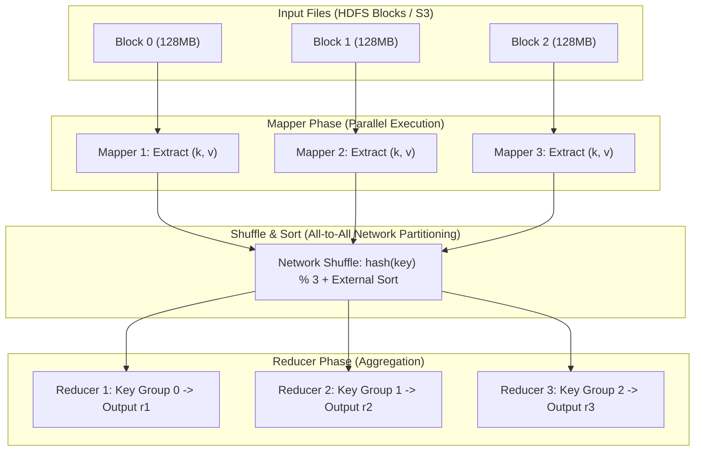
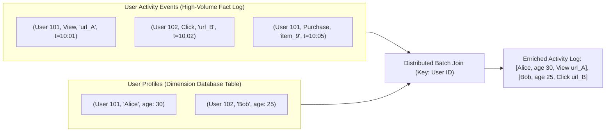
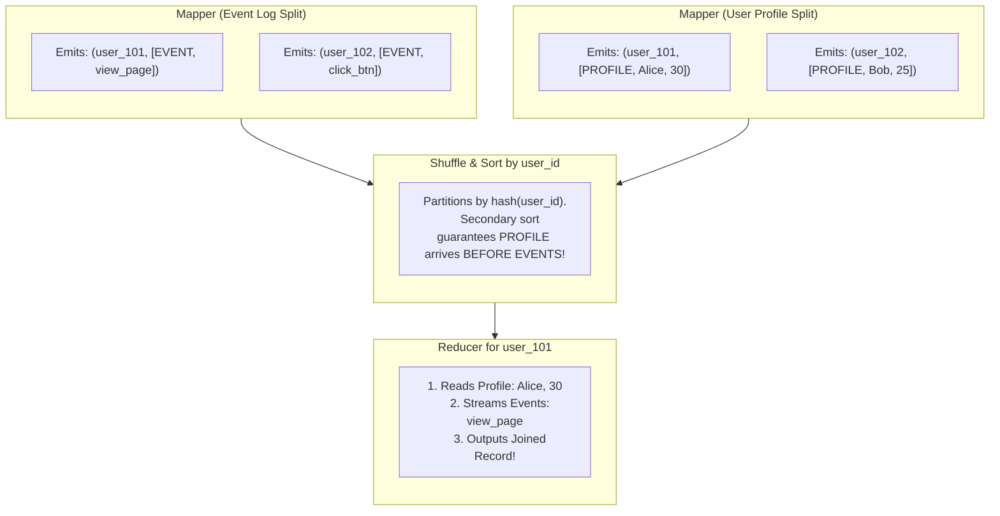
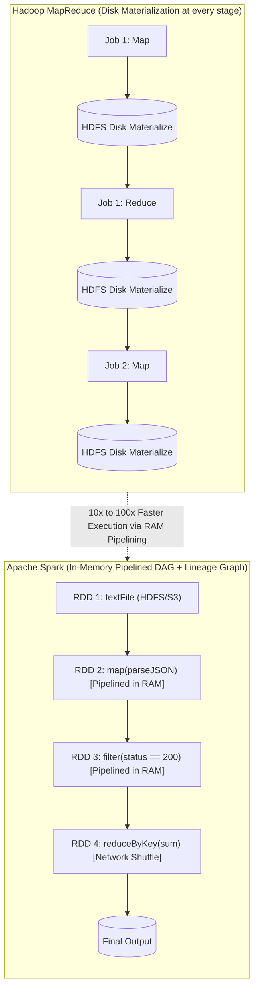

# Chapter 11: Batch Processing — Definitive Technical Summary
*From: Designing Data-Intensive Applications (2nd Edition) by Martin Kleppmann and Chris Riccomini*
*Source PDF: pp. 475–510 (673-page PDF) — figures below cite PDF pages.*

> [!NAV] **Chapter Navigation**
> ⬅️ **Previous:** [[chapter-10-consistency-and-consensus|Chapter 10: Consistency and Consensus]] | 🏠 **Index:** [[00-Master-Reading-Dashboard|Master Dashboard]] | ➡️ **Next:** [[chapter-12-stream-processing|Chapter 12: Stream Processing]]


---

## 1. Executive Summary & Core Engineering Problem

- **Core Thesis:** Systems can be categorized into three distinct operational paradigms: **Service-Oriented (Online)** systems that optimize for low latency and high availability on discrete point requests; **Stream Processing (Near-Real-Time)** systems that ingest and transform unbounded event streams with sub-second latencies; and **Batch Processing (Offline)** systems that process bounded, historical datasets of arbitrary size by prioritizing aggregate job throughput over response time. Batch processing treats input data as strictly **immutable**, executing deterministic computational pipelines that produce newly derived outputs without modifying source records. By embracing bounded execution and immutability, batch architectures achieve complete fault tolerance: transient worker failures are resolved via deterministic recomputation without distributed locks or two-phase commit.
- **Problem Statement:** Attempting to execute complex data transformations, aggregations, or analytical joins directly on transactional OLTP databases causes catastrophic operational collapse. For instance, executing a star-schema join between 10 billion user clickstream events and a 50-million-row customer database on an operational PostgreSQL or MySQL cluster saturates disk I/O channels, evicts buffer pool working sets, triggers long-running shared read locks, and inflates p99 transaction latencies from 10 ms to $>45,000\ \text{ms}$, bringing online checkout APIs to a dead halt. Conversely, building ad-hoc in-memory scripts fails because in-memory hash tables crash with Out-Of-Memory (OOM) errors whenever data volume exceeds physical RAM.
- **Historical & Industry Context:** The foundational philosophy of batch processing was established in the 1970s with Unix pipelines (`stdin`, `stdout`, and `sort`), demonstrating that complex computations can be constructed by chaining composable, single-purpose tools via uniform stream interfaces. In 2004, Google published MapReduce, scaling this philosophy across thousands of commodity machines backed by the Google File System (GFS). Apache Hadoop popularized open-source MapReduce and HDFS in the late 2000s, but its rigid multi-stage materialization model (spilling all intermediate state to disk) introduced severe I/O bottlenecks. In the 2010s, dataflow engines like **Apache Spark** and **Apache Flink** emerged, generalizing MapReduce into arbitrary Directed Acyclic Graphs (DAGs) and keeping intermediate working sets pipelined in distributed RAM. In the 2020s (2nd Edition inflection), batch architectures decoupled compute from cloud object stores (Amazon S3, Google Cloud Storage), utilizing vectorized SQL engines (Trino, DuckDB) and open table formats (Apache Iceberg) to merge batch processing with lakehouse warehousing.

---

## 2. In-Depth Technical Concepts & Internal Mechanics

### 2.1 The Unix Philosophy & External Sorting
- **Foundational Theory:** The design principles of Unix (Doug McIlroy, 1978) provide the architectural blueprint for modern distributed batch computing:
  1. Make each program do one thing well.
  2. Expect the output of every program to become the input to another, as yet unknown, program.
  3. Design and build software to be run by software rather than human operators.
  4. Use standard text/byte streams as a universal interface (`stdin` / `stdout`).
- **Log Analysis Case Study:**
  Find the 5 most popular URLs in a web server access log:
  ```bash
  cat /var/log/nginx/access.log |
    awk '{print $7}' |
    sort |
    uniq -c |
    sort -r -n |
    head -n 5
  ```
- **Sorting vs. In-Memory Aggregation:**
  - *In-Memory Script (Python/Ruby Hash Map):* Reads lines sequentially, populating `counts[url] += 1`. 
    - *Bottleneck:* If the unique URL working set exceeds physical RAM (e.g., 50 million unique URLs with long query strings requiring 32 GiB on an 8 GiB machine), the process enters OS swap thrashing and crashes with an OOM error.
  - *Unix `sort` (External Merge-Sort):*
    1. Reads data into an in-memory buffer up to a configured threshold (e.g., 500 MiB).
    2. Sorts the buffer in memory using QuickSort.
    3. Flushes the sorted run sequentially to disk as a temporary file.
    4. Repeats for all input data, producing $K$ sorted temporary files.
    5. Executes a multi-way merge across all $K$ files, streaming the final sorted output directly to `uniq -c`.
  - *Core Invariant:* **External merge-sort scales gracefully to datasets orders of magnitude larger than physical RAM**, bound only by available disk space.

---

### 2.2 Distributed Filesystems and Cloud Object Storage
- **HDFS (Hadoop Distributed File System):**
  - Designed around the principle of **moving computation to data** (data locality), avoiding saturated datacenter network switches during the 1 Gbps Ethernet era.
  - *Architecture:*
    - **NameNode:** Centralized master managing directory trees, file metadata, and block locations in RAM.
    - **DataNodes:** Worker machines storing raw 64 MiB or 128 MiB contiguous file blocks on local commodity drives, replicated across $3\times$ nodes (2 nodes in the same rack, 1 node in an off-rack machine).
  - *Data Locality Scheduling:* Job schedulers assign compute tasks directly to the physical DataNode hosting the target block, reading data via local OS file descriptors ($O(1)$ network I/O).
- **Cloud Object Storage (Amazon S3, Google Cloud Storage, Azure Blob):**
  - Modern datacenters utilize 100 Gbps / 400 Gbps non-blocking bisection bandwidth, rendering the "compute-to-data" locality optimization obsolete.
  - **Disaggregated Storage:** Compute instances (ephemeral VMs/containers) are completely decoupled from durable object storage.
  - *API & Consistency:* Exposes RESTful HTTP APIs (`GET`, `PUT`, `DELETE`). S3 guarantees strong read-after-write consistency for object operations. Files are immutable: updating an object requires rewriting the entire byte payload.

---

### 2.3 MapReduce Internals: Mappers, Reducers, and the Shuffle
- **The Execution Model (Figure 11-1):**
  A MapReduce job decomposes computation into two primary phases separated by an internal data-shuffling stage:
  1. **Map Phase:**
     - The job scheduler partitions input files into independent chunks (typically 128 MiB matching HDFS block boundaries).
     - A **Mapper** task is spawned for each chunk. The mapper iterates over records, parses fields, and invokes user code:
       $$\text{map}(k_1, v_1) \to \text{list}(k_2, v_2)$$
  2. **Partition & Shuffle Phase:**
     - The MapReduce framework groups all values sharing the same output key $k_2$.
     - Each mapper partitions its output records across $R$ target Reducers:
       $$\text{reducer\_id} = \text{hash}(k_2) \pmod R$$
     - *In-Memory Sorting & Spilling:* Mapper buffers output records in memory (e.g., 100 MiB buffer). When the buffer is 80% full, a background thread sorts records by $(k_2)$ and spills them to a local disk file.
     - *The Shuffle:* Reducer tasks pull their assigned partitions from **all mappers across the network** via HTTP connections.
  3. **Reduce Phase:**
     - The Reducer merges the presorted partition files from all mappers using an external merge-sort.
     - All values for a given key $k_2$ are passed sequentially to the user reducer function:
       $$\text{reduce}(k_2, \text{list}(v_2)) \to \text{list}(k_3, v_3)$$
     - Output records are streamed directly to durable distributed storage (HDFS or S3).
- **Fault Tolerance Mechanics (The Beauty of Immutability):**
  - Inputs to MapReduce are read-only. Outputs are written to a temporary directory and atomically renamed upon successful job completion.
  - If a worker machine crashes mid-job:
    - If a **Mapper** fails: The coordinator reschedules the mapper on another node, re-reading the immutable input block from an alternative HDFS replica.
    - If a **Reducer** fails: The coordinator restarts the reducer on another node, re-fetching the intermediate partition files from surviving mapper disks.
  - Because tasks are pure functions without side effects, **failed tasks can be re-executed an arbitrary number of times without risking partial state corruption**.

---

### 2.4 Distributed Joins in Batch Processing
Joining large-scale datasets (e.g., joining an unbounded clickstream event log with a dimension table of user profiles, Figure 11-2) requires specialized distributed join strategies:

#### 1. Sort-Merge Joins (Reduce-Side Joins - Figure 11-3)
- *Theory:* The most general join strategy. Applicable when both datasets are vast and cannot fit into memory.
- *Execution Steps:*
  1. *Mapper Extraction:* Mappers scan both datasets. Dataset A (clickstream) emits records with `key = user_id, value = (EVENT, click_data)`. Dataset B (user database) emits records with `key = user_id, value = (PROFILE, user_metadata)`.
  2. *Shuffle & Partitioning:* Records are hashed by `user_id` and routed to the corresponding Reducer. The framework sorts all records for a given `user_id`.
  3. *Secondary Sorting:* The framework orders records such that the profile record arrives *first*, followed by all corresponding click events.
  4. *Reducer Merge:* The reducer reads the single profile record into memory, and sequentially streams through the subsequent millions of click events for that user, emitting joined rows without storing events in RAM.
- *Bottleneck:* The **Hot Key / Straggler Problem**. If a single celebrity user has 50 million events, all 50 million events route to a single reducer node, stalling job completion while remaining reducers sit idle.

#### 2. Broadcast Hash Joins (Map-Side Joins)
- *Theory:* Applicable when joining a massive dataset (e.g., 500 GB clickstream) with a small dataset that fits in RAM (e.g., a 100 MB country lookup table).
- *Execution Steps:*
  1. The small table is read completely and **broadcast** across the network to every single mapper worker.
  2. Each mapper loads the small table into an in-memory hash table.
  3. The mapper streams through its assigned 128 MiB chunk of the large dataset, querying the local in-memory hash table for each row.
- *Advantage:* **Zero shuffle, zero sorting, zero reducers!** The join executes in a single streaming pass ($O(N)$ time), maximizing network and CPU efficiency.

#### 3. Partitioned Hash Joins (Bucket Map Joins)
- *Theory:* Applicable when both datasets are partitioned on the exact same join key using the exact same hash function and partition count.
- *Execution Steps:*
  - Partition $i$ of Dataset A only ever matches with Partition $i$ of Dataset B.
  - The mapper assigned to Partition $i$ loads Partition $i$ of the smaller dataset into an in-memory hash table, scanning Partition $i$ of the larger dataset.
  - Eliminates global shuffles while bypassing RAM limits of broadcast joins.

---

### 2.5 Dataflow Engines: Apache Spark and Apache Flink
- **The Limitations of Hadoop MapReduce:**
  - Rigid multi-stage execution: every step requires a full Map $\to$ Shuffle $\to$ Reduce pipeline.
  - High storage amplification: intermediate results between jobs must be written to disk, replicated $3\times$ across HDFS, and read back over the network by the subsequent job.
- **Dataflow Engine Generalization (Spark / Flink / Tez):**
  - Models computation as an arbitrary **Directed Acyclic Graph (DAG)** of operators.
  - Functions are composed fluently (`map`, `filter`, `join`, `groupBy`).
  - **In-Memory Pipelining:** An operator streams its output directly across memory channels or network TCP buffers to the next operator without materializing intermediate data to physical disk.
- **Resilient Distributed Datasets (RDDs) and Lineage Graphs:**
  - An RDD is an immutable, partitioned collection of records in Spark.
  - *Fault Tolerance without Disk Materialization:*
    - Spark does not replicate RDD partitions across nodes.
    - Instead, it maintains a **Lineage Graph** (the exact sequence of deterministic operations that created the RDD).
    - If a worker hosting partition 4 of an RDD crashes, Spark inspects the lineage graph and re-computes **only partition 4** from the original input block on another worker.

---

### 2.6 The Straggler Problem & Skew Handling
- **The Straggler Invariant:** A batch processing job cannot complete until its **slowest individual task finishes**.
- **Causes of Stragglers:**
  - Hardware degradation: faulty CPU core, thermal throttling, failing disk sectors with high ECC read retries.
  - Virtual machine noisy neighbors stealing hypervisor CPU cycles.
  - Data skew: non-uniform key distributions where a single partition contains $100\times$ more records than average.
- **Mitigation Mechanisms:**
  1. *Speculative Execution (Hedging):* The coordinator monitors task execution rates. If a task runs significantly slower than the median, the coordinator launches a duplicate copy of the task on an alternative healthy machine. Whichever copy finishes first is accepted; the other is terminated.
  2. *Skewed Join Optimization (Salting Hot Keys):*
     - If key `celebrity_user` has 10 million records:
     - The mapper appends a random integer salt from $0$ to $K-1$: `celebrity_user_0`, `celebrity_user_1`, ..., `celebrity_user_K-1`.
     - The records scatter across $K$ distinct reducers.
     - The corresponding dimension record is replicated across all $K$ reducers, parallelizing the hot join.

---

### 2.7 Batch Outputs: Serving Derived Data
- **Batch Processing is Not Just for Analytics:**
  - While batch jobs compute business reports and machine learning models, their most powerful application is **building derived data systems for online operational serving**.
- **Use Cases:**
  1. *Building Search Indexes (Apache Lucene):*
     - Running full-text indexing directly on an active Elasticsearch cluster incurs heavy write amplification and segment compaction thrashing.
     - *Batch Approach:* MapReduce scans raw documents, builds fully optimized, compressed, immutable Lucene segment files in parallel, and uploads the sealed index files directly to the serving cluster.
  2. *Pre-materializing Key-Value Stores (Voldemort, RocksDB SSTables):*
     - Batch pipelines process recommendation algorithms or machine learning embeddings, writing sorted SSTables directly to cloud storage.
     - Operational key-value stores download the sealed SSTables and load them into memory/disk, providing blazing sub-millisecond point lookups without incurring write path overhead.

---

## 3. Important Figures, Diagrams & Visual Architecture

> 📕 **Original figures quick index (source PDF, 673 pages):** open the PDF at the cited page to verify each reconstruction.
>
> | Book Fig | PDF page | What to compare |
> |---|---|---|
> | Fig 11-1 | PDF p.494 | MapReduce 3x3 |
> | Fig 11-2 | PDF p.495 | Shuffle sort |
> | Fig 11-3 | PDF p.496 | Row-by-row mapper |


### Figure 11-1: MapReduce Execution Dataflow
- **Figure Reference:** `Figure 11-1: A MapReduce job with three mappers and three reducers (reconstructed from text p. 434)`
- **Original PDF:** Fig 11-1 → PDF p.494 — open the PDF at page 494 to compare with the Mermaid reconstruction below.
- **Visual Flow & Description:** Shows 3 mappers reading HDFS input splits, partitioning by key, sorting locally, shuffling over the network, and streaming to 3 reducers that write final output files to HDFS.
- **Mermaid Flowchart:**



- **Key Takeaway:** MapReduce decouples application logic into isolated stages, utilizing external sorting during the shuffle to aggregate massive datasets without memory exhaustion.

---

### Figure 11-2: Batch Star-Schema Join (Events vs. Dimensions)
- **Figure Reference:** `Figure 11-2: A join between a log of user activity events and a database of user profiles (reconstructed from text p. 436)`
- **Original PDF:** Fig 11-2 → PDF p.495 — open the PDF at page 495 to compare with the Mermaid reconstruction below.
- **Visual Flow & Description:** Depicts joining high-volume, append-only clickstream event logs with a slowly changing dimension table of user profiles.
- **Mermaid Flowchart:**



- **Key Takeaway:** Batch processing unifies high-velocity event facts with normalized relational dimensions without locking or impacting operational databases.

---

### Figure 11-3: Reduce-Side Sort-Merge Join Execution
- **Figure Reference:** `Figure 11-3: A sort-merge join on user ID; mappers extract join key, shuffle partitions by key, reducers merge streams (reconstructed from text p. 437)`
- **Original PDF:** Fig 11-3 → PDF p.496 — open the PDF at page 496 to compare with the Mermaid reconstruction below.
- **Visual Flow & Description:** Tracks execution of a reduce-side join. Mappers tag records by source table. The shuffle groups and sorts by `user_id`, allowing the reducer to execute a single-pass streaming merge join.
- **Mermaid Flowchart:**



- **Key Takeaway:** Sort-merge joins exploit secondary sorting to stream unbounded event lists against dimension records with $O(1)$ reducer memory overhead.

---

### Spark DAG Lineage & In-Memory Pipeline Execution
- **Visual Flow & Description:** Contrasts rigid multi-job MapReduce disk materialization with Apache Spark's in-memory pipelined DAG execution and RDD lineage recomputation.
- **Mermaid Flowchart:**



- **Key Takeaway:** Spark's DAG execution eliminates disk serialization between intermediate stages, achieving order-of-magnitude speedups over MapReduce.

---

## 4. Real-World Systems, Case Studies & Code Examples

### 4.1 Industry Implementations & Architectural Divergence
- **Hadoop MapReduce & HDFS:** The original big-data workhorse. Optimized for batch processing on spinning HDDs where disk bandwidth and cluster locality dominated. High latency, high disk write amplification, but rock-solid reliability on multi-thousand-node clusters.
- **Apache Spark (In-Memory DAG Processing):** De-facto enterprise standard for batch processing, machine learning pipelines, and graph processing. Uses Tungsten memory management (bypassing JVM garbage collection via raw off-heap memory bytes) and Catalyst query optimizer for vectorized code generation.
- **Trino & Presto (Distributed Vectorized SQL on Lakehouses):** Interactive distributed SQL query engines designed to query disaggregated object storage (S3/GCS) backing Parquet, ORC, and Apache Iceberg tables. Implements pure in-memory streaming pipelines without intermediate disk writes, optimizing for sub-second analytical latencies.
- **DuckDB (Embedded Analytical Batch Engine):** High-performance in-process columnar SQL OLAP engine. Implements vectorized columnar interpretation and adaptive multi-threaded execution, processing terabyte-scale datasets on a single multicore laptop without distributed cluster overhead.

---

### 4.2 Production Implementation: Pure Python MapReduce Framework

```python
import collections
import itertools
from typing import Callable, Iterator, List, Tuple, Any

class MapReduceEngine:
    """
    Simulates distributed MapReduce execution:
    Mappers emit (key, value) pairs, shuffle partitions and sorts by key,
    and Reducers process grouped value iterators.
    """
    def __init__(self, num_reducers: int = 4):
        self.num_reducers = num_reducers

    def run(
        self, 
        input_records: List[Any], 
        mapper_fn: Callable[[Any], Iterator[Tuple[str, Any]]], 
        reducer_fn: Callable[[str, Iterator[Any]], Iterator[Tuple[str, Any]]]
    ) -> List[Tuple[str, Any]]:
        # --- PHASE 1: MAP PHASE ---
        mapper_outputs: List[Tuple[str, Any]] = []
        for record in input_records:
            for intermediate_key, intermediate_value in mapper_fn(record):
                mapper_outputs.append((intermediate_key, intermediate_value))

        # --- PHASE 2: PARTITION & SHUFFLE PHASE ---
        # Partition keys across reducers using hash(key) % num_reducers
        reducer_buckets: List[List[Tuple[str, Any]]] = [[] for _ in range(self.num_reducers)]
        for key, val in mapper_outputs:
            bucket_idx = hash(key) % self.num_reducers
            reducer_buckets[bucket_idx].append((key, val))

        # External sort within each bucket by key
        for bucket in reducer_buckets:
            bucket.sort(key=lambda item: item[0])

        # --- PHASE 3: REDUCE PHASE ---
        final_output: List[Tuple[str, Any]] = []
        for bucket in reducer_buckets:
            # Group records by key
            for key, group in itertools.groupby(bucket, key=lambda item: item[0]):
                values_iterator = (val for _, val in group)
                for out_key, out_val in reducer_fn(key, values_iterator):
                    final_output.append((out_key, out_val))

        return final_output

# --- Example Application: Word Count ---
def word_count_mapper(line: str) -> Iterator[Tuple[str, int]]:
    for word in line.lower().strip().split():
        yield (word, 1)

def word_count_reducer(word: str, counts: Iterator[int]) -> Iterator[Tuple[str, int]]:
    yield (word, sum(counts))
```

---

### 4.3 Production Implementation: Broadcast Hash Join Engine

```python
from typing import Dict, List, Tuple, Any

class BroadcastHashJoinEngine:
    """
    Executes a Broadcast Hash Join (Map-Side Join):
    The smaller dimension dataset is broadcast and loaded into an in-memory hash table,
    enabling a single-pass join over the massive fact dataset without any shuffle or sort.
    """
    @staticmethod
    def execute(
        large_fact_stream: Iterator[Dict[str, Any]], 
        small_dimension_table: List[Dict[str, Any]], 
        join_key: str
    ) -> Iterator[Dict[str, Any]]:
        # Phase 1: Build in-memory hash table for the small dimension dataset
        hash_table: Dict[Any, Dict[str, Any]] = {}
        for dim_record in small_dimension_table:
            k = dim_record[join_key]
            hash_table[k] = dim_record

        # Phase 2: Stream through the large fact dataset (Zero-Shuffle Map Phase)
        for fact_record in large_fact_stream:
            k = fact_record.get(join_key)
            if k in hash_table:
                # Merge dictionaries to produce enriched output row
                joined_row = dict(fact_record)
                joined_row.update(hash_table[k])
                yield joined_row
```

---

### 4.4 Production War Story: The Straggler That Froze Cyber Monday Billing
- **The Context:** A major e-commerce marketplace ran a nightly Apache Spark batch job to reconcile merchant payouts across 200 million daily orders. The pipeline performed a reduce-side join between order records and merchant accounts, running across 120 worker nodes with 960 CPU cores.
- **The Pathological Incident:** During Cyber Monday, the merchant reconciliation job, which normally completed in 45 minutes, hung at $99\%$ completion for 7 hours, blocking daily banking ACH payout transfers.
- **The Root Cause:**
  - The join partitioned records on `merchant_id`.
  - A single mega-merchant ("Amazon Basics" equivalent) accounted for $18\%$ of global marketplace transactions ($36\ \text{million orders}$ in 24 hours).
  - Out of 960 Spark tasks, 959 tasks finished their partitions in under 3 minutes.
  - The single task assigned the hash bucket for the mega-merchant received 36 million orders. The worker process ran out of JVM heap space trying to buffer the partition, entered an infinite Stop-the-World garbage collection thrashing loop, and stalled CPU execution (**The Classic Skewed Straggler**).
- **Remediation & Architecture Lessons:**
  1. *Skewed Join Optimization:* Activated Spark's Adaptive Query Execution (`spark.sql.adaptive.skewJoin.enabled = true`), which dynamically splits skewed partitions into multiple sub-partitions.
  2. *Key Salting for Super-Merchants:* Pre-identified high-volume merchants and salted their partition keys with random integers `merchant_id + "_" + rand(0, 31)`, parallelizing the mega-merchant's join across 32 separate workers and restoring job runtime to 38 minutes.

---

## 5. Architectural Trade-Off Matrix

| Batch Processing Architecture | Throughput Profile | Fault Tolerance Mechanism | Memory Sensitivity | Intermediate State Storage | Best Workload Fit | Catastrophic Failure Mode |
| :--- | :--- | :--- | :--- | :--- | :--- | :--- | :--- |
| **Unix Pipelines (`awk`, `sort`)** | Single-core streaming; bounded by local disk I/O | None (Process failure requires restarting pipeline from start) | **Low** (External merge-sort spills to disk automatically) | Local temp files / OS pipes | Small-to-medium files ($<500\ \text{GB}$) on single multicore server | Single corrupted line or syntax error halts entire pipe |
| **Hadoop MapReduce (HDFS)** | High aggregate throughput; high startup latency | Deterministic task re-execution from immutable HDFS blocks | **Low** (Sort buffers spill to local disk; handles massive skew) | Materialized to disk and replicated across HDFS at every stage | Multi-petabyte batch jobs on cheap commodity spinning disks | Extreme disk write amplification stalls multi-stage pipelines |
| **Apache Spark (Dataflow DAG)** | **Blazing** ($10\times\text{--}100\times$ faster than MapReduce via RAM pipelining) | Lineage graph recomputes lost RDD partitions in memory | **High** (JVM heap bloat and GC pauses under memory pressure) | Pipelined in memory; spills to disk only when memory exhausted | Complex multi-stage ETL; iterative machine learning; graph analytics | Uncontrolled data skew triggers worker JVM Out-Of-Memory crash |
| **Broadcast Hash Join** | **Optimal** ($O(N)$ streaming scan; zero network shuffle) | Task re-execution on failure | **High** (Small dataset must fit entirely in mapper RAM) | Zero intermediate disk or network state | Joining vast fact logs ($>1\ \text{TB}$) with small dimension tables ($<500\ \text{MB}$) | Dimension table exceeding broadcast memory threshold crashes all mappers |
| **Sort-Merge Join (Reduce-Side)** | Moderate (Heavy all-to-all network shuffle + disk sort) | Reducer re-execution from mapper partition files | **Low** (Streams sorted inputs off disk via external merge) | Shuffled over network; materialized on mapper/reducer disks | Joining two massive, unpartitioned datasets ($>1\ \text{TB}$ each) | Celebrity key skew concentrates millions of rows on single reducer |

---

### Concrete Decision Heuristics

```text
Decision Tree for Distributed Batch Architecture:
1. Does the dataset fit comfortably within the RAM and NVMe storage of a single large machine (<1 TB)?
   ├── YES: Use DuckDB or Unix pipelines on a high-memory multi-core cloud VM (Avoids cluster networking overhead).
   └── NO (Distributed multi-node processing required):
        ├── Is the workload interactive SQL querying over analytical data lakehouses (S3 / Iceberg)?
        │    └── YES: Use Trino / Presto with vectorized columnar execution.
        └── Is the workload large-scale multi-stage ETL, data transformation, or feature engineering?
             ├── Joining a massive table with a small dimension table (<500 MB)?
             │    └── YES: Force a Broadcast Hash Join (Zero-shuffle map-side join).
             └── Joining two massive multi-terabyte tables without shared partitioning?
                  └── YES: Use Sort-Merge Join on Apache Spark with Adaptive Query Execution (AQE) enabled.
```

---

## 6. Jargon Buster & Key Terminology

- **Batch Processing:** An offline data processing paradigm that executes long-running computational jobs over bounded, static, historical datasets, optimizing for total throughput rather than response time.
- **Data Locality:** An architectural technique (pioneered by HDFS) that schedules compute tasks on the physical machine hosting the target data blocks, avoiding network transfers.
- **External Merge-Sort:** A sorting algorithm designed for datasets that exceed physical RAM, sorting chunks in memory, spilling sorted runs to disk, and merging runs in streaming passes.
- **Mapper:** A batch processing function that processes raw input records and projects them into intermediate key-value pairs.
- **Reducer:** A batch processing function that iterates over all intermediate values associated with a specific key to compute an aggregated output.
- **Shuffle:** The phase in MapReduce and distributed dataflow engines where intermediate records are partitioned, transferred across the network, and sorted before delivery to reducers.
- **Straggler:** A single computational task within a distributed batch job that executes significantly slower than peer tasks, delaying overall job completion.
- **Speculative Execution:** A resilience mechanism where the cluster coordinator detects straggling tasks and launches duplicate speculative copies on other nodes, committing whichever copy finishes first.
- **Broadcast Hash Join (Map-Side Join):** A distributed join optimization where a small dimension table is broadcast to all mappers and loaded into memory, eliminating the shuffle phase entirely.
- **Resilient Distributed Dataset (RDD):** Spark's core abstraction representing an immutable, partitioned collection of records that can be recomputed on failure via its lineage graph.

---

## 7. System Design & Practical Engineering Takeaways

### 7.1 Production Engineering Checklist
1. **Enable Speculative Execution on Large Batch Clusters:** Configure `spark.speculation = true` to automatically mitigate stragglers caused by degraded cloud hardware or noisy neighbors.
2. **Force Broadcast Joins for Small Dimension Tables:** When joining large fact tables with lookup tables $<100\ \text{MB}$, explicitly hint or configure `spark.sql.autoBroadcastJoinThreshold = 104857600` to prevent unnecessary all-to-all shuffles.
3. **Pre-Filter and Prune Projections Before Shuffling:** Never execute a global shuffle before filtering. Always push filters (`WHERE`) and column projections (`SELECT colA, colB`) directly to the source scan operator (predicate pushdown).
4. **Tune Garbage Collection for Off-Heap Memory:** In Apache Spark, configure off-heap memory allocation (`spark.memory.offHeap.enabled = true`) to minimize JVM garbage collection pauses on multi-hundred-gigabyte worker nodes.
5. **Mitigate Skew via Salted Keys:** In reduce-side joins, monitor partition sizes. If a single key dominates $>5\%$ of total records, salt the key with a random suffix (`0..31`) and replicate the matching join record across 32 buckets.

---

### 7.2 System Design Interview Strategy
- **Treat Immutability as the Superpower of Batch Systems:** When asked how batch systems recover from mid-job worker crashes, highlight the contrast with OLTP: *"OLTP systems require complex WAL undo logging and 2PC. Batch systems treat inputs as immutable and operations as pure deterministic functions; recovery simply re-executes the failed task on another node without side effects."*
- **Explain the Mechanics of Distributed Joins:** Do not just say *"We join the tables."* Specify the exact join type based on data sizes: *"Because the user profile table is small (50 MB), we will use a Broadcast Hash Join to load it into mapper memory, completely bypassing the network shuffle and reducer phase."*
- **Capacity Sketching for Shuffle Bandwidth:**
  $$\text{Shuffle Network Volume} = \text{Total Input Records} \times \text{Intermediate Key-Value Bytes}$$
  $$\text{Reducer Memory Required} = \text{Max Key Cardinality Records} \times \text{Avg Record Size} \times \text{Skew Multiplier}$$

---

### 7.3 Mastery Self-Assessment Questions

#### Question 1 (Conceptual Depth)
*Why does a Broadcast Hash Join (Map-Side Join) achieve orders-of-magnitude higher throughput and lower resource consumption than a Sort-Merge Join (Reduce-Side Join), and what is its fundamental architectural limitation?*
- **Answer:** 
  A **Sort-Merge Join (Reduce-Side Join)** is a heavy, multi-stage operation. It requires scanning both datasets, emitting records tagged with source identifiers, hashing every record across $R$ reducers, executing an all-to-all network shuffle across cluster racks, spilling intermediate partition files to disk, executing an external merge-sort to order records by join key, and invoking reducers to merge streams. The shuffle stage consumes massive network switch bandwidth, disk write IOPS, and CPU serialization cycles.
  A **Broadcast Hash Join (Map-Side Join)** eliminates the shuffle, the sorting stage, and the reducer stage entirely. The smaller dataset is broadcast once over the network to all mapper workers, where each mapper loads the data into a local in-memory hash table. As mappers stream through their local chunks of the massive fact dataset, they perform an $O(1)$ memory lookup against the hash table for every row. The join executes in a single streaming pass ($O(N)$ time), bounded only by raw input read bandwidth.
  The **fundamental limitation** of a Broadcast Hash Join is memory capacity: the smaller dataset **must fit entirely within the physical RAM** allocated to each individual mapper process. If the dimension table exceeds available memory, mappers crash with JVM `OutOfMemoryError` or enter severe OS swap thrashing.

#### Question 2 (Failure Scenario & Edge Cases)
*An engineering team runs an Apache Spark batch job that processes 500 million web analytics sessions daily. The pipeline performs an aggregation: `sessions.groupBy("ip_address").count()`. During a DDoS attack, a single botnet IP address generates 150 million requests. The Spark job consistently fails after running for 2 hours with an `ExecutorLostFailure: Container killed by YARN for exceeding memory limits`. Diagnose the failure mechanism and prescribe the production architectural fix.*
- **Answer:**
  - *Failure Mechanism:* The failure is caused by **Extreme Key Skew (The Straggler OOM Collapse)**.
    - During the `groupBy("ip_address")` shuffle, Spark hashes the `ip_address` to determine the target reducer task: `reducer_id = hash(ip_address) % num_reducers`.
    - All 150 million records for the botnet IP address route to the exact same reducer task on a single worker executor.
    - The reducer attempts to buffer and aggregate the 150 million records in its in-memory hash map or append them to its shuffle spill buffer.
    - The memory footprint of the single task exceeds the worker container's physical memory limit (`yarn.nodemanager.vmem-pmem-ratio`). YARN detects the memory boundary violation and forcefully terminates the container with `SIGKILL`.
    - Spark attempts to reschedule the task on another worker up to `spark.task.maxFailures = 4`, where it crashes each worker consecutively until the entire job fails.
  - *Prescribed Remediation:*
    1. *Two-Stage Aggregation (Salting):*
       - *Stage 1 (Partial Aggregation with Salt):* In the mapper, append a random integer salt from $0$ to $31$ to the key: `salted_ip = ip_address + "_" + rand(0, 31)`. Execute a `groupBy("salted_ip").count()`. This scatters the 150 million botnet records uniformly across 32 separate reducers, parallelizing the aggregation and keeping each task's memory footprint small.
       - *Stage 2 (Final Aggregation):* Strip the salt suffix from the intermediate keys: `original_ip = salted_ip.split('_')[0]`. Execute a second `groupBy("original_ip").sum("count")`. Because Stage 1 collapsed the 150 million records into just 32 pre-aggregated rows, Stage 2 processes only 32 numbers for the botnet IP, executing in milliseconds without memory strain.

#### Question 3 (Trade-Off & Capacity Estimation)
*An advertising platform processes 10 billion ad click events per day (average event size = 200 bytes uncompressed). An analytics job joins these clicks against a 20 GB advertiser dimension table to compute daily revenue per advertiser. Calculate: (A) The network shuffle volume and minimum disk I/O required if the job is executed as a Reduce-Side Sort-Merge Join, vs. (B) The network and disk I/O required if executed as a Broadcast Hash Join across 100 mapper workers. Show exact derivations.*
- **Answer:**
  - *Input Volume Metrics:*
    - Click Events: $10 \times 10^9\ \text{events} \times 200\ \text{bytes} = 2,000 \times 10^9\ \text{bytes} = \mathbf{2\ \text{TB}}$.
    - Dimension Table: $\mathbf{20\ \text{GB}}$.
  - *Approach A: Reduce-Side Sort-Merge Join*
    - *Map Phase:*
      - Mappers read 2 TB of clicks and 20 GB of dimensions off storage:
        $$\text{Disk Read (Mappers)} = 2\ \text{TB} + 0.02\ \text{TB} = \mathbf{2.02\ \text{TB}}$$
      - Mappers emit intermediate key-value pairs (assume intermediate projection size is 100 bytes per event):
        $$\text{Intermediate Map Output} = 10 \times 10^9 \times 100\ \text{bytes} = \mathbf{1\ \text{TB}}$$
      - Mappers sort and spill intermediate data to local disk:
        $$\text{Disk Write (Mapper Spills)} = \mathbf{1\ \text{TB}}$$
    - *Shuffle Phase:*
      - Reducers pull intermediate data over the network from all mappers:
        $$\text{Network Shuffle Volume} = \mathbf{1\ \text{TB}}$$
    - *Reduce Phase:*
      - Reducers merge and sort spilled partition files off disk:
        $$\text{Disk Read (Reducers)} = \mathbf{1\ \text{TB}}$$
      - Reducers write final joined output (assume output size is 50 GB):
        $$\text{Disk Write (Final Output)} = \mathbf{50\ \text{GB}}$$
    - *Totals for Reduce-Side Join:*
      - **Total Network Shuffle:** $\mathbf{1\ \text{TB}}$
      - **Total Disk I/O:** $2.02\ \text{TB (read)} + 1\ \text{TB (map write)} + 1\ \text{TB (reduce read)} + 0.05\ \text{TB (write)} = \mathbf{4.07\ \text{TB}}$
  - *Approach B: Broadcast Hash Join across 100 Mappers*
    - *Broadcast Phase:*
      - The 20 GB dimension table is broadcast across the network to 100 mapper workers:
        $$\text{Network Broadcast Volume} = 100\ \text{mappers} \times 20\ \text{GB} = \mathbf{2,000\ \text{GB}} = \mathbf{2\ \text{TB}}$$
      - (Note: With peer-to-peer BitTorrent broadcast protocols used in Spark, network overhead is distributed, but total traffic across nodes is $\sim 2\ \text{TB}$).
    - *Map Phase:*
      - Mappers read their 2 TB chunk of clicks directly off storage:
        $$\text{Disk Read (Mappers)} = \mathbf{2\ \text{TB}}$$
      - Mappers query their local in-memory 20 GB hash table (zero intermediate spills).
      - Mappers stream joined results directly to final storage:
        $$\text{Disk Write (Final Output)} = \mathbf{50\ \text{GB}}$$
    - *Totals for Broadcast Hash Join:*
      - **Total Network Shuffle:** $\mathbf{0\ \text{TB}}$ (Replaced by 2 TB broadcast).
      - **Total Intermediate Disk I/O:** $\mathbf{0\ \text{TB}}$ (Saves 2 TB of intermediate spill/read disk traffic).
      - **Total Disk I/O:** $2\ \text{TB (read)} + 0.05\ \text{TB (write)} = \mathbf{2.05\ \text{TB}}$
  - *Quantitative Comparison:*
    - Broadcast Hash Join cuts total disk I/O from **$4.07\ \text{TB}$ to $2.05\ \text{TB}$** (a **$50\%$ reduction in physical disk wear and I/O bus contention**).
    - Broadcast Hash Join completely eliminates the complex, CPU-heavy external merge-sort phase, converting a multi-hour shuffle-heavy job into a blazing, single-pass streaming map operation.


---
> [!NAV] **Chapter Navigation**
> ⬅️ **Previous:** [[chapter-10-consistency-and-consensus|Chapter 10: Consistency and Consensus]] | 🏠 **Index:** [[00-Master-Reading-Dashboard|Master Dashboard]] | ➡️ **Next:** [[chapter-12-stream-processing|Chapter 12: Stream Processing]]