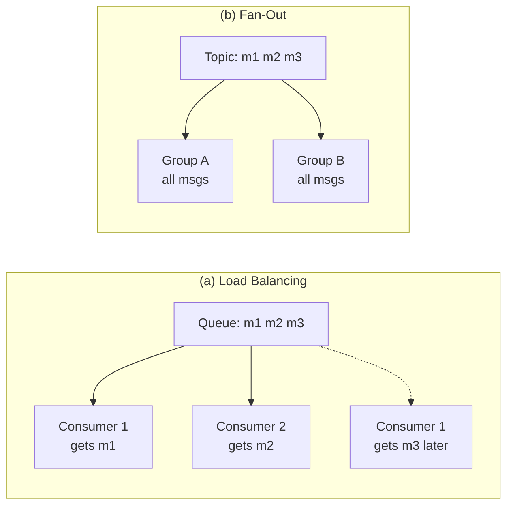
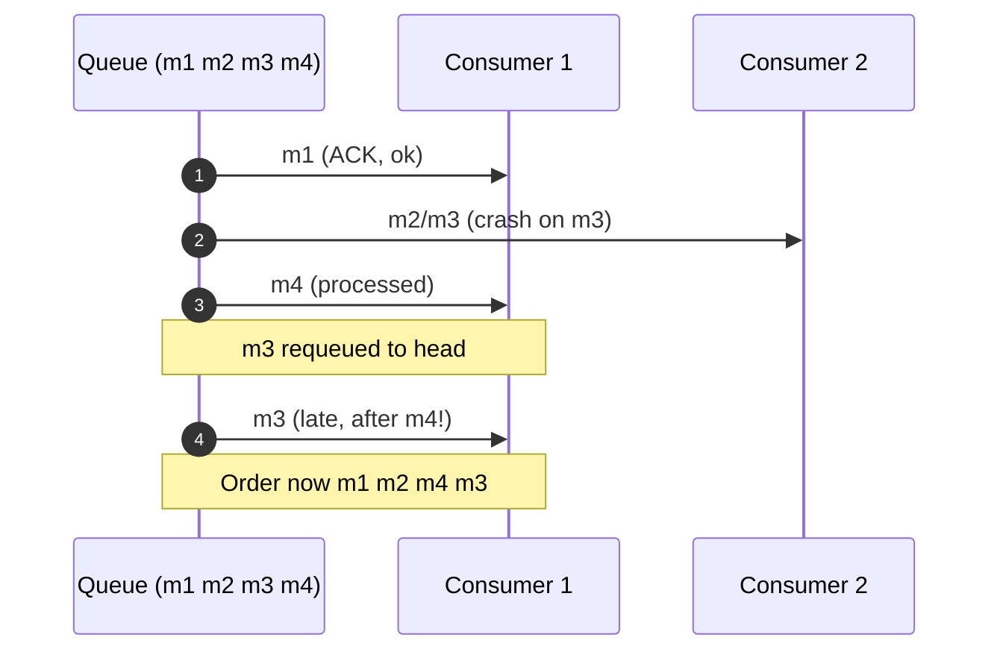
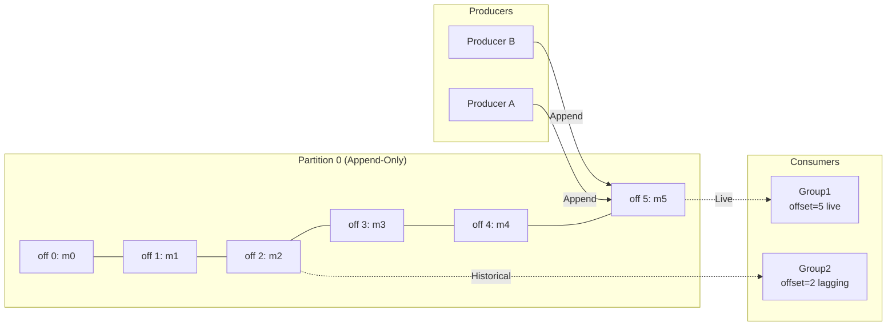
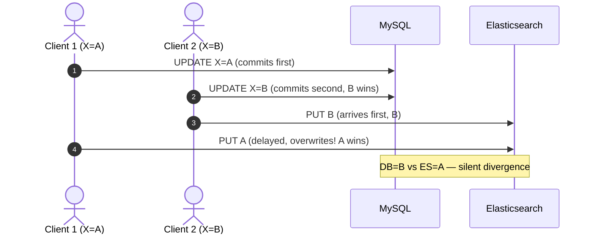
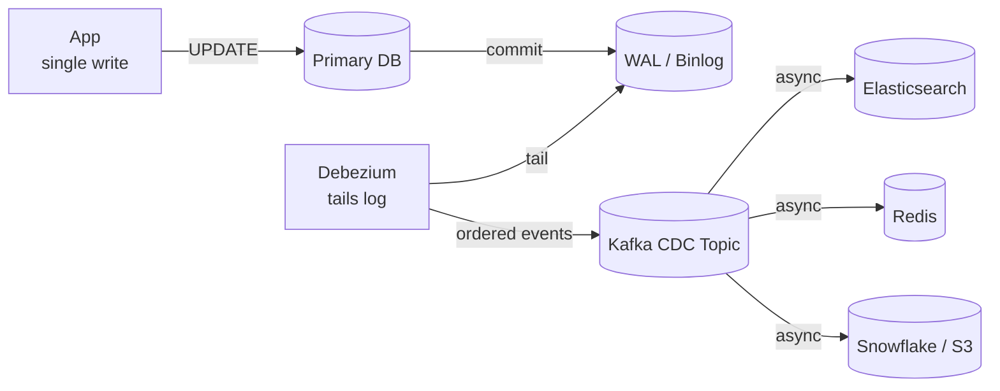
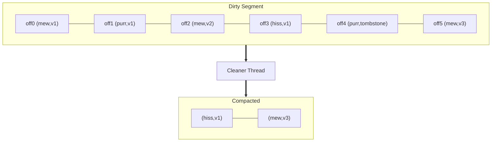
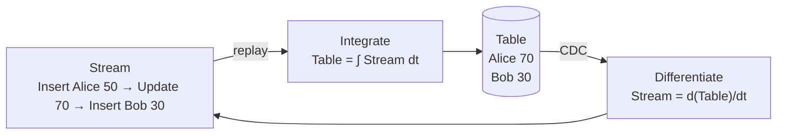
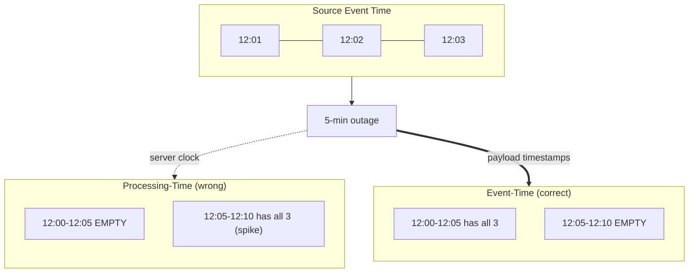

# Chapter 12: Stream Processing — Definitive Technical Summary
*From: Designing Data-Intensive Applications (2nd Edition) by Martin Kleppmann and Chris Riccomini*
*Source PDF: pp. 511–562 (673-page PDF) — figures below cite PDF pages.*

> [!NAV] **Chapter Navigation**
> ⬅️ **Previous:** [[chapter-11-batch-processing|Chapter 11: Batch Processing]] | 🏠 **Index:** [[00-Master-Reading-Dashboard|Master Dashboard]] | ➡️ **Next:** [[chapter-13-a-philosophy-of-streaming-systems|Chapter 13: A Philosophy of Streaming Systems]]

---

## 1. Executive Summary & Core Engineering Problem

> *"A complex system that works is invariably found to have evolved from a simple system that works."*
> — **John Gall**, *Systemantics* (1975)

- **The Big Picture:** Batch waits for tomorrow's newspaper; stream watches live news. Chapter 11 froze time into bounded immutable datasets. Real systems don't pause: card swipes, GPS pings, DB writes arrive continuously. Stream processing treats data as an unbounded immutable event flow, computing incrementally with sub-second latency while keeping batch-like fault-tolerance and determinism.
- **Core Thesis:** Batch latency is structural — you wait for bounds to accumulate. Stream inverts it: unbounded streams + incremental state + stream-table duality (table = cached snapshot, stream = changelog). Durable partitioned logs plus Change Data Capture (CDC) fix dual-write corruption; event-time windows + watermarks + stateful joins deliver deterministic analytics over asynchronous arrivals.
- **Problem Statement:** Dual-writes guarantee divergence. App writes MySQL then Elasticsearch: Client 1 sets X=A, Client 2 sets X=B. MySQL orders A→B (B wins); network jitter orders B→A at Elasticsearch (A wins). Crash between writes = permanent staleness. No error is raised. The chapter's answer is single-write + log tailing, not double application writes.
- **Historical Context:** 1990s–2000s JMS/RabbitMQ/ActiveMQ deleted on ACK, scrambled order on redelivery, choked on fan-out. 2011 LinkedIn Kafka pioneered log-based brokers: append-only partitioned durable logs, consumer-held offsets, zero-copy fan-out, replay. 2010s engines moved Storm (at-least-once tuples) → Flink / Spark Structured Streaming (stateful, event-time, effectively-once). 2020s Debezium WAL-tailing + Iceberg streaming sinks made streams the enterprise nervous system.

| Alice (dual-write) | Bob (log-centric) |
| :--- | :--- |
| "Update DB then POST to index in code." | "Write DB once, tail WAL via Debezium into Kafka, index consumes ordered log." |
| "Processing-time hourly counts look fine." | "Mobile offline bursts spike one window; use event-time + watermarks or lie." |

---

## 2. In-Depth Technical Concepts & Internal Mechanics

### 2.1 Transmitting Event Streams — Messaging Systems (p.512)

Event = small immutable fact at a physical time (swipe, ping, deduction).

#### 2.1.1 Traditional brokers vs. log-based brokers (p.513)

**Traditional (JMS/RabbitMQ/AMQP):** Producer → exchange → queues; consumers load-balance. Broker marks M invisible on delivery, deletes on ACK. Redelivery destroys order: C1 gets M1, C2 gets M2, C3 gets M3; C2 crashes on M2 → broker requeues M2 to head; C1 finishes M1 and takes M2 after M3 already processed. Permanent scramble. RAM holds unacked messages; lagging consumers force paging stalls.

**Log-based (Kafka/Pulsar, p.519):** Topic split into partitions; each partition an append-only sequential file with monotonic 64-bit offsets. No delete-on-read. Each consumer tracks its own offset (`__consumer_offsets`). 50 groups read the same partition at different offsets via Linux `sendfile()` zero-copy — no per-consumer broker memory. Reset to 0 replays weeks deterministically. Strict order within a partition; scale by adding partitions.

| Dimension | RabbitMQ/JMS/SQS | Kafka/Pulsar log-based |
| :--- | :--- | :--- |
| **Retention** | Delete on ACK | Days/indefinite on disk |
| **State** | Broker RAM in-flight | Consumer scalar offset |
| **Order** | Scrambled on retry | Total order per partition |
| **Fan-out** | Copy per queue, RAM bloat | Unlimited groups, zero-copy |
| **Replay** | Impossible | Rewind to 0/timestamp |
| **Under lag** | Swap death | Zero broker penalty |
| **Use** | RPC/task queues | Sourcing, CDC, analytics backbone |

Partitioning rule that matters: key = entity ID (`user_id`, `order_id`) → `hash(key) % partitions` → all mutations for that entity land same partition, one consumer thread, causal order preserved.

#### 2.1.2 Backpressure, load shedding, reactive streams (the gap most summaries miss)

The book returns to backpressure four times in this chapter for a reason. Fast producers + slow consumers need explicit policy, not hope:

- **Backpressure:** Consumer signals "slow down". Unix pipes block the producer on a full buffer; Spark/Flink direct handoffs do the same over network/memory; reactive streams (Reactive Streams spec, Project Reactor, Akka Streams) formalize demand (`request(n)`) so sources emit only what downstream can hold.
- **Load shedding:** When backpressure can't propagate (mobile bursts, traffic spikes), drop or degrade deliberately: sample, aggregate early, route to dead-letter/side output, serve stale cache. Alternative to OOM is controlled loss with audit.
- **Bounded queues + watermarks:** Flink/Spark bound window state and use watermarks to close windows; late data goes to side outputs rather than growing state forever.
- **Kafka as shock absorber:** Durable log decouples rate: producers append at line rate, consumers lag without broker penalty, catching up from disk. This is why CDC + Kafka replaces synchronous dual-writes under burst.

Failure without it: unbounded RocksDB/JVM buffers OOM on a 30-min offline flush; RabbitMQ paging stalls; rebalance storms when `max.poll.interval.ms` is exceeded by slow processing.

### 2.2 Databases and Streams — Keeping Systems in Sync, CDC, State/Streams/Immutability (p.524)

#### 2.2.1 Keeping systems in sync / dual-write hazard (p.525)

```python
db.execute("UPDATE products SET price=99 WHERE id=101")
search_index.put("/products/101", {"price": 99})
```

Fails two ways: concurrent race (reverse arrival orders → permanent fork) and partial fault (crash after DB commit, before HTTP → stale index). Outbox-in-same-transaction mitigates but still needs relay; log-tailing removes app coordination entirely.

#### 2.2.2 Change Data Capture (p.527)

Write only to the system of record. Debezium tails Postgres WAL / MySQL binlog at storage layer, converts committed inserts/updates/deletes into ordered Kafka events. Elasticsearch/Redis/Snowflake consume and converge. Guarantees: total order matching DB commits, crash atomicity (no half-writes), zero app race. Envelope carries `before`/`after`/`source`; schema changes must be versioned or downstream deserializers break.

#### 2.2.3 State, streams, immutability + log compaction + event sourcing (p.532)

Duality:

```text
Table = integral of stream over time
Stream = derivative of table over time
```

Table = snapshot; stream = history. **Log compaction:** normal retention drops old segments after days; compacted topics keep at least the latest value per key, dropping overwritten versions during segment merges, purging deletes via tombstones (`key=K, value=null`). New consumer replays from 0 and rebuilds current table without touching the primary. **Event sourcing:** store every state change as immutable events; current state by replay; audit/free schema evolution by reprocessing. Immutability gives deterministic retry and time travel.

### 2.3 Processing Event Streams — Uses, Time, Joins, Fault Tolerance (p.537)

#### 2.3.1 Uses of stream processing (p.538)

Fraud scoring, live dashboards, CDC-driven search/caches/warehouses, notifications, ML feature pipelines, IoT rollups — anywhere reaction can't wait for the daily batch and where the log is also the audit trail.

#### 2.3.2 Reasoning about time — event vs. processing, watermarks, windows (p.542)

- **Event time** = when it happened on device (payload timestamp). **Processing time** = when server handles it (local clock).
- Processing-time windows lie under delay: subway-tunnel phones buffer 30 min, flush in 2 s → one 1-min window spikes, prior windows empty. Business metrics must window by event time.
- Out-of-order arrivals force heuristics. For window `[12:00,12:05)` you never know all events arrived. **Watermark** = "we believe all events ≤ tw observed". `W(t) = max observed event time − bounded lateness`. Late policy: drop, or update/retract (Flink side outputs, changelog retractions).
- Windows: **tumbling** (fixed non-overlapping, e.g., 5-min; exactly one window per event), **hopping/sliding** (fixed overlapping, e.g., 5-min every 1-min → 5 windows per event, smooth rollups, 5x state), **session** (activity bursts until gap timeout e.g., 30 min; per-user, retroactive merges on late arrivals), **global** (infinite, custom triggers).

Worked watermark: 5-min tumbling `[12:00,12:05)`, 2-min allowance. A(12:03:00) → W=12:01:00 accumulate; B(12:04:30) → W=12:02:30 accumulate; C(12:07:00) → W=12:05:00 ≥ window end → emit 150, close; D(12:03:30) arriving 12:08:15 has event time < W → late → side output/retraction (150→225).

| Window | Bounds | Overlap | State | Late hit | Fit |
| :--- | :--- | :--- | :--- | :--- | :--- |
| **Tumbling** | Fixed consecutive | Zero | Low | Drop/side | Billing, telemetry means |
| **Hopping** | Length + hop | duration/hop | High | Hits many slices | Rolling errors, moving averages, SLAs |
| **Session** | Gap timeout | Zero per user | Timers/user | Merges sessions | Click paths, carts |
| **Global** | Infinite | N/A | Unbounded w/o purge | Trigger logic | Thresholds, anomaly counts |

#### 2.3.3 Stream joins — expanded (three join types the book demands)

Stream joins are stateful lookups over time, not one-shot hash builds. All need bounds or state grows forever.

**1. Stream–stream (windowed) join.** Ad impressions × clicks for conversion. Click may lag impression minutes. Engine buffers impressions in RocksDB for 1 h; on click arrival probes buffer, emits joined pair, purges. Requires event-time window bound + watermark expiry, else infinite retention. Symmetric: either side buffers until mate or timeout. Late mate → side output.

**2. Stream–table (enrichment) join.** Clickstream × user-profile CDC table. CDC stream maintains local RocksDB replica; each click does O(1) local lookup for age/country/tier, no remote DB call, sub-ms. Handles slowly changing dimensions; must version lookups temporally or a late click enriches with the wrong era's profile.

**3. Table–table / stream–table temporal join (materialized-view maintenance).** Two CDC changelogs (orders + addresses) incrementally maintain a joined view. Each input is a table-as-stream; engine keeps join indices per key and emits upserts/retractions on either side's change. Temporal variant: `FOR SYSTEM_TIME AS OF click.event_time` picks the dimension version valid at that moment — fixes retroactive enrichment errors.

| Join | Left | Right | State | Expiry | Pitfall |
| :--- | :--- | :--- | :--- | :--- | :--- |
| **Stream–stream** | Impressions | Clicks | Both buffers | Window + watermark | Unbounded without bound |
| **Stream–table** | Clicks | CDC profile replica | Table replica | Compacted, versioned | Wrong-era enrichment |
| **Table–table / temporal** | Orders CDC | Addresses CDC | Dual indices | Tombstone purge | Retraction storms |

#### 2.3.4 Fault tolerance — checkpoints, savepoints, exactly-once, idempotence (p.550)

Guarantees: **at-most-once** (drop on fail — unacceptable), **at-least-once** (retry → duplicates — double charges), **effectively/exactly-once** (post-recovery state identical to once). Flink's Chandy-Lamport barriers: sources inject checkpoint barriers; operators align barriers, snapshot RocksDB to S3/HDFS, forward barrier, resume — no global pause. Recovery rolls all operators to last complete checkpoint and rewinds Kafka offsets to barrier positions. Spark microbatch gets the same via deterministic RDD lineage recompute at 500–2000 ms granularity vs. Flink's 10–50 ms per-record.

End-to-end exactly-once needs three legs: replayable source (Kafka rewind), deterministic checkpointed processing, idempotent/transactional sink (`UPSERT` by PK or Kafka transactions `sendOffsetsToTransaction`). Without the sink, "exactly-once processing" still double-writes.

---

## 3. Important Figures, Diagrams & Visual Architecture

> 📕 **Original figures quick index (source PDF, 673 pages):** open the PDF at the cited page to verify each reconstruction.
>
> | Book Fig | PDF page | What to compare |
> |---|---|---|
> | Fig 12-1 | PDF p.516 | Load-balance vs fan-out |
> | Fig 12-2 | PDF p.518 | Crash redelivery m3 |
> | Fig 12-3 | PDF p.520 | Partition append/consume |
> | Fig 12-4 | PDF p.526 | Concurrent item update |
> | Fig 12-5 | PDF p.527 | DB CDC propagation |
> | Fig 12-6 | PDF p.529 | Compaction mew/purr |
> | Fig 12-7 | PDF p.533 | State vs stream |
> | Fig 12-8 | PDF p.543 | Processing-time windows |

### Figure 12-1: Load Balancing vs. Fan-Out (PDF p.516)
- **Figure Reference:** `Figure 12-1: (a) Load balancing shares work among consumers; (b) fan-out delivers each message to multiple consumers`
- **Original PDF:** Fig 12-1 → PDF p.516
- **Mermaid:**



### Figure 12-2: Redelivery Scrambles Order (PDF p.518)
- **Figure Reference:** `Figure 12-2: Consumer 2 crashes while processing m3, redelivered to consumer 1 after m4`
- **Original PDF:** Fig 12-2 → PDF p.518
- **Mermaid:**



### Figure 12-3: Partitioned Log Broker (PDF p.520)
- **Figure Reference:** `Figure 12-3: Producers append to partition file; consumers read via offsets`
- **Original PDF:** Fig 12-3 → PDF p.520
- **Mermaid:**



### Figure 12-4: Dual-Write Race (PDF p.526)
- **Figure Reference:** `Figure 12-4: X=A then B in DB, B then A in index — permanent fork`
- **Original PDF:** Fig 12-4 → PDF p.526
- **Mermaid:**



### Figure 12-5: CDC Propagation (PDF p.527)
- **Figure Reference:** `Figure 12-5: Taking DB commits and propagating via CDC to downstream`
- **Original PDF:** Fig 12-5 → PDF p.527
- **Mermaid:**



### Figure 12-6: Log Compaction (PDF p.529)
- **Figure Reference:** `Figure 12-6: Key = cat-video ID (mew/purr); keep latest per key`
- **Original PDF:** Fig 12-6 → PDF p.529
- **Mermaid:**



- **Key Takeaway:** Older `mew` versions dropped; `purr` purged via tombstone; replay from 0 rebuilds table.

### Figure 12-7: State vs. Stream Derivative (PDF p.533)
- **Figure Reference:** `Figure 12-7: State differentiated by time gives stream; stream integrated gives state`
- **Original PDF:** Fig 12-7 → PDF p.533
- **Mermaid:**



### Figure 12-8: Processing-Time Artifacts (PDF p.543)
- **Figure Reference:** `Figure 12-8: Windowing by processing time introduces artifacts from delay variations`
- **Original PDF:** Fig 12-8 → PDF p.543
- **Mermaid:**



---

## 4. Real-World Systems, Case Studies & Code Examples

### 4.1 Industry Implementations
- **Kafka / Redpanda:** Segment files, sequential appends, zero-copy reads; Redpanda C++/Seastar thread-per-core, no JVM GC.
- **Flink:** True per-record streaming, Chandy-Lamport snapshots to S3/HDFS, embedded RocksDB for GBs of window/join state, side outputs for late data.
- **Spark Structured Streaming:** Microbatch lineage recompute, unified batch/stream code at 0.5–2 s latency cost.
- **Debezium on Kafka Connect:** WAL/binlog → `before`/`after`/`source` envelopes for Postgres/MySQL/SQL Server/Oracle.
- **Iceberg / Delta streaming sinks:** Micro-commits via catalog CAS, lakehouse as real-time store.

### 4.2 Sliding Event-Time Window Aggregator

```python
import collections
from typing import Dict, List, Tuple, Iterator

class StreamEvent:
    def __init__(self, key: str, value: float, event_time_ms: int):
        self.key = key; self.value = value; self.event_time_ms = event_time_ms

class SlidingEventTimeWindowAggregator:
    def __init__(self, window_size_ms: int, slide_ms: int, allowed_lateness_ms: int):
        self.window_size_ms = window_size_ms; self.slide_ms = slide_ms
        self.allowed_lateness_ms = allowed_lateness_ms
        self.watermark_ms = 0
        self.state: Dict[Tuple[int, str], float] = collections.defaultdict(float)

    def process(self, e: StreamEvent):
        self.watermark_ms = max(self.watermark_ms, e.event_time_ms - self.allowed_lateness_ms)
        if e.event_time_ms < self.watermark_ms:
            return []  # late beyond bound -> caller routes to DLQ/side output
        first = ((e.event_time_ms - self.window_size_ms + self.slide_ms) // self.slide_ms) * self.slide_ms
        out = []
        s = max(0, first)
        while s <= e.event_time_ms:
            if e.event_time_ms < s + self.window_size_ms:
                self.state[(s, e.key)] += e.value
                out.append((s, s + self.window_size_ms, e.key, self.state[(s, e.key)]))
            s += self.slide_ms
        return out

    def emit_closed(self) -> Iterator[Tuple[int, int, str, float]]:
        for (s, k), tot in list(self.state.items()):
            if s + self.window_size_ms <= self.watermark_ms:
                yield (s, s + self.window_size_ms, k, tot)
                del self.state[(s, k)]
```

### 4.3 Stream–Table Enrichment Joiner (temporal-safe sketch)

```python
from typing import Dict, Any, Optional

class StreamTableJoiner:
    def __init__(self):
        self.profiles: Dict[str, Dict[str, Any]] = {}  # CDC replica

    def cdc(self, p: Dict[str, Any]):
        op, uid = p["op"], p["user_id"]
        if op in ("c", "u"):
            self.profiles[uid] = p["after"]
        elif op == "d":
            self.profiles.pop(uid, None)

    def enrich(self, click: Dict[str, Any]) -> Dict[str, Any]:
        prof = self.profiles.get(click["user_id"], {})
        return {**click,
                "user_age": prof.get("age"),
                "user_country": prof.get("country", "UNKNOWN"),
                "user_tier": prof.get("membership_tier", "STANDARD")}
# Production hardening: version profiles by commit ts and join
# FOR SYSTEM_TIME AS OF click.event_time for temporal correctness.
```

### 4.4 Backpressure / Load-Shedding Wrapper (reactive-streams style)

```python
import queue
from typing Callable if False else None
class BoundedProcessor:
    """Demand-driven handoff: bounded queue + drop-to-side-output."""
    def __init__(self, maxsize: int = 10000):
        self.q: queue.Queue = queue.Queue(maxsize=maxsize)
        self.dropped = 0

    def on_event(self, e, side_output: list) -> bool:
        try:
            self.q.put_nowait(e)
            return True
        except queue.Full:
            # Load shedding: preserve availability, audit loss
            self.dropped += 1
            side_output.append(e)
            return False
```

### 4.5 War Story: Dual-Write Flash Sale (€350k Lesson)

Postgres decrement + RabbitMQ publish per order. Deadlock stalls DB 15 s; one container OOMs after commit before publish → warehouse never ships but money taken (200 customers). Other path publishes but DB times out → ships without charge (350 consoles). Fix: transactional outbox in same DB txn + Debezium WAL → Kafka at-least-once; warehouse consumes idempotently. No app-level dual coordination ever again.

---

## 5. Architectural Trade-Off Matrix

| Component | Latency | Replay | Order | Fan-out / memory | Fit | Fails when |
| :--- | :--- | :--- | :--- | :--- | :--- | :--- |
| **RabbitMQ / SQS** | Sub-ms push | None (deleted) | Scrambled on retry | RAM per unacked | Task queues, RPC | Lag pages broker to death |
| **Kafka / Pulsar** | 5–20 ms disk+cache | From 0 | Per-partition total | Infinite groups, zero-copy | Sourcing, CDC, streams | Retention exhausts disk |
| **Debezium CDC** | 20–100 ms behind commit | WAL-anchored | DB commit order | Decoupled via Kafka | Sync caches/index/warehouse | Schema change breaks serde |
| **Flink event-time** | 10–50 ms streaming | Checkpoints to S3 | Watermarks | RocksDB TBs state | Fraud, windows, joins | Unbounded lateness OOMs |
| **Spark microbatch** | 0.5–2 s batches | Lineage recompute | Per-batch | JVM buffers | ETL, unified code | Too slow for reactive alerts |

```text
Decisions:
1. Sync derived stores? NEVER dual-write -> Debezium WAL -> Kafka.
2. Messaging: transient unordered tasks -> RabbitMQ/SQS; durable ordered replay/stream inputs -> Kafka/Redpanda.
3. Engine: sub-100ms + event-time/windows/joins -> Flink; Spark-standard + 1s ok -> Structured Streaming.
4. Overload: bounded queues + request(n) backpressure; shed to side outputs/DLQ with audit; never grow state unbounded.
5. Joins: stream-stream windowed with TTL; stream-table via CDC replica + temporal versioning; table-table via dual CDC + retractions.
```

---

## 6. Jargon Buster & Key Terminology

- **Stream processing:** Continuous computation over unbounded append-only events.
- **Event:** Immutable fact at a physical time.
- **Traditional vs. log-based broker:** Delete-on-ACK queues vs. partitioned durable logs with consumer offsets.
- **Partition / offset:** Shard of a topic; monotonic seq per partition; parallelism + order unit.
- **Consumer group / load balancing vs. fan-out:** Share partitions for scale vs. each group gets all messages.
- **Change Data Capture (CDC):** WAL/binlog tailing (Debezium) into ordered Kafka topics; `before`/`after` envelopes.
- **Dual-write hazard:** App writes two systems → race + partial-fault divergence.
- **Log compaction / tombstone:** Keep latest per key, drop overwrites, purge deletes via null; replay rebuilds table.
- **Stream-table duality:** Table = ∫ stream; stream = d(table)/dt.
- **Event sourcing:** Persist events, derive state by replay.
- **Event time / processing time:** Device occurrence vs. server handling; only event time is truthful under delay.
- **Watermark:** "No events ≤ tw expected"; bounded lateness; triggers window close.
- **Tumbling / hopping / session / global windows:** Non-overlapping fixed; overlapping fixed; gap-based dynamic; infinite+trigger.
- **Stream–stream / stream–table / table–table (temporal) joins:** Windowed buffering; CDC-replica enrichment; dual-changelog view maintenance with retractions.
- **Backpressure / load shedding / reactive streams:** Demand signaling (`request(n)`), deliberate drop/sample to DLQ, bounded state.
- **Checkpoint barrier / savepoint:** Chandy-Lamport markers snapshotting RocksDB to durable store without pausing.
- **At-most/at-least/effectively-once:** Drop; retry-duplicate; checkpoint+replay+idempotent/transactional sink equivalence.
- **Idempotent sink / transactions:** `UPSERT` by PK or `sendOffsetsToTransaction` for end-to-end exactly-once.

---

## 7. System Design & Practical Engineering Takeaways

### 7.1 Production Engineering Checklist
1. **Never dual-write:** Outbox or Debezium WAL → Kafka; key by entity ID for order.
2. **Window by event time,** bound lateness explicitly, route late to DLQ/side output — never silently drop.
3. **Bound all state:** Window TTLs, compaction + tombstones, RocksDB capacity planning; backpressure + shedding under burst.
4. **Version temporal joins:** `FOR SYSTEM_TIME AS OF` enrichment; emit retractions on dimension change.
5. **Tune consumer liveness:** `max.poll.interval.ms` >> max batch processing time or face rebalance storms.
6. **Close the exactly-once loop:** Replayable source + checkpointed engine + idempotent/transactional sink together.

### 7.2 System Design Interview Strategy
- Open by killing dual-writes: draw Fig 12-4 race, replace with Fig 12-5 CDC total order.
- Invoke duality: "Locations as stream, driver lookup as compacted table for ms reads."
- Partition math: `partitions = max(write_TP/single-partition BW, read_TP/single-consumer BW)`; scale partitions for parallelism, keys for order.
- Name the join: "Impression×click windowed stream–stream with 1 h TTL; clicks×profiles stream–table via CDC replica; orders×addresses table–table with retractions."

### 7.3 Mastery Self-Assessment Questions

#### Question 1 (Conceptual)
*Why does RabbitMQ lose order with concurrent consumers while Kafka keeps per-entity order at scale?*
- **Answer:** Shared-queue pull assigns M1→C1, M2→C2, M3→C3. C2 NACK/timeout requeues M2 at head after M3 committed — M2 after M3 forever. Kafka assigns each partition to exactly one thread in a group, reads offsets monotonically, colocates same key via `hash(key)%N` — per-entity serialization + partition-count parallelism.

#### Question 2 (Failure)
*Flink hourly tumbling + 5-min bounded lateness; 50k phones offline 45 min (12:00–12:45), events ~12:02 flushed 12:45. Fate? Fix?*
- **Answer:** Non-impacted traffic advances watermark past 12:05 by 12:10; 11–12 window closed/purged. 12:45 watermark ≈12:40; 12:02 < watermark → late beyond allowance → dropped. Billing undercounts. Fix: `sideOutputLateData` to dead-letter Kafka + Lambda/Kappa replay from 14-day Kafka retention with wider lateness, emitting corrections/retractions to warehouse.

#### Question 3 (Capacity)
*1M events/s × 500 B = 500 MB/s write; 3 consumer groups each 100 MB/s read; single-partition 10 MB/s write, 5 MB/s per consumer. Partitions? Retention disk for 7 days? Backpressure plan?*
- **Answer:** Write needs 500/10=50; reads need (3×100)/5=60 → max 60 partitions (round to 72 for balance). Storage: 500 MB/s × 604800 s ≈ 302 TB before replication/compaction — provision accordingly or shorten retention + tier to S3. Backpressure: bounded Flink queues with `request(n)`, Kafka absorbs bursts, shed expired windows to side outputs, alert on consumer lag, scale partitions/consumers before `max.poll.interval` fires.

---
> [!NAV] **Chapter Navigation**
> ⬅️ **Previous:** [[chapter-11-batch-processing|Chapter 11: Batch Processing]] | 🏠 **Index:** [[00-Master-Reading-Dashboard|Master Dashboard]] | ➡️ **Next:** [[chapter-13-a-philosophy-of-streaming-systems|Chapter 13: A Philosophy of Streaming Systems]]
