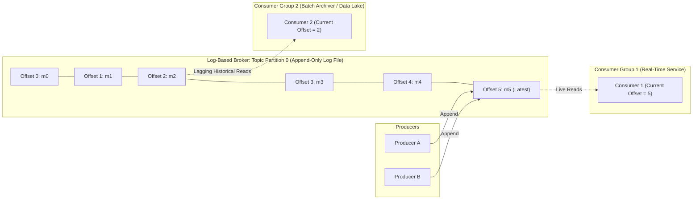
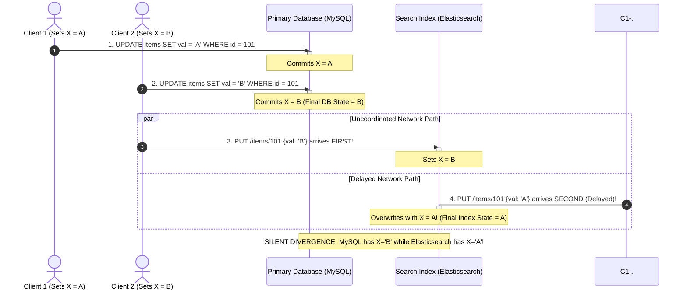
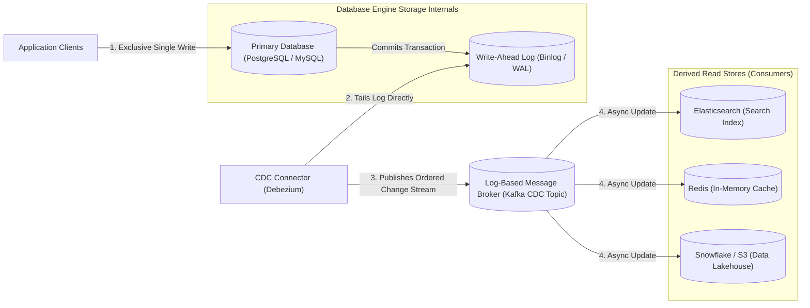
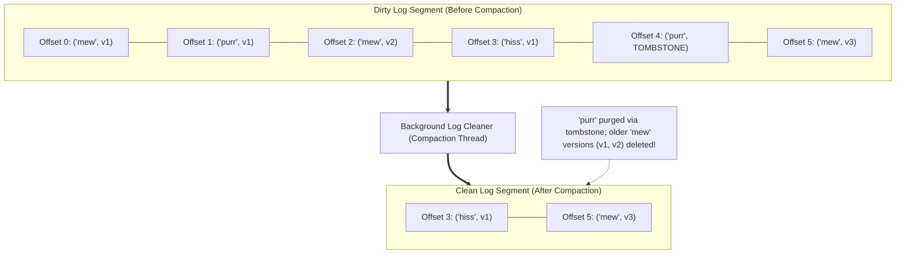
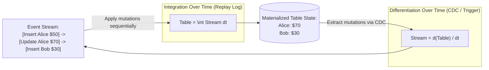
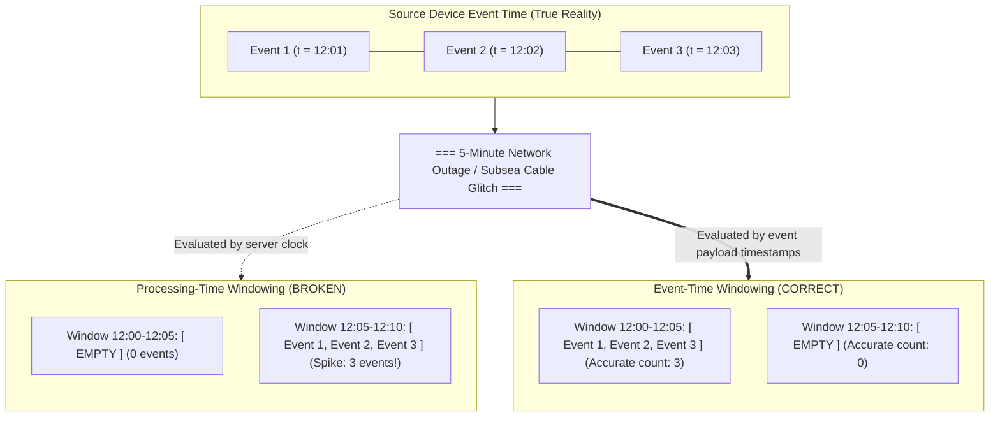

# Chapter 12: Stream Processing — Definitive Technical Summary
*From: Designing Data-Intensive Applications (2nd Edition) by Martin Kleppmann and Chris Riccomini*
*Source PDF: pp. 511–562 (673-page PDF) — figures below cite PDF pages.*

> [!NAV] **Chapter Navigation**
> ⬅️ **Previous:** [[chapter-11-batch-processing|Chapter 11: Batch Processing]] | 🏠 **Index:** [[00-Master-Reading-Dashboard|Master Dashboard]] | ➡️ **Next:** [[chapter-13-a-philosophy-of-streaming-systems|Chapter 13: A Philosophy of Streaming Systems]]


---

## 1. Executive Summary & Core Engineering Problem

- **Core Thesis:** The fundamental limitation of batch processing is latency: waiting for a bounded dataset to accumulate (e.g., hourly or daily batches) inherently delays business reactions to data. **Stream Processing** inverts this paradigm by treating data as an **unbounded, continuously arriving stream of immutable events**, processing records incrementally with sub-second latency. A stream-processing architecture unifies the durability of storage with the low-latency reactivity of messaging. By formalizing the **Stream-Table Duality** (a table is a cached snapshot of state; a stream is the changelog of state mutations), modern architectures solve the chronic consistency defects of distributed dual-writes through **Change Data Capture (CDC)** and deliver deterministic, fault-tolerant stateful aggregations across asynchronous time windows.
- **Problem Statement:** Naively attempting to keep multiple storage systems in sync using application-level "dual-writes" guarantees silent, permanent data corruption. A classic production catastrophe occurs when an e-commerce service updates both an operational relational database (MySQL) and a secondary full-text search index (Elasticsearch) (Figure 12-4): Client 1 issues an update setting item $X = A$. Concurrently, Client 2 issues an update setting $X = B$. In MySQL, Client 1's transaction commits first, followed by Client 2 ($X = B$ wins). However, due to network latency jitter, Client 2's HTTP request arrives at Elasticsearch *before* Client 1's request ($X = A$ wins in Elasticsearch). The database and search index permanently diverge without throwing errors. Furthermore, if the application crashes between updating MySQL and calling Elasticsearch, the search index remains permanently stale.
- **Historical & Industry Context:** Early real-time architectures in the 1990s and 2000s relied on traditional enterprise message brokers (JMS, RabbitMQ, ActiveMQ). While suitable for asynchronous RPC task dispatch, traditional message brokers delete messages immediately upon delivery, destroy message ordering upon redelivery, and collapse under fan-out scale. In 2011, LinkedIn created **Apache Kafka**, pioneering the **Log-Based Message Broker** model: an append-only, partitioned, durable disk log where consumers independently read streams via persistent offsets. In the 2010s, stream processing engines evolved from low-level, at-least-once tuple processors (Apache Storm) to stateful, event-time-aware, exactly-once stream processors (**Apache Flink**, Apache Spark Structured Streaming). In the 2020s (2nd Edition inflection), the widespread adoption of **Debezium** for log-based Change Data Capture and cloud streaming lakehouse architectures (Apache Iceberg streaming sinks) established stream processing as the primary architectural nervous system of data-intensive enterprises.

---

## 2. In-Depth Technical Concepts & Internal Mechanics

### 2.1 Messaging Systems: Traditional AMQP vs. Log-Based Brokers
- **The Event Abstraction:** An **event** is a small, self-contained, immutable object containing the details of something that occurred at a specific point in physical time (e.g., a credit card swipe, a GPS location ping, or an inventory deduction).
- **Architectural Divergence in Messaging:**

#### 1. Traditional Message Brokers (JMS, RabbitMQ, AMQP)
- *Topology:* Producers send messages to an exchange; the exchange routes messages to queues. Multiple consumers pull from a queue (Load Balancing, Figure 12-1a).
- *Delivery Semantics:* When a consumer receives message $M$, the broker marks $M$ as invisible. When the consumer processes $M$, it sends an acknowledgment (`ACK`). The broker immediately deletes $M$ from storage.
- *The Out-of-Order Redelivery Disaster (Figure 12-2):*
  - Consumer 1 processes message $M_1$; Consumer 2 processes message $M_2$; Consumer 3 processes message $M_3$.
  - Consumer 2 crashes or times out while processing $M_2$.
  - The broker returns $M_2$ to the head of the queue. Consumer 1 finishes $M_1$ and dequeues $M_2$.
  - *Result:* $M_3$ was already processed by Consumer 3 before $M_2$ finished. **Message ordering is permanently scrambled**.
- *Memory Bottleneck:* Traditional brokers keep unacknowledged messages in RAM buffers. If consumers lag, memory fills, and brokers enter disk-paging stalls, destroying throughput.

#### 2. Log-Based Message Brokers (Apache Kafka, Apache Pulsar - Figure 12-3)
- *Topology:* A hybrid combining durable log-structured storage with publish-subscribe messaging. A topic is split into multiple **Partitions**.
- *Storage Layout:* Each partition is an append-only, sequentially written file on disk. The broker assigns a strictly monotonically increasing 64-bit integer **Offset** to each message.
- *Consumer Mechanics:*
  - Messages are **not deleted** when read.
  - Each consumer tracks its own progress via a single scalar pointer: its **Consumer Offset** (stored in an internal Kafka topic `__consumer_offsets`).
  - *Zero Memory Overhead Fan-Out:* 50 independent consumer groups can read from the exact same partition at completely different rates and offsets. The broker simply streams raw disk blocks via the Linux kernel's zero-copy `sendfile()` system call, saturating 100 Gbps network interfaces without memory bloat.
  - *Replayability:* If an application bug is discovered in a downstream service, the consumer can reset its offset back to the beginning of time (`offset = 0`), reprocessing weeks of historical data deterministically.

---

### 2.2 Databases and Streams: Change Data Capture (CDC)
- **The Dual-Write Problem (Figure 12-4):**
  - Application code attempts to write to two systems sequentially:
    ```python
    db.execute("UPDATE products SET price = 99 WHERE id = 101")
    search_index.put("/products/101", {"price": 99})
    ```
  - *Catastrophic Failure Modes:*
    1. *Concurrent Update Race:* Two clients update the same record in reverse order across the two systems, permanently corrupting index state.
    2. *Partial Faults:* If the app process crashes after the DB commit but before the HTTP call to Elasticsearch, the search index permanently loses the update.
- **Change Data Capture (CDC) Architecture (Figure 12-5):**
  - All application mutations write **only to the database of record**.
  - A CDC daemon (e.g., Debezium) tails the database's internal transaction log (PostgreSQL WAL, MySQL Binlog) at the storage layer.
  - Every committed insert, update, and delete is converted into an ordered event stream and pushed to a partitioned log-based broker (Kafka).
  - Downstream systems (Elasticsearch, Redis, Snowflake) consume the Kafka CDC topic and update their local derived state asynchronously.
  - *Guarantees:* **Total ordering, zero dual-write race conditions, and complete crash atomicity.**

---

### 2.3 The Duality of Streams and Tables (Figure 12-7)
- **Foundational Theory:** Tables and streams are two perspectives on the exact same underlying data:
  $$\text{Table} = \int \text{Stream} \, dt \quad (\text{A table is the integral of a stream over time})$$
  $$\text{Stream} = \frac{d(\text{Table})}{dt} \quad (\text{A stream is the derivative of a table over time})$$
  - A **Table** holds current state (a snapshot of reality at a discrete instant).
  - A **Stream** holds history (a changelog of every mutation that produced current state).
- **Log Compaction (Figure 12-6):**
  - In a standard log-based broker, old segments are deleted when retention time expires (e.g., after 7 days).
  - Under **Log Compaction**, the broker guarantees that it retains **at least the latest value for every primary key** indefinitely.
  - Overwritten records are discarded during background segment merges; deleted records are purged via explicit **Tombstones** (`key = K, value = null`).
  - *The Architectural Superpower:* A new consumer joining the cluster can rebuild the entire current database table state by reading the compacted topic from offset 0, without querying or locking the primary operational database!

---

### 2.4 Reasoning About Time: Event Time vs. Processing Time
- **The Temporal Dichotomy:**
  - **Event Time:** The exact physical time when the event occurred on the source device/client (recorded in the event payload).
  - **Processing Time:** The physical time when the event is processed by a stream processing node (determined by the server's local clock).
- **Why Processing-Time Windowing Fails (Figure 12-8):**
  - If a mobile client goes offline into a subway tunnel for 30 minutes, it buffers events locally.
  - When the client regains 5G connectivity, it flushes 30 minutes of buffered events in a single 2-second burst.
  - If the stream processor windows by **Processing Time**, all 30 minutes of activity land in a single 1-minute window, generating a massive artificial traffic spike while previous windows appear empty.
  - *Core Invariant:* **Stream processing analytics must be windowed by Event Time to reflect true operational reality.**
- **The Challenge of Late-Arriving Events & Watermarks:**
  - In an asynchronous network, events arrive out of chronological order.
  - A stream processor computing a 5-minute event-time window ($12:00\text{--}12:05$) cannot know when all events for that window have arrived.
  - **Watermarks:** A heuristic progress metric emitted into the stream indicating: *"We believe all events with event time $\le t_w$ have been observed."*
  - *Handling Late Events:*
    1. *Drop:* Discard events with event time $< t_w$.
    2. *Update / Retract:* Re-open the window, recompute the aggregation, and emit a retraction message (e.g., Apache Flink side outputs).

---

### 2.5 Windowing Strategies
Stream processing breaks unbounded streams into discrete bounded subsets using three primary windowing models:

1. **Tumbling Windows:**
   - Fixed-size, non-overlapping intervals (e.g., 5-minute tumbling windows: $12:00\text{--}12:05$, $12:05\text{--}12:10$).
   - Every event belongs to exactly one window.
2. **Hopping (Sliding) Windows:**
   - Fixed-size, overlapping intervals defined by window length and hop step (e.g., a 5-minute window that hops every 1 minute).
   - An event belongs to multiple concurrent windows ($5$ windows in this example), providing smooth rolling metric aggregations.
3. **Session Windows:**
   - Dynamic, variable-duration intervals based on user activity.
   - Defined by an inactivity timeout gap (e.g., 30 minutes). If no events arrive for user $U$ within 30 minutes, the session window closes. Captures human behavior accurately.

---

### 2.6 Stateful Stream Joins
Stream processing supports three fundamental join topologies:

#### 1. Stream-Stream Join (Windowed Join)
- *Scenario:* Joining an ad-impression stream with an ad-click stream to calculate conversion rates.
- *Mechanics:*
  - A click can occur minutes after an impression.
  - The stream processor maintains in-memory state (backed by RocksDB):
    - When an impression arrives, buffer it in state for 1 hour.
    - When a click arrives, search the impression state buffer. If matched, emit `(Impression + Click)` and purge state.
  - Requires bounded event-time windows to prevent state memory from growing to infinity.

#### 2. Stream-Table Join (Enrichment Join)
- *Scenario:* Enriching a raw clickstream event with the user's demographic profile (age, country).
- *Mechanics:*
  - The stream processor consumes the clickstream (stream) and the user database CDC changelog (table).
  - The CDC stream continuously updates a local in-memory RocksDB table.
  - As clicks arrive, the engine executes a fast $O(1)$ local memory lookup against the RocksDB state store, enriching the click record in sub-millisecond time without querying the remote database.

#### 3. Table-Table Join (Materialized View Maintenance)
- *Scenario:* Maintaining a materialized view of user orders and billing addresses across two continuous CDC changelogs. Both inputs are tables represented as streams, updating local join indices incrementally.

---

### 2.7 Fault Tolerance & Exactly-Once Processing
- **Delivery Guarantees Defined:**
  - *At-Most-Once:* Messages dropped on failure; zero retries. Unacceptable for business data.
  - *At-Least-Once:* Messages retried until acknowledged. Prone to duplicate processing (e.g., charging credit cards twice).
  - *Effectively-Once (Exactly-Once):* The final state after recovery is mathematically identical to an execution where every event was processed exactly once.
- **The Chandy-Lamport Distributed Snapshot Algorithm (Apache Flink):**
  - Rather than pausing stream processing, the engine injects special **Checkpoint Barrier** markers into the message stream at the sources.
  - As barriers flow through the DAG operators alongside data records:
    1. An operator aligns barriers from all input channels.
    2. The operator pauses processing on aligned channels, writes a snapshot of its local state (e.g., RocksDB memtable) to distributed cloud storage (S3/HDFS), and forwards the barrier downstream.
    3. Processing resumes immediately.
  - *Recovery:* On worker crash, all operators in the DAG roll back their local state to the latest globally completed checkpoint, and message brokers reset source offsets to the corresponding checkpoint barrier.
- **End-to-End Exactly-Once Invariant:**
  - Requires three coordinated layers:
    1. *Replayable Source:* Log-based broker (Kafka) that can rewind offsets.
    2. *Deterministic Stateful Processing:* Checkpointed state snapshots (Flink).
    3. *Idempotent or Two-Phase Commit Sink:* Sinks must either support natural idempotency (`UPSERT` by primary key) or implement Two-Phase Commit (Kafka Transactions via `KafkaProducer.sendOffsetsToTransaction()`).

---

## 3. Important Figures, Diagrams & Visual Architecture

> 📕 **Original figures quick index (source PDF, 673 pages):** open the PDF at the cited page to verify each reconstruction.
>
> | Book Fig | PDF page | What to compare |
> |---|---|---|
> | Fig 12-1 | PDF p.517 | Load-balance vs fan-out |
> | Fig 12-2 | PDF p.518 | Crash redelivery m3 |
> | Fig 12-3 | PDF p.520 | Partition append/consume |
> | Fig 12-4 | PDF p.526 | Concurrent item update |
> | Fig 12-5 | PDF p.527 | DB CDC propagation |
> | Fig 12-6 | PDF p.529 | Stream processor |
> | Fig 12-7 | PDF p.533 | State vs stream |
> | Fig 12-8 | PDF p.544 | Processing-time windows |


### Figure 12-3: Partitioned Log-Based Message Broker (Kafka Architecture)
- **Figure Reference:** `Figure 12-3: Producers append to a topic partition file; consumers sequentially read via offsets (reconstructed from text p. 453)`
- **Original PDF:** Fig 12-3 → PDF p.520 — open the PDF at page 520 to compare with the Mermaid reconstruction below.
- **Visual Flow & Description:** Shows a topic partitioned across 3 append-only disk files. Producers append messages with monotonic offsets. Independent Consumer Groups read from partitions at their own pace, maintaining independent offset pointers.
- **Mermaid Flowchart:**



- **Key Takeaway:** Log-based brokers decouple consumers completely: fast real-time microservices and lagging batch archivers consume the exact same physical log concurrently without resource contention.

---

### Figure 12-4: The Dual-Write Concurrency Race Condition
- **Figure Reference:** `Figure 12-4: Concurrent dual-writes lead to permanent database and search index divergence (reconstructed from text p. 458)`
- **Original PDF:** Fig 12-4 → PDF p.526 — open the PDF at page 526 to compare with the Mermaid reconstruction below.
- **Visual Flow & Description:** Client 1 writes $X=A$; Client 2 concurrently writes $X=B$. Due to network latency variance, MySQL commits $X=A$ then $X=B$, while Elasticsearch commits $X=B$ then $X=A$. The two systems permanently diverge.
- **Mermaid Sequence Diagram:**



- **Key Takeaway:** Application-level dual-writes lack a shared total order, making permanent silent state divergence an inevitable mathematical certainty under concurrency.

---

### Figure 12-5: Change Data Capture (CDC) Architecture
- **Figure Reference:** `Figure 12-5: Propagating committed database changes to downstream systems via CDC (reconstructed from text p. 459)`
- **Original PDF:** Fig 12-5 → PDF p.527 — open the PDF at page 527 to compare with the Mermaid reconstruction below.
- **Visual Flow & Description:** Applications write strictly to the primary database. A CDC engine tails the database transaction log, streaming ordered change events into Kafka. Consumers update Elasticsearch, caches, and analytical stores deterministically.
- **Mermaid Flowchart:**



- **Key Takeaway:** CDC establishes the primary database's commit log as the single source of truth, guaranteeing that all downstream derived stores converge to identical state without race conditions.

---

### Figure 12-6: Log Compaction in Apache Kafka
- **Figure Reference:** `Figure 12-6: Log compaction retains only the most recent value for each key (reconstructed from text p. 461)`
- **Original PDF:** Fig 12-6 → PDF p.529 — open the PDF at page 529 to compare with the Mermaid reconstruction below.
- **Visual Flow & Description:** Tracks compaction across segment files. Intermediate updates to keys (`mew`, `purr`) are discarded; only the latest value is preserved. Deleted keys are purged when tombstones expire.
- **Mermaid Flowchart:**



- **Key Takeaway:** Log compaction turns an event stream into a persistent, self-healing key-value store, allowing fresh consumers to restore current application state by replaying from offset 0.

---

### Figure 12-7: The Stream-Table Duality
- **Figure Reference:** `Figure 12-7: The mathematical relationship between application state and event streams (reconstructed from text p. 464)`
- **Original PDF:** Fig 12-7 → PDF p.533 — open the PDF at page 533 to compare with the Mermaid reconstruction below.
- **Visual Flow & Description:** Demonstrates that a table is state integrated over time, while a stream is the continuous derivative of table mutations.
- **Mermaid Flowchart:**



- **Key Takeaway:** State and streams are duals: you can deterministically transform a stream into a table, and a table into a stream, bridging transactional and streaming architectures.

---

### Figure 12-8: Processing-Time vs. Event-Time Windowing
- **Figure Reference:** `Figure 12-8: Windowing by processing time introduces artificial spikes due to network delays (reconstructed from text p. 473)`
- **Original PDF:** Fig 12-8 → PDF p.544 — open the PDF at page 544 to compare with the Mermaid reconstruction below.
- **Visual Flow & Description:** Compares events generated steadily at 12:01, 12:02, and 12:03. A 5-minute network outage delays delivery. Processing-time windowing lumps all events into 12:06, whereas event-time windowing assigns them to their true historical windows.
- **Mermaid Flowchart:**



- **Key Takeaway:** Processing-time windows are corrupted by variable network delays; reliable metrics require event-time windowing governed by watermarks.

---

## 4. Real-World Systems, Case Studies & Code Examples

### 4.1 Industry Implementations & Architectural Divergence
- **Apache Kafka & Redpanda (Log-Based Streaming Storage):** High-throughput distributed event store. Organizes partitions into segment files, enforcing sequential disk appends and zero-copy reads. Redpanda implements the Kafka protocol natively in C++ using a thread-per-core (Seastar) architecture, bypassing JVM garbage collection entirely.
- **Apache Flink (Stateful Stream Processing):** True event-by-event stream processor (unlike Spark's microbatching). Implements the Chandy-Lamport distributed snapshotting algorithm to achieve sub-second state checkpointing and deterministic exactly-once processing. Uses embedded RocksDB for multi-gigabyte local state management.
- **Debezium (Log-Based CDC Platform):** Built on top of Kafka Connect. Captures row-level database changes directly from transaction logs across PostgreSQL, MySQL, SQL Server, and Oracle, publishing JSON or Avro envelopes with `before`, `after`, and `source` metadata.
- **Apache Iceberg & Delta Lake Streaming Sinks:** Modern streaming engines stream events directly into open table formats on cloud object storage (S3). Sinks execute micro-commits via atomic catalog metadata CAS updates, allowing lakehouses to act as real-time analytical repositories.

---

### 4.2 Production Implementation: Sliding Event-Time Window Aggregator

```python
import collections
from typing import List, Tuple, Dict, Any, Iterator

class StreamEvent:
    def __init__(self, key: str, value: float, event_time_ms: int):
        self.key = key
        self.value = value
        self.event_time_ms = event_time_ms

class SlidingEventTimeWindowAggregator:
    """
    Implements a stateful sliding event-time window aggregator with watermark tracking.
    Computes SUM(value) grouped by key over a window of size window_size_ms,
    sliding every slide_step_ms, handling late-arriving events within allowed_lateness_ms.
    """
    def __init__(self, window_size_ms: int, slide_step_ms: int, allowed_lateness_ms: int):
        self.window_size_ms = window_size_ms
        self.slide_step_ms = slide_step_ms
        self.allowed_lateness_ms = allowed_lateness_ms
        self.watermark_ms = 0
        # (window_start_ms, key) -> sum_value
        self.window_state: Dict[Tuple[int, str], float] = collections.defaultdict(float)

    def update_watermark(self, current_event_time_ms: int):
        # Monotonic watermark tracking (assumes max delay heuristic)
        self.watermark_ms = max(self.watermark_ms, current_event_time_ms - self.allowed_lateness_ms)

    def process_event(self, event: StreamEvent) -> List[Tuple[int, int, str, float]]:
        """Processes an incoming event and updates matching overlapping sliding windows."""
        self.update_watermark(event.event_time_ms)
        
        # Check if event is too late to be accepted
        if event.event_time_ms < self.watermark_ms:
            # Dropped: Late event exceeds allowed lateness bound
            return []

        # Find all sliding windows that cover this event's timestamp
        # Window starts must satisfy: event_time - window_size < w_start <= event_time
        # and w_start % slide_step == 0
        first_window_start = (
            (event.event_time_ms - self.window_size_ms + self.slide_step_ms) // self.slide_step_ms
        ) * self.slide_step_ms

        updated_windows = []
        w_start = max(0, first_window_start)
        while w_start <= event.event_time_ms:
            w_end = w_start + self.window_size_ms
            if event.event_time_ms < w_end:
                self.window_state[(w_start, event.key)] += event.value
                updated_windows.append((w_start, w_end, event.key, self.window_state[(w_start, event.key)]))
            w_start += self.slide_step_ms

        return updated_windows

    def emit_and_purge_closed_windows(self) -> Iterator[Tuple[int, int, str, float]]:
        """Emits and purges windows that have fallen behind the watermark."""
        closed_keys = []
        for (w_start, key), total in list(self.window_state.items()):
            w_end = w_start + self.window_size_ms
            # Window is closed if its end time plus allowed lateness is past watermark
            if w_end <= self.watermark_ms:
                yield (w_start, w_end, key, total)
                closed_keys.append((w_start, key))
                
        for k in closed_keys:
            del self.window_state[k]
```

---

### 4.3 Production Implementation: Stream-Table Enrichment Joiner

```python
from typing import Dict, Any, Optional

class StreamTableJoiner:
    """
    Demonstrates a Stream-Table Join:
    Tails a CDC changelog topic to maintain local state (the table),
    and enriches an incoming high-velocity click event stream in real time.
    """
    def __init__(self):
        # In-memory representation of the database table (replicated via CDC)
        self.user_table_state: Dict[str, Dict[str, Any]] = {}

    def process_cdc_event(self, cdc_payload: Dict[str, Any]):
        """Processes database WAL mutations: INSERT, UPDATE, DELETE."""
        op = cdc_payload["op"]  # "c" = create, "u" = update, "d" = delete
        user_id = cdc_payload["user_id"]

        if op in ("c", "u"):
            self.user_table_state[user_id] = cdc_payload["after"]
        elif op == "d":
            self.user_table_state.pop(user_id, None)

    def process_click_event(self, click_event: Dict[str, Any]) -> Optional[Dict[str, Any]]:
        """Enriches an incoming click event with user demographic metadata."""
        user_id = click_event["user_id"]
        user_profile = self.user_table_state.get(user_id)

        enriched_event = dict(click_event)
        if user_profile:
            enriched_event["user_age"] = user_profile.get("age")
            enriched_event["user_country"] = user_profile.get("country")
            enriched_event["user_tier"] = user_profile.get("membership_tier")
        else:
            enriched_event["user_age"] = None
            enriched_event["user_country"] = "UNKNOWN"
            enriched_event["user_tier"] = "STANDARD"

        return enriched_event
```

---

### 4.4 Production War Story: The Dual-Write Inventory Catastrophe
- **The Context:** A major omnichannel retail brand operated an online flash-sale portal. When an order was placed, the application service updated the primary PostgreSQL inventory database and immediately published an event to a RabbitMQ queue to alert the warehouse dispatch system.
- **The Pathological Incident:** During a Black Friday flash sale for high-end gaming consoles ($1,000\ \text{consoles in stock}$), the database server experienced a transient 15-second write lock stall due to a foreign-key deadlock.
- **The Dual-Write Failure:**
  - The application executed the PostgreSQL transaction: `UPDATE inventory SET stock = stock - 1 WHERE item_id = 99`. The database transaction committed.
  - However, immediately after the database commit, the application container encountered an Out-Of-Memory (OOM) `SIGKILL` before its thread could invoke `channel.basicPublish()` to RabbitMQ.
  - The inventory was decremented in PostgreSQL, but **zero message was published to the warehouse queue**.
  - Concurrently, for other transactions, the application successfully published to RabbitMQ, but the database connection timed out; the application returned an error to the user, yet the warehouse received the dispatch message and shipped products without charging the customer!
- **The Disaster:** Over 350 consoles were physically shipped from warehouses without matching financial records, while 200 legitimate purchasing customers had their money debited but never received tracking numbers, resulting in a \$350,000 inventory write-down.
- **Remediation & Architecture Lessons:**
  1. *Eliminate Dual-Writes via the Transactional Outbox Pattern:* Rewrote the service to store outgoing events inside an `outbox` table within the **exact same database transaction** that decrements inventory.
  2. *Deploy Log-Based CDC:* Deployed Debezium to read the PostgreSQL WAL directly, streaming outbox events to Apache Kafka with guaranteed at-least-once delivery, eliminating application-level dual-write coordination forever.

---

## 5. Architectural Trade-Off Matrix

| Streaming Architecture / Component | Latency Profile | Fault Tolerance & Replayability | Ordering Guarantees | Memory & Fan-Out Scalability | Best Workload Fit | Catastrophic Failure Mode |
| :--- | :--- | :--- | :--- | :--- | :--- | :--- | :--- |
| **Traditional Broker (RabbitMQ / SQS)** | Sub-millisecond (Pushed directly to active sockets) | **Poor** (Messages deleted upon ACK; no historical replay) | **Destroyed on Redelivery** (Failed message redelivered out of order) | **Poor** (Unread messages saturate broker RAM buffers) | Task queues; asynchronous RPC dispatch; discrete job distribution | Lagging consumers saturate broker RAM, stalling entire queue |
| **Log-Based Broker (Apache Kafka / Pulsar)** | Low ($5\text{--}20\ \text{ms}$; bounded by sequential disk write & page cache) | **Optimal** (Persistent disk retention; replayable from offset 0) | **Strict Total Order** per partition | **Infinite Fan-Out** (Zero broker memory cost per consumer group) | Event sourcing; stream processing; Change Data Capture (CDC) | Slow consumer group triggers storage exhaustion if retention long |
| **Change Data Capture (Debezium + Kafka)** | Low ($20\text{--}100\ \text{ms}$ lag behind DB commit) | **Optimal** (Tails durable DB WAL; zero lost transactions) | **Strict Total Order** matching database transactions | Decoupled (Consumers read from Kafka, not DB) | Keeping caches, search indexes, and data warehouses in sync | Schema alterations in database break downstream consumer deserializers |
| **Event-Time Stream Processor (Apache Flink)** | True Streaming ($10\text{--}50\ \text{ms}$ continuous processing) | **Effectively-Once** (Chandy-Lamport state snapshots to S3) | Preserved via watermarks and event timestamps | **High** (RocksDB off-heap state holds terabytes of window state) | Stateful fraud detection; complex event-time aggregations; streaming joins | Unbounded out-of-order delay causes state buffer OOM exhaustion |
| **Microbatch Stream Processor (Spark Streaming)** | Moderate ($500\text{--}2,000\ \text{ms}$ microbatch intervals) | **Effectively-Once** (Deterministic RDD lineage recomputation) | Preserved within microbatch boundaries | Moderate (Buffers microbatch partitions in JVM RAM) | High-throughput streaming ETL; unifying batch and stream codebases | Microbatch scheduling latency too slow for sub-second reactive alerting |

---

### Concrete Decision Heuristics

```text
Decision Tree for Stream Architecture:
1. Does the application require keeping derived stores (Elasticsearch, Redis, Snowflake) in sync with an operational database?
   ├── CRITICAL MANDATE: NEVER use dual-writes in application code!
   └── MANDATORY ARCHITECTURE: Use Log-Based Change Data Capture (Debezium reading DB WAL into Kafka).
2. For Event Transmission & Messaging:
   ├── Need transient task queueing where messages are deleted immediately and ordering doesn't matter? -> Use RabbitMQ / SQS.
   └── Need durable event logging, ordered partitions, independent consumer replay, or stream processing inputs? -> Use Apache Kafka / Redpanda.
3. For Stream Processing Engine:
   ├── Requires sub-100ms processing latency and complex event-time windowing? -> Use Apache Flink.
   └── Organization already standardizes on Apache Spark and 1-second microbatch latency is acceptable? -> Use Spark Structured Streaming.
```

---

## 6. Jargon Buster & Key Terminology

- **Stream Processing:** The continuous, real-time computation and transformation of unbounded, append-only datasets as events arrive.
- **Event:** A small, self-contained, immutable data record detailing a discrete business occurrence at a specific point in physical time.
- **Change Data Capture (CDC):** An architectural technique that extracts row-level data modifications directly from a database's transaction write-ahead log and streams them as ordered events.
- **Log Compaction:** A storage optimization in log-based brokers where old segments are cleaned to retain strictly the most recent value for each primary key, discarding overwritten records.
- **Tombstone:** A message with a valid key and a `null` payload published to a compacted topic to indicate that the key has been deleted.
- **Stream-Table Duality:** The fundamental mathematical property that a table is state integrated over time, and a stream is the continuous derivative of table mutations.
- **Event Time:** The timestamp when an event originally occurred on the producer client device, recorded inside the event payload.
- **Processing Time:** The timestamp when a stream processing server receives and executes logic on an event, determined by local server clocks.
- **Watermark:** A temporal heuristic flowing through a stream processor indicating that no further events with event time $\le t_w$ are expected to arrive.
- **Tumbling Window:** A fixed-length, contiguous, non-overlapping time window where every event belongs to exactly one window.
- **Chandy-Lamport Algorithm:** A distributed snapshot protocol that injects checkpoint barriers into event streams to capture global consistent state across operators without pausing stream execution.

---

## 7. System Design & Practical Engineering Takeaways

### 7.1 Production Engineering Checklist
1. **Never Execute Application-Level Dual-Writes:** Always implement the Transactional Outbox pattern or log-based CDC (Debezium) to synchronize databases with message queues and search indexes.
2. **Always Window Streaming Aggregations by Event Time:** Never use processing time for business metrics; network latency, mobile offline buffering, and consumer restarts corrupt processing-time windows.
3. **Configure Partition Keys to Preserve Causal Ordering:** In Apache Kafka, always set the message key to the entity ID (e.g., `user_id` or `order_id`). Kafka guarantees strict ordering **only within a single partition**; records sharing the same key land on the same partition.
4. **Implement Allowed Lateness and Dead-Letter Sinks for Late Events:** When configuring watermarks, define an explicit `allowedLateness` threshold. Late-arriving events exceeding this threshold must be routed to a dead-letter queue (DLQ) for audit rather than silently dropped.
5. **Tune Kafka Consumer `max.poll.interval.ms` to Prevent Rebalance Storms:** Ensure `max.poll.interval.ms` is significantly larger than the maximum time a consumer thread takes to process a batch of records. Exceeding this threshold causes the broker to presume the consumer dead, triggering continuous cluster-wide rebalancing storms.

---

### 7.2 System Design Interview Strategy
- **Advocate for the Stream-Table Duality:** In system design interviews (e.g., designing real-time ride-sharing matching, fraud detection, or newsfeed ranking), show Staff-level maturity by invoking the duality: *"We will model user location updates as an append-only event stream, and project them into an in-memory materialized table using log compaction for sub-millisecond driver lookup."*
- **Attack Dual-Writes Proactively:** When an interviewer asks *"How do you update the cache after saving to MySQL?"*, immediately point out the race condition and partial failure risks of dual-writes, and propose CDC via Debezium: *"Dual-writes guarantee divergence under network partitions. We will write to MySQL, capture the binlog with Debezium, and stream CDC mutations to Kafka to asynchronously update Redis."*
- **Capacity Sketching for Kafka Partitions:**
  $$\text{Required Partitions} = \max\left( \frac{\text{Target Write Throughput (MB/s)}}{\text{Single-Partition Write Bandwidth (e.g., 10 MB/s)}}, \frac{\text{Target Read Throughput (MB/s)}}{\text{Single-Consumer Processing Bandwidth (e.g., 5 MB/s)}} \right)$$

---

### 7.3 Mastery Self-Assessment Questions

#### Question 1 (Conceptual Depth)
*Why does a traditional message broker (RabbitMQ) lose total message ordering when multiple consumers read from a shared queue concurrently, and how does a log-based broker (Kafka) guarantee strict message ordering while scaling read throughput across multiple consumers?*
- **Answer:** 
  A **traditional message broker** implements a shared queue model where multiple consumer threads pull messages concurrently (load balancing, Figure 12-1a). Message $M_1$ goes to Consumer 1, $M_2$ goes to Consumer 2, and $M_3$ goes to Consumer 3. If Consumer 2 encounters a transient error, network glitch, or slow dependency, it sends a negative acknowledgment (`NACK`) or its visibility timeout expires. The broker re-inserts $M_2$ at the head of the queue. However, by that time, Consumer 3 has already processed and committed message $M_3$. Message $M_2$ is processed *after* $M_3$, completely scrambling the original causal sequence. Traditional message brokers cannot maintain ordering under concurrent multi-consumer execution.
  A **log-based message broker** (Kafka) guarantees strict ordering by **partitioning the log and enforcing the single-consumer-per-partition invariant**. Within a Consumer Group:
  1. Each partition is assigned to **exactly one consumer thread**.
  2. The consumer reads messages sequentially in strict append order, advancing its offset monotonically ($0, 1, 2, 3, \dots$).
  3. Messages sharing the same business key (e.g., `user_id = 42`) are guaranteed to hash to the exact same partition (`hash(key) % num_partitions`).
  4. Consequently, all mutations for user 42 are processed in strict sequential order by a single consumer thread.
  To scale throughput, the cluster simply adds more partitions: a topic with 64 partitions can be processed in parallel by 64 independent consumer threads across a fleet of machines, combining parallel scale with strict per-entity causal ordering.

#### Question 2 (Failure Scenario & Edge Cases)
*An engineering team implements an event-time hourly analytics pipeline in Apache Flink: `clicks.keyBy("ad_id").window(TumblingEventTimeWindows.of(Time.hours(1))).sum("count")`. The watermark is configured as `BoundedOutOfOrderness(Time.minutes(5))`. At 12:00:00, a mobile carrier experiences a transient 45-minute cellular tower failure affecting 50,000 mobile devices. The devices buffer click events locally and flush them at 12:45:00. Describe the exact fate of these 50,000 events, explain the resulting data corruption, and specify the architecture to recover accurate metrics.*
- **Answer:**
  - *The Fate of the Events:*
    - The events generated between 12:00:00 and 12:05:00 carry event timestamps $\approx 12:02:00$.
    - However, other devices on non-impacted networks continued transmitting events normally throughout the hour.
    - By 12:10:00, Flink had observed events with event time 12:10:00. The watermark progressed:
      $$\text{Watermark} = 12:10:00 - 5\ \text{minutes} = 12:05:00$$
    - Because the watermark crossed 12:00:00 (the end of the 11:00--12:00 window) and 12:05:00, the 11:00--12:00 window was formally closed, evaluated, and purged from Flink's RocksDB state.
    - When the 50,000 buffered events arrive at 12:45:00, their event timestamps are $\approx 12:02:00$.
    - Flink compares the event timestamps against the current watermark ($12:45:00 - 5\ \text{min} = 12:40:00$).
    - Because $12:02:00 < 12:40:00$, the events are classified as **Late Events Beyond Allowed Lateness** and are **unconditionally dropped and discarded**.
  - *Data Corruption:* The ad impressions and clicks from those 50,000 mobile users are permanently omitted from daily billing reports, causing a massive under-counting of advertiser revenue.
  - *Architectural Recovery:*
    1. *Side Outputs (Dead-Letter Retraction):* Configure Flink's `sideOutputLateData(lateTag)` to capture dropped events into a separate dead-letter Kafka topic rather than discarding them.
    2. *Lambda / Kappa Replay Architecture:* Because Kafka retains raw event logs for 14 days, the engineering team can launch a secondary batch or catch-up streaming job that processes the historical topic with an expanded lateness bound (or re-aggregates using Apache Spark), emitting an incremental correction/retraction update to the downstream billing data warehouse.

#### Question 3 (Trade-Off & Capacity Estimation)
*An e-commerce platform processes 10,000 orders per second. An architect evaluates two approaches to maintain a real-time Redis cache and an Elasticsearch search index: (A) Application-Level Dual-Writes with 3 HTTP/TCP calls per transaction (MySQL commit + Redis write + Elasticsearch write), vs. (B) Log-Based Change Data Capture (Debezium + Kafka) streaming changes asynchronously to Redis and Elasticsearch consumers. Calculate: (A) The p99 latency amplification and failure probability imposed on the checkout API under dual-writes assuming each external service call has a 99th percentile latency of 15 ms and a 0.1% independent transient network error rate, vs. (B) The latency and fault-isolation profile under CDC. Show exact derivations.*
- **Answer:**
  - *Approach A: Application-Level Dual-Writes*
    - The checkout web server must execute 3 sequential or parallel external network operations for every single customer order:
      1. MySQL commit ($p = 0.001$ error rate, $p99 = 15\ \text{ms}$).
      2. Redis cache write ($p = 0.001$ error rate, $p99 = 5\ \text{ms}$).
      3. Elasticsearch document index ($p = 0.001$ error rate, $p99 = 25\ \text{ms}$).
    - *Failure Probability per Transaction:*
      - If each operation has an independent failure probability $p = 0.001$:
        $$P(\text{success}) = (1 - 0.001)^3 = (0.999)^3 \approx 0.997003$$
        $$P(\text{failure}) = 1 - P(\text{success}) \approx \mathbf{0.003} \ (0.3\%)$$
      - At $10,000\ \text{orders/sec}$, an error rate of $0.3\%$ results in:
        $$\text{Failed/Inconsistent Orders} = 10,000 \times 0.003 = \mathbf{30\ orders\ per\ second!}$$
        Every second, 30 orders encounter partial failures where MySQL commits but Redis or Elasticsearch fails, creating catastrophic state divergence.
    - *p99 Latency Amplification:*
      - If executing in parallel, the total client response time is bounded by the **slowest of the 3 calls**.
      - The probability that *at least one* call experiences its tail latency ($p99$) is:
        $$P(\text{slow}) = 1 - (1 - 0.01)^3 = 1 - (0.99)^3 \approx \mathbf{2.97\%}$$
      - The checkout API's observed p99 response time spikes to $\approx \mathbf{25\text{--}35\ \text{ms}}$ because it is tethered to Elasticsearch's search cluster I/O.
  - *Approach B: Log-Based CDC (Debezium + Kafka)*
    - *Checkout API Latency & Reliability:*
      - The checkout application executes **only 1 operation**: the MySQL database commit.
      - Failure probability per transaction drops from $0.3\%$ to $\mathbf{0.1\%}$ ($3\times$ reduction in transaction failures).
      - p99 checkout response time is strictly bounded by MySQL local transaction commit: $\mathbf{10\text{--}15\ \text{ms}}$ (a **$50\%\text{--}60\%$ latency reduction** for checkout users).
    - *Downstream Isolation:*
      - Debezium reads the MySQL binlog asynchronously off disk.
      - If Elasticsearch experiences a 30-second GC pause or crashes completely, **the checkout API is 100% unaffected**: customers continue buying products without interruption.
      - Events queue durably in Kafka's partitioned disk logs. When Elasticsearch recovers, the consumer catches up sequentially at line rate with zero data loss and zero dual-write race conditions.


---
> [!NAV] **Chapter Navigation**
> ⬅️ **Previous:** [[chapter-11-batch-processing|Chapter 11: Batch Processing]] | 🏠 **Index:** [[00-Master-Reading-Dashboard|Master Dashboard]] | ➡️ **Next:** [[chapter-13-a-philosophy-of-streaming-systems|Chapter 13: A Philosophy of Streaming Systems]]