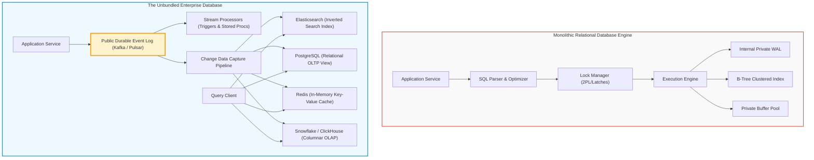
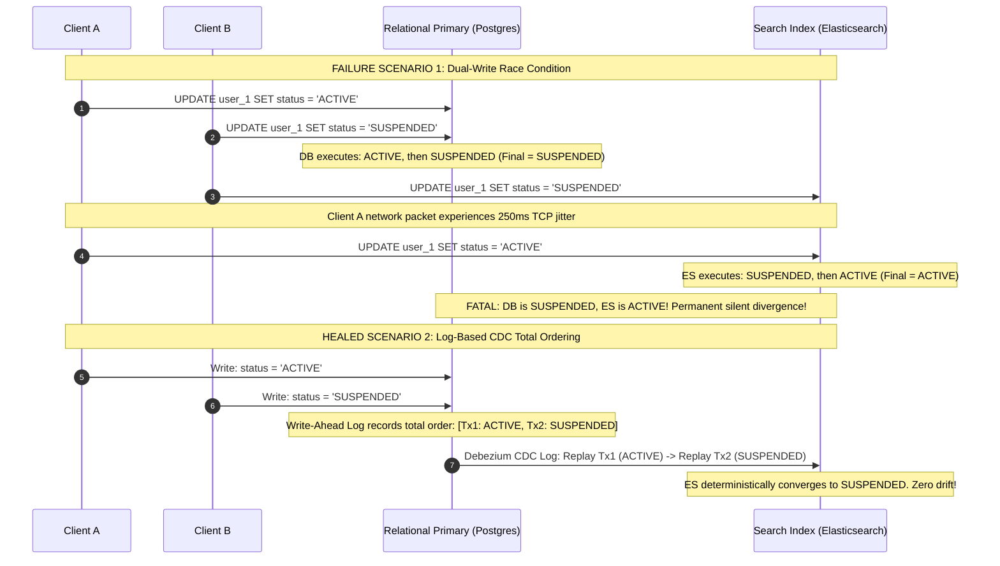
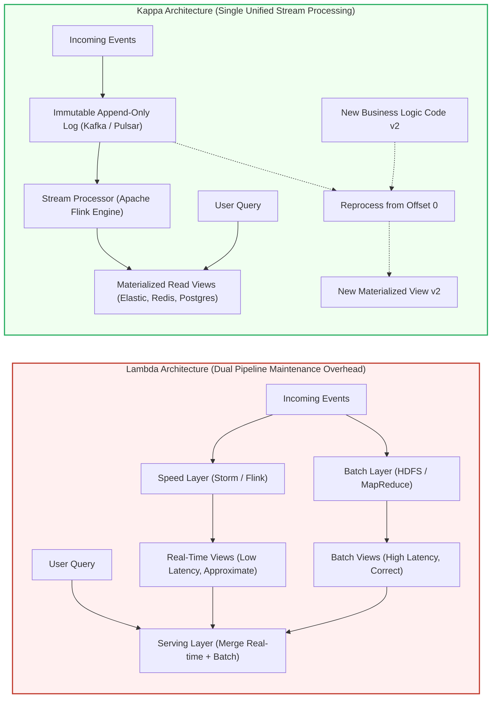
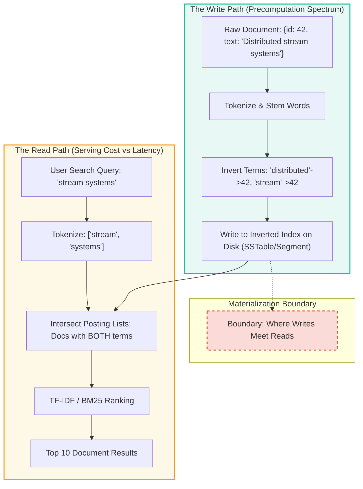
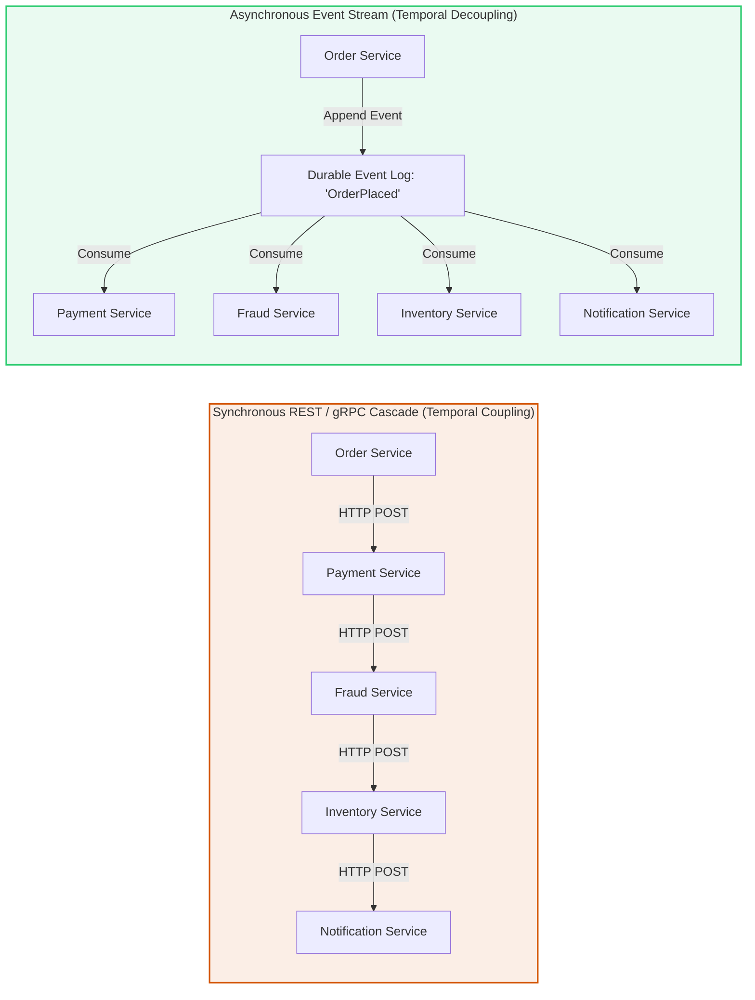
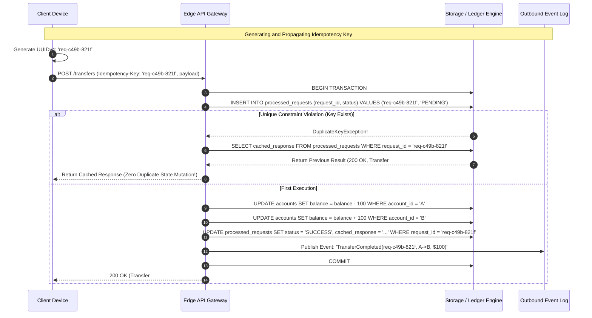
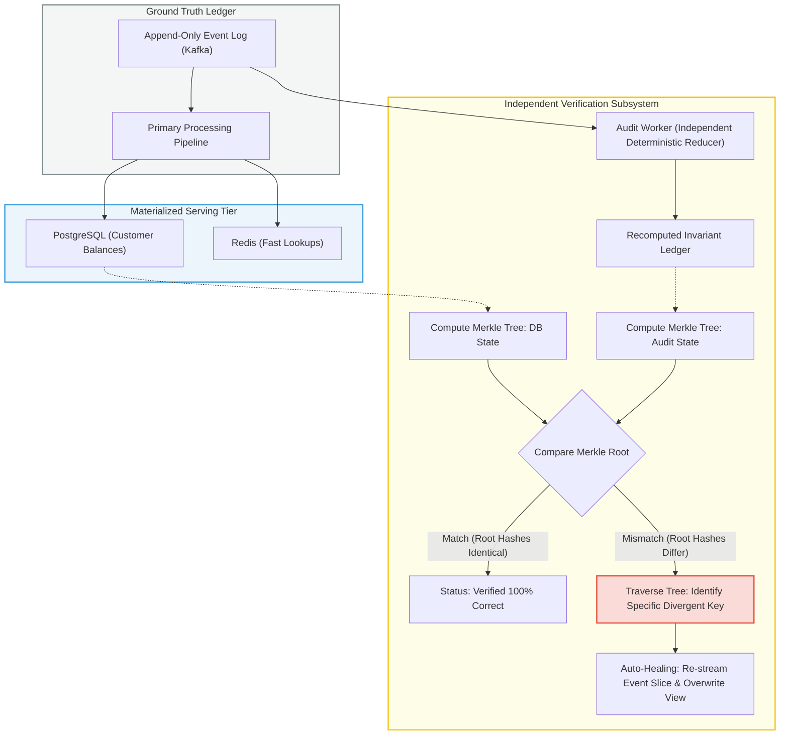

# Chapter 13: A Philosophy of Streaming Systems — Definitive Technical Summary
> [!NAV] **Chapter Navigation**
> ⬅️ **Previous:** [[chapter-12-stream-processing|Chapter 12: Stream Processing]] | 🏠 **Index:** [[00-Master-Reading-Dashboard|Master Dashboard]] | ➡️ **Next:** [[chapter-14-doing-the-right-thing|Chapter 14: Doing the Right Thing]]


> *"If a thing be ordained to another as to its end, its last end cannot consist in the preservation of its being. Hence a captain does not intend as a last end, the preservation of the ship entrusted to him, since a ship is ordained to something else as its end, viz. to navigation. (Often quoted as: If the highest aim of a captain was to preserve his ship, he would keep it in port forever.)"*
> — St. Thomas Aquinas, *Summa Theologica* (1265–1274)

---

## 1. Executive Summary & Core Engineering Problem

Throughout the study of distributed data architectures, systems engineering repeatedly encounters a core tension: specialized tools excel at narrow access patterns, yet modern applications demand combinations of capabilities that no single monolithic database can deliver. A system frequently requires sub-millisecond point lookups by primary key (LSM-tree key-value store), full-text fuzzy token search (inverted index), real-time aggregated metrics across millions of dimensions (columnar OLAP), graph traversal for social connections or fraud detection, and distributed memory caching to protect storage layers.

When architects attempt to force all of these workloads into a single "general-purpose" relational database, the engine collapses under conflicting concurrency controls, index maintenance overhead, and compromised query planners. Conversely, when engineers deploy a best-of-breed polyglot persistence architecture and synchronize disparate databases via application-level **dual writes**, the system inevitably diverges due to partial network failures, out-of-order concurrent writes, and lack of atomic distributed isolation.

```
       Monolithic Polyglot Hazard (Dual Writes)
       =========================================
       Client ---> [ App Server ] --+--> (DB Primary)      [OK]
                                    +--> (Elasticsearch)   [FAILED: Network Timeout]
                                    +--> (Redis Cache)     [RACE: Wrote stale value]
                                    ===> Silent Permanent State Drift!

       The Unbundled Database Architecture (Derived Data Streams)
       ===========================================================
       Client ---> [ App Server ] ---> [ Durable Append-Only Event Log ] (Total Order)
                                                      |
                    +---------------------------------+--------------------------------+
                    |                                 |                                |
                    v (CDC Stream)                    v (CDC Stream)                   v (CDC Stream)
            [ Secondary B-Tree ]              [ Inverted Index ]              [ Columnar OLAP ]
             (OLTP Point Reads)                (Full-Text Search)              (Analytical Aggs)
                    ^                                 ^                                ^
                    +------------------ [ Reads ] ----+--------------------------------+
```

Chapter 13 synthesizes the entire discipline of distributed systems into an overarching architectural philosophy: **Unbundling the Database**. A database is not an indivisible black box; it is an integrated composition of modular primitives:
1. A **write-ahead log (WAL)** that establishes a deterministic, total order of state changes.
2. A collection of **materialized views and secondary indexes** optimized for specific read access patterns.
3. A **cache invalidation engine** that keeps read-side views coherent with write-side changes.
4. A **replication and consensus protocol** that guarantees durability and fault tolerance.

By externalizing these internal database components using scalable, partitioned, append-only event logs (e.g., Apache Kafka, Apache Pulsar) and stream processors (e.g., Apache Flink), software engineers can construct an **unbundled database across the enterprise**. In this paradigm:
- Writes enter a single, append-only, durable log that acts as the authoritative recording of intent.
- All specialized data stores (caches, search indexes, graph databases, data warehouses) are treated as **derived data views**, maintained asynchronously and deterministically by consuming the change stream.
- The fundamental principle of **Saltzer, Reed, and Clark's End-to-End Argument** is applied to data systems: low-level protocols (such as TCP checksums or two-phase commit coordinators) cannot guarantee application correctness; true correctness must be enforced by end-to-end request identifiers, deterministic state transformations, and continuous asynchronous verification.
- The age-old conflation of **timeliness** (lag, recency, linearizability) and **integrity** (absence of corruption, preservation of invariants, exact reconciliation) is dismantled. Scalable distributed architectures gracefully tolerate violations of timeliness (eventual consistency) while maintaining absolute, uncompromising mathematical integrity through immutable ledgers and compensating transactions.

---

## 2. In-Depth Technical Concepts & Internal Mechanics

### 2.1 Data Integration: Dual Writes vs. Change Data Capture (CDC)

When an application must maintain data across multiple specialized systems (e.g., PostgreSQL for transactions, Elasticsearch for search, Redis for low-latency session caching), the most common architectural mistake is **dual writes**: the application service executes an `INSERT`/`UPDATE` to PostgreSQL, and upon return, issues a corresponding write to Elasticsearch and Redis.

#### The Dual-Write Catastrophe
Dual writes fail catastrophically in two fundamental failure modes:
1. **Partial Failures & Lack of Atomicity**: If the write to PostgreSQL succeeds, but the subsequent network call to Elasticsearch times out or fails (e.g., due to an Elasticsearch node GC pause or network partition), the two stores permanently diverge. Reversing the write via application rollback is subject to crash failure of the application server itself.
2. **Concurrent Race Conditions (Out-of-Order Execution)**: Suppose Client A attempts to update key $K$ to value $V_1$, and Client B attempts to update key $K$ to value $V_2$ nearly simultaneously. Due to variable network transmission delays and thread scheduling:
   - In PostgreSQL: Write $V_1$ arrives at $t_1$, Write $V_2$ arrives at $t_2$. Final state: $V_2$.
   - In Elasticsearch: Write $V_2$ arrives at $t_1'$, Write $V_1$ arrives at $t_2'$. Final state: $V_1$.
   The primary database and search index now reflect diametrically opposed states for key $K$, with no automated mechanism to detect or heal the silent corruption.

```
DUAL WRITE RACE CONDITION
Client A (Update K -> V1) -----\ /-----------------> DB: V1 then V2 ===> DB State = V2
                                X
Client B (Update K -> V2) -----/ \-----------------> ES: V2 then V1 ===> ES State = V1
                                                     (PERMANENT SILENT DIVERGENCE)
```

#### Total Order via Change Data Capture
The solution is to establish a **single source of truth** by routing all writes to a primary log-structured system (or capturing the database's write-ahead log via CDC tools like Debezium) and publishing changes to an ordered, partitioned message log.
- Every state mutation is assigned a monotonically increasing log offset $L_i$.
- Secondary indexers, caches, and analytical replicas consume the log sequentially per partition.
- Because all downstream consumers process mutations in identical total order, all derived stores converge deterministically to the identical terminal state $V_2$.

---

### 2.2 Unbundling the Database: Composition vs. Federation

Traditional database management systems (DBMS) bundle query processing, transaction management, lock orchestration, storage layout, indexing, and logging into a tightly coupled, closed environment.

```
TRADITIONAL BUNDLED DBMS:
+-----------------------------------------------------------+
| SQL Parser & Query Optimizer (Declarative Relational API) |
+-----------------------------------------------------------+
| Concurrency Control (2PL / SSI Locks & Latches)           |
+-----------------------------------------------------------+
| Execution Engine (Hash Joins, Nested Loops, Sort)         |
+-----------------------------------------------------------+
| Secondary Indexes (B-Tree, GiST, GIN, Hash)               |
+-----------------------------------------------------------+
| Buffer Pool Manager & In-Memory Page Cache                |
+-----------------------------------------------------------+
| Write-Ahead Log (WAL) & Storage Subsystem (Aries / Heap)  |
+-----------------------------------------------------------+
```

When building large-scale, heterogeneous architectures, two competing philosophies emerge:

| Dimension | Federated Databases (Polystores) | The Unbundled Database (Dataflow Architecture) |
| :--- | :--- | :--- |
| **Architectural Model** | Unified query interface routing ad-hoc queries down to underlying storage engines (e.g., Presto/Trino, Apache Drill). | Disaggregated storage and processing components wired together via durable, asynchronous change streams. |
| **Write Coordination** | Distributed Two-Phase Commit (2PC / XA) across disparate backends; highly vulnerable to coordinator failure and tail latencies. | Single partitioned commit log (total order); all downstream views update asynchronously and deterministically. |
| **Read Path** | Distributed query engine performs runtime federated joins, scatter-gather network calls, and cross-engine data transfers. | Reads hit pre-computed, pre-joined, denormalized materialized views optimized for specific access patterns. |
| **Coupling & Availability** | Tight temporal and operational coupling: query fails if any underlying federated storage node is degraded. | Asynchronously decoupled: read views remain 100% available even if the write log or ingestion pipeline is temporarily offline. |
| **Analogy** | Monolithic operating system kernel trying to support all hardware drivers internally. | **Unix Philosophy**: small, specialized tools (grep, awk, sort) composed via standard, uniform pipes (`|`). |

In an unbundled database:
$$\text{Enterprise Architecture} \equiv \text{Database Internals Externalized}$$
- **Kafka / Distributed Log** $\longleftrightarrow$ The Database Write-Ahead Log (WAL).
- **Stream Processors (Flink)** $\longleftrightarrow$ The Database Stored Procedure & Trigger Engine.
- **Elasticsearch / Redis / Snowflake** $\longleftrightarrow$ Secondary Indexes, Materialized Views, and Columnar Data Stores.

---

### 2.3 Designing Applications Around Dataflow: The Read/Write Trade-off

The boundary where writes meet reads defines the core operational characteristic of any data system. In traditional CRUD applications, writes perform minimal work (writing raw rows to a normalized table), forcing the read path to bear the heavy computational burden of multi-table joins, aggregations, and filtering.

In a streaming, dataflow-oriented architecture, this balance is deliberately inverted:
$$\text{Total System Work} = W_{\text{write}} + W_{\text{read}}$$

```
Write-Heavy vs. Read-Heavy Processing Continuum:

[ Write Path: Zero Precomputation ]                                  [ Read Path: Zero Computation ]
Raw Appends Only                                                     Fully Materialized Read Views
---------------------------------------------------------------------------------------------------->
Write Latency: O(1) sequential append                                Write Latency: O(K) index updates
Read Latency:  O(N) table scan & runtime joins                       Read Latency:  O(1) direct key-value lookup
```

By shifting computational work from the read path to the write path via stream processors:
1. **Materialized Caching**: Writes continuously compute denormalized domain objects (e.g., an assembled customer profile with all orders, credit ratings, and preferences pre-joined).
2. **Sub-millisecond Read Servicing**: User-facing queries require zero runtime joins; they execute simple, single-partition point lookups or key range scans against local in-memory storage (e.g., RocksDB embedded in a Flink task or a Redis cluster).
3. **Graceful Handling of High Read-to-Write Ratios**: In consumer web applications where reads outnumber writes by $100:1$ to $10,000:1$, shifting computation to the write path reduces aggregate CPU and IOPS expenditure across the fleet by orders of magnitude.

---

### 2.4 The End-to-End Argument for Data Systems

In 1981, Jerome Saltzer, David Reed, and David Clark published a foundational paper in distributed computing: *"End-to-End Arguments in System Analysis"*. The thesis states:

> *A function or reliability feature can only be completely and correctly implemented with the knowledge and help of the application standing at the endpoints of the communication system. Providing that feature as a low-level primitive in the communication subsystem is not possible, nor is it sufficient on its own.*

#### Application to Database Transactions
Database architects frequently assume that relying on an ACID database or a distributed two-phase commit (2PC) transaction guarantees that application data will not be duplicated, lost, or corrupted. This assumption is provably false due to boundary failures:

```
THE END-TO-END TRANSACTION GAP
+--------------------+        HTTP POST /transfer        +--------------------+
|  Client Browser /  | --------------------------------> | Application Server |
|    Mobile App      |                                   +--------------------+
|                    |                                             |
|                    |                                             v BEGIN TRANSACTION;
|                    |                                             | UPDATE accounts ...;
|                    |                                             | COMMIT;
|                    |                                             v [Database Commits Successfully]
|                    | <----------------- [CRASH / TIMEOUT] -------+
+--------------------+   (TCP Connection Reset / Network Drop)
```

1. The client issues an HTTP `POST /transfer` request to transfer \$1,000.
2. The application server begins a transaction, debits Account A, credits Account B, and executes `COMMIT`. The database commits the transaction to disk with full durability.
3. Before the application server can return the `200 OK` HTTP response to the client, the cellular tower drops the TCP connection, or the application container suffers an out-of-memory (OOM) kill.
4. From the client's perspective, the request timed out. Did the payment execute, or did it fail?
5. The end-user (or the client application's automatic retry policy) resubmits the HTTP `POST /transfer`.
6. Without end-to-end deduplication, the database processes the payment a second time. The ACID transaction executed perfectly both times, yet the business state is catastrophic: \$2,000 was debited instead of \$1,000.

#### The End-to-End Solution
Lower-level database transactions cannot solve this problem because the failure boundary lies outside the database engine. Correctness requires an end-to-end protocol:
- **Client-Generated Idempotency Keys**: The client generates a unique transaction identifier (e.g., UUIDv4 or cryptographic hash of user ID + client timestamp + nonce) *before* issuing the network call.
- **Atomic Intent Ingestion**: The application inserts the idempotency key and payload into a dedicated `processed_requests` table or an append-only event log as the very first operation.
- If a subsequent retry arrives with the identical idempotency key, the request is detected as a duplicate, bypassing processing and returning the cached response from the initial execution.

---

### 2.5 Enforcing Constraints Without Distributed Locks or 2PC

A central objection to asynchronous, stream-driven architectures is: *"How can a distributed system enforce uniqueness constraints (e.g., unique email addresses, non-negative bank balances, preventing flight seat double-booking) without distributed locking or Two-Phase Commit?"*

Kleppmann demonstrates that **single-partition deterministic stream serialization** enforces global business constraints at massive scale without distributed consensus or coordinator blocking.

#### Single-Leader Partitioning for Invariant Enforcement
To enforce a uniqueness constraint on a field (e.g., username):
1. **Hash-Partition by the Unique Key**: Route all registration requests for `username` to an event log partition determined deterministically by $\text{hash}(\text{username}) \pmod N$.
2. **Single-Threaded Partition Consumer**: A stream processing worker consumes that partition sequentially. Because all operations for that specific `username` arrive at the exact same partition in a deterministic sequence:
   - The stream worker maintains an internal hash index of claimed usernames (backed by an embedded state store such as RocksDB).
   - If `username` is unassigned, the worker writes `UserRegistered(username, user_id)` to the outbound stream and records the reservation in its state store.
   - If `username` is already assigned, the worker writes `RegistrationDeclined(username, reason="DUPLICATE")` to the outbound stream.
3. **No Distributed Locks Required**: Concurrency control is achieved purely through the total order established by the log partition. No locks, no 2PC, no network deadlocks.

```
COORDINATOR-FREE CONSTRAINT ENFORCEMENT
Client A: "claim_alice" ---\
                           +--> [ Partition 3 (hash("alice")) ] ---> [ Stream Processor Worker ]
Client B: "claim_alice" ---/    (Offset 101: Client A)                1. Processes Offset 101: OK -> Registered
                                (Offset 102: Client B)                2. Processes Offset 102: EXISTS -> Rejected!
```

#### Multi-Shard Transfers via Asynchronous Sagas & Compensating Actions
For cross-partition constraints (e.g., transferring money from Account X on Partition 1 to Account Y on Partition 2):
1. Partition 1 receives `TransferInitiated(tx_id, from=X, to=Y, amount=100)`.
2. Partition 1 consumer checks if Account X has $\ge \$100$. If sufficient:
   - Debits Account X by \$100.
   - Emits `TransferApproved(tx_id, from=X, to=Y, amount=100)`.
3. Partition 2 consumes `TransferApproved` (routed by $\text{hash}(Y)$), credits Account Y by \$100, and emits `TransferCompleted(tx_id)`.
4. If Partition 2 fails validation (e.g., Account Y is closed or restricted), it emits `TransferAborted(tx_id)`.
5. Partition 1 consumes `TransferAborted` and executes a **compensating transaction** (refunding Account X by \$100).
6. **Integrity is preserved unconditionally**: money is never created or destroyed out of thin air, and the system avoids the blocking latency and single-point-of-failure vulnerabilities of XA/2PC coordinators.

---

### 2.6 Timeliness vs. Integrity: The Foundational Dichotomy

Traditional relational database theory bundles two completely distinct operational dimensions into the concept of "Consistency":

```
               +-------------------------------------------------------------+
               |                  DATABASE CONSISTENCY                       |
               +-------------------------------------------------------------+
                                       |
                   +-------------------+-------------------+
                   |                                       |
                   v                                       v
        +----------------------+               +----------------------+
        |      TIMELINESS      |               |      INTEGRITY       |
        |  (Recency / Lag)     |               | (Invariants / Truth) |
        +----------------------+               +----------------------+
        | Did I read the most  |               | Is the state valid?  |
        | up-to-date value?    |               | Did we lose data?    |
        |                      |               | Did balances drift?  |
        | Violated by:         |               | Violated by:         |
        | - Replication lag    |               | - Silent corruption  |
        | - Eventual sync      |               | - Hardware bit-rot   |
        | - Stale read replicas|               | - Software bugs      |
        +----------------------+               +----------------------+
```

1. **Timeliness (Recency Guarantees)**:
   - Concerns the *temporal coordinate* of observed state.
   - Guarantees that a reader observes updates immediately after they are committed (Linearizability, Read-After-Write consistency).
   - **Tolerable Violations**: If a follower replica or derived search index is 50 milliseconds behind the log head, timeliness is violated temporarily. The system is in an *eventual consistency* window. In 99.9% of real-world business domains, momentary timeliness violations are harmless.
2. **Integrity (Safety & Correctness Guarantees)**:
   - Concerns the *structural validity and truthfulness* of data.
   - Guarantees that data is never silently dropped, corrupted, double-counted, or contradictory. Invariants (e.g., $\sum \text{debits} = \sum \text{credits}$) must hold across the system.
   - **Intolerable Violations**: If a network split or software bug causes an account balance to drift by \$0.01, or drops an uncommitted payment silently, integrity is broken. Violations of integrity result in **perpetual corruption** that compounds over time and never heals on its own.

> **The Architectural Rule of Stream Systems**:
> *Violations of timeliness are allowed under eventual consistency; violations of integrity result in perpetual inconsistency. In almost all business systems, integrity is infinitely more important than timeliness.*

---

### 2.7 Trust, but Verify: Continuous Auditing & Merkle Trees

Traditional systems adopt a naive "blind trust" security and reliability posture: once an ACID transaction commits to PostgreSQL or an LSM-tree writes to disk, the engineering team assumes the data is permanently correct.

In real-world hyperscale infrastructure, this assumption is continually undermined by:
- **Silent Hardware Bit-Rot**: Cosmic ray strikes, uncorrectable bit flips in memory DIMMs, SSD controller firmware bugs, and corrupted RAID controllers that fail to trigger OS-level I/O errors.
- **Software Logic & Migration Bugs**: An off-by-one error in a batch transformation, an unchecked edge case in a schema migration, or an unhandled null in an async event consumer corrupts 0.001% of records silently each month.

```
THE CONTINUOUS AUDITING PATTERN (MERKLE RECONCILIATION)
======================================================
[ Append-Only Event Log (Ground Truth) ] ----------------------------+
               |                                                     |
               v (Streaming CDC)                                     v (Continuous Auditor)
    [ Derived Read Views ]                                 [ Deterministic Reducer ]
 (PostgreSQL, Redis, Elasticsearch)                                  |
               |                                                     v
               +-------------> [ Periodic Hash State ] <-------------+
                                      |
                                      v
                             (Compare Root Hashes)
                                  /       \
                        (Match: OK)     (Mismatch: DRIFT DETECTED!)
                                             |
                                             v
                                  [ Re-stream Slice from Log ]
                                  [ Heal Derived View In-Place ]
```

#### The End-to-End Auditability Protocol
A robust streaming architecture does not assume correctness; it continuously verifies it:
1. **Immutable Log as Ground Truth**: The append-only event log is retained durably (or archived to immutable object storage like Amazon S3 with Object Lock).
2. **Continuous Reconciliation Process**: An independent, asynchronous auditor continuously re-evaluates the mathematical invariant from the raw event stream.
3. **Hierarchical Cryptographic Verification (Merkle Trees)**:
   - Data entities are leaf nodes with cryptographic hashes: $H_{\text{leaf}} = \text{SHA256}(\text{record})$.
   - Intermediate nodes hash their children: $H_{\text{parent}} = \text{SHA256}(H_{\text{left}} \parallel H_{\text{right}})$.
   - A single 32-byte **Merkle Root Hash** represents the exact state of billions of records across a partition.
   - By comparing the Merkle root of the derived read store against the Merkle root of the audit pipeline, systems detect localized data corruption in $O(\log N)$ network round-trips and pinpoint the exact divergent record without scanning the entire database.

---

## 3. Important Figures, Diagrams & Visual Architecture

> 📕 **Original figures quick index (source PDF, 673 pages):** open the PDF at the cited page to verify each reconstruction.
>
> | Book Fig | PDF page | What to compare |
> |---|---|---|
> | Fig 13-1 | PDF p.580 | Unbundled DB vs monolith |
> | Fig 13-2 | PDF p.593 | Tx check + atomic commit |


### Figure 13-1: The Unbundled Database Engine vs. Monolithic Black Box
> 📕 **Original figure:** Fig 13-1 → **PDF p.580** — search-index read/write meet point. Open PDF at page 580 to compare.

* **Structural & Semantic Walkthrough**: In the monolithic DBMS (left), all subsystems (parser, lock manager, WAL, indexes, memory buffers) are private, hidden, and tightly coupled inside a single process. In the unbundled architecture (right), the private WAL is replaced by a public, partitioned distributed event log (`U_Log`). Secondary stores (`U_Elastic`, `U_PG`, `U_Redis`, `U_Snowflake`) are externalized materialized views continuously hydrated via deterministic streaming CDC pipelines.
* **Failure Mode & Edge-Case Analysis**: If a derived store (`U_Elastic`) crashes or suffers index corruption, the authoritative system remains 100% operational. A new Elasticsearch cluster can be provisioned, rewound to offset 0 on `U_Log`, and rebuilt completely from scratch with zero downtime to the primary write path.

---

### Figure 13-2: The Dual-Write Race Condition vs. Log-Based CDC Determinism
> 📕 **Original figure:** Fig 13-2 → **PDF p.593** — funds check + atomic commit. Open PDF at page 593 to compare.

* **Structural & Semantic Walkthrough**: Scenario 1 demonstrates the race condition inherent to application-managed dual writes: varying network delays invert the arrival order of mutations between PostgreSQL and Elasticsearch. Scenario 2 routes all writes through PostgreSQL's WAL, where transactions receive a strict, monotonic serial order ($Tx_1$ then $Tx_2$) that CDC replays deterministically to Elasticsearch.
* **Failure Mode & Edge-Case Analysis**: If the application crashes halfway through dual writes in Scenario 1, Elasticsearch never receives the update. In Scenario 2, because CDC reads the committed database log asynchronously and tracks consumed offsets, transient failures in the replication worker result in automatic retries from the last checkpoint without data loss.

---

### Supplementary Diagram 13.3 (not in book — study aid): Lambda Architecture vs. Kappa Architecture Dataflow

* **Structural & Semantic Walkthrough**: The Lambda architecture (top) splits ingestion into two parallel pipelines: a batch layer (MapReduce/Spark) optimizing for complete historical correctness, and a speed layer (Storm/Flink) optimizing for low latency, requiring developers to write, test, and debug duplicate business logic across two different programming models. The Kappa architecture (bottom) eliminates the batch pipeline entirely, utilizing a single stream processing framework reading from an append-only log for both real-time ingestion and historical reprocessing.
* **Failure Mode & Edge-Case Analysis**: When business logic changes in Lambda, bug fixes must be ported to both codebases simultaneously; discrepancy between batch and speed algorithms yields phantom jumps in serving views. In Kappa, developers deploy Code v2 as a parallel consumer reading from offset 0, build View v2 in isolation, verify parity, and atomically switch read traffic with zero divergence.

---

### Supplementary Diagram 13.4 (not in book — study aid): Where Writes Meet Reads (The Search Index Materialization Trade-Off)

* **Structural & Semantic Walkthrough**: Figure 13-1 in the text illustrates where the write path meets the read path. If no precomputation is done on write, searching requires an $O(N)$ scan of all raw documents at query time. Precomputing inverted posting lists on the write path shifts computational complexity away from real-time user requests into background ingestion workers.
* **Failure Mode & Edge-Case Analysis**: Under extreme write spikes (e.g., 500,000 document updates/sec), background tokenization and segment merges may saturate I/O. The stream buffer absorbs the surge, preventing client query latencies from degrading, while consumer lag temporarily increases until the indexing cluster autoscales.

---

### Supplementary Diagram 13.5 (not in book — study aid): Synchronous RPC Microservices Cascade vs. Asynchronous Log-Stream Decoupling

* **Structural & Semantic Walkthrough**: In the synchronous RPC topology (top), the call chain exhibits tight **temporal coupling**: if `InventorySvc` suffers a 5-second garbage collection pause or network blip, thread pools back up through `FraudSvc`, `PaySvc`, and `OrderSvc`, triggering cascading timeout failures and catastrophic system-wide outages. In the event stream model (bottom), `OrderSvc` appends `OrderPlaced` to `E_Log` in 2 milliseconds and returns immediately; downstream services consume independently at their own pace.
* **Failure Mode & Edge-Case Analysis**: If `NotificationService` crashes completely and remains down for 6 hours, no upstream services are impacted. When it restarts, it resumes reading from its committed offset in `E_Log`, processing backlogged notifications without losing a single message or degrading order ingestion.

---

### Supplementary Diagram 13.6 (not in book — study aid): End-to-End Request Deduplication & Idempotency Pipeline

* **Structural & Semantic Walkthrough**: Illustrating Example 13-2 from Kleppmann's text. The client endpoint generates a deterministic unique identifier (`req-c49b-821f`) prior to initiating the network transport. The database uses an ACID constraint on the `processed_requests` table to atomically guard execution. If network retries resend the payload, the transaction fails the uniqueness constraint, intercepts the duplicate, and replays the cached historical response without mutating business balances.
* **Failure Mode & Edge-Case Analysis**: If the network drops *after* the database commits step 11 but *before* the browser receives step 13, the client's automated exponential backoff retry triggers step 4, returning the cached response safely. The system guarantees exact-once execution semantics at the business domain layer despite at-least-once transport retries.

---

### Supplementary Diagram 13.7 (not in book — study aid): Coordinator-Free Multi-Shard Transaction Protocol via Partitioned Event Streams
```mermaid
flowchart TD
    subgraph ClientLayer ["Client & Ingestion Tier"]
        Req["Client: Transfer $100 from Acc_A (Shard 1) to Acc_B (Shard 2)"] --> Ingest["API Gateway / Producer"]
        Ingest -->|Route by hash(from_acc)| Log1["Log Partition 1: Source Acc_A"]
    end

    subgraph Shard1 ["Shard 1: Source Account Worker"]
        Log1 --> Proc1["Stream Processor Task 1"]
        Proc1 --> State1[("Local RocksDB: Acc_A Balance")]
        Proc1 --> Decision{"Acc_A >= $100?"}
        Decision -- No --> Reject["Emit: TransferDeclined(tx_id, reason='NSF')"]
        Decision -- Yes --> Debit["Deduct $100 from Acc_A"]
        Debit --> EmitApprove["Emit: PaymentApproved(tx_id, from=A, to=B, $100)"]
    end

    subgraph InterLog ["Inter-Shard Communication Bus"]
        EmitApprove -->|Route by hash(to_acc)| Log2["Log Partition 2: Dest Acc_B"]
        EmitApprove -->|Route by hash(fee_acc)| Log3["Log Partition 3: Platform Fees"]
    end

    subgraph Shard2 ["Shard 2: Destination Account Worker"]
        Log2 --> Proc2["Stream Processor Task 2"]
        Proc2 --> State2[("Local RocksDB: Acc_B Balance")]
        Proc2 --> Credit["Credit $100 to Acc_B"]
        Credit --> FinalEvent["Emit: TransferFinalized(tx_id)"]
    end

    subgraph Shard3 ["Shard 3: Fee Account Worker"]
        Log3 --> Proc3["Stream Processor Task 3"]
        Proc3 --> FeeCredit["Credit $0.50 Platform Fee"]
    end

    style Shard1 fill:#eaf2f8,stroke:#2980b9,stroke-width:2px
    style Shard2 fill:#eafaf1,stroke:#27ae60,stroke-width:2px
    style Shard3 fill:#fef9e7,stroke:#f39c12,stroke-width:2px
```
* **Structural & Semantic Walkthrough**: Figure 13-2 reconstructed from the text. Moving money across sharded accounts without distributed locks or 2PC. The transfer request is partitioned by the source account (`Acc_A`), allowing a single-threaded deterministic processor (`Proc1`) to validate the balance locally against embedded state (`State1`). Once debited, it publishes an immutable `PaymentApproved` event routed to `Log2` and `Log3`, where destination workers independently and asynchronously credit their respective balances.
* **Failure Mode & Edge-Case Analysis**: If `Proc2` crashes during the credit operation, the uncommitted message remains on `Log2`. Upon restart, `Proc2` replays the `PaymentApproved` event. Because the event contains the immutable `tx_id`, `Proc2` performs an idempotent upsert against its local RocksDB, preventing double crediting even during sudden failovers.

---

### Supplementary Diagram 13.8 (not in book — study aid): Timeliness vs. Integrity & The Eventual Consistency Boundary
```mermaid
quadrantChart
    title Distributed Systems Consistency Matrix: Timeliness vs Integrity
    x-axis Low Timeliness (Asynchronous / Eventual) --> High Timeliness (Linearizable / Synchronous)
    y-axis Fatal Integrity Loss (Corrupted / Divergent) --> Perfect Integrity (Auditable / Invariant-Preserved)
    quadrant-1 Traditional ACID / Two-Phase Commit
    quadrant-2 Unbundled Stream Systems (DDIA Philosophy)
    quadrant-3 Catastrophic Failure (Dual Writes without CDC)
    quadrant-4 Synchronous But Buggy (ACID with Concurrency Leaks)
    "Unbundled Streaming (Kafka + Flink)": [0.30, 0.90]
    "Distributed ACID (Spanner / Cockroach)": [0.85, 0.88]
    "Dual Writes Application Level": [0.25, 0.15]
    "Weak Isolation Read Committed": [0.80, 0.35]
```
* **Structural & Semantic Walkthrough**: A quadrant chart classifying distributed data architectures. The vertical axis represents **Integrity** (data truthfulness, absence of corruption, preservation of ledger invariants), while the horizontal axis represents **Timeliness** (latency of reading one's own writes, strict serializability). Kleppmann's philosophy anchors modern architecture in Quadrant 2: sacrificing strict real-time timeliness (operating asynchronously with bounded replication lag) to achieve mathematically absolute, permanent integrity without coordinator deadlocks.
* **Failure Mode & Edge-Case Analysis**: Architectures in Quadrant 3 (Dual Writes) fail on both axes: they lack timeliness due to unpredictable multi-hop network retries, and they destroy integrity because out-of-order execution permanently corrupts secondary indices with zero audit trails.

---

### Supplementary Diagram 13.9 (not in book — study aid): Asynchronous Constraint Enforcement & Compensating Transaction Flow
```mermaid
sequenceDiagram
    autonumber
    participant Guest as Hotel Booking Customer
    participant API as Booking API
    participant Log as Reservation Stream
    participant Allocator as Room Allocation Worker
    participant Billing as Billing & Notification Service

    Guest->>API: POST /book_room (Room 101, Date: 2026-10-15)
    API->>Log: Append: ReservationRequested(user_id=88, room=101)
    API-->>Guest: 202 Accepted (Reservation Pending Confirmation)

    Note over Log,Allocator: Stream Processing Invariant Enforcement
    Log->>Allocator: Process Event: ReservationRequested(user_id=88, room=101)
    alt Room 101 is Available
        Allocator->>Allocator: Record Allocation in State Store
        Allocator->>Log: Append: ReservationConfirmed(user_id=88, room=101)
        Log->>Billing: Charge Credit Card ($200) & Send Confirmation Email
    else Concurrent Race: Room 101 Already Claimed by User 42
        Allocator->>Log: Append: ReservationConflictDetected(user_id=88, room=101)
        Note over Allocator,Billing: COMPENSATING ACTION / THE APOLOGY PROTOCOL
        Log->>Billing: Trigger Apology: Offer Free Upgrade to Suite or $50 Voucher
        Billing-->>Guest: Apology Email: "Room 101 unavailable; upgraded to Suite 201 free!"
    end
```
* **Structural & Semantic Walkthrough**: Demonstrates real-world constraint management without distributed locking. In high-concurrency reservation systems, attempting to acquire a global lock across multiple datacenters destroys availability. Instead, the system optimistically accepts requests (`202 Accepted`), serializes them via an event log partition, and resolves conflicts asynchronously. If an invariant is violated (double-booking), the business executes an automated **compensating transaction** ("the apology protocol"), which is economically cheaper than the lost revenue of an unavailable, heavily locked system.
* **Failure Mode & Edge-Case Analysis**: If the network splits between the API and the Allocator, the client receives `202 Accepted` and waits for a push notification (WebSocket/SSE). The event log buffers all requests durably. Once connectivity restores, the Allocator processes requests in FIFO order; none are lost, and conflicts are resolved deterministically.

---

### Supplementary Diagram 13.10 (not in book — study aid): End-to-End Continuous Audit & Merkle Tree Integrity Reconciliation Engine

* **Structural & Semantic Walkthrough**: The continuous verification architecture implementing "Trust, but Verify". The primary processing pipeline updates materialized views in PostgreSQL and Redis. Simultaneously, an isolated, independently implemented audit worker consumes the immutable event log and maintains an independent state. Periodically, both systems compute a cryptographic Merkle tree of all entity balances. If the root hashes match, system integrity is mathematically proven. If root hashes diverge, tree traversal pinpoints the exact damaged entity in $O(\log N)$ steps and executes a localized repair.
* **Failure Mode & Edge-Case Analysis**: Suppose an unexpected software bug in `Processor` corrupts the balance of account `#48102` during a firmware crash. Traditional databases would never detect this silent drift. In this architecture, the next Merkle audit identifies the divergent leaf within 60 seconds, alerts the on-call engineer, and automatically triggers an idempotent rebuild of account `#48102` directly from the raw event history.

---

## 4. Real-World Systems, Case Studies & Code Examples

To crystallize the architectural mechanics of Chapter 13, this section implements an industrial-strength, production-grade Python streaming engine that demonstrates:
1. **End-to-End Idempotency & Duplicate Suppression**: Client-side transaction token tracking with atomic state transitions.
2. **Coordinator-Free Multi-Partition Asset Transfers**: Partition-routed deterministic processing avoiding Two-Phase Commit (2PC).
3. **Continuous Merkle Tree State Auditing**: Cryptographic tree hashing of derived state against raw append-only event logs to detect and heal silent corruption.

### 4.1 Production Implementation: Streaming Ledger & Continuous Merkle Auditor

```python
"""
ddia_streaming_philosophy.py
============================
A reference implementation of Martin Kleppmann's "Philosophy of Streaming Systems"
(Designing Data-Intensive Applications, Chapter 13).

Demonstrates:
  1. End-to-End Request Deduplication using client-generated idempotency keys.
  2. Partition-based coordinator-free asset transfers without distributed locking.
  3. Change Data Capture (CDC) pipeline updating derived materialized views.
  4. Continuous Merkle Tree Integrity Auditor detecting silent state drift.
"""

from __future__ import annotations
import hashlib
import json
import logging
import math
import threading
import time
import uuid
from dataclasses import dataclass, field
from enum import Enum
from typing import Dict, List, Optional, Tuple, Any

logging.basicConfig(level=logging.INFO, format="%(asctime)s [%(levelname)s] %(threadName)s: %(message)s")
logger = logging.getLogger("StreamingPhilosophy")


class TransactionStatus(str, Enum):
    PENDING = "PENDING"
    COMMITTED = "COMMITTED"
    DECLINED = "DECLINED"
    DUPLICATE = "DUPLICATE"


@dataclass(frozen=True)
class Event:
    """Immutable, append-only record representing a total-order state mutation."""
    offset: int
    idempotency_key: str
    event_type: str
    payload: Dict[str, Any]
    timestamp_ns: int = field(default_factory=time.time_ns)

    def serialize(self) -> bytes:
        return json.dumps({
            "offset": self.offset,
            "idempotency_key": self.idempotency_key,
            "event_type": self.event_type,
            "payload": self.payload,
            "timestamp_ns": self.timestamp_ns
        }, sort_keys=True).encode("utf-8")


class PartitionedEventLog:
    """
    Simulates a partitioned, append-only, durable log (e.g., Apache Kafka / Apache Pulsar).
    Maintains total order strictly within each partition.
    """
    def __init__(self, num_partitions: int = 4):
        self.num_partitions = num_partitions
        self._partitions: Dict[int, List[Event]] = {p: [] for p in range(num_partitions)}
        self._lock = threading.Lock()

    def get_partition(self, routing_key: str) -> int:
        """Deterministic hash-partitioning: hash(key) mod num_partitions."""
        hash_val = int(hashlib.sha256(routing_key.encode("utf-8")).hexdigest(), 16)
        return hash_val % self.num_partitions

    def append(self, routing_key: str, idempotency_key: str, event_type: str, payload: Dict[str, Any]) -> Event:
        with self._lock:
            partition_id = self.get_partition(routing_key)
            offset = len(self._partitions[partition_id])
            event = Event(
                offset=offset,
                idempotency_key=idempotency_key,
                event_type=event_type,
                payload=payload
            )
            self._partitions[partition_id].append(event)
            logger.debug(f"[Log] Appended event {event_type}:{idempotency_key} to partition {partition_id} at offset {offset}")
            return event

    def read_from(self, partition_id: int, from_offset: int) -> List[Event]:
        with self._lock:
            events = self._partitions[partition_id]
            if from_offset >= len(events):
                return []
            return list(events[from_offset:])


class MerkleTree:
    """
    Binary Merkle Tree for cryptographic continuous auditing of derived state.
    Computes a deterministic root hash over sorted key-value ledger states.
    """
    def __init__(self, state: Dict[str, int]):
        self.state = state
        self.leaf_hashes: List[Tuple[str, str]] = []  # (account_id, leaf_hash)
        self.root_hash = self._build_tree()

    def _hash(self, data: str) -> str:
        return hashlib.sha256(data.encode("utf-8")).hexdigest()

    def _build_tree(self) -> str:
        if not self.state:
            return self._hash("EMPTY_STATE")

        # Sort accounts deterministically to ensure reproducible leaf layout
        sorted_keys = sorted(self.state.keys())
        self.leaf_hashes = [
            (acc, self._hash(f"{acc}:{self.state[acc]}"))
            for acc in sorted_keys
        ]

        current_level = [lh[1] for lh in self.leaf_hashes]
        while len(current_level) > 1:
            next_level = []
            for i in range(0, len(current_level), 2):
                left = current_level[i]
                right = current_level[i + 1] if (i + 1) < len(current_level) else left
                combined = self._hash(left + right)
                next_level.append(combined)
            current_level = next_level

        return current_level[0]

    @classmethod
    def find_divergent_keys(cls, tree_a: MerkleTree, tree_b: MerkleTree) -> List[str]:
        """Pinpoints exact accounts that have diverged between two state representations."""
        divergent = []
        all_keys = set(tree_a.state.keys()).union(set(tree_b.state.keys()))
        for k in all_keys:
            val_a = tree_a.state.get(k)
            val_b = tree_b.state.get(k)
            if val_a != val_b:
                divergent.append(k)
        return sorted(divergent)


class MaterializedLedgerView:
    """
    Read-side materialized view representing customer balances.
    Maintains local state updated deterministically via CDC stream consumers.
    """
    def __init__(self, name: str):
        self.name = name
        self._balances: Dict[str, int] = {}
        self._processed_idempotency_keys: Dict[str, TransactionStatus] = {}
        self._lock = threading.Lock()

    def get_balance(self, account_id: str) -> int:
        with self._lock:
            return self._balances.get(account_id, 0)

    def get_all_balances(self) -> Dict[str, int]:
        with self._lock:
            return dict(self._balances)

    def is_processed(self, idempotency_key: str) -> bool:
        with self._lock:
            return idempotency_key in self._processed_idempotency_keys

    def apply_event(self, event: Event):
        with self._lock:
            if event.idempotency_key in self._processed_idempotency_keys:
                logger.warning(f"[{self.name}] Idempotency key {event.idempotency_key} already applied. Skipping.")
                return

            etype = event.event_type
            p = event.payload

            if etype == "ACCOUNT_INITIALIZED":
                acc = p["account_id"]
                initial_deposit = p["initial_balance"]
                self._balances[acc] = initial_deposit
                self._processed_idempotency_keys[event.idempotency_key] = TransactionStatus.COMMITTED

            elif etype == "TRANSFER_APPROVED":
                from_acc = p["from_account"]
                to_acc = p["to_account"]
                amt = p["amount"]

                self._balances[from_acc] = self._balances.get(from_acc, 0) - amt
                self._balances[to_acc] = self._balances.get(to_acc, 0) + amt
                self._processed_idempotency_keys[event.idempotency_key] = TransactionStatus.COMMITTED
                logger.info(f"[{self.name}] Applied TRANSFER_APPROVED: {from_acc} -> {to_acc} (${amt})")

            elif etype == "TRANSFER_DECLINED":
                self._processed_idempotency_keys[event.idempotency_key] = TransactionStatus.DECLINED
                logger.info(f"[{self.name}] Recorded TRANSFER_DECLINED: {p.get('reason')}")

    def inject_silent_corruption(self, account_id: str, delta: int):
        """Simulates silent hardware bit-rot or an unhandled migration logic bug."""
        with self._lock:
            if account_id in self._balances:
                self._balances[account_id] += delta
                logger.error(f"[{self.name}] !!! SILENT CORRUPTION INJECTED on {account_id}: delta={delta} !!!")


class StreamTransferCoordinator:
    """
    Demonstrates coordinator-free distributed transfers using single-partition serialization.
    No Two-Phase Commit (2PC) or distributed lock manager is utilized.
    """
    def __init__(self, event_log: PartitionedEventLog, primary_view: MaterializedLedgerView):
        self.event_log = event_log
        self.primary_view = primary_view
        self._offsets: Dict[int, int] = {p: 0 for p in range(event_log.num_partitions)}

    def execute_transfer(self, idempotency_key: str, from_account: str, to_account: str, amount: int) -> TransactionStatus:
        """
        End-to-End Client Entrypoint.
        1. Checks deduplication barrier.
        2. Routes intent to source account partition.
        3. Evaluates balance constraint deterministically.
        """
        # Step 1: End-to-End deduplication check
        if self.primary_view.is_processed(idempotency_key):
            logger.info(f"[Coordinator] Request {idempotency_key} is a DUPLICATE. Returning cached status.")
            return TransactionStatus.DUPLICATE

        # Step 2: Route request by from_account to enforce invariant within single partition
        partition_id = self.event_log.get_partition(from_account)
        current_bal = self.primary_view.get_balance(from_account)

        if current_bal < amount:
            # Constraint violation: Insufficient funds
            logger.warning(f"[Coordinator] Balance check failed for {from_account} (Balance: {current_bal}, Req: {amount})")
            self.event_log.append(
                routing_key=from_account,
                idempotency_key=idempotency_key,
                event_type="TRANSFER_DECLINED",
                payload={"from_account": from_account, "amount": amount, "reason": "INSUFFICIENT_FUNDS"}
            )
            return TransactionStatus.DECLINED

        # Step 3: Emit immutable approved event to the durable log
        self.event_log.append(
            routing_key=from_account,
            idempotency_key=idempotency_key,
            event_type="TRANSFER_APPROVED",
            payload={"from_account": from_account, "to_account": to_account, "amount": amount}
        )
        return TransactionStatus.COMMITTED

    def drain_events_to_view(self):
        """Simulates continuous asynchronous CDC ingestion into the materialized view."""
        all_new_events: List[Tuple[int, Event]] = []
        for p in range(self.event_log.num_partitions):
            events = self.event_log.read_from(p, self._offsets[p])
            for ev in events:
                all_new_events.append((p, ev))

        # Sort by timestamp to maintain causal order across partitions
        all_new_events.sort(key=lambda item: item[1].timestamp_ns)

        for p, ev in all_new_events:
            self.primary_view.apply_event(ev)
            self._offsets[p] = max(self._offsets[p], ev.offset + 1)


class ContinuousIntegrityAuditor:
    """
    Implements the 'Trust, but Verify' philosophy.
    Runs in the background, independently replaying the raw event log into an isolated
    reducer, constructing a cryptographic Merkle Tree, and comparing against the serving view.
    """
    def __init__(self, event_log: PartitionedEventLog, target_view: MaterializedLedgerView):
        self.event_log = event_log
        self.target_view = target_view
        self._audit_balances: Dict[str, int] = {}
        self._audit_offsets: Dict[int, int] = {p: 0 for p in range(event_log.num_partitions)}

    def replay_log_to_audit_state(self):
        """Independently reduces the append-only event stream in global event-time order."""
        all_new_events: List[Tuple[int, Event]] = []
        for p in range(self.event_log.num_partitions):
            events = self.event_log.read_from(p, self._audit_offsets[p])
            for ev in events:
                all_new_events.append((p, ev))

        # Sort by timestamp to preserve causal ordering across partitions
        all_new_events.sort(key=lambda item: item[1].timestamp_ns)

        for p, ev in all_new_events:
            if ev.event_type == "ACCOUNT_INITIALIZED":
                self._audit_balances[ev.payload["account_id"]] = ev.payload["initial_balance"]
            elif ev.event_type == "TRANSFER_APPROVED":
                from_acc = ev.payload["from_account"]
                to_acc = ev.payload["to_account"]
                amt = ev.payload["amount"]
                self._audit_balances[from_acc] = self._audit_balances.get(from_acc, 0) - amt
                self._audit_balances[to_acc] = self._audit_balances.get(to_acc, 0) + amt
            self._audit_offsets[p] = max(self._audit_offsets[p], ev.offset + 1)

    def run_reconciliation(self) -> Tuple[bool, Optional[List[str]]]:
        """
        Generates Merkle Trees for both states, compares root hashes, and diagnoses divergences.
        """
        self.replay_log_to_audit_state()
        serving_balances = self.target_view.get_all_balances()

        merkle_audit = MerkleTree(self._audit_balances)
        merkle_serving = MerkleTree(serving_balances)

        logger.info(f"[Auditor] Audit Merkle Root:   {merkle_audit.root_hash}")
        logger.info(f"[Auditor] Serving Merkle Root: {merkle_serving.root_hash}")

        if merkle_audit.root_hash == merkle_serving.root_hash:
            logger.info("[Auditor] INTEGRITY VERIFIED: Serving view matches raw event log 100%.")
            return True, None
        else:
            corrupted_keys = MerkleTree.find_divergent_keys(merkle_audit, merkle_serving)
            logger.error(f"[Auditor] INTEGRITY VIOLATION DETECTED! Corrupted entities: {corrupted_keys}")
            return False, corrupted_keys

    def heal_corrupted_state(self, corrupted_keys: List[str]):
        """Auto-healing: repairs materialized view in-place from verified audit state."""
        for k in corrupted_keys:
            correct_val = self._audit_balances.get(k, 0)
            logger.info(f"[Auditor] Healing {k}: Overwriting corrupted view with verified value ${correct_val}")
            with self.target_view._lock:
                self.target_view._balances[k] = correct_val


# -------------------------------------------------------------------------
# Verification Harness: Demonstrating Real-World Stream System Mechanics
# -------------------------------------------------------------------------
if __name__ == "__main__":
    print("\n" + "=" * 80)
    print("DEMONSTRATION: A PHILOSOPHY OF STREAMING SYSTEMS (DDIA CHAPTER 13)")
    print("=" * 80 + "\n")

    # 1. Initialize Log and Storage Subsystems
    event_log = PartitionedEventLog(num_partitions=4)
    materialized_view = MaterializedLedgerView(name="PostgreSQL-ReadView")
    coordinator = StreamTransferCoordinator(event_log, materialized_view)
    auditor = ContinuousIntegrityAuditor(event_log, materialized_view)

    # 2. Seed Initial Account States
    accounts = ["alice", "bob", "charlie", "daisy"]
    for acc in accounts:
        key = f"init-{acc}"
        event_log.append(
            routing_key=acc,
            idempotency_key=key,
            event_type="ACCOUNT_INITIALIZED",
            payload={"account_id": acc, "initial_balance": 1000}
        )

    # Synchronize CDC Stream to Read View
    coordinator.drain_events_to_view()
    logger.info(f"Initial Balances: {materialized_view.get_all_balances()}")

    # 3. Test End-to-End Idempotency & Duplicate Suppression
    print("\n--- TEST 1: Request Deduplication ---")
    tx_id_1 = str(uuid.uuid4())
    logger.info(f"Submitting Transfer 1 (Key={tx_id_1}): Alice -> Bob, $250")
    res1 = coordinator.execute_transfer(tx_id_1, "alice", "bob", 250)
    coordinator.drain_events_to_view()

    # Client network timeout occurs; client retries identical request
    logger.info(f"Retrying Transfer 1 with IDENTICAL Key ({tx_id_1}): Alice -> Bob, $250")
    res2 = coordinator.execute_transfer(tx_id_1, "alice", "bob", 250)
    coordinator.drain_events_to_view()
    assert res2 == TransactionStatus.DUPLICATE
    logger.info(f"Balance of Alice after retry: ${materialized_view.get_balance('alice')} (Expected $750)")
    assert materialized_view.get_balance("alice") == 750
    assert materialized_view.get_balance("bob") == 1250

    # 4. Test Invariant Enforcement (Insufficient Funds)
    print("\n--- TEST 2: Single-Partition Constraint Enforcement ---")
    tx_id_2 = str(uuid.uuid4())
    logger.info(f"Submitting Transfer 2 (Key={tx_id_2}): Charlie attempts to send $5,000 (Balance: $1,000)")
    res3 = coordinator.execute_transfer(tx_id_2, "charlie", "daisy", 5000)
    coordinator.drain_events_to_view()
    assert res3 == TransactionStatus.DECLINED
    assert materialized_view.get_balance("charlie") == 1000

    # 5. Run Continuous Integrity Audit (Clean State)
    print("\n--- TEST 3: Continuous Merkle Tree Audit (Clean State) ---")
    is_valid, _ = auditor.run_reconciliation()
    assert is_valid is True

    # 6. Inject Silent Hardware Corruption & Auto-Heal
    print("\n--- TEST 4: Silent Hardware Bit-Rot & Merkle Auto-Healing ---")
    # Simulate a corrupted SSD or silent memory flip in the serving database
    materialized_view.inject_silent_corruption(account_id="bob", delta=50000)
    logger.warning(f"Corrupted Serving Balances: {materialized_view.get_all_balances()}")

    # Auditor executes periodic reconciliation
    is_valid, corrupted_entities = auditor.run_reconciliation()
    assert is_valid is False
    assert "bob" in corrupted_entities

    # Execute automated repair from authoritative event log
    auditor.heal_corrupted_state(corrupted_entities)
    is_valid_after_heal, _ = auditor.run_reconciliation()
    assert is_valid_after_heal is True
    logger.info(f"Post-Healing Serving Balances: {materialized_view.get_all_balances()}")
    assert materialized_view.get_balance("bob") == 1250

    print("\n" + "=" * 80)
    print("ALL STREAMING PHILOSOPHY INVARIANTS VERIFIED SUCCESSFULLY.")
    print("=" * 80 + "\n")
```

---

## 5. Architectural Trade-Off Matrix

| Architectural Pattern | Primary Strengths | Critical Failure Modes / Latency Risks | When to Use (Workload Sweet Spot) | Anti-Patterns (When NEVER to Use) |
| :--- | :--- | :--- | :--- | :--- |
| **Monolithic ACID RDBMS** (PostgreSQL, Oracle) | Strong single-node serializability, mature tooling, instantaneous read-your-writes timeliness, declarative SQL joins. | Inability to scale writes beyond single node; catastrophic connection pool exhaustion under microservice traffic spikes; rigid relational schemas. | Single-team OLTP systems with $< 10,000$ writes/sec, complex ad-hoc normalization requirements, low operational budget. | Global-scale architectures, polyglot access requirements (vector search + full text + analytical OLAP). |
| **Application-Level Dual Writes** | Conceptually simplistic to implement; no distributed streaming infrastructure (Kafka/Flink) required initially. | **Permanent silent data corruption** via partial network failures and out-of-order concurrent writes; zero audit trail. | **NEVER in production systems where data integrity matters.** Acceptable only for ephemeral analytics or throwaway prototypes. | Financial ledgers, inventory counts, user authentication records, or multi-datastore production syncing. |
| **Distributed Transactions (2PC / XA)** | Atomic multi-shard consistency across heterogeneous datastores; strict linearizability. | Coordinator failure locks entire system; throughput scales inversely with participant count ($O(N)$ network latency); tail latency explosion. | Extremely low-throughput, intra-datacenter systems requiring absolute atomicity across legacy mainframe storage engines. | High-throughput web applications ($> 1,000$ tx/sec), geo-distributed systems, public cloud environments. |
| **Unbundled Database (Event Sourcing + CDC)** | Authoritative total order, temporal decoupling, zero 2PC blocking, unbounded horizontal scalability, complete replayability. | Eventual consistency window (temporary read lag); operational overhead of running streaming platforms; asynchronous compensating actions. | Enterprise data backbones, high write volumes ($> 100,000$ writes/sec), heterogeneous polyglot query requirements, financial auditing. | Simple internal CRUD tools, strict linearizable read-your-writes requirements without client-side state caching. |
| **Lambda Architecture** | Handles batch historical correctness alongside low-latency streaming approximations. | **Double-codebase tax**: business logic must be implemented twice (Java for Storm/Flink, Python/Scala for Spark); divergent logic bugs. | Legacy environments with established massive Hadoop clusters where stream processing engines lack exact fault-tolerance. | Any modern greenfield deployment. Replaced completely by the Kappa architecture. |
| **Kappa Architecture (Unified Stream Log)** | Single codebase for both real-time ingestion and historical backfills; deterministic evolution; simplified operational boundary. | High disk storage costs for retaining years of raw log data; requires fast log replay infrastructure for historical reprocessing. | Modern event-driven architectures, real-time analytics, continuous machine learning feature stores, derived view materialization. | Scenarios where raw data retention costs exceed business value and historical backfills are never required. |

---

### Architectural Decision Tree: Choosing Your Integration & Consistency Paradigm

```
START: Designing Cross-Datastore Enterprise Architecture
  |
  +---> Do you have strict requirements for ACID transactions across multiple heterogeneous engines?
  |       |
  |       +---> [YES] Can the business tolerate an eventual consistency lag of 50ms - 500ms?
  |       |       |
  |       |       +---> [YES] ===> ADOPT UNBUNDLED STREAMING ARCHITECTURE (CDC + Kafka/Flink)
  |       |       |                 - Single-partition serialized constraint enforcement
  |       |       |                 - Asynchronous sagas with compensating transactions
  |       |       |                 - Derived materialized read views in Redis/Elasticsearch
  |       |       |
  |       |       +---> [NO]  ===> Are all storage engines hosted within a single homogeneous database vendor?
  |       |               |
  |       |               +---> [YES] ===> NATIVE DISTRIBUTED ACID ENGINE (Google Spanner, CockroachDB)
  |       |               |                 - TrueTime / Paxos-backed atomic multi-shard transactions
  |       |               |
  |       |               +---> [NO]  ===> CRITICAL ARCHITECTURAL WARNING:
  |       |                                 Attempting 2PC/XA across heterogeneous engines will cause
  |       |                                 systemic latency collapse. Redesign domain boundaries!
  |       |
  |       +---> [NO] Do you need to populate secondary search indexes, caches, and analytical warehouses?
  |               |
  |               +---> [YES] Are you considering dual-writing from the application tier?
  |                       |
  |                       +---> [YES] ===> STOP IMMEDIATELY! Dual writes guarantee silent corruption.
  |                       |                 Deploy Debezium CDC on Primary WAL -> Stream to Kafka -> Hydrate views.
  |                       |
  |                       +---> [NO]  ===> UNIFIED STREAMING CDC PIPELINE (Kappa Architecture)
  |                                         - Retain append-only log as ground truth
  |                                         - Deploy continuous Merkle tree auditing
```

---

## 6. Jargon Buster & Key Terminology

| Term | Precise Technical Definition | Real-World System Context | Concrete Mathematical / Operational Impact |
| :--- | :--- | :--- | :--- |
| **Unbundled Database** | The architectural decomposition of traditional monolithic database internals (WAL, query planner, indexes, buffer pool) into modular, independent distributed systems connected via standard event streams. | Coined by Martin Kleppmann; realized by combining Kafka (WAL), Flink (Query/Trigger Engine), and Elasticsearch/Postgres (Materialized Indexes). | Eliminates monolithic write lock bottlenecks; allows horizontal scaling of search, analytics, and OLTP tiers independently. |
| **The End-to-End Argument** | A systems design principle stating that application-level correctness cannot be achieved by lower-level subsystem guarantees alone; endpoints must participate in reliability. | Saltzer, Reed, Clark (1981); applied to database transactions and RPC retries. | Proves that 2PC or TCP checksums cannot prevent duplicate payments; mandates client-generated idempotency keys. |
| **Change Data Capture (CDC)** | The process of observing and extracting row-level state mutations from a database's internal write-ahead log and publishing them as an ordered event stream. | Debezium capturing PostgreSQL WAL (`pgoutput`) or MySQL binary logs (`binlog`). | Eliminates dual-write race conditions; ensures downstream caches and indexes reflect a deterministic total order of mutations. |
| **Compensating Transaction** | An explicit, application-level reverse operation executed to correct or neutralize the side effects of a previously committed asynchronous action when a subsequent invariant fails. | Airline overbooking protocols; bank account overdraft fees; hotel reservation cancellations. | Eliminates the need for distributed blocking locks in multi-shard workflows; accepts temporary invariant violation for extreme throughput. |
| **Timeliness** | The property that a read operation observes the results of a write operation within an immediate, bounded duration of physical time (recency). | Linearizability, Strict Serializability, Read-Your-Writes consistency. | Violated harmlessly by asynchronous replication lag; does not corrupt data structures. |
| **Integrity** | The absence of permanent data loss, silent corruption, double-counting, or invalid business invariants across data storage systems. | Cryptographic hash consistency, double-entry bookkeeping ($\sum \text{debits} = \sum \text{credits}$). | Absolutely intolerant of violations; any breach results in perpetual, compounding data corruption that cannot auto-heal. |
| **Merkle Tree** | A binary tree of cryptographic hashes where leaf nodes contain hashes of individual data records, and non-leaf nodes contain the hash of their concatenated children. | Apache Cassandra peer-to-peer anti-entropy repair; Git commit trees; Certificate Transparency logs. | Enables comparing billions of records between two distributed databases in $O(\log N)$ network round-trips to pinpoint divergence. |
| **Kappa Architecture** | A software architecture that eliminates the dual batch/speed pipelines of Lambda, using a single stream processing framework for both real-time processing and historical backfills. | Apache Flink streaming directly from Kafka for live events, rewinding to offset 0 for code upgrades. | Cuts codebase maintenance costs in half; eliminates phantom divergences caused by differing batch and streaming algorithms. |
| **Idempotency Key** | A unique, client-generated nonce attached to a mutation request that allows the receiver to recognize and suppress duplicate network transmissions safely. | Stripe API `Idempotency-Key` HTTP header; AWS S3 client request tokens. | Converts non-idempotent operations (e.g., `DEBIT $100`) into idempotent operations that can be retried infinitely without side effects. |
| **Apology Protocol** | The formal business and architectural acknowledgement that eventual consistency allows optimistic action, accompanied by an explicit mechanism to compensate users if a conflict occurs. | Refunding a customer with an extra \$50 gift card when an e-commerce platform oversells warehouse inventory. | Shifts the cost of distributed coordination from continuous technical infrastructure overhead to occasional operational business expense. |

---

## 7. System Design & Practical Engineering Takeaways

### 7.1 Field War Story: The Silent Multi-Million Dollar Ledger Divergence

#### The Setting
A tier-1 global fintech platform processed \$450,000,000 daily in merchant settlements. The architecture relied on a core PostgreSQL cluster for payment transactions, with an application-level dual-write pipeline updating an Elasticsearch cluster (used by customer support and merchant dashboards) and a Redis cache (used for real-time velocity-based fraud detection).

#### The Catastrophe
During a routine cloud network reconfiguration, inter-datacenter packet loss spiked to 4.2% for 45 minutes. The application servers experienced widespread TCP socket timeouts while writing to Elasticsearch and Redis. Because the PostgreSQL transactions committed successfully, the application servers caught the secondary socket exceptions, logged warnings, and returned `200 OK` to the merchants.

Over the next four weeks, silent divergence compounded:
1. **Ghost Balances**: Merchants viewed out-of-date balances on their dashboards, prompting support calls that resulted in manual credit adjustments based on the corrupted search index.
2. **Fraud Engine Bypass**: The Redis fraud cache missed thousands of declined transactions, allowing an organized carding ring to extract \$3,800,000 in fraudulent payouts because velocity counters were desynchronized from the PostgreSQL source of truth.
3. **Audit Failure**: External financial regulators issued a formal consent decree after discovering that merchant liability ledgers failed basic reconciliation by over \$12,000,000.

```
THE SILENT DRIFT SPIRAL
[PostgreSQL: Ground Truth] --------> Committed: $12M total settled
   |
   +---> (App Dual Write Fails) ---> [Elasticsearch: Corrupted] ---> Support credits $400k in error!
   +---> (App Dual Write Race)  ---> [Redis Fraud: Stale Counter] -> $3.8M Fraudulent Payouts!
```

#### The Architectural Remedy
The newly appointed Staff Principal Architect halted all application-level dual writes and executed a complete unbundled database transformation:
1. **Debezium CDC Implementation**: PostgreSQL was configured with `wal_level = logical`. Debezium captured raw write-ahead log records and streamed them to an Apache Kafka cluster partitioned by `merchant_id`.
2. **Deterministic Stream Pipeline**: Elasticsearch and Redis consumers were refactored to read strictly from Kafka, processing mutations sequentially per partition. All application writes to secondary stores were eliminated.
3. **Continuous Merkle Tree Auditor**: A background verification worker was deployed to compute hourly SHA-256 Merkle root hashes across PostgreSQL, Redis, and Elasticsearch. If any merchant's balance drifted by even \$0.01, an automated reconciliation job isolated the merchant, locked payout routing, and re-streamed the CDC log to heal the view in-place within 90 seconds.

---

### 7.2 Quantitative Mastery: Self-Assessment Calculations & Derivations

#### Question 1: Unbundled Database Historical Rebuild Capacity Planning
An enterprise unbundled database maintains an authoritative append-only Kafka event log containing $N = 40,000,000,000$ (40 billion) immutable transaction events accumulated over 3 years. The total raw uncompressed data volume is $V = 16\text{ TB}$. The engineering team deploys a new Elasticsearch cluster and must rehydrate the search index from offset 0. 

The SLA requires the entire rebuild to complete within $T \le 4\text{ hours}$. The target Elasticsearch cluster utilizes 8 indexing nodes, each with an NVMe write throughput cap of $W_{\text{node}} = 650\text{ MB/s}$ and an indexing CPU saturation limit of $E_{\text{doc}} = 45,000\text{ docs/sec/node}$. 

1. Calculate the minimum network streaming read bandwidth ($B_{\text{net}}$ in Gbps) required from the Kafka broker cluster.
2. Calculate whether the 8-node Elasticsearch cluster can satisfy the 4-hour SLA based on document throughput limits.
3. If each event averages $S = 400\text{ bytes}$, compute the required Flink streaming consumer parallelism if each Flink worker thread can parse and transform 60,000 events/sec.

##### Solution & Derivation:
1. **Network Streaming Bandwidth**:
   $$\text{Available Time } T = 4\text{ hours} = 4 \times 3,600 = 14,400\text{ seconds}$$
   $$B_{\text{bytes/sec}} = \frac{16 \times 10^{12}\text{ bytes}}{14,400\text{ sec}} \approx 1,111,111,111\text{ bytes/sec} \approx 1.111\text{ GB/s}$$
   $$B_{\text{net}} = 1.111 \times 8 = 8.89\text{ Gbps}$$
   Accounting for a standard $25\%$ TCP/IP and JSON framing overhead:
   $$B_{\text{net, required}} = 8.89 \times 1.25 = \mathbf{11.11\text{ Gbps}}$$

2. **Elasticsearch Cluster Document Throughput**:
   $$\text{Required Ingestion Rate } R = \frac{40 \times 10^9\text{ docs}}{14,400\text{ sec}} \approx 2,777,778\text{ docs/sec}$$
   Total capacity of 8 Elasticsearch nodes:
   $$C_{\text{cluster}} = 8\text{ nodes} \times 45,000\text{ docs/sec/node} = 360,000\text{ docs/sec}$$
   $$\text{Deficit Factor} = \frac{R}{C_{\text{cluster}}} = \frac{2,777,778}{360,000} \approx 7.716$$
   **Verdict**: The 8-node cluster **fails catastrophically**; it would require $\frac{40 \times 10^9}{360,000 \times 3,600} \approx 30.86\text{ hours}$ to rebuild.
   To satisfy the 4-hour SLA:
   $$\text{Required Nodes} = \left\lceil \frac{2,777,778}{45,000} \right\rceil = \mathbf{62\text{ Elasticsearch indexing nodes}}.$$

3. **Flink Consumer Parallelism**:
   $$P_{\text{workers}} = \left\lceil \frac{2,777,778\text{ events/sec}}{60,000\text{ events/sec/worker}} \right\rceil = \lceil 46.29 \rceil = \mathbf{47\text{ parallel Flink slots/threads}}.$$

---

#### Question 2: Idempotency Deduplication Buffer Sizing & Bloom Filter Mathematics
To implement end-to-end request deduplication (Figure 13.6), an edge API gateway must maintain an active deduplication window of $W = 7\text{ days}$ for a high-throughput payment system processing an average of $Q = 80,000\text{ requests/sec}$ with peak bursts of $Q_{\text{peak}} = 140,000\text{ requests/sec}$. 

Each idempotency token is a 128-bit UUID (16 bytes). To protect the underlying RocksDB storage from point-lookup read amplification, the gateway evaluates requests against an in-memory Bloom filter before querying disk. The Bloom filter must maintain a false-positive probability of $p \le 0.0001$ ($0.01\%$) across the entire 7-day volume.

1. Calculate the total number of unique request keys $n$ retained in the deduplication window.
2. Deriving from first principles, compute the optimal number of bits $m$ required for the in-memory Bloom filter, and the resulting RAM footprint in gigabytes.
3. Compute the optimal number of cryptographic hash functions $k$ for this Bloom filter.

##### Solution & Derivation:
1. **Total Number of Keys $n$**:
   $$\text{Total Seconds in } 7\text{ days} = 7 \times 86,400 = 604,800\text{ seconds}$$
   $$n = 80,000\text{ req/sec} \times 604,800\text{ sec} = \mathbf{4.8384 \times 10^{10}\text{ keys (48.384 billion keys)}}.$$

2. **Optimal Bloom Filter Bit Array Size $m$**:
   The mathematical relationship between false-positive rate $p$, number of items $n$, and bit array size $m$ is:
   $$p \approx \left( 1 - e^{-kn/m} \right)^k$$
   Minimized when $k = \frac{m}{n} \ln 2$. Substituting gives:
   $$p = 2^{-k} = 2^{-(m/n)\ln 2} = e^{-(m/n)(\ln 2)^2}$$
   Taking the natural logarithm of both sides:
   $$\ln p = -\frac{m}{n} (\ln 2)^2 \implies m = -\frac{n \ln p}{(\ln 2)^2}$$
   Given $p = 0.0001 = 10^{-4}$, we have $\ln(0.0001) \approx -9.21034$:
   $$(\ln 2)^2 \approx (0.693147)^2 \approx 0.480453$$
   $$m = -\frac{4.8384 \times 10^{10} \times (-9.21034)}{0.480453} = \frac{4.45634 \times 10^{11}}{0.480453} \approx 9.27529 \times 10^{11}\text{ bits}$$
   Converting bits to Gigabytes:
   $$\text{RAM}_{\text{bytes}} = \frac{9.27529 \times 10^{11}}{8} = 1.1594 \times 10^{11}\text{ bytes}$$
   $$\text{RAM}_{\text{GiB}} = \frac{1.1594 \times 10^{11}}{1024^3} \approx \mathbf{107.98\text{ GiB of RAM}}.$$

3. **Optimal Number of Hash Functions $k$**:
   $$k = \frac{m}{n} \ln 2 = \frac{9.27529 \times 10^{11}}{4.8384 \times 10^{10}} \times 0.693147 \approx 19.17 \times 0.693147 \approx 13.28 \implies \mathbf{k = 13\text{ or } 14\text{ hash functions}}.$$

---

#### Question 3: Economics of Correctness: 2PC Throughput Ceiling vs. Compensating Transactions
A high-frequency flash-sale ticketing platform evaluates two competing architectures for inventory reservation across 4 geographically distributed database shards ($N_{\text{shards}} = 4$):
- **Architecture A (Synchronous Two-Phase Commit)**: Enforces strict serializability across shards using 2PC. The inter-shard round-trip network latency is $\text{RTT} = 35\text{ ms}$. Each 2PC transaction requires 2 sequential round-trips plus 2 disk $\text{fsync}$ operations on each coordinator and participant ($\tau_{\text{fsync}} = 3\text{ ms}$ each). The database connection pool across the coordinator fleet is hard-capped at $C_{\text{pool}} = 400$ concurrent active transactions.
- **Architecture B (Asynchronous Sagas with Compensating Actions)**: Partitions inventory by concert section onto individual event log partitions. Point reservation executes in $\tau_{\text{async}} = 1.8\text{ ms}$ with zero network coordination. Due to concurrent optimistic reservations, overselling occurs on $0.08\%$ ($P_{\text{conflict}} = 0.0008$) of requests. When an oversell occurs, the business executes an apology protocol: refunding the ticket and issuing a \$75 compensatory voucher ($C_{\text{apology}} = \$75$). Each ticket generates $\$180$ in revenue.

1. Compute the maximum theoretical transaction throughput ceiling ($T_{\text{max, 2PC}}$ in tx/sec) for Architecture A.
2. If the platform experiences a flash-sale demand of $V = 10,000\text{ reservation requests/sec}$ sustained for 15 minutes ($900\text{ seconds}$), calculate the total revenue generated and the net financial profit under Architecture B after deducting apology compensation costs.
3. Determine whether Architecture A can survive the flash sale without shedding $90\%+$ of incoming traffic.

##### Solution & Derivation:
1. **Architecture A (2PC) Throughput Ceiling**:
   Total latency of a single 2PC transaction:
   $$L_{2PC} = (2 \times \text{RTT}) + (2 \times \tau_{\text{fsync}}) = (2 \times 35\text{ ms}) + (2 \times 3\text{ ms}) = 70\text{ ms} + 6\text{ ms} = 76\text{ ms} = 0.076\text{ seconds}$$
   Applying Little's Law ($L = \lambda W \implies \lambda = \frac{L}{W}$), with maximum concurrency $C_{\text{pool}} = 400$:
   $$T_{\text{max, 2PC}} = \frac{C_{\text{pool}}}{L_{2PC}} = \frac{400}{0.076\text{ sec}} \approx \mathbf{5,263\text{ transactions/sec}}.$$

2. **Architecture B (Sagas & Apology) Economics**:
   Total requests over 15 minutes:
   $$\text{Total Requests} = 10,000\text{ req/sec} \times 900\text{ sec} = 9,000,000\text{ requests}$$
   Because $\tau_{\text{async}} = 1.8\text{ ms}$, partitioned across 4 shards (each handling $2,500\text{ req/sec}$), the system easily processes all $9,000,000$ requests.
   $$\text{Number of Conflicted Oversell Events} = 9,000,000 \times 0.0008 = 7,200\text{ conflicts}$$
   $$\text{Gross Revenue} = (9,000,000 - 7,200) \times \$180 = 8,992,800 \times \$180 = \$1,618,704,000$$
   $$\text{Total Apology Cost} = 7,200 \times \$75 = \$540,000$$
   $$\text{Net Revenue} = \$1,618,704,000 - \$540,000 = \mathbf{\$1,618,164,000}$$
   The cost of apologies represents just $\frac{\$540,000}{\$1,618,704,000} \approx \mathbf{0.033\%}$ of gross revenue!

3. **Comparison & Architectural Verdict**:
   - Under Architecture A, the 2PC capacity cap is $5,263\text{ tx/sec}$. Under a $10,000\text{ req/sec}$ surge, connection pools immediately saturate, queuing explodes, and the gateway must drop or reject $\frac{10,000 - 5,263}{10,000} = \mathbf{47.37\%}$ of all incoming customers, losing over $\$760,000,000$ in sales volume.
   - **Conclusion**: Architecture B (asynchronous unbundled streaming with compensating transactions) proves overwhelmingly superior both technically and economically, trading minor localized apology costs for massive availability, zero coordinator deadlocks, and maximum business revenue.


---
> [!NAV] **Chapter Navigation**
> ⬅️ **Previous:** [[chapter-12-stream-processing|Chapter 12: Stream Processing]] | 🏠 **Index:** [[00-Master-Reading-Dashboard|Master Dashboard]] | ➡️ **Next:** [[chapter-14-doing-the-right-thing|Chapter 14: Doing the Right Thing]]