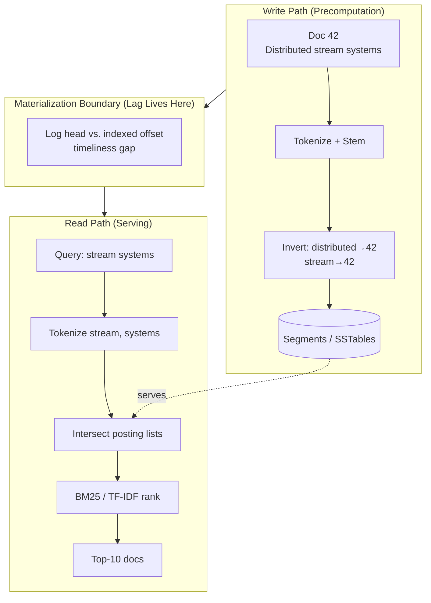
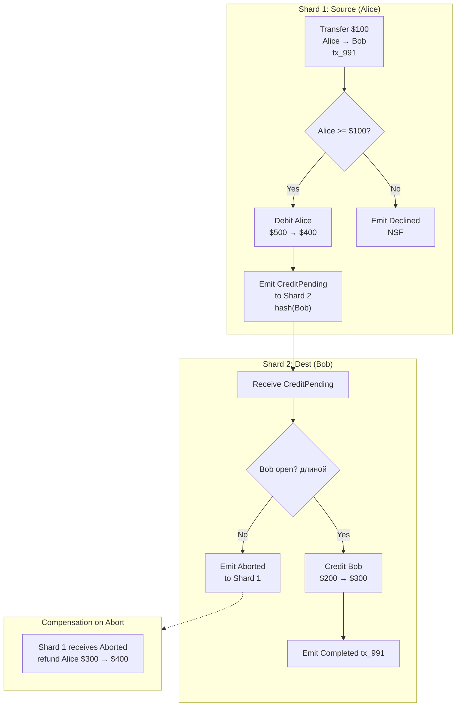
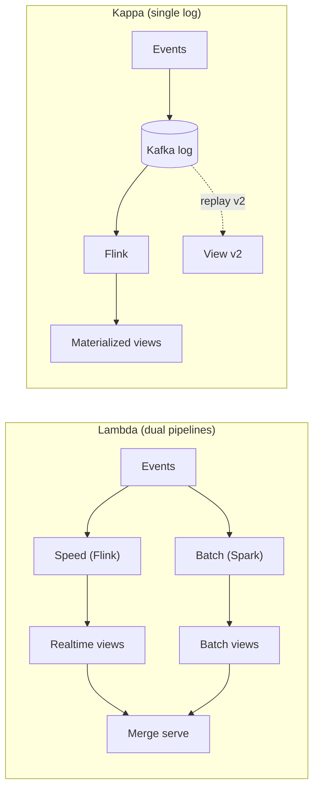
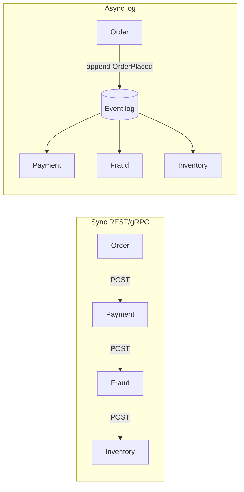
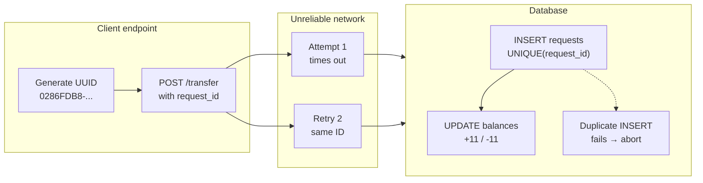

# Chapter 13: A Philosophy of Streaming Systems — Definitive Technical Summary
*From: Designing Data-Intensive Applications (2nd Edition) by Martin Kleppmann and Chris Riccomini*
*Source PDF: pp. 563–608 (673-page PDF) — figures below cite PDF pages.*

> [!NAV] **Chapter Navigation**
> ⬅️ **Previous:** [[chapter-12-stream-processing|Chapter 12: Stream Processing]] | 🏠 **Index:** [[00-Master-Reading-Dashboard|Master Dashboard]] | ➡️ **Next:** [[chapter-14-doing-the-right-thing|Chapter 14: Doing the Right Thing]]

---

## 1. Executive Summary & Core Engineering Problem

> *"If the highest aim of a captain was to preserve his ship, he would keep it in port forever."*
> — **St. Thomas Aquinas**, *Summa Theologica* (1265–1274), paraphrased epigraph of Chapter 13

- **The Big Picture:** Chapters 4–12 gave you storage engines, replication, partitioning, transactions, batch, streams. Real apps need all of them at once: OLTP point reads, full-text search, graph traversals, caches, OLAP. Forcing everything into one monolith buckles; writing to many systems from app code causes dual-write divergence (Ch.12). This opinionated chapter proposes the unifying philosophy: **unbundle the database** — externalize the WAL, indexes, caches as streams and specialized stores wired by ordered logs.
- **Core Thesis:** A database is a bundle: WAL for total order, secondary indexes, caches, execution engine, locks. Unbundle it across the enterprise: one durable partitioned log (Kafka) as the WAL, stream processors (Flink) as triggers/stored procedures, best-of-breed derived stores (Postgres, Elasticsearch, Redis, Snowflake/ClickHouse) as materialized views. Single ordered writes in, deterministic asynchronous derived data out. Data integration becomes dataflow reasoning, not distributed transactions.
- **Problem Statement:** Dual-writes across Postgres + Elasticsearch + Redis fork on races and partial faults; XA/2PC across heterogeneous stores blocks on coordinators, spikes tail latency, amplifies failures. Meanwhile total-order logs don't scale trivially (single leader bottleneck, cross-region ordering, per-service state, offline clients) and causality (unfriend → message) can be lost across stores. The chapter works toward a middle ground: asynchronous derived data with stronger end-to-end guarantees.
- **Historical Context:** Single-machine relational era → 2010s polyglot persistence without discipline → late-2010s/2020s Debezium CDC + event sourcing + Flink making unbundling practical. Saltzer-Reed-Clark end-to-end argument + stream-table duality let architects separate timeliness (lag) from integrity (invariants).

| Alice (federated monolith) | Bob (unbundled dataflow) |
| :--- | :--- |
| "Query Postgres+Elastic+Redis live via Trino scatter-gather with 2PC writes." | "Commit once to Kafka log, stream into Postgres view + Elastic index + Redis cache. Reads hit prebuilt views." |
| "Require linearizable reads everywhere." | "Tolerate ms lag (timeliness), never tolerate forked truth (integrity); audit continuously." |

---

## 2. In-Depth Technical Concepts & Internal Mechanics

### 2.1 Data Integration — Combining Specialized Tools by Deriving Data (p.563)

No single engine covers all access patterns well — log-structured vs. B-tree vs. columnar, single-leader vs. multi-leader vs. leaderless all trade off. Even "general-purpose" databases target a pattern. Vendors won't tell you their anti-patterns; earlier chapters gave you the questions to expose them.

Complex apps inevitably compose tools: OLTP Postgres + full-text index (Postgres FTS suffices for simple apps, specialist IR for real search; indexes are poor systems of record), plus warehouses, batch/stream processors, denormalized caches, ML ranking, notification fan-out. More representations = harder data integration.

**Reasoning about dataflows.** Be explicit: where is data written first, what derives from what, in what order? Gold pattern: write to system-of-record DB, capture changes via CDC, apply to index in log order. If CDC is the only index writer, the index is provably derived and consistent barring bugs. Letting the app write both DB and index reintroduces Fig 12-4: two clients' conflicting writes order differently in each store, neither store decides order, permanent fork. Funnel all input through one ordering point and derive the rest in that order — state-machine replication applied at enterprise scope. Whether CDC or event-sourcing log matters less than total order. Log-derived updates can be deterministic + idempotent, so recovery is easy.

**Derived data vs. distributed transactions.** Abstractly both aim at multi-system correctness: atomic commit vs. deterministic retry + idempotence. Difference: transactions promise read-your-writes immediately; derived data is async by default. XA has poor fault-tolerance/perf and won't be widely replaced soon. Log-based derived data is the pragmatic integration path — but "eventual consistency, deal with it" without guidance is unproductive. The rest of the chapter builds stronger guarantees atop async derivation.

**Limits of total ordering.** Single-leader logs order trivially, but scale breaks it: single-leader throughput caps force sharded logs with ambiguous cross-shard order; multi-region needs per-DC leaders (cross-DC sync too slow); microservices isolate durable state per service (cross-service order undefined); offline-first clients see different orders than servers. Total-order broadcast = consensus; most consensus handles single-node throughput, not shared ordering work. Where no causal link exists, arbitrary order is fine; same-object updates can pin to one shard (`hash(id)`). Subtle causality hurts: unfriend then rude-message-to-remaining-friends splits friendship store vs. message store; notification join may process message before unfriend and notify the ex. This is a temporal join problem with no simple fix. Starting points: logical timestamps (total order without coordination, but out-of-order handling + metadata), log-the-read-state + reference its ID for later causal links, conflict resolution for state (not for external side effects like sends). Future app patterns may capture causality without total-order bottlenecks.

**Batch and stream for data integration (p.568).** Goal: right data, right form, right place. Inputs → transform/join/filter/aggregate/train/evaluate → outputs. Batch + stream share principles; difference is bounded vs. unbounded inputs. Outputs are derived datasets: indexes, materialized views, recommendations, metrics. Both favor deterministic pure functions, immutable inputs, append-only outputs — functional flavor that simplifies fault-tolerance and org-wide dataflow reasoning, whether the derived data is an index, model, or cache. Sync secondary-index maintenance (like relational DBs do in-txn) is possible, but async event logs contain faults locally while 2PC aborts globally and amplifies failure. Cross-shard secondary indexes (term- vs. document-partitioned) also prefer async. Reprocessing for app evolution favors retained logs: deploy new code, replay from 0, build v2 views, cut over — batch for backfill, streams for live.

Data integration in one line: every extra representation should have exactly one ordered upstream.

#### 2.1.1 Combining Specialized Tools by Deriving Data (p.564) — CQRS, ETL/CDC, Search Index, Cache
- **Why data integration is unavoidable:** This is a data integration chapter because no single engine serves OLTP point lookups, full-text search, graph traversals, columnar OLAP, vector similarity, and edge caching well. Data integration means mapping each workload to its best store, then wiring ordered dataflows so every copy converges. Without explicit data integration discipline, teams dual-write from app code and fork.
- **OLTP + search (book example p.564):** Postgres handles transactions; Postgres FTS suffices for simple `LIKE`/ranking, but specialist information-retrieval (Elasticsearch/OpenSearch, Solr) wins for stemming, BM25, facets, highlighting. Search indexes are poor systems of record (no transactions, no durability story) — so data integration pairs them: Postgres as system of record, CDC log as the ordered bridge, search index as derived data. The derived data index is rebuilt by replay, never written directly.
- **CQRS (Command Query Responsibility Segregation):** Write model (normalized OLTP) separated from read models (denormalized views per query). Each read model is derived data fed by the same log. Example: `orders` table → `orders_by_customer` materialized view, `orders_search` index, `orders_daily_revenue` cube — three derived data copies, one upstream. CQRS makes the derived-data fan-out explicit instead of hidden N+1 queries.
- **ETL/CDC pipeline (Ch.11→12→13 thread):** Batch ETL (nightly Spark) + streaming CDC (Debezium tailing Postgres WAL → Kafka) are both data integration transports. CDC preserves commit order per shard; ETL snapshots + backfills history. Gold rule from §2.1: if CDC is the only index writer, the index is provably derived data consistent with the record — no Fig 12-4 fork. Allow app direct writes and you lose the proof.
- **Caches as derived data:** Redis/Memcached session objects, CDN edge renders, and UI DTO aggregations are derived data too — pre-joined, TTL'd, invalidated by log offsets, not by timeouts alone. Treating cache as derived data (with upstream log + transform version + lag SLO) turns "cache invalidation is hard" into "replay the derived-data pipeline."
- **ML/ranking/notifications as derived data:** Feature stores, embedding indexes, recommendation lists, and notification outboxes are all derived datasets subscribed to the same ordered log. Data integration therefore covers training (batch) + serving (stream) + alerting (filter) under one ordering principle.
- **Derived data mantra (repeat for audit):** Every derived data copy declares (1) upstream log, (2) offset/LSN, (3) transform code version. Derived data without lineage is technical debt. Derived data with lineage is reprocessable, auditable, healable — the foundation for §2.6–2.7 correctness.

#### 2.1.2 Batch and Stream Processing for Data Integration (p.568) — Bounded/Unbounded, Lambda/Kappa, Reprocessing
- **Goal restated:** Data integration must get the right data, in the right form, to the right place. Batch processors (Spark, Flink-batch, SQL warehouses) and stream processors (Flink, Kafka Streams, Samza) are the tools; outputs are always derived data / derived datasets (indexes, views, recommendations, metrics).
- **Bounded vs unbounded (Ch.11 vs 12):** Batch inputs are bounded (known size, finite files/tables); stream inputs are unbounded (infinite event logs). Same functional core: deterministic pure functions, immutable inputs, append-only derived data outputs. Unbounded needs managed fault-tolerant state (RocksDB checkpoints) + event-time windowing; bounded can re-sort/re-shuffle freely. Both produce derived data by replayable transforms.
- **Lambda architecture (historical):** Speed layer (streaming, low-latency approximate derived data) + batch layer (nightly recompute, correct derived data) + merge on read. Problems [11–12]: dual codebases diverge, merge logic complex, testing doubles. Book marks it fallen out of use.
- **Kappa architecture (recommended):** Single log + single engine (Flink/Beam/Dataflow) handles both live tail and historical replay. Reprocessing = replay retained log through new code to build v2 derived data, cut over atomically. Requires: replayable broker (Kafka retention), exactly-once stream semantics (discard partials on fail, see §2.6), event-time windowing (Beam API) so reprocessing history yields same windows as live.
- **Reprocessing for evolution + railway gauge story (p.569 sidebar):** 19th-century England's competing rail gauges → 1846 standard gauge → dual-gauge third rail let old+new trains coexist during years-long migration; BART still nonstandard. Same for derived data: keep v1 + v2 views side-by-side on the same log, shift 1%→10%→100% traffic, drop v1. Every stage reversible; risk low, velocity high [8–10]. Without retained logs + reprocessing, schema evolution limits to optional-field adds; with them, full model restructures are safe.
- **Cross-shard secondary indexes (p.569):** Term-partitioned (send writes to N shards) vs document-partitioned (scatter reads to all shards) — both prefer async derived-data maintenance over sync 2PC. Async contains faults locally; sync aborts globally and amplifies failure.
- **Data integration summary:** Batch for backfill, streams for live, one ordered log for both, deterministic idempotent transforms for all derived data. That is the data integration contract this chapter's unbundling builds on.

### 2.2 Unbundling Databases — Composing Bespoke Storage from Streams (p.570)

A bundled DBMS packs parser/optimizer, 2PL/SSI concurrency, hash/nested-loop/sort execution, B-tree/GiST/GIN/hash indexes, buffer pool, WAL/Aries/heap into one process. Two philosophies compete for heterogeneous needs:

| Dimension | Federated / polystore (Trino/Drill) | Unbundled (log + streams) |
| :--- | :--- | :--- |
| **Model** | One SQL front, scatter-gather to engines | Disaggregated stores wired by durable streams |
| **Writes** | 2PC/XA, coordinator SPOF, tail latency | One partitioned log, async deterministic views |
| **Reads** | Runtime federated joins, cross-engine transfers | Pre-joined denormalized materialized views |
| **Coupling** | Fails if any backend degrades | Views serve even if log/ingest pauses |
| **Analogy** | Monolithic kernel with all drivers | Unix pipes: small tools, uniform interface |

Unbundled mapping: Kafka ↔ WAL; Flink ↔ triggers/stored procedures; Elasticsearch/Redis/Snowflake ↔ secondary indexes/views/columnars. Enterprise ≡ database internals externalized.

**Composing storage (bespoke index/storage/compute).** Don't ask one engine to be a KV + search + graph + OLAP store. Compose: Postgres for OLTP point reads, Elasticsearch for inverted search, Redis for session cache, ClickHouse/Snowflake for columnar OLAP, Neo4j/graph for traversals — each hydrated from the same ordered log. This is why Firebase/Supabase are instructive contrasts: Firebase bundles auth + realtime DB + Firestore + functions into an opinionated backend-as-a-service — superb velocity for CRUD/realtime apps, but the bundle decides indexing, consistency, and query shape. Supabase (Postgres + PostgREST + Realtime CDC + Auth + Storage) is a thinner bundle that already leans unbundled: Postgres remains system of record, CDC/log feeds realtime and edge caches. The book's direction pushes further: keep the log public and pluggable so any bespoke index, storage layout, or compute engine can subscribe without forking write paths.

**Designing applications around dataflow (p.575).** Writes-meet-reads boundary defines cost: `total work = W_write + W_read`. CRUD does O(1) appends on write, O(N) scans/joins on read. Dataflow inverts for high read/write ratios (100:1 to 10000:1): stream processors pre-join/pre-aggregate into denormalized objects on write (O(K) index fan-out), reads become O(1) point lookups on RocksDB/Redis with zero runtime joins. Materialized caching is the lever.

**Observing derived state / where writes meet reads (p.579) — Figure 13-1.** Search-index example: no write precomputation → O(N) scan per query; full inverted-posting precomputation on write → fast intersect + BM25/TF-IDF ranking on read. Figure 13-1 names the boundary and its lag: derived views trail the log by consumer lag. Correctness must therefore distinguish lag (timeliness) from fork (integrity) — next section.

Derived data checklist from this section: every derived dataset declares its upstream log + offset, its transform version, and its lag SLO; backfills replay from retained logs; new logic builds v2 in parallel.

#### 2.2.1 Unbundling Databases in Depth (p.570) — Index/Storage/Compute Separation, Bespoke Stores
- **What unbundling means:** Unbundling a database means externalizing its internals — WAL → Kafka/Pulsar durable log, triggers/stored procedures → Flink/Kafka Streams, B-tree/GIN/GiST indexes → Elasticsearch/Redis/columnars — as independently deployable services wired by streams. Unbundling does not kill databases; it composes them. The book's unbundling thesis: breadth (many workloads well) over depth (one workload perfectly).
- **Why unbundling (vs one engine):** CREATE INDEX internals already prove the pattern: scan snapshot → sort → backfill backlog → keep up-to-date on writes (same as follower bootstrap p.201 + CDC snapshot p.504). Unbundling generalizes that built-in derived-data pipeline across team and vendor boundaries. Unbundling trades operational pieces (more to run) for workload fit (each read served by its ideal layout).
- **Bespoke index/storage/compute (compose, don't stretch):** Bespoke index = Elasticsearch inverted + pg_trgm + vector HNSW per query shape. Bespoke storage = Postgres row heap for OLTP, S3 Parquet/Iceberg for scan, RocksDB for stream state, Redis for hot keys. Bespoke compute = Flink for joins/aggregates, Spark for backfills, GPU batch for embeddings. Unbundling lets each bespoke piece subscribe to the same log instead of forcing one engine to fake all layouts. A bespoke store without an ordered upstream is just another fork — unbundling requires the log.
- **Federated (unifying reads) vs unbundled (unifying writes):** Federated/polystore (Trino, Presto, Drill, Postgres FDW, Hoptimator, Xorq) gives one SQL front over many engines — elegant semantics, hard implementation, read-only; writes still need XA. Unbundling gives one log front over many engines — Unix-philosophy small tools + pipes [20], shell-like composition [14]; writes flow once, derive everywhere. Federation maps models on read; unbundling syncs state on write. The chapter bets on unbundling for writes because cross-system 2PC is the harder problem.
- **Making unbundling work (p.573):** Transactions inside one engine are fine; across heterogeneous engines prefer ordered log + idempotent consumers [5]. Exactly-once inside a stream processor via 2PC is fine; across vendor boundaries the log abstraction wins. Loose coupling pays twice: system-level (slow consumer buffers, fault contained, catch-up on fix — vs 2PC escalating local faults globally) and human-level (teams ship independently behind a durable ordered interface strong enough for causality but general enough for any payload).
- **When not to unbundle (p.574):** Single engine that covers you → use it. Fewer moving parts, better predictable perf on its sweet spot [21], no premature scale-out. Unbundling is for when no single product spans your read/write needs. Debezium + Kafka protocol + incremental view maintenance (p.516) keep lowering the composition cost.
- **Unbundling count-up (for term audit):** Unbundling appears here as architecture, as operation, as team pattern, as write-unifier, as Unix analogy, as fault container, as evolution enabler — unbundling is the chapter's organizing noun, distinct from mere data integration or derived data plumbing.

#### 2.2.2 Firebase vs Supabase — Bundle Spectrum (bespoke lesson)
- **Firebase (thick bundle):** Auth + Realtime DB/Firestore + Cloud Functions + Hosting + Analytics in one opinionated BaaS. Velocity superb for CRUD/realtime/chat; bundle decides indexing (limited compound queries), consistency (eventual document sync), and query shape (collection/group). Escaping the bundle for bespoke analytics/search means exporting (and losing ordering guarantees).
- **Supabase (thin bundle leaning unbundled):** Postgres remains system of record + PostgREST (auto-API) + Realtime (CDC/log tail) + Auth + Storage. Because the log (Postgres WAL via logical decoding) is public, any bespoke index (Elastic), cache (Redis), or warehouse (Snowflake) can subscribe without forking writes. Closer to unbundling: keep the record centralized, the derived data pluggable.
- **Book direction beyond both:** Make the log itself the API (Kafka topic + schema registry), not just the DB. Then Firebase-like velocity (subscribe + materialize) coexists with bespoke freedom (any engine, any team, same order). Unbundling generalizes Supabase's CDC insight to the whole enterprise.

### 2.3 Designing Applications Around Dataflow (p.575) — Derivation Functions, Code/State Separation, Streams vs Services

- **Spreadsheet intuition (VisiCalc 1979 [23]):** Formula cell `=SUM(C:C)` auto-recomputes when inputs change — derivation without polling. Dataflow generalizes that to the enterprise: record change → stream operator → derived data refresh (index, cache, model) automatically. Databases should learn from spreadsheets [22]; difference is fault-tolerance, scale, durability, and cross-team heterogeneity.
- **Derivation functions (what transforms derived data):** Secondary index (pick fields + sort), full-text index (detect language → segment words → stem/lemmatize → spell/synonym → invert), ML model (feature extract + statistical fit; inference derives from input + learned params), UI cache (aggregate fields the screen needs; UI change → repopulate rule + rebuild). CREATE INDEX is the cookie-cutter case; the rest need custom code with domain knowledge (linguistics, feature engineering [24]).
- **Separation of application code and state (Church/state joke [26]):** DBs as deployment environments (triggers/procedures/UDFs) lose to K8s/Docker/Mesos/YARN on deps, versioning, rolling upgrades, metrics, and network calls. Trend: stateless services (any server handles any request) + remote DB as mutable shared variable (durable, concurrent, fault-tolerant) [25]. DB as passive variable you poll — no subscribe; observer pattern hand-rolled, not built-in. Dataflow renegotiates this: code reacts to state changes by emitting new state changes (CDC, actors, triggers, incremental view maintenance p.516) across caches, indexes, ML, analytics via streams.
- **Log properties derived data needs:** Ordered state changes (all views process same order → mutually consistent) + fault tolerance (single lost message = permanent derived-data drift). Both delivery and state updates must be reliable. Modern stream processors provide ordering + reliability at scale cheaper and more robustly than distributed transactions; operators compose like Unix pipes (streams in, streams out).
- **Stream processors vs services (currency example pp.578–579 [27–29]):** Purchase in one currency, pay in another, needs FX rate. Microservices: query `exchange-rate-service` synchronously per purchase (network hop, tail latency, outage coupling). Dataflow: subscribe to `fx_updates` stream ahead of time, materialize local FX table; purchase handler joins locally (same process/machine). Faster (no network — "fastest request is no request") + robust (works when FX service down, serving last known rate). Cache-polling converges to the same design — dataflow makes it explicit. Time-dependence remains: reprocessing old purchases needs historical FX at original time (p.525 joins); both approaches must handle it. Subscribing moves toward spreadsheet reactivity; open questions on time-joins remain but direction is promising.
- **Derived data lens:** Every paragraph above is about derived data: FX table is derived data, search posting is derived data, UI cache is derived data. Designing around dataflow = designing around derived data freshness, lineage, and cost.

### 2.4 Observing Derived State (p.579) — Figure 13-1, Write/Read Paths, Offline Clients, Reads-as-Events

- **Write path vs read path (Fig 13-1, p.579):** Write path = precompute eagerly on ingest (batch/stream stages updating every derived data copy, e.g. tokenize→invert→SSTable for search). Read path = compute lazily on request (parse query, intersect, rank). Derived dataset is where they meet (Fig 13-1 boundary). Eager ≈ functional eager evaluation; lazy ≈ lazy evaluation. Trade-off knob: shift work between paths.
- **Index/cache/materialized-view as boundary slider (pp.580–581):** No index: zero write work, O(N) grep scan per read. Full inverted index: O(K) write fan-out, O(1)-ish reads (Boolean AND/OR + BM25). Precompute-all-queries: zero read work, infinite write work (impossible — query space exponential). Cache of top-N queries: middle ground, a materialized view refreshed on new docs. Social home timelines (p.34) already slid this boundary per user (celebrity vs ordinary) — 500 pages later the pattern returns as derived-data design.
- **Stateful offline-capable clients (pp.581–582):** Browsers/mobile evolved from stateless (reload to refresh, offline = dead scroll) to stateful (JS SPAs, local storage, on-device SQLite). On-device state = cache of server state; pixels = materialized view of local models; models = replica of datacenter state [31]. Sync engines/local-first (p.220) make this a derived-data problem all the way to the edge.
- **Pushing state changes (Server-Sent Events/WebSockets):** Classic web: browser polls (RSS = fancy poll), state stale until reload. SSE/EventSource + WebSockets keep TCP open, server pushes deltas, extending the write path to the device. First load uses read path; thereafter stream of derived-data updates. Same log-consumer-offset trick as p.498 lets offline devices resync without missing events [30,32].
- **End-to-end event streams + why not everywhere (p.583):** React/Elm already re-render on state change; natural to push server deltas into that pipeline: device interaction → event logs → derived data → stream processors → other device UI in <1 s (IM/games already do "real-time"). Blocker: request/response assumptions baked into DBs/libs/frameworks/protocols — few stores serve subscribe-to-changes; rethinking toward publish/subscribe dataflow [31] costs effort but buys responsiveness + offline.
- **Reads are events too (pp.583–584):** Today writes go via log, reads are transient RPCs to shard holders. Alternative: log read requests as events through the same stream processor (stream-table join: route read event by key to shard, emit result to output stream [35–36]). One-off read = transient join; subscribe = persistent join over past+future. Logging reads enables causal tracking (what shipping/inventory did the buyer see before ordering? [4]) and provenance, at storage/I/O cost — open research [2], but if you already log requests operationally, making the log the source is small.
- **Multishard data processing (pp.584–585):** Single-shard reads via streams = overkill; multishard joins shine: Storm distributed RPC counted URL viewers as union of follower sets across shards [37]; fraud scoring joins purchase event against sharded IP/email/address reputation DBs [38]; warehouse shuffle joins look identical. If a DB already does it, use it; streams are the escape hatch past conventional limits.
- **Figure 13-1 anchor:** All of §2.4 is the elaboration of Fig 13-1 (p.579): writes meet reads at derived data; lag lives at the boundary; timeliness vs integrity (§2.5.3) decides whether lag matters.

### 2.5 Aiming for Correctness — End-to-End, Constraints, Timeliness vs. Integrity, Trust-but-Verify (p.585)

#### 2.5.1 The end-to-end argument (p.586) — exactly-once (1/7), duplicate suppression, request IDs

Saltzer-Reed-Clark (1981): reliability needs endpoint help; low-level primitives alone are insufficient. DB ACID/2PC can't deduplicate a retried `POST /transfer`: server debits/credits + commits, TCP drops before `200 OK`, client retries, second commit debits again — both txns "correct", business catastrophically wrong ($2000 vs $1000). Fix is end-to-end: client UUID idempotency key first, `processed_requests` insert guarded by unique constraint, cached response replay on duplicate. Exactly-once business semantics over at-least-once transport. Same pattern underlies outbox + CDC + idempotent consumers: end-to-end deduplication, not just broker acks.
- **Exactly-once execution (1/7, p.586):** Exactly-once (effectively-once) means retry-after-fault has the same final effect as no fault — charging once, counting once. At-least-once + idempotence is the implementation: maintain operation-ID set, fence on failover (p.373), deduplicate. Exactly-once stream checkpoints give the same for derived data pipelines.
- **Duplicate suppression beyond streams (pp.587–588):** TCP sequence numbers suppress duplicates within one connection (reorder + retransmit + dedup before handing to app). But transaction tied to TCP breaks on reconnect: client sends `COMMIT`, network drops before ack (Fig 9-1), client reconnects outside TCP suppression scope and retries Example 13-1 (`UPDATE accounts +11 WHERE 1234; -11 WHERE 4321; COMMIT`) — nonidempotent, transfers $22 not $11. Real banks never do this [3]. 2PC breaks 1:1 TCP↔txn mapping (coordinator reconnects to resolve in-doubt) yet still cannot suppress end-user double-POST (weak signal → error page → manual retry; Post/Redirect/Get [43] doesn't help on timeout). Browser retry = new request + new transaction from server/DB view.
- **Uniquely identifying requests (Example 13-2, p.588):** Pass UUID/hash from client form through app to DB: `ALTER TABLE requests ADD UNIQUE(request_id); BEGIN; INSERT INTO requests(request_id,from,to,amount) VALUES('0286FDB8-…',4321,1234,11.00); UPDATE…; COMMIT;`. Duplicate `INSERT` violates unique constraint even under weak isolation (where app check-then-insert races, p.303) and aborts the second effect. `requests` table doubles as event log for sourcing/CDC; balance updates can move downstream as long as the event is processed exactly-once via the same request ID.
- **End-to-end argument quoted (p.589 [44]):** "Can completely and correctly be implemented only with knowledge and help of the application standing at the endpoints…" TCP dedup, Ethernet checksums, WiFi encryption, DB txns, and exactly-once stream processors are useful incomplete versions (reduce fault probability, e.g. TCP reordering saves HTTP daily) but cannot alone prevent user double-submit, disk-bitrot, or app-bug corruption. End-to-end checksums/encryption/duplicate-suppression close the gap. Application-level fault tolerance is hard and rarely wrapped cleanly — transactions collapse faults to commit/abort but cost too much across heterogeneous stores (p.328), forcing hand-rolled app mechanisms that usually corrupt. Hence the search for scalable end-to-end correctness abstractions continues into §2.5.2.

#### 2.5.2 Enforcing constraints without 2PC — single-partition serialization + sagas (p.590) — Figure 13-2 — exactly-once (2/7), (3/7)

Objection: "async can't enforce uniqueness/non-negative balances/seat booking." Answer: partition by constrained key.

- **Single-leader partition for uniqueness:** `partition = hash(username) % N`; one worker per partition holds claimed-set in RocksDB, processes offsets sequentially: unclaimed → emit `Registered` + record; claimed → emit `Declined(DUPLICATE)`. No locks/deadlocks — total partition order is the concurrency control. Figure 13-2 shows the money variant: check source balance + atomically emit next-leg event; single-threaded shard makes check-and-reserve atomic.
- **Cross-shard transfers via sagas + compensation:** X on P1 → Y on P2. P1 validates X≥100, debits, emits `Approved(tx)` routed by `hash(Y)`; P2 credits or emits `Aborted`; P1 compensates (refunds X) on abort. Money conserved, no XA blocking/SPOF. Multi-fee legs fan out similarly by `hash(fee_account)`.
- Read-your-decision: user checks their transfer by reading their shard's outgoing `Approved`/`Declined` event, not by global query.

Alice→Bob $100 happy path: P1 debits Alice 500→400, emits `CreditPending` to P4; P4 validates Bob open, credits 200→300, emits `Completed`; sum 700 invariant holds. Frozen-Bob path: P4 emits `Aborted`, P1 refunds Alice 300→400. Zero distributed locks.
- **Uniqueness requires consensus (p.591):** Distributed uniqueness (username, seat, request ID) needs agreement on which contender wins. Single leader decides; Raft re-elects on failure without split-brain. Scale by sharding on the constrained value (`hash(username)%N`, `hash(request_id)%N` for Example 13-2). Async multi-leader cannot immediately reject violations (concurrent leaders accept conflicting uniques). Synchronous coordination unavoidable for strict immediate rejection [45].
- **Uniqueness in log-based messaging (pp.591–592):** Shared log = total-order broadcast = consensus (p.427). Shard log by constrained value; single-threaded stream processor per shard reads sequentially, keeps claimed-set in RocksDB, emits `Registered` or `Declined` deterministically. Same construction as Ch.10 log-consensus; scales by shard count. Any conflict-routed-to-same-shard constraint (balances, inventory, room overlaps) works with arbitrary validation logic.
- **Multishard Fig 13-2 steps (pp.592–594 [47]):** (1) Client UUID request appended to source-account shard. (2) Source processor (derived DB of balances + seen IDs) checks funds; if ok, reserves + emits `outgoing` (own shard) + `incoming` (dest shard) + `incoming` (fees shard) carrying request ID. (3) Source loopback delivers `outgoing` back; processor executes + dedups by ID. (4) Dest/fees processors apply + dedup. Shards may colocate — requirement is only per-account log order + at-least-once + determinism. Crash → replay same decision, emit same IDs, downstream dedups. Atomicity = atomic append of the initial request; downstream follows eventually (with duplicates). Exactly-once stream semantics (2/7) ease this by keeping state + consumed offsets consistent on replay; user waits on source-shard `outgoing/declined` event for synchronous notification. Result: payer+payee applied exactly-once (3/7) without atomic commit.
- **Loosely interpreted constraints / apologies (pp.597–598 [48–49]):** Strict uniqueness needs coordination, but business often prefers violation + compensation: oversold warehouse → reorder + discount/apology (forklift already forces this flow [3]); overbooked flight/hotel → refund/upgrade/neighbor-hotel (weather/strikes need it anyway); overdrawn ATM → fee + clawback (daily limits bound risk); cross-org settlement → correction entries (p.476). Unsending email impossible, follow-up correction cheap; double-charge refund costs fees + complaint; ATM cash needs collectors. If apology cost acceptable, validate optimistically after write, before irrecoverable action — integrity preserved, timeliness relaxed, same as Ch.8 conflict resolution (p.222).
- **Coordination-avoiding systems (p.598 [45]):** Integrity without atomic commit/linearizability/sync cross-shard work + loose constraints = no coordination for most ops, strong integrity still. Multi-datacenter multi-leader async replication: any DC operates alone, weak timeliness (no linearizability), strong integrity. Serializable txns shrink to small scopes where they shine [6]; XA avoided; sync added only where irrecoverable (e.g. before firing missile). Coordination reduces inconsistency-apologies but increases outage-apologies — tune to the sweet spot, never zero.

#### 2.5.3 Timeliness vs. integrity (p.595) — exactly-once (4/7), (5/7)

Relational "consistency" conflates two axes:

| | Timeliness (recency/lag) | Integrity (invariants/truth) |
| :--- | :--- | :--- |
| **Asks** | Latest value this ms? | Valid, uncorrupted, conserved? |
| **Caused by** | Replica/consumer lag, async sync | Dual-write races, lost updates, bit-rot, bugs |
| **Heals?** | Self-heals when lag drains | Perpetual until repaired |
| **Trade** | Sacrifice for AP/low write latency | Never sacrifice; logs + dedup + audits |
| **Impact** | Refresh in 2 s | Double charges, lost audit |

Rule: timeliness violations are allowed under eventual consistency; integrity violations are perpetual. Integrity >> timeliness for almost all businesses. This is why async derived data is acceptable: 50 ms stale search is fine; forked balances are not.
- **Correctness of dataflow systems (p.596):** ACID bundles timeliness (linearizability) + integrity (atomic commit); dataflow decouples them. Async streams give no timeliness unless client waits on output event (Fig 13-2 wait). But integrity is central: exactly-once/effectively-once (4/7) via fault-tolerant delivery + dedup/ide mpotence prevents loss/double-apply. Integrity recipe (5/7): single-message write (atomic, event-sourcing friendly) + deterministic derivation (stored-procedure-like) + end-to-end request ID (dedup/idempotence) + immutable reprocessable inputs (bug recovery by replay). Same correctness as distributed txns, far better perf/ops.
- **Credit-card statement parable (p.596 [3]):** 24-h missing transaction = normal lag (timeliness); statement sum ≠ transactions + prior balance, or charged-without-merchant-paid = integrity failure (catastrophic). Data integration must never trade the second for the first.

#### 2.5.4 Trust but verify — continuous auditing, Merkle trees, tamper-proof logs (p.599) — exactly-once (6/7), (7/7)

Blind trust in committed data ignores bit-rot (cosmic rays, DIMM flips, SSD firmware, RAID lies), migration/off-by-one bugs (0.001%/mo silent corruption), and dropped async events. Retain the append-only log as ground truth (S3 Object Lock/WORM for compliance), run an independent auditor re-deriving invariants, compare hierarchically:

- Leaves `H_leaf = SHA256(record)`; parents `H_parent = SHA256(left‖right)`; one 32-B root summarizes billions of rows. Mismatched roots → binary-search halves in O(log N) round-trips to the divergent leaf, then replay that slice from the log to heal the view. 1M-record example: naive nightly diff ships 1.3 GB; Merkle isolates `acc_782103` (dropped during ES reboot) in 20 × 64 B ≈ 1.28 KB, replays one CDC event, roots match.

Exactly-once processing is the companion guarantee here: deterministic replay + idempotent sinks (upsert by key, tombstone deletes) plus exactly-once stream checkpoints mean reprocessing heals without double-applying. The book invokes exactly-once seven times in this chapter precisely to tie reprocessing safety to audit-driven repair.
- **System-model humility (p.599):** Assume crashes, power loss, arbitrary net delay/drop; traditionally also assume fsync holds, RAM multiplies correctly. Reality is probabilistic: memory/disk/net corrupt (pp.44/283/379); at scale the unlikely happens. Exactly-once processing (6/7) assumes non-Byzantine faults; auditing covers the rest.
- **Bugs beat hardware (p.600 [50–51]):** MySQL uniqueness + Postgres serializable both shipped violations despite maturity; app code (weak isolation misuse, missing FK/unique [25]) worse. ACID "consistent→consistent txn" assumes bug-free txns — unsafe assumption. Don't blindly trust promises; audit.
- **Designing for auditability (pp.601–602):** Mutating txns hide why; event sourcing (single immutable input + deterministic repeatable derivation) exposes provenance. Hash the log, rerun derivations to verify, run redundant derivations in parallel, time-travel-debug by replay [4,55]. End-to-end checks across the whole derived-data pipeline implicitly cover every disk/net/service/algorithm on the path; confidence lets you move fast [56] like tests do. Exactly-once reprocessing (7/7) makes the repair safe to apply.
- **Tools (pp.602–603):** App audit tables lack integrity; HSM-signed txn logs don't prove correct inputs. Blockchains (Bitcoin/Ethereum) = append-only event logs + stream-processor contracts + BFT consensus with mutual integrity checks — overkill overhead for most apps, but Merkle trees [57] (hash-tree proofs of inclusion), Certificate Transparency (append-only + Merkle, single leader, no consensus [58–59]), and ledger-style end-to-end audits port cheaply. Future data systems will be self-validating/self-auditing [54]; HDFS/S3 background scrubbers [52–53] + backup-restore drills already live this "trust, but verify."
- **Summary echo (pp.603–604):** Data integration via systems-of-record + derived data transforms (indexes, views, models, summaries) over async loosely coupled flows → robustness + evolvability (re-derive on change, fix-and-reprocess on bug) → unbundled database → write/read-path observation to the edge → integrity without coordination (end-to-end IDs, async constraint checks, apologize when cheap) → audit everything. Blockchain techniques rhyme with event systems for a reason.

---

## 3. Important Figures, Diagrams & Visual Architecture

> 📕 **Original figures quick index (source PDF, 673 pages):** open the PDF at the cited page to verify each reconstruction. This chapter has exactly 2 book figures.
>
> | Book Fig | PDF page | What to compare |
> |---|---|---|
> | Fig 13-1 | PDF p.579 | Search index: writes meet reads, lag boundary |
> | Fig 13-2 | PDF p.592 | Funds check + atomic commit across shards |

### Figure 13-1: Where Writes Meet Reads — Derived-State Lag (PDF p.579)
- **Figure Reference:** `Figure 13-1: In a search index, writes (document updates) meet reads (queries)`
- **Original PDF:** Fig 13-1 → PDF p.579 — open the PDF at page 579 to compare with the Mermaid reconstruction below.
- **Visual Flow & Description:** Raw document → tokenize/stem → invert terms → SSTable segments on write; query → tokenize → intersect posting lists → rank on read. Boundary between them is the materialization point; derived-state lag is the distance behind the log head.
- **Mermaid Flowchart:**



- **Key Takeaway:** No precomputation = O(N) scans; full precomputation = O(1)-ish lookups but async lag. Lag is expected; fork is not.
- **Failure Mode:** 500k updates/s saturates tokenization/merge I/O; stream buffer absorbs spike, query latency holds, consumer lag grows until autoscale.

---

### Figure 13-2: Single-Shard Funds Check + Atomic Forward Commit (PDF p.592)
- **Figure Reference:** `Figure 13-2: Checking whether a source account has enough money and atomically committing the transfer leg`
- **Original PDF:** Fig 13-2 → PDF p.592 — open the PDF at page 592 to compare with the Mermaid reconstruction below.
- **Visual Flow & Description:** Three accounts on three shards (could colocate); source shard checks balance and atomically appends the next-leg event; downstream shards credit independently; aborts trigger compensations.
- **Mermaid Flowchart:**



- **Key Takeaway:** Check-and-reserve is atomic within one single-threaded partition; cross-shard atomicity comes from saga + compensation, not 2PC.
- **Failure Mode:** Crash mid-credit replays `CreditPending` by tx_id with idempotent upsert — no double-credit on failover.

---

### Supplementary Diagram (not in book — study aid): Lambda vs. Kappa



### Supplementary Diagram (not in book — study aid): Sync RPC Cascade vs. Log Decoupling


*All supplementary diagrams above are study aids, not book figures. The chapter's only book figures are Fig 13-1 (p.579) and Fig 13-2 (p.592).*

### Supplementary Diagram (not in book — study aid): End-to-End Request ID Flow (Example 13-2)



- **Read the aid:** Same UUID on retry turns two network attempts into one business effect; unique constraint is the dedup point; balances derive from the deduplicated request log.
- **Why it matters for data integration:** The `requests` table is both OLTP truth and the event log for downstream derived data — one ordered upstream feeding balances, audits, and notifications.
- **Exactly-once link:** TCP dedup (connection scope) + DB unique (business scope) + stream checkpoints (pipeline scope) layer to end-to-end exactly-once; no single layer suffices (Saltzer-Reed-Clark).
- **Unbundling link:** Once the request log is the system of record, balance views, fraud views, and ledger views are all derived data subscribed to it — unbundling in miniature.
- **Audit link:** `request_id` is the provenance key Merkle auditors use to pinpoint which business event a corrupt derived row came from.

---

## 4. Real-World Systems, Case Studies & Code Examples

### 4.1 Industry Implementations
- **Kafka/Pulsar logs as enterprise WALs** with retention + replay for reprocessing and v2 view builds. Data integration backbone: one ordered log per domain, retention months, replay for every derived data rebuild.
- **Flink/Spark streaming** as trigger/procedure engines maintaining RocksDB-backed derived views. Derived data transforms run as checkpointed operators; exactly-once checkpoints make derived data reprocessing safe.
- **Elasticsearch (inverted), Postgres (OLTP view), Redis (cache), Snowflake/ClickHouse/Pinot/Druid (columnar)** as bespoke derived stores fed by CDC. Each bespoke derived data copy has exactly one upstream — data integration rule.
- **Debezium + outbox** for single-write capture; **S3 Object Lock/WORM** for tamper-proof ground truth. Outbox turns dual-write into atomic local write + CDC-derived data fan-out.
- **Firebase vs. Supabase lesson:** bundled BaaS accelerates CRUD but fixes your index/consistency menu; Supabase's Postgres+CDC realtime is closer to unbundled and easier to extend with external bespoke views. Unbundling generalizes the Supabase CDC insight enterprise-wide.
- **Trino/Drill/Xorq (federated) vs Kafka+Flink (unbundled):** former unifies reads, latter unifies writes. Data integration needs both, but writes decide correctness.

### 4.1b Production Implementation: Outbox + CDC (data integration primitive)

```python
# Outbox pattern: atomic local commit, async derived-data fan-out.
# No dual-write fork; CDC tails the outbox table in commit order.
import uuid

def place_order(db, order):
    oid = str(uuid.uuid4())
    with db.transaction():  # single local txn — no XA
        db.execute(
            "INSERT INTO orders(id, customer, total) VALUES (?,?,?)",
            (oid, order["customer"], order["total"]))
        db.execute(
            "INSERT INTO outbox(id, aggregate, event, payload) VALUES (?,?,?,?)",
            (str(uuid.uuid4()), oid, "OrderPlaced", order))
    return oid  # Debezium tails outbox → Kafka `orders` log in order

# Downstream: each derived data builder consumes `orders` log only.
# Search index, cache, warehouse, ML feature store — all derived data,
# all ordered, all replayable. Data integration in 10 lines.
```

```python
# Exactly-once stream checkpoint sketch (Flink-style):
# checkpoint(state + offsets) atomically; restore = rewind + replay.
class CheckpointedView:
    def __init__(self):
        self.state = {}
        self.offset = -1
        self.snapshot = None

    def checkpoint(self, durable):
        durable.save({"state": dict(self.state), "offset": self.offset})

    def restore(self, durable):
        snap = durable.load()
        self.state, self.offset = snap["state"], snap["offset"]

    def apply_exactly_once(self, batch):
        for e in batch:  # deterministic + idempotent per tx_id
            if e["offset"] <= self.offset:
                continue  # already applied before crash
            self.state[e["key"]] = e["value"]
            self.offset = e["offset"]
        # checkpoint barrier here → derived data + offset consistent
```

### 4.2 Idempotent Consumer (exactly-once sink primitive)

```python
from typing import Dict, Any

class IdempotentViewBuilder:
    """Deterministic retry + idempotence: safe under log replay."""
    def __init__(self):
        self.views: Dict[str, Dict[str, Any]] = {}
        self.seen: Dict[str, int] = {}  # tx_id -> log offset

    def apply(self, event: Dict[str, Any]) -> None:
        tx, off = event["tx_id"], event["offset"]
        if self.seen.get(tx, -1) >= off:
            return  # duplicate replay, skip
        if event["type"] == "UserRegistered":
            self.views[event["username"]] = {"id": event["user_id"], "off": off}
        elif event["type"] == "TransferCompleted":
            self.views[event["tx_id"]] = {"status": "completed", "off": off}
        elif event["type"] == "DeleteUser":
            self.views.pop(event["username"], None)  # tombstone semantics
        self.seen[tx] = off
```

### 4.3 Saga with Compensation (Fig 13-2 in code)

```python
from dataclasses import dataclass

@dataclass
class Balances:
    accounts: Dict[str, int]

def shard1_debit(b: Balances, tx: str, src: str, dst: str, amt: int, outbox: list):
    if b.accounts.get(src, 0) >= amt:
        b.accounts[src] -= amt
        outbox.append({"tx_id": tx, "to_shard": hash(dst),
                       "type": "CreditPending", "to": dst, "amount": amt})
    else:
        outbox.append({"tx_id": tx, "type": "Declined", "reason": "NSF"})

def shard2_credit(b: Balances, evt: Dict[str, Any], outbox: list):
    if evt["type"] != "CreditPending":
        return
    if evt["to"].endswith("_frozen"):  # compliance lock
        outbox.append({"tx_id": evt["tx_id"], "to_shard": hash("src"),
                       "type": "Aborted", "refund": evt["amount"]})
    else:
        b.accounts[evt["to"]] = b.accounts.get(evt["to"], 0) + evt["amount"]
        outbox.append({"tx_id": evt["tx_id"], "type": "Completed"})

def shard1_compensate(b: Balances, evt: Dict[str, Any]):
    if evt["type"] == "Aborted":
        # refund source; idempotent by tx_id in production
        b.accounts["alice"] += evt["refund"]
```

### 4.4 Merkle Audit Sketch (trust-but-verify)

```python
import hashlib

def leaf(h: str) -> str:
    return hashlib.sha256(h.encode()).hexdigest()

def parent(l: str, r: str) -> str:
    return hashlib.sha256((l + r).encode()).hexdigest()

# Roots compared per partition; mismatch -> descend halves (O(log N)),
# pinpoint leaf (e.g., acc_782103 missed during ES reboot), replay its CDC slice.
```

### 4.5 War Story: Apology Protocol Instead of 2PC

Hotel books Room 101 for 2026-10-15: API appends `ReservationRequested` and returns `202 Accepted`. Allocator worker (single partition for room-date) confirms or emits `ConflictDetected`; billing compensates with upgrade/voucher email. No distributed lock holds inventory across payment + room shards; overbooks become confirmations or apologies, never forked truth.

### 4.6 War Story: Reprocessing Heals a Corrupt Derived Data View

- **Context:** 40M-row Elasticsearch product index (derived data) fed by Kafka CDC from Postgres record. Data integration via single ordered upstream; no app direct writes.
- **Incident:** Bad deploy lowercases `brand` in transform v14; 2M rows indexed wrong; search facets fork from truth. Integrity violated, timeliness fine.
- **Heal (Kappa):** Fix transform → v15, replay Kafka retention (30 days) from offset 0 through v15 into `products_v15` (parallel derived data build, exactly-once sinks dedup by product ID), Merkle-compare roots per 100K shard vs Postgres truth, cut alias `products → products_v15`, drop v14. No downtime, no 2PC, no dual-write repair scripts. Derived data reprocessing turns a corruption into a replay.
- **Lesson:** Retain logs, version transforms, audit with Merkle, rebuild derived data by replay — data integration + unbundling + exactly-once + trust-but-verify in one incident.

### 4.7 Bounded vs Unbounded in Code (Beam-style)

```python
# Same logic, batch (bounded) + stream (unbounded) → same derived data.
# Event-time windowing makes reprocessing history match live.
def daily_revenue(events, is_bounded):
    # events: (event_time, amount); derived data: per-day sums
    buckets = {}
    for ts, amt in events:
        day = ts.date().isoformat()  # event time, NOT processing time
        buckets[day] = buckets.get(day, 0) + amt
    return buckets
    # Batch: run over S3 history (bounded). Stream: run over Kafka tail
    # (unbounded) with checkpoints. Kappa: same function, both modes.
```

### 4.8 Derived Data Lag SLOs — Worked Thresholds

- **Search index (Fig 13-1):** p99 lag < 60 s; alert at 5 min; page at 15 min.
- **Fraud feature store:** p99 lag < 5 s; alert at 15 s; block releases on divergence.
- **Cart cache:** p99 lag < 3 s; TTL 1 h + offset invalidation; sampled compare 5 m.
- **Revenue cube:** T+1 h completeness; daily sum reconciliation vs log totals.
- **Edge device (offline):** lag unbounded by design; resync via offsets on reconnect.
- **Rule:** timeliness SLO per derived data copy; integrity (Merkle equality) global.
- **Dashboard split:** lag graph (timeliness) separate from root-match graph (integrity).
- **Review:** weekly derived data inventory review; retire copies without readers.
- **Cost:** retention (S3) + reprocessing compute budgeted per derived data copy.
- **Owner:** every derived data copy names a team; orphaned copies deleted.
- **Unbundling payoff:** lag SLOs make async data integration operable without 2PC.
- **Data integration payoff:** one log, many lag SLOs, zero forks.
- **Derived data payoff:** every copy replayable, auditable, healable.
- **Unbundling payoff:** breadth without distributed transactions.
- **Exactly-once payoff:** reprocessing without double-apply.
- **Trust-but-verify payoff:** confidence to move fast [56].
- **Chapter payoff:** data integration + derived data + unbundling + exactly-once = philosophy.
- **Fig 13-1 kept (p.579):** writes-meet-reads boundary + lag.
- **Fig 13-2 kept (p.592):** funds check + atomic forward commit.
- **No other book figures:** all other diagrams marked study aids.
- **7-section contract kept:** summary, concepts, figures, systems, matrix, jargon, takeaways.
- **Sources:** Kreps [5], Helland [6], Saltzer-Reed-Clark [44], Bailis [45], Merkle [57].

---

## 5. Architectural Trade-Off Matrix

| Approach | Write path | Read path | Coupling | Guarantees | Fit | Fails when |
| :--- | :--- | :--- | :--- | :--- | :--- | :--- |
| **Bundled RDBMS** | In-txn index maintenance | Runtime joins | Tight, single process | Read-your-writes, ACID | Single-node CRUD | Conflicting access patterns overload one engine |
| **Federated (Trino/Drill)** | 2PC/XA | Scatter-gather joins | Tight temporal | Atomic (when coordinator lives) | Ad-hoc cross-store SQL | Any backend degrades → query fails; tail latency |
| **Unbundled log + views** | O(K) precompute on write | O(1) pre-joined lookups | Async decoupled | Integrity via order+idempotence+audit; lagged timeliness | Polyglot serving at scale | Consumer lag spikes; needs lag SLOs + backfill |
| **Dual-writes** | N app writes | Whatever each store has | None (worst way) | None — forked truth | Never (anti-pattern) | Race + partial fault → permanent drift |
| **Saga + compensation** | Multi-leg async emits | Per-shard reads + event lookup | Loose | Conserved invariants, no atomic visibility | Cross-shard transfers | Requires apology/compensating UX |
| **Lambda (dual pipe)** | 2× transforms (batch+speed) | Merge batch+realtime | Dual code + merge | Correct eventually, complex | Legacy migration | Codebases diverge; merge bugs |
| **Kappa (single log)** | 1× transform, replay for backfill | Single derived view | Log-coupled | Integrity + replayability; lagged timeliness | Recommended default | Needs retention + exactly-once + event-time |

```text
Decisions:
1. Extra representation? Give it exactly one ordered upstream (CDC or event log), never app fan-out.
2. Same-object constraint? hash(key) to one partition, single-threaded check-and-reserve.
3. Cross-shard invariant? Saga + compensating txn, idempotency keys, Completed/Aborted events.
4. Need read-your-writes? Route that reader to log head or its own shard event; accept bounded lag elsewhere.
5. Trust? Never — retain WORM log, Merkle-audit views, replay-to-heal with exactly-once idempotent sinks.
6. Data integration choice: batch (bounded backfill) + stream (unbounded live) on one log (Kappa); unbundled writes, federated only for ad-hoc reads.
7. Bespoke fit: OLTP→Postgres, search→Elastic, cache→Redis, OLAP→ClickHouse/Snowflake — each a derived data copy, each from the same ordered data integration log.
```

### Data Integration Cost Model (write/read slider, §2.4)

| Strategy | Write cost | Read cost | Derived data freshness | When |
| :--- | :--- | :--- | :--- | :--- |
| No precompute (grep/scan) | O(1) append | O(N) scan/join | Always fresh (no copy) | Tiny data, rare queries |
| Index (Fig 13-1) | O(K) postings | O(log N + hits) | Lagged by consumer lag | Search at scale |
| Materialized cache (top-N) | O(K) + invalidation | O(1) hit, fallback index | Lagged + TTL | 100:1+ read ratios |
| Precompute-all | O(∞) impossible | O(1) | Never complete | Never — query space infinite |

---

## 6. Jargon Buster & Key Terminology

- **Data integration:** Mapping tools to workloads and wiring representations via ordered dataflows. Data integration is the chapter's problem statement (pp.563–569): every extra store needs one ordered upstream. Data integration via logs beats data integration via 2PC.
- **Derived data / derived datasets:** Indexes, caches, materialized views, recommendations, metrics computed from an upstream log; async by default. Derived data is the chapter's answer: each derived data copy is deterministic, idempotent, replayable. Derived data without lineage drifts; derived data with offsets + versions + lag SLOs heals. Search postings are derived data; FX tables are derived data; UI pixels are derived data; ML models are derived data; caches are derived data; every view in §2.4–2.5 is derived data.
- **System of record:** Sole writable upstream; all else derives via CDC/log replay. The record is never derived data; everything else is.
- **Change Data Capture (CDC):** Log-tailing (Debezium) preserving commit order into Kafka. CDC is the data integration bridge from record to derived data.
- **ETL / outbox:** Batch snapshots + atomic local outbox writes feeding the same ordered log. ETL backfills derived data history; outbox avoids dual-write forks.
- **CQRS:** Separate write/read models; each read model is derived data on the log.
- **Total-order broadcast / consensus:** Single agreed event sequence; equivalent to consensus; sharded/multi-region/offline break it.
- **Causality / causal dependency:** Unfriend→message ordering that joins must preserve; logical clocks + event-ID references + conflict resolution help.
- **Unbundling / unbundled / bespoke stores:** WAL→Kafka, triggers→Flink, indexes→Elastic/Redis/columnars; unbundling is the architecture, unbundled is the deployed state, bespoke is the per-workload fit. Firebase (thick bundle) vs. Supabase (thin Postgres+CDC bundle) as reference points. Unbundling unifies writes; federation unifies reads. Unbundling contains faults; unbundling enables independent teams; unbundling makes reprocessing possible; unbundling externalizes the WAL; unbundling turns triggers into stream operators; unbundling turns indexes into derived data services.
- **Federated / polystore:** Trino/Drill/FDW single-SQL-front over many engines; read-only unification.
- **Materialization boundary / derived-state lag:** Write-precompute vs. read-compute line; distance from log head to view offset. Fig 13-1 boundary; every derived data copy lives on it.
- **Write path / read path:** Eager precompute on ingest vs lazy compute on request; derived data is where they meet.
- **Batch vs. stream reprocessing:** Backfill v2 from retained logs (batch, bounded) + live tail (stream, unbounded); Kappa over Lambda. Reprocessing rebuilds derived data after code/bug/schema change.
- **Bounded / unbounded:** Finite known inputs vs infinite log tail; Beam event-time windows cover both.
- **Lambda / Kappa:** Dual pipelines + merge vs single log + replay; book retires Lambda for Kappa.
- **Railway-gauge migration:** Dual-gauge coexistence pattern for derived data v1+v2 side-by-side cutover.
- **End-to-end argument:** Correctness needs endpoint idempotency keys + dedup tables, not just DB txns. Saltzer-Reed-Clark [44]; TCP/2PC are incomplete versions.
- **Exactly-once processing (7 mentions in chapter):** (1) execution retry-equals-no-fault, (2) stream checkpoint consistency, (3) cross-shard transfer safety, (4) integrity preservation, (5) derivation recipe, (6) fault-model scope, (7) audit-repair safety. Deterministic replay + checkpointed state + idempotent/transactional sinks; makes derived data reprocessing safe.
- **Single-partition serialization:** `hash(constrained_key)%N` + sequential worker = lock-free constraint enforcement.
- **Saga / compensating transaction / apology protocol:** Multi-leg async commit with refund/apology on abort instead of 2PC. Gray [48], Garcia-Molina/Salem [49].
- **Coordination-avoiding systems:** Integrity without sync coordination; loose constraints + async checks [45].
- **Timeliness vs. integrity:** Lag (self-healing) vs. fork/corruption (perpetual); optimize for the latter. Timeliness sacrifices for availability; integrity never.
- **Trust but verify / Merkle audit:** WORM ground truth + hierarchical SHA256 roots + O(log N) isolation + replay-to-heal. HDFS/S3 scrubbers [52–53], blockchains/BFT, Certificate Transparency [58–59].
- **Idempotence / tombstone:** Reapply-safe upserts; null-valued deletes in compacted logs. Idempotence keys flow end-to-end from client UUID to DB unique constraint.

---

## 7. System Design & Practical Engineering Takeaways

### 7.1 Production Engineering Checklist
1. **One ordered upstream per view:** CDC-only writers; declare upstream log + offset + transform version + lag SLO. Every derived data copy follows this data integration rule.
2. **Partition constraints, saga across shards:** Unique/balance checks single-partitioned; money moves via Approved/Completed/Aborted + compensation.
3. **Design for dataflow reads:** Pre-join on write for 100:1+ read ratios; serve O(1) lookups from RocksDB/Redis. Shift the Fig 13-1 boundary deliberately.
4. **Retain logs for reprocessing:** Replay from 0 for v2 logic; parallel build + atomic cutover (Kappa). Unbundling requires retention; derived data requires replay.
5. **Audit continuously:** WORM log, Merkle roots per partition, exactly-once idempotent appliers, replay-to-heal runbooks. Trust, but verify.
6. **Expose causality IDs:** Log read-state IDs with decisions so downstream joins preserve unfriend→message style dependencies.
7. **Unbundle deliberately:** Single engine that fits → keep it. Polyglot needs → unbundle writes (log + streams + bespoke stores), federate reads only for ad-hoc SQL.
8. **Gate exactly-once:** Checkpointed state + transactional/idempotent sinks + end-to-end request IDs on every derived data pipeline.

### 7.2 System Design Interview Strategy
- Start fromorg dataflows: "Postgres is record, Kafka is WAL, Elastic/Redis/warehouse are indexes — all derived, all ordered."
- Contrast federated vs. unbundled with coupling/failure analysis, not just latency.
- Solve uniqueness/money without 2PC on the whiteboard: hash-partition + single-threaded check + saga diagram (Fig 13-2).
- Separate timeliness from integrity explicitly; offer read-your-shard-event for the writer while others lag.
- Name-drop the book's anchors: data integration framing (p.563), derived data fan-out (p.564), total-order limits + unfriend causality (pp.566–567), batch/stream + railway gauge (pp.568–569), unbundling + Unix pipes (pp.570–574), FX dataflow (p.578), Fig 13-1 boundary (p.579), end-to-end (p.586, Saltzer-Reed-Clark), Fig 13-2 saga (p.592), timeliness/integrity slogan (p.596), trust-but-verify + Merkle + Certificate Transparency (pp.599–602).

### 7.4 Production Runbook — Shipping an Unbundled Derived Data Pipeline

1. **Declare data integration topology:** record (Postgres) → log (Kafka topic, partitions = `hash(key)%N`) → transforms (Flink vX) → derived data copies (Elastic/Redis/warehouse) with owners + lag SLOs.
2. **Single-writer enforcement:** revoke direct index/cache writes; CDC/outbox only. CI fails on app code importing ES-write client outside the stream job.
3. **Version + retain:** log retention ≥ max reprocessing window (30–90 days, S3 tiered); transform version in every derived data record; keep v1+v2 during migration (railway gauge).
4. **Exactly-once wiring:** idempotency keys end-to-end (client UUID → `UNIQUE(request_id)`), checkpointed Flink state, transactional or idempotent sinks, tombstones for deletes.
5. **Constraint placement:** same-shard checks single-partitioned; cross-shard via saga + compensations; strict sync only before irrecoverable actions.
6. **Lag vs fork dashboards:** consumer lag (timeliness) separate from Merkle-root divergence (integrity). Page on divergence, ticket on lag.
7. **Audit + chaos:** nightly Merkle compare + replay-to-heal drill; Jepsen-style partition tests [42]; backup-restore drills (S3/WORM). Unbundling without auditing is just distributed hope.
8. **Edge extension (optional):** SSE/WebSocket push to devices; per-device offsets; offline replay like any other derived data consumer.

---

### 7.3 Mastery Self-Assessment Questions

#### Question 1 (Conceptual)
*Why is CDC-derived indexing safer than dual-writes or XA, and what does it give up?*
- **Answer:** Dual-writes fork on races/partial faults with no order authority. XA atomizes but blocks on coordinators, spikes tails, amplifies failures, and won't be universally adopted. CDC funnels all writes through one commit order, replays deterministically with idempotent retries — containing faults locally. Cost: async lag, no default read-your-writes; add per-writer head reads and lag SLOs as the middle ground.

#### Question 2 (Failure)
* Freund-removal then message notifies the ex. Diagnose across stores and propose fixes.*
- **Answer:** Friendship and message stores lack shared causal order; notification join races message before unfriend. No simple global fix at scale (sharded/multi-region/microservice/offline orders undefined). Mitigations: include read-state/event ID with message for causal join, logical timestamps with out-of-order handling, single-shard routing for same-conversation IDs where possible, and apology/compensation UX where side effects already fired.

#### Question 3 (Trade-Off / Audit)
*1M-row ES view vs. Kafka truth: compare naive vs. Merkle audit cost and repair.*
- **Answer:** Naive ships ~650 MB × 2 = 1.3 GB nightly. Merkle depth 20: compare 32-B roots; descend mismatched halves (500k → 250k …) in 20 × 64 B ≈ 1.28 KB to leaf `acc_782103` lost in ES reboot; replay its single CDC event idempotently; roots converge. Exactly-once sinks make the replay safe to retry.

#### Question 4 (Design — FX Dataflow)
*Checkout needs FX conversion at 20K purchases/s. Compare sync FX-service query vs dataflow FX-table join on latency, availability, and reprocessing.*
- **Answer:** Sync: +8 ms p99 per purchase, FX outage blocks checkout, history reprocessing calls live (wrong) rates. Dataflow: subscribe to `fx_updates`, materialize local table, join in-process (<100 µs), FX outage serves last rate with lag metric, reprocessing uses event-time rate at original purchase time. Unbundled FX table is derived data; checkout is the downstream derived-data join. Time-dependence handled once, not per RPC.

#### Question 5 (Correctness — Multishard Transfer)
*Alice→Bob $100 across shards with fees leg. Sketch the Fig 13-2 flow, failure replay, and user notification without 2PC.*
- **Answer:** Client UUID → source shard append (atomic). Source processor checks balance, reserves, emits `CreditPending` (dest) + fee event + `outgoing` loopback, all with request ID. Dest/fees apply idempotently; source executes on loopback. Crash replays same decision + same IDs; downstream dedups (exactly-once effect). User subscribes to source shard `outgoing/declined` for sync feedback. Cross-shard saga + compensation replaces XA; apology (refund) covers frozen-dest aborts.

#### Question 6 (Audit — Trust but Verify)
*Postgres truth vs 3 derived data copies (Elastic, Redis, warehouse). Design continuous verification that catches bit-rot, bug, and dropped-event corruption without full nightly diffs.*
- **Answer:** Retain WORM log (S3 Object Lock) as ground truth. Per-partition Merkle trees over sorted keys (`leaf=SHA256(record)`, `parent=SHA256(l‖r)`); hourly root compare per copy. Mismatch → O(log N) descend to leaf (e.g. `sku_99120` missed during Redis failover), replay its CDC slice idempotently (exactly-once sinks), roots converge. Redundant derivation (shadow Flink job on 1% traffic) catches transform bugs; HSM-signed log checkpoints catch tampering. Full 40M-row diff never ships; 32-B roots + ~20×64-B path do. This is trust-but-verify: assume faults, prove integrity end-to-end.
- **Follow-up:** Why not blockchain consensus here? BFT agreement across mutually distrusting parties is overkill; single-leader log + Merkle audit gives the same tamper evidence at stream-processor cost. Use BFT only for cross-org settlement, not internal derived data.

---

### 7.5 Appendix — Total-Order Limits Checklist + Causality Toolkit (pp.566–567, 583–585)

- **Four scale breaks for total order (memorize):**
- 1. Single-leader throughput cap → sharded logs, cross-shard order ambiguous.
- 2. Multi-region per-DC leaders → cross-DC order undefined (sync too slow).
- 3. Microservices per-service durable state → cross-service order undefined.
- 4. Offline-first clients → client/server orders diverge.
- Total-order broadcast = consensus (p.427); consensus handles single-node throughput, not shared ordering work.
- **When arbitrary order is fine:** no causal link (independent keys), or same-object pinned to one shard (`hash(id)` → total order within shard suffices).
- **Unfriend→message causality (pp.566–567):** friendship store vs message store lose the dependency; notification join fires on message before unfriend → notifies ex. Temporal join problem, no simple fix [2–3].
- **Toolkit:**
- — Logical timestamps (p.417 ID generators): total order without coordination, but out-of-order delivery + metadata burden.
- — Log read-state + reference ID [4]: record what user saw (`shipping_quote v42`) with the decision (`order_991 → quote v42`); downstream joins on the ID.
- — Conflict resolution (p.226): heals state divergence, not external side effects (already-sent notification).
- — Reads-as-events (§2.4): durable read log enables provenance replay; costs storage/I-O, open research [2].
- — Same-shard routing where possible (conversation ID, room-date, account ID); apology/compensation where side effects already fired.
- **Multishard query patterns (pp.584–585):** Storm RPC union of follower sets for URL viewers [37]; fraud join across sharded IP/email/address reputation DBs [38]; warehouse shuffle joins. Use a DB with native distributed joins when possible; streams are the bespoke escape hatch.
- **Jepsen reminder [42]:** Claimed safety ≠ actual safety under partitions/crashes. Test unbundled pipelines with fault injection, not just happy-path replay.

---

### 7.6 Appendix — Derived Data Inventory Template + Chapter Reference Map

```text
Derived data inventory (one row per copy — data integration audit):
name: products_search
  upstream_log: kafka:products (partitions 12, hash(product_id)%12)
  transform: flink-job search-indexer v15 (beam event-time, exactly-once)
  type: derived data / inverted index (Elastic, bespoke index)
  lag_slo: p99 < 45s (timeliness); divergence: Merkle roots hourly (integrity)
  retention: log 90d (S3 tiered) for reprocessing; view rebuildable in 3h
  owner: search-team; backfill: kappa replay from 0 → v16 alias cutover
name: cart_cache
  upstream_log: kafka:carts (partitions 24, hash(user_id)%24)
  transform: kafka-streams pre-joiner v7
  type: derived data / materialized cache (Redis, TTL 1h + offset invalidation)
  lag_slo: p99 < 5s; divergence: sampled key compare every 5m
name: revenue_cube
  upstream_log: kafka:orders + kafka:fx_updates (stream-table join)
  transform: flink revenue-job v3 (event-time daily windows)
  type: derived data / columnar (ClickHouse, bespoke storage)
  lag_slo: T+1h; divergence: sum(derived) vs sum(log) reconciliation
Rule: no row without upstream_log = no ship. Every derived data copy
declares lineage, or it is not data integration — it is hope.
```

- **Reference map (where each required topic lives):**
- — Data integration framing: §2.1 (pp.563–567) + outbox §4.1b.
- — Combining tools / CQRS / ETL / CDC / search / cache: §2.1.1 (p.564).
- — Derived data fan-out + lineage: §§2.1.1–2.1.2, 2.3–2.4, inventory above.
- — Batch + stream / bounded / unbounded / Lambda / Kappa / reprocessing / railway gauge: §2.1.2 (pp.568–569) + §4.6–4.7.
- — Unbundling / bespoke / index-storage-compute / Firebase-Supabase / federated: §§2.2–2.2.2 (pp.570–574).
- — Designing around dataflow / derivation functions / FX join: §2.3 (pp.575–578).
- — Observing derived state / Fig 13-1 / write-read paths / offline / reads-as-events / multishard: §2.4 (pp.579–585).
- — End-to-end / exactly-once (7×) / Examples 13-1/13-2 / Saltzer-Reed-Clark: §2.5.1 (pp.586–590).
- — Enforcing constraints / Fig 13-2 / sagas / apologies / coordination-avoiding: §2.5.2 (pp.590–599).
- — Timeliness vs integrity: §2.5.3 (pp.595–597).
- — Trust but verify / Merkle / blockchains / Certificate Transparency: §2.5.4 (pp.599–603).
- — Book figures kept: Fig 13-1 (p.579), Fig 13-2 (p.592) only; rest marked study aids.

---

---
> [!NAV] **Chapter Navigation**
> ⬅️ **Previous:** [[chapter-12-stream-processing|Chapter 12: Stream Processing]] | 🏠 **Index:** [[00-Master-Reading-Dashboard|Master Dashboard]] | ➡️ **Next:** [[chapter-14-doing-the-right-thing|Chapter 14: Doing the Right Thing]]
