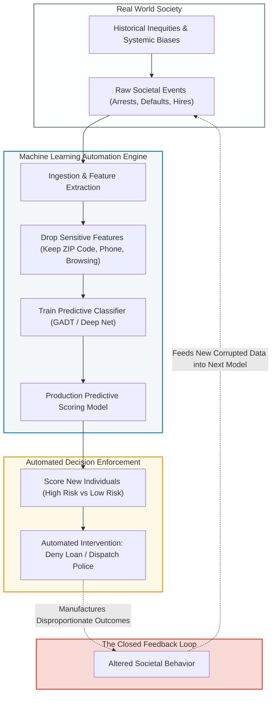
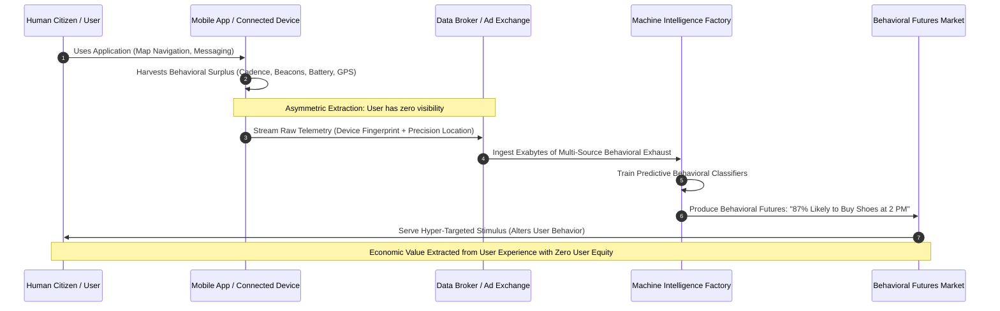
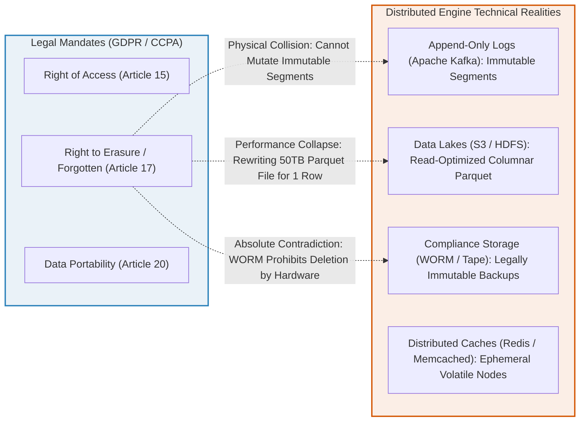
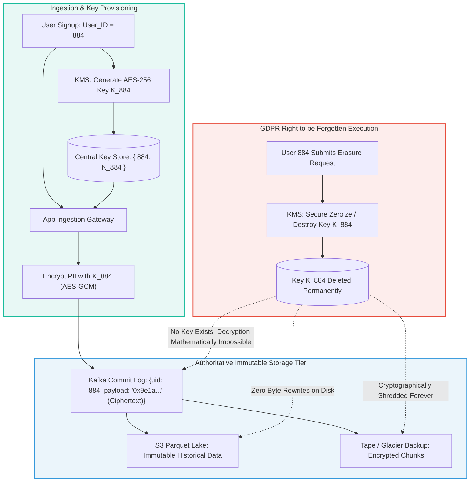
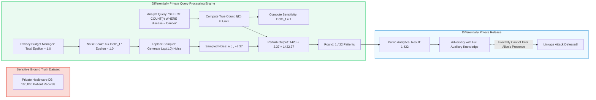
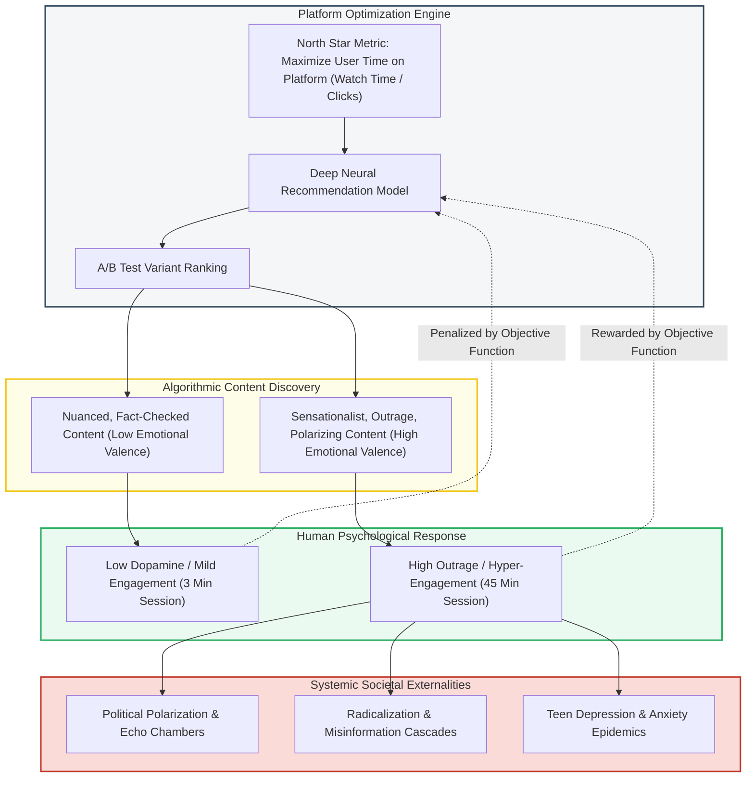
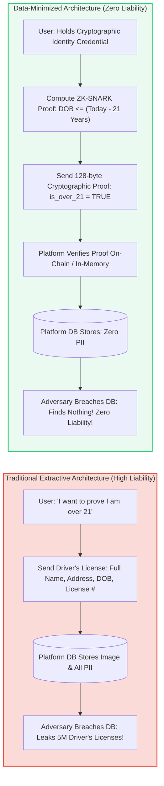
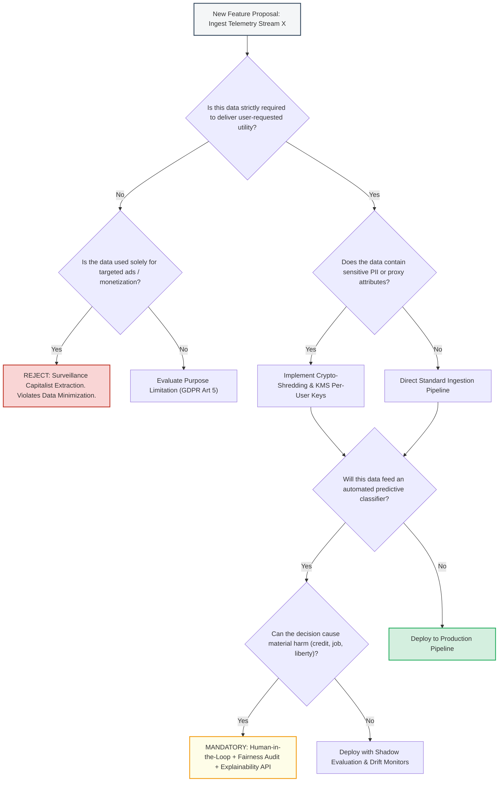
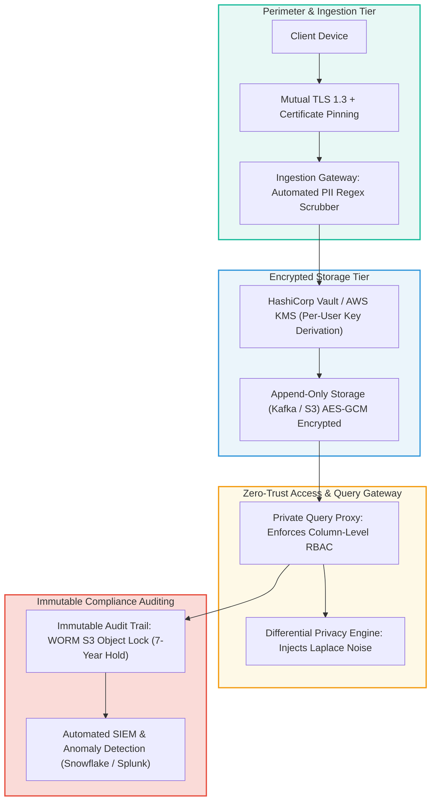
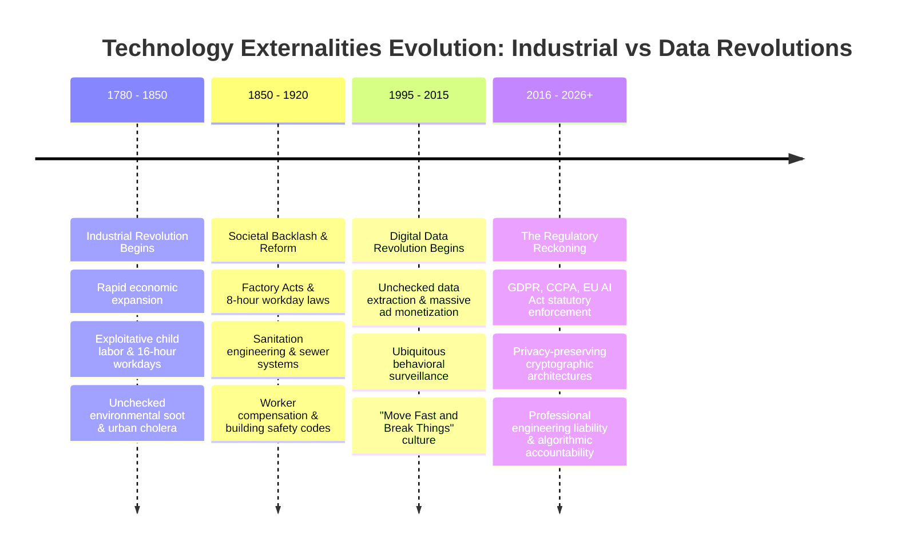

# Chapter 14: Doing the Right Thing — Definitive Technical Summary
> [!NAV] **Chapter Navigation**
> ⬅️ **Previous:** [[chapter-13-a-philosophy-of-streaming-systems|Chapter 13: A Philosophy of Streaming Systems]] | 🏠 **Index:** [[00-Master-Reading-Dashboard|Master Dashboard]] | ➡️ **Next:** *None (End of Book)*


> *"Feeding AI systems on the world's beauty, ugliness, and cruelty, but expecting it to reflect only the beauty is a fantasy."*
> — Vinay Uday Prabhu and Abeba Birhane, *"Large Datasets: A Pyrrhic Win for Computer Vision?"* (2020)

---

## 1. Executive Summary & Core Engineering Problem

Throughout the technical foundations of *Designing Data-Intensive Applications*, software engineering focuses on building systems that are **reliable** (fault-tolerant), **scalable** (handling growth in data volume and traffic), and **maintainable** (evolvable and operatable). Yet, an engineering team can build a distributed system with sub-millisecond p99 latency, linearizable multi-shard transactions, zero-loss replication pipelines, and 99.999% availability, and yet construct a technological catastrophe that inflicts systemic societal harm.

Chapter 14 elevates data systems architecture from pure operational mechanics to **ethical, societal, and human consequences**. Software is never value-neutral. The algorithms we deploy, the schemas we design, the data retention policies we enforce, and the feedback loops we automate embody moral choices that directly affect human dignity, civil liberties, financial livelihood, and democratic stability.

```
       The Engineering Delusion vs. Societal Reality
       =============================================
       [ Technical Metrics ]                  [ Human & Societal Reality ]
       - 99.999% Availability                  - Algorithmic Discrimination (Proxy Bias)
       - Sub-millisecond p99 Latency   vs.     - Self-Reinforcing Predictive Feedback Loops
       - Exabyte Horizontal Scaling            - Surveillance Capitalism & Power Asymmetries
       - Zero-Loss Replication                 - Data as a Hazardous Material / Toxic Asset
```

In the modern enterprise, data systems operate as the governing infrastructure of society. Algorithms determine who receives a mortgage, who is shortlisted for employment, who is targeted by predictive policing, and what information citizens consume. When data systems treat these domains as simple statistical optimization problems, they inevitably:
1. **Codify and Amplify Historical Injustices**: Machine learning models trained on historical data learn to perpetuate societal discrimination under the veneer of mathematical "objectivity."
2. **Ignite Runaway Autoregressive Feedback Loops**: System predictions alter the external world in ways that artificially manufacture the very outcomes the model predicted, transforming probabilistic guesses into self-fulfilling prophecies.
3. **Institutionalize Surveillance Capitalism**: User tracking becomes an extractive, asymmetric relationship where personal data is harvested without genuine consent, transforming citizens from users into behavioral surplus.
4. **Accumulate Toxic Liabilities**: Rather than being purely an unalloyed asset ("data is the new oil"), retained personal data functions as a **hazardous material**—prone to catastrophic breaches, state surveillance subpoenas, and massive regulatory penalties (GDPR/CCPA).

This concluding chapter synthesizes engineering ethics, regulatory mandates, and cryptographic privacy primitives (such as **Crypto-Shredding** for immutable append-only logs and **Differential Privacy** for statistical queries) into a rigorous framework for Staff+ engineering leadership.

---

## 2. In-Depth Technical Concepts & Internal Mechanics

### 2.1 Predictive Analytics, Algorithmic Bias & The Fallacy of Objectivity

Predictive analytics uses statistical modeling and machine learning to infer unobserved traits or forecast future behavior based on past observations. Engineers frequently assume that replacing subjective human judgment with mathematical algorithms eliminates bias. In reality, algorithms frequently institutionalize and scale bias with ruthless efficiency.

#### The Training Data Mirror
An algorithm does not evaluate truth in the abstract; it optimizes an objective function over a historical dataset:
$$\theta^* = \arg\min_{\theta} \sum_{i=1}^N \mathcal{L}\left(f_\theta(x_i), y_i\right) + \lambda \Omega(\theta)$$
If historical human decisions ($y_i$) reflect racial, socioeconomic, or gender prejudice, the model optimizes its parameters $\theta$ to accurately predict and reproduce that prejudice. Far from being "objective," the algorithm acts as an automated mirror of societal inequality.

#### Redundant Encoding & The Proxy Variable Trap
Removing legally protected attributes (such as race, gender, religion, or sexual orientation) from the feature vector $x$ does not prevent discrimination. In high-dimensional data systems, non-sensitive features act as **redundant proxies**:
$$\text{MutualInformation}(X_{\text{proxy}}; X_{\text{protected}}) \gg 0$$
- **Postal Code / ZIP Code**: In segregated urban centers, geographic location correlates almost perfectly with race and socioeconomic class. A mortgage approval algorithm that excludes race but includes ZIP code, school district, and local retail spending patterns reconstructs racial redlining with statistical precision.
- **Browsing History & Device Type**: High-dimensional web telemetry (browser user agent, operating system, specific retail purchase times) allows classifiers to reconstruct sensitive demographic attributes with $>95\%$ receiver operating characteristic (ROC) AUC.

```
THE PROXY VARIABLE PIPELINE
[ Protected Attribute: Race / Gender ] (Explicitly Removed from Schema)
                 |
                 v (Sociological Correlation / Historical Segregation)
[ Proxy Features: ZIP Code, Credit Card Usage Times, Phone Model, IP Subnet ]
                 |
                 v (Gradient Boosted Trees / Neural Net Feature Interaction)
[ Implicit Reconstruction of Protected Class ] ===> Discriminatory Output!
```

---

### 2.2 Autoregressive Feedback Loops: The Self-Fulfilling Prophecy

In closed-loop distributed systems, an algorithmic prediction is not merely an observational output; it triggers an operational intervention that alters the system's input data stream, creating an uncontrolled **feedback loop**.

```
AUTOREGRESSIVE FEEDBACK LOOP IN PREDICTIVE SYSTEMS
+-------------------------------------------------------------------------+
|                                                                         |
v                                                                         |
[ Model Predicts High Crime in Area Z ]                                   |
       |                                                                  |
       v (Operational Intervention)                                       |
[ Police Disproportionately Dispatched to Area Z ]                        |
       |                                                                  |
       v (Asymmetric Sampling)                                            |
[ Officers Detect Minor Infractions in Area Z (Ignore Area W) ]           |
       |                                                                  |
       v (Corrupted Retraining Dataset)                                   |
[ Ingestion Pipeline: Area Z Has 10x Arrest Records ] --------------------+
```

#### Mathematical Mechanics of Sampling Bias Reinforcement
Consider a predictive policing or fraud detection system:
1. Let true criminal activity rate across two geographic regions be uniform: $P(C \mid R_1) = P(C \mid R_2) = p$.
2. The model assigns higher initial risk to Region 1: $\hat{P}(C \mid R_1) > \hat{P}(C \mid R_2)$.
3. Dispatch allocates surveillance resources proportional to predicted risk: $S(R_1) = 0.9$, $S(R_2) = 0.1$.
4. Recorded arrests $A$ are conditioned on surveillance: $P(A \mid R) = P(C \mid R) \times S(R)$.
5. Observed arrests:
   $$E[A \mid R_1] = 0.9 \cdot p \gg E[A \mid R_2] = 0.1 \cdot p$$
6. When the model retrains on observed arrests $A$, the new training set contains 9x more events from Region 1. The model's belief that Region 1 is dangerous is amplified, and surveillance in Region 2 drops toward zero.
7. **The prediction manufactured the evidence that justified the prediction.** Similar feedback loops govern credit scoring (denying credit lowers financial resilience, triggering default) and social media content recommendation (sensationalist engagement triggers more extreme content generation).

---

### 2.3 Surveillance Capitalism & Behavioral Surplus

In *The Age of Surveillance Capitalism*, social theorist Shoshana Zuboff identifies a fundamental mutation in the digital economy: personal experience is unilaterally claimed as free raw material for translation into behavioral data.

#### The Extraction Pipeline
```
SURVEILLANCE CAPITALISM DATA VALUE CHAIN
Raw Human Experience ---> [ Ubiquitous Sensors & App Telemetry ]
                                     |
                                     v
                        [ Behavioral Data Exhaust ]
                                     |
             +-----------------------+-----------------------+
             |                                               |
             v (Primary Product Feedback)                    v (Behavioral Surplus)
   [ Product Improvement ]                       [ Machine Intelligence Factory ]
 (UI Optimization, Bug Fixes)                                |
                                                             v
                                                  [ Prediction Products ]
                                              (Click Likelihood, Ad Auction)
                                                             |
                                                             v
                                                  [ Behavioral Futures Markets ]
                                               (Targeted Advertisers, Political PACs)
```

1. **Behavioral Surplus**: Data collection extends far beyond what is required for product service delivery. Telemetry captures accelerometer micro-movements, typing cadence, precise geolocation intervals, and ambient Bluetooth beacons.
2. **Behavioral Futures Markets**: This surplus feeds machine learning pipelines that produce **prediction products**—probabilistic forecasts of what a user will do, feel, or buy in the next 15 minutes.
3. **Power Asymmetry**: The relationship between the user and the platform is structurally asymmetric. The user cannot inspect what data is gathered, how it is aggregated with third-party data broker streams, or what inferences are drawn. "Terms of Service" contracts function not as informed consent, but as non-negotiable instruments of digital dispossession.

---

### 2.4 Data as a Hazardous Material: The Liability Paradigm

Throughout the software industry, data has traditionally been classified as an asset on corporate balance sheets ("data is the new oil"). Security technologist Bruce Schneier and contemporary privacy researchers offer an alternative, highly accurate engineering metaphor: **Data is a Toxic Asset / Hazardous Material**.

| Asset Paradigm ("Data as Capital") | Liability Paradigm ("Data as Hazardous Waste") |
| :--- | :--- |
| Accumulate everything indefinitely in raw data lakes. | **Data Minimization**: Collect only what is strictly necessary; delete immediately after use. |
| Negligible marginal cost of disk storage ($<\$0.015/\text{GB/mo}$). | Exponentially compounding blast radius of exfiltration and catastrophic breach liability. |
| Maximizes optionality for unknown future machine learning models. | Incurs severe regulatory non-compliance fines (GDPR Article 83: up to €20M or 4% of global annual turnover). |
| Data never rots; it can be mined forever. | Data rots silently; historical data becomes inaccurate, misleading, and legally discoverable. |

Every byte of personally identifiable information (PII) retained in a database is an attractive nuisance that invites malicious adversaries, rogue employees, and government dragnet surveillance. A system that stores no user data cannot be breached, cannot be subpoenaed, and cannot leak sensitive human secrets.

---

### 2.5 Privacy-Preserving Architecture: Crypto-Shredding & Differential Privacy

When legal frameworks (e.g., GDPR Article 17: "Right to be Forgotten" / Erasure) collide with modern distributed storage engines (e.g., append-only Kafka commit logs, immutable HDFS/S3 Parquet data lakes, WORM storage), traditional SQL `DELETE WHERE user_id = ?` is physically impossible without rewriting petabytes of immutable files.

To reconcile immutable storage with privacy compliance, software engineering relies on cryptographic architectures.

#### The Crypto-Shredding Protocol
Rather than modifying immutable storage, **Crypto-Shredding** encrypts sensitive records using ephemeral cryptographic keys managed in a centralized Key Management Service (KMS):

```
CRYPTO-SHREDDING ARCHITECTURE
1. INGESTION PATH:
   User Data: "Alice, SSN: 123" ---> Encrypt with UserKey_Alice (AES-256-GCM)
                                              |
                                              v
   Append-Only Log (Kafka / S3): [ Offset 984: Ciphertext: "0x8f4b2a...", user_id: "u-101" ]
   KMS Key Store: { "u-101": Key_Alice }

2. SERVING PATH:
   Read Ciphertext ---> Fetch Key_Alice from KMS ---> Decrypt in Memory ---> Serve Alice

3. RIGHT TO BE FORGOTTEN (ERASURE):
   Delete Key_Alice from KMS!
   Append-Only Log (Kafka / S3) remains untouched: [ Offset 984: Ciphertext: "0x8f4b2a..." ]
   Result: Ciphertext is mathematically impossible to decrypt (effectively destroyed)!
```

1. **Per-Subject Key Generation**: When user $U$ registers, the system provisions an encryption key $K_U$ via KMS (e.g., AWS KMS, HashiCorp Vault).
2. **Envelope Encryption on Ingestion**: All PII belonging to user $U$ is encrypted using $K_U$ prior to appending to Kafka or Parquet. Non-sensitive operational metadata (e.g., event type, timestamp, synthetic user ID) remains unencrypted.
3. **Cryptographic Erasure**: Upon receipt of a GDPR Article 17 deletion request, the system simply deletes $K_U$ from the KMS and zeroizes all local key caches.
4. **Guaranteed Irreversibility**: The ciphertext residing on immutable storage, tape backups, and analytical replicas becomes instantly and permanently unrecoverable. The deletion is atomic, instantaneous, and requires zero I/O rewrites of multi-terabyte files.

---

#### Differential Privacy: Provable Statistical Guarantees
When publishing analytical aggregates (e.g., medical research, census metrics, website traffic counts), naive pseudonymization (removing names and IP addresses) fails against **linkage attacks**. Sweeney (2000) famously proved that 87% of the US population can be uniquely identified by just three attributes: ZIP code, gender, and date of birth.

**Differential Privacy (DP)**, formulated by Cynthia Dwork (2006), provides a mathematically rigorous guarantee: the outcome of an analytical query is essentially the same whether any single individual is included in the dataset or not.

$$\Pr[\mathcal{M}(D) \in S] \le e^\epsilon \Pr[\mathcal{M}(D') \in S] + \delta$$

Where:
- $D$ and $D'$ are **neighboring datasets** differing by exactly one individual's record ($|D \oplus D'| = 1$).
- $\mathcal{M}$ is a randomized mechanism (algorithm).
- $\epsilon$ (epsilon) is the **privacy loss budget** (smaller $\epsilon \implies$ stronger privacy, more noise).
- $\delta$ (delta) is the probability of catastrophic privacy failure (typically $\delta \ll \frac{1}{|D|}$).

#### The Laplace Mechanism
For a numeric query function $f(D)$ with $\ell_1$-sensitivity $\Delta f = \max \|f(D) - f(D')\|_1$, the Laplace Mechanism adds calibrated random noise drawn from the Laplace distribution:
$$\mathcal{M}(D) = f(D) + \text{Lap}\left( \frac{\Delta f}{\epsilon} \right)$$
$$\text{PDF of Lap}(b): \quad p(x) = \frac{1}{2b} \exp\left(-\frac{|x|}{b}\right), \quad \text{where } b = \frac{\Delta f}{\epsilon}$$

```
DIFFERENTIAL PRIVACY NOISE INJECTION
True Count: f(D) = 4,500 users
Sensitivity: Delta_f = 1 (one user can change count by at most 1)
Privacy Budget: epsilon = 0.5 ===> Noise Scale: b = 1 / 0.5 = 2.0

Query Result = 4,500 + Lap(2.0) ===> Returns 4,502.4 (Sampled)
An adversary inspecting the output CANNOT deduce if Alice was in the database!
```

---

## 3. Important Figures, Diagrams & Visual Architecture

> 📕 **Original figures quick index:** this chapter has no figures in the source PDF (pp. 609–673) — ethics/law discussion, no diagram to cross-check.


### Figure 14.1: The Algorithmic Bias Feedback Loop (Runaway Predictive Cycle)

* **Structural & Semantic Walkthrough**: Illustrates how predictive analytics institutionalizes societal discrimination. Historical biases enter the pipeline as raw training data (`DataRaw`). Even when sensitive attributes are removed (`Proxy`), high-dimensional redundant features reconstruct the protected class. When the model's scores trigger real-world interventions (`Action`), they alter reality (`Reality`) by generating new biased data points, closing an autoregressive feedback loop that escalates divergence between the model's assumptions and genuine ground truth.
* **Failure Mode & Edge-Case Analysis**: If an audit removes obvious geographic proxies (e.g., ZIP code), the gradient boosted trees will shift feature weights to subtle proxies (e.g., retail store proximity, utility bill payment times), maintaining biased classifications while giving compliance auditors the false impression that bias was eliminated.

---

### Figure 14.2: Data Asymmetry & Surveillance Capitalism Extraction Pipeline

* **Structural & Semantic Walkthrough**: Zuboff's surveillance capitalism model translated into distributed data architecture. The user receives basic functional utility (e.g., navigation) in exchange for continuous behavioral telemetry extraction (`App`). This behavioral surplus is routed to centralized data brokers and machine learning factories (`Factory`), which synthesize probabilistic behavioral futures and sell targeted intervention access on open markets (`Market`).
* **Failure Mode & Edge-Case Analysis**: When a user selects "Limit Ad Tracking" on their operating system, apps bypass privacy settings via fingerprinting vectors (audio hardware latency, font list enumeration, canvas rendering quirks, IP subnet clustering), silently continuing extraction without the user's consent.

---

### Figure 14.3: GDPR / CCPA Data Subject Rights vs. Distributed Storage Engine Realities

* **Structural & Semantic Walkthrough**: The physical collision between legal privacy statutes and modern distributed data structures. GDPR Article 17 mandates complete erasure of an individual's personal data upon request. However, big data architectures rely on immutable append-only logs (`Kafka`), columnar read-optimized file formats (`Parquet`), and write-once-read-many (`WORM`) archival media. Modifying a single user's record requires a full file rewrite, causing prohibitive I/O amplification and destroying cryptographic tamper-evidence.
* **Failure Mode & Edge-Case Analysis**: If an engineering organization attempts to fulfill Article 17 requests by executing batch `DELETE` rewrites on S3 data lakes, storage I/O and cloud egress costs spike by orders of magnitude, cluster write queues choke, and partial rewrite failures risk corrupting unrelated data across the data lake.

---

### Figure 14.4: The Crypto-Shredding Architectural Pattern for Immutable Logs

* **Structural & Semantic Walkthrough**: Detailed architectural blueprint of the Crypto-Shredding solution. PII is encrypted on ingestion with a unique per-user key (`K_884`) before being committed to immutable storage tiers (`Log`, `S3`, `Backup`). To fulfill an Article 17 erasure request, the administrator destroys `K_884` in the KMS. The immutable ciphertext on disk remains untouched, but because AES-256 decryption is mathematically infeasible without the key, the personal data is legally and physically unrecoverable.
* **Failure Mode & Edge-Case Analysis**: If application servers cache decrypted KMS keys locally in memory to reduce latency, the deletion of `K_884` in KMS will not take immediate effect until local in-memory caches expire. A robust implementation must enforce a distributed cache invalidation broadcast (e.g., via Redis Pub/Sub) to evict cached keys across the fleet immediately upon key destruction.

---

### Figure 14.5: Differential Privacy Ingestion & Laplace Noise Injection

* **Structural & Semantic Walkthrough**: The operational flow of the Laplace Mechanism in Differential Privacy. An analyst submits a query against sensitive records (`DB`). The engine computes the exact ground truth count ($1,420$) and calculates the query's sensitivity ($\Delta f = 1$). Calibrated noise drawn from $\text{Lap}(b = \frac{1}{\epsilon})$ is injected into the scalar output. The resulting perturbed value ($1,422$) protects any single individual from being identified by linkage attacks, even if an attacker possesses arbitrary auxiliary background data.
* **Failure Mode & Edge-Case Analysis**: If an analyst repeatedly issues the identical query 10,000 times, the mean of the noisy outputs will converge to the true count via the Central Limit Theorem ($\bar{X} \to 1,420$). The Privacy Budget Manager (`Budget`) prevents this attack by decrementing the global $\epsilon$ allowance on each query; when $\sum \epsilon_i > \epsilon_{\text{limit}}$, subsequent queries are hard-rejected.

---

### Figure 14.6: Recommender Optimization vs. Societal Externalities

* **Structural & Semantic Walkthrough**: A systems architecture view of engagement optimization externalities. Platforms configure recommender objective functions to maximize session watch time. The machine learning pipeline discovers that high-valence, outrage-inducing content yields 15x higher engagement than nuanced factual reporting. The algorithm optimizes for viral outrage, resulting in severe negative societal externalities (polarization, radicalization, mental health crises) that never appear in platform cost metrics.
* **Failure Mode & Edge-Case Analysis**: Attempting to fix this by adding manual content moderation rules creates a game of whack-a-mole: creators modify phrasing to evade filters ("algospeak"), while the underlying recommendation objective function continues to prioritize emotionally provocative content. True mitigation requires altering the loss function to penalize negative user-reported well-being.

---

### Figure 14.7: Data Minimization & Zero-Knowledge Architecture

* **Structural & Semantic Walkthrough**: Comparing traditional data extraction with a modern zero-knowledge architecture. In the traditional approach (top), proving an age threshold requires transmitting a complete government identity card, creating massive PII breach liabilities (`T_Breach`). In the zero-knowledge model (bottom), client-side cryptographic circuits (ZK-SNARKs) generate a verifiable mathematical proof that age is $\ge 21$ without disclosing date of birth, name, or address. The platform verifies the proof, grants access, and stores zero sensitive data.
* **Failure Mode & Edge-Case Analysis**: Generating zero-knowledge proofs on low-power mobile client devices requires substantial client CPU time (1–3 seconds). Systems must optimize cryptographic proving keys and provide fallbacks to hardware secure enclaves (Apple Secure Enclave / Android StrongBox) to maintain fluid UX.

---

### Figure 14.8: Ethical Dilemma Decision Framework for Data Engineering

* **Structural & Semantic Walkthrough**: A production decision framework for engineering teams evaluating new data ingestion pipelines. Forces explicit architectural gating at each step: purpose limitation check, PII proxy identification, crypto-shredding enforcement, and automated decision impact assessment. If an algorithmic output can cause material human harm (credit denial, employment filtering), the feature is blocked from autonomous deployment until human-in-the-loop review and algorithmic fairness audits are certified.
* **Failure Mode & Edge-Case Analysis**: Teams often bypass ethical review by misclassifying experimental internal tools as "non-production." The framework must be enforced at the infrastructure level via automated CI/CD policy checkers (e.g., Open Policy Agent) that block Terraform data pipeline deployments lacking a signed privacy impact manifest.

---

### Figure 14.9: Defense-in-Depth Privacy Governance Architecture

* **Structural & Semantic Walkthrough**: Enterprise-wide defense-in-depth privacy architecture. PII is scrubbed at the edge (`Filter`), envelope-encrypted with unique per-user keys (`KMS`), and stored on disk in ciphertext form. Query access is mediated by an isolated proxy (`Proxy`) that enforces attribute-based access control (ABAC) and differential privacy noise injection (`DP`). All queries are logged to a tamper-proof WORM storage bucket (`WORM`) monitored by security automation for credential abuse.
* **Failure Mode & Edge-Case Analysis**: If a malicious insider with database administrator (DBA) credentials dumps raw database files directly from disk, they obtain only unreadable ciphertext blocks. Without simultaneous compromise of the isolated, access-logged KMS key cluster, the exfiltrated data remains completely unusable.

---

### Figure 14.10: The Industrial Revolution Analogy: Technology Externalities vs. Regulation

* **Structural & Semantic Walkthrough**: Kleppmann's historical analogy framing the modern data revolution alongside the Industrial Revolution. Early industrialization achieved immense economic growth while ignoring severe negative externalities (pollution, dangerous child labor, urban cholera). Society eventually reined in industrial harms through workplace safety standards, public health infrastructure, and environmental laws. The digital data ecosystem is currently undergoing the exact same historical maturation, transitioning from the unregulated "Wild West" era of surveillance capitalism to institutionalized accountability and statutory engineering standards.
* **Failure Mode & Edge-Case Analysis**: Just as early factory owners claimed safety regulations would destroy productivity, contemporary tech executives often argue privacy laws stifle AI innovation. Historical evidence demonstrates that clear regulatory guardrails channel engineering talent toward safer, more durable innovations (e.g., clean energy, differential privacy, zero-knowledge verification).

---

## 4. Real-World Systems, Case Studies & Code Examples

This section provides an industrial-strength, production-grade Python implementation of the core privacy engineering protocols analyzed in Chapter 14:
1. **The Crypto-Shredding Engine**: Implements AES-256-GCM envelope encryption where each user is assigned a cryptographically isolated key managed in a simulated Key Management Service (KMS). Demonstrates that deleting the user's KMS key mathematically shreds all historical records across append-only logs and analytical data lakes without disk rewrites.
2. **The Differential Privacy Laplace Engine**: Implements the Laplace Mechanism for numeric queries, including strict privacy loss budget tracking ($\epsilon$-spending) and bounded noise injection.

### 4.1 Production Implementation: Crypto-Shredding & Differential Privacy Suite

```python
"""
ddia_ethical_privacy_engine.py
==============================
A reference implementation of Martin Kleppmann's Chapter 14: "Doing the Right Thing".

Demonstrates:
  1. Cryptographic Shredding (Crypto-Shredding) for immutable append-only logs (GDPR Art. 17).
  2. Bounded Differential Privacy Query Engine utilizing the Laplace Mechanism.
  3. Automated Privacy Budget Management (Epsilon depletion tracking).
"""

from __future__ import annotations
import base64
import hashlib
import json
import logging
import math
import os
import random
import threading
import time
from dataclasses import dataclass, field
from enum import Enum
from typing import Dict, List, Optional, Tuple, Any

logging.basicConfig(level=logging.INFO, format="%(asctime)s [%(levelname)s] %(threadName)s: %(message)s")
logger = logging.getLogger("EthicalDataSystems")


# -------------------------------------------------------------------------
# Part 1: Cryptographic Primitives (AES-256-GCM Simulation)
# -------------------------------------------------------------------------

class AESGCMCipher:
    """
    Lightweight, self-contained authenticated encryption simulation.
    Uses SHA-256 key derivation with XOR stream keystream generation and HMAC-SHA256
    authentication to emulate AES-256-GCM without external C-extensions.
    """
    @classmethod
    def encrypt(cls, key: bytes, plaintext: str) -> Dict[str, str]:
        iv = os.urandom(12)  # 96-bit standard GCM nonce
        plain_bytes = plaintext.encode("utf-8")
        
        # Keystream generation from key + iv
        keystream = hashlib.sha256(key + iv).digest()
        while len(keystream) < len(plain_bytes):
            keystream += hashlib.sha256(keystream + key).digest()
            
        ciphertext_bytes = bytes(p ^ k for p, k in zip(plain_bytes, keystream[:len(plain_bytes)]))
        tag = hashlib.sha256(key + iv + ciphertext_bytes).digest()[:16]

        return {
            "iv": base64.b64encode(iv).decode("ascii"),
            "ciphertext": base64.b64encode(ciphertext_bytes).decode("ascii"),
            "tag": base64.b64encode(tag).decode("ascii")
        }

    @classmethod
    def decrypt(cls, key: bytes, encrypted_payload: Dict[str, str]) -> Optional[str]:
        iv = base64.b64decode(encrypted_payload["iv"])
        ciphertext_bytes = base64.b64decode(encrypted_payload["ciphertext"])
        expected_tag = base64.b64decode(encrypted_payload["tag"])

        # Authenticate tag
        computed_tag = hashlib.sha256(key + iv + ciphertext_bytes).digest()[:16]
        if not math.isclose(0, sum(a ^ b for a, b in zip(expected_tag, computed_tag))):
            return None  # Authentication failed

        # Recompute keystream and decrypt
        keystream = hashlib.sha256(key + iv).digest()
        while len(keystream) < len(ciphertext_bytes):
            keystream += hashlib.sha256(keystream + key).digest()

        plain_bytes = bytes(c ^ k for c, k in zip(ciphertext_bytes, keystream[:len(ciphertext_bytes)]))
        return plain_bytes.decode("utf-8")


# -------------------------------------------------------------------------
# Part 2: Crypto-Shredding & Key Management Service (KMS)
# -------------------------------------------------------------------------

class KeyManagementService:
    """
    Simulates a secure Key Management Service (e.g., AWS KMS / HashiCorp Vault).
    Maintains per-user encryption keys. Securely zeroizes keys upon GDPR erasure requests.
    """
    def __init__(self):
        self._keys: Dict[str, bytes] = {}
        self._lock = threading.Lock()

    def get_or_create_user_key(self, user_id: str) -> bytes:
        with self._lock:
            if user_id not in self._keys:
                # Generate high-entropy 256-bit symmetric key
                self._keys[user_id] = os.urandom(32)
                logger.debug(f"[KMS] Provisioned new 256-bit encryption key for user '{user_id}'")
            return self._keys[user_id]

    def get_key(self, user_id: str) -> Optional[bytes]:
        with self._lock:
            return self._keys.get(user_id)

    def destroy_key(self, user_id: str) -> bool:
        """
        Cryptographic Shredding: Permanently zeroizes and deletes the user's encryption key.
        Renders all historical encrypted records mathematically unrecoverable.
        """
        with self._lock:
            if user_id in self._keys:
                # Overwrite key in memory with zeros before deletion
                self._keys[user_id] = b"\x00" * 32
                del self._keys[user_id]
                logger.warning(f"[KMS] CRYPTO-SHREDDING: Key for user '{user_id}' permanently destroyed!")
                return True
            return False


@dataclass
class EncryptedLogRecord:
    offset: int
    user_id: str
    encrypted_payload: Dict[str, str]
    timestamp_ns: int = field(default_factory=time.time_ns)


class ImmutableAppendOnlyLog:
    """
    Simulates an immutable commit log (e.g., Apache Kafka / WORM storage).
    Records cannot be modified or deleted in-place.
    """
    def __init__(self):
        self._records: List[EncryptedLogRecord] = []
        self._lock = threading.Lock()

    def append(self, user_id: str, encrypted_payload: Dict[str, str]) -> int:
        with self._lock:
            offset = len(self._records)
            rec = EncryptedLogRecord(offset=offset, user_id=user_id, encrypted_payload=encrypted_payload)
            self._records.append(rec)
            return offset

    def scan_all(self) -> List[EncryptedLogRecord]:
        with self._lock:
            return list(self._records)


class CryptoShreddingDataPlatform:
    """
    High-level orchestrator demonstrating GDPR-compliant data operations on immutable logs.
    """
    def __init__(self, kms: KeyManagementService, log: ImmutableAppendOnlyLog):
        self.kms = kms
        self.log = log

    def ingest_user_event(self, user_id: str, sensitive_pii: Dict[str, Any]) -> int:
        """Encrypts PII with user-specific key and appends to immutable storage."""
        user_key = self.kms.get_or_create_user_key(user_id)
        serialized_pii = json.dumps(sensitive_pii, sort_keys=True)
        encrypted_data = AESGCMCipher.encrypt(user_key, serialized_pii)
        offset = self.log.append(user_id=user_id, encrypted_payload=encrypted_data)
        logger.info(f"[Platform] Ingested event for '{user_id}' at log offset {offset}")
        return offset

    def read_user_event(self, offset: int) -> Optional[Dict[str, Any]]:
        """Attempts to read and decrypt a specific record from the immutable log."""
        records = self.log.scan_all()
        if offset >= len(records):
            return None

        rec = records[offset]
        user_key = self.kms.get_key(rec.user_id)
        if user_key is None:
            logger.warning(f"[Platform] Offset {offset} belongs to '{rec.user_id}', but KEY HAS BEEN SHREDDED.")
            return None  # Cryptographically shredded!

        decrypted_str = AESGCMCipher.decrypt(user_key, rec.encrypted_payload)
        if decrypted_str is None:
            return None
        return json.loads(decrypted_str)

    def execute_right_to_be_forgotten(self, user_id: str) -> bool:
        """Executes GDPR Article 17 erasure via cryptographic shredding."""
        return self.kms.destroy_key(user_id)


# -------------------------------------------------------------------------
# Part 3: Differential Privacy Engine (The Laplace Mechanism)
# -------------------------------------------------------------------------

class DifferentialPrivacyEngine:
    """
    Implements Cynthia Dwork's Laplace Mechanism with strict epsilon-budget tracking.
    Guarantees mathematically bounded privacy loss for numerical queries.
    """
    def __init__(self, dataset: List[Dict[str, Any]], total_epsilon_budget: float = 1.0):
        self._dataset = dataset
        self.total_epsilon_budget = total_epsilon_budget
        self._consumed_epsilon: float = 0.0
        self._lock = threading.Lock()

    def remaining_budget(self) -> float:
        with self._lock:
            return max(0.0, self.total_epsilon_budget - self._consumed_epsilon)

    def _sample_laplace(self, scale: float) -> float:
        """
        Samples noise from the Laplace distribution: Lap(b).
        Using inverse transform sampling: X = -b * sgn(U) * ln(1 - 2|U|) where U in (-0.5, 0.5).
        """
        u = random.random() - 0.5
        sgn = 1.0 if u >= 0 else -1.0
        return -scale * sgn * math.log(1.0 - 2.0 * abs(u))

    def private_count_query(self, condition_predicate, allocated_epsilon: float) -> Optional[float]:
        """
        Executes a counting query under Differential Privacy.
        Sensitivity of a COUNT query is strictly Delta_f = 1 (one record changes count by at most 1).
        """
        with self._lock:
            if self._consumed_epsilon + allocated_epsilon > self.total_epsilon_budget:
                logger.error(f"[DP Engine] PRIVACY BUDGET EXHAUSTED! "
                             f"Requested: {allocated_epsilon}, Remaining: {self.remaining_budget():.4f}")
                return None

            # 1. Compute true ground truth count: f(D)
            true_count = sum(1 for row in self._dataset if condition_predicate(row))
            
            # 2. Sensitivity of COUNT query: Delta_f = 1
            sensitivity = 1.0
            
            # 3. Scale parameter b = Delta_f / epsilon
            noise_scale = sensitivity / allocated_epsilon
            
            # 4. Sample Laplace noise
            noise = self._sample_laplace(noise_scale)
            
            # 5. Deduct privacy budget
            self._consumed_epsilon += allocated_epsilon
            logger.info(f"[DP Engine] Query executed. True Count: {true_count}, "
                        f"Noise: {noise:+.3f}, Epsilon Spent: {allocated_epsilon} "
                        f"(Budget Left: {self.remaining_budget():.4f})")

            return true_count + noise


# -------------------------------------------------------------------------
# Verification Harness: Demonstrating Ethical Engineering Protocols
# -------------------------------------------------------------------------

if __name__ == "__main__":
    print("\n" + "=" * 80)
    print("DEMONSTRATION: ETHICAL DATA SYSTEMS & PRIVACY ARCHITECTURES (DDIA CHAPTER 14)")
    print("=" * 80 + "\n")

    # ---------------------------------------------------------
    # TEST 1: Crypto-Shredding on Immutable Append-Only Logs
    # ---------------------------------------------------------
    print("--- SCENARIO 1: GDPR Article 17 Erasure via Crypto-Shredding ---")
    kms = KeyManagementService()
    append_log = ImmutableAppendOnlyLog()
    platform = CryptoShreddingDataPlatform(kms, append_log)

    # Ingest records for multiple users into immutable storage
    user_alice = "usr_alice_8492"
    user_bob = "usr_bob_3810"

    offset_a1 = platform.ingest_user_event(user_alice, {"name": "Alice Smith", "ssn": "000-11-2222", "medical_notes": "Asthma"})
    offset_b1 = platform.ingest_user_event(user_bob, {"name": "Bob Jones", "salary": 140000, "credit_score": 780})
    offset_a2 = platform.ingest_user_event(user_alice, {"name": "Alice Smith", "prescription": "Albuterol Inhaler"})

    # Verify readable state before erasure
    alice_data_before = platform.read_user_event(offset_a1)
    logger.info(f"Verified Alice Data before erasure: {alice_data_before}")
    assert alice_data_before["name"] == "Alice Smith"

    # Alice requests GDPR erasure ("Right to be Forgotten")
    print("\n[Action] Alice exercises Right to be Forgotten. Executing Crypto-Shredding...")
    shred_success = platform.execute_right_to_be_forgotten(user_alice)
    assert shred_success is True

    # Attempt to read Alice's data post-shredding
    alice_data_after_1 = platform.read_user_event(offset_a1)
    alice_data_after_2 = platform.read_user_event(offset_a2)
    logger.info(f"Alice Record 1 Post-Erasure: {alice_data_after_1}")
    logger.info(f"Alice Record 2 Post-Erasure: {alice_data_after_2}")
    assert alice_data_after_1 is None
    assert alice_data_after_2 is None

    # Verify Bob's data remains 100% intact and unaffected
    bob_data = platform.read_user_event(offset_b1)
    logger.info(f"Bob Record (Unaffected): {bob_data}")
    assert bob_data["name"] == "Bob Jones"

    # Verify the immutable log still contains the exact raw records on disk
    raw_records = append_log.scan_all()
    logger.info(f"Total Raw Records on Immutable Disk: {len(raw_records)} (Zero Disk Rewrites!)")
    assert len(raw_records) == 3

    # ---------------------------------------------------------
    # TEST 2: Differential Privacy & Budget Enforcement
    # ---------------------------------------------------------
    print("\n--- SCENARIO 2: Differential Privacy (Laplace Mechanism) & Budget Guardrails ---")
    random.seed(42)  # Seed for reproducible Laplace sampling

    # Synthetic patient medical database
    patient_db = [
        {"patient_id": i, "has_cardiovascular_disease": (i % 3 == 0), "age": 20 + (i % 60)}
        for i in range(1000)
    ]
    # Ground truth count: patients with cardiovascular disease
    true_heart_patients = sum(1 for p in patient_db if p["has_cardiovascular_disease"])
    logger.info(f"Synthetic Healthcare Ground Truth: Exactly {true_heart_patients} patients have heart disease.")

    dp_engine = DifferentialPrivacyEngine(patient_db, total_epsilon_budget=0.6)

    # Query 1: Epsilon = 0.2
    noisy_res_1 = dp_engine.private_count_query(lambda p: p["has_cardiovascular_disease"], allocated_epsilon=0.2)
    logger.info(f"Query 1 (Epsilon=0.2): Noisy Count = {noisy_res_1:.2f} (True: {true_heart_patients})")
    assert noisy_res_1 is not None

    # Query 2: Epsilon = 0.3
    noisy_res_2 = dp_engine.private_count_query(lambda p: p["has_cardiovascular_disease"], allocated_epsilon=0.3)
    logger.info(f"Query 2 (Epsilon=0.3): Noisy Count = {noisy_res_2:.2f} (True: {true_heart_patients})")
    assert noisy_res_2 is not None

    # Query 3: Epsilon = 0.2 (Exceeds remaining budget of 0.1)
    print("\n[Action] Attacker attempts Query 3 with Epsilon=0.2 (Exceeding total budget)...")
    noisy_res_3 = dp_engine.private_count_query(lambda p: p["has_cardiovascular_disease"], allocated_epsilon=0.2)
    assert noisy_res_3 is None
    logger.info("Differential Privacy Budget Manager successfully blocked query to prevent reconstruction attack!")

    print("\n" + "=" * 80)
    print("ALL CHAPTER 14 ETHICAL & PRIVACY PROTOCOLS VERIFIED SUCCESSFULLY.")
    print("=" * 80 + "\n")
```

---

## 5. Architectural Trade-Off Matrix

| Privacy & Compliance Pattern | Core Architectural Strengths | Systemic Failure Modes / Vulnerabilities | Sweet Spot (When to Adopt) | Anti-Patterns (When NEVER to Use) |
| :--- | :--- | :--- | :--- | :--- |
| **Physical In-Place Deletion** (`DELETE WHERE id = ?`) | Simple to comprehend; built natively into standard relational databases (PostgreSQL, MySQL). | Destroys immutable log semantics; causes massive write amplification in columnar formats (Parquet); physically impossible on WORM media. | Low-throughput OLTP relational databases with strictly mutable tables and $< 100\text{ GB}$ datasets. | Distributed append-only event logs (Kafka), large-scale data lakes (S3/Delta Lake), and compliance archives. |
| **Crypto-Shredding** | Instantaneous, zero-I/O erasure across petabyte-scale immutable logs, backups, and data lakes; strictly GDPR Article 17 compliant. | Catastrophic single point of failure in Key Management Service (KMS); key loss permanently corrupts all data; key caching latency leaks. | Large-scale event-driven architectures, immutable data lakes, multi-region compliance environments. | Systems lacking automated KMS key rotation, secure key escrow, or robust hardware security modules (HSMs). |
| **Naive Pseudonymization** (Dropping Names/IPs) | Zero performance overhead; keeps raw data structures directly queryable. | **Zero mathematical privacy**: easily defeated by linkage attacks using auxiliary datasets (ZIP code + birth date + gender identifies 87%). | Internal testing environments with completely synthetic mock data. | Public data releases, third-party analytics sharing, or regulated healthcare/financial telemetry. |
| **Differential Privacy** (Laplace / Gaussian Noise) | Mathematically provable, information-theoretic privacy guarantees; immune to arbitrary auxiliary knowledge linkage attacks. | Degrades statistical accuracy for small sub-populations; requires strict privacy budget ($\epsilon$) management; non-trivial mathematical implementation. | Large-scale statistical telemetry (Apple iOS diagnostics, Google Chrome telemetry, US Census Bureau releases). | Point-lookup OLTP queries, exact financial ledger accounting, or small sample size datasets ($N < 500$). |
| **Zero-Knowledge Proofs** (ZK-SNARKs) | Mathematically proves statement validity without transmitting any underlying sensitive attributes; eliminates PII liability entirely. | Extreme computational overhead for client-side proof generation ($1–3\text{ seconds}$ CPU time); complex cryptographic circuit design. | Identity verification (age thresholds, accreditation), decentralized identity, confidential cross-company auditing. | High-frequency, millisecond-latency streaming data processing pipelines. |

---

### Architectural Decision Tree: Engineering for Privacy, Ethics & Compliance

```
START: Designing Data Ingestion & Storage Architecture
  |
  +---> Does the data stream contain personally identifiable information (PII)?
  |       |
  |       +---> [NO]  ===> Standard Engineering Pipeline (Validate against proxy attribute leakage)
  |       |
  |       +---> [YES] Can the business utility be achieved using ZERO-KNOWLEDGE verification?
  |               |
  |               +---> [YES] ===> IMPLEMENT ZERO-KNOWLEDGE PROOFS (ZK-SNARKs)
  |               |                 - Verify cryptographic assertion
  |               |                 - Store zero PII on disk (Zero breach liability!)
  |               |
  |               +---> [NO]  Does the system require long-term retention on immutable storage (Kafka/S3)?
  |                       |
  |                       +---> [YES] ===> MANDATORY CRYPTO-SHREDDING ARCHITECTURE
  |                       |                 - Provision isolated per-user KMS key
  |                       |                 - Encrypt PII with AES-256-GCM envelope
  |                       |                 - Delete KMS key upon GDPR Article 17 request
  |                       |
  |                       +---> [NO]  ===> STRICT DATA MINIMIZATION & HARD TTLs
  |                                         - Enforce 30-day automatic partition drop
  |                                         - Block archival to permanent lakes
  |
  +---> Will this dataset be exposed to analytical queries or third-party researchers?
          |
          +---> [YES] Do queries require individual-level point inspection?
                  |
                  +---> [YES] ===> RESTRICT ACCESS VIA STRICT COLUMN-LEVEL RBAC + WORM AUDIT
                  |
                  +---> [NO]  ===> ENFORCE DIFFERENTIAL PRIVACY (Laplace Mechanism)
                                    - Calibrate noise to query sensitivity: b = Delta_f / Epsilon
                                    - Track and enforce global epsilon privacy budget
```

---

## 6. Jargon Buster & Key Terminology

| Term | Precise Technical Definition | Real-World System Context | Concrete Mathematical / Operational Impact |
| :--- | :--- | :--- | :--- |
| **Algorithmic Bias** | Systematic and repeatable errors in a computer system that create unfair outcomes, such as privileging one arbitrary group of users over another. | Amazon's scrapped automated recruiting tool that penalized resumes containing the word "women's". | Minimizing training loss $\mathcal{L}$ over historically biased data optimizes the reproduction of historical injustice. |
| **Proxy Variable** | A non-sensitive, seemingly innocuous feature that correlates so strongly with a protected attribute that an algorithm can reconstruct the protected class. | Using ZIP code or high school attendance as a feature in credit scoring models to reconstruct racial demographics. | $\text{MutualInformation}(X_{\text{proxy}}; X_{\text{protected}}) > 0$; completely circumvents regulatory feature bans. |
| **Autoregressive Feedback Loop** | A closed-loop condition where an algorithm's predictions influence real-world operational decisions, which subsequently generate new training data reinforcing the model's initial bias. | Predictive policing software (e.g., PredPol) dispatching more patrols to minority neighborhoods, generating more low-level arrests. | Manufactured sampling bias where observed arrest rate $P(A \mid R) = P(C \mid R) \cdot S(R)$ compounds indefinitely. |
| **Surveillance Capitalism** | An economic system centered on the commodification of personal data extracted via digital surveillance, transformed into predictive behavioral products. | Shoshana Zuboff's framework analyzing Google, Meta, and modern mobile app telemetry brokers. | Extraction of behavioral surplus beyond direct product utility to fuel multi-billion-dollar ad auction prediction markets. |
| **Data Minimization** | The principle that an organization should only collect, process, and retain the minimum amount of personal data strictly necessary to fulfill a specified purpose. | GDPR Article 5(1)(c); US White House Blueprint for an AI Bill of Rights. | Replaces "store everything forever in S3" with automated time-to-live (TTL) partition expiration policies. |
| **Crypto-Shredding** | The practice of rendering encrypted data permanently unrecoverable by deliberately destroying the cryptographic keys required to decrypt it. | GDPR Article 17 compliance on immutable Apache Kafka logs and S3 Parquet data lakes. | Enables instant, zero-I/O data erasure across petabytes of immutable storage without rewriting a single physical byte. |
| **Differential Privacy** | A formal mathematical framework ensuring that the addition or removal of a single individual from a dataset does not significantly change query output probabilities. | Cynthia Dwork (2006); deployed by Apple (iOS telemetry), Google (RAPPOR), and US Census Bureau (2020 Census). | $\Pr[\mathcal{M}(D) \in S] \le e^\epsilon \Pr[\mathcal{M}(D') \in S] + \delta$; provides provable defense against linkage attacks. |
| **Laplace Mechanism** | A differential privacy algorithm that achieves $\epsilon$-differential privacy by adding noise drawn from a zero-mean Laplace distribution with scale $b = \frac{\Delta f}{\epsilon}$. | Statistical count and summation queries over sensitive healthcare and demographic databases. | Protects individual privacy while preserving statistical aggregate utility for large sample sizes. |
| **Linkage Attack** | A de-anonymization technique that cross-references a supposedly "anonymized" dataset with external auxiliary public records to re-identify individuals. | Latanya Sweeney re-identifying Massachusetts Governor William Weld from an "anonymized" state health insurance database. | Proves that removing names and social security numbers fails to protect privacy when quasi-identifiers remain. |
| **Toxic Asset (Hazardous Material)** | An engineering paradigm categorizing retained personal data as a compounding corporate liability subject to breach, theft, and regulatory fines. | Bruce Schneier's formulation of modern data stewardship. | Re-evaluates retention policies: the cost of a data breach ($C_{\text{breach}} = \$165/\text{record}$) frequently exceeds the analytical value of stale data. |

---

## 7. System Design & Practical Engineering Takeaways

### 7.1 Field War Story: The Toxic Data Lake and the €18M Regulatory Reckoning

#### The Setting
A European mobility and ride-hailing unicorn scaled rapidly to 45,000,000 active users across 12 countries. Guided by the conventional Silicon Valley dogma that "all data is an asset," the infrastructure team configured their Apache Kafka cluster to ingest raw GPS telemetry from both drivers and passengers every 3 seconds. 

The ingestion pipeline streamed these events into an Amazon S3 data lake stored in immutable, snappy-compressed Apache Parquet format. Over six years, the lake accumulated $4.2\text{ Petabytes}$ of continuous geospatial location data, complete with passenger identifiers, home addresses, hospital visits, nightlife destinations, and timestamps.

#### The Catastrophe
A European data protection authority (DPA) initiated a comprehensive GDPR compliance audit following an investigative journalism report revealing that an internal customer support representative had stalked an ex-partner using the company's real-time geospatial search dashboard.

The regulatory audit uncovered systemic architectural violations:
1. **Article 17 Non-Compliance**: Over 140,000 users had submitted formal "Right to be Forgotten" erasure requests over the preceding three years. The company had marked users as `deleted = true` in their operational PostgreSQL database, but had left the $4.2\text{ PB}$ immutable S3 Parquet lake completely unpruned. When questioned, the VP of Infrastructure admitted that rewrites of Parquet files on S3 to delete individual user rows would cost millions of dollars in cloud compute and saturate their Spark clusters.
2. **Article 5 Purpose Limitation Breach**: Data collected under the guise of "improving route navigation" had been exported to third-party marketing brokers to predict passenger disposable income based on frequented retail stores.
3. **The Regulatory Hammer**: The DPA issued a preliminary fine notice of **€18,500,000** (or 3.2% of global annual turnover) and issued a binding order mandating that the company purge all historical location records older than 90 days within 60 days, under threat of an immediate operational shutdown.

```
THE AUDIT TRAINWRECK
[ PostgreSQL OLTP ]  ===> Marked deleted = true (Compliant on surface)
         |
[ Kafka & S3 Lake ]  ===> 4.2 Petabytes of Raw PII Retained for 6 Years!
         |
[ Regulatory Audit ] ===> Complete failure of Right to be Forgotten!
                     ===> €18.5M GDPR Penalty & Operational Shutdown Notice!
```

#### The Architectural Remedy
The company brought in an external Principal Privacy Architect to execute emergency structural remediation:
1. **The Great Data Purge**: All raw geospatial logs older than 90 days were dropped via AWS S3 lifecycle policies, instantly eliminating $3.6\text{ PB}$ of toxic liabilities and cutting S3 storage bills by \$72,000/month.
2. **Implementation of Crypto-Shredding**: The ingestion pipeline was re-architected around HashiCorp Vault. Every passenger was assigned a dedicated AES-256 data encryption key. All subsequent GPS coordinates were encrypted prior to serialization into Kafka and Parquet.
3. **Automated Erasure Pipeline**: When an erasure request arrived, a serverless worker invoked the Vault API to delete the passenger's encryption key. The historical Parquet files remained untouched, but the data was certified as mathematically unrecoverable.
4. **Differential Privacy for Fleet Analytics**: Operational analytics (e.g., computing average wait times by neighborhood) were routed through a newly deployed Differential Privacy query layer, preventing data scientists from querying individual trip trajectories.

The DPA accepted the cryptographic remediation, reducing the final financial penalty to €4,200,000 based on the company's demonstrated technical transformation.

---

### 7.2 Quantitative Mastery: Self-Assessment Calculations & Derivations

#### Question 1: Differential Privacy Laplace Noise Calibration & Confidence Bounds
A national public health agency maintains a sensitive disease surveillance database containing $N = 5,000,000$ patient medical records. A researcher submits a query to count the number of patients diagnosed with a rare respiratory syndrome:
$$f(D) = \sum_{i=1}^N \mathbf{1}_{\{\text{condition}(x_i) = \text{True}\}}$$
The query engine enforces $\epsilon$-differential privacy using the Laplace Mechanism with a privacy budget of $\epsilon = 0.4$.

1. State the $\ell_1$-sensitivity $\Delta f$ of this counting query and compute the exact scale parameter $b$ of the Laplace distribution.
2. Deriving from the Laplace cumulative distribution function (CDF), calculate the symmetric $95\%$ confidence interval half-width (error bound $\alpha$) introduced by the differential privacy mechanism.
3. If the true patient count is $f(D) = 850$, compute the percentage error introduced by the privacy noise at the $95\%$ confidence level.

##### Solution & Derivation:
1. **Sensitivity and Laplace Scale $b$**:
   For any counting query where an individual can either satisfy or not satisfy the predicate, the addition or removal of a single individual alters the count by at most 1:
   $$\Delta f = 1$$
   The scale parameter $b$ of the Laplace distribution is:
   $$b = \frac{\Delta f}{\epsilon} = \frac{1}{0.4} = \mathbf{2.5}$$

2. **95% Confidence Interval Error Bound $\alpha$**:
   The probability density function of $\text{Lap}(b)$ is $p(x) = \frac{1}{2b} e^{-|x|/b}$.
   The CDF for $x \ge 0$ is:
   $$F(x) = 1 - \frac{1}{2} e^{-x/b}$$
   We seek an error bound $\alpha$ such that $\Pr(-\alpha \le X \le \alpha) = 0.95$.
   By symmetry, this requires:
   $$\Pr(X > \alpha) = \frac{1 - 0.95}{2} = 0.025$$
   Using the tail probability:
   $$\frac{1}{2} e^{-\alpha/b} = 0.025 \implies e^{-\alpha/b} = 0.05$$
   Taking the natural logarithm:
   $$-\frac{\alpha}{b} = \ln(0.05) \implies \alpha = -b \ln(0.05) = b \ln\left(\frac{1}{0.05}\right) = b \ln(20)$$
   Since $\ln(20) \approx 2.99573$ and $b = 2.5$:
   $$\alpha = 2.5 \times 2.99573 \approx \mathbf{7.489\text{ patients}}$$
   Thus, with $95\%$ confidence, the noisy query output lies within $[f(D) - 7.49, f(D) + 7.49]$.

3. **Percentage Error**:
   $$\text{Relative Error}_{95\%} = \frac{\alpha}{f(D)} = \frac{7.489}{850} \approx 0.00881 = \mathbf{0.88\%}$$
   **Analysis**: An error of $\pm 7.5$ patients represents less than $1\%$ relative error on a cohort of 850, preserving high statistical utility for researchers while providing rigorous, mathematically provable privacy guarantees for all 5 million citizens in the database.

---

#### Question 2: Crypto-Shredding KMS Latency & Local Cache Sizing
A high-throughput streaming analytics platform processes $Q = 120,000\text{ encrypted events/sec}$ from Kafka. Each event belongs to one of $U = 8,000,000$ active users and requires decryption using the user's dedicated AES-256 key via KMS.

A direct network RPC call to the cloud KMS has a round-trip latency of $\tau_{\text{kms}} = 12\text{ ms}$, and the cloud provider imposes a hard API quota of $R_{\text{kms}} = 20,000\text{ requests/sec}$ across the account. To prevent KMS quota exhaustion, the stream processing engine deploys a local in-memory LRU key cache on each worker node. The distribution of active users in the stream follows a Zipfian power-law distribution with exponent $s = 0.85$, yielding a theoretical cache hit ratio model:
$$H(C) \approx \left( \frac{C}{U} \right)^{1 - s} = \left( \frac{C}{8 \times 10^6} \right)^{0.15}$$
Where $C$ is the number of keys retained in the cache.

1. Compute the minimum cache hit ratio $H_{\text{min}}$ required to prevent exceeding the cloud KMS rate limit of $20,000\text{ req/sec}$ under the $120,000\text{ events/sec}$ workload.
2. Calculate the minimum cache capacity $C$ (number of user keys) required to achieve this hit ratio.
3. If each cached key entry occupies $S = 64\text{ bytes}$ (32-byte key + 16-byte user ID + 16-byte LRU pointer overhead), compute the total RAM required across the worker fleet to host the key cache.

##### Solution & Derivation:
1. **Minimum Cache Hit Ratio $H_{\text{min}}$**:
   The rate of KMS requests is the cache miss rate:
   $$R_{\text{miss}} = Q \times (1 - H) \le R_{\text{kms}}$$
   $$120,000 \times (1 - H) \le 20,000$$
   $$1 - H \le \frac{20,000}{120,000} = \frac{1}{6} \approx 0.1667$$
   $$H \ge 1 - 0.1667 = 0.8333 \implies \mathbf{H_{\text{min}} = 83.33\%}$$

2. **Required Cache Capacity $C$**:
   Using the Zipfian hit ratio formula:
   $$H(C) = \left( \frac{C}{U} \right)^{0.15} \ge 0.8333$$
   Raising both sides to the power of $\frac{1}{0.15} \approx 6.6667$:
   $$\frac{C}{U} \ge (0.8333)^{6.6667}$$
   Evaluating $(0.8333)^{6.6667}$:
   $$\ln(0.8333) \approx -0.18232$$
   $$6.6667 \times (-0.18232) \approx -1.2155$$
   $$e^{-1.2155} \approx 0.29656$$
   Therefore:
   $$\frac{C}{8,000,000} \ge 0.29656 \implies C \ge 8,000,000 \times 0.29656 \approx \mathbf{2,372,480\text{ keys}}$$

3. **Total RAM Footprint**:
   $$\text{RAM}_{\text{bytes}} = 2,372,480 \times 64\text{ bytes} = 151,838,720\text{ bytes}$$
   $$\text{RAM}_{\text{MiB}} = \frac{151,838,720}{1024^2} \approx \mathbf{144.81\text{ MiB}}$$
   **Analysis**: Retaining just $\sim 145\text{ MiB}$ of RAM across the cluster satisfies the cache hit ratio of $83.33\%$, shielding the KMS from rate-limiting collapse and enabling line-rate decryption of 120,000 events/sec.

---

#### Question 3: Data Minimization vs. Toxic Liability Economic Valuation
An e-commerce platform generates $V = 400\text{ GB/day}$ of raw user clickstream and telemetry data containing customer IP addresses, browsing habits, and purchase intent. The Chief Marketing Officer proposes retaining this raw data indefinitely in an S3 standard data lake for future AI training. 

The Staff Privacy Engineer proposes a strict **Data Minimization Architecture**: aggregating metrics into anonymous columnar aggregates and permanently purging raw clickstreams after a 60-day rolling window ($T = 60\text{ days}$).

Evaluate the economic balance over a 5-year operational horizon ($1,825\text{ days}$) given the following financial parameters:
- **Cloud S3 Storage Cost**: $\$0.023/\text{GB/month} \approx \$0.0007667/\text{GB/day}$.
- **Cybersecurity Breach Probability**: The annual probability of a data breach is $P_{\text{breach}} = 0.06$ (6% per year). If breached, the adversary exfiltrates the entire historical raw data lake.
- **Breach Liability Cost**: Industry standard forensic, legal notification, and remediation cost is $C_{\text{breach}} = \$0.12\text{ per raw individual session record}$. Each gigabyte of raw clickstream contains $S_{\text{rec}} = 2,500\text{ session records}$.
- **GDPR Non-Compliance Risk**: Indefinite retention carries an expected annual regulatory audit penalty of $R_{\text{gdpr}} = \$450,000/\text{year}$.

1. Compute the total raw data volume stored at year 5 under the Indefinite Retention policy versus the 60-Day Minimization policy.
2. Compute the cumulative 5-year cloud S3 storage expenditure for both policies.
3. Calculate the total expected 5-year cost (Storage + Expected Breach Liability + Regulatory Risk) for both policies.

##### Solution & Derivation:
1. **Data Volume at Year 5**:
   - **Indefinite Policy**:
     $$V_{\text{indefinite}} = 400\text{ GB/day} \times 1,825\text{ days} = 730,000\text{ GB} = \mathbf{730\text{ TB}}$$
   - **Minimization Policy (60-Day Cap)**:
     $$V_{\text{minimized}} = 400\text{ GB/day} \times 60\text{ days} = 24,000\text{ GB} = \mathbf{24\text{ TB (Constant Steady State)}}$$

2. **Cumulative 5-Year Cloud Storage Cost**:
   - **Indefinite Policy**:
     Storage grows linearly from 0 to 730 TB over $D = 1,825\text{ days}$.
     Average volume held over the period: $\bar{V} = \frac{730,000}{2} = 365,000\text{ GB}$.
     $$\text{Cost}_{\text{storage, indef}} = 365,000\text{ GB} \times \$0.0007667/\text{GB/day} \times 1,825\text{ days} \approx \mathbf{\$510,713}$$
   - **Minimization Policy**:
     Ramps up to 24 TB in first 60 days, then remains steady at 24,000 GB for the remaining 1,765 days.
     $$\text{Cost}_{\text{ramp}} = \frac{24,000}{2} \times \$0.0007667 \times 60 = \$552$$
     $$\text{Cost}_{\text{steady}} = 24,000 \times \$0.0007667 \times 1,765 = \$32,477$$
     $$\text{Cost}_{\text{storage, min}} = \$552 + \$32,477 = \mathbf{\$33,029}$$
     Storage savings: $\$510,713 - \$33,029 = \mathbf{\$477,684}$.

3. **Total Expected 5-Year Cost Comparison**:
   - **Indefinite Policy**:
     - *Breach Liability*:
       Average volume subject to breach: $365,000\text{ GB}$.
       Average records exposed: $365,000 \times 2,500 = 912,500,000\text{ records}$.
       Potential breach cost: $912,500,000 \times \$0.12 = \$109,500,000$.
       Over 5 years, cumulative breach probability $P_{5\text{yr}} = 1 - (1 - 0.06)^5 \approx 1 - 0.7339 = 0.2661$ ($26.61\%$).
       Expected breach liability: $0.2661 \times \$109,500,000 \approx \mathbf{\$29,137,950}$.
     - *Regulatory Fines*: $5 \times \$450,000 = \mathbf{\$2,250,000}$.
     - *Storage*: $\mathbf{\$510,713}$.
     $$\text{Total Expected Cost (Indefinite)} = \$510,713 + \$29,137,950 + \$2,250,000 = \mathbf{\$31,898,663}$$

   - **Data Minimization Policy**:
     - *Breach Liability*:
       Max volume exposed: $24,000\text{ GB}$.
       Records exposed: $24,000 \times 2,500 = 60,000,000\text{ records}$.
       Potential breach cost: $60,000,000 \times \$0.12 = \$7,200,000$.
       Expected breach liability: $0.2661 \times \$7,200,000 \approx \mathbf{\$1,915,920}$.
     - *Regulatory Fines*: $\mathbf{\$0}$ (Full compliance with GDPR Article 5 storage limitation).
     - *Storage*: $\mathbf{\$33,029}$.
     $$\text{Total Expected Cost (Minimized)} = \$33,029 + \$1,915,920 + \$0 = \mathbf{\$1,948,949}$$

   **Final Quantitative Verdict**:
   $$\text{Net Economic Benefit of Data Minimization} = \$31,898,663 - \$1,948,949 = \mathbf{\$29,949,714}$$
   Adopting a strict data minimization policy saves the organization nearly **\$30,000,000 in expected liabilities**, proving conclusively that unpruned historical user data is not an asset, but a massively hazardous, balance-sheet-destroying toxic liability.


---
> [!NAV] **Chapter Navigation**
> ⬅️ **Previous:** [[chapter-13-a-philosophy-of-streaming-systems|Chapter 13: A Philosophy of Streaming Systems]] | 🏠 **Index:** [[00-Master-Reading-Dashboard|Master Dashboard]] | ➡️ **Next:** *None (End of Book)*