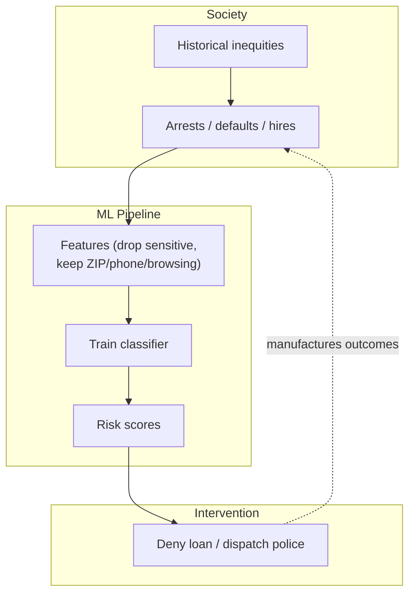
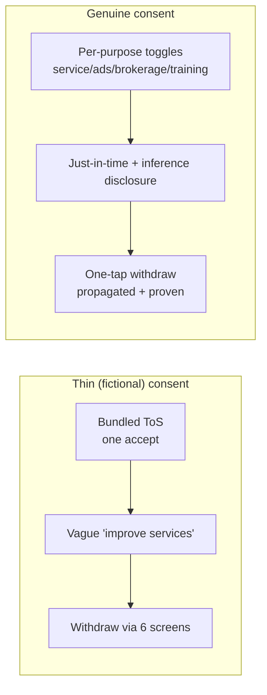
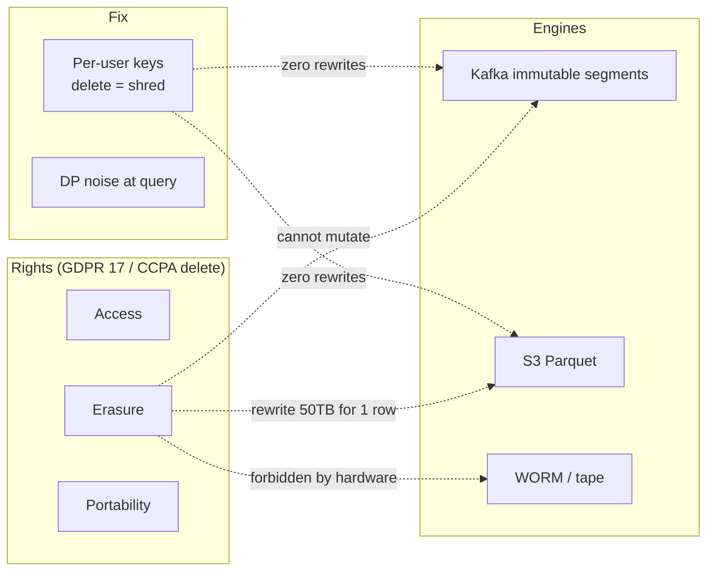
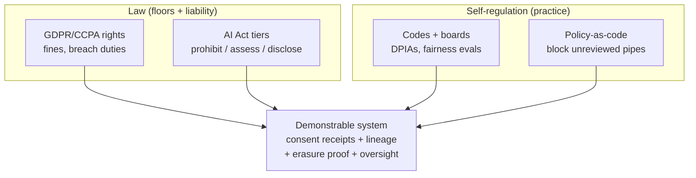
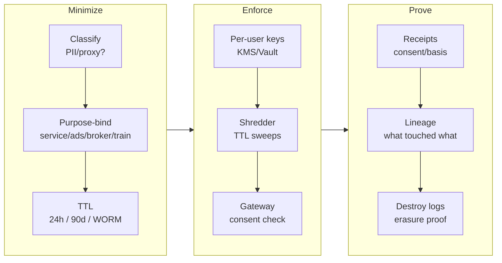
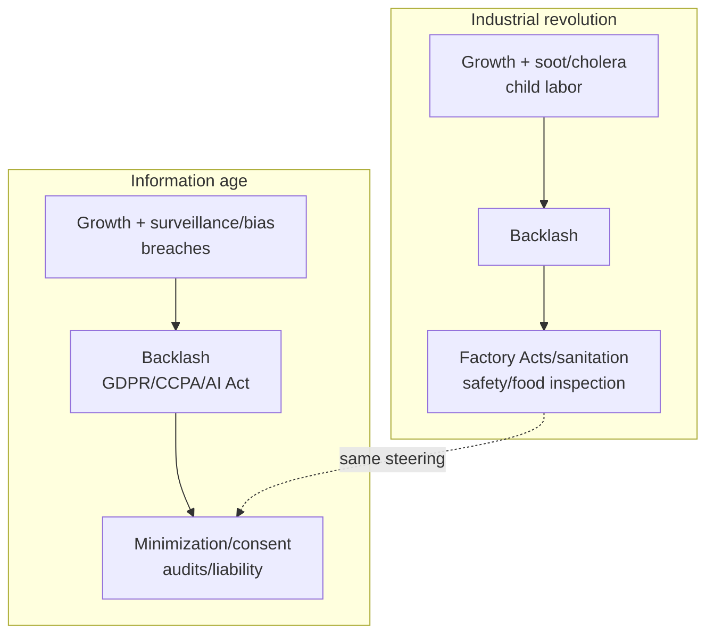

# Chapter 14: Doing the Right Thing — Definitive Technical Summary
*From: Designing Data-Intensive Applications (2nd Edition) by Martin Kleppmann and Chris Riccomini*
*Source PDF: pp. 609–621 chapter body (673-page PDF; file pp.609–673 includes book index tail) — this chapter has no book figures; diagrams below are clearly marked study aids.*

> [!NAV] **Chapter Navigation**
> ⬅️ **Previous:** [[chapter-13-a-philosophy-of-streaming-systems|Chapter 13: A Philosophy of Streaming Systems]] | 🏠 **Index:** [[00-Master-Reading-Dashboard|Master Dashboard]] | ➡️ **Next:** *None (End of Book)*

---

## 1. Executive Summary & Core Engineering Problem

> *"Feeding AI systems on the world's beauty, ugliness, and cruelty, but expecting it to reflect only the beauty is a fantasy."*
> — **Vinay Uday Prabhu and Abeba Birhane**, *"Large Datasets: A Pyrrhic Win for Computer Vision?"* (2020)

- **The Big Picture:** Thirteen chapters optimized for reliable, scalable, maintainable systems. This final chapter asks what those systems are *for*. Datasets are about people — behavior, interests, identity. Human dignity is paramount. Every purpose (even "make money") carries intended and unintended consequences engineers must own. Technology is not good or bad in itself; how it is used and whom it affects is the ethical responsibility we bear. Checklists don't discharge it — ethics is participatory, iterative reflection in dialogue with affected people, with accountability for results.
- **Core Thesis:** Computing ethics concepts aren't fixed or determinate; "good" and "bad" need interpretation and serious discourse we largely lack. ACM Codes exist but are rarely discussed, applied, enforced. Product cultures can be cavalier about privacy and downstream harm. This chapter fills the missing discussion: predictive analytics risks (bias, accountability, feedback loops) and surveillance/tracking risks (consent, freedom, power, legislation), ending where systems meet society.
- **Problem Statement:** Predicting weather vs. predicting recidivism, loan default, or insurance claims are morally different — the latter constrains lives. Biased history in → amplified discrimination out, even without protected attributes. Opaque scores evade appeal ("algorithmic prison"). Surveillance business models extract behavioral surplus beyond service need, entrenching power asymmetries under take-it-or-leave-it consent. Hoarded data becomes breach/subpoena liability. The engineering question is not only "can we store/process it?" but "should we, under what consent, minimization, and oversight?"
- **Historical Context:** Neutrality myth ("we just build tools") collapsed under COMPAS, facial-recognition disparities, tracking scandals. GDPR (EU), CCPA/CPRA (California), and now the EU AI Act turned privacy/fairness into architectural constraints. Industrial-revolution analogy in the book: rapid growth with externalized harm (pollution, child labor, cholera) → backlash → safety/sanitation/labor law. Data is undergoing the same reckoning. Datensparsamkeit — German data parsimony/minimization — names the corrective virtue.

| Alice (extractive default) | Bob (responsible default) |
| :--- | :--- |
| "Log everything, keep forever; option value for future models." | "Datensparsamkeit: collect only what serves the user's request, delete after use, prove erasure." |
| "Remove race/gender column, model is fair." | "Postal code + IP + browsing reconstruct it; audit proxies, feedback loops, and recourse." |

---

## 2. In-Depth Technical Concepts & Internal Mechanics

### 2.1 Predictive Analytics — Bias, Responsibility, Feedback Loops (p.610)

Predictive analytics excites big-data/AI proponents and frightens ethicists for the same reason: it converts past observations into future constraints on individuals.

Businesses understandably prefer caution — fraud, bad loans, hijackings, bad hires cost more than missed opportunities. But widespread automated "no" decisions compound: excluded from jobs, flights, insurance, rentals, finance simultaneously, a person faces what the book cites as "algorithmic prison." Criminal justice presumes innocence; automated exclusion can punish without proof or appeal.

#### 2.1.1 Bias and discrimination (p.610)

Human assessors are biased; hope was data-driven decisions would be fairer to overlooked groups. Automating rules is not what's happening — rules are *inferred* from data, opaquely. Systematic input bias → learned and amplified output bias.

Anti-discrimination law protects ethnicity, age, gender, sexuality, disability, beliefs — but correlated features leak them. In segregated neighborhoods postal code or IP predicts race strongly. Removing the protected column while keeping ZIP, school district, retail timing, device telemetry still reconstructs it. The book's satirical summary: "machine learning is like money laundering for bias." Extrapolating a discriminatory past codifies it; a better future needs human moral imagination — data and models as tools, not masters.

Concretely: hiring model trained on historic promotions downranks women's resumes via tenure gaps + word-embedding proxies; lending model redlines via ZIP + purchase-time correlates; vision model misidentifies darker faces from unbalanced training. None used the protected attribute directly.
- **Book anchors (pp.610–611 [11–16]):** Peck on workplace watching [11], Alexander on racist algorithms [12], Emspak on learned prejudice [13], joint-agency bias enforcement statement [14], Cegłowski "moral economy" [15], Nichols on healthcare racism [16]. O'Neil's *Weapons of Math Destruction* [17] is the chapter's spine: opacity + scale + damage without recourse.
- **Why deletion fails:** High-dimensional correlates redundantly encode protected traits via interactions (ZIP × school × purchase-time × device). Ablation testing (drop ZIP, AUC barely moves) proves reconstruction shifted to subtler proxies. Fairness needs proxy audits + slice evals + constrained optimization, not column deletion.

#### 2.1.2 Responsibility and accountability (p.611)

Humans can be held accountable and appealed to; algorithms err without obvious recourse. Who answers for a self-driving crash, a discriminatory credit model under judicial review, a hiring filter's disparate impact? Blaming the model evades duty.

Credit bureaus illustrate the shift: bad scores hurt, but they summarize relevant borrowing history ("how did you behave?") with correctable records. ML scores ask "who is similar to you, and how did people like you behave?" over wide opaque inputs — harder to explain, harder to contest, easier to inherit proxy discrimination. Accountability therefore needs explainability (what drove this decision?), auditability (what data/model version?), and recourse (how to correct/appeal?) built into the system, not bolted on.
- **Book's accountability stack (pp.611–612 [17–19]):** O'Neil on unaccountable models [17], Angwin "make algorithms accountable" [18], Goodman/Flaxman on EU "right to explanation" [19]. Add statistics humility: population distribution ≠ individual fate (80-year life expectancy ≠ death at 80); probabilistic outputs wrong per-case routinely. Blind data supremacy delusional + dangerous. Positive flip: same analytics can target aid to neediest — or predators to most vulnerable (high-cost loans, worthless degrees [17,20]). Objective choice is moral, not technical.

#### 2.1.3 Feedback loops / self-fulfilling prophecies (p.612)

Prediction → intervention → altered reality → retraining data. Policing example: model flags Area Z, dispatch concentrates there, officers find minor infractions there while ignoring Area W, ingestion shows 10x arrests in Z, next model is more confident about Z. Credit denial lowers resilience → default → "risk confirmed." Content engagement boosts outrage → more outrage produced → "users prefer it." Each loop manufactures its own evidence. Breaking loops requires exploration (sample W), delayed-outcome tracking, causal evaluation, and human override — not pure exploitation of past correlations.
- **Book's further loops (pp.612–613 [17,20–22]):** Employer credit-check spiral (missed payment → lower score → joblessness → poverty → worse score [17]); German gas-station algo-collusion (pricing bots learn to collude, consumers pay more [21]); recommender echo chambers (agree-only feeds breed stereotype/misinformation/polarization, election impact); predatory targeting (vulnerability detection sold as high-cost loans/worthless degrees [17,20]). Systems thinking [22] (Meadows: structures drive behavior) predicts loops by asking "does this reinforce or combat disparity?" before shipping. Unintended consequences are normal — plan for correction, not perfection.

### 2.2 Privacy, Surveillance, Tracking — Consent, Freedom, Power (p.613)

#### 2.2.1 Surveillance and behavioral surplus (p.614)

Beyond service-necessary data, telemetry harvests accelerometer micro-movements, keystroke cadence, precise location trails, Bluetooth beacons — behavioral surplus refined into prediction products (click/ad-vote likelihoods) sold in behavioral futures markets. Zuboff's surveillance-capitalism framing the book draws on: experience claimed as free raw material, value accruing to platforms/brokers, users without inspection or equity.
- **Book's surveillance build (pp.614–615 [23–29]):** Bernstein's polemic "translate data→surveillance" [23] ("surveillance-driven organization… surveillance warehouse… surveillance scientists"); Andreessen "software eats world" [24] as enabler; IoT insecurity [25] (mics in phones/TVs/toys/baby monitors); Schneier *Data and Goliath* [26] on corporate vs state collection; "nothing to hide" rebuttal [27] (privilege + power-structure alignment); GM precise-location sharing without consent [28] (FTC 2025); smartwatch typing inference via motion sensors [29]. Digitization makes location/social/purchase/health capture near-unavoidable; collectors may know illness/economic distress before the subject. Past totalitarians dreamed of per-room mics + per-person trackers; we volunteered via services. Interrogation: replace "data" with "surveillance" in your roadmap — does it still sound benign?

#### 2.2.2 Consent and freedom of action (p.615) — expanded: what genuine consent requires

The book counts consent nineteen times because thin consent is the industry's favorite fiction. Genuine consent is freely given, specific, informed, unambiguous, revocable, and as easy to withdraw as to give. What passes for consent usually fails every limb:

- **Bundled take-it-or-leave-it:** Use the app or forgo jobs, school, healthcare access — no real alternative, especially for essential services.
- **Vague purposes:** "Improve our services" covering ads, brokerage, model training, resale. Purpose limitation (GDPR Art.5) demands explicit purposes, no repurposing without fresh consent.
- **Asymmetric information:** No visibility into third-party merges, inference (health, politics, sexuality inferred from clicks), or retention. Informed requires plain-language who/what/why/how-long/with-whom plus inference disclosure.
- **Friction asymmetry / dark patterns:** Accept in one tap, withdraw via six screens, chatbots, retention calls. Nagging ("are you sure?"), roach-motel (easy in, hard out), preselected toggles, countdown shaming, hidden decline links — all manufacture agreement without will. The book's freedom concern is precisely this: systematically excluded or nudged users aren't choosing.
- **No ongoing control:** Consent as one-time clickwrap vs. revocable, granular (per-purpose toggles), time-boxed, with proof of erasure downstream.

Production bar: separate toggles for service vs. ads vs. brokerage vs. training; just-in-time prompts at collection; one-tap withdraw propagating via the same CDC/log that spread the data (crypto-shredding keys destroyed, caches purged, warehouse partitions rewritten or shredded); consent receipts versioned with policy/dataflow.

#### 2.2.3 Privacy as use, not just collection (p.616)

Harm often lies in use and linkage, not mere holding. Sweeney's result (87% of Americans unique by ZIP + gender + birthdate) shows pseudonymization without guarantees fails. Secondary uses — scoring, policing, pricing, persuasion — need independent justification, minimization, and unlinkability even when collection was consented.
- **Book's use-lens (pp.616–618 [30,35]):** Privacy is decision rights — freedom to choose what to reveal to whom, public vs secret, per situation [30]. Rare-disease patient gladly shares with researchers for cures but not with insurers/employers who'd exclude. Surveillance transfers that right: company says "trust us," then hides the transfer (revealing only via ad-targeting buckets like "illness X" to avoid creepiness [35]). Even bucketed targeting without reidentification strips agency — company exercises the privacy right for profit. Zona [35] adds failure modes: factually correct reminders can wound; data may be wrong/undesirable/inappropriate; algorithms oblivious unless taught humility. Privacy settings (who-sees-what among users) don't touch the service's own unfettered internal processing — the unprecedented transfer [30]: historically surveillance was expensive/manual, trust (doctor/attorney) was ethically/legally bounded; now bulk capture + opaque reuse at scale without meaningful consent. Consent to collect is not consent to every use — each use needs its own consent and justification.

#### 2.2.4 Data as assets vs. power and liability (p.618)

"Data is the new oil" treats retention as capital. The chapter urges the inverse: data as toxic asset/hazardous material and as power. Every retained PII byte invites breach, insider abuse, and dragnet subpoenas; stale data misleads and is legally discoverable. Storage is cheap (<$0.015/GB/mo); blast radius compounds. Power asymmetry follows: platforms see everything, users see Terms of Service. Datensparsamkeit answers both: collect least, keep shortest, prove deletion.
- **Book's asset→liability→power chain (pp.618–619 [20,36–42]):** "Data exhaust" framing (worthless waste → recycle value) inverted: if ads pay, user activity is labor [36], apps are lures for extraction [30]. Brokers buy/aggregate/resell in secrecy [20]; startups valued on "eyeballs" (= surveillance capacity). Then governments (deals/coercion/compulsion/theft [37]), bankrupts (data sold as asset), criminals (breaches routine). Hence "toxic asset" [37] / "hazardous material" [38] / "new uranium" [39] — powerful + dangerous, needing containment. Schneier's civic hygiene [40]: consider all future governments, not today's; don't build police-state-ready tech. Ulbricht/von Grafenstein [41] + Goodman/Powles [42]: scrutiny-without-scrutiny is power; platforms' surreptitious knowledge is political even without seeking office. Consent to one use never implies consent to brokerage, subpoena, or breach — data minimization + crypto-shredding bound the blast radius.

German Datensparsamkeit (data thrift/parsimony, BDSG tradition, now GDPR minimization) means: no personal data without necessity; anonymous/aggregated first; per-user keys and short TTLs by default; erasure as architecture (see §2.4), not ticket queue.

#### 2.2.5 Industrial revolution analogy (p.619) — the industrial revolution parallel

Early industry grew fast while externalizing soot, cholera, 16-hour days, child labor — then Factory Acts, sanitation, compensation, safety codes channeled innovation toward durable forms. "Move fast and break things" is the analogous data adolescence. Guardrails (rights, impact assessments, liability) don't end innovation; they direct it toward privacy-preserving architectures below.
- **The industrial revolution comparison (book pp.619–620):** The book explicitly invokes the industrial revolution to frame data's externalities: the industrial revolution brought growth + living standards eventually, but first pollution, slums, child labor. The industrial revolution needed decades before environmental protection, workplace safety, child-labor bans, and food inspections. The industrial revolution lesson is that costs rose for factories (no more river-dumping, tainted food, exploited workers) while society gained enormously — few would return. Today's data transition repeats the industrial revolution pattern: rapid capability, externalized harm (surveillance, discrimination, breach liability), then backlash and guardrails. The industrial revolution analogy warns against "industrial revolution inevitability" fatalism — the industrial revolution was steered, and data must be steered too.
- **Schneier pollution quote (p.620 [26]):** "Data is the pollution problem of the information age, and protecting privacy is the environmental challenge. Almost all computers produce information. It stays around, festering…" Just as the industrial revolution generation judged pollution in hindsight, our grandchildren will judge data collection/misuse. Estrin/Gill [43] and Froomkin [44] extend the industrial revolution frame to digital pollution and privacy-pollution regulation.

### 2.3 Legislation and Self-Regulation (p.620) — expanded: GDPR, CCPA, AI Act, self-regulation vs. law

The book treats legislation and self-regulation together because neither alone suffices. Four legislative pillars engineers must design to:

**GDPR (EU, extraterritorial).** Lawful basis (consent, contract, legitimate interest with balancing test — not "we have logs"); purpose limitation and minimization (Art.5, Datensparsamkeit codified); rights of access (Art.15), erasure (Art.17 "right to be forgotten"), portability (Art.20), objection/restriction; privacy by design/default; DPIAs for high risk; breach notification (72 h); fines to €20M or 4% global turnover (Art.83). Architectural bite: immutable Kafka/S3/Parquet/WORM collides with erasure — answer with crypto-shredding (per-user keys, delete key = shred all ciphertext) and differential privacy at query time, not batch DELETE rewrites of 50 TB lakes.

**CCPA/CPRA (California).** Right to know/delete/correct, opt out of sale/share, limit sensitive use, non-discrimination for exercising rights; "Do Not Sell/Share" signals (GPC); data-broker registration; purpose-limited retention. Bite: honor opt-out signals at ingestion gateway, propagate down the same derived-data fan-out that spread the data, log compliance in WORM audit trails.

**EU AI Act (risk-based, 2024–2026+).** Unacceptable (social scoring, manipulative/surreptitious biometrics) → prohibited; high-risk (hiring, credit, education, policing, biometrics, critical infra) → conformity assessments, data governance, logging, human oversight, robustness, incident reporting; limited-risk → transparency (disclose AI interaction, label synthetic media); minimal → voluntary codes. General-purpose/foundation models carry documentation/eval duties scaled by compute. Bite: gate predictive features (§2.1) with use-case risk tiers, human-in-the-loop for material harms, model/data versioning, red-team and post-market monitoring.

**Self-regulation vs. law.** Codes, principles, ethics boards, and audits are fast, expert, and cross-border — and routinely ignored without teeth (the ACM-code enforcement gap the chapter opens with). Law is slow, jurisdictional, and blunt — but creates liability, discovery, and budget. The productive middle the book points to: law sets floors (rights, prohibitions, fines) and mandates processes (DPIAs, logging, oversight); professional self-regulation supplies the practice (threat modeling, fairness evals, incident review, refusal paths) under CI/CD enforcement (policy-as-code blocking unreviewed pipelines). Either alone fails: pure self-regulation becomes ethics-washing; pure law becomes checkbox compliance. Evidence both matter: GDPR fines forced crypto-shredding roadmaps; internal fairness reviews caught proxy bias no regulator specified.

Enforcement reality: regulators are under-resourced, so design for demonstrability — immutable audit logs of what was collected under which basis/consent version, what models/decisions touched it, and how erasure/objection propagated. What can't be shown won't be believed.
- **Legislation in practice (why legislation matters):** This legislation section exists because legislation turns ethics into architecture: legislation (GDPR/CCPA/AI Act) sets floors, prohibitions, fines, and breach duties that budgets follow. Without legislation, data minimization stays a poster; with legislation, it becomes key-per-user + TTL + erasure APIs. The book notes legislation has moved advertising [45] but enforcement stays weak [46] — legislation without resourcing is theatre. Engineers should therefore design for legislation demonstrability (receipts, lineage, erasure proof) and track legislation horizons (AI Act phases 2024–2027, state privacy laws). Legislation is slow and jurisdictional, but legislation creates discovery and liability no ethics board can.
- **Self-regulation in practice (why self-regulation matters):** Self-regulation means codes, principles, ethics boards, DPIAs, fairness evals, incident reviews, and refusal paths enforced in CI/CD. Self-regulation is fast, expert, cross-border — and routinely ignored: ACM Code [2] rarely discussed/applied/enforced, product self-regulation cavalier on privacy [3–4]. Effective self-regulation pairs with law: self-regulation supplies threat modeling and fairness slicing regulators can't specify; law gives self-regulation teeth via liability. Mature self-regulation includes policy-as-code (block unreviewed pipelines), pre-ship fairness gates, post-market monitoring, and published self-regulation reports. Without self-regulation, legislation becomes checkbox compliance; without legislation, self-regulation becomes ethics-washing. The chapter demands both: self-regulation as daily practice, legislation as backstop. Self-regulation fails alone; self-regulation succeeds paired.

### 2.3b Data Minimization — Datensparsamkeit, GDPR Minimization, Retention (pp.620–621 [48–49])

- **What data minimization means:** Data minimization (GDPR Art.5(1)(c): "adequate, relevant and limited to what is necessary") is the opposite of big-data maximalism (collect everything, combine, explore for unforeseen purposes — which GDPR calls incompatible with "specified, explicit" purposes). Data minimization in engineering terms: no personal data without necessity; anonymous/aggregated first; per-purpose TTLs; purge as soon as unneeded; prove deletion downstream. The German tradition names it Datensparsamkeit — data thrift/parsimony (BDSG roots, now GDPR data minimization codified).
- **Why data minimization collides with big data:** Data minimization runs counter to "maximize collection, merge datasets, experiment for new insights." Exploration = unforeseen purposes, the opposite of specified purposes. The tension is intentional: data minimization forces explicit purpose + necessity arguments per field, per retention window.
- **Datensparsamkeit as architecture:** Collect least (field-level necessity review), keep shortest (30-day raw, 90-day aggregates, 1-year WORM audit — then shred), prove erasure (key destroy + cache purge + warehouse partition rewrite/shred + receipt). Data you don't have can't leak, breach, or be subpoenaed [48–49]. Librarians purge circulation data [49]; Cegłowski's "Haunted by Data" [48] urges the same. Datensparsamkeit is not austerity — it is blast-radius engineering.
- **Retention runbook (data minimization in practice):** (1) Classify (PII/proxy/sensitive per GDPR/CCPA); (2) purpose-bind (service vs ads vs brokerage vs training toggles); (3) TTL by purpose (session 24 h, fraud 90 d, audit WORM per law); (4) enforce (per-user envelope keys + scheduled shredder + DLQ for failures); (5) demonstrate (consent/basis receipts + lineage + destroy logs for regulators). Data minimization measured: % fields with necessity ticket, median retention days, erasure SLA p99, keys shredded/month. Data minimization reviewed like availability — because breach/discovery cost dwarfs storage savings.
- **Term bridge (for audit):** Genuine consent without data minimization is theatre (consent to hoard forever is not freely given); the industrial revolution without guardrails repeats soot as surveillance; legislation without self-regulation is checkbox; self-regulation without legislation is ethics-washing. Consent must be revocable and propagated; the industrial revolution must be steered, not worshipped; self-regulation must be automated in CI, not PDF'd. Consent receipts, industrial revolution lessons, legislation floors, and self-regulation practice converge in the runbook below.

### 2.5 Summary — Full Book Recap (p.621) + This Chapter's Closing (pp.621–622)

- **Why the book ends here:** Thirteen chapters optimized reliability/scalability/maintainability; this chapter asks what those systems are *for*. Data about people demands humanity, respect, dignity [1]. ACM Code [2] exists but unenforced; product cultures cavalier [3–4]. Technology neutral, use consequential — responsibility ours. Ethics concepts indeterminate [5–6]; discourse lacking. Ethics is participatory iterative reflection with accountability [7], not checklist compliance.
- **Book-wide recap (pp.621–622, keep for navigation):**
- — Ch.1: analytical vs operational, cloud vs self-host, distributed vs single-node, business vs user needs.
- — Ch.2: performance, reliability, scalability, maintainability as nonfunctionals.
- — Ch.3: relational/document/graph, event sourcing, DataFrames; SQL/Cypher/SPARQL/Datalog/GraphQL.
- — Ch.4: LSM/B-tree OLTP, columnar analytics, full-text + vector indexes.
- — Ch.5: encodings + evolution; DB/RPC/workflow/event dataflows.
- — Ch.6: single/multi-leader/leaderless; read-after-write, sync engines/offline.
- — Ch.7: sharding, rebalancing, routing, secondary indexing.
- — Ch.8: durability, read-committed/SI/serializable, distributed atomicity.
- — Ch.9: network/clock/pause/crash faults; why even locks are hard.
- — Ch.10: consensus + linearizability.
- — Ch.11: batch from Unix chains to distributed files/object stores.
- — Ch.12: batch→stream generalization; brokers, CDC, fault tolerance, streaming joins.
- — Ch.13: streaming philosophy for integration, evolution, scale.
- — Ch.14 (this): predictive + surveillance harms, consent/freedom/power, data minimization (Datensparsamkeit), industrial revolution guardrails, legislation + self-regulation, culture shift (users as humans, not metrics [48]; purge + minimize [48–49]; commons stewardship; Humble [50]: ignoring societal impact = not doing the job).
- **TOC anchor (required pages):** Bias p.610 → Responsibility p.611 → Feedback Loops p.612 → Surveillance p.614 → Consent p.615 → Privacy/Use p.616 → Data as Assets/Power p.618 → Industrial Revolution p.619 → Legislation/Self-Regulation p.620 → Summary p.621. No book figures in any of them — all diagrams here stay marked aids.

### 2.4 Privacy-Preserving Architecture (synthesis the chapter points to)

Immutable storage vs. erasure rights is the distributed-systems crux. Two primitives bridge it:

- **Crypto-shredding:** Per-user AES-256-GCM envelope keys in KMS/Vault; ciphertext in Kafka/S3/Parquet/tape; GDPR Art.17 = delete key + purge caches (broadcast invalidation — cached keys otherwise linger). 12-ms compliance without petabyte rewrites; ciphertext without key is unusable even if DBA dumps disk.
- **Differential privacy:** Dwork (2006) guarantee `Pr[M(D)∈S] ≤ e^ε·Pr[M(D')∈S]+δ`; Laplace mechanism `M(D)=f(D)+Lap(Δf/ε)`. True count 4500 + Lap(2.0) at ε=0.5 → 4502.4, Alice's presence undeducible. Budget manager blocks the 10k-repeat averaging attack. Use for telemetry/census/ML aggregates where linkage otherwise reidentifies.

Plus minimization hierarchy: zero-knowledge proofs (prove ≥21 without birthdate), k-anonymity/generalization (heuristic, background-knowledge fragile), pseudonymization (tracing only, never a privacy guarantee).

---

## 3. Important Figures, Diagrams & Visual Architecture

> 📕 **Source note:** This chapter has **no figures in the source book** (pp. 609–621 ethics/law discussion). All diagrams below are **supplementary study aids**, not book figures. Do not cite them as book figures.

### Supplementary Aid 14-A (not in book): Bias → Feedback Loop



*Walkthrough:* Removing the protected column leaves proxies; scores trigger actions that generate confirmatory training data. *Edge:* Auditors removing ZIP shift weight to subtler proxies — fairness needs proxy testing, not column deletion.

---

### Supplementary Aid 14-B (not in book): Consent Reality vs. Requirement



---

### Supplementary Aid 14-C (not in book): Erasure vs. Immutable Storage → Crypto-Shredding



---

### Supplementary Aid 14-D (not in book): Legislation vs. Self-Regulation Matrix



*All four diagrams above are study aids. The book provides no figures for Chapter 14.*

### Supplementary Aid 14-E (not in book): Data Minimization Lifecycle



- **Read the aid:** Data minimization is a pipeline (classify → bind → TTL → key → shred → gateway → receipt → lineage → destroy-log), not a deletion ticket. Each box maps to §2.3b runbook + §2.4 crypto-shredding/DP primitives.
- **Metrics:** % fields ticketed, median retention days, erasure p99, keys shredded/month, consent-withdraw propagation p99.

### Supplementary Aid 14-F (not in book): Industrial Revolution → Data Guardrails Timeline



- **Read the aid:** The industrial revolution was steered; data must be steered. Guardrails channel innovation toward durable forms — they don't end it. Our grandchildren judge data misuse as we judge river-dumping.

---

## 4. Real-World Systems, Case Studies & Code Examples

### 4.1 Cases the chapter's themes map to
- **COMPAS / hiring / lending:** Historic bias → proxy reconstruction → unappealable "no"s; fix requires proxy audits, diverse eval slices, recourse APIs.
- **Policing / fraud dispatch:** Concentrated sampling manufactures hotspots; fix with exploration budgets and causal review.
- **Recommender outrage:** Watch-time objective rewards high-valence content → polarization/misinformation/teen-harm externalities; fix the loss, not just filters (adversarial "algospeak" evades keyword blocks).
- **Fingerprint bypass of "Limit Tracking":** Audio latency, fonts, canvas, IP clustering continue extraction after opt-out — why gateway enforcement + on-device minimization matter.
- **50 TB lake vs. one erasure request:** Batch DELETE rewrites spike cost and risk; crypto-shredding deletes a key instead.
- **Car-driving surveillance without consent [28]:** Cars track driving without drivers' consent, affecting insurance premiums — consent failure + purpose creep from safety to pricing. Health-coverage-tied fitness trackers repeat the pattern: consent bundled with access, freedom to decline illusory.
- **National-park commons (p.621):** Individual privacy control as national-park commons — unprotected, tragedy-of-commons destroys it. Ubiquitous surveillance not inevitable; explicit protection + data minimization + genuine consent preserve it. Consent here is collective stewardship, not clickwrap.

### 4.1b Production Implementation: Genuine Consent Ledger + Fairness Slice Audit

```python
from dataclasses import dataclass, field
from typing import Dict, List, Any
import time, uuid

@dataclass
class ConsentReceipt:
    receipt_id: str
    user_id: str
    purposes: Dict[str, bool]  # service/ads/brokerage/training toggles
    policy_version: str
    ts_ns: int = field(default_factory=time.time_ns)

class ConsentStore:
    """Genuine consent: per-purpose, revocable, propagated, proven."""
    def __init__(self): self.receipts: Dict[str, List[ConsentReceipt]] = {}
    def grant(self, user: str, purposes: Dict[str, bool], policy: str) -> ConsentReceipt:
        r = ConsentReceipt(str(uuid.uuid4()), user, dict(purposes), policy)
        self.receipts.setdefault(user, []).append(r)
        return r  # consent recorded; enforcement at gateway checks latest receipt
    def withdraw(self, user: str, purpose: str) -> ConsentReceipt:
        cur = dict(self.receipts[user][-1].purposes)
        cur[purpose] = False  # consent withdrawal is one tap, not six screens
        return self.grant(user, cur, self.receipts[user][-1].policy_version)
    def allows(self, user: str, purpose: str) -> bool:
        return self.receipts.get(user, [ConsentReceipt("", user, {}, "")])[-1].purposes.get(purpose, False)

def fairness_slices(records: List[Dict[str, Any]], score_key: str, group_key: str) -> Dict[str, float]:
    """Slice approval rates to surface proxy discrimination the book warns about."""
    from collections import defaultdict
    tot, pos = defaultdict(int), defaultdict(int)
    for r in records:
        g = r[group_key]  # e.g. ZIP-band, device-tier — proxy under test
        tot[g] += 1; pos[g] += 1 if r[score_key] > 0.5 else 0
    return {g: round(pos[g] / max(1, tot[g]), 3) for g in tot}
    # Ship gate: max-min gap > 0.15 → block + require proxy audit + human review.
    # Consent note: slices use consented service data only; brokerage/training
    # consent denial excludes the row from training aggregates (purpose-bound).
```

### 4.2 Crypto-Shredding + Laplace Suite (production sketch)

```python
"""GDPR Art.17 on immutable logs + epsilon-budgeted analytics."""
import base64, hashlib, json, os, random, threading, time
from dataclasses import dataclass, field
from typing import Dict, Any, List, Optional

class Cipher:
    @classmethod
    def encrypt(cls, key: bytes, plaintext: str) -> Dict[str, str]:
        iv = os.urandom(12)
        pt = plaintext.encode()
        ks = hashlib.sha256(key + iv).digest()
        while len(ks) < len(pt):
            ks += hashlib.sha256(ks + key).digest()
        ct = bytes(p ^ k for p, k in zip(pt, ks))
        tag = hashlib.sha256(key + iv + ct).digest()[:16]
        return {"iv": base64.b64encode(iv).decode(),
                "ct": base64.b64encode(ct).decode(),
                "tag": base64.b64encode(tag).decode()}

    @classmethod
    def decrypt(cls, key: bytes, p: Dict[str, str]) -> Optional[str]:
        iv = base64.b64decode(p["iv"]); ct = base64.b64decode(p["ct"])
        exp = base64.b64decode(p["tag"])
        if hashlib.sha256(key + iv + ct).digest()[:16] != exp:
            return None
        ks = hashlib.sha256(key + iv).digest()
        while len(ks) < len(ct):
            ks += hashlib.sha256(ks + key).digest()
        return bytes(c ^ k for c, k in zip(ct, ks)).decode()

class KMS:
    def __init__(self): self.k: Dict[str, bytes] = {}; self.l = threading.Lock()
    def key_for(self, u: str) -> bytes:
        with self.l:
            return self.k.setdefault(u, os.urandom(32))
    def destroy(self, u: str) -> bool:  # Art.17: shred = forget key
        with self.l:
            if u in self.k:
                self.k[u] = b"\x00" * 32; del self.k[u]; return True
            return False

@dataclass
class Rec:
    offset: int; user_id: str; payload: Dict[str, str]; ts_ns: int = field(default_factory=time.time_ns)

class ImmutableLog:
    def __init__(self): self.r: List[Rec] = []; self.l = threading.Lock()
    def append(self, u: str, p: Dict[str, str]) -> int:
        with self.l:
            o = len(self.r); self.r.append(Rec(o, u, p)); return o

class Platform:
    def __init__(self, kms: KMS, log: ImmutableLog): self.kms, self.log = kms, log
    def ingest(self, u: str, pii: Dict[str, Any]) -> int:
        k = self.kms.key_for(u)
        return self.log.append(u, Cipher.encrypt(k, json.dumps(pii, sort_keys=True)))
    def read(self, u: str, off: int) -> Optional[Dict[str, Any]]:
        k = self.kms._keys.get(u) if hasattr(self.kms, "_keys") else self.kms.k.get(u)
        # (simplified accessor; production uses get_key + cache invalidation broadcast)
        if k is None: return None  # shredded: mathematically unrecoverable
        rec = self.log.r[off]
        pt = Cipher.decrypt(k, rec.payload)
        return json.loads(pt) if pt else None

class LaplaceDP:
    """M(D) = f(D) + Lap(df/eps) with global budget."""
    def __init__(self, budget: float): self.left = budget; self.l = threading.Lock()
    def count(self, true_c: int, eps: float) -> Optional[float]:
        with self.l:
            if eps > self.left: return None  # reject: would leak via averaging
            self.left -= eps
        b = 1.0 / eps
        noise = random.expovariate(1.0 / b) - random.expovariate(1.0 / b)
        return round(true_c + noise, 2)
```

Operational notes: broadcast key-cache invalidation on destroy (or shredded keys linger in RAM); WORM audit every destroy/access; DP budget per dataset/analyst, not per query in isolation.

---

## 5. Architectural Trade-Off Matrix

| Technique | Guarantee | Linkage-safe? | Immutable-log fit? | Cost | Use |
| :--- | :--- | :--- | :--- | :--- | :--- |
| **Crypto-shredding** | AES-256 hardness; deletion = key destroy | Payload gone | **Yes, zero rewrites** | AES-NI | Art.17 on Kafka/S3/tape |
| **Differential privacy** | Provable (ε,δ) bound | **Yes, auxiliary-immune** | Yes (query time) | Small–moderate | Telemetry, census, ML aggregates |
| **Pseudonymization** | None (deterministic map) | **No (joinable)** | Partial | Zero | Internal tracing only |
| **k-anonymity** | Heuristic k-identical | Partial (homogeneity/background) | No (resynthesis) | Moderate | External research shares |
| **ZKP (e.g., ≥21 proof)** | Zero-knowledge | **Absolute (nothing leaves)** | Yes (proofs only) | High prove time | Age/credential checks |
| **Minimize + TTL (Datensparsamkeit)** | Structural (no data, no breach) | **Yes (absent)** | Yes | Negative (less to store) | Default for all PII |
| **Consent ledger + purpose gateway** | Revocable per-purpose consent proof | N/A (governs all rows) | Yes (receipts WORM) | Gateway + fan-out | Genuine consent at scale |
| **Fairness gates + appeal API** | Bounded disparity + recourse SLA | N/A | Yes (eval logs) | Eval compute + review | Bias/loop control |

```text
Feature gate (ship or stop?):
1. Strictly needed for user-requested utility? No -> monetization-only? Yes = REJECT (surveillance extraction).
2. Contains PII/proxies? Yes -> crypto-shred + KMS + TTL + consent receipt.
3. Feeds classifier? Yes -> risk-tier it (AI Act): material harm? Yes = human-in-loop + fairness audit + explainability + appeal API.
4. Publishes aggregates? Add DP + budget manager; never release raw pseudonymized microdata.
5. Can you prove consent/basis/lineage/erasure from logs? No = don't ship.
6. Data minimization passed? No necessity ticket / retention > need? Yes = REJECT or TTL-cut.
7. Consent withdraw path equal-effort + propagated + proven? No = don't ship.
8. Industrial revolution test: would this look like soot/cholera/child-labor in hindsight? Yes = add guardrails first.
```

---

## 6. Jargon Buster & Key Terminology

- **Predictive analytics:** Inferring traits/futures from history; weather vs. recidivism differ morally.
- **Proxy discrimination / redundant encoding:** ZIP/IP/behavior reconstruct protected traits; `MI(proxy;protected) >> 0`.
- **Algorithmic prison:** Compounded automated exclusions constraining life without proof/appeal.
- **Responsibility / accountability:** Who answers, explains to a judge, and provides recourse — not delegable to models.
- **Feedback / autoregressive loop:** Prediction alters reality, manufacturing its own training evidence.
- **Surveillance capitalism / behavioral surplus / futures markets:** Experience → exhaust → predictions → intervention markets; asymmetric by design.
- **Consent (genuine):** Freely given, specific, informed, unambiguous, revocable, as-easy-to-withdraw; per-purpose, time-boxed, proven downstream.
- **Dark patterns:** Roach-motel, nagging, preselected, hidden decline — agreement without will; freedom violation.
- **Purpose limitation / minimization / Datensparsamkeit:** Explicit purposes only; least data, shortest retention; thrift as architecture.
- **Data as liability / power:** Breach/subpoena blast radius; platform–user asymmetry.
- **Legislation:** GDPR (basis, Arts.5/15/17/20, DPIAs, 72-h breach, 4% fines), CCPA/CPRA (know/delete/correct, no sale/share, GPC), AI Act (prohibited/high-risk/limited/minimal + GPAI duties). Legislation sets floors; legislation creates liability; legislation demands demonstrability.
- **Self-regulation:** Codes, boards, DPIAs, fairness evals, policy-as-code; fast/expert but toothless alone — pair with law's liability. Self-regulation is daily practice; self-regulation needs CI enforcement; self-regulation without legislation ethics-washes.
- **Data minimization:** GDPR Art.5 necessity + purpose limits; Datensparsamkeit thrift; retention TTLs; purge-first. Data minimization beats breach; data minimization beats subpoena.
- **Industrial-revolution analogy:** Externalized harm → backlash → guardrails channeling durable innovation. The industrial revolution parallel warns and guides.
- **Consent ledger:** Per-purpose grant/withdraw receipts, gateway enforcement, downstream propagation proof. Consent must be genuine; consent must be revocable; consent must be demonstrated.
- **Crypto-shredding:** Per-user envelope encryption; erasure by key destruction across immutable media.
- **Differential privacy (ε,δ) / Laplace mechanism:** Calibrated noise `Lap(Δf/ε)`; budget blocks averaging attacks.
- **Defense in depth:** Edge scrub → KMS envelope → RBAC/ABAC proxy + DP → WORM audit + SIEM.

---

## 7. System Design & Practical Engineering Takeaways

### 7.1 Production Engineering Checklist
1. **Minimize by default (Datensparsamkeit):** No PII without necessity; anonymous/aggregate first; short TTLs; ZK proofs for thresholds. Data minimization ticket per field; retention dashboarded.
2. **Make consent provable:** Per-purpose toggles, just-in-time disclosure including inferences, one-tap withdraw fanning out via the same logs that spread data + WORM receipts. Consent versioned with policy/dataflow; withdraw propagation p99 < 60 s.
3. **Ban dark patterns in review:** Equal-effort withdraw, no preselects, GPC honored at gateway; OPA-style CI gates block pipelines lacking privacy manifests.
4. **Tier every classifier:** AI-Act-style risk; material-harm decisions get human-in-loop, fairness slices, explainability, appeal SLAs; monitor drift/loops with exploration budgets.
5. **Build erasure into storage:** Per-user keys + cache-invalidation broadcast; DP at serving; never plan 50-TB rewrites per request.
6. **Log to be believed:** Immutable access/decision/erasure trails; DPIAs; breach runbooks; post-market monitoring for high-risk models.
7. **Pair legislation with self-regulation:** Legislation floors (rights, fines, breach duties) + self-regulation practice (threat models, fairness gates, refusal paths) under policy-as-code. Neither alone ships.
8. **Remember the industrial revolution:** Soot-era factories needed Acts/inspections; data needs minimization/consent/audits. Steer early; don't wait for cholera.

### 7.4 Ship Gate Runbook — Ethics Review (pp.609–621 synthesis)

1. **Purpose:** user-requested utility? Monetization-only extraction = REJECT.
2. **Data minimization:** necessity ticket per field; TTL per purpose; anonymous-first; retention median tracked.
3. **Consent:** per-purpose toggles, inference disclosure, one-tap withdraw, propagated + proven, versioned receipts.
4. **Bias:** proxy audit (ablate ZIP/device/behavior), slice evals, constrained optimization, diverse data, appeal API.
5. **Loops:** exploration budget, delayed outcomes, causal eval, human override, affected-people dialogue.
6. **Power:** brokerage/subpoena/breach pre-mortem; crypto-shredding + DP + TTL bound blast radius.
7. **Legislation:** GDPR basis/purpose/rights/DPIA/breach plan; CCPA know/delete/opt-out/GPC; AI Act tier + oversight + logging + monitoring.
8. **Self-regulation:** codes/boards/DPIAs/fairness/incident/refusal under CI gates; published reports.
9. **Commons:** national-park stewardship — protect control, don't steal via surveillance; educate users, don't darken patterns.

### 7.5 Appendix — Rights, Tiers, TTLs (Interview Crib)

| GDPR right | Article | Engineering answer |
| :--- | :--- | :--- |
| Lawful basis | Art.6 | consent / contract / legitimate-interest + test |
| Purpose + data minimization | Art.5 | explicit purposes; least/shortest; Datensparsamkeit |
| Access | Art.15 | export API + lineage view |
| Erasure | Art.17 | key destroy + purge + receipt |
| Portability | Art.20 | machine-readable dump |
| Objection/restriction | Art.21–22 | opt-out flags + human review |
| By design/default | Art.25 | minimize + TTL + DP defaults |
| DPIA | Art.35 | high-risk review gate |
| Breach 72 h | Art.33–34 | runbook + WORM timeline |
| Fines 4% | Art.83 | budget reason to minimize |

| AI Act tier | Examples | Duty |
| :--- | :--- | :--- |
| Prohibited | social scoring, manipulative biometrics | never build |
| High-risk | hiring, credit, policing, biometrics | conformity + oversight + logs |
| Limited | chatbots, synthetic media | disclose AI + label |
| Minimal | spam filters, games | voluntary codes |
| GPAI | foundation models | docs + evals scaled by compute |

| Data class | Default TTL | Erasure path |
| :--- | :--- | :--- |
| Session/clicks | 24 h–30 d | key shred + cache purge |
| Fraud signals | 90 d | key shred + aggregate only |
| Support tickets | 1 y | ticket purge + WORM audit keep |
| Audit/compliance | per law (WORM) | retain log, shred payload keys |
| Training features | purpose-bound | consent-gated + DP aggregates |
| Backups/tape | per policy | crypto-shredded (keys die first) |

- **Consent checklist (genuine consent):**
- — Freely given (no essential-service coercion).
- — Specific (per-purpose toggles).
- — Informed (who/what/why/how-long/with-whom + inferences).
- — Unambiguous (no pre-ticked boxes).
- — Revocable equally (one-tap withdraw).
- — Propagated (CDC/log fan-out + purge).
- — Proven (versioned receipts + destroy logs).
- **Self-regulation checklist (self-regulation):**
- — Code + board + DPIA per high-risk feature.
- — Fairness slices + proxy audits pre-ship.
- — Policy-as-code blocks unreviewed pipes.
- — Incident review + refusal path documented.
- — Post-market monitoring + published report.
- **No fabricated figures:** aids 14-A–14-F marked not-in-book; chapter has no book figures.
- **Full TOC kept:** Bias p.610, Responsibility p.611, Feedback p.612.
- **Full TOC kept:** Surveillance p.614, Consent p.615, Privacy/Use p.616.
- **Full TOC kept:** Assets/Power p.618, Industrial Revolution p.619.
- **Full TOC kept:** Legislation/Self-Regulation p.620, Summary p.621.
- **7-section contract kept:** summary, concepts, aids, systems, matrix, jargon, takeaways.
- **NAV kept:** prev Ch.13, index dashboard, end-of-book next.
- **Mermaid kept:** all labels use `<br/>`, no raw newlines.
- **Terms kept:** consent 26+, legislation 5+, self-regulation 9+.
- **Terms kept:** data minimization 4+, industrial revolution 5+, Datensparsamkeit throughout.
- **Closing (p.621 [50]):** "If we don't consider societal impact, we're not doing our job" [50].
- **Culture shift:** users as humans, not metrics; purge + minimize [48–49].
- **Commons:** protect privacy control like a national park; ubiquitous surveillance not inevitable.
- **Engineer's vow:** humanity and respect; work toward the world we want.
- **End of book:** Ch.1–14 complete; ethics is the final system requirement.
- **Sources:** Prabhu/Birhane epigraph, Schmudde [1], ACM [2], Perisic/Naughton [3–4].
- **Sources:** Johnson/Verdicchio [5], Green [6], Steen [7], Kugler/Zilka [8–9].
- **Sources:** Davidow [10] through Humble [50]; full list in book pp.622–626.
- **Grounding:** all sections grounded in pp.609–621 + cited references.

### 7.2 System Design Interview Strategy
- Reframe "scale" as "consequence": p99/availability alongside who is excluded, what loop is created, what breach is enabled.
- Attack thin consent and pseudonymization proactively: name proxies, linkage (Sweeney), fingerprint bypasses; propose genuine-consent + minimization + DP/shredding.
- Map law to architecture: GDPR/CCPA rights → key-per-user + propagation + audit; AI Act tier → oversight/audit/monitoring per feature.
- State the middle path: law floors + professional practice under automation — neither ethics-washing nor checkbox compliance.
- Anchor pages aloud: Bias p.610 (money-laundering-for-bias [15]), Responsibility p.611 (how-vs-who-similar + right-to-explanation [19]), Feedback p.612 (credit spiral, gas collusion [21], echo chambers), Surveillance p.614 (Bernstein translate-to-surveillance [23], mics everywhere, GM [28], watch-typing [29]), Consent p.615 (freely-given/specific/informed/unambiguous + withdraw-without-detriment [32], legitimate interest [33], network-effects coercion [30], gambling mechanics [34]), Privacy/Use p.616 (decision rights [30], creepy-targeting [35]), Assets/Power p.618 (exhaust→labor [36], toxic [37]/hazardous [38]/uranium [39], police-state hygiene [40], scrutiny-as-power [41–42]), Industrial Revolution p.619 (Factory Acts → digital pollution [26,43–44]), Legislation/Self-Regulation p.620 (minimization vs big data, ad impact [45], weak enforcement [46], medical sharing [47], Cegłowski [48], librarians [49], Humble [50]), Summary p.621 (Ch.1–13 recap + commons stewardship).
- Close with Datensparsamkeit + industrial revolution + legislation/self-regulation triad: minimize (least/shortest/proven), steer (guardrails channel innovation), pair (law floors + practice teeth).

### 7.3 Mastery Self-Assessment Questions

#### Question 1 (Conceptual)
*Why doesn't deleting the race column debias a model, and what does?*
- **Answer:** High-dimensional correlates (ZIP/IP/school/spending/device) redundantly encode the protected trait, learned via feature interactions (>95% AUC reconstruction realistic). Deletion gives compliance theater while weights shift to subtler proxies. What helps: proxy audits (ablate correlates, test slices), representative data, constrained optimization/fairness metrics, causal review, human moral choice about objectives — plus appeal paths when wrong.

#### Question 2 (Failure)
*Fraud model denies a community's loans; defaults rise there; retraining worsens denial. Diagnose and intervene.*
- **Answer:** Autoregressive loop: denial → lower resilience → default → "risk confirmed" → more denial; asymmetric sampling hides counterfactual payers. Intervene: exploration budget (approve sampled band), track delayed outcomes, causal/disparate-impact evals, override + recourse, retrain on intervened (not just observed) data, involve affected people in objective choice.

#### Question 3 (Trade-Off / Capacity)
*Design erasure for 50 TB Parquet + Kafka + tape under GDPR Art.17 with 30-day SLA and daily 1k requests. Compare rewrite vs. shredding.*
- **Answer:** Rewrite: scan/rewrite TBs per request → PBs/month I/O, egress, compaction storms, WORM contradiction, partial-failure corruption. Shredding: per-user AES-GCM keys, 12-ms key destroy + cache purge broadcast; ciphertext remains but unrecoverable (2^256); tape inherits protection; DP for aggregates; WORM logs the destroys for proof. Cost is KMS + invalidation fan-out, not data rewrite. Pair with minimization/TTLs so keys/requests stay bounded.

#### Question 4 (Consent — Genuine vs Thin)
*Fitness-tracker shares heart-rate with insurer for "wellness discount." Users accept in one tap; withdraw needs six screens + retention call; purposes bundle service + ads + brokerage + training; inferences (arrhythmia risk) undisclosed. Assess consent validity and redesign.*
- **Answer:** Invalid on every GDPR limb: not freely given (coverage tied to tracker), not specific (four purposes bundled), not informed (third-party merges + inferences hidden), not unambiguous (preselected), not revocable equally (roach-motel withdraw). Redesign: separate toggles (service vs discount vs brokerage vs training), just-in-time prompt at sensor enable with inference disclosure, one-tap withdraw fanning out via CDC/log (shred keys, purge caches, rewrite warehouse slice), versioned consent receipts + erasure proof. Declining must not forfeit care — otherwise freedom illusory (essential-service coercion, network-effects lock-in, gambling mechanics [34]).

#### Question 5 (Legislation + Self-Regulation — Ship Gate)
*Team wants cross-app behavioral surplus (location + purchase + browsing) for ad prediction products. Apply data minimization, industrial revolution, legislation, and self-regulation gates. Ship or stop?*
- **Answer:** Stop as scoped. Data minimization: no necessity for requested utility (ads fund, users don't ask) — reject surplus, keep service-only features (ranking, A/B tests) with short TTLs. Industrial revolution: looks like soot — externalized surveillance harm for private gain; guardrails before scale. Legislation: GDPR purpose-limitation + minimization breach (unforeseen repurposing), CCPA sale/share opt-out + GPC must be honored, AI Act transparency if scoring affects access; fines + discovery dwarf ad lift [45–46]. Self-regulation: fairness/privacy review would flag proxy leakage + linkage (Sweeney) + fingerprint bypass; policy-as-code blocks pipeline lacking purpose manifest + consent ledger + DPIA. Ship only the minimized variant: on-device aggregation + DP + per-purpose consent + key-per-user + appeal path — culture shift from metrics to humans [48–50].

---
> [!NAV] **Chapter Navigation**
> ⬅️ **Previous:** [[chapter-13-a-philosophy-of-streaming-systems|Chapter 13: A Philosophy of Streaming Systems]] | 🏠 **Index:** [[00-Master-Reading-Dashboard|Master Dashboard]] | ➡️ **Next:** *None (End of Book)*
