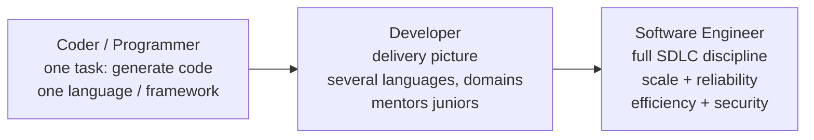
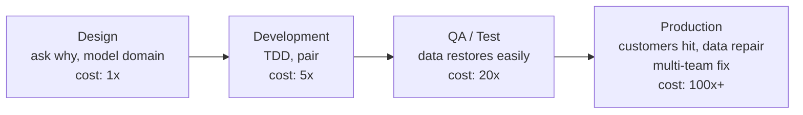

# Chapter 1: From Programmer to Engineer — Definitive Summary
*From: Fundamentals of Software Engineering: From Coder to Engineer by Nathaniel Schutta & Dan Vega*
*Source PDF: pp. 23–44 (672-page PDF) — figures below cite PDF pages.*

> [!NAV] **Chapter Navigation**
> ⬅️ **Previous:** *None (Start of Book)* | 🏠 **Index:** [[00-Master-Reading-Dashboard|Master Dashboard]] | ➡️ **Next:** [[chapter-02-reading-code|Chapter 02: Reading Code]]

---

## 1. Executive Summary & Core Problem

- **Core Thesis:** Writing syntactically correct code makes you a programmer; applying engineering discipline across the *entire* software development lifecycle (SDLC) — scalability, reliability, efficiency, security, communication, maintenance — makes you a software engineer. Promotions, interesting projects, and lasting careers go to people who master those fundamentals, not the newest framework fad.
- **The Core Problem Statement:** Boot camps, degrees, and self-study teach you to *write* code on tiny greenfield exercises with `foo`/`bar` variables, solo, graded once and thrown away. Real work is the opposite: hundreds of thousands to millions of lines, written by teams across the globe, already in production, where real people depend on it — and you will spend most of your life in the maintenance phase. Without the missing subjects (reading code, writing readable code, working with others, working with legacy code), your first exposure to reality is a shock, and quick-fix habits make it worse.
- **What This Chapter Covers (PDF pp. 23–44):** Engineer by any other name (p.23) → Fundamentals matter (p.24) → Many paths to engineer — degree/boot camp/self-taught, 600 vs 850 vs 1,400 hours (p.25) → Taught vs needed — greenfield school vs brownfield reality, maintenance phase (p.27) → Lazy programmer ethos, brute force vs searching (p.29) → Capitalization Assignment story (p.31) → Fresh eyes vs "we've always done it this way" (p.32) → Widget batch parallelization story (p.33) → Don't solution too quickly, shift left, misconception problems (p.34) → Five Whys incl. web-server tag story (p.38) → Golden Rule applied to code (p.39) → Wrapping up, Putting It into Practice, Additional Resources (pp.41–42).
- **Historical & Industry Context:** Early programmers were mathematicians by training; early CS degrees were math degrees with some computing thrown in (PDF p.27 note). Traditional CS programs were designed to prepare you for *graduate school* — algorithms, compilers, operating systems — not day-to-day work on real applications. Boot camps invert this: practical, current-framework, but transitory. Neither is "better"; success is about problem-solving, tinkering, and creativity regardless of path.

---

## 2. In-Depth Concepts & Mechanics

### 2.1 Engineer by any other name — coder vs developer vs engineer (PDF pp. 23–24)

- **Foundational theory & intuition:** The terms are overloaded but not synonyms. Think of a ladder of scope:
  - **Programmer / coder:** focused on the singular task of generating code. Highly skilled in a language or framework, but may not understand the full SDLC. Fixes bugs, implements isolated features.
  - **Developer:** sees the larger picture of delivering software. Knows a few languages/frameworks, has multi-domain experience, explores more of the SDLC, mentors juniors.
  - **Software engineer:** brings engineering discipline to the *entire* SDLC. Proficient code is a given; on top of that thinks about scalability, reliability, efficiency, security. Knows the rules *and when to bend or break them*. Trusted with the most complex, critical production systems.
- **Concrete example — Alice, Bob, and Carol on the same ticket:** The ticket says "checkout is slow under load." Alice the coder profiles one method and micro-optimizes a loop. Bob the developer fixes the loop *and* adds a missing index, writes a regression test, and documents the endpoint. Carol the engineer asks why checkout hits the database synchronously at all, checks traffic shape (peak 40× average on sale days), threat model (card data), and operability (can we roll back?), then proposes an async queue + idempotency keys with load-test numbers — solving this sale *and* the next three.
- **Edge case:** Titles lie. Some companies call everyone "engineer." Judge by scope of ownership (one function vs one service vs the system in production), not the business card. And footnote 1 (p.43) is blunt: pure code-generators are the practitioners most likely to be replaced by agentic coding systems.

### 2.2 Fundamentals matter — athletes and code readers (PDF pp. 24–25)

- **Intuition:** Pro golfers drill stance, grip, alignment — not highlight-reel trick shots. Pro engineers drill reading unfamiliar code, writing code others can read, learning continuously, communicating. The flashy new language feature is the trick shot; fundamentals are what get you promoted.
- **The four fundamentals this book hammers:**
  1. You will spend most of your career working with *existing* code — get comfortable with ambiguity; you will never understand every nuance, and you do not need to before making changes.
  2. Writing code is taught; writing code *for the person who comes after you* is not — learn it.
  3. Technology does not stand still — you must be able to learn new things on demand.
  4. Evergreen soft skills (asking why, explaining, mentoring, pushing back kindly) beat framework trivia for career scope.
- **Failure mode:** The "latest-technology obsessive" who learns every new annotation but cannot onboard to a legacy module without rewriting it from scratch. That person stays at the same level while the fundamentals-driven peer gets the critical system.

### 2.3 The many paths — degree, boot camp, self-taught (PDF pp. 25–27)

- **Mechanics, with the book's numbers:**
  - **Self-taught:** no tuition, possibly weeks instead of years depending on aptitude; but the internet is a maze of uneven-quality material, demands high self-motivation, and involves heavy trial and error.
  - **Boot camp:** ~**600 hours** over several weeks, near-constant access to help, focused on the language/framework of the day. Practical but transitory — popularity ebbs and flows.
  - **Associate's degree:** ~**850 hours** over 1–2 years.
  - **Bachelor's:** ~**1,400 hours** over 4–5 years. Built to feed graduate school: algorithms, language design, compiler theory, operating systems. Projects are small, span a few months at most, start from scratch, carry no legacy baggage.
- **Two myth-busts:** (a) A degree may give an *initial* advantage, but it evens out over time. (b) Math aptitude is *not* a requirement. Coding is communication — mostly with other developers, not the computer. **Language aptitude matters far more than math skill** (p.27 note; expanded in Chapter 2). Some still use math exams to recruit — the book says the research does not support that filter for general engineering.
- **Takeaway line:** "If you have the mindset [problem-solving, tinkering, creativity], you have it. Period. Don't apologize for your path."

### 2.4 What you were taught vs what you need (PDF pp. 27–29)

- **Taught:** a language or two, `foo`/`bar`, a bit of debugging, efficient algorithm design.
- **Not taught (and career-critical):** working with others, reading code, writing readable code, working with legacy/heritage applications — plus everything downstream in this book.
- **The greenfield-to-brownfield shock, step by step:**
  1. School: blank slate, no technical debt, solo, small, isolated, graded and discarded.
  2. Reality: hundreds of thousands to millions of lines, teams across the globe, decisions made before your time, production users depending on behavior, code that never "ends" — it lives in **maintenance phase** (ongoing investment while it delivers business value) until abandoned "like art."
  3. Even a genuine greenfield luxury accumulates technical debt within months.
- **Alice example:** Alice aced a semester project: 2,000 lines, solo, three months, from scratch. Week one on the job she opens a 10-year-old billing service: 400,000 lines, six owners (four gone), three frameworks from three eras, and a "temporary" workaround from 2019 that processes $2M/month. Nobody grades it — customers *rely* on it. That gap is what the rest of the book fills.

### 2.5 The lazy programmer ethos — take the time it takes so it takes less time (PDF pp. 29–31)

- **Definition (not cat videos):** a philosophy of *efficiency*. Strategically lazy means pausing to think before solutioning, so you do less total work. Quote (attributed to horsemanship trainer Pat Parelli): *"Take the time it takes so it takes less time."*
- **Mechanics — the three lazy moves:**
  1. **Resist brute force as final answer.** You may start there, but iterate. Know enough Big-O to reason about best/worst/average case (bubble sort vs alternatives — footnote: Big-O describes relative efficiency of algorithms).
  2. **Search first.** You are almost never the first person to solve this problem. Ten minutes of searching can save days. If it feels like there should be an easier way, there probably is.
  3. **Check the platform before building.** Language feature → framework → library, before hand-rolling (expanded into a decision tree in Chapter 3).
- **War story — the Capitalization Assignment (PDF p.31, "Nate here"):** Task: capitalize billing addresses for post-office consistency. Tech lead points Nate at a homegrown capitalization routine with *more than a dozen arguments* that would take hours to understand. Nate searches, finds the language already has a built-in capitalize function, uses it. Next team meeting — record-scratch moment: *"Oh, did you use Joe's capitalization function?"* Nobody else in the room, all more senior, knew the built-in existed. Maybe the feature postdated Joe's function; doesn't matter. Lesson: a few hours investigating options can save days or weeks.
- **Failure mode:** The rushed engineer who "saves" 30 minutes by skipping the search, then owns a hand-rolled, subtly buggy, unmaintained fork for five years.

### 2.6 Fresh eyes — your junior superpower (PDF pp. 32–34)

- **Intuition:** *"The most dangerous phrase in the language is, 'We've always done it this way.'"* — Grace Hopper. Newcomers — to the codebase, team, or industry — see with unbiased eyes, unencumbered by expired historical decisions. That naïveté is a feature: it surfaces inefficiencies and challenges assumptions seniors literally cannot see anymore.
- **War story — the widget batch job (PDF p.33, "Nate here"):** Client's overnight widget batch no longer finishes overnight. It worked when there were a few customers with a few boxes of widgets; success multiplied customers × widgets per customer until the serial overnight run overflowed the night. After a couple of hours reviewing architecture, Nate asks: *"Does processing widget A have anything to do with widget B?"* Answer: no — only an aggregation at the end; individual widgets are independent. Proposal: a pool of workers each grabbing the next widget, processing, and queuing results for aggregation. Pause — yes, that works. No special insight, just freedom from "that's how we've always done it." The old serial design was possibly an accident or the expedient option years ago.
- **How to wield fresh eyes without making enemies:** ask *why* from a desire to learn, not to embarrass past or present developers. "This ordering surprised me — what's the history?" lands; "Who wrote this garbage?" ends the conversation. Most engineers engage positively with genuine curiosity. And when the odd approach *does* have valid reasons, you just learned something.

### 2.7 Don't solution too quickly — root causes, shift left, misconceptions (PDF pp. 34–39)

- **The urge:** calendar full of standups, messaging pings, testers finding bugs, to-do list growing — so you grab the first fix that quiets the symptom. Quick fixes resolve the immediate pain and breed larger problems.
- **Shift left (move value earlier on the timeline):** bugs found in production are the most expensive — customers impacted, money lost, data possibly corrupted, fixes spanning routines and teams with heavy coordination. It is cheaper in QA/test (test datastores restore with minimal fuss, code still top-of-mind, less time pressure), cheaper still in development (this underpins test-driven development — Chapter 5), and cheapest of all *in design* — never writing the bug because the misconception was cleared up first.
  - Pair programming moves review from days-later to real-time. Continuous testing catches defects near creation. Continuous integration/delivery surfaces merge and environment variance before customers feel it. Building security in throughout beats bolting it on after a breach.
- **Misconception problems (Rich Hickey epigraph, Clojure Conj 2010):** *"Most of the big problems we have with software are problems of misconception."* "Client" vs "customer" may sound interchangeable until the product owner explains the approach works for one but not the other — similar, distinct, nuance matters. No test suite or type system catches a fundamental difference in understanding. Technical solutions alone cannot fix them.
- **The discipline — drive to the "why":**
  - Know what problem the app solves, its context, constraints, related problems.
  - Resist overengineering (scars make you imagine everything you might ever need) *and* under-thinking (building throwaway or, worse, dead code you keep forever).
  - When a customer says *"export this table to a spreadsheet,"* ask the underlying need first — they often request a specific solution when they need a business outcome, colored by the old system (which is why so many apps devolve into email + spreadsheets). Super-users of the old system will unconsciously spec a copy of the old system in new technology.
  - Be ruthlessly pragmatic: scalability matters, but not every app serves a third of internet traffic. *"Prediction is very difficult, especially if it's about the future."* Pick the right tool for the job the customer actually has.
- **Tool — the Five Whys (PDF p.38, from the Toyota Production System):** ask "Why?" five times, each answering the previous, to dig from symptom to root cause. Textbook example: robot stopped → fuse blew (overload) → bearings locked (no lube) → pump circulated too little oil → intake clogged with shavings → **no filter on the pump** (fix that, not the fuse). Software example ("Nate here"): web page with closing tags starting each line — visually jarring though the interpreter didn't care. Why? A bug in an old web-server version. Why still follow it? We no longer run that version. Why unfixed? It *was* fixed. Why is a page created *days ago* still doing it? Old habit, never corrected → tell developers to stop + add cleanup for pages still using the pattern.

### 2.8 The Golden Rule of software (PDF pp. 39–40)

- **Statement:** *"Treat others the way you would like to be treated"* — applied to code. The next developer may be *you*, staring at your own code months later wondering what fool wrote it (footnote 8: everyone has lived this).
- **Mechanics:** Code is a communication mechanism first, computer instruction second. Optimize for the human, not the compiler (narrow specialist exceptions aside). Concretely: write clean code others can maintain, update documentation instead of letting people spin on stale instructions, draw diagrams that clarify rather than confuse, answer questions and help others. People will want you on their teams because you make everyone around you better.
- **Bob example:** Bob inherits Alice's module. Alice followed the Rule: intention-revealing names, 10-line methods, a README that matches reality, a context diagram on the wiki. Bob ships a safe fix in a day and tells his manager Alice's code is a joy. Flip it — stale docs, 400-line methods, `tmp2` variables — and Bob spends a week, breaks two things, and dreads the module. Same Bob, same skill; the difference is Alice's Golden-Rule investment.

---

## 3. Important Figures, Diagrams & Visual Architecture

> No numbered figures in Chapter 1 (PDF pp. 23–44). The two reconstructions below are **study aids synthesizing the chapter's arguments** — not book figures. IDE screenshots begin in Chapter 2; UML-family reconstructions in Chapter 4.

| Figure | PDF Page | Description |
|--------|----------|-------------|
| Synthesis S1-1 — role ladder | pp. 23–24 | Coder → developer → engineer scope of ownership |
| Synthesis S1-2 — shift-left cost curve | pp. 34–35 | Cost of a defect by phase: design < dev < test < production |

### S1-1. Role ladder: coder → developer → engineer
- **Reference:** Synthesizes "An Engineer by Any Other Name" → 📕 PDF pp. 23–24 — open the source PDF at those pages to compare.
- **Flow:** scope of ownership widens at each rung: single task → delivery picture → full-lifecycle engineering discipline.



- **Takeaway:** Promotions track scope of ownership, not typing speed. Climb by owning reliability, scale, and the system in production.

### S1-2. Shift-left cost curve: misconception → production defect
- **Reference:** Synthesizes "Don't Solution Too Quickly" → 📕 PDF pp. 34–35 — open the source PDF at those pages to compare.
- **Flow:** the later a misunderstanding is caught, the more it costs; design-time clarity is cheapest, production incidents most expensive.



- **Takeaway:** An hour clarifying "client vs customer" in design beats a cross-team data-reconciliation project after release.

---

## 4. Real-World Systems, Case Studies & Code Examples

- **The Capitalization Assignment (PDF p.31):** homegrown routine with 12+ args vs a language built-in. Concrete numbers: *hours* to understand the bespoke function vs *minutes* of searching; *days/weeks* saved downstream. Generalize: before writing string/date/money/timezone code, check JDK/stdlib, Spring/Spring Boot, Guava, Commons (the full decision tree lands in Chapter 3, PDF p.90).
- **The widget batch (PDF p.33):** serial overnight job that outgrew the night. Fix pattern: independent work items → worker pool pulling "next widget" → result queue → final aggregation. This is the map-reduce shape in miniature; recognizing *independence* of work items is the whole trick. Ask it explicitly: "does A have anything to do with B?"
- **The closing-tag Five Whys (PDF p.38):** a formatting habit fossilized from a dead server bug, still copied into new pages years later. Cleanup had two parts: broadcast the new rule *and* backlog a sweep of old pages. Process lesson: dead constraints outlive their causes unless someone asks why five times.
- **Spring Data abstraction warning (Putting It into Practice, PDF pp.41–42):** embracing coarse abstractions (Spring Data saves you countless SQL statements) is right — *and* you should pop the hood one layer down. When the generated query misbehaves at 2 a.m., the engineer who understands the SQL underneath fixes it in minutes; the one who doesn't files a ticket and waits.
- **Pseudocode — lazy search before building (Chapter 1 ethos, executable form in Chapter 3):**

```java
// Before writing capitalizeBillingAddress(String, ...12 more args):
// 1. JDK? 2. Spring? 3. Guava/Commons? 4. already in codebase?
// Nate's actual outcome:
String normalized = billingAddress.trim().toUpperCase(Locale.US);
// built-in, tested by millions, zero maintenance — vs a 12-arg bespoke routine.
```

---

## 5. Trade-Off Matrix

| Approach | Upfront cost | Long-run payoff | Risk | Best used when | Avoid when |
|----------|-------------|-----------------|------|----------------|------------|
| Strategic laziness (search + think first) | 30 min–few hours of investigation | Days/weeks saved, less owned code | Looks "slow" to status-hungry observers | Any non-trivial task; unfamiliar domain | True production fire with known fix — act, then reflect |
| Brute-force first version, then iterate | Fast first draft | Only if you actually iterate | Draft becomes permanent; Big-O surprise at scale | Spiking to learn; throwaway probe | Shipping the spike as the solution |
| Fresh-eyes question ("why is it this way?") | Social risk, 15-min conversation | Kills fossilized constraints; parallelization wins | Sounding accusatory | New to team/codebase; "always done it this way" smells | During incident command — ask in the retro |
| Five Whys to root cause | 20–40 min of digging | Fixes cause, not symptom; stops recurrence | Analysis paralysis past 5 whys | Recurring bugs, weird conventions, customer feature requests | Single obvious typo — fix and move on |
| Golden-Rule code (names, docs, diagrams) | 10–20% slower to write | Next reader (often you) ships 2–5× faster | Over-documenting trivia | Anything others will maintain | Truly throwaway spike you will delete today |

- **Decision heuristics:** *"Take the time it takes so it takes less time"* for anything living past a week. *"If it feels like there should be an easier way, there probably is"* — stop and search. *"Don't solution too quickly"* when the request names a solution ("export to spreadsheet") rather than a need.

---

## 6. Jargon Buster & Key Terminology

- **SDLC (Software Development Life Cycle):** the full journey — requirements, design, build, test, deploy, operate, maintain. Coders live in "build"; engineers own all of it.
- **Greenfield / Brownfield (Heritage / Legacy) code:** blank-slate new work vs work inside an existing codebase with prior decisions and debt. School is greenfield; careers are brownfield. The book prefers "heritage/existing" over sneering "legacy" — old code that earns its keep deserves respect (expanded Chapter 2/6).
- **Technical debt:** expedient shortcuts that mortgage future velocity. Even fresh code accrues it within months.
- **Maintenance phase:** most of a product's life — ongoing investment while it delivers business value, not a project with a neat end date.
- **Lazy programmer ethos:** efficiency philosophy — pause, search, think, *then* write. Not shirking.
- **Brute-force approach:** first, obvious, often inefficient solution. Acceptable start, unacceptable finish without iteration.
- **Big-O notation:** shorthand for how algorithm cost grows with input (e.g., bubble sort's quadratic blowup). You need enough to compare best/worst/average cases.
- **Fresh set of eyes:** unbiased newcomer perspective that spots expired assumptions.
- **"That's how we've always done it":** the most dangerous phrase — a fossilized decision masquerading as a reason.
- **Shift left:** moving value (testing, review, security, integration) earlier in the timeline where fixes are cheap.
- **Problem of misconception:** misunderstandings (client vs customer) no test or type system can catch; solved in design conversation, not code.
- **Five Whys:** Toyota-originated root-cause drill — ask "why?" five times down the causal chain.
- **Super user (of the old system):** invaluable yet biased requirements source who may spec a clone of the old system in new tech.
- **Golden Rule (software):** write code, docs, and diagrams as you wish to find them. Optimize for the human reader.

---

## 7. Takeaways

### Production Engineering Checklist
- [ ] Before coding a ticket, spend 30 minutes: restate the *problem* (not the requested solution) and search for an existing answer (codebase → language → framework → library).
- [ ] Ask "why?" to the fifth level at least once per week — on a weird convention, a recurring bug, or a feature request naming a solution.
- [ ] Leave every module friendlier than you found it: one accurate doc paragraph, one clarified name, one deleted fossil.
- [ ] Pop one abstraction hood per month (e.g., what SQL did Spring Data just generate?).
- [ ] Ask one genuine "why is it this way?" question per sprint — kindly, from curiosity, in the open.

### Interview / Career Strategy
- **Promotion narrative:** frame every project as scope-widening: "I owned not just the feature but its operability — load shape, rollback, threat model." That is the coder→engineer story panels reward.
- **"Tell me about a time you simplified":** use the Capitalization shape — bespoke complexity found, platform feature discovered, days saved. Interviewers remember numbers: "12-arg routine → one built-in call."
- **System-design signal:** explicitly separate *need* from *asked-for solution* ("they asked for CSV export; the need was weekly reconciliation — so we built scheduled aggregation instead"). That sentence marks engineer-level thinking.
- **Fresh-eyes answer:** "Within 90 days I ask the 'dumb' architecture questions, because that's when I can still see them. Example: the serial batch I helped parallelize…"

### Mastery Q&A (with answers — folds in "Putting It into Practice," PDF pp. 41–42)

**Q1. What's the real difference between a programmer and a software engineer?**
*Answer:* Scope of ownership. Both write code; the engineer additionally owns scalability, reliability, efficiency, and security across the whole lifecycle — and knows when rules bend or break. Concretely: the programmer fixes the slow method; the engineer questions the synchronous design under 40× peak load with card data and a rollback plan.

**Q2. I just got a bug ticket. What's the "lazy" first 30 minutes?**
*Answer:* Don't open the editor yet. (1) Restate the problem in one sentence. (2) Spend ~30 minutes researching: is there a ready-made solution (codebase → JDK → Spring → Guava/Commons → open source)? (3) Sketch the domain and 2 candidate solutions. (4) Run the sketch past an experienced coworker. The book's exercise prescribes exactly this pause — it feels slower and ships faster.

**Q3. How do I find a mentor worth having?**
*Answer:* Look around your org for a senior engineer whose code and conduct you admire, and politely ask for 30 minutes over coffee — your treat. Ask: what they wish they'd learned earlier, what made them valuable on teams, what you should learn next. Then act on one suggestion visibly. Repeat with event speakers and authors — most help seekers who ask well.

**Q4. How do I audit my own gaps with this book?**
*Answer:* Skim the table of contents, rank each area strong/weak, pick the weakest one you touch weekly, and make a dated plan: do that chapter's "Putting It into Practice" items and read its Additional Resources. One area per cycle beats skimming all of them.

**Q5. My framework hides SQL/HTTP/threads from me. Should I care?**
*Answer:* Yes — one layer down. Embrace Spring Data *and* read the SQL it generates this month; use the HTTP client *and* learn what retry/timeout it defaults to. Abstractions leak at 2 a.m., and the engineer who has popped the hood debugs in minutes instead of filing tickets.

**Q6. When is asking "why" the wrong move?**
*Answer:* Mid-incident with customers down — execute the known mitigation, then Five-Why in the retro. And never weaponize it: questions from curiosity ("help me understand the history") build trust; from accusation ("who wrote this?") destroy it.

### Sources — Additional Resources (PDF p.42)
- *The Pragmatic Programmer* (20th Anniv.), Hunt & Thomas (Addison-Wesley, 2019)
- *The Mythical Man-Month* (Anniv.), Fred Brooks (Addison-Wesley, 1995)
- *Design Patterns*, Gamma et al. (Addison-Wesley, 1994)
- *Practices of an Agile Developer*, Subramaniam & Hunt (Pragmatic Bookshelf, 2006)
- *The Productive Programmer*, Neal Ford (O'Reilly, 2008)
- *Software Engineering at Google*, Wright et al. (O'Reilly, 2020)
- *The Staff Engineer's Path*, Tanya Reilly (O'Reilly, 2022)
- "No Silver Bullet: Essence and Accidents of Software Engineering," Frederick P. Brooks Jr. (UNC-Chapel Hill, Sept 1986)
- *Code Complete* (2nd Ed.), Steve McConnell (Cisco Press, 2004)

> [!FOOT] **Chapter Footnotes (PDF p.43)**
> 1. Pure code-generators are most likely to be replaced by agentic coding systems. 2. Courses also skip debugger/editor fluency. 3. Ask why, but don't be surprised when colleagues' guesses match yours. 4. Big-O = relative algorithm efficiency. 5. Consider a project glossary — high-impact artifact. 6. Explains the email-and-spreadsheet devolution. 7. "Do unto others…" 8. Everyone has cursed code only to discover they wrote it. 9. Except rare specialist cases — you'll know.

---
> [!NAV] **Chapter Navigation**
> ⬅️ **Previous:** *None (Start of Book)* | 🏠 **Index:** [[00-Master-Reading-Dashboard|Master Dashboard]] | ➡️ **Next:** [[chapter-02-reading-code|Chapter 02: Reading Code]]
