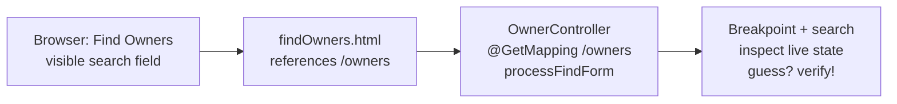
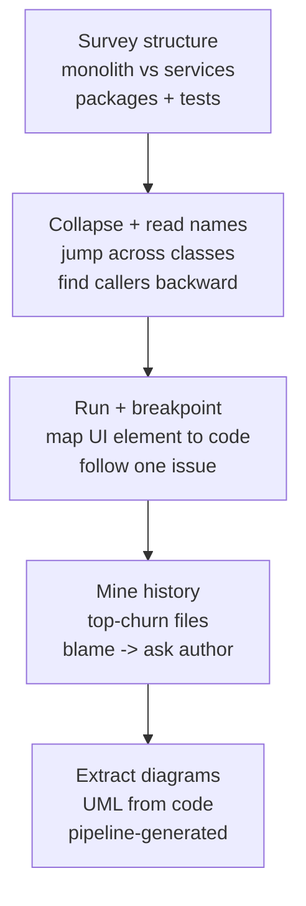
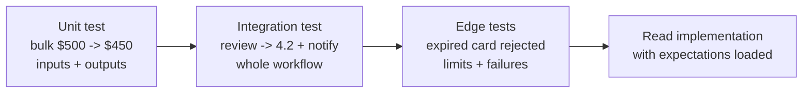

# Chapter 2: Reading Code — Definitive Summary
*From: Fundamentals of Software Engineering: From Coder to Engineer by Nathaniel Schutta & Dan Vega*
*Source PDF: pp. 45–88 (672-page PDF) — figures below cite PDF pages.*

> [!NAV] **Chapter Navigation**
> ⬅️ **Previous:** [[chapter-01-programmer-to-engineer|Chapter 01: From Programmer to Engineer]] | 🏠 **Index:** [[00-Master-Reading-Dashboard|Master Dashboard]] | ➡️ **Next:** [[chapter-03-writing-code|Chapter 03: Writing Code]]

---

## 1. Executive Summary & Core Problem

- **Core Thesis:** You will spend far more of your career *reading* code than writing it — yet coding is taught backward (write first, read never). With agentic/chat-oriented ("vibe") coding generating ever more code you didn't write, reading skill matters *more*, not less. This chapter gives you the orientation system: tame your biases, survey people and docs, do software archeology with your IDE/debugger/history, and read tests as living documentation.
- **The Core Problem Statement:** School hands you greenfield blanks slates; work hands you brownfield codebases — years of layered decisions, patches on patches, evolved frameworks, 20,000-lines-a-day AI output, and a single method that eats an afternoon. On top of the technical maze sit cognitive traps (your code always looks smarter than theirs) that make you sneer instead of understand. Without a method you thrash: guessing, breaking things, and concluding "what idiot wrote this?" — only to `git blame` yourself.
- **What This Chapter Covers (PDF pp. 45–88):** Greenfield vs brownfield; legacy-by-any-other-name (p.45) → Four problems in every existing-code task (p.45) → Cognitive biases: IKEA 63%, mere-exposure, Blub (pp.47–48) → Approaching unfamiliar code: teammates, README/ADRs/standards, Golden-Rule docs (p.49) → Metrics Can Mislead — 92% coverage, zero asserts (p.51) → Software archeology + PetClinic `/owners` trace, Figs 2-1–2-7 (pp.52–66) → Leveraging IDE features: Tip of the Day Fig 2-8, find usages Fig 2-9, jump-to-definition Fig 2-10, hierarchies, inspections, structure Figs 2-11–2-12 (pp.66–79) → Reading tests: living docs, bulk-discount, review workflow, expired-card edge cases (pp.79–82) → Practice makes perfect → What about AI? pilot-not-passenger (p.84) → Wrapping up, Practice, Resources (pp.86–87).
- **Epigraph & context:** *"Code is read much more often than it is written."* — Guido van Rossum (p.44). Language aptitude beats math aptitude for picking up code (Ch.1 note) — because reading code *is* reading. Neal Ford's corollary (p.86n): "Today's best practice is tomorrow's anti-pattern" — so carbon-date what you read.

---

## 2. In-Depth Concepts & Mechanics

### 2.1 Greenfield bliss vs brownfield reality (PDF pp. 45–46)

- **Intuition:** Greenfield = blank editor, no baggage. Brownfield = working inside the limits of a codebase that arrived at its state over years. Your professional life is almost entirely the second.
- **Legacy by any other name (p.45 sidebar):** "Legacy code" is rarely a compliment — definitions range from "written yesterday" to "no test coverage" to "code I didn't write." The book reframes: if a product delivered business value for years and earned continued investment, that's a *success* — say **heritage** or **existing** code. Respect it (full treatment: Chapter 6).
- **Alice example:** Alice's boot-camp capstone: 3,000 lines, herself, 8 weeks, latest Spring. Her first job module: 250,000 lines, 40 contributors over 9 years, Spring idioms from three eras plus a 2024 AI-generated package nobody fully reviewed. Same Java; different planet.

### 2.2 The four problems inside every existing-code task (PDF pp. 45–47)

Every "fix this bug in existing code" ticket is actually four problems:

1. **The business problem.** Domains are demanding — "software is eating the world," low-hanging fruit is picked. You must understand what the business needs, not just the stack trace.
2. **Seeing through the previous developer's eyes** — often the hardest part. Different habits: a functional-style predecessor, an unfamiliar pattern or library. Many valid solutions exist; disagreement ≠ wrongness.
3. **Wrong level of abstraction.** Code too generic, nuance-lost, two concepts conflated, a favorite pattern forced where another fit. Fixing the bug may require refactoring the model, not just the line.
4. **Peeling technical-debt strata like an archaeologist.** Languages and best practices evolve; read code through the lens of *when written*. "Carbon-date" it: missing lambdas/annotations/`var` tells you its era. Spring alone has supported multiple "right ways" across its lifetime.
- **Plus patches on patches:** the last developer may have half-understood the problem, missed a new language feature that simplifies everything, held a premium AI-assistant license outputting 20,000 lines/day, or just fixed-it-fast under pressure. Any one of those can make a single method an afternoon.
- **Bob example:** Bob's ticket: "discount wrong over $500." (1) Business: bulk 10% for *regulars* over threshold — not VIPs. (2) Predecessor loved nested ternaries; Bob must read them as intended. (3) `Customer` conflates billing-contact with discount-identity — needs splitting. (4) The method uses pre-lambda Java idioms from 2012 plus a 2023 hotfix bolted on. Four layers, one ticket.

### 2.3 Cognitive biases that poison code reading (PDF pp. 47–49)

- **"What idiot wrote this?" → yourself.** The authors confess: more than once the idiot was a past self. If code you wrote years ago doesn't mildly disappoint you, that's stagnation, not quality — growth means today's you knows more.
- **IKEA effect:** you overvalue what you assemble. Cited study (Norton, Mochon & Ariely, HBS 11-091): people pay **63% more** for the product they built themselves vs identical pre-built. Pick-your-own orchards charge a *premium* to let you do the work. In software: your approach always feels "right"; theirs feels suspect — independent of merit.
- **Mere-exposure effect:** you prefer what you already know. Language dogmatism lives here: "time began with whatever I learned first." Exhibit: when Java added lambdas, a mailing-list user demanded why Java needed "new-fangled lambdas" — unaware lambdas predate Java by decades and were in its original plan.
- **The Blub paradox (Paul Graham, "Beating the Averages"):** languages sit on a power continuum invisible to the comfortable. The Blub programmer looking *down* sees only missing features ("why use that inferior tool?"); looking *up* sees only weird unneeded features ("why would anyone need that?") — because Blub lacks them. You cannot evaluate what your language cannot express.
- **Countermeasure:** when a colleague is adamant about a tool, ask "IKEA or Blub?" — kindly. Then turn it inward: audit your own assumptions first. Concrete habit: before rewriting their utility, implement one feature *their* way and note what you learn.

### 2.4 Approaching unfamiliar code — people, paper, then debugger (PDF pp. 49–51)

1. **Start with teammates.** A project overview should be part of onboarding. Ask for the 30-minute tour before the 30-hour spelunk.
2. **Read the docs:** README for bearings, wikis/sites for overview, **ADRs (architecture decision records)** for the vanished *why* — minutes with ADRs beats hours with the debugger. Coding standards prepare you for the patterns ahead. (ADR deep-dive: *Head First Software Architecture*, Gandhi et al., O'Reilly 2024.)
3. **Write docs as you learn (Golden Rule, Ch.1).** If docs are stale, update them; if absent, build lightweight ones answering: *What does the service do? How does it work? What does it depend on? How do I run it?* Favor low-ceremony formats.
4. **Docs lie; tests don't (as much).** Documentation drifts from code the day it's written. **Tests as documentation** — behavior-driven, well-written — produce *executable documentation* that must pass CI (full treatment: Chapter 5). Coverage tells you what runs; *asserts* tell you what's checked (see §2.5).

### 2.5 Metrics can mislead — the 92%-with-no-asserts story (PDF p.51 sidebar)

- **The story:** a friend joins a regression-plagued project. Tech lead proudly reports **~92% code coverage**. Friend reads the tests: *no asserts*. Anywhere. Endemic. Lead repeats the coverage number. Regressions every release — of course: executing code without asserting behavior proves nothing.
- **Meta-lesson:** beware any metric; don't discard the practice's purpose. Ceremony without intent yields numbers without safety. Teams should regularly challenge their approach and change course. (Hawthorne-effect mirror in Chapter 3: prominently displayed coverage *can* lift real testing — if asserts come with it.)

### 2.6 Software archeology — the hands-on loop (PDF pp. 52–66)

Paraphrasing Newton: look for smoother pebbles and prettier shells. The loop:

1. **Survey structure.** How is code packaged (first-class modules vs conventions)? Monolith or dozens/hundreds of services? What domain concepts surface? Read the tests — what do they claim this class intends?
2. **Backtrack from intent.** If a class's purpose is unclear, ask the IDE who calls it; walk callers backward to an HTTP endpoint or user action. Callers reveal role.
3. **Run it and map UI→code.** Find one UI element or service parameter, trace it to code. Pick one issue/feature and follow its path. Hunt a landmark (e.g., "this action writes the datastore" — find that write).
4. **Debug your mental model.** Step through — did execution match your guess, or land on a wildly different path? You are loading the application into your brain; surprises are the learning.
- **Worked example — Spring PetClinic `findOwners` (pp.53–55):** clone, run, search owners (Fig 2-1). Open `findOwners.html` → references `/owners` endpoint. Search project for `/owners` → `@GetMapping("/owners")` on `processFindForm` in `OwnerController`. Set a breakpoint, search from the browser, inspect state (Fig 2-2). Wrong guess? Repeat. Each cycle wires one more path into your head.
- **Orienting tactics (Figs 2-3–2-5):** jump-to-method across classes (Fig 2-3); collapse all method bodies to shrink the surface, then read *names* as the table of contents (Fig 2-4); IntelliJ dependency view of the `owner` package to see how pieces fit (Fig 2-5).
- **Trust rules:** do *not* assume names tell the truth — identifiers rot as code evolves; confirm hunches, don't shortcut ("take the time it takes, so it takes less time"). Exceptions mislead: blocks catching lofty `Exception` hide real causes; code that "can't happen" comments often can.
- **History as compass (Fig 2-6, pp.61–64):** `git log` shows what churns; commit messages narrate intent. Hot-spot query (book's command):
  `git log --pretty=format: --since="1 year ago" --name-only -- "*.java" | sort | uniq -c | sort -rg | head -10`
  → start with the top-10 most-changed classes; that's where the business lives. `git blame` / IDE annotations show who touched what, when — then *ask them*.
- **Extract, don't hand-maintain models (Fig 2-7, pp.64–66):** hand-drawn models rot; generated ones don't. IntelliJ `Option+Shift+Cmd+U` / `Ctrl+Alt+Shift+U` renders UML from code; Umbrello, Doxygen, Structurizr do it standalone. Consider generating fresh diagrams on every commit in the build pipeline.

### 2.7 Leveraging IDE features — learn one trick a week (PDF pp. 66–79)

- **Continuous learning over mastery binges:** IDEs are too deep to learn at once. Enable **Tip of the Day** (IntelliJ: Help → Tip of the Day; e.g., *live templates* for frequent constructs, Fig 2-8) and learn one shortcut/feature weekly. Keep a personal **IDE Tricks doc**; review until muscle memory.
- **Navigation (Figs 2-9–2-10):** gutter icons list interface implementations (Fig 2-9); right-click → *Find Usages* shows every call site; `Cmd/Ctrl+Click` *jumps to definition* — into libraries, frameworks, base classes, utilities (Fig 2-10). Specialized views: **call hierarchy** (who calls this / what it calls), **type hierarchy** (inheritance), **dependency diagram** (module/package coupling).
- **Analysis that teaches:** inspections suggest idioms — e.g., flagging
  `for (Book b : books) System.out.println(b.getTitle());`
  and proposing `library.getBooks().forEach(b -> System.out.println(b.getTitle()));`. Suggestions are advisory, but each one teaches a best practice. Wire analyzers into the editor so violations surface as you type, not at build-break.
- **Structure visualization (Figs 2-11–2-12):** project view reveals packaging (PetClinic: monolith, package-by-feature, Fig 2-11); class *Structure* view lists `OwnerController`'s methods at a glance (Fig 2-12) — faster and fresher than possibly-stale API docs.

### 2.8 Reading tests for insight — what code *should* do (PDF pp. 79–82)

Code tells you *how*; tests tell you *how it's supposed to work*:

- **Living documentation:** tests must pass CI, so unlike wikis they can't silently rot. Read them first for inputs/outputs, component interactions, system behavior — then the implementation reads easily. Example — bulk pricing (Given/When/Assert): regular customer + $500 order → `calculateFinalPrice` → **$450.00** (10% bulk discount by *order size*, not customer type). Now go read the method with that expectation loaded.
- **Workflows from integration tests:** end-to-end tests encode user stories. Example — `submitProductReviewShouldUpdateRatingAndNotifyAdmin`: Jane reviews product XYZ789 (4 stars, "Great quality product!") → assert success + average rating becomes **4.2** + verify `notificationService.sendReviewNotification(_, "XYZ789")`. One test teaches persistence *and* notification flow.
- **Edge cases at the boundaries:** names like `shouldHandleEmptyList`, `shouldRejectInvalidInput`, `shouldTimeoutAfterTenSeconds` mark where happy-path assumptions died and regression tests were born. Example — `shouldRejectPaymentWhenCreditCardIsExpired`: card `4111111111111111` exp `05/20` + $50 order → assert failure + reason `EXPIRED_CARD`. Now find the expiry check in `processPayment` — you know exactly what to look for.

### 2.9 Practice + AI — pilot, not passenger (PDF pp. 83–85)

- **Practice:** sprawling codebases can't be fully known — that isn't the goal. Rinse and repeat per area; grace for yourself. To improve: read more code — frameworks you use, trending GitHub repos, a few hours, applying this chapter's techniques. Revisit in months; notice it got easier. Contributing to open source (many projects tag first-timer bugs) is the advanced lab — contributors will help you start.
- **AI ("What about AI?", p.84):** Copilot/ChatGPT belong in the toolbox — e.g., "what does this chunk do?" — but they lack enterprise context (multi-repo, libraries, purpose) and hallucinate. History rhymes: COBOL, 4GLs, drag-and-drop "no-code" all promised the end of developers; demand grew instead. Dan's line: *you are the pilot, not the passenger — trust but verify.* Check corporate policy before pasting proprietary pricing algorithms into a model that trains on your input.

---

## 3. Important Figures, Diagrams & Visual Architecture

> Figs 2-1–2-12 are **IDE screenshots / UI captures** — referenced by PDF page, **not redrawn pixel-perfect**. The Mermaid diagrams below reconstruct the *workflows the screenshots teach*.

| Figure | PDF Page | Description |
|--------|----------|-------------|
| Fig 2-1 | p. 55 | Spring PetClinic Find Owners page (browser UI) |
| Fig 2-2 | p. 55 | Breakpoint in `OwnerController` showing live state (debugger) |
| Fig 2-3 | p. 58 | IDE quick-navigation between methods/classes |
| Fig 2-4 | p. 60 | Collapsed method bodies for orientation |
| Fig 2-5 | p. 61 | Dependencies in PetClinic `owner` package |
| Fig 2-6 | p. 64 | Blame/annotations — who edited what, when |
| Fig 2-7 | p. 66 | Class diagrams extracted from code (high-level structure) |
| Fig 2-8 | p. 69 | Tip of the Day — live templates (continuous learning) |
| Fig 2-9 | p. 71 | Gutter icons / Find Usages — interface implementations & references |
| Fig 2-10 | p. 73 | Jump to definition (into libraries/frameworks) |
| Fig 2-11 | p. 77 | Project structure — monolith, package-by-feature |
| Fig 2-12 | p. 79 | Structure view — `OwnerController` methods at a glance |

### W1. PetClinic trace: UI → template → endpoint → breakpoint (Figs 2-1–2-2)
- **Reference:** Figs 2-1, 2-2 → 📕 PDF p. 55 — open the source PDF at that page to compare the screenshots.
- **Flow:** start from a visible UI element and walk backward to the handler, verifying with a live breakpoint.



- **Takeaway:** one traced path beats an hour of package-tree staring. Repeat per feature until the mental model loads.

### W2. Archeology loop: structure → callers → run → history (Figs 2-3–2-7)
- **Reference:** Figs 2-3 (p.58), 2-4 (p.60), 2-5 (p.61), 2-6 (p.64), 2-7 (p.66) — open the source PDF at those pages to compare.
- **Flow:** shrink the surface, follow callers to user actions, confirm with the debugger, mine history, regenerate models.



- **Takeaway:** names lie and docs drift — callers, runtime behavior, and history don't. Trust those.

### W3. Tests-first reading ladder (pp. 79–82, no screenshot — method synthesis)
- **Reference:** "Reading Tests for Insight" → 📕 PDF pp. 79–82.
- **Flow:** unit expectations → end-to-end workflows → boundary cases, then read implementations top-down.



- **Takeaway:** tests encode *supposed-to*; code encodes *how*. Load the former before decoding the latter.

---

## 4. Real-World Systems, Case Studies & Code Examples

- **Spring PetClinic as archeology lab (pp.53–55):** the book's running specimen — Java/Spring, excellent docs, cleanly named `findOwners.html` (a luxury; most apps need search-tool spelunking). Follow the exact trace in W1 above; it works even if you aren't a Java/Spring expert.
- **Hot-spot mining command (p.62):** the `git log … | sort | uniq -c | sort -rg | head -10` pipeline lists the 10 most-changed `*.java` files in the last year. Alice runs it week one, discovers `PricingService` churns 5× anything else — that's where the business rules (and bugs) live — and reads *that* first instead of alphabetically.
- **The inspection that teaches (p.74):** classic loop → `forEach` + lambda suggestion. Nothing was *wrong*; the IDE taught the idiom. Multiply by hundreds of suggestions and the editor becomes a tutor.
- **Three canonical tests (pp.79–82, Java/JUnit style, Given/When/Then):**

```java
// 1. Living doc — bulk discount by ORDER SIZE, not customer type
@Test public void shouldApplyBulkDiscountForLargeOrders() {
    Customer regular = new Customer(CustomerType.REGULAR);
    Order bulk = new Order(regular, 500.00);
    double finalPrice = pricingService.calculateFinalPrice(bulk);
    assertEquals(450.00, finalPrice, 0.01); // 10% off
}
// 2. Workflow — review updates rating AND notifies admin
@Test public void submitProductReviewShouldUpdateRatingAndNotifyAdmin() {
    Product p = productService.findProductById("XYZ789");
    User u = userService.findByUsername("janedoe");
    ReviewResult r = reviewService.submitReview(new Review(u, p, 4, "Great quality product!"));
    assertTrue(r.isSuccessful());
    assertEquals(4.2, productService.findProductById("XYZ789").getAverageRating(), 0.01);
    verify(notificationService).sendReviewNotification(anyObject(), eq("XYZ789"));
}
// 3. Edge case — expired card fails gracefully with a reason
@Test public void shouldRejectPaymentWhenCreditCardIsExpired() {
    CreditCard expired = new CreditCard("4111111111111111", "05/20");
    PaymentResult r = paymentService.processPayment(new Order(new Customer(), 50.00), expired);
    assertFalse(r.isSuccessful());
    assertEquals(PaymentFailureReason.EXPIRED_CARD, r.getFailureReason());
}
```

---

## 5. Trade-Off Matrix

| Approach | Cost | Payoff | Risk | Best used when | Avoid when |
|----------|------|--------|------|----------------|------------|
| Ask teammates + read README/ADRs first | 30–60 min | Hours saved vs debugger wandering | Docs stale | Every onboarding / new area | You already own the module |
| Collapse-all + read names | 5 min | Instant table of contents | Names lie — verify | Orienting in a big class | Deciding behavior — read bodies + callers |
| Breakpoint-trace one UI→code path | 20–40 min per path | Verified mental model | One path ≠ whole system | Learning flows | Bulk comprehension — combine with history |
| `git log` hot-spots + blame→ask | 15 min | Read where the business lives; author context | Churn may mean pain, not importance | Joining a project | Tiny/stable repos — just read it |
| Extract UML from code / pipeline | Setup once | Always-fresh models | Generated diagrams can overwhelm | Large/unfamiliar systems | Hand-sketch suffices (whiteboard + photo) |
| Tests-first reading | Test-reading time | Know *supposed-to* before *how* | Tests may also be wrong — cross-check | Unfamiliar logic | No tests exist — write characterization tests (Ch.5) |
| Ask AI "what does this do?" | Seconds | Fast first hypothesis | Hallucination; no enterprise context; IP risk | Isolated chunk, verified after | Multi-repo reasoning; proprietary code vs policy |

- **Heuristics:** docs-minutes beat debugger-hours for the *why*; debugger-minutes beat docs-hours for the *what-actually-happens*. Never trust a metric (92%!) without reading the asserts. Pilot, not passenger.

---

## 6. Jargon Buster & Key Terminology

- **Greenfield / Brownfield:** blank-slate vs existing-codebase work. Careers are brownfield.
- **Heritage (existing) code:** the book's preferred frame for "legacy" — successful, value-delivering code deserving respect, not sneers.
- **IKEA effect:** overvaluing what you built (63% premium in the cited study). Your code feels righter than it is.
- **Mere-exposure effect:** preferring the familiar — root of language/tool provincialism.
- **Blub paradox (Graham):** you can't see above or below your comfort language's power level; "weird features" look pointless until you need them.
- **Software archeology:** hands-on excavation of structure, callers, runtime, history to build a mental model.
- **ADR (Architecture Decision Record):** short doc capturing a decision's *why* — the context that vanishes in defect-rushes.
- **Code coverage:** % of code executed by tests. Necessary, never sufficient — asserts do the proving (92%-no-asserts parable).
- **Hawthorne-adjacent warning:** metrics change behavior; link them to goals and watch trends, not absolutes.
- **Find Usages / Jump to definition / Call hierarchy / Type hierarchy / Dependency diagram:** the five navigation moves; learn one per week.
- **Live templates / Tip of the Day:** IDE micro-lessons; keep a personal Tricks doc.
- **Executable documentation:** behavior-driven tests that stay true because CI enforces them.
- **Edge case:** valid-but-extreme input where assumptions break (`shouldRejectInvalidInput`, expiry, empty list, 10s timeout).
- **Vibe coding:** chat-oriented/AI-generated development — raises, not lowers, the reading burden.

---

## 7. Takeaways

### Production Engineering Checklist
- [ ] On any new area: 30-min teammate tour → README + ADRs + standards → archeology loop (W2) → tests-first (W3) before changing code.
- [ ] Run the churn query; read the top-10 most-changed files first.
- [ ] Collapse-all and read names; verify every surprising name against callers + runtime.
- [ ] Leave docs better: update the stale paragraph, answer the four service questions for the next reader.
- [ ] Learn one IDE trick weekly; log it in your Tricks doc until it's muscle memory.

### Interview / Career Strategy
- **Onboarding story:** "Week one I map UI→code on one flow with a breakpoint, mine churn for hot spots, and read tests before implementation — on PetClinic-shaped apps that gets me shipping a safe fix in days, not weeks."
- **Bias-awareness signal:** mention IKEA/Blub by name when discussing rewrites: "I check whether I dislike this code or just didn't write it." Senior panels notice that maturity.
- **AI answer:** "I use AI as a first hypothesis on isolated chunks, then verify against callers, tests, and history — pilot, not passenger — and I respect our code-sharing policy."
- **Testing answer:** "I read integration tests for workflows and edge-case names for boundaries — `shouldReject…`, `shouldTimeout…` show me where production already bled."

### Mastery Q&A (with answers — folds in "Putting It into Practice," PDF pp. 86–87)

**Q1. Why is reading harder — and more important — than writing?**
*Answer:* Careers run on existing code: layered decisions, evolved idioms, patches, AI output. Writing is taught on blank slates; reading decodes all of that plus the original author's differently-shaped mind. Van Rossum's ratio holds — and vibe-coding pushes it further, since someone must verify what the model emitted.

**Q2. I inherited a module. What's the first two hours? (Practice exercise 1)**
*Answer:* Block two hours on code you *use* (your framework, or a trending GitHub repo): teammate tour → README/ADRs → collapse-all + names → one UI→code breakpoint trace → churn query → tests-first. In two months revisit another area and compare ease — that's your reading-fitness metric. Repeat; there are no shortcuts.

**Q3. Coverage is 92%. Are we safe?**
*Answer:* Not until you've read the asserts. The book's team had ~92% with zero asserts and regressions every release — execution without expectation proves nothing. Check: do tests assert outcomes, cover boundaries, and encode workflows? If not, coverage is ceremony.

**Q4. How do I contribute to open source without drowning? (Practice exercise 2)**
*Answer:* Pick one project, spend a few hours *reading* with this chapter's loop — many repos tag first-timer bugs precisely for this. Ask contributors; most help starters gladly. You get a real brownfield lab plus review feedback from strangers — the fastest reading workout available.

**Q5. When should I ask AI vs a teammate?**
*Answer:* AI for instant hypotheses on isolated chunks ("what does this method do?") — then verify via callers/tests/history, minding IP policy. Teammates for *why*: intent, history, constraints, and the business problem. AI doesn't know your enterprise's purpose across repos; colleagues do.

### Sources — Additional Resources (PDF p.86)
- "Code as Design: Three Essays," Jack W. Reeves
- "Reading Code Is Harder Than Writing It," Trisha Gee
- "Reading Other People's Code," Patricia Aas
- "How to Quickly and Effectively Read Other People's Code," Alex Coleman
- "How to Read Code Without Ripping Your Hair Out," Sunny Beatteay

> [!FOOT] **Chapter Footnotes (PDF pp. 86–87)**
> "Vibe coding" = agentic/chat-oriented programming. Ford: today's best practice, tomorrow's anti-pattern. IKEA study: Norton, Mochon & Ariely, HBS 11-091. Docs: trust but verify. ADRs: see *Head First Software Architecture* (Gandhi et al., O'Reilly 2024). Cleanly-named files are a luxury — master search. IntelliJ UML hotkey: `⌥⇧⌘U` / `Ctrl+Alt+Shift+U`. Java interface = contract enabling polymorphism. AI + proprietary code: check corporate policy first. First-timer bug lists exist — plus helpful maintainers.

---
> [!NAV] **Chapter Navigation**
> ⬅️ **Previous:** [[chapter-01-programmer-to-engineer|Chapter 01: From Programmer to Engineer]] | 🏠 **Index:** [[00-Master-Reading-Dashboard|Master Dashboard]] | ➡️ **Next:** [[chapter-03-writing-code|Chapter 03: Writing Code]]
