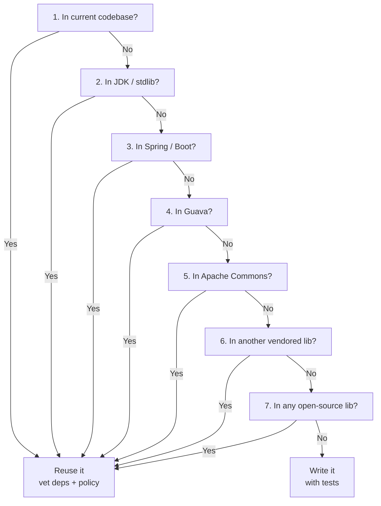
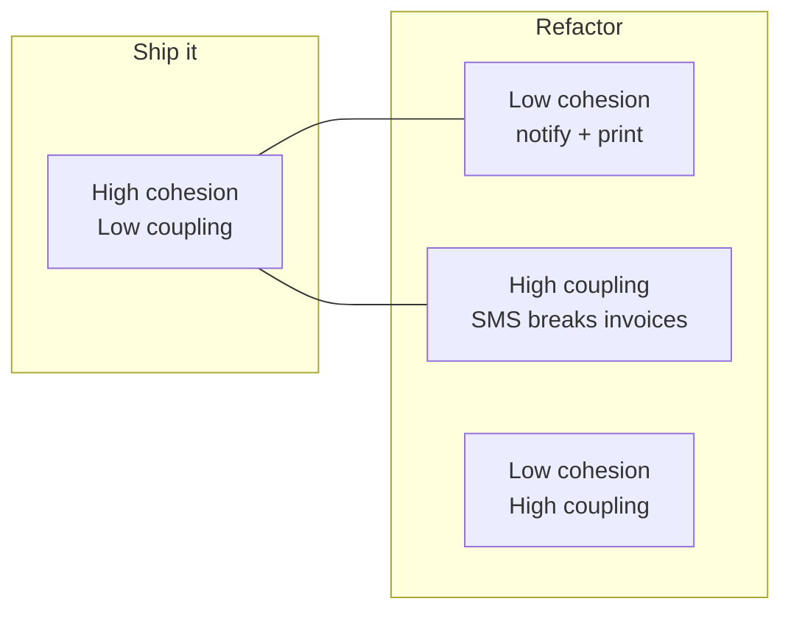
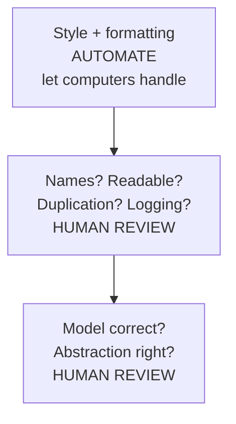

# Chapter 3: Writing Code — Definitive Summary
*From: Fundamentals of Software Engineering: From Coder to Engineer by Nathaniel Schutta & Dan Vega*
*Source PDF: pp. 89–118 (672-page PDF) — figures below cite PDF pages.*

> [!NAV] **Chapter Navigation**
> ⬅️ **Previous:** [[chapter-02-reading-code|Chapter 02: Reading Code]] | 🏠 **Index:** [[00-Master-Reading-Dashboard|Master Dashboard]] | ➡️ **Next:** [[chapter-04-modeling|Chapter 04: Modeling]]

---

## 1. Executive Summary & Core Problem

- **Core Thesis:** Writing code the computer accepts is trivial; writing code *humans* can read, maintain, and trust is the skill — and with AI generating ever more code, reviewing well (which demands writing well) matters more than ever. Don't write what you can reuse; keep what you write small, cohesive, and intention-revealing; document with tests, not comments; review with empathy.
- **The Core Problem Statement:** Developers write too much code — re-solving solved problems, generating boilerplate that lives forever, building clever/error-prone constructs, and "documenting" with comments that rot. Every extra line is surface area someone (often future-you) must load into a maxed-out human brain. Meanwhile reviews degenerate into checkbox theater or nitpick turf wars, and language parochialism narrows every solution to the one familiar hammer.
- **What This Chapter Covers (PDF pp. 89–118):** Code-is-communication premise; Fowler epigraph (p.88) → Don't reinvent the wheel + Judd's 7-question decision tree (pp.89–90) → What is good code? complexity metrics, PMD/SonarQube/JSHint/CodeScene (p.91) → Adding metrics to existing projects — subset-then-grow (p.93) → Hawthorne effect + coverage-from-single-digits-to-70% story (p.94) → Less is more, Kent Beck chunking (p.95) → Zeroth law: high cohesion/low coupling (p.96) → Boilerplate, composition-over-inheritance with Vehicle/EV (pp.97–98) → Short methods, no conjunctions (p.98) → Write-to-be-read: intent vs implementation, newspaper lede (pp.99–100) → Naming is hard: foo/bar, IDE postfix, gibberish game (p.101) → Comments problem: DRY, rot, change-blocks, why-not-what, maintainer counter (pp.102–103) → Tests as documentation + consumer contracts (p.104) → Avoid clever code: essential vs accidental complexity, dangling-`if` (pp.105–106) → Code reviews: pyramid, checkbox, PRs/LFTM, criticism, trust, bug-of-the-week (pp.106–110) → Learning new languages: immersion, one-a-year-or-two, communication-not-math (pp.110–113) → Practice (katas), Resources (pp.114–116).
- **Epigraph:** *"Any fool can write code that a computer can understand. Good programmers write code that humans can understand."* — Martin Fowler (p.88). AI footnote (p.116): AI never asks whether it *should* write the code — you must.

---

## 2. In-Depth Concepts & Mechanics

### 2.1 Don't reinvent the wheel — Judd's decision tree (PDF pp. 89–91)

- **Intuition:** before pounding out excellent lines, check whether the universe already solved it. Five minutes of searching can save hours (Ch.1's Capitalization Assignment is the proof).
- **The tree (Christopher M. Judd, taught in boot camps — adapt to your stack), in order:**
  1. Is it already done *in the current codebase*?
  2. Does the **JDK** (your language stdlib) already do it?
  3. Does **Spring / Spring Boot** (your framework) solve it?
  4. Does **Google Guava**?
  5. Does **Apache Commons**?
  6. Does *any other library already in the project* solve it?
  7. Does *any open-source library* solve it?
  All-no → write it, with tests. Any-yes → reuse it; you just saved yourself days.
- **Cautions:** vet transitive dependencies and follow org policy before adding anything ad hoc. And yesterday's best practice is tomorrow's anti-pattern — never copy a pattern (or accept AI output) without asking *why* it fits today. Languages, frameworks, techniques move fast; keep a weather eye on the horizon (fresh-eyes principle, Ch.1).
- **Alice example:** Alice needs CSV parsing. Lazy path: codebase already vendors Commons CSV (question 6 — yes in 2 minutes). Eager path: hand-rolled splitter that breaks on quoted commas by Friday's demo. Same demo, but only one Alice spends the weekend fixing escaping bugs.

### 2.2 What is good code? — smell, metrics, analyzers (PDF pp. 91–95)

- **Definition by nose:** hard to define, known on sight (Potter Stewart paraphrase). Overly long methods *smell* — but examine before condemning; sometimes no simpler approach exists. Everyone denies writing bad code; everyone has.
- **Instruments, not oracles:**
  - **Cyclomatic complexity:** number of independent paths through code — more paths, more test burden, refactor candidate.
  - **Analyzers:** PMD, SonarQube, JSHint (per language), CodeScene — catch bug classes and bad practices early. Your org likely has one; if unsure ask; if none, champion adoption.
  - **Coupling signals:** external coupling / fan-in (classes depending on this one). High coupling suggests refactor — *unless* the class is a façade *hiding* a subsystem, where high fan-in is the job. Contextualize every metric.
- **Rolling metrics into a legacy project (p.93 sidebar — do NOT turn on all rules):** rules contradict each other, and hundreds/thousands of warnings demoralize while moving the graph "an imperceptible couple of pixels" per fix-session. Instead: team-pick a *few* agreed rules → fix to green → enable a couple more → rinse. Months later: rich rule set, cleaner code, intact morale.
- **Hawthorne effect as tool (p.94):** people change behavior when observed — post the coverage number, praise upticks in standups/retros, have authors present tricky-test techniques. Story ("Nate here"): joined a project with tests mostly *skipped* ("kept failing"), single-digit coverage. He posted the number everywhere, celebrated rises — months later nearing **70%**, far less brittle. Measurement + attention moved the culture.
- **Metric abuse warning (p.94–95):** lines-written/deleted/modified as performance scores; coverage without asserts (Ch.2's 92% parable). Link metrics to project goals, watch *trend direction* over short horizons, stay ready to adjust — and wire analyzers into editors so feedback lands as you type.

### 2.3 Less is more — chunking for maxed-out brains (PDF pp. 95–96)

- **Kent Beck frame:** design creates chunks/slices that fit a human mind; software grows unboundedly, minds don't — so keep re-chunking. Smaller codebases onboard faster (weeks/months of Getting-Started + lunar-cycle builds is the big-ball-of-mud tax), hold less in heads, and split more cleanly (a force behind microservices/functions).
- **Four levers (following sections):** zeroth law, boilerplate discipline, composition, short methods.

### 2.4 The zeroth law — high cohesion, low coupling (PDF p.96)

- **Definitions:** **cohesion** = likeness-together (notification function containing print logic = low cohesion). **Coupling** = interdependence (changing notification breaks printing = tight coupling). Goal: *high cohesion, low coupling* — readable, maintainable, evolvable. Patterns and (at best) microservices are this law at different altitudes.
- **Bob example:** Bob's `notify()` also formats print margins. Changing SMS templates re-breaks invoices — tight coupling, low cohesion. Split: `Notifier` (one reason to change) + `PrintFormatter` (another). Now each fits in a head.

### 2.5 Beware boilerplate (PDF p.97)

- **Rule:** generated-or-not, boilerplate is carried for the project's lifetime. Classes: a few pages at most — if you scroll, suspect length (verbosity varies by language; with modern monitors, target ~one screen). Less to load into brains = faster comprehension.
- **Corollaries:** favor libraries over scaffolding you own; delete dead code instead of curating it; treat "the framework made me" as a smell worth a second look.

### 2.6 Favor composition over inheritance (PDF pp. 97–98)

- **Intuition:** inheritance (`is-a`) is powerful and overused — especially as a *reuse mechanism* ("reuse is a byproduct, not a rationale"). Composition (`has-a`) flexes when the taxonomy shifts.
- **The book's Ruby-pseudocode trap:**

```ruby
class Vehicle { Engine engine; Integer num_wheels; Integer num_doors
  brake(); accelerate() }
class Truck < Vehicle { Number tow_capacity }
class ElectricVehicle < Vehicle { Number range; # wait… EVs don't have engines… }
```

A cat-is-a-mammal works; a combustion-engine-on-the-superclass breaks the moment EVs (no engine) arrive — the hierarchy bakes a false universal. Composed version: `Vehicle` *has-a* `Powertrain` (combustion | electric | hybrid); new powertrains plug in without rewriting ancestry. Use inheritance for true stable `is-a`; default to composition.

### 2.7 Favor short methods (PDF p.98)

- **Rule:** single-digit lines; like a Unix tool — do one thing, do it well, compose toward larger goals. **Conjunction test:** `and/or/but` in the name = doing too much. Hard to name? Probably doing too much — split and see. Be descriptive, de-duplicate even small logic, then simplify again.
- **Alice example:** `validateAndSaveAndNotify(order)` (23 lines) → `validate(order)` + `save(order)` + `notifyCustomer(order)` — each 4–8 lines, each name self-proving, each testable alone.

### 2.8 Write code to be read — intent vs implementation, newspaper model (PDF pp. 99–100)

- **Fowler's razor:** the gap between *intent* and *implementation* should be closable from the name alone — read the signature, know what it does, open the body only for curiosity. That pressure yields few-line, sometimes one-line, intention-clear functions; class names supply context headlines.
- **Inverted-pyramid reading:** newspaper lede → key facts → deep background; readers stop where satisfied. Code likewise: class name (headline) → skim signatures (story) → drill into bodies/callees (background). Never bury the lede — the what-and-why belongs at the top, not line 200.
- **Naming is hard (p.101 sidebar) — practical kit:** `foo/bar/foobar` proliferate because good names cost thought — spend it ("take the time it takes…"). Enlist teammates (explaining often surfaces the name), IDE postfix completion (`new Arrays.asList("Red","Green","Blue")` → suggested variable), agentic tools for inspiration. Rename freely with modern refactoring tools — but endlessly churning *core domain* names signals a misconception problem (fix the understanding, Ch.1 §2.7). Stuck? play the **gibberish game**: coin a nonsense word, keep modeling, replace with the now-obvious real term later.

### 2.9 The problem with comments (PDF pp. 102–103)

- **Core charge:** comments restate code → **DRY violation** (usually code-clone, but prose-clone counts). You write the code, then write *about* the code; later you change the former without the latter, and the divergence sediments confusion for the next reader.
- **Prescription:** time is better spent making code readable — expressive language, careful names — than narrating it. Good names beat comments; tempted to comment? rename first — it nearly always removes the need.
- **Worst offenders:** file-header change-blocks (hundreds of lines of ticket/date/name archaeology) — let source control do its job.
- **When comments earn their keep:** the non-obvious *why* you couldn't simplify away — algorithm choice rationale, gnarly-but-necessary logic (then still try rewriting first), reminders/warnings to future-you. The apocryphal `total_hours_wasted_here = 42` "don't optimize this" signpost: sometimes genuine kindness, sometimes fossil — judge by whether it explains *why*.
- **Bob example:** `// increment i` above `i++` (prose-clone — delete); `// Fisher–Yates chosen over sort-by-random because…` above a shuffle (why — keep).

### 2.10 Tests as documentation (PDF pp. 104–105)

- **Thesis:** READMEs/comments/specifications drift from code immediately; **tests written alongside code** are executable specs that CI keeps honest, refactor freely, and signpost followers (deep dive: Chapter 5). Characterizing old code with new tests captures what you learn *for* the next reader — rename + prune + cover = leave it better.
- **Consumer-driven contracts:** for service consumers, prose API comments are second-best; contracts (Spring Cloud Contract, Pact per platform) simulate expected behavior as runnable tests — providers evolve freely while contracts hold, consumers upgrade without fear. Keep your contracts green and your prose short.
- **Concrete recall:** Ch.2's three tests *are* this section in action — bulk-price expectation ($500→$450), review workflow (4.2 + notify), expiry boundary (`EXPIRED_CARD`) document better than any comment block.

### 2.11 Avoid clever code (PDF pp. 105–106)

- **Brooks frame ("No Silver Bullet"):** **essential complexity** (business nuance, team coordination, codebase evolution — comes with the paycheck, irreducible) vs **accidental complexity** (noisy tech, heavyweight tooling, show-off constructs — removable; stay vigilant, be skeptical of revolutionary silver-oil, demand extraordinary evidence). When in doubt, keep it simple (Ch.6 expands).
- **Error-prone forms:** Java's optional braces on single-statement `if`:
```java
if (condition)
  doFoo();
  doBar(); // INDENT LIES: always runs — one author lost ~2 weeks here
```
Someone *will* add the second line and trust the indent. Braces always; encode it in standards; enforce with static analysis in the pipeline. Generalize: if your toolchain has a known footgun, outlaw it by default.

### 2.12 Code reviews — pyramid, empathy, trust (PDF pp. 106–110)

- **Shape:** reviews span hallway method-glances to multi-hour walkthroughs; all forms share the purpose — learn, share experience, socialize knowledge. More eyes is why pair programming works.
- **The Code Review Pyramid (spend low, automate high):** automate formatting/style (computers do it free); spend human attention *below* that line — clear names? readable? duplication? logging/tracing/metrics? interface consistency? error-prone forms? model/abstraction right?
- **Conduct — don't be snarky:** feedback-seeking is stressful; sarcasm and trivia-flexing ("today I will display my esoterica") corrode. Downey's razor: *"The only way to make something great is to recognize that it might not be great yet"* — critique the code toward the best solution, never the coder's worth.
- **Avoid the checkbox review:** mandatory-review gates decay into box-ticking for compatriots — small batches keep reviews real. PRs specifically: comfortable async, but fertile for nitpick/turf/re-litigation, toneless text that reads acidic, and **LFTM ("looks fine to me")** rubber-stamps; juniors especially may dread them. Empathy + senior example-setting are the fix.
- **Receiving criticism:** code isn't identity; everyone errs. Keep it on the code, stay humble, ask helpful questions, sandwich with genuine compliments, share personal war stories (they diffuse resistance), avoid blanket "won't work" without full context (missing constraints?), and take sensitive threads 1:1 — never ambush.
- **Fostering trust (the point):** shared ownership, learning, growth — no confusing idioms, no deprecated paths. Tactics: **bug-of-the-week**, Friday-standup interesting-defect round (assumed-shared knowledge rarely is), regular adapt-and-adjust retros whether "Agile" or not. Be kind; do what's right; do what works.

### 2.13 Learning new languages — immersion, tools-not-tribes (PDF pp. 110–113)

- **Why:** writing skill needs writing — but new languages accelerate it. Like moving to Paris for French: build a real (work- or home-plaguing) app in it, follow its community/podcasts/conferences, attend the local user group. Months-to-years of translating-into-native gives way to dreaming in it; programming grammars are just stricter with fewer keywords.
- **Tools, not identity:** C for embedded portability/optimization the way hammers drive nails — fit matters, tribes don't. Beware first-language attachment. Influential advice: a new language every year or two; early career go deep on daily drivers *while* sampling.
- **Pick different, not adjacent:** Java veteran? C# teaches little; Ruby (dynamic) or Haskell (functional) rewires how you write Java afterward — even cursory exposure alters approach. More languages → more comparison points → first-language-zero becomes fifth-language-pattern-matching.
- **Communication framing (p.112 sidebar):** programming lived in math departments; some still filter by math exams — but research says **language aptitude predicts pickup speed far better than math**. The computer accepts anything grammatical; *humans* are the hard audience. Good writers of every kind keep the reader front of mind.

---

## 3. Important Figures, Diagrams & Visual Architecture

> Chapter 3 has **no numbered figures** in the source. Below are study-aid reconstructions of its named decision structures — not book figures.

| Figure | PDF Page | Description |
|--------|----------|-------------|
| Synthesis S3-1 | pp. 89–90 | Judd's don't-reinvent decision tree (7 questions) |
| Synthesis S3-2 | p. 96 | Zeroth law: cohesion vs coupling quadrants |
| Synthesis S3-3 | pp. 107–108 | Code Review Pyramid — automate top, spend humans below |

### S3-1. Judd's decision tree — search order before writing
- **Reference:** "Don't Reinvent the Wheel" → 📕 PDF pp. 89–90 — open the source PDF at those pages to compare the 7-question list.
- **Flow:** walk the reuse ladder top-down; first "yes" wins; all-"no" earns the right to write (with tests).



- **Takeaway:** reuse is a discipline with an order — local first, world last — plus dependency/policy hygiene.

### S3-2. Zeroth law quadrants
- **Reference:** "The Zeroth Law of Computer Science" → 📕 PDF p. 96.
- **Flow:** only one quadrant ships calmly.



- **Takeaway:** like-things-together, strangers-apart. Microservices at their best are just this law at service altitude.

### S3-3. Code Review Pyramid — where humans spend
- **Reference:** "Code Reviews" → 📕 PDF pp. 106–107.
- **Flow:** machines own the top; humans spend downward where judgment lives.



- **Takeaway:** every human minute spent on brace placement is stolen from the abstraction question only humans can answer.

---

## 4. Real-World Systems, Case Studies & Code Examples

- **Toolchain (pp.91–95):** PMD / SonarQube / JSHint per language; SonarQube + CodeScene for codebase insight; editor plug-ins + pipeline gates to shorten the loop. Org has one? Ask. None? Champion it — starting with 3 agreed rules, not 300.
- **Coverage turnaround (p.94):** skipped-tests + single-digit coverage → posted number + praised rises → ~**70%** in months. The instrument is trivial; the attention ritual is the mechanism.
- **Vehicle→EV composition (p.98):** the full Ruby-pseudocode hierarchy trap and its `Powertrain` fix — §2.6 above. Interview-whiteboard-ready in 60 seconds.
- **The dangling `if` (p.106):** two-line indent lie that cost one (nameless) author the better part of two weeks. Encode "braces always" in standards + analyzer; generalize to every known footgun in your stack.
- **Consumer contracts (p.104–105):** Spring Cloud Contract / Pact — provider evolves, contract holds, downstream sleeps. If your services still coordinate via wiki prose, this is the upgrade.
- **Review room smells:** checkbox gates, LFTM one-liners, PR nitpick wars, toneless "suggestions" that land as verdicts, ambush critiques in groups. Antidotes: small batches, 1:1s for heat, stories over proclamations, compliments that are real, bug-of-the-week rituals.

---

## 5. Trade-Off Matrix

| Approach | Upfront cost | Long-run payoff | Risk | Best used when | Avoid when |
|----------|-------------|-----------------|------|----------------|------------|
| Reuse (Judd tree) | Search + dep/policy vetting | Days saved; battle-tested code | Transitive bloat; version drift | Anything plausibly solved | Truly novel domain logic |
| Metrics + analyzers (subset-grow) | Rule debates + fix sessions | Steady cleanliness, morale intact | All-rules-on avalanche | Every project, from week one ideally | As dev-perf scores (LoC, raw coverage) |
| Short/cohesive/composed code | Design minutes | Heads hold it; onboarding fast | Over-splitting trivia | All production code | Spike you're deleting today |
| Tests over comments | Test-writing time | Executable docs; fearless refactor | Tests also need care | Behavior, workflows, boundaries | The *why* no test can carry — comment it |
| Human review below pyramid line | Reviewer hours | Shared ownership; catching model errors | Theater (checkbox/LFTM), tone damage | Small batches, kind tone | Style nits — automate those |
| New language yearly-ish | Nights/weeks immersion | Rewires daily-driver code | Tourist trivia without building | Adjacent-career growth | Week before a deadline in the old stack |

- **Heuristics:** *"If you think you need a comment, try renaming first."* *"Reuse is a byproduct, not a rationale"* for inheritance. *"Keep it simple"* against accidental complexity. *"Be kind; do what's right; do what works"* for reviews.

---

## 6. Jargon Buster & Key Terminology

- **Good code (smell):** hard-to-define, known-on-sight readability/maintainability; long methods smell but verify.
- **Cyclomatic complexity:** independent-path count; proxy for test/refactor burden.
- **PMD / SonarQube / JSHint / CodeScene:** analyzers/insight tools per language; wire into editor + pipeline.
- **Hawthorne effect:** observed people change behavior — post the number, celebrate rises (use honestly).
- **External coupling / fan-in:** dependents count; high = refactor candidate *unless* it's a façade doing its job.
- **Zeroth law:** high cohesion (like-with-like), low coupling (independent change). The chapter's load-bearing law.
- **Boilerplate:** own-it-forever scaffolding, generated or not; minimize.
- **Composition over inheritance:** `has-a` Powertrain beats `is-a` engine-taxonomy when the world shifts; reuse ≠ rationale.
- **Intent vs implementation (Fowler):** name closes the gap; bodies become optional background.
- **Inverted pyramid / don't bury the lede:** headline names → skimmable signatures → drillable bodies.
- **Gibberish game:** placeholder-word now, precise term after modeling clarifies thought.
- **DRY (comments violate it too):** prose restating code rots alongside; rename > narrate; change-blocks belong in VCS.
- **Consumer-driven contracts (Pact / Spring Cloud Contract):** runnable API expectations freeing both sides to evolve.
- **Essential vs accidental complexity (Brooks):** irreducible domain-ness vs self-inflicted cleverness — remove the latter relentlessly.
- **Error-prone forms:** toolchain footguns (dangling `if`); outlaw + auto-enforce.
- **Code Review Pyramid:** automate style; humans judge names, duplication, observability, model.
- **Checkbox / LFTM review:** gate-theater and rubber-stamps; small batches + empathy cure.
- **Kata:** martial-arts-derived practice problem; solve repeatedly, in several languages/ways, review old solutions.

---

## 7. Takeaways

### Production Engineering Checklist
- [ ] Run Judd's 7 questions before any non-trivial new code; log the search (2 lines) in the PR.
- [ ] Keep methods single-digit lines, conjunction-free names, classes screen-sized; split on naming pain.
- [ ] Rename before commenting; reserve comments for the irreducible *why*; delete change-block headers.
- [ ] Cover new behavior with tests (incl. one boundary case); prefer contracts over prose for service APIs.
- [ ] Review below the pyramid line with empathy: small batches, real compliments, stories, 1:1s for heat, bug-of-the-week ritual.

### Interview / Career Strategy
- **"Good code" answer:** intent-revealing names + newspaper readability + tests-as-docs + analyzer-clean, with the EV-composition story (60 seconds) and the dangling-`if` war story (standards + pipeline enforcement) as proof.
- **Review philosophy:** "Automate style; spend humans on model and abstraction; small batches; kind, specific, story-backed feedback." Panels hire this.
- **Learning narrative:** "Yearly I build one real app in an unlike-my-daily-driver language — Ruby after Java, say — and my Java changes. Language aptitude, deliberately trained."

### Mastery Q&A (with answers — folds in "Putting It into Practice," PDF pp. 114–115)

**Q1. I want to get better. What's the minimum effective dose?**
*Answer:* Practice, deliberately: every ~2 months block 2 hours for a **code kata** — solve it in 2–3 languages, or pair through it, or solve one kata 3 ways, or review a kata solution from months ago and note what you'd change. No shortcuts; the old Carnegie-Hall joke applies. Add open-source contributions (trending repos; first-timer bugs + welcoming maintainers) and periodic "what's new in my stack" sweeps (a few hours 1–2×/year beats drowning in 3 years of release notes). Volunteer code for a nonprofit counts double — reps plus purpose, possibly in your target language.

**Q2. How do I add a linter to a 3-year-old codebase without a revolt?**
*Answer:* Never "all rules on" (contradictions + hundreds of warnings = demoralization). Team-pick a few consensual rules, fix to green together, enable a couple more, repeat. Months later you own a rich set — and the team owns it too.

**Q3. Comments or tests?**
*Answer:* Tests for *what/how*; comments only for the *why* that resists simplification — algorithm rationale, necessary gnarliness, honest warnings. Everything else: rename, shrink, compose until the comment is redundant. For service consumers, contracts over prose.

**Q4. My PRs get LFTMs or flame wars. Fix?**
*Answer:* Shrink batches (reviewable in <30 min), automate style so humans never discuss it, ask questions not verdicts, move heat to 1:1, lead with what's good, share a story where you made the same mistake. Institute bug-of-the-week so review feels like shared learning, not tribunal.

**Q5. Which language should I learn next?**
*Answer:* One *unlike* your daily driver (Java → Ruby/Haskell, not C#), learned by building something real + joining its community. Expect translation-phase slowness for months — then new idioms leaking (usefully) into your day job. Early career: depth on the paycheck stack first, breadth always simmering.

### Sources — Additional Resources (PDF p.116)
- "Portrait of a Noob," Steve Yegge
- Discussion thread on favoring composition over inheritance
- *The Mythical Man-Month* (Anniv.), Frederick P. Brooks (O'Reilly, 1995)
- "An Appropriate Use of Metrics," Patrick Kua
- "Simple Made Easy," Rich Hickey

> [!FOOT] **Chapter Footnotes (PDF p.116)**
> AI can't judge *should* vs *can*. Freeway-trooper = Hawthorne. One screen per class (modern monitors). Comment-avoidance marks experience (pragmatism > dogmatism). Spring REST Docs keeps docs in sync. The 2-week `if` debugging victim stays nameless. "Looks good to me" wastes human review. First-timer bug lists + helpful maintainers. Tech upgrades compound — sweep periodically.

---
> [!NAV] **Chapter Navigation**
> ⬅️ **Previous:** [[chapter-02-reading-code|Chapter 02: Reading Code]] | 🏠 **Index:** [[00-Master-Reading-Dashboard|Master Dashboard]] | ➡️ **Next:** [[chapter-04-modeling|Chapter 04: Modeling]]
