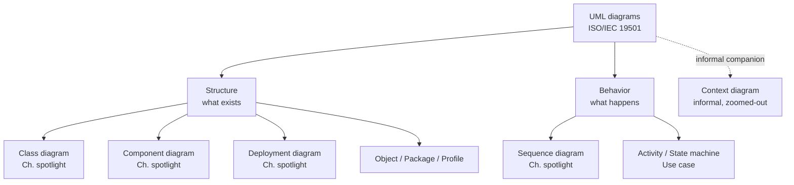
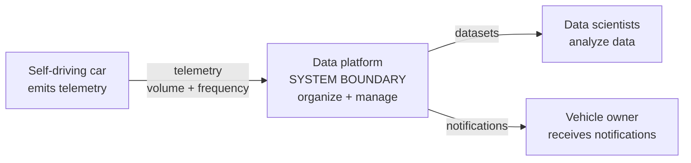
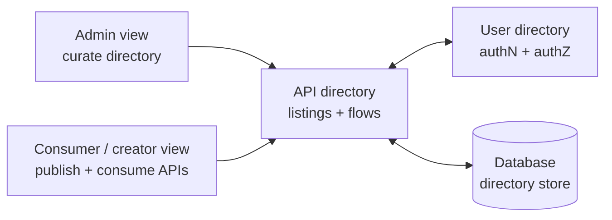
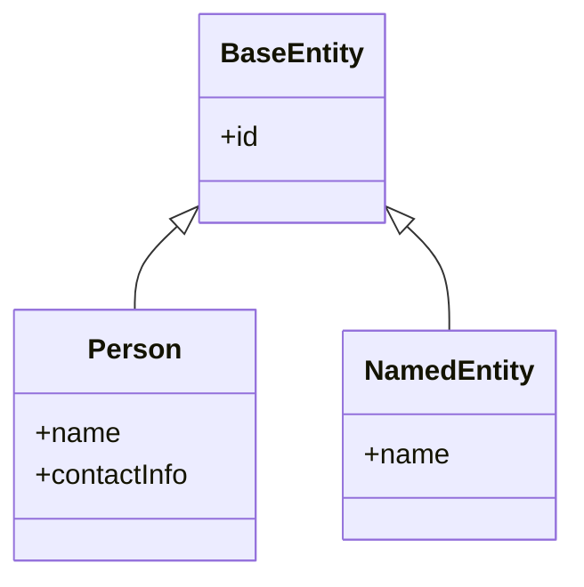
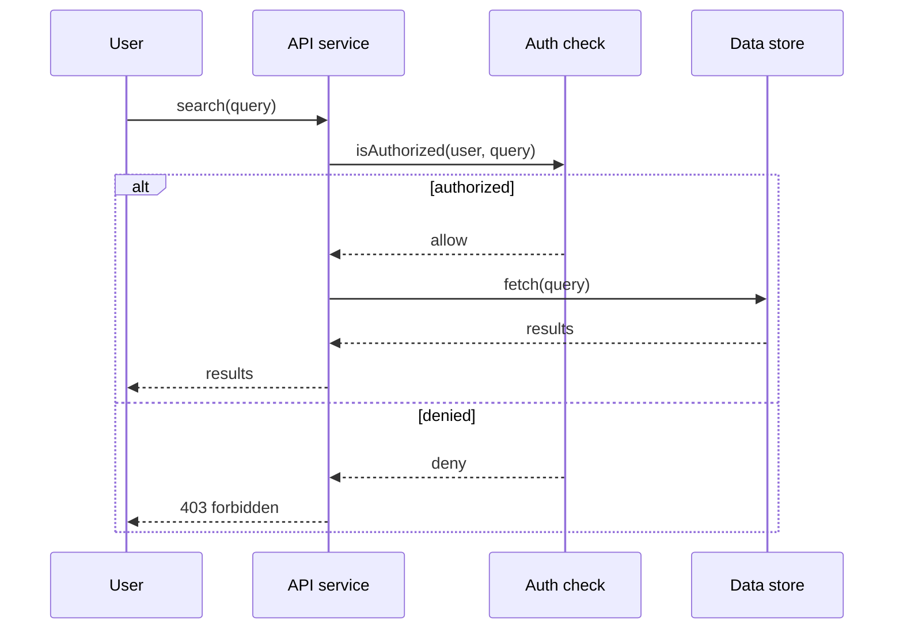
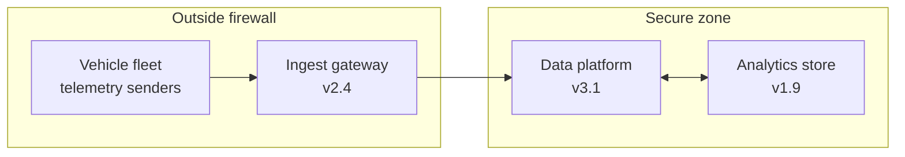
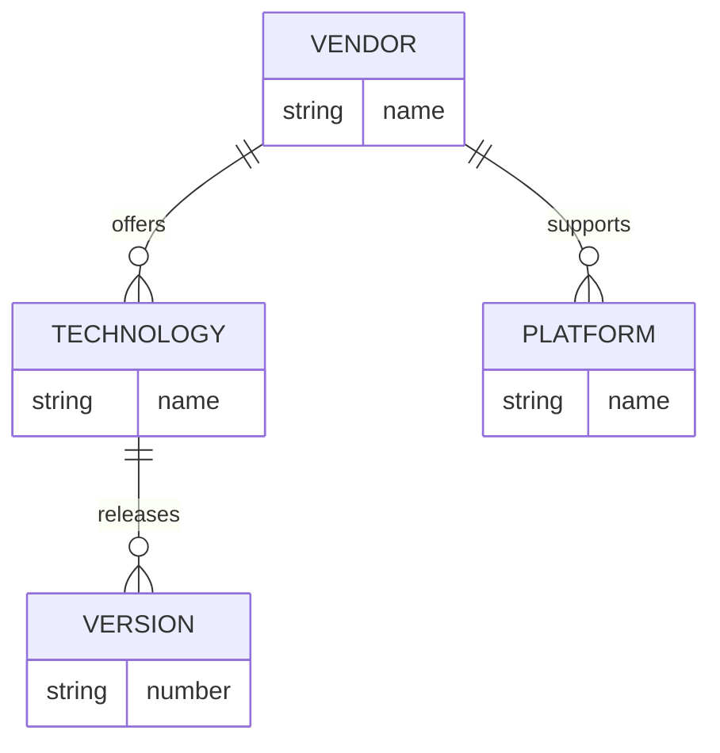
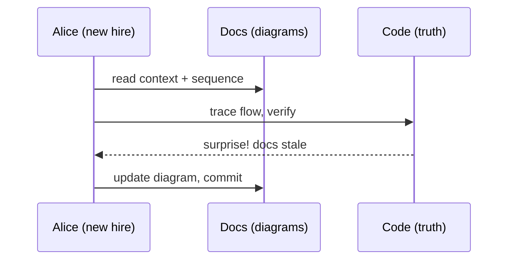

# Chapter 4: Modeling — Definitive Summary
*From: Fundamentals of Software Engineering: From Coder to Engineer by Nathaniel Schutta & Dan Vega*
*Source PDF: pp. 119–152 (672-page PDF) — figures below cite PDF pages.*

> [!NAV] **Chapter Navigation**
> ⬅️ **Previous:** [[chapter-03-writing-code|Chapter 03: Writing Code]] | 🏠 **Index:** [[00-Master-Reading-Dashboard|Master Dashboard]] | ➡️ **Next:** *Chapter 05 (in next batch)*

---

## 1. Executive Summary & Core Problem

- **Core Thesis:** Communication is your job, and code alone doesn't always carry it — models (box-and-line diagrams of structure, behavior, and deployment) express technical intent to everyone from owners to security. But diagrams don't compile, rot fast, and mislead when aimed at the wrong audience. So: know *which* diagram answers *whose* question, keep each brutally simple, and treat code as the ultimate truth.
- **The Core Problem Statement:** Teams drown two ways — no shared picture (six people, six mental architectures, misconceptions no test catches) or diagram theater (a wall-sized, color-dependent, crossing-line-free masterpiece nobody including the architect can decode, printed in grayscale into meaninglessness, mandating use-case diagrams for a stories-driven Agile project). Both cost days of building the wrong thing that an hour of sketching would have prevented.
- **What This Chapter Covers (PDF pp. 119–152):** Why model — blueprints vs refactorable software, Reeves "code as design" (pp.119–120) → Diagrams' uses: context, complexity, quality attributes, planning, archeology, onboarding, debugging; expiration dates; redraw-signal TIP (pp.120–121) → Tools panorama (p.122) → Which diagrams: formal vs informal, audience size (pp.122–123) → UML overview Fig 4-1 + filled-vs-empty-diamond box (p.125) → Context Fig 4-2, self-driving car (pp.125–127) → Component Fig 4-3, API directory (pp.128–129) → Class Fig 4-4, Person/NamedEntity/BaseEntity (pp.129–132) → Sequence Fig 4-5, authorized search (pp.132–134) → Deployment Fig 4-6, secure zone (pp.134–137) → Security Fig 4-7, HTTPS/LDAP (pp.137–139) → Data models Fig 4-8, tech/vendor ER (pp.139–140) → Additional diagrams: event storming, value-stream, story mapping, DR (pp.141–142) → Best practices: simplicity, audience, color, standards + "Do I really need this?" use-case pushback (pp.142–145) → Tools catalog + code-gen history + version control (pp.145–149) → Practice, Resources (pp.149–150).
- **Epigraph:** *"All models are wrong, but some are useful."* — George E.P. Box (p.118). The chapter is the art of staying on the useful side.

---

## 2. In-Depth Concepts & Mechanics

### 2.1 What modeling is and why bother (PDF pp. 119–121)

- **Definition:** creating abstract representations of structure, behavior, and functionality to understand, analyze, and communicate a system — guiding developers, designers, and stakeholders through design and development, reflecting the real problem domain.
- **Borrowed — with a crucial difference:** software apes construction blueprints, UML waves, now C4. But houses can't refactor: load-bearing walls can't be A/B-tested in production, so blueprints carry code-compliance, routing, owner sign-off, and as-built verification. Software *can* change in hours for hundreds of dollars — if houses worked that way, blueprints would matter far less. Add Reeves (*Code as Design*): programming *is* design, and code is its purest expression. Diagrams never compile into shipped value.
- **So why draw? Six paying uses:**
  1. **Context:** what's inside vs outside the boundary.
  2. **Complexity management:** decompose the problem into holdable chunks.
  3. **Quality-attribute prediction/design** (nonfunctionals — Chapter 9): will this meet scale, resilience, security needs?
  4. **Planning:** an hour sketching can save days building (draw when it helps you think).
  5. **Archeology + onboarding + knowledge transfer:** first-contact maps of new systems — *assuming accuracy*.
  6. **Debugging:** boundaries + responsibilities suggest test cases and search areas. Some orgs mandate diagrams in the SDLC — blessing and curse.
- **Permanence rule:** value tracks accuracy; stale diagrams actively harm. Treat most as expirable — whiteboard-ephemeral by default, formalized only on the redraw signal. **TIP (p.121):** drawing the same diagram repeatedly? Formalize it in a tool, store centrally, plot big ones for the wall (cardstock makes them feel real) or photo them into docs. Never let tooling slow thinking — pencil first.

### 2.2 Which diagrams — formal vs informal, audience-first (PDF pp. 122–125)

- **Selection questions:** goal? complexity? risk? novelty? budget? business criticality? Answer those before picking a notation — "it depends" is the honest answer.
- **Formality tradeoff:** formal (UML, Fig 4-1) demands technical readers — smaller, precise audience. Informal reaches more people — larger, looser shared understanding. Almost nobody outside specialists reads Z notation (1970s math-based spec language); even UML's filled-vs-empty diamond (cascading-delete nuance — look it up, and note your audience won't know it) proves most engineers rationally choose informal-with-UML-flavor over strict UML. Simple that works beats correct that confuses.
- **UML box (p.125):** mid-1990s harmonization of 1980s/early-90s notations; OMG standard 1997; ISO/IEC 19501 (2005). Engineers still prefer informal. Don't shun what communicates.

### 2.3 Context diagrams (Fig 4-2, PDF pp. 125–127)

- **What:** the most zoomed-out view — system boundary, environment, interacting entities, data volume/frequency. Very high level; logical entities.
- **Who/when:** architects, leadership, PMs, product owners; early, to agree what's in/out — the map's edges.
- **Content (Fig 4-2):** self-driving-car data platform — car streams telemetry up; analysts/data-scientists consume; owners receive notifications. Three arrows tell the whole story: ingest, analyze, notify.

### 2.4 Component diagrams (Fig 4-3, PDF pp. 128–129)

- **What:** principal runtime elements, how they work together — structure, behavior, flows, interfaces.
- **Who/when:** developers, architects, support, DevOps; throughout — first as expected interactions, later as the technical story for transfer/onboarding.
- **Content (Fig 4-3):** API directory with dual views (admin view vs consumer/creator view), a user directory for authN/authZ, and a backing database. Two doors, one bouncer, one vault.

### 2.5 Class diagrams (Fig 4-4, PDF pp. 129–132)

- **What:** classes, inheritance + composition, cardinality (element counts), logical entities, methods where helpful.
- **Lifecycle warning:** extract from code on demand — hand-maintained ones rot instantly; large systems must split by domain boundary or overwhelm.
- **Who/when:** deeply technical (engineers, architects, ops); early overall picture, refined continuously; onboarding aid.
- **Content (Fig 4-4):** `Person` and `NamedEntity` as subclasses of `BaseEntity` — shared identity behavior at the root, human vs named-thing branches.

### 2.6 Sequence diagrams (Fig 4-5, PDF pp. 132–134)

- **What:** interactions over time for *one* flow — never every entity/flow (limitless). Documents the interesting/architecturally-significant or the canonical library-use pattern. May carry params/return types (helpful, rots fast); extractable from code for newcomers.
- **Who/when:** developers/solution architects build; developers, architects, DevOps — plus QA scoping tests — consume; early as pattern, always as transfer.
- **Content (Fig 4-5):** API search — client searches, service checks authorization, authorized requests flow to the store and return. One denied-path arrow saves pages of prose.

### 2.7 Deployment diagrams (Fig 4-6, PDF pp. 134–137)

- **What:** runtime view — hardware nodes + resident software, connections, protocols, cardinality. **Label logical vs physical:** a cluster-as-one-box (logical) vs every LB/server instance (physical).
- **Who/when:** architects, developers, DevOps, support, infra, security, middleware; early to validate quality attributes — 24/7 vs best-effort deploys differ radically; also scaling, continuity, cost-effectiveness.
- **Enterprise reality:** Lego blocks, not blank canvas — standard clouds, approved databases (AWS-shop draws AWS, Postgres-shop models Postgres, not MariaDB), reference architectures bounding choices.
- **Content (Fig 4-6):** self-driving-car platform split by firewall — secure-zone components vs outside; component versions noted.

### 2.8 Security diagrams (Fig 4-7, PDF pp. 137–139 — deployment specialization)

- **What:** deployment/technology view plus security mechanisms — protocols, zones, PII touchpoints, regulatory overlay.
- **Who/when:** developers, architects, security; throughout — defining the pattern and proving it meets security needs.
- **Content (Fig 4-7):** same car platform zoned by firewall, now annotated with **HTTPS** and **LDAP** — the two labels that turn a topology into a threat-model input.

### 2.9 Data models (Fig 4-8, PDF pp. 139–140)

- **Granularity ladder:** conceptual (high-level, unnormalized) → logical (business terms, normalized — redundancy-reduced for integrity) → physical (types, implementation). Detail grows downward.
- **Who/when:** customers → information architects → DBAs → architects/developers/support; early domain sketch, refined for life.
- **Content (Fig 4-8):** API-system ER — one technology → many versions; one vendor → many technologies *and* platforms.

### 2.10 Additional diagram-like artifacts (PDF pp. 141–142)

- **Event storming:** sticky-note workshops (in-person/virtual) mapping domain events + causing commands + executing actors, color-coded. Flexible, lightweight discovery.
- **Value-stream mapping:** current-state vs future-state flow analysis surfacing friction/bottlenecks.
- **User-story mapping:** stickies + rough sketches of UX — activities across the top, steps/details below — business + technical jointly.
- **Disaster-recovery models:** runtime entities on hardware, continuity requirements, outage blast-radius (people impacted × downtime cost); importance peaks near production.
- **Meta-point:** the *making* often matters most — groups discover they never shared an understanding of the problem at all.

### 2.11 Best practices (PDF pp. 142–145)

- **Keep it simple:** shock-and-awe diagrams (eye-chart text, spaghetti lines, shape soup) communicate only confusion. Never all-of-everything on one sheet — overview plus linked detail pages; split components at logical seams. Print-legibility test: if it isn't readable on paper, it isn't readable.
- **Know your audience (code's rule, Ch.3):** developer-perfect ≠ VP-comprehensible and vice versa. **Cautionary tale — Diagrams Require Context (p.144, "Nate here"):** proud of a complex, zero-crossing-line class diagram, Nate hands it to his architect — who shrugs it back. No cookie. The architect lacked domain depth to judge non-obvious errors; he could only trust it. Craftsmanship without shared context doesn't transfer.
- **Color discipline:** legend every meaning (your green-"new" isn't universal); assume grayscale printing *and* color blindness — always provide a non-color channel (labels, line styles, icons).
- **Standards + templates, lightly:** org-wide diagram set + palette = consistency; over-prescription = waste. **Pushback tale — Do I Really Need This? (p.145):** an architect template demanded a use-case diagram on an Agile-stories project — Nate skipped it rather than diagramming for diagramming's sake. Challenge templates that don't serve the project.

### 2.12 Tools + code-gen history + versioning (PDF pp. 145–149)

- **Catalog:** OmniGraffle (macOS/iOS stencils, low curve) · Visio (Windows, flowcharts→UML, Office-bundled, cloud-provider stencils) · Mural/Miro/Lucidchart (browser multiplayer whiteboards) · **Mermaid** (Markdown-text diagrams — flowcharts, sequences, classes — for docs/wikis; this book's reconstructions use it) · Structurizr (diagram-as-code DSL, C4-friendly plus cloud themes) · PlantUML (text→UML via CLI/GUI) · **your IDE** (native + plug-ins; often extracts models) · slides (PowerPoint/Keynote/Slides — ubiquitous, stencil-supplemented, collaborative) · AI extractors (review for hallucinations). Rule: pick what everyone can access/license.
- **Generating code from models (p.148 box):** round-trip modeling promised code-from-diagrams, but hand-added code got wiped on regeneration unless rules were obeyed perfectly; bidirectional sync never delivered the gains — now mostly software-history dust (safety-critical excepted; "today developers just vibe code, amirite?"). Inverse direction — models *from* code, on demand or per-commit — is the healthy pattern.
- **Version everything:** diagram-as-code diffs naturally; binaries version well enough in modern VCS. Fancy tools cost money and learning — regular use fixes only the second. Message first, tool second.

---

## 3. Important Figures, Diagrams & Visual Architecture

> All eight source figures reconstructed below in Mermaid. Labels use `<br/>` for compact high-contrast rendering in GitHub/Obsidian dark+light modes.

| Figure | PDF Page | Description |
|--------|----------|-------------|
| Fig 4-1 | p. 125 | Standard UML diagram taxonomy (adapted from Wikimedia Commons) |
| Fig 4-2 | p. 127 | Context — self-driving-car data platform |
| Fig 4-3 | p. 129 | Component — API directory (admin vs consumer views) |
| Fig 4-4 | p. 132 | Class — BaseEntity → Person, NamedEntity |
| Fig 4-5 | p. 134 | Sequence — authorized API search |
| Fig 4-6 | p. 137 | Deployment — car platform zoned by firewall |
| Fig 4-7 | p. 139 | Security — zoned deployment + HTTPS/LDAP |
| Fig 4-8 | p. 140 | ER — vendor/technology/version/platform |

### Fig 4-1. UML overview taxonomy
- **Reference:** Figure 4-1 → 📕 PDF p. 125 — open the source PDF at that page to compare.
- **Flow:** UML splits into structure (what's there) vs behavior (what happens); the book spotlights the six bolded workhorses below.



- **Takeaway:** learn the six spotlighted types deeply; treat the rest as on-demand vocabulary — and prefer informal renderings your audience already reads.

### Fig 4-2. Context — self-driving-car data platform
- **Reference:** Figure 4-2 → 📕 PDF p. 127 — open the source PDF at that page to compare.
- **Flow:** the whole system in three arrows: car emits, scientists analyze, owners get notified. Boundary explicit; internals hidden.



- **Takeaway:** if a stakeholder can't point to the boundary after 30 seconds, redraw — that's the diagram's entire job.

### Fig 4-3. Component — API directory
- **Reference:** Figure 4-3 → 📕 PDF p. 129 — open the source PDF at that page to compare.
- **Flow:** two audience views converge on one directory, gated by the user directory, persisted in one store.



- **Takeaway:** component diagrams answer "what talks to what at runtime" — interfaces and flows, not classes.

### Fig 4-4. Class — BaseEntity hierarchy
- **Reference:** Figure 4-4 → 📕 PDF p. 132 — open the source PDF at that page to compare.
- **Flow:** shared identity at the root; human vs named-thing specializations below.



- **Takeaway:** extract (don't hand-maintain) hierarchies like this; split by domain when the single sheet overwhelms.

### Fig 4-5. Sequence — authorized API search
- **Reference:** Figure 4-5 → 📕 PDF p. 134 — open the source PDF at that page to compare.
- **Flow:** search → authorize → gated store access → results; the denied branch is the security story.



- **Takeaway:** one flow, only involved entities, both branches — the template for every sequence worth drawing.

### Fig 4-6. Deployment — car platform zones
- **Reference:** Figure 4-6 → 📕 PDF p. 137 — open the source PDF at that page to compare.
- **Flow:** firewall partitions trusted inside from exposed outside; versions pinned per node.



- **Takeaway:** label logical-vs-physical explicitly; this logical view validates 24/7, scaling, and continuity before money is spent.

### Fig 4-7. Security — zones plus protocols
- **Reference:** Figure 4-7 → 📕 PDF p. 139 — open the source PDF at that page to compare.
- **Flow:** Fig 4-6's topology with the two annotations that make it a security argument: HTTPS on wire paths, LDAP at the identity check; PII/regulations overlay mentally.

```mermaid
flowchart LR
    subgraph OUT2["Outside firewall<br/>treat as hostile"]
        CAR3["Vehicle fleet"]
        GW["Ingest gateway"]
    end
    subgraph IN2["Secure zone"]
        PLAT2["Data platform"]
        IDP["Identity service<br/>LDAP"]
        DB2[("PII store")]
    end

    CAR3 -- "HTTPS" --> GW
    GW -- "HTTPS" --> PLAT2
    PLAT2 <--> IDP
    PLAT2 <--> DB2
    Note over CAR3,GW: all exterior traffic encrypted
```

- **Takeaway:** protocols + zones + PII marking turn topology into a reviewable security claim.

### Fig 4-8. ER — vendor/technology/platform
- **Reference:** Figure 4-8 → 📕 PDF p. 140 — open the source PDF at that page to compare.
- **Flow:** vendors own technologies and platforms; technologies version independently.



- **Takeaway:** conceptual→logical→physical is a zoom control — pick the rung your reader needs, refine as the domain sharpens.

---

## 4. Real-World Systems, Case Studies & Code Examples

- **Self-driving-car thread (Figs 4-2/4-6/4-7):** one system shown at three altitudes — context (who's around it), deployment (where it runs), security (how it's defended). Alice presents the VP the context diagram, the on-call team the deployment, the audit the security view — same truth, three lenses. That's audience-first modeling in one example.
- **API-directory thread (Figs 4-3/4-5/4-8):** component (runtime doors), sequence (authorized search flow), ER (catalog data shape). Bob onboarding reads them in that order: where → how-one-flow → what's-stored. Fifteen minutes, productive by lunch.
- **Mermaid as the chapter practices (p.146):** text-defined, doc-embedded, diffable — the reconstructions above are runnable:



- **Tool-choice walkthrough:** solo spike → whiteboard + photo (fastest). Team design review → Miro/Lucidchart multiplayer canvas. Doc-embedded living diagrams → Mermaid/PlantUML/Structurizr in version control, optionally regenerated per commit. Enterprise-wide standard → Visio/OmniGraffle stencils + reference architectures. AI extraction → always human-reviewed.

---

## 5. Trade-Off Matrix

| Approach | Strength | Cost / Risk | Best used when | Avoid when |
|----------|----------|-------------|----------------|------------|
| Context diagram | 30-sec boundary alignment for everyone | Hides all mechanism | Project start; exec reviews | Engineers implementing flows |
| Component diagram | Runtime truth for builders + support | Rots as services shift | Design; onboarding; transfer | Non-technical audiences |
| Class diagram (extracted) | Precise relations for implementers | Overwhelms at scale; hand-versions rot | Focused domain slice, generated fresh | Wall-sized "complete" posters |
| Sequence diagram | One flow, both branches, QA-testable | Per-flow cost; param-rot | Significant/pattern flows | Exhaustive "all flows" attempts |
| Deployment (logical/physical) | Validates scale/continuity/cost early | Wrong if logical/physical unlabeled | Infra planning; incident prep | As the only diagram |
| Security specialization | Reviewable defense claim (zones+protocols+PII) | False comfort if stale | Audits; PII/regulated systems | Sketched once, never revisited |
| Data model (conceptual→physical) | Shared domain language → implementation | Premature normalization debates | Domain discovery onward | Before concepts stabilize |
| Event storming / story mapping / value-stream / DR | Shared understanding via making | Workshop time; facilitator needed | Discovery, UX, flow friction, continuity | Solo work answerable by a sketch |
| Formal UML | Precision for technical readers | Small audience; diamond-level trivia | Contract-grade specs | Broad/mixed audiences — go informal |
| Whiteboard-ephemeral | Fastest thought aid | Vanishes | Thinking, spiking | Repeatedly redrawn → formalize it |

- **Heuristics:** no diagram without an audience *and* a question it answers. Repeated sketch → formalize + version. Stale diagram > no diagram is false — stale misleads; expire or regenerate.

---

## 6. Jargon Buster & Key Terminology

- **Software modeling:** abstract representations of structure/behavior/functionality for understanding and communication.
- **Box-and-line diagram:** informal workhorse — boxes (things), lines (relations); UML-flavored but not UML-bound.
- **UML (Unified Modeling Language):** 1990s-harmonized notation family, OMG 1997, ISO/IEC 19501 (2005); precise, narrowly read. Filled-vs-empty diamond = composition-vs-aggregation (cascade-delete nuance) — the canonical "your audience won't know this" example.
- **C4 model:** modern layered modeling wave (context→container→component→code); Structurizr's home turf.
- **Z notation:** 1970s math-based formal spec language — the "who reads this?" test.
- **Context diagram:** zoomed-out boundary + environment + entity interactions (+volume/frequency).
- **Component diagram:** runtime elements, structure + behavior + flows + interfaces.
- **Class diagram:** inheritance/composition + cardinality + methods-where-helpful; extract, split by domain.
- **Sequence diagram:** one flow over time, involved entities only, both branches; QA-readable.
- **Deployment diagram (logical vs physical):** nodes + resident software + connections/protocols/cardinality; cluster-as-one vs every-instance — label which.
- **Security diagram:** deployment view + mechanisms (protocols, zones, PII/regulatory overlay).
- **Data model (conceptual→logical→physical):** domain sketch → normalized business terms → typed implementation.
- **Cardinality:** element counts in a relation (one-to-many etc.).
- **Normalization:** redundancy-reducing structuring for integrity.
- **Event storming / value-stream / story mapping / DR models:** workshop-derived discovery, friction analysis, UX mapping, continuity views.
- **Diagram-as-code (Mermaid/PlantUML/Structurizr):** text-defined, versioned, regenerable diagrams.
- **Code as design (Reeves):** programming-is-design; code is the purest design artifact — diagrams serve it, not vice versa.

---

## 7. Takeaways

### Production Engineering Checklist
- [ ] Before building: one context sketch (boundary all agree on) + one flow sequence (the risky/valuable path) — timebox to an hour.
- [ ] Label every deployment logical-vs-physical; pin versions; mark zones + protocols + PII on the security view.
- [ ] Extract class/sequence from code (IDE or pipeline) instead of hand-maintaining; split by domain when big.
- [ ] Legend all color + provide a non-color channel; print-test legibility before the review.
- [ ] Version diagrams with code; expire whiteboards; formalize anything redrawn thrice.

### Interview / Career Strategy
- **Whiteboard answer:** open with context (boundary), drill to one sequence (authorized path + denied path), land on deployment zones. Narrating altitude-changes signals senior modeling judgment.
- **Pushback story:** "Our template demanded a use-case diagram on a stories-driven project — I skipped it and showed the sequence that actually decided the design." Principled omission impresses more than compliant volume.
- **Security fluency:** annotate any deployment with protocols + identity + PII unprompted — reviewers read that as production experience.

### Mastery Q&A (with answers — folds in "Putting It into Practice," PDF pp. 149–150)

**Q1. When is a diagram worth the hour?**
*Answer:* When it answers someone's question cheaper than code can: boundary disputes (context), runtime surprises (component/deployment), flow misunderstandings (sequence), domain fog (data model/storming). An hour sketching that prevents days of wrong building is the ROI test. Otherwise whiteboard-and-photo — or nothing.

**Q2. Exercise: draw sequences for a flow you know. How do I get useful feedback?**
*Answer:* Pick one interesting flow in your app (or a familiar OSS library), draw 1–2 sequences (happy + denied/edge path, involved entities only), and ask a colleague: "could you implement/test from this?" Their confusion marks exactly what's missing — audience, not artistry, is the grade.

**Q3. Exercise: extract a class diagram. What should surprise me?**
*Answer:* Run your IDE's extractor (`⌥⇧⌘U` / `Ctrl+Alt+Shift+U`) or Doxygen/Structurizr on your module. Surprises — god-classes, circular deps, inheritance where composition fits, cardinality you didn't believe — are the insights; each is a refactor candidate or a misconception exposed. Record which ones you'd split by domain.

**Q4. Exercise: what do I ask my architect about their diagrams?**
*Answer:* Get their context/deployment/sequence set, learn to navigate them, and ask: audience? logical-vs-physical? version-pinned? regenerated or hand-kept? What's deliberately omitted? Then propose one improvement (a missing denied path, an unlabeled zone) — and if nothing auto-generates in CI/CD, pitch adding it.

**Q5. Formal UML or informal boxes?**
*Answer:* Audience decides. Contract-grade precision among fluent readers → formal. Mixed/broad audience → informal with UML seasoning. The diamond trivia is the litmus: if readers don't know filled-vs-empty, formality costs comprehension. Simple that communicates beats correct that confuses.

**Q6. My diagram is beautiful and nobody understands it. Fix?**
*Answer:* Nate's zero-crossing-lines lesson: craftsmanship ≠ communication without shared context. Halve the entities (overview + linked details), add the missing domain legend, print-test it, and walk one reader through it live. Their first confusion is your first edit.

### Sources — Additional Resources (PDF p.150)
- The C4 model for visualizing software architecture
- *User Story Mapping*, Jeff Patton (O'Reilly, 2014)
- *Communication Patterns*, Jacqui Read (O'Reilly, 2023)
- *Creating Software with Modern Diagramming Techniques*, Ashley Peacock (Pragmatic Programmers, 2023)
- *UML Distilled* (3rd Ed.), Martin Fowler (Addison-Wesley Professional, 2003)

> [!FOOT] **Chapter Footnotes (PDF p.151)**
> "Architect/QA/librarian/scientist/ontologist" — borrowed titles included. Refactoring costs more than assumed. Stale-enough diagrams actively harm. Code↔model generation both ways (codegen mostly historical outside safety-critical). Z notation: 1970s math-based spec language. Diamonds = cascade-delete nuance. Cardinality = set sizes. Normalization = redundancy reduction. Someone always wants print. Nate wanted a cookie. "Vibe code" acknowledged.

---
> [!NAV] **Chapter Navigation**
> ⬅️ **Previous:** [[chapter-03-writing-code|Chapter 03: Writing Code]] | 🏠 **Index:** [[00-Master-Reading-Dashboard|Master Dashboard]] | ➡️ **Next:** *Chapter 05 (in next batch)*
