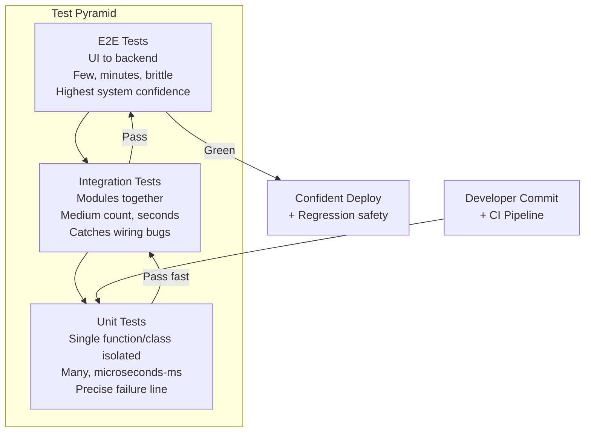
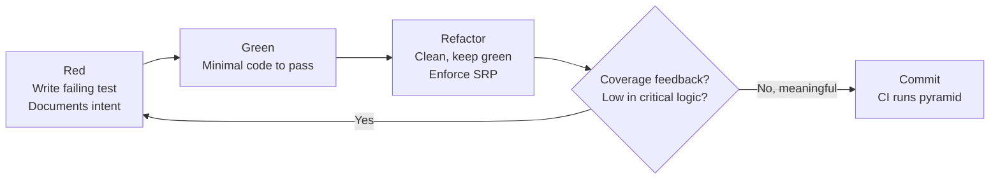
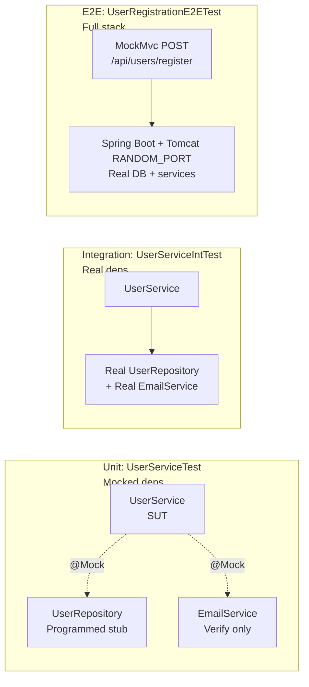

# Chapter 05: Automated Testing — Definitive Technical Summary
*From: Fundamentals of Software Engineering: From Coder to Engineer by Nathaniel Schutta, Dan Vega*
*Source PDF: pp. 153–180 — figures below cite PDF pages.*

> [!NAV] **Chapter Navigation**
> ⬅️ **Previous:** *None (Start of this batch)* | 🏠 **Index:** [[00-Master-Reading-Dashboard|Master Dashboard]] | ➡️ **Next:** [[chapter-06-exploring-and-modifying-unfamiliar-systems|Chapter 06: Exploring and Modifying Unfamiliar Systems]]

---

## 1. Executive Summary & Core Engineering Problem

- **Core Thesis:** Automated testing is not resume-driven overhead but the engineer's safety net: it documents intent, forces maintainable design (single-responsibility), enables fearless refactoring, and replaces flaky manual regression with fast repeatable verification. The chapter argues for a pyramid-heavy suite — many fast unit tests, fewer integration tests, very few end-to-end (E2E) tests — plus honest coverage and disciplined mocking.
- **The Core Problem Statement:** Without tests, every change is mountain-climbing without ropes. A naive `BlogPostController.publish(post)` that saves to DB + logs + sends email looks fine until you try to test it and discover it does three jobs, cannot be isolated, and any edit risks silent production regression. Manual re-testing of payment-card paths (e.g., adding Orange Pay) does not scale: humans vary, forget steps, and fixed bugs mysteriously return.
- **What This Chapter Covers (PDF pp. 153–178):** Benefits (Acts as Documentation p.153 → Improves Maintainability p.154 BlogPostController/SRP → Boosts Confidence p.155 safety-net/refactor → Consistency/Repeatability p.157 regression) → Types of Automated Testing p.158 + Fig 5-1 Pyramid p.159 (Unit p.160 → Integration p.161 → E2E p.162 → What Mix p.162 → What Not to Test p.163) → Code Coverage p.164 (map analogy, line/branch, 80–90% thresholds, gaming/vanity) → Writing Tests p.165 (Getting Started Java/JUnit/Maven p.165, TDD red-green-refactor vs test-last, AI NOTE → Assertions p.167 → Unit Tests Operations/SUT p.168 → Mocking Mockito UserService p.170 → Integration UserServiceIntTest p.172 → E2E SpringBootTest/MockMvc p.173) → Wrapping Up p.175 → Putting It into Practice p.176 (6 practices) → Additional Resources p.178 → Footnotes p.179.
- **Historical & Industry Context:** Manual QA checklists dominated early web development; continuous integration (run on every check-in, footnote p.179) made fast suites economical. Mike Cohn's test pyramid (cited p.159) corrected the ice-cream-cone anti-pattern (too many slow UI tests). JUnit (Kent Beck/Erich Gamma lineage) + Mockito + Spring Boot Test + AssertJ/Hamcrest now form the Java standard stack the chapter uses.

---

## 2. In-Depth Technical Concepts & Internal Mechanics

### 2.1 Why Test — Four Benefits

**2.1.1 Acts as Documentation (PDF p.153–154)**
- **Intuition:** Up-to-date docs are rare (footnote: "even rarer ... up-to-date and accurate"). Well-named tests are executable specs.
- **Mechanics:** New hire fixing "Orange Pay fails" finds `PaymentProcessorTests` with `shouldValidateValidCreditCardNumber`, `shouldProcessCreditCardTransaction`, `shouldProcessOrangePay`, `shouldFailWhenCreditCardTypeIsOrangePay`. IDE navigate-to-implementation jumps to service under test; failing test localizes culprit.
- **Example — Alice onboarding:** Alice greps `*Test.java`, reads test names as feature list, runs suite green, then breaks one deliberately to see mapping test→production line. She fixes real bug + updates frontend + docs.
- **Failure mode if skipped:** Sifting unfamiliar payment code or interrupting seniors; guessing instead of reading contracts.

**2.1.2 Improves Maintainability / Design Pressure (PDF p.154–155)**
- **Intuition:** Writing tests first is "thinking before you speak." Untestable code smells of bad design.
- **Mechanics — BlogPostController anti-pattern:**
  1. `publish(post)` does DB write + logging + email in one void method.
  2. Attempt to unit-test forces stubbing DB, log appender, SMTP — painful.
  3. Pain reveals Single Responsibility Principle violation ("a class should have only one reason to change").
  4. Refactor to `PostRepository.save()`, `AuditLogger.log()`, `SubscriberNotifier.notify()` — each independently testable/reusable.
- **Invariant:** If a unit test needs >2 mocks + static time + filesystem, the SUT likely does too much.

**2.1.3 Boosts Confidence / Safety Net (PDF p.155–157)**
- **Intuition:** Iterative development = write, experiment, refactor. Without net you code timidly; with net you try creative solutions.
- **Team capabilities unlocked:** Refactor confidently; ensure changes don't break existing functionality; catch issues pre-production; understand behavior; catch bugs when cheap; prevent regressions; verify spec compliance.
- **Mountain analogy (book):** No tests = free-solo; tests = ropes. Both can summit, only one survives a slip.

**2.1.4 Consistency and Repeatability (PDF p.157–158)**
- **Intuition:** Humans cannot repeat steps identically; scripts can at button-press / build time.
- **Mechanics:** Automated suite runs every commit (CI). Regression tests pin fixed bugs so they cannot silently return. Runs identically regardless of environment given hermetic fixtures.
- **Edge:** Flaky E2E (timing-dependent) destroys trust — quarantine or fix, never ignore.

### 2.2 Types of Automated Testing — The Pyramid

| Layer (bottom→top) | Scope | Speed / Volume | Failure signal | Book guidance |
| :--- | :--- | :--- | :--- | :--- |
| **Unit** (PDF p.160) | One function/class in isolation, deps mocked | Microseconds–ms; largest count; run constantly + CI | Points to exact line | Contract: any functional change should break its test. First defense alongside static analysis + review. |
| **Integration** (PDF p.161) | Multiple modules together (service+repo+email) | Seconds; medium count; run less often | Needs investigation which interaction failed | Catches wiring/contract issues invisible in isolation. SDLC integrity gate. Juggling-balls complexity. |
| **E2E** (PDF p.162) | Full stack UI→backend→DB simulating real user | Minutes; fewest; scheduled/nightly | Heavy debugging; brittle false negatives (CSS selector change ≠ functional bug) | Highest confidence that system works together. Worth cost despite brittleness. |

- **Trade-off law:** Higher up = slower + costlier to maintain + more likely to break. Hundreds/thousands × minutes = hours.
- **What Mix (PDF p.162–163):** No universal number; depends on complexity, stack, criticality, org standards. Keep balanced coverage of all layers.
- **What NOT to Test (PDF p.163) — four prohibitions:**
  1. Do not test language/framework code (JDK/Spring maintainers own it).
  2. Do not test generated code (getters/setters/builders/auto DTOs).
  3. Do not test private methods directly — test via public interface that calls them.
  4. Do not hit external services in unit tests — use mocks (unit) / test doubles (integration).

### 2.3 Code Coverage (PDF p.164–165)

- **Definition:** % of code executed during tests (line, branch, function). Tooling: IDE inline + CI gates blocking PRs below threshold.
- **Video-game-map analogy (book):** Dark map → tests light explored areas. High = most explored; low = blind spots where bugs hide.
- **Reports:** "85% line, 72% branch" = executed fraction, not correctness fraction.
- **Threshold trap:** Orgs mandating 80–90% before deploy have good intent but invite gaming: call method with no assertions still counts as covered yet protects nothing.
- **Correct use:** Feedback, not target. Low coverage in critical business logic → add meaningful behavior-verifying tests. High coverage in DTOs/config → you are over-testing. Goal is confidence, not 100% vanity.
- **Failure modes:** Assertion-free tests, `toString`/`getter` padding, excluding hard paths via ignores.

### 2.4 Writing Tests — Mechanics (Java/JUnit 5)

**2.4.1 Getting Started (PDF p.165–166)**
- Stack: Java + JUnit (Maven POM dependency). Concepts transfer to any language.
- **Test-first (TDD) red-green-refactor:** Write failing test (red) → minimal code to pass (green) → clean without behavior change (refactor).
- **Test-last:** Implement then test. Both use assertions; choice depends on requirements/team.
- **AI NOTE (book p.167):** Feed AI existing suite for style/naming/conventions; ask for edge cases, boilerplate, refactors. Speeds while preserving consistency.

**2.4.2 Assertions (PDF p.167–168)**
- Assertion = function verifying condition; failure fails test. JUnit 5 `org.junit.jupiter.api.Assertions` static methods. Canonical `assertEquals(expected, actual)`:
```java
@Test
void shouldAdd2Numbers() {
  int expected = 3;
  int actual = 2 + 1;
  assertEquals(expected, actual);
}
```
- Read assertion-library docs for full catalog (`assertTrue`, `assertThrows`, `assertTimeout`, etc.).

**2.4.3 Unit Tests — Operations / SUT (PDF p.168–170)**
- Source in `src/main/java/com/fose/Operations.java`, tests in `src/test/java` same package `com.fose`.
- SUT (system under test) = component under test, nothing else.
- Must cover edge cases (`2+3`, `-1+1`, `-2+-3`) so users don't find them.
- Stub-then-fill pattern: empty `@Test void add(){}` / `subtract(){}` → inject `private final Operations sut = new Operations();` → fill bodies.

**2.4.4 Mocking — Isolating Dependencies (PDF p.170–172)**
- Dependency = any other class SUT needs. Mock (stunt double) looks like dependency but performs no real logic; you program its behavior.
- `UserService(UserRepository, EmailService)` cannot be unit-tested with real DB/SMTP — that would be integration. Mockito `@Mock UserRepository`, `@Mock EmailService`, `@InjectMocks UserService`; stub `when(existsByUsername).thenReturn(false)`; verify `save(any(User.class))` + `sendWelcomeEmail(email)`.
- Integration pain preview: real deps must be in correct state and interact correctly — juggling balls.

**2.4.5 Integration Tests (PDF p.172–173)**
- Name `UserServiceIntTest` (`Int` suffix). Manually wire real `new UserRepository()`, `new EmailService()` in `@BeforeEach setUp()` (or DI framework in real app). Tests like `shouldRegisterValidUser` / `shouldNotRegisterUserWithUsernameOfUser` exercise real collaboration.

**2.4.6 E2E Tests — Backend API (PDF p.173–175)**
- Needs real environment: Spring Boot + embedded Tomcat on `RANDOM_PORT`, `MockMvc` for MVC test support.
- Steps: clean DB (`deleteAll`), POST `/api/users/register` JSON via `objectMapper`, expect 200, verify `findByUsername` present + email matches (welcome-email check omitted for brevity).
- Covers API → service → DB full flow.

---

## 3. Important Figures, Diagrams & Visual Architecture

> 📕 **Original figures quick index:** open the PDF at the cited page to verify each reconstruction.
>
> | Book Fig | PDF page | What to compare |
> |---|---|---|
> | Fig 5-1 | PDF p.159 | Test pyramid (unit/integration/E2E amounts) |

### Figure 5-1: Test Pyramid (Unit / Integration / E2E)
- **Figure Reference:** `Figure 5-1: Pyramid showing the three types of automated tests and recommended amount of each relative to others`
- **Original PDF:** Fig 5-1 → PDF p.159 — open the PDF at page 159 to compare with the Mermaid reconstruction below.
- **Visual Flow & Description:** Wide base of many fast unit tests, middle band of fewer integration tests, tiny apex of few slow E2E tests. Cost/slowness/brittleness increase upward; confidence in whole-system behavior also peaks at top. CI runs base on every commit, apex on schedule.
- **Mermaid.js Architectural Diagram:**



- **Key Takeaway:** Invert the pyramid (many E2E) and builds take hours and break on CSS tweaks; honor the pyramid and you get rapid precise feedback plus systemic confidence.

---

### Supplementary Diagram S5-2 [Supplementary — not in book]: TDD Red-Green-Refactor Loop
- **Figure Reference:** `Supplementary S5-2 [Supplementary — not in book]: TDD cycle + coverage feedback`
- **Visual Flow & Description:** Failing test → minimal pass → refactor with suite green → coverage as feedback (not target) guiding next test.
- **Mermaid.js Architectural Diagram:**



- **Key Takeaway:** Coverage lights the map; assertions defend it. Never chase 100% with assertion-free tests.

---

### Supplementary Diagram S5-3 [Supplementary — not in book]: Mock vs Integration vs E2E Scope
- **Figure Reference:** `Supplementary S5-3 [Supplementary — not in book]: Isolation boundaries`
- **Mermaid.js Architectural Diagram:**



- **Key Takeaway:** Same SUT, widening radius: mock to isolate, real to integrate, server to validate system.

---

## 4. Real-World Systems, Case Studies & Code Examples

### 4.1 Book's Java Examples (Preserved, PDF-cited)

**BlogPostController SRP violation (PDF p.155):**
```java
public class BlogPostController {
  public void publish(Post post) {
    // save blog post to the database (flip isPublished to true)
    // log blog post has been published
    // send email to subscribers about the new post
  }
}
// Test pain reveals 3 responsibilities: persistence + logging + notification.
// Refactor each into separate classes for isolated testing.
```

**Operations + OperationsTest / SUT (PDF p.168–170):**
```java
package com.fose;
public class Operations {
  public double add(double a, double b) { return a + b; }
  public double subtract(double a, double b) { return a - b; }
}

// src/test/java/com/fose/OperationsTest.java
package com.fose;
import org.junit.jupiter.api.Test;
import static org.junit.jupiter.api.Assertions.*;
class OperationsTest {
  private final Operations sut = new Operations();
  @Test void add() {
    assertEquals(5, sut.add(2, 3));
    assertEquals(0, sut.add(-1, 1));
    assertEquals(-5, sut.add(-2, -3));
  }
  // subtract tests omitted for brevity (book)
}
```

**Mocking with Mockito (PDF p.170–172):**
```java
package com.fose;
public class UserService {
  private UserRepository userRepository;
  private EmailService emailService;
  public UserService(UserRepository userRepository, EmailService emailService) {
    this.userRepository = userRepository;
    this.emailService = emailService;
  }
  public void registerUser(String username, String email) { /* register user */ }
}

// Test isolates UserService; deps are programmed doubles
@ExtendWith(MockitoExtension.class)
class UserServiceTest {
  @Mock private UserRepository userRepository;
  @Mock private EmailService emailService;
  @InjectMocks private UserService userService;
  @Test public void testUserRegistration() {
    String username = "newuser";
    String email = "newuser@example.com";
    when(userRepository.existsByUsername(username)).thenReturn(false);
    userService.registerUser(username, email);
    verify(userRepository).save(any(User.class));
    verify(emailService).sendWelcomeEmail(email);
  }
}
```

**Integration test wiring real deps (PDF p.172–173):**
```java
class UserServiceIntTest {
  private UserRepository userRepository;
  private EmailService emailService;
  private UserService userService;
  @BeforeEach void setUp() {
    userRepository = new UserRepository();
    emailService = new EmailService();
    userService = new UserService(userRepository, emailService);
  }
  @Test void shouldRegisterValidUser() { /* real collaboration */ }
  @Test void shouldNotRegisterUserWithUsernameOfUser() { /* duplicate path */ }
}
```

**E2E with Spring Boot + MockMvc (PDF p.173–174, full on GitHub):**
```java
@SpringBootTest(webEnvironment = SpringBootTest.WebEnvironment.RANDOM_PORT)
@AutoConfigureMockMvc
class UserRegistrationE2ETest {
  @Autowired private MockMvc mockMvc;
  @Autowired private UserRepository userRepository;
  @Autowired private EmailService emailService;
  @Autowired private ObjectMapper objectMapper;
  @BeforeEach void setUp() { userRepository.deleteAll(); }
  @Test void testUserRegistration() throws Exception {
    User request = new User("testuser", "testuser@example.com");
    mockMvc.perform(post("/api/users/register")
        .contentType(MediaType.APPLICATION_JSON)
        .content(objectMapper.writeValueAsString(request)))
        .andExpect(status().isOk());
    Optional<User> savedUser = userRepository.findByUsername("testuser");
    assertTrue(savedUser.isPresent());
    assertEquals("testuser@example.com", savedUser.get().email());
  }
}
```

### 4.2 Production War Story: Orange Pay Regression
Team adds Orange Pay; no test pins `shouldFailWhenCreditCardTypeIsOrangePay`. Manual QA passes once, later refactor silently drops the card-type branch, production declines spike. With pyramid + regression test, CI would have failed on the refactor commit in seconds. Lesson: every production bug gets a failing-first test before fix (book p.177).

### 4.3 Architectural Divergence
- **JUnit 5 vs AssertJ/Hamcrest:** JUnit assertions suffice for equality; AssertJ fluent (`assertThat(list).containsExactly(...)`) and Hamcrest matchers shine for rich object graphs — book lists both as Additional Resources.
- **Mockito vs test doubles in integration:** Mocks isolate (unit speed/precision); real doubles validate wiring (integration realism) at cost of state management.

---

## 5. Architectural Trade-Off Matrix

| Dimension | Approach A | Approach B | Primary Cost / Invariant | Best Used When... | Worst Used When... |
| :--- | :--- | :--- | :--- | :--- | :--- |
| **Scope** | **Unit** (isolated, mocked) | **E2E** (full stack, real server) | Microseconds vs minutes; precision vs system confidence | Fast feedback on logic branches | Validating cross-service wiring with only unit tests |
| **Scope** | **Integration** (real collaborators) | **Unit + E2E only** | Seconds + state setup vs gap in middle | Service↔repo↔email contracts | Skipping; wiring bugs escape to prod |
| **Authoring** | **TDD red-green-refactor** | **Test-last** | Upfront design pressure vs speed to first demo | Unclear requirements, design risk | Throwaway spikes where learning is the goal |
| **Isolation** | **Mockito mocks** | **Real dependencies** | Control vs realism | Unit: external DB/SMTP/email | Integration: need real interaction proof |
| **Coverage** | **Meaningful behavior asserts** | **Vanity 100% / threshold gaming** | Confidence vs number | Critical business logic, bug-prone paths | DTOs/getters to hit 80–90% gate |
| **What to test** | **Public interface** | **Private methods / generated code** | Encapsulation vs brittleness | Behavior contracts | Refactor breaks tests without behavior change |
| **Execution** | **Every commit (CI)** | **Nightly/scheduled only** | Feedback latency vs resource cost | Unit/integration | E2E on every keystroke (hours) |

### Concrete Decision Heuristics
1. **Default to pyramid:** If suite takes >10 min on commit, move coverage down (convert brittle E2E to integration + unit).
2. **Mock at seams:** External I/O (DB, SMTP, HTTP) mocked in unit, real in integration, live in E2E — never hit prod services from unit.
3. **Pin every bug:** Reproduce with failing test first (red), then fix; keeps regression suite honest.
4. **Coverage as flashlight:** <60% in payment logic → write tests; 95% via getters → delete tests.
5. **One assertion theme per test:** Descriptive names (`shouldFailWhenCreditCardTypeIsOrangePay`) double as docs.

---

## 6. Jargon Buster & Key Terminology

- **Automated Testing (Repeatable verification):** Scripts asserting behavior on every run. *Confused with:* manual click-throughs (non-repeatable).
- **Unit Test (Isolated contract):** Single component in isolation, deps mocked; microseconds. *Confused with:* integration (real collaborators).
- **Integration Test (Collaboration proof):** Verifies modules work together. Slower, needs state setup. *Confused with:* E2E (full UI→DB).
- **End-to-End / E2E Test (User-journey simulation):** Entire app UI→backend→DB. Highest confidence, slowest/most brittle.
- **Test Pyramid (Mike Cohn):** Many unit, fewer integration, few E2E. *Confused with:* ice-cream cone (inverted, all E2E).
- **Regression Test (Bug stays fixed):** Guards previously fixed behavior across changes.
- **Code Coverage — Line/Branch (Map-light metric):** % executed. High ≠ correct without assertions. *Pitfall:* gaming with assertion-free calls.
- **SUT — System Under Test (Focus component):** `Operations` in `OperationsTest`. Everything else is mocked or fixture.
- **Assertion (Verification function):** `assertEquals(expected, actual)`; failure fails test. JUnit 5 `Assertions` class.
- **Mock / Test Double / Stunt Double (Programmed stand-in):** Looks like `UserRepository` but returns canned data. Mockito `@Mock` + `@InjectMocks` + `when/verify`.
- **TDD — Test-Driven Development / Red-Green-Refactor (Test-first loop):** Red (fail) → Green (pass minimally) → Refactor (clean, stay green).
- **MockMvc + SpringBootTest RANDOM_PORT (Server-backed API test):** Boots real Spring + Tomcat on ephemeral port, drives HTTP, asserts DB state.
- **SRP — Single Responsibility Principle (One reason to change):** `publish()` doing DB+log+email violates it; test pain exposes it.

---

## 7. System Design & Practical Engineering Takeaways

### 7.1 Production Engineering Checklist
1. **Name tests as docs:** `shouldProcessOrangePay`, `shouldFailWhen...` — future readers learn features without tribal knowledge.
2. **Let test pain refactor you:** >2 mocks or static-time/filesystem setup → split responsibilities (`PostRepository`, `AuditLogger`, `Notifier`).
3. **Honor the pyramid in CI:** Unit on every commit, integration per PR, E2E nightly/scheduled; quarantine flakes immediately.
4. **Never assert-free:** Every test must verify behavior; delete coverage-padding getter tests.
5. **Pin regressions red-first:** Bug report → failing test → fix → suite stays green; add to `UserServiceIntTest`/`E2ETest` as appropriate.
6. **Mock seams, not internals:** Mock `UserRepository`/`EmailService` boundaries; test private logic via public API.
7. **Gate wisely:** Enforce coverage thresholds (e.g., 80%) as signals with human review, not blind deploy blockers inviting gaming.

### 7.2 Practice Exercises as Q&A (from Putting It into Practice, PDF pp.176–178)

**Q1 — Learn from open source: what do I look for in a library's tests?**
- **A:** Clone a favorite library, read its `*Test` classes. Note naming, fixture builders, mocking style, edge-case tables. Adopt one pattern (e.g., given/when/then comments from p.177) into your suite this week.

**Q2 — Use tests as documentation on unfamiliar code?**
- **A:** When assigned unknown area: (1) find existing tests first and run them, (2) if missing, write characterization tests capturing current behavior as you learn, (3) use failing test to localize payment-type bugs like Orange Pay. Do not change behavior while characterizing.

**Q3 — Improve a codebase with inadequate tests without boiling the ocean?**
- **A:** Incremental: one new test per developer per day. Start with new features (clarifies requirements + designs better from start). Celebrate small gains; track coverage trend in critical packages only.

**Q4 — Address bugs with tests (red-first workflow)?**
- **A:** (1) Write failing test proving bug, (2) refactor for clarity if test-writing exposes smell, (3) fix minimally until green, (4) keep test as regression. Refactor only after green.

**Q5 — Advocate for testing after an escaped defect?**
- **A:** Add the missing test that would have caught it, present as team learning (not blame), discuss with manager how coverage of that path prevents recurrence. Quantify: "5-min test vs 3-hour incident."

**Q6 — Practice deliberately (katas)?**
- **A:** Do code katas (e.g., String Calculator, Bowling) TDD-style weekly. Focus on red-green-refactor rhythm and edge-case imagination, not framework trivia.

### 7.3 Additional Resources (Book list, PDF p.178)
- Single Responsibility Principle (SRP) — design pressure behind testability.
- Mockito — mocking framework used in Ch.5 examples.
- JUnit 5 (User Guide) — `Assertions`, `@Test`, `@BeforeEach`, `@ExtendWith`.
- AssertJ — fluent assertions.
- Hamcrest — matcher library.
- *Clean Code: A Handbook of Agile Software Craftsmanship* by Robert C. Martin (Pearson, 2008).

---

> [!NAV] **Chapter Navigation**
> ⬅️ **Previous:** *None (Start of this batch)* | 🏠 **Index:** [[00-Master-Reading-Dashboard|Master Dashboard]] | ➡️ **Next:** [[chapter-06-exploring-and-modifying-unfamiliar-systems|Chapter 06: Exploring and Modifying Unfamiliar Systems]]
