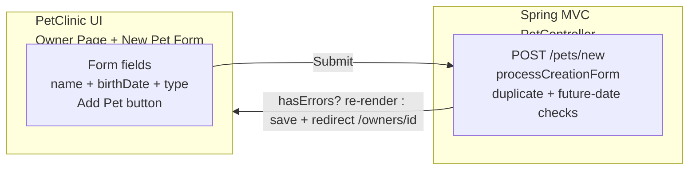
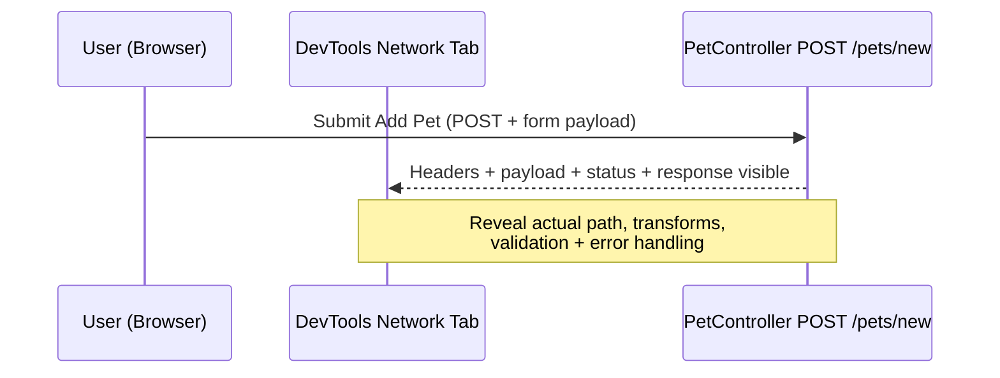
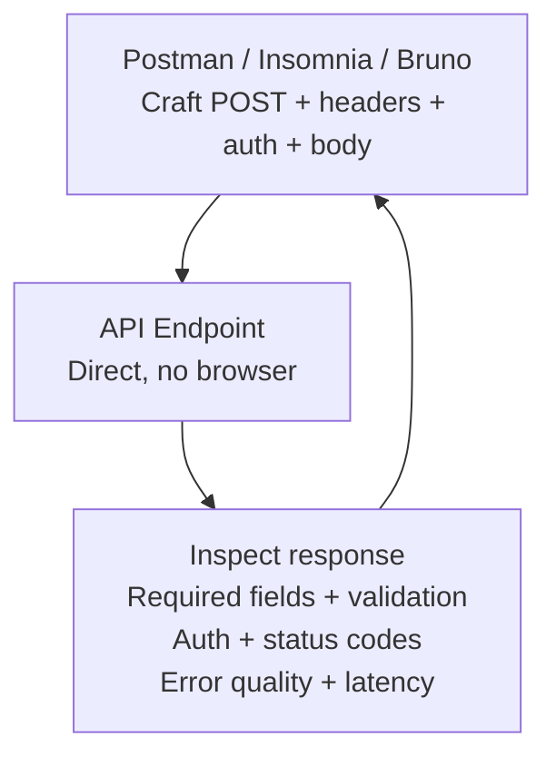
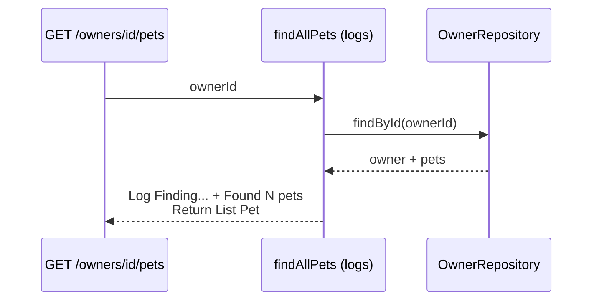
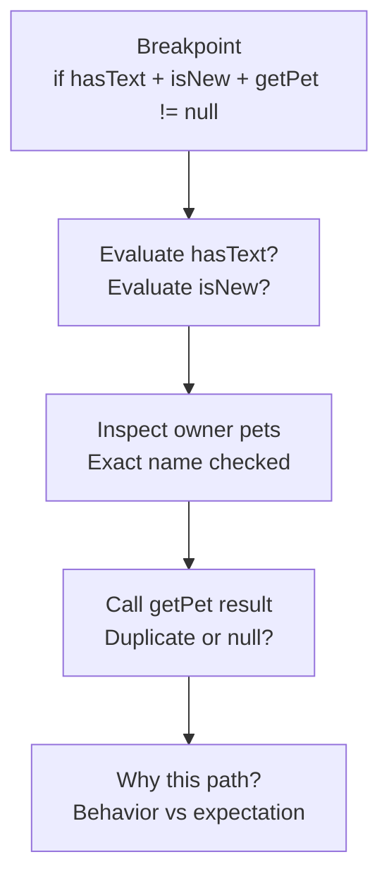
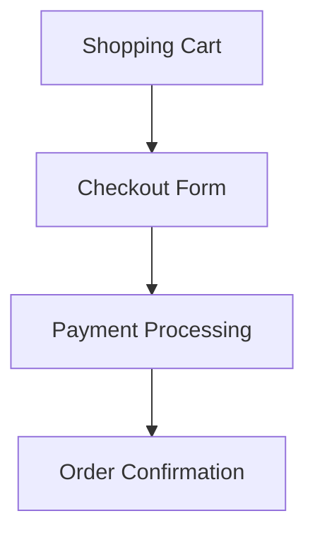
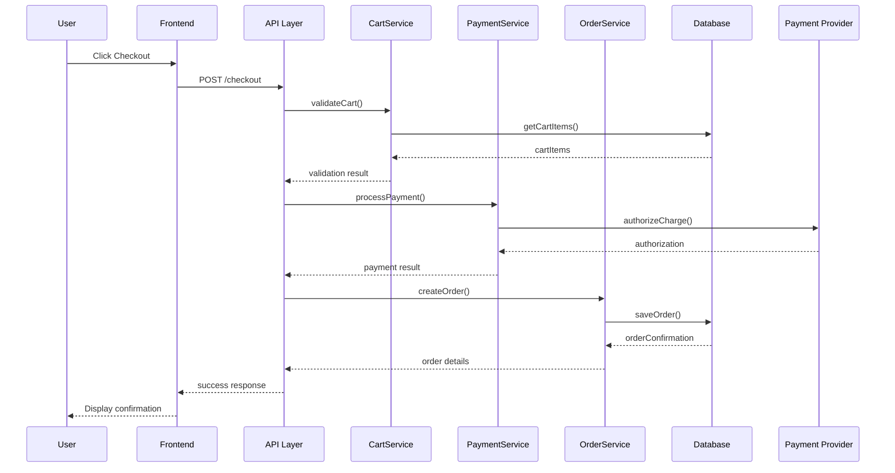

# Chapter 06: Exploring and Modifying Unfamiliar Systems — Definitive Technical Summary
*From: Fundamentals of Software Engineering: From Coder to Engineer by Nathaniel Schutta, Dan Vega*
*Source PDF: pp. 181–230 — figures below cite PDF pages.*

> [!NAV] **Chapter Navigation**
> ⬅️ **Previous:** [[chapter-05-automated-testing|Chapter 05: Automated Testing]] | 🏠 **Index:** [[00-Master-Reading-Dashboard|Master Dashboard]] | ➡️ **Next:** [[chapter-07-user-interface-design|Chapter 07: User Interface Design]]

---

## 1. Executive Summary & Core Engineering Problem

- **Core Thesis:** Most careers are brownfield, not greenfield: you inherit decisions, gaps, and homegrown frameworks. The chapter gives a field manual — start from the big picture (people + docs + architecture), trace real execution (entry points → request journeys → deps), build incremental visual mental models, then change safely via tested refactoring, the Scout Rule, small reversible commits, and disciplined version control.
- **The Core Problem Statement:** Diving into an unknown codebase without a plan produces anxiety, wrong assumptions (stale docs), and wild-boxer breakage: you rewrite auth from a two-version-old wiki, miss that `POST /pets/new` validates duplicates + future birth dates, or blast a 1,000-line PR across 20 files nobody can review. Methodical exploration + tiny verifiable steps convert unknown to contributor in days.
- **What This Chapter Covers (PDF pp.181–229):** Understanding Unfamiliar Codebases (Big Picture p.181 → Docs + Documentation Trap p.183 → Architecture/package patterns p.184 → Execution Flow/entry points PetClinic p.187 → Tracing journeys: devtools Fig6-1 p.191 + POST validation + Fig6-2 p.194 + Postman Fig6-3 p.196 + Logging Fig6-4 p.198 + Debugging Fig6-5 p.201 + External deps configs p.201 + Internal frameworks p.202 → Mental models: break down flows/cart p.206 + visualize + Mermaid checkout Fig6-6 p.211 + sequence Fig6-7 p.213 + expand scope → Sample Process Judd 10 steps p.213) → Making Changes Safely (Refactor with/before tests calculateTotal p.215 + TIP → Scout Rule prcs→processCustomers p.218 + when/defer → Small reversible + change management + processOrder split p.220 → Version control: scenarios + atomic commits + branches + PRs p.223) → Wrapping Up p.227 → Practice (8) p.228 → Resources p.229.
- **Context & Epigraph:** Opens with Dalia Abo Sheasha ("supporting a legacy app ... wouldn't wish it on anyone") and the greenfield myth: key infra decisions already made is a feature — you can focus on the problem at hand. Builds on Ch.2 code-reading + Ch.5 tests-as-safety-net.

---

## 2. In-Depth Technical Concepts & Internal Mechanics

### 2.1 Start with the Big Picture (PDF p.181–182)
- **Why:** "Can't see the forest through the trees" — framework version trivia before product purpose wastes days.
- **Steps:**
  1. **Product intent:** Why does project exist? Stakeholders? Business weight? Start with product manager; record (ask to record virtual), take notes, ask "dumb" questions.
  2. **Technical lineage:** Talk to current engineers, ideally original authors / tech lead / architect for decision rationale.
  3. **Customer lens:** Public info, user personas (fictional profiles of goals/pain points). Explains otherwise odd technical choices.
- **Failure mode:** Optimizing code nobody uses while missing the revenue-critical checkout path.

### 2.2 Review Documentation, Distrust It (PDF p.183)
- **What to comb:** READMEs, ADRs (architecture decision records), onboarding/run-local docs (Docker improved but still tedious). Take notes + flag gaps — future contribution.
- **Documentation Trap (Dan sidebar, p.183):** Three days reading auth docs that were two versions stale; rewrite happened last year. Teammate laugh: "Oh ... we rewrote auth." Lesson: *docs can lie, code never does.* Verify against running code; 3-minute question saves 3 days.

### 2.3 Architecture and Project Structure (PDF p.184–186)
- **Why before reading code:** Layout reveals holistic view; identifies pattern (deliberate or organic).

| Pattern (book example) | Layout signal | Strength | Pain when exploring |
| :--- | :--- | :--- | :--- |
| **Package by layer** | `controllers/ services/ repositories/ models/` (`UserController`, `ProductService`...) | Find all of one technical kind | Business flow scattered across 4 dirs |
| **Package by feature** | `users/{Controller,Service,Repository,User}` + `products/...` | Whole workflow co-located | Cross-cutting tech change touches many features |
| **Hexagonal (ports & adapters)** | `domain/model+service`, `application/service`, `ports/input+output`, `adapters/web+persistence+messaging` | Business isolated from tech | Indirection; many interfaces to trace |
| **Microservices** | `user-service/ product-service/ order-service/ api-gateway/ shared/` each with Dockerfile | Independent deploy/scale | Must learn one service + ecosystem wiring |

### 2.4 Execution Flow — Entry Points (PDF p.186–189)
- **Definition:** Sequential runtime path including decisions, loops, calls.
- **Spring PetClinic main (book, p.187):**
```java
@SpringBootApplication
public class PetClinicApplication {
  public static void main(String[] args) {
    SpringApplication.run(PetClinicApplication.class, args);
  }
}
```
Set breakpoint on `run`, step to see framework under the hood.
- **REST entry:** `@GetMapping("/pets/new") initCreationForm(Owner, ModelMap)` → returns `VIEWS_PETS_CREATE_OR_UPDATE_FORM`. Use IDE navigate + debug to follow.
- **Catalog of doors (book list):** main/bootstrap, public APIs/controllers, event handlers/listeners, scheduled jobs, lifecycle hooks (startup/shutdown), plug-in/extension points, message consumers (queues/brokers), CLI arg processors, DB triggers/stored procedures.

### 2.5 Tracing Request Journeys (PDF p.189–202)
- **Why tracing beats docs/tests:** Shows what *actually* happens: path across layers, transformations, hidden validation, real error handling.
- **2.5.1 Browser devtools (p.190–194):** Run PetClinic, Add Pet form (Fig6-1) → POST `/pets/new` with `processCreationForm` validation (duplicate name via `owner.getPet(name,true)`, future `birthDate` rejection, `BindingResult` re-render vs `owners.save` + redirect). Network tab (Fig6-2) exposes headers/payload/response.
- **2.5.2 API tools (p.194–196):** GET via browser URL; POST/PUT/PATCH/DELETE via Postman/Insomnia/Bruno or IDE plugin (Fig6-3). Probe required fields/types, invalid/missing/malformed/empty/null handling, auth (401/403), status codes (400/404/500), error-message quality, latency outliers — bypassing UI.
- **2.5.3 Logging (p.197–198):** Only production lens sometimes. `log.info("Finding owner with id: {}", ownerId)` → IntelliJ console (Fig6-4) shows substituted values + `Found {} pets`. `findAllPets(ownerId)` example: lookup `ownerRepository.findById`, log size.
- **2.5.4 Debugging (p.198–201):** Breakpoint on multi-part `if (hasText(name) && isNew() && getPet(...) != null)` to inspect each boolean, owner pet list, `getPet` return (Fig6-5). Reveals *why* path taken when logs say "duplicate" but you disagree.
- **2.5.5 External deps (p.201–202):** App never isolated. Check `application.properties/yaml` (`spring.datasource.url=jdbc:postgresql://db-server:5432/petclinic`, `payment.service.endpoint=https://payments.example.com/api/v2`, `email.service.host=smtp.company.com`) + `docker-compose.yml` (`depends_on: mysql, redis, kafka`) / K8s manifests.
- **2.5.6 Internal frameworks (p.202–205):** Custom `com.yourcompany.framework`, `BaseService/AbstractController`, `@CompanyTable/@CompanyField`, `AppUtils/BusinessHelper`, heavy custom YAML/XML.
  - *Why they exist:* missing feature, security/perf, cost, quick fix that grew, ignorance, "meta work more interesting than real work" (Neal Ford).
  - *Pains:* poor docs, authors gone, inconsistent maintenance.
  - *Tactics:* usage examples first, read framework tests, document as you learn, `git blame`/history, evaluate replace-vs-keep, scout-rule improvements.

### 2.6 Mental Models Incrementally (PDF p.205–213)
- **Definition:** Internal representation of how system works; built deliberately over time. Even veterans don't know all.
- **Break down:** Don't model whole ecommerce; model one flow: new-customer+coupon, checkout purchase, product review. Or one feature package (`cart/CartController,Service,Repository,Cart,CartItem,dto/`).
- **AI NOTE (p.206):** Text Mermaid + generative AI: describe system, ask for Mermaid draft, refine manually.
- **Visualization types (book):** Flowcharts (sequence/decisions), ER (data relations), sequence (time interactions), component (arch/deps), mind maps (hierarchy). Scratch pad suffices; add detail as comprehension grows.
- **Simple → rich:** `A[Shopping Cart]→B[Checkout Form]→C[Payment]→D[Confirmation]` (Fig6-6) → full sequence `User→Frontend→API→CartService→PaymentService→OrderService→DB→Payment Provider` (Fig6-7).
- **Expand scope (book 1-4):** single methods → classes+deps → feature flows → cross-cutting (security/transactions). Prevents overload; each feature/issue deepens model.

### 2.7 Sample Process — Judd Boot-Camp Checklist (PDF p.213–215)
1. Clone from SCM. 2. Read README/standards/architecture. 3. Take shareable notes (arch, build, SQL, terms). 4. Review build scripts. 5. Review deps. 6. Review structure. 7. Review CI/CD. 8. Install toolchains. 9. IDE: run+debug app, breakpoint interesting methods, run+debug unit tests similarly. 10. CLI: build artifacts, run unit tests, start containers (datastore), run locally (ports/URLs). Iterative — each issue deepens knowledge.

### 2.8 Making Changes Safely (PDF p.215–227)
- **Posture:** Not wild-boxer, not move-fast-break-things. Methodical, small, verified.
- **Rely on existing tests (p.215–217):** `calculateTotal` loop+discount → extract `calculateSubtotal` (streams) + `applyDiscount`; don't modify tests (behavior preserved); run after each step.
- **Add tests before refactoring / test-driven refactoring (p.217–218):** 1. Document current behavior with tests. 2. Verify pass. 3. Refactor. 4. Verify still pass. Example `calculateTotalAppliesDiscountWhenOrderHasDiscount`: `(10*2+15*1)*0.9=31.5`. TIP: first goal is document, not fix — even if you see bug, pin current then address separately.
- **Scout Rule (p.218–220):** "Leave code better than found" (Boy Scouts). Add docs, rename (`prcs(List l)`→`processCustomers(List<Customer>)` + enhanced for + Javadoc), split complex, remove dead, fix minor bugs. Balance: refactor when hard to understand / adding feature / fixing bug / perf issue / hot area; defer when works+rarely changes / deadline / risk>benefit / sprawling / no coverage.
- **Small reversible (p.220–223):** Change management: visible (what+why), verification (tests/reviews/static analysis), rollback plan (Murphy), monitor (observability). Benefits: less risk, focused testing, reviewable, easier troubleshooting. Split `processOrder` (validate→totals→discounts→shipping→taxes→payment→inventory→confirm) extracting `validateOrder`, `calculateOrderTotal`, etc., testing each.
- **Version control (p.223–227):** Scenarios: legacy (main-only, giant messages, tracked deps), personal (habits early), OSS forks, contractor cleanup. Commits tell story: atomic (one logical change), meaningful message (`Fix bug`→`Fix order calculation when discount applied twice + why mobile+desktop double-apply`), frequent. Branches: feature-isolate, short-lived (days not weeks), rebase onto latest (careful on shared). PRs: small focused (<~20 files/1k lines anti-pattern), explain problem+how+issue links; review improves solution, not criticizes person.

---

## 3. Important Figures, Diagrams & Visual Architecture

> 📕 **Original figures quick index:** open the PDF at the cited page to verify each reconstruction. Screenshots in book are UI captures; Mermaid below reconstructs the *workflow* each screenshot evidences.
>
> | Book Fig | PDF page | What to compare |
> |---|---|---|
> | Fig 6-1 | PDF p.191 | PetClinic Add New Pet form (Owner UI) |
> | Fig 6-2 | PDF p.194 | Chrome DevTools Network POST to /pets/new |
> | Fig 6-3 | PDF p.196 | Postman POST to /posts/new (bypass UI) |
> | Fig 6-4 | PDF p.198 | IntelliJ console logs from findAllPets |
> | Fig 6-5 | PDF p.201 | IntelliJ debugger stepping validation |
> | Fig 6-6 | PDF p.211 | Simple checkout flowchart (Mermaid in book) |
> | Fig 6-7 | PDF p.213 | Expanded checkout sequence (Mermaid in book) |

### Figure 6-1: Adding a New Pet — Request Origin (PDF p.191)
- **Figure Reference:** `Figure 6-1: The Spring PetClinic application — adding a new pet to an owner`
- **Original PDF:** Fig 6-1 → PDF p.191 — open the PDF at page 191 to compare form fields (name, birth date, type) + Add Pet button.
- **Visual Flow & Description:** Browser form for owner → Add Pet click fires POST to `/pets/new` handled by `processCreationForm` with duplicate/future-date validation.
- **Mermaid.js Architectural Diagram:**



- **Key Takeaway:** UI is the entry door; form submission maps 1:1 to controller method to trace.

### Figure 6-2: Inspecting POST in Chrome DevTools (PDF p.194)
- **Figure Reference:** `Figure 6-2: Chrome developer tools showing POST to /pets/new`
- **Original PDF:** Fig 6-2 → PDF p.194 — open the PDF at page 194 to compare Network tab headers/payload/response.
- **Mermaid.js Architectural Diagram:**



- **Key Takeaway:** DevTools proves what actually travels, not what docs claim.

### Figure 6-3: Bypassing UI with Postman (PDF p.196)
- **Figure Reference:** `Figure 6-3: Postman sending POST to /posts/new`
- **Original PDF:** Fig 6-3 → PDF p.196 — open the PDF at page 196 to compare request builder + response inspector.
- **Mermaid.js Architectural Diagram:**



- **Key Takeaway:** API tools isolate backend behavior from frontend noise; probe validation/auth/perf directly.

### Figure 6-4: Logs in IntelliJ Console (PDF p.198)
- **Figure Reference:** `Figure 6-4: IntelliJ IDEA console displaying logs from findAllPets`
- **Original PDF:** Fig 6-4 → PDF p.198 — open the PDF at page 198 to compare `Finding owner with id: {}` + `Found {} pets` lines with substituted values.
- **Mermaid.js Architectural Diagram:**



- **Key Takeaway:** `{}` placeholders + structured logs are the only production trace when debugger unavailable.

### Figure 6-5: Debugger Stepping Validation (PDF p.201)
- **Figure Reference:** `Figure 6-5: Using debugger in IntelliJ to step through business logic`
- **Original PDF:** Fig 6-5 → PDF p.201 — open the PDF at page 201 to compare breakpoint + variable/method-result panes.
- **Mermaid.js Architectural Diagram:**



- **Key Takeaway:** Debugger answers *why* a branch was taken, not just *which*.

### Figure 6-6: Simple Checkout Flowchart (PDF p.211)
- **Figure Reference:** `Figure 6-6: Flowchart for sample checkout process`
- **Original PDF:** Fig 6-6 → PDF p.211 — open the PDF at page 211 to compare 4-box Mermaid original.
- **Mermaid.js Architectural Diagram (book verbatim logic):**



- **Key Takeaway:** Start minimal; add services/DB/externals only as understanding grows.

### Figure 6-7: Expanded Checkout Sequence (PDF p.213)
- **Figure Reference:** `Figure 6-7: Larger flowchart (sequence) for ecommerce app`
- **Original PDF:** Fig 6-7 → PDF p.213 — open the PDF at page 213 to compare User→Frontend→API→Cart→Payment→Order→DB→Provider flow.
- **Mermaid.js Architectural Diagram (book verbatim participants):**



- **Key Takeaway:** Sequence reveals time-ordered collaboration hidden in static package diagrams.

---

## 4. Real-World Systems, Case Studies & Code Examples

### 4.1 PetClinic Validation Under Test (PDF p.192)
```java
@PostMapping("/pets/new")
public String processCreationForm(Owner owner, @Valid Pet pet, BindingResult result,
    RedirectAttributes redirectAttributes) {
  if (StringUtils.hasText(pet.getName()) && pet.isNew() &&
      owner.getPet(pet.getName(), true) != null)
    result.rejectValue("name", "duplicate", "already exists");
  LocalDate currentDate = LocalDate.now();
  if (pet.getBirthDate() != null && pet.getBirthDate().isAfter(currentDate)) {
    result.rejectValue("birthDate", "typeMismatch.birthDate");
  }
  if (result.hasErrors()) return VIEWS_PETS_CREATE_OR_UPDATE_FORM;
  owner.addPet(pet);
  this.owners.save(owner);
  redirectAttributes.addFlashAttribute("message", "New Pet has been Added");
  return "redirect:/owners/{ownerId}";
}
```

### 4.2 Logging Probe (PDF p.197)
```java
@GetMapping("/owners/{id}/pets")
public List<Pet> findAllPets(@PathVariable("id") int ownerId) {
  log.info("Finding owner with id: {}", ownerId);
  Optional<Owner> owner = ownerRepository.findById(ownerId);
  if (owner.isPresent()) {
    var pets = owner.get().getPets();
    log.info("Found {} pets for owner", pets.size());
    return pets;
  }
  return null;
}
```

### 4.3 Config Discovery (PDF p.201–202)
```properties
# application.properties — external deps at a glance
spring.datasource.url=jdbc:postgresql://db-server:5432/petclinic
spring.datasource.driver-class-name=org.postgresql.Driver
payment.service.endpoint=https://payments.example.com/api/v2
email.service.host=smtp.company.com
```
```yaml
# docker-compose.yml — linked services
services:
  app:
    image: petclinic:latest
    depends_on: [mysql, redis, kafka]
```

### 4.4 Safe Refactor Pair (PDF p.216–217)
```java
// Before
public double calculateTotal(Order order) {
  double total = 0;
  for (OrderItem item : order.getItems())
    total += item.getPrice() * item.getQuantity();
  if (order.hasDiscount()) total = total * (1 - order.getDiscountRate());
  return total;
}
// After — same behavior, tested each step
public double calculateTotal(Order order) {
  double subtotal = calculateSubtotal(order);
  return applyDiscount(subtotal, order);
}
private double calculateSubtotal(Order order) {
  return order.getItems().stream()
    .mapToDouble(item -> item.getPrice() * item.getQuantity()).sum();
}
private double applyDiscount(double amount, Order order) {
  return order.hasDiscount() ? amount * (1 - order.getDiscountRate()) : amount;
}
// Pinning test
@Test public void calculateTotalAppliesDiscountWhenOrderHasDiscount() {
  Order order = new Order(Arrays.asList(
    new OrderItem("Product1", 10.0, 2),
    new OrderItem("Product2", 15.0, 1)), true, 0.1);
  assertEquals(31.5, orderService.calculateTotal(order), 0.001);
}
```

### 4.5 Scout Rule Rename (PDF p.219)
```java
// Before
public void prcs(List l) {
  for (int i = 0; i < l.size(); i++) { Object o = l.get(i); /* ... */ }
}
// After — name, generics, for-each, Javadoc; no behavior change
/** Processes customers and updates their status in the database. */
public void processCustomers(List<Customer> customers) {
  for (Customer customer : customers) { /* ... */ }
}
```

### 4.6 War Stories: Stale Auth Docs + 11-Click Scheduler
Dan's 3-day auth read vs 3-minute ask (p.183) and Nate's scheduler apology ("11 clicks, we counted," p.240 cross-ref) prove: verify docs in code, shadow users to feel usability cost of flows you inherit.

---

## 5. Architectural Trade-Off Matrix

| Dimension | Approach A | Approach B | Primary Cost / Invariant | Best Used When... | Worst Used When... |
| :--- | :--- | :--- | :--- | :--- | :--- |
| **Onboarding** | **Big-picture first** (PM→docs→arch) | **Dive into code** | Days orientation vs fast illusion + rework | Unknown domain, large codebase | Tiny script, obvious purpose |
| **Truth source** | **Docs/ADRs** | **Running code + traces** | Stale risk vs live proof | Historical rationale | Behavior verification (docs lie) |
| **Structure** | **By layer** | **By feature / Hexagonal / Microservices** | Tech cohesion vs flow cohesion / isolation / independence | Uniform tech ops | End-to-end reasoning (layer scatters) |
| **Tracing** | **DevTools + Postman + logs** | **Debugger stepping** | Non-invasive prod-safe vs precise why | Prod/remote, request shape | Complex branching logic locally |
| **Modeling** | **Hand sketch / simple flowchart** | **Full UML / detailed sequence** | Speed vs completeness | Early learning | Communicating contract to team |
| **Refactor guard** | **Existing tests** | **Write tests first (characterize)** | Free safety vs upfront pinning | Good coverage | Legacy with none — must pin first |
| **Cleanup** | **Scout Rule touch-up** | **Defer** | Steady quality vs focus | Hot/expanding area, safe coverage | Stable, deadline, high blast radius |
| **Change size** | **Small reversible + rollback** | **Big-bang rewrite** | Reviewability vs feature grandeur | Brownfield, risky deps | Atomic protocol change (rare) |
| **VCS** | **Atomic frequent + short branches** | **Mega-commits + long-lived** | Bisectable history vs merge hell | Team collaboration | Solo spike (overhead) |

### Concrete Decision Heuristics
1. **People before code:** PM (why) → tech lead (why this shape) → personas → docs → arch → entry points. Never invert.
2. **Every claim gets a trace:** Doc says X → DevTools/Postman/log/debugger proves X on running build.
3. **One flow per model:** Checkout *or* review, not whole shop; expand method→class→feature→cross-cutting.
4. **No behavior change without pin:** No coverage → characterize first (TIP p.218), even if bug obvious.
5. **PRs reviewable in <30 min:** Split 1,000-line/20-file monsters; explain problem+fix+issue links.

---

## 6. Jargon Buster & Key Terminology

- **Brownfield / Legacy App (Inherited system):** Existing codebase with history; most work lives here. *Confused with:* greenfield (blank canvas).
- **Entry Point / Door (Execution doorway):** `main`, REST endpoint, event listener, cron, consumer. Start tracing here.
- **Execution Flow (Runtime path):** Ordered decisions/loops/calls actually taken. *Confused with:* static package layout.
- **Request Tracing (Journey proof):** Follow one request UI→API→DB via DevTools/Postman/logs/debugger. Shows actual vs supposed.
- **ADR — Architecture Decision Record (Why log):** Dated doc of decision + alternatives. Read for rationale, verify still true.
- **Package by Layer vs by Feature (Org axis):** Horizontal tech grouping vs vertical business grouping. Determines where flow lives.
- **Hexagonal / Ports & Adapters (Isolated core):** Domain center, adapters outward. Test business without web/DB.
- **Mental Model (Internal map):** Your running theory of system; refine per flow with sketches/Mermaid. AI can draft, you validate.
- **Test-Driven Refactoring / Characterization Test (Pin-then-change):** Tests documenting current behavior before refactor; stay green.
- **Scout Rule (Leave better):** Tiny improvements per touch (names, docs, dead code). *Confused with:* rewrite.
- **Atomic Commit / Short-Lived Branch (Story units):** One logical change, frequent, merged in days; rebase carefully. Enables revert/bisect.
- **Internal Framework (Homegrown platform):** `BaseService`, `@CompanyTable`, `AppUtils`. Check usage→tests→history before replacing.

---

## 7. System Design & Practical Engineering Takeaways

### 7.1 Production Engineering Checklist
1. **Onboard in order:** Clone → README/ADRs → notes → build/deps/structure/CI → run+debug app+tests → CLI build/test/containers/run (Judd list).
2. **Treat docs as leads:** Note gaps for later; confirm auth/config against `application.properties` + running code + a human.
3. **Map doors first:** `PetClinicApplication.main`, `@GetMapping/@PostMapping`, consumers/crons; breakpoint `run` to learn framework.
4. **Trace one journey end-to-end:** Form (Fig6-1) → DevTools POST (Fig6-2) → Postman direct (Fig6-3) → logs (Fig6-4) → debugger why (Fig6-5).
5. **Sketch before scaling:** `Cart→Checkout→Payment→Confirm` then full sequence (Fig6-6→6-7); expand scope gradually.
6. **Refactor under green:** Existing tests or characterize first; never edit tests to match refactor (behavior fixed).
7. **Leave better, ship smaller:** Scout touch-ups in hot areas only; atomic commits, short branches, focused PRs with rollback + monitoring.

### 7.2 Practice Exercises as Q&A (from Putting It into Practice, PDF pp.228–229)

**Q1 — Explore OSS 30 min without coding?**
- **A:** Pick a project you like. List top-level dirs → identify pattern (layer/feature/hexagonal/microservices). Find `main` + one REST entry, note external deps from configs. Share notes; no code changes.

**Q2 — Trace a full journey with three tools?**
- **A:** Using PetClinic: submit New Pet via UI while DevTools open (capture POST), replay via Postman bypassing UI (vary invalid/missing fields), add `log.info` + breakpoint in `processCreationForm` to compare logged vs debugger truth. Document actual validation order.

**Q3 — Refactor one hard method safely?**
- **A:** Choose confusing method, write characterization tests pinning outputs (including edge inputs), then extract helpers like `calculateSubtotal/applyDiscount`. Run suite after each extract; keep behavior identical.

**Q4 — Add tests to legacy with minimal coverage?**
- **A:** Don't blanket-cover. Target method you must change; write `should...` tests for current behavior, verify pass, then change code and verify still pass. One file at a time.

**Q5 — Diagram one business process and validate?**
- **A:** Hand-draw or Mermaid (`graph TD` then `sequenceDiagram`) the checkout/review flow as code *actually* flows (services, DB, provider). Walk teammate through; correct model where they laugh.

**Q6 — Complex change via small reversible commits?**
- **A:** Break `processOrder` into `validateOrder`, `calculateOrderTotal`, etc. Commit each extract + tests atomically with why-messages. Ask peer to review commit story; rehearse rollback (`git revert <sha>`).

**Q7 — Apply Scout Rule ×3?**
- **A:** In files you touch this week: rename one (`prcs`→`processCustomers`), document one, delete dead code. Skip stable/deadline/high-risk areas per defer rules.

**Q8 — Safe dependency upgrade?**
- **A:** Pick `mysql/redis/kafka` or library: map usages, check changelog/breaks, pin test coverage, plan dual-run/rollback, upgrade in staging with monitoring. Document impact.

### 7.3 Additional Resources (Book list, PDF p.229)
- *Refactoring: Improving the Design of Existing Code* by Martin Fowler (Addison-Wesley, 2018) — extract-method catalog behind `calculateTotal` split.
- *Working Effectively with Legacy Code* by Michael Feathers (Prentice Hall, 2004) — characterization + seam tactics for untested code.
- *Getting to Know IntelliJ IDEA* by Trisha Gee and Helen Scott (JetBrains, 2021) — console, debugger, Find Action workflows in Figs 6-4/6-5.

---

> [!NAV] **Chapter Navigation**
> ⬅️ **Previous:** [[chapter-05-automated-testing|Chapter 05: Automated Testing]] | 🏠 **Index:** [[00-Master-Reading-Dashboard|Master Dashboard]] | ➡️ **Next:** [[chapter-07-user-interface-design|Chapter 07: User Interface Design]]
