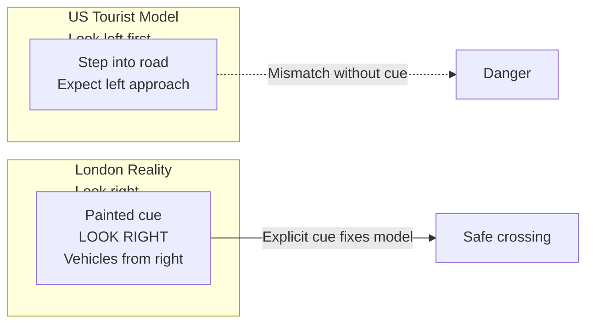
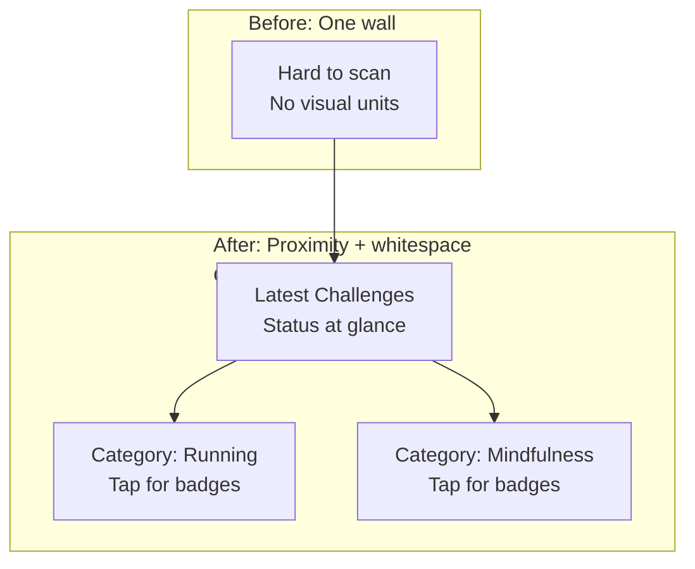
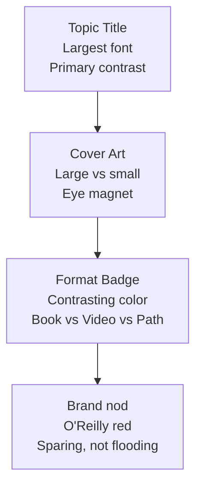
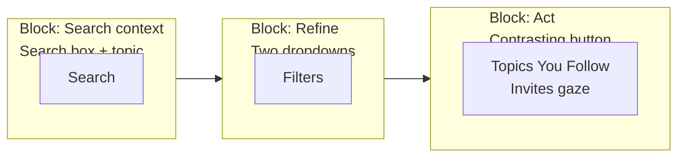
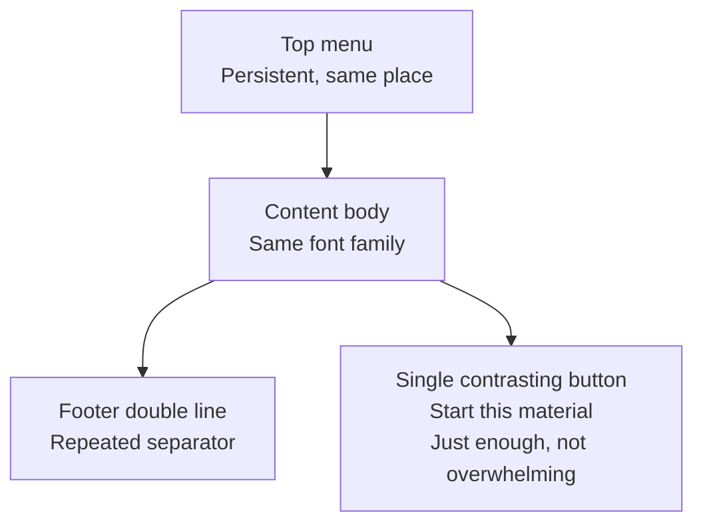
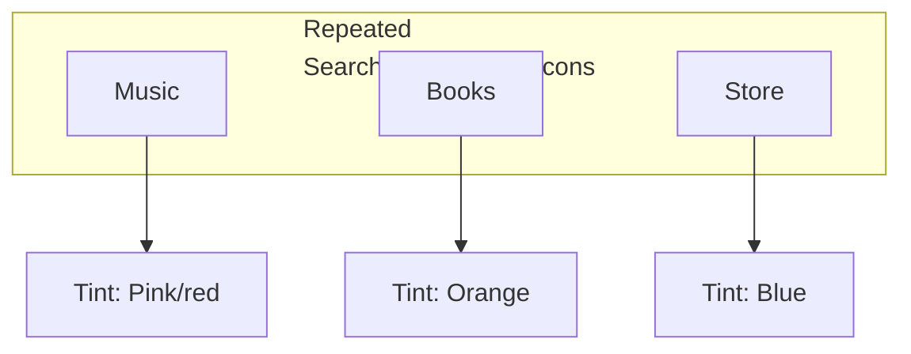
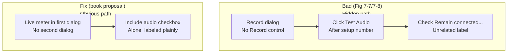
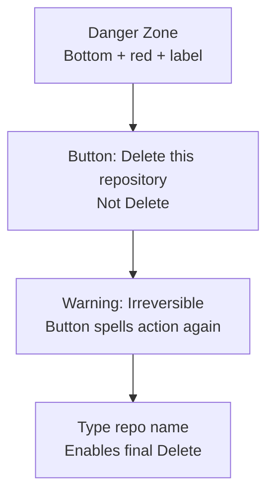

# Chapter 07: User Interface Design — Definitive Technical Summary
*From: Fundamentals of Software Engineering: From Coder to Engineer by Nathaniel Schutta, Dan Vega*
*Source PDF: pp. 231–280 — figures below cite PDF pages.*

> [!NAV] **Chapter Navigation**
> ⬅️ **Previous:** [[chapter-06-exploring-and-modifying-unfamiliar-systems|Chapter 06: Exploring and Modifying Unfamiliar Systems]] | 🏠 **Index:** [[00-Master-Reading-Dashboard|Master Dashboard]] | ➡️ **Next:** [[chapter-08-working-with-data|Chapter 08: Working with Data]]

---

## 1. Executive Summary & Core Engineering Problem

- **Core Thesis:** UI is not "fields wherever they fit." Usable software answers *how easy is it for its intended audience?* through seven qualities (learnability, efficiency, memorability, discoverability, error handling, satisfaction, accessibility), built inclusively (a11y/L10N/I18N) from day one, guided by Williams's four visual principles — contrast, repetition, alignment, proximity — plus obviousness, honest errors, and friction for destruction.
- **The Core Problem Statement:** Engineers design for themselves on huge monitors with perfect vision, hardcode English labels left-to-right, center everything, group unrelated controls, hide Record behind Test Audio + unchecked checkbox, and return "Interface not registered." Real users enlarge fonts (hiding poll candidates and voiding the poll), navigate by keyboard/screen reader, or delete repos by accident — and choose the competitor that respects them.
- **What This Chapter Covers (PDF pp.231–278):** Numeronyms a11y/L10N/I18N + laws ADA/508/EAA p.231 → Retrofit Challenge (Nate screen-reader retrofit) p.232 → Usability defined + 7 components p.233 → Accessibility (visual/auditory/dexterity/cognitive, curb-cut, Apple/Microsoft) p.235 → L10N vs I18N (expansion 35%, RTL, vertical) p.237 → Know Your User + Don't Assume (keyboards) p.238 → Secondary users (11 clicks) p.240 → You Are Not Your User (font-hid poll) p.241 → Tyranny of Defaults (Google→Apple billions, telemetry, safe defaults) p.243 → Culture (Fig7-1 crosswalks p.246, color/icons) → Maximizing Usability (CAD vs unicorn, clicks×volume) p.246 → CRAP Principles (Contrast/Repetition/Alignment/Proximity) p.248 + Fitness Fig7-2 p.254 → Applied: O'Reilly Fig7-3 p.256 + blocks Fig7-4 p.258 + repetition Fig7-5 p.260 + Apple sidebars Fig7-6 p.262 → Obvious Thing (Fig7-7 p.263 mystery + Fig7-8 p.264 answer + fix) → Hidden-feature box (pinch-zoom) p.266 + shortcuts Find Action Fig7-9 p.269 + Go/Navigate Figs7-10/7-11 + Help search Fig7-12 p.272 → Errors (Fig7-13 cryptic vs Fig7-14 Gmail Try now) + undo → Destructive (Danger Zone Fig7-15 + steps Figs7-16/7-17/7-18) → Wrap/Practice/Resources (Norman, Williams, Cooper, Tidwell, Tufte).
- **Epigraph:** Donald Norman — "Good design is ... communication ... The device must explain itself." (p.230). Robin Williams's *Non-Designer's Design Book* supplies CRAP.

---

## 2. In-Depth Technical Concepts & Internal Mechanics

### 2.1 Usability, Accessibility, L10N/I18N — Foundations

**What Is Usability? (PDF p.233–235) — flossing analogy:** Everyone knows it matters, first cut from project. Not PhD-only. Seven components:
1. **Learnability:** Minutes vs years? Novice→expert growth, training wheels, contextual help.
2. **Efficiency:** Clicks/screens minimized for frequent tasks.
3. **Memorability:** Bike vs relearning to walk after absence.
4. **Discoverability:** Obvious vs hidden core functions.
5. **Error handling:** Graceful recovery, no BSOD/data loss; prevention via hints/masks/cues.
6. **User satisfaction:** Cloud nine vs cursing the mess.
7. **Accessibility:** Assistive-tech enabled.

**What Is Accessibility? (PDF p.235–236):** Usability for different abilities — visual (low→blind→color-blind ~8% men/0.4% women), auditory (deaf/hard-of-hearing), dexterity (RSI/motor, imprecise pointer), cognitive (autism/dyslexia/literacy). Curb-cut effect: ramps help rollerboards; large targets help all; shortcuts help power users + no-mouse users; low-bandwidth tolerance helps rural + roaming. Apple (color filters, live captions, eye tracking) + Microsoft (adaptive buttons/mice) provide OS APIs — use them.

**L10N vs I18N (PDF p.237):** I18N = build adaptable (labels from properties files, layout tolerates expansion, RTL Arabic/Hebrew + vertical Japanese). L10N = adapt to locale (translate, currency, dates, units). I18N foundation enables L10N customizations. Unless single-locale guaranteed, build global from start; retrofit costs massively (see Nate sidebar).

**Retrofit Challenge (PDF p.232, Nate):** Mature engineer-app retrofitted for screen readers/keyboard: unlabeled fields, no shortcuts, mouse-only traversal. Screen-reader walk exposed enormity. Lesson: multilingual was fine (I18N done), a11y was not. Build both in upfront.

### 2.2 Know Your User (PDF p.238–243)
- **Ask before assuming:** Computer experience/OS? Functional limits? Screen-reader/font/zoom behavior? Devices (phone/tablet/laptop/headset/TV/all)? Education? Turnover? Frequency? Location (office/table/couch/field)? Noise/stress? Training?
- **Don't Assume (retirement keyboards):** Manager donated old PCs thinking elders non-tech; residents wore out keyboards staying in touch — wanted more. Research beats stereotype.
- **Shadow users:** Days in situ (not months) reveal delight vs disgust. Loud env → missed sounds → visual alternatives. Don't rely on manual ("easy thing = right thing": numeric-only fields reject letters).
- **Secondary users (p.240):** Reps serving *you* (end user is secondary). "System slow" + scheduler "11 clicks, we counted" with data on file = usability cost bleeding to reputation. Captive internal users still deserve better than eye-pokes.
- **You Are Not Your User (p.241):** Poll org randomized candidate order; call staff enlarged font for readability (untested!), hiding names → biased poll thrown out, reputation hit. Test zoom/reflow.
- **Tyranny of Defaults (p.243):** Phone mail/browser/maps = OS defaults; Google pays Apple billions to be search default. Student demo: customer changed every default → update defaults → delight. Telemetry (or thumbs up/down) reveals actual use for new apps. Remember user changes across launches. Defaults must be safe: never default to irreversible delete on click-through dialog; add friction intentionally.

### 2.3 Impact of Culture + Maximizing Usability (PDF p.244–248)
- **Culture:** Mental models differ. London "look right" crosswalks (Fig7-1) for LTR tourists. RTL needs mirrored layout. Red = luck (East) vs mourning (South Africa). Icons vary concrete↔abstract; floppy Save meaningless to diskless generation. Translation resizes/relocates elements (German +35%).
- **Which qualities to maximize?** Context decides. All-day CAD (trained, repetition) → efficiency/memorability/satisfaction. Social unicorn (no training tolerance) → learnability/discoverability or churn. Frequent × seconds saved = big number (judged tasks/hour). Rare app can trade efficiency for learnability. Puzzle games intentionally low discoverability (figuring = point) — exception proving rule.

### 2.4 CRAP Principles (Robin Williams, PDF p.248–254)

| Principle | Rule (Williams) | Do | Don't |
| :--- | :--- | :--- | :--- |
| **Contrast** (p.248) | "Don't be a wimp" — really different | Large vs small type, thick vs thin, red vs black; distinct H1/H2/body so flow scannable | Two grays; weak contrasts creating false groups |
| **Repetition** (p.249) | Repeat visual elements for cohesion | Same fonts/colors/layout, persistent nav/header, footer double-line; lets users ignore chrome, spot differences | Red-everywhere brand excess; shifting design per page |
| **Alignment** (p.250) | Place with care; find something to align to | Left/right sharp edges, polished; align icons/images; repeat one alignment | Centered jagged edges; orphaned elements; mixed alignments |
| **Proximity** (p.251–254) | Grouped = related (even if not) | Group likes, separate unlikes, whitespace buffers, ≤~5 groups; Fitness category cards (Fig7-2) | `Sandals/Shirts` dash-group implying false special relation; wall of badges |

- **Shorts list demo (book):** Uniform list reads as one unit (trip + s-alliteration inferred). Dashing two items manufactures phantom association users try to decode.
- **O'Reilly applications (p.254–260):** Fig7-3 contrast (cover art, format color, large topic font + brand nod); Fig7-4 blocks (search↔topic, refining dropdowns, Topics-You-Follow contrasting button); Fig7-5 repetition (same family, top menu, single contrasting Start button); Apple sidebars Fig7-6 (Music/Books/Store: search+fonts+icons repeated, subtle color per app — identical colors would confuse identity).
- **Bend/break only deliberately:** Jagged campaign art ≠ time-tracking app.

### 2.5 Discoverability, Shortcuts, Errors, Destruction

**Obvious Thing (p.262–265):** Discoverability → learnability + memorability. Bad: Record-audio dialog (Fig7-7) whose answer (Fig7-8) is click Test Audio *after* conference setup + check "Remain connected..." — undiscoverable, unmemorable after months. Fix: live meter in first dialog (kill second), or "Include audio" checkbox alone (remove second checkbox). Generally prevent wrong via field types, hints, masks, formatted examples.

**Must everything be discoverable? (p.266 box):** No — pinch-to-zoom invisible yet 2-sec teach, memorable, natural (break model if missing), advertised + usable without it. Hide only when benefit >> cost.

**Shortcuts must be discoverable too (p.267–272):** Efficiency + expert + a11y, but unmemorable infrequently. IntelliJ Find Action (Fig7-9, Ctrl/Cmd+Shift+A) + Key Promoter plugin; reinforce via menu labels (VS Code Go Fig7-10 vs IntelliJ Navigate Fig7-11); OS/help search ("file" Fig7-12). Save/Copy/Paste ingrained; rest need surfacing.

**Good Errors (p.272–273):** Users err; recovery defines usability. Bad: "Interface not registered" (Fig7-13). Good: Gmail offline (Fig7-14) — states connectivity issue, auto-retries, offers Try now; clear/concise/actionable. Add context, suggest alternatives, support undo/revert so users explore without fear; never reformat for zip-code typo. Also aids your debugging.

**Destructive Actions (p.273–276, GitHub delete):** Exception to easiness — add steps. Bottom placement (proximity) avoids misclick; Danger Zone label + red buttons (contrast, Fig7-15); Step 1 button spells action (not Delete, Fig7-16); Step 2 warning + irreversible + spelled action (Fig7-17); final requires typing repo name to enable Delete (Fig7-18). Overkill is cheaper than accident; rare flows deserve friction.

---

## 3. Important Figures, Diagrams & Visual Architecture

> 📕 **Original figures quick index:** open the PDF at the cited page to verify each reconstruction. Book screenshots are pixel captures; Mermaid below reconstructs the *principle* each evidences.
>
> | Book Fig | PDF page | What to compare |
> |---|---|---|
> | Fig 7-1 | PDF p.246 | London crosswalk "look right" |
> | Fig 7-2 | PDF p.254 | Fitness Awards proximity (ungrouped→category cards) |
> | Fig 7-3 | PDF p.256 | O'Reilly contrast (cover, format color, topic size) |
> | Fig 7-4 | PDF p.258 | O'Reilly blocks (search/topic/dropdowns/button) |
> | Fig 7-5 | PDF p.260 | O'Reilly repetition (family, menu, Start button) |
> | Fig 7-6 | PDF p.262 | Apple sidebars similarity (Music/Books/Store) |
> | Fig 7-7 | PDF p.263 | Undiscoverable Record dialog |
> | Fig 7-8 | PDF p.264 | Hidden Record path (Test Audio + checkbox) |
> | Fig 7-9 | PDF p.269 | IntelliJ Find Action |
> | Fig 7-10/7-11 | PDF p.269–270 | VS Code Go vs IntelliJ Navigate |
> | Fig 7-12 | PDF p.272 | Help search "file" |
> | Fig 7-13/7-14 | PDF p.272–273 | Bad vs Gmail error |
> | Fig 7-15–7-18 | PDF p.274–276 | GitHub Danger Zone 3-step delete |

### Figure 7-1: Culture — Look Right (PDF p.246)
- **Figure Reference:** `Figure 7-1: London crosswalks remind visitors vehicles approach from the right`
- **Original PDF:** Fig 7-1 → PDF p.246 — open the PDF at page 246 to compare street marking photo.
- **Mermaid.js Architectural Diagram:**



- **Key Takeaway:** Never assume shared mental model; cue the foreign one in context. Same for RTL/red/icons.

### Figure 7-2: Proximity — Fitness Awards (PDF p.254)
- **Figure Reference:** `Figure 7-2: Proximity in action — Awards grouped under category cards`
- **Original PDF:** Fig 7-2 → PDF p.254 — open the PDF at page 254 to compare badge wall vs grouped cards.
- **Mermaid.js Architectural Diagram:**



- **Key Takeaway:** Proximity + buffer creates navigable units; cap groups (~5) or re-group.

### Figure 7-3: Contrast — O'Reilly Topic (PDF p.256)
- **Figure Reference:** `Figure 7-3: Design principles — O'Reilly learning platform contrast`
- **Original PDF:** Fig 7-3 → PDF p.256 — open the PDF at page 256 to compare large cover, brand/format colors, oversized topic font.
- **Mermaid.js Architectural Diagram:**



- **Key Takeaway:** Bold differences establish scan order; timid gray-on-gray confuses grouping.

### Figure 7-4: Blocks of Related Material (PDF p.258)
- **Figure Reference:** `Figure 7-4: Notice the various blocks of related material`
- **Original PDF:** Fig 7-4 → PDF p.258 — open the PDF at page 258 to compare search↔topic block, refining dropdowns, Topics-You-Follow button.
- **Mermaid.js Architectural Diagram:**



- **Key Takeaway:** Alignment + proximity + one contrasting CTA = scannable action page.

### Figure 7-5: Repetition — Details Page (PDF p.260)
- **Figure Reference:** `Figure 7-5: Repetition of design elements`
- **Original PDF:** Fig 7-5 → PDF p.260 — open the PDF at page 260 to compare repeated family/menu/footer line + single contrasting Start button.
- **Mermaid.js Architectural Diagram:**



- **Key Takeaway:** Repetition reassures "same site" and teaches ignorable chrome; difference then pops.

### Figure 7-6: Similarity with Identity — Apple Sidebars (PDF p.262)
- **Figure Reference:** `Figure 7-6: Apple sidebar similarities (Music/Books/Store)`
- **Original PDF:** Fig 7-6 → PDF p.262 — open the PDF at page 262 to compare search+fonts+icons repeated with per-app tint.
- **Mermaid.js Architectural Diagram:**



- **Key Takeaway:** Repeat structure for learnability, vary accent for identity; identical colors would mislead location.

### Figure 7-7/7-8: Discoverability Failure → Fix (PDF p.263–265)
- **Figure Reference:** `Figure 7-7 (p.263): How do you record audio? + Figure 7-8 (p.264): Test Audio + Remain-connected path`
- **Original PDF:** Fig 7-7 → PDF p.263; Fig 7-8 → PDF p.264 — open the PDF at both pages to compare mystery dialog vs hidden checkbox path.
- **Mermaid.js Architectural Diagram:**



- **Key Takeaway:** Discoverable beats memorable-by-trauma; prevent wrong with right field types/masks/cues, and research shows discoverability aids memorability.

---

### Supplementary: Error & Destruction Patterns (Figs 7-13–7-18, PDF pp.272–276)
- **Bad vs Good error:** `Interface not registered` (Fig7-13, no context/action) vs Gmail offline (Fig7-14: cause + auto-retry + Try now).
- **GitHub delete chain:** Danger Zone bottom + red (Fig7-15) → spelled-action button (Fig7-16) → irreversible warning + spelled button (Fig7-17) → type-name to enable (Fig7-18). Mermaid:



---

## 4. Real-World Systems, Case Studies & Code Examples

### 4.1 I18N Code Shape (Book pattern: properties-file labels, Java)
```java
// Instead of hardcoding:
label.setText("Welcome"); // breaks L10N, RTL, expansion
// I18N foundation — load from bundle, tolerate +35% German, mirror for ar/he:
ResourceBundle bundle = ResourceBundle.getBundle("messages", locale);
label.setText(bundle.getString("welcome"));
// CSS/HTML: use logical properties (margin-inline-start) not left/right;
// test with pseudo-locale (expand + RTL) before translators arrive.
```

### 4.2 Preventing Wrong via Field Types (Book § Make Right Obvious)
```html
<!-- Right thing obvious: numeric-only, hinted, masked -->
<label for="zip">ZIP code</label>
<input id="zip" inputmode="numeric" pattern="[0-9]{5}(-[0-9]{4})?"
       placeholder="02108" autocomplete="postal-code" />
<!-- Date with picker + explicit TZ; destructive needs friction, not ease -->
```

### 4.3 Industry Implementations
- **O'Reilly Learning (Figs 7-3–7-5):** Contrast/repetition/alignment/proximity composed; single CTA color. Copy for dashboards: one accent, consistent family, block grouping.
- **Apple Fitness/Music/Books/Store (Figs 7-2/7-6):** Category cards + tinted-but-shared sidebars. Copy for multi-app suites: shared skeleton, per-app accent.
- **IntelliJ/VS Code (Figs 7-9–7-12):** Find Action + Go/Navigate + Help search + menu-embedded shortcuts solve shortcut memorability without hiding power.
- **Gmail offline vs COM error (Figs 7-13/7-14):** State cause, auto-recover, offer action. Log same clarity server-side.
- **GitHub Danger Zone (Figs 7-15–7-18):** Proximity (bottom) + contrast (red) + explicit labels + typed confirmation. Template for any irreversible op (delete account, wipe env).

### 4.4 War Stories (Book)
- **Poll voided by font:** Untested zoom hid randomized candidates → biased sample, thrown poll, reputation loss. Test 200% zoom/reflow on every list.
- **Retirement keyboards:** Stereotype wrong; residents burned keyboards. Interview + observe.
- **11-click scheduler:** Internal tool with data on file still took minutes. Measure clicks/time for secondary users; each click × volume = cost.

---

## 5. Architectural Trade-Off Matrix

| Dimension | Approach A | Approach B | Primary Cost / Invariant | Best Used When... | Worst Used When... |
| :--- | :--- | :--- | :--- | :--- | :--- |
| **Audience** | **Design for self** (dev, huge monitor) | **Research + shadow** (devices, a11y, field) | Speed vs fit | Dev-tools for devs | Public/internal broad use |
| **Inclusion** | **Retrofit a11y/L10N/I18N** | **Build in from start** | Massive rework vs upfront discipline | Never (only if forced) | Always prefer build-in (labels, keyboard, bundles, RTL) |
| **Quality focus** | **Efficiency/memorability** | **Learnability/discoverability** | Power vs onboarding | All-day CAD, trained, frequent | Unicorn/rare app, untrained, sporadic |
| **Visual** | **Bold contrast + repetition + alignment + proximity** | **Timid/centered/scattered** | Cohesion vs noise | Almost always (Williams) | Artistic one-off where confusion is goal |
| **Grouping** | **≤5 proximity groups + whitespace** | **Wall / false dashes** | Scannability vs mystery | Cards, blocks, sidebars | Badge wall, phantom associations |
| **Features** | **Obvious primary path** | **Hidden power (pinch-zoom)** | Immediate use vs elegance | Core flows, destructive, errors | Justified hidden gem (taught, advertised, optional) |
| **Shortcuts** | **Surfaced (Find Action, menus)** | **Tribal shortcuts** | Learnability vs minimalism | Expert efficiency + a11y | Hiding frequent actions |
| **Errors** | **Context + recovery + undo** | **Cryptic code** | Trust vs brevity | All user-facing failures | Never (also hurts debugging) |
| **Destruction** | **Friction (zone+warn+type)** | **One-click easy** | Safety vs speed | Irreversible deletes/wipes | Reversible edits (don't add friction) |
| **Defaults** | **Safe + remembered + telemetered** | **Clever + reset** | Trust vs novelty | Destructive-adjacent, frequent settings | Never default to delete |

### Concrete Decision Heuristics
1. **Context picks qualities:** Daily/trained → efficiency; sporadic/public → learnability/discoverability; always keep error/satisfaction/a11y.
2. **CRAP-check every screen:** One accent color, one alignment, grouped likes, repeated chrome — fix violations in an hour audit (book practice).
3. **Test with real constraints:** 200% font, keyboard-only, screen reader, small phone, noisy field, RTL pseudo-locale, German expansion.
4. **Errors must act:** Cause + auto-retry + explicit action + undo; log same server-side.
5. **Destruct = 3 gates:** Separate zone, spelled warnings, typed confirmation; never pre-check or default-delete.

---

## 6. Jargon Buster & Key Terminology

- **Usability (Ease for intended audience):** Learnability, efficiency, memorability, discoverability, errors, satisfaction, accessibility. *Confused with:* visual prettiness.
- **a11y — Accessibility (Usable by all abilities):** Numeronym a+11+y. Visual/auditory/dexterity/cognitive. Laws: ADA, §508, EAA. *Confused with:* usability subset for disabled only (helps all — curb-cut).
- **I18N — Internationalization (Build adaptable):** i+18+n. Bundles, expansion, RTL/vertical, logical CSS. Foundation.
- **L10N — Localization (Adapt to locale):** L+10+N. Translate, currency/dates/units. Implementation on I18N.
- **Numeronym (Letter-count word):** `[a-zA-Z]\d{1,2}[a-zA-Z]` (book regex). a11y/L10N/I18N.
- **CRAP — Contrast/Repetition/Alignment/Proximity (Williams):** Four visual principles; bold, repeat, align, group. Bending needs justification.
- **Discoverability (Findability):** Can users fathom features? Contributes to memorability. *Confused with:* memorability (recall after absence).
- **Secondary User (Served-through user):** End beneficiary behind rep's screen. 11-click pain hits them too.
- **Safe Default / Friction (Protective design):** Pre-selected harmless option; deliberate steps for irreversible. Tyranny of defaults = power.
- **Undo/Revert (Exploration license):** Recovery enabling trial. Without it users won't try.

---

## 7. System Design & Practical Engineering Takeaways

### 7.1 Production Engineering Checklist
1. **Instrument inclusion:** Labels for every field, keyboard path, focus visible, contrast AA, screen-reader pass, bundles from commit one.
2. **Research lightweight:** Personas + 2-day shadow + settings telemetry; ask about defaults; remember choices.
3. **Apply CRAP visibly:** Largest font = topic, one accent = action, left-aligned edges, ≤5 proximity groups with whitespace.
4. **Make right obvious:** Correct input types, masks, hints, examples; live meters over second dialogs; surface shortcuts in menus + Find Action.
5. **Write errors that help:** Cause + auto-retry + Try-now + undo; never raw codes to users.
6. **Gate destruction:** Bottom Danger Zone, red spelled buttons, warnings, typed confirmation; rare by design.
7. **Verify hostile conditions:** Zoom, keyboard, reader, small screen, RTL, long German, slow network — before release, not after poll voided.

### 7.2 Practice Exercises as Q&A (from Putting It into Practice, PDF pp.277–278)

**Q1 — Spot CRAP in the wild in one hour?**
- **A:** Pick a daily app. Label one contrast win/fail (headings distinct?), one repetition (nav stable?), one alignment (centered mush?), one proximity (false groups?). Screenshot + propose fix per violation.

**Q2 — Audit your own UI for usability issues?**
- **A:** List top 3 flows. Score learn/efficiency/memory/discover/errors/satisfaction/a11y. Redesign one screen in an hour: regroup by proximity, align left, single accent CTA, correct field types. Re-test with zoom/keyboard.

**Q3 — Analyze a regular app for 1–2 hours?**
- **A:** Choose phone/laptop app. Count CRAP violations, note secondary-user pain (would a rep struggle serving you?), check defaults (safe? remembered?). Propose telemetry to settle guesses.

**Q4 — Shadow real users — what to capture?**
- **A:** In their env, note tasks, clicks/time, workarounds, font/device tweaks, errors + recovery, likes/hates, default changes. Ask "what would you change?" and "is this efficient?" Expect opinions — act on clicks×volume math.

### 7.3 Additional Resources (Book list, PDF p.278–279)
- *The Design of Everyday Things, Revised and Expanded* by Donald A. Norman (Basic Books, 2013) — device must explain itself.
- *The Non-Designer's Design Book, 4th Ed.* by Robin Williams (Peachpit, 2014) — CRAP source.
- *About Face: Essentials of Interaction Design, 4th Ed.* by Alan Cooper et al. (Wiley, 2014).
- *Designing Interfaces, 3rd Ed.* by Jennifer Tidwell et al. (O'Reilly, 2019).
- The Work of Edward Tufte — information density done right.

---

> [!NAV] **Chapter Navigation**
> ⬅️ **Previous:** [[chapter-06-exploring-and-modifying-unfamiliar-systems|Chapter 06: Exploring and Modifying Unfamiliar Systems]] | 🏠 **Index:** [[00-Master-Reading-Dashboard|Master Dashboard]] | ➡️ **Next:** [[chapter-08-working-with-data|Chapter 08: Working with Data]]
