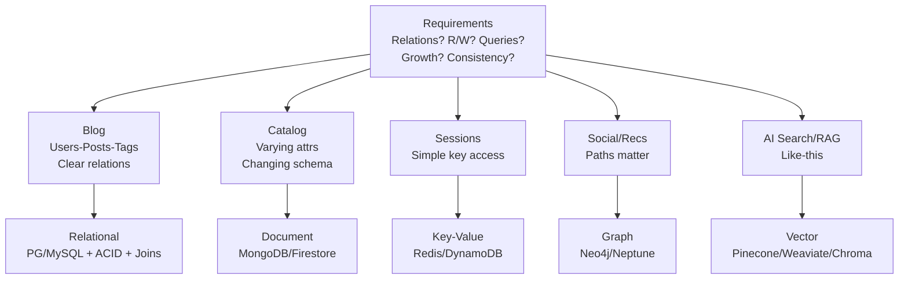
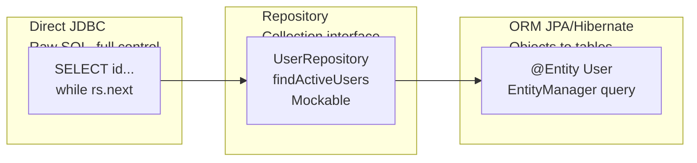
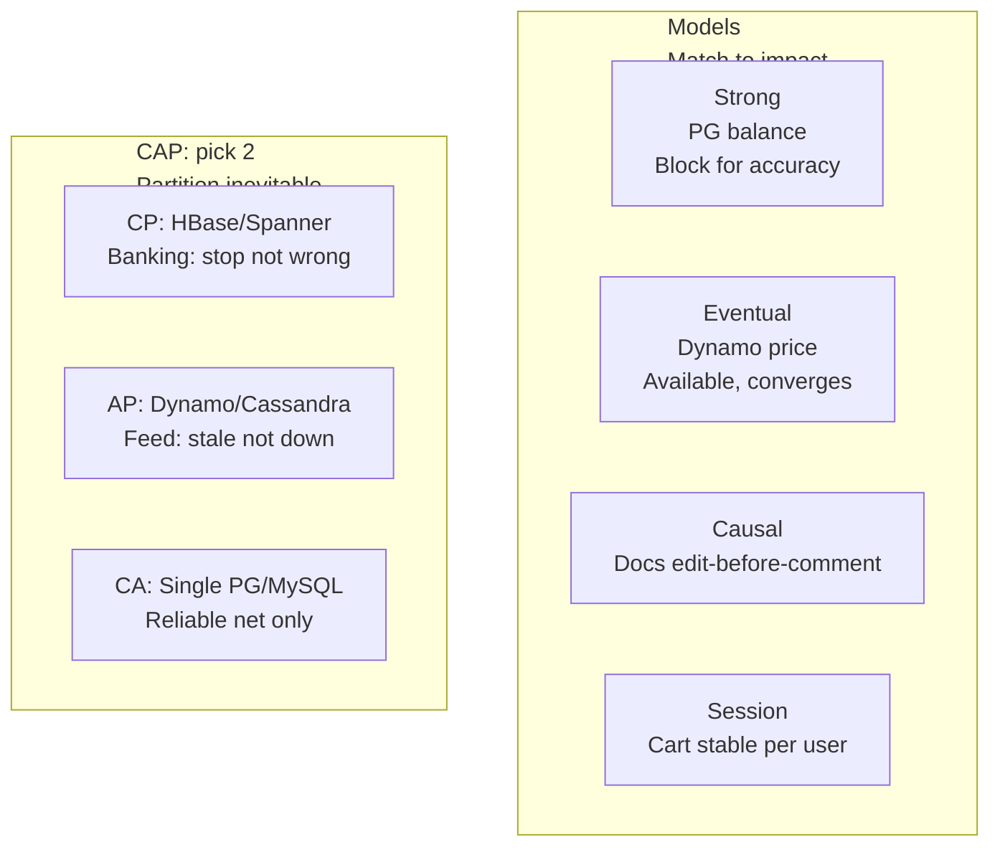
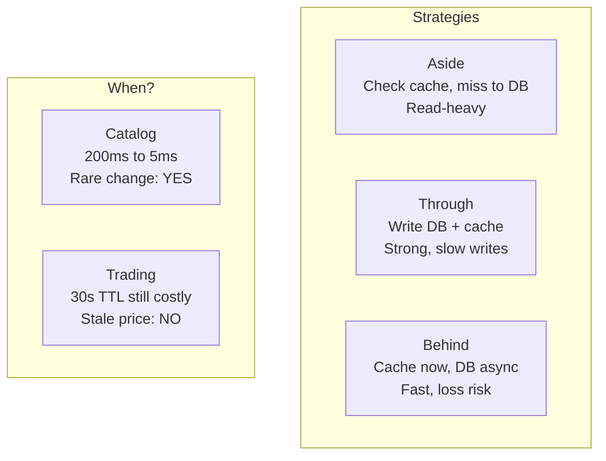
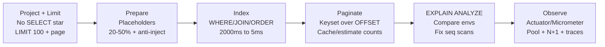
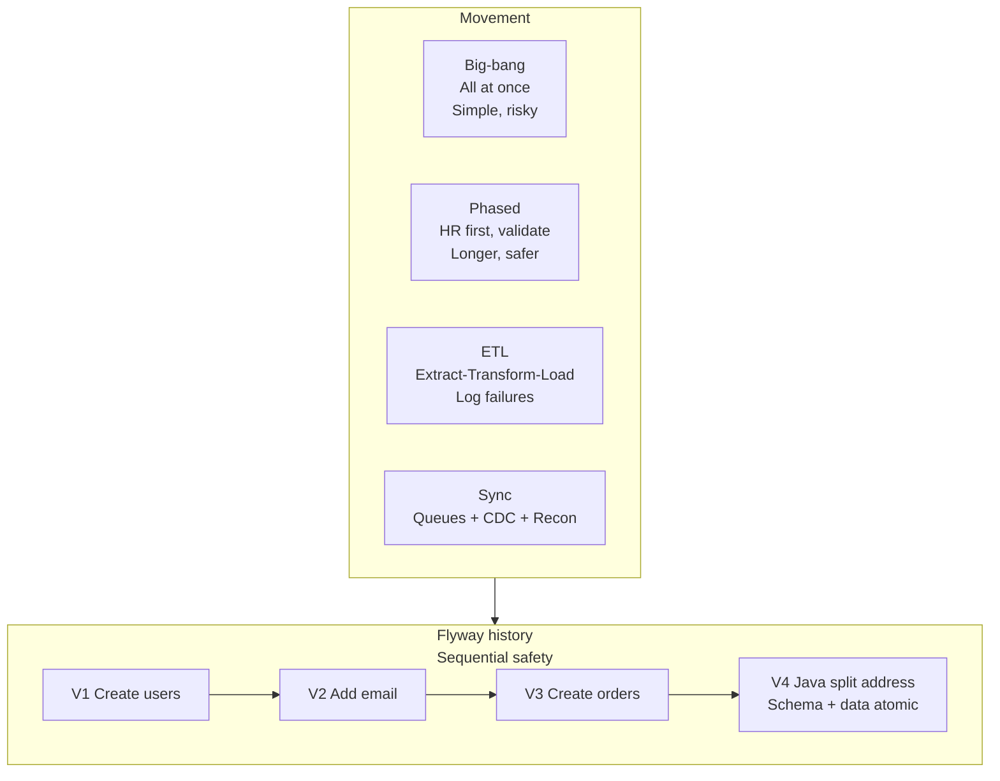

# Chapter 08: Working with Data — Definitive Technical Summary
*From: Fundamentals of Software Engineering: From Coder to Engineer by Nathaniel Schutta, Dan Vega*
*Source PDF: pp. 281–351 (largest chapter, ~70 pages) — figures below cite PDF pages; this chapter has no numbered figures, so Section 3 reconstructs its core architectures in Mermaid.*

> [!NAV] **Chapter Navigation**
> ⬅️ **Previous:** [[chapter-07-user-interface-design|Chapter 07: User Interface Design]] | 🏠 **Index:** [[00-Master-Reading-Dashboard|Master Dashboard]] | ➡️ **Next:** *None (End of this batch)*

---

## 1. Executive Summary & Core Engineering Problem

- **Core Thesis:** Data outlives systems (Berners-Lee epigraph). Career success hinges less on language trivia than on choosing types/formats, storage, persistence abstraction, consistency/caching, query/index discipline, growth/migration planning — pragmatically for *today's* needs without overengineering hypothetical futures. No choice is permanent; every choice has a shape it fits.
- **The Core Problem Statement:** Dev-fast choices die in prod: `SELECT *` without `LIMIT` OOMs on 10M rows, string-concatenated SQL gets injected, missing index turns 5 ms into 2,000 ms, cache serves 30-second-stale trading prices costing money, unversioned schema edit loses data, big-bang migration needs a downtime window you don't have. The chapter walks the full lifecycle — types → store → persist → consistency/cache → query → grow/migrate — with Java patterns for each.
- **What This Chapter Covers (PDF pp.281–350):** Foundation (identify types/tools/storage/query/migration, avoid pitfalls) → Data Types/Formats (audience/perf/compat/complexity/validation; Structured vs Unstructured p.282 Customer/NLP + AI test-data NOTE; JSON/XML/XSD/XPath/namespaces/streaming p.287 + CSV pitfalls NOTE + YAML indent p.289; Binary Base64/hex/memory p.291 + Date/time UTC/ISO8601 p.292 + Large datasets streaming/pagination p.293) → Storing Effectively (factors p.295, blog-relational vs catalog-document, NOTE evolve; Relational ACID+JDBC p.296, Document MongoDB p.299, Key-value Redis p.300, Graph Neo4j p.301, Vector embeddings/RAG p.302) → Persistence/Management (abstraction+team p.304; Direct JDBC p.305, Repository p.305, ORM JPA p.307 + NOTE; Connections HikariCP p.309 + Transactions money-transfer p.309; Consistency strong/eventual/causal/session + CAP CP/AP/CA p.311; Caching 10–100× + aside/write-through/write-behind + when-to + TTL p.315 + Distributed box; Growth metrics/monthly + vertical/horizontal/replicas/sharding + replicas-vs-caching + archiving/indexes p.320) → Querying Performance (Efficient: SELECT*/LIMIT p.324 + TIP pagination, prepared 20–50% + injection p.325, index 400× + cardinality/composite p.327, large sets offset vs keyset/count p.328; Tools: planner rule/cost + PG/MySQL/Oracle + EXPLAIN ANALYZE + warnings + NOTE env-compare p.330, monitoring Actuator/Micrometer logging/metrics/tracing + N+1 p.333, complexity readability vs SQL hybrid p.336) → Migration/Transformation (big-bang vs phased HR + NOTE batches 1–10k PoC + ETL + sync queues/CDC/recon p.338; Schema: version Flyway/Liquibase history V1__ + NOTE sequential 100→250 + idempotent/compat p.341, Java V4__ address-split atomic + background/dual-write/rollback + sample-first p.343) → Wrap (no perfect, decide for now) → Practice (7) → Resources (DDIA 2e, Seven Databases, freeCodeCamp SQL, Refactoring Databases, Data Engineering, NoSQL Distilled).
- **Context:** Explicitly *not* DBA/data-engineering depth; essential developer data-savviness. Pairs with Book-01 (DDIA) Ch.1–4; here pragmatic Java-first.

---

## 2. In-Depth Technical Concepts & Internal Mechanics

### 2.1 Data Types and Formats — Choose by Consumer

**Decision factors (PDF p.281–282):** Audience (human vs machine), performance (size/speed), compatibility (consumers), complexity (nesting/variability), validation (schema needed?).

**2.1.1 Structured vs Unstructured (PDF p.282–286)**
- **Structured:** Predefined schema, consistent types/relations; fits rows/columns; Java `Customer{id,firstName,lastName,email,birthDate,Address}` maps 1:1 to table. Traits: consistent format, well-defined relations, precise query (`WHERE lastName=?`), efficient fixed fields. Shines: finance, inventory, profiles (integrity + complex queries). In PG/MySQL schema dictates fields (NOTE p.284). Limits: inflexible (add field → migrate schema + code), poor for nested.
  - **AI NOTE (p.284):** Prompt AI for realistic fixtures ("20 customers JSON", "vintage bookstore products", "fitness profiles") for learning/prototyping.
- **Unstructured:** No preset model — emails, posts, chats, images/audio/video, ragged logs, PDF/Word. Needs NLP/vision/full-text/lakes, not SQL. Example `processCustomerFeedback(text)`: `nlpService.analyzeSentiment` + `extractKeywords` → save `Feedback(text,sentiment,keywords)` (raw + insights). Traits: variable format, rich (emotion/opinion/visual), hard to query traditionally, specialized storage. Stack: Elasticsearch, NLP libs, data lakes.

**2.1.2 Common Formats (PDF p.286–290)**
- **JSON (p.287):** De-facto API/config/document standard; readable, language-independent (objects/arrays/strings/numbers/bool/null). Jane Smith example with nested address. Great for JS-frontend APIs. Lacks comments/dates/binary (Base64 if forced).
- **XML (p.287–288):** Verbose but XSD/DTD validation (types/constraints), XPath selection, XSLT transforms, namespaces (vocab isolation), streaming/event parsers for huge docs. Jane Smith XML example. Keep for enterprise/DOCX/SVG/complex config where validation/namespaces/doc-compat matter.
- **CSV (p.289):** Plain tabular (header + commas/newlines); flattened `address.street,city...`; quoted `"123 Main Street"`. Great for exports/spreadsheets/simple exchange. No types; beware commas/quotes/newlines/empty/i18n. NOTE: configure library handling explicitly.
- **YAML (p.289–290):** Human-friendly, comments/refs/multiline; indentation = structure (usually 2 spaces; one space breaks parse). Jane YAML example. Ideal for Docker Compose/K8s/CI human-edited config; validate pre-deploy with YAML-aware editor. Most apps mix: JSON APIs + YAML config + CSV downloads.

**2.1.3 Specialized Considerations (PDF p.290–294)**
- **Binary (p.291–292):** Images/docs/audio/encrypted — unreadable without decode. `FileInputStream("dogs-playing-poker.png")→ByteArrayOutputStream→byte[]` then display/resize/convert/upload/HTTP-embed/PDF-embed/metadata. Practices: format libs, Base64 for text embedding, hex for byte debugging, careful memory for large files, corrupt/incomplete handling.
- **Date/time (p.292–293):** "Hardest + naming + cache invalidation" joke territory: zones, DST, calendars, formats. Rules: store UTC, exchange ISO 8601, use modern libs (`ZonedDateTime`), explicit TZ in UI. (Book's second code block repeats binary read — editorial duplication; intent was ZonedDateTime travel+format example.)
- **Large datasets (p.293–294):** Too big for memory → stream (`FileReader→CSVParser.forEach(processRecord)` one-at-a-time), paginate APIs/UI, index/tune, consider warehouses/distributed, guard concurrency (locks/atomics/immutables), test with realistic volumes early.

### 2.2 Storing Effectively — Pick by Shape (PDF p.295–304)

**Selection factors:** Relationship complexity, read vs write skew, query complexity, growth, consistency needs. Blog (users→posts→tags/comments, clear relations) → relational. Custom-merch catalog (varying/changing attrs) → document. NOTE: choice evolves; start simple, migrate on success — don't overengineer day one.

| Type (book) | Model / Guarantees | Use when | Examples | Java sketch (book) |
| :--- | :--- | :--- | :--- | :--- |
| **Relational** (p.296) | Tables+keys, relational algebra, **ACID** (Atomic all-or-none + rollback; Consistent valid→valid; Isolated no interference; Durable survives crash) | Clear relations, joins, critical consistency, stable structured | PG, MySQL, Oracle, SQL Server | JDBC `CREATE TABLE users/posts (FK user_id)`, `PreparedStatement INSERT` |
| **Document** (p.299) | Flexible JSON-like per-doc schema | Varying records, horizontal scale, changing reqs, CMS/catalogs | MongoDB, Couchbase, Firestore | `new Document(title, author{name,email}, tags[], comments[], publishedAt)` → `insertOne` |
| **Key-value** (p.300) | O(1) by key, minimal query | Blazing simple access, cache/sessions/prefs, speed>query | Redis, DynamoDB, Riak | Jedis `setex("session:"+id,1800,json)` / `get` |
| **Graph** (p.300) | Nodes+first-class edges, pattern/path queries | Interconnected, relations = data, traversals | Neo4j, JanusGraph, Neptune | `CREATE (Person{name,email})`, `MATCH...CREATE (a)-[:FOLLOWS]->(b)` |
| **Vector** (p.302) | High-dim embeddings (100s–1000s dims); similarity search ("like this" not "exactly this") | Semantic search, recommend, RAG context for LLMs, media search, anomaly/dedup | Pinecone, Weaviate, Chroma, Qdrant | Embed pipeline → `topK(cosine)` (book conceptual; no Java snippet) |

### 2.3 Persistence and Management — Abstraction Level (PDF p.304–320)

**Premise:** Abstraction affects speed/maintainability/perf; team skill matters (SQL-strong, ORM-naive team → skip JPA). Java examples transfer conceptually.

- **Direct access (p.305, lowest):** Raw SQL/JDBC, full control, needs DB depth. `SELECT id,username,email ... ORDER BY created_at DESC` → `while(rs.next()) new User(...)`.
- **Repository (p.305–307, middle):** Collection-like interface hiding SQL; separates concerns, mockable for unit tests, centralized, `RepositoryException`, try-with-resources. `UserRepository(DataSource).findActiveUsers()` encapsulates query, shields schema, offers domain method.
- **ORM (p.307–308, highest):** Hibernate/JPA/Entity Framework map objects→tables. `@Entity User{id @GeneratedValue, username...}` + `entityManager.createQuery("SELECT u FROM User...")`. NOTE (book, verbatim wisdom): *higher ≠ better* — raw SQL often faster/more controllable; ORMs easier to start, harder to debug. Evaluate per need.
- **Connections (p.308–309):** Single connection was learning; prod needs pooling (reuse, avoid per-op handshake). HikariCP: `jdbc:postgresql://localhost:5432/myapp`, `maxPoolSize=10`; Spring auto-configures.
- **Transactions (p.309–310):** Atomic unit (insert/update/delete all-or-none). Money transfer: `setAutoCommit(false)` → withdraw + deposit `PreparedStatement`s → `commit()` else `rollback()`. NOTE: DB guarantees ACID *within* defined boundaries; developer defines boundaries (group related ops in one scope).
- **Consistency models (p.310–315):** Transactions = single-op integrity; models = accuracy across servers/users.
  - **Strong:** All see same order immediately (PG balance update). May block for guarantee; accuracy>availability.
  - **Eventual:** Temporary divergence resolving over time (DynamoDB price seconds to propagate globally). Availability during outages; fine for logs/feeds/recomms.
  - **Causal:** Order only for causally related (Docs: B's comment after A's edit seen in order; unrelated C any order). Middle ground.
  - **Session:** Per-user coherence (cart persists in session though global inventory slightly stale). No global sync needed.
  - **CAP (p.313):** Multi-server can guarantee only 2/3: Consistency (same everywhere) + Availability (works despite failures) + Partition tolerance (works despite net splits). **CP** (HBase, Spanner; banking/inventory: stop rather than wrong) / **AP** (DynamoDB, Cassandra; feeds/CDN/social: stale better than down) / **CA** (single-node/cluster on reliable net; MySQL/PG undistributed). Match to business impact; mix models per data type; revisit as reqs change.
- **Caching (p.315–320):** Faster store (memory) between app and DB; 10–100×+ (tens/hundreds ms → ~5 ms) but adds staleness + failure surface + complexity. Strategies:
  - **Cache-aside/lazy:** App checks cache → miss → DB → populate. `getPostById: cache.get→database.findById→cache.put`. Best read-heavy + control; cost: code complexity + first miss slow.
  - **Write-through:** Write DB+cache together. `updatePost: database.save + cache.put`. Strong consistency; slow writes, may cache unread.
  - **Write-behind/write-back:** Cache now, DB async. `cache.put + asyncQueue.schedule(save)`. Fast writes; loss risk if cache dies pre-flush. Good for activity/logs/metrics where loss tolerable.
  - **When to (catalog vs trading):** Catalog (200 ms × 1,000 shoppers × 4 queries, rarely changes → 5 ms cached, DB for orders) yes. Trading (prices/sec, 30-sec TTL still loses money) no — invalidation risk > benefit. Ask: change frequency? stale cost? query cost? bottlenecks? **Caching×consistency:** aside+TTL = eventual; through = strong (write cost); behind = temporary inconsistency for perf. **Distributed box:** multi-server complicates cache coherence, needs distributed tx/eventual patterns, replication/sharding (own chapter, but anticipate).
- **Growth planning (p.320–323):** No perfect plan, but have one. Monthly joint dev/DBA/ops review: p95 latency, CPU%, memory climb, complaints. Options: **Vertical** (bigger box; first, simple, hits limit) → **Read replicas** (read copies, eases read-heavy, geographic, no app change, eventual) → **Horizontal** (multi-server, geo) → **Sharding** (shard-key partitions; most complex, massive volumes). **Replicas vs caching box:** replicas = full DB copies via replication (DB-level eventual, no code change); cache = app-managed memory copies (needs invalidation, fastest for hot keys). Maintain: archive old data, review indexes as patterns evolve, analyze/optimize slow queries.

### 2.4 Querying and Performance (PDF p.323–338)

**Efficient writing (p.324–329):**
- **SELECT * + unbounded (bad):** `SELECT * WHERE active=true` mapping 15+ fields loads thousands fully. **Fix:** projection + limit → `SELECT id,username,email ... LIMIT 100` into `UserSummary`. Orders-of-magnitude less transfer. TIP: always project columns + paginate (e.g., 20/page); documents need.
- **Prepared statements (p.325–326):** Concatenated `"WHERE email='"+email+"' AND active="+active` reparses/replans every call + injectable. Placeholders `WHERE email=? AND active=?` parse/optimize once, reuse plan (20–50% faster hot path) + auto-escape (injection-proof).
- **Indexes (p.327–328):** Book-without-index analogy. Unindexed `WHERE email=?` ~2,000 ms full scan → `CREATE INDEX idx_user_profiles_email ON user_profiles(email)` → ~5 ms (400×). Costs: space + slower writes (maintain each index). Index WHERE/JOIN/ORDER/GROUP BY, composite for multi-filter, skip low-cardinality.
- **Large result sets (p.328–329):** Dev-small vs prod-huge. `getProductsByCategory(category,page,size)` with `LIMIT ? OFFSET ?` + `COUNT(*)` assembles `Page(products,page,size,total)`. Pitfalls: COUNT expensive at scale; OFFSET scans+discards pre-offset (degrades deep). Alternatives: keyset (`WHERE id>last_seen_id`), cache counts, estimate huge counts, infinite-scroll UI without totals.

**Tools/Best practices (p.329–338):**
- **Planners (p.330–331):** Compiler SQL→plan. Rule-based (always use index) vs cost-based (cheapest of candidates; PG/MySQL/Oracle modern = cost). PG: per-relation scans + index/join-order search, genetic for many joins. MySQL: read-focused cost. Oracle: adaptive mid-execution on runtime stats.
- **EXPLAIN (p.331–332):** `EXPLAIN [ANALYZE] SELECT u.username,p.bio FROM users u JOIN profiles p ON u.id=p.user_id WHERE active=true` (PG/MySQL/Oracle variants). Shows order, join methods (nested/merge/hash), indexes, scan types (seq vs index), costs, est vs actual rows. Red flags: unexpected seq scans, wrong join for volume, missing/unused indexes, huge costs, est≪actual. NOTE: compare plans across dev/stage/prod — missing index/stale stats/skew explains "worked in test, dies in prod."
- **Monitoring/observability (p.333–336):** Slow logs + `pg_stat_statements` = partial. Add app lens via Spring Actuator + Micrometer (auto-instruments HikariCP): **logging** (events/errors correlatable), **metrics** (`jdbc.connections.active/idle/pending/max`, query/tx times, error rates), **tracing** (request lifecycle, DB span share). Diagnoses: pending+maxed = pool small/leak/long tx; idle-high = oversized; 90% in one DB span = EXPLAIN that query; dozens sequential small queries = N+1 (ORM misconfig, visible in trace); slowing trends + deploys/growth = proactively optimize; DB errors × app failures = user impact (deadlocks/constraints/connectivity).
- **Complexity vs perf (p.336–338):** JPA streams (`findByUserIdAndStatusOrderBy...` + in-memory `filter(total>100).map(toDto)`) readable but pulls excess; raw `SELECT o.id,created_at,total,u.name ... WHERE user_id=? AND status=? AND total>100 ORDER BY` pushes filter/projection to DB, fetches only needed. Decide by scale/perf/maintenance/SQL skill/flexibility. Hybrid wins: ORM default, raw SQL on hot paths. "Fast queries" = whole lifecycle (project, index, paginate, monitor), not just SQL text.

### 2.5 Migration and Schema Evolution (PDF p.338–346)

**Movement fundamentals (p.338–341):** Copy-paste myth — needs plan/execute/validate. Choose by volume/complexity/downtime/risk/business.
- **Big-bang:** All at once in window (all employees DB→DB). Simpler, riskiest.
- **Phased:** Segments (HR first, validate, next). Longer, safer, learn early on low-impact cohort. NOTE: batch code 1k–10k rows + PoC sizing to avoid OOM.
- **ETL:** Extract (rate limits/prod impact) → Transform (quality surprises beyond PoC) → Load (constraint/validation fails). Log/error-handle every failed record for iteration.
- **Sync during transition:** Dual-existence (new hires in both DBs). Queues (async updates), CDC (track DB mods), reconciliation (find/fix drift).
- **Schema changes (p.341–346):** Inevitable (add/remove/rename/retype). Version like code or lose history/clobber/rollback. Tools: Flyway/Liquibase/Rails Migrations; `flyway_schema_history` tracks applied; scan `V1__Create_users_table.sql, V2__Add_email...` sequentially (`100→...→250` NOTE: sequential is safety, builds properly, eases debug; squash only advanced). Practices: idempotent scripts, backward-compat when possible, schema+data transform in same script.
- **Java migration example (V4__Add_Address_Components, p.344):** `ALTER TABLE users ADD street/city/state/zip/country` then `SELECT id,address` → `addressParser.parse(fullAddress)` → `UPDATE ... WHERE id=?` in JDBC. Versioned together = consistent, atomic (both or neither), trackable per env. Complex: background jobs (minimize impact), dual-write transition, rollback plan. Quality surfaces here (missing/invalid/unexpected) — sample small, validate thoroughly before full run.

---

## 3. Important Figures, Diagrams & Visual Architecture

> 📕 **Original figures quick index:** This chapter contains **no numbered figures** (verified across PDF pp.281–351). Diagrams below are faithful Mermaid reconstructions of the chapter's core architectures — compare each against its cited section.
>
> | Reconstruction | PDF pages | What to compare |
> |---|---|---|
> | R8-1 DB selection | PDF pp.295–304 | Blog-relational vs catalog-document + 5 DB types |
> | R8-2 Persistence ladder | PDF pp.304–308 | JDBC → Repository → ORM |
> | R8-3 Consistency + CAP | PDF pp.311–315 | Strong/eventual/causal/session + CP/AP/CA |
> | R8-4 Caching strategies | PDF pp.315–320 | Aside / through / behind + catalog vs trading |
> | R8-5 Query perf path | PDF pp.324–333 | Project/limit → prepare → index → paginate → EXPLAIN → observe |
> | R8-6 Migration + Flyway | PDF pp.338–346 | Big-bang/phased + ETL + V-history + Java transform |

### R8-1: Selecting Storage by Shape (PDF pp.295–304)
- **Visual Flow & Description:** Requirements (relations, R/W skew, query, growth, consistency) route blog → relational, catalog → document, sessions → key-value, traversals → graph, semantic/RAG → vector. No permanent perfect; evolve with success.
- **Mermaid.js Architectural Diagram:**



- **Key Takeaway:** Shape decides store; start simple, migrate when scale proves need.

### R8-2: Persistence Ladder (PDF pp.304–308)
- **Mermaid.js Architectural Diagram:**



- **Key Takeaway:** Higher = faster start, harder debug. Team SQL skill may favor Repository over JPA.

### R8-3: Consistency + CAP (PDF pp.311–315)
- **Mermaid.js Architectural Diagram:**



- **Key Takeaway:** Mix models per data type (money strong, logs eventual, cart session); CP/AP/CA follows partition reality.

### R8-4: Caching Strategies + When (PDF pp.315–320)
- **Mermaid.js Architectural Diagram:**



- **Key Takeaway:** Cache answers change-frequency × stale-cost × query-cost; aside+TTL=eventual, through=strong, behind=fast-risky.

### R8-5: Query Performance Path (PDF pp.324–333)
- **Mermaid.js Architectural Diagram:**



- **Key Takeaway:** Perf is lifecycle: fetch less, reuse plans, index selectively, page wisely, prove with plans + metrics.

### R8-6: Migration + Schema Versioning (PDF pp.338–346)
- **Mermaid.js Architectural Diagram:**



- **Key Takeaway:** Version schema+data together, run sequentially, batch 1–10k, sample-validate, keep rollback + dual-write for hairy splits.

---

## 4. Real-World Systems, Case Studies & Code Examples

### 4.1 Book's Java Examples (Preserved, PDF-cited)

**Structured Customer (p.283) + JSON/YAML/CSV/XML Jane (pp.287–290):** See Section 2.1.2; canonical `id:1001 Jane Smith jane.smith@example.com 1985-03-15 123 Main St Boston MA 02108 USA` rendered in all four formats — use to teach projection (pick fields) vsEmbedding (nest address).

**Binary + Streaming (p.291–293):**
```java
// Binary read (book dogs-playing-poker.png)
try (FileInputStream fis = new FileInputStream("dogs-playing-poker.png");
     ByteArrayOutputStream bos = new ByteArrayOutputStream()) {
  byte[] buffer = new byte[1024]; int bytesRead;
  while ((bytesRead = fis.read(buffer)) != -1) bos.write(buffer, 0, bytesRead);
  byte[] imageBytes = bos.toByteArray(); // display/resize/upload/embed/extract
}
// Large CSV streaming (book)
try (Reader reader = new FileReader("massive-data.csv");
     CSVParser parser = CSVFormat.DEFAULT.withHeader().parse(reader)) {
  parser.forEach(record -> processRecord(record)); // one-at-a-time, no OOM
}
```

**Relational DDL + Insert (p.298 JDBC):**
```java
String createUserTable = """
  CREATE TABLE users (id SERIAL PRIMARY KEY, username VARCHAR(50) UNIQUE NOT NULL,
    email VARCHAR(100) UNIQUE NOT NULL, created_at TIMESTAMP DEFAULT CURRENT_TIMESTAMP)""";
String createPostTable = """
  CREATE TABLE posts (id SERIAL PRIMARY KEY, user_id INTEGER REFERENCES users(id),
    title VARCHAR(200) NOT NULL, content TEXT NOT NULL,
    published_at TIMESTAMP DEFAULT CURRENT_TIMESTAMP)""";
// + PreparedStatement INSERT INTO users (username,email) VALUES (?,?)
```

**Document / KV / Graph (pp.299–301):**
```java
// MongoDB
Document post = new Document()
  .append("title", "Getting Started with MongoDB")
  .append("author", new Document("name","Jane Developer").append("email","jane@example.com"))
  .append("tags", Arrays.asList("database","nosql","mongodb"))
  .append("comments", Arrays.asList(
    new Document("user","reader1").append("text","Great article!")))
  .append("publishedAt", new Date());
collection.insertOne(post);
// Redis sessions
try (Jedis jedis = jedisPool.getResource()) {
  jedis.setex("session:"+sessionId, 1800, userJson);
  String s = jedis.get("session:"+sessionId);
}
// Neo4j
try (Session session = driver.session()) {
  session.writeTransaction(tx -> {
    tx.run("CREATE (user:Person {name:$name,email:$email})",
      parameters("name","Alice","email","alice@example.com"));
    tx.run("MATCH (a:Person {name:$p1}),(b:Person {name:$p2}) CREATE (a)-[:FOLLOWS]->(b)",
      parameters("p1","Alice","p2","Bob"));
    return null;
  });
}
```

**Repository vs JPA vs JDBC (pp.305–308) + HikariCP + Tx (pp.309–310):**
```java
// JDBC direct
String q = "SELECT id,username,email FROM users WHERE active=true ORDER BY created_at DESC";
// Repository UserRepository.findActiveUsers() with RepositoryException + try-with-resources
// JPA
@Entity public class User { @Id @GeneratedValue(strategy=IDENTITY) Long id; String username; }
// + entityManager.createQuery("SELECT u FROM User u WHERE u.active=true ORDER BY u.createdAt DESC",User.class)
// HikariCP
HikariConfig c = new HikariConfig();
c.setJdbcUrl("jdbc:postgresql://localhost:5432/myapp"); c.setMaximumPoolSize(10);
// Money transfer commit/rollback (book concise)
try (Connection conn = dataSource.getConnection()) {
  conn.setAutoCommit(false);
  try (PreparedStatement w = conn.prepareStatement("UPDATE accounts SET balance=balance-? WHERE id=?");
       PreparedStatement d = conn.prepareStatement("UPDATE accounts SET balance=balance+? WHERE id=?")) {
    w.setBigDecimal(1,amount); w.setLong(2,fromAccountId); w.executeUpdate();
    d.setBigDecimal(1,amount); d.setLong(2,toAccountId); d.executeUpdate();
    conn.commit();
  } catch (SQLException e) { conn.rollback(); throw e; }
}
```

**Caching trio (pp.316–317) + Query fixes (pp.324–329) + Flyway Java (p.344):** See Sections 2.3–2.5 for verbatim `getPostById/updatePost`, `getActiveUserSummaries/LIMIT`, prepared, `idx_user_profiles_email`, `getProductsByCategory/Page`, `V4__Add_Address_Components` — all preserved in mechanics above; full text on book GitHub per Ch.5 pattern.

### 4.2 War Stories: Catalog vs Trading, Prod-only Slowness
Catalog 200 ms × 4,000 QPS → 5 ms cached (DB freed for orders) justifies complexity; trading 30-sec TTL still displays money-losing prices — invalidation risk dominates. EXPLAIN differing across envs (missing index/stale stats in prod) explains "fast in test, dead in prod" faster than code review.

### 4.3 Divergence Notes
- **PG/MySQL vs Dynamo/Cassandra:** Strong/CP/CA for money/inventory/auth vs eventual/AP for feeds/logs/recomms — same app mixes both.
- **Read replicas vs cache:** Replicas = DB-owned eventual copies (no code change, geographic); cache = app-owned hot copies (fastest, needs invalidation). Use replicas for read scale, cache for hot-key latency.
- **ORM vs SQL on hot path:** `OrderDto` raw join wins at scale despite coupling; default ORM elsewhere (hybrid).

---

## 5. Architectural Trade-Off Matrix

| Dimension | Approach A | Approach B | Primary Cost / Invariant | Best Used When... | Worst Used When... |
| :--- | :--- | :--- | :--- | :--- | :--- |
| **Model** | **Structured** (schema, queryable) | **Unstructured** (raw, rich) | Rigidity vs queryability | Finance/inventory/profiles | Text/images needing NLP/search |
| **Format** | **JSON** (API/docs) | **XML** (validated docs) | Brevity vs validation | JS APIs, configs, documents | Need XSD/namespaces/streaming |
| **Format** | **CSV** (tabular export) | **YAML** (human config) | Simplicity vs readability | Sheets/simple exchange | Human-edited K8s/CI (indent!) |
| **Store** | **Relational ACID** | **Document flexible** | Consistency/joins vs evolution/scale | Clear relations, critical tx | Varying attrs, rapid change |
| **Store** | **Key-value speed** | **Graph traversals / Vector similarity** | O(1) vs relationship/semantic | Sessions/cache | Social paths / RAG search |
| **Persist** | **JDBC direct** | **Repository / ORM** | Control/perf vs speed/mockability | Hot paths, SQL skill | CRUD-heavy, testability need |
| **Tx** | **Pooled + explicit bounds** | **Per-op connections / implicit** | Throughput/integrity vs simplicity | Prod concurrency, multi-op units | Single-threaded demo |
| **Consistency** | **Strong/CP** | **Eventual/AP / Session/Causal** | Accuracy vs availability | Money/inventory/auth | Feeds/logs/cart (tolerate lag) |
| **Cache** | **Aside / Through / Behind** | **No cache / Replicas only** | Speed vs staleness/complexity | Hot rare-change reads | Volatile prices, tiny datasets |
| **Scale** | **Vertical → Replicas** | **Horizontal / Sharding** | Simplicity vs limit | Early growth, read-heavy | Massive/global (must shard) |
| **Query** | **Project+LIMIT+prepare+index+keyset** | **SELECT *+concat+no-index+OFFSET+COUNT** | ms vs seconds/OOM/inject | Prod volumes | Dev-only tiny tables |
| **Migrate** | **Phased + ETL + versioned** | **Big-bang unversioned** | Time vs risk/loss | Ongoing business, no window | Tiny downtime-tolerant + backup |

### Concrete Decision Heuristics
1. **Format by consumer:** API→JSON, validated docs→XML, sheets→CSV, human config→YAML (2-space, validate). Never hand-roll dates — UTC+ISO8601.
2. **Store by shape today:** Blog→relational, catalog→document, sessions→KV, paths→graph, like-this→vector. Revisit on success; don't shave future yaks.
3. **Persist by team+hotness:** Repository default (mockable); JPA for CRUD velocity; drop to JDBC/SQL on measured hot paths (`OrderDto` join).
4. **Pool + bound:** HikariCP ~10 start, Spring auto; wrap multi-write in explicit tx (commit/rollback); never rely on autocommit for money.
5. **Consistency per data:** Money/inventory strong/CP; feeds/logs eventual/AP; cart session; Docs causal. CAP is partition reality, not preference.
6. **Cache only with math:** (change-freq × stale-cost) < (query-cost × QPS). Aside default, through for money, behind for loss-tolerant writes; TTL = eventual contract.
7. **Query checklist:** Project columns → `LIMIT`/keyset → prepare → index WHERE/JOIN/ORDER (skip low-cardinality) → EXPLAIN → compare envs → observe pool/N+1.
8. **Migrate safely:** Phased low-impact first, batches 1–10k PoC, ETL with failure logs, queues/CDC/recon for dual-live, Flyway sequential + idempotent + data+schema together, sample-validate, keep rollback.

---

## 6. Jargon Buster & Key Terminology

- **Structured Data (Schema-first):** Fixed fields/relations (`Customer`→table). Queryable, rigid. *Confused with:* semi-structured JSON docs.
- **Unstructured Data (Model-less):** Text/images/audio/logs. Needs NLP/vision/full-text (Elasticsearch). *Confused with:* schemaless docs (still fielded).
- **JSON / XML / CSV / YAML (Exchange dialects):** Readable objects / validated namespaced docs (XSD/XPath/XSLT) / flat tabular / indented human config. Pick by consumer.
- **ISO 8601 + UTC (Sane time):** Store UTC, exchange `YYYY-MM-DDTHH:mm:ssZ`, render local + explicit TZ. Avoids DST hell.
- **ACID (Tx guarantees):** Atomic (all-or-none) + Consistent (valid→valid) + Isolated (no interference) + Durable (survives crash). Developer bounds scope.
- **Repository Pattern (Collection facade):** `findActiveUsers()` hiding SQL; mockable, centralized. *Confused with:* ORM (object→table mapper).
- **ORM — Hibernate/JPA (Object mapper):** `@Entity` + JPQL; fast start, hard debug. Higher ≠ better.
- **Connection Pool — HikariCP (Reuse cache):** `maxPoolSize=10` reuses conns; avoids handshake per op. Watch `active/idle/pending`.
- **Consistency Models (Freshness contract):** Strong (same now) / Eventual (converges) / Causal (related ordered) / Session (per-user stable).
- **CAP Theorem (Pick 2):** Consistency + Availability + Partition tolerance. CP (Spanner/HBase) / AP (Dynamo/Cassandra) / CA (single PG/MySQL).
- **Cache-Aside / Write-Through / Write-Behind (Freshness vs speed):** Lazy miss-fill / dual-write strong / cache-now-DB-later fast-risky. TTL = eventual.
- **N+1 Problem (ORM trap):** 1 parent + N child queries sequentially; visible as trace fan-out. Fix with join/fetch.
- **EXPLAIN ANALYZE (Plan proof):** Shows order/joins/indexes/scans/costs/est-vs-actual. Compare across envs.
- **Keyset vs OFFSET Pagination (Deep-page perf):** `WHERE id>last` O(log N) vs OFFSET scan-and-discard O(N). Cache/estimate huge counts.
- **ETL — Extract/Transform/Load (Move pipeline):** Pull → convert → insert with per-record error logs.
- **Flyway / flyway_schema_history (Versioned schema):** `V1__...sql` sequential; idempotent + backward-compat; Java migrations for complex splits.

---

## 7. System Design & Practical Engineering Takeaways

### 7.1 Production Engineering Checklist
1. **Model for today, keep evolvable:** Choose store/abstraction for current shape + team; record ADR so future migration is success, not failure.
2. **Validate at boundary:** XSD for XML, library-configured CSV edge handling, YAML lint, prepared statements everywhere (no concat SQL).
3. **Pool, bound, and pay for indexes:** HikariCP sized + monitored; explicit tx for multi-write; index WHERE/JOIN/ORDER, composite for multi-filter, drop low-cardinality.
4. **Prove perf with plans + metrics:** EXPLAIN (ANALYZE) every hot query; compare dev/stage/prod; watch `jdbc.connections.*`, traces for N+1, 90%-in-DB spans.
5. **Cache deliberately:** Only when math wins; pick aside/through/behind by stale-cost; TTL as contract; replicas for geo/read-scale vs cache for hot-key ms.
6. **Version data like code:** Flyway/Liquibase sequential, idempotent, schema+transform together; batch 1–10k; sample-validate; background/dual-write + rollback for big splits.
7. **Migrate in phases:** Low-impact cohort first, ETL-logged, queues/CDC/recon while dual-live; monthly growth review (latency/CPU/memory/complaints) before vertical→replicas→horizontal→shard.

### 7.2 Practice Exercises as Q&A (from Putting It into Practice, PDF pp.347–349)

**Q1 — Map an OSS data model: is the DB right?**
- **A:** Clone blog/ecommerce. Draw entities + relations (users→posts→comments). Note DB type; argue relational (joins/integrity) vs document (varying attrs). Propose what would force a switch (10× catalog variance → document; money integrity → relational).

**Q2 — Optimize a slow query with EXPLAIN?**
- **A:** Pick prod-slow query. `EXPLAIN ANALYZE` → spot seq scan / wrong join / missing index. Fix: project columns, add `CREATE INDEX`, convert concat→prepared, add `LIMIT`/keyset. Re-run plan; record 2,000→5 ms style win.

**Q3 — Mini migration with Flyway/Liquibase?**
- **A:** Toy app: `V1 users`, `V2 add email`, `V3 orders`, `V4 Java split address→street/city/state/zip/country` preserving data. Apply sequentially, verify `history` table, practice rollback/squash discussion.

**Q4 — Basic caching with before/after numbers?**
- **A:** Choose read-heavy feature (post/catalog). Implement aside (`get→miss→DB→put`) with TTL. Load-test: record p95/latency + DB QPS before/after (e.g., 200→5 ms). Document stale window accepted.

**Q5 — CSV→JSON transform with edge cases?**
- **A:** Convert dataset handling commas/quotes/newlines/empty/i18n, type coercion (dates ISO8601, numbers). Unit-test malformed rows; log failures per ETL guidance.

**Q6 — Design unstructured storage + retrieval?**
- **A:** Scenario: user uploads (images/feedback). Store blobs (object store) + structured metadata (PG/doc) + extracted insights (sentiment/keywords) + search (Elasticsearch/vector for similarity). Justify hybrid vs pure doc.

**Q7 — Prototype data-intensive app?**
- **A:** Analyze logs/public dataset: stream load (no full-memory), transform, index, paginate UI, monitor pool/traces. Start tiny — "first project needn't be perfect, just exist" (book p.349).

### 7.3 Additional Resources (Book list, PDF pp.348–350)
- *Designing Data-Intensive Applications, 2nd Ed.* by Martin Kleppmann and Chris Riccomini (O'Reilly, 2026) — deep dive on replication/partitioning/consensus behind Ch.8 sketches.
- *Seven Databases in Seven Weeks, 2nd Ed.* by Luc Perkins et al. (Pragmatic, 2018) — polyglot tour (relational/document/graph etc.).
- *Mastering SQL for Web Developers: Full Course* (freeCodeCamp) — hands-on querying/indexing.
- *Refactoring Databases: Evolutionary Database Design* by Scott W. Ambler and Pramod J. Sadalage (Addison-Wesley, 2006) — versioned schema evolution.
- *Fundamentals of Data Engineering* by Joe Reis and Matt Housley (O'Reilly, 2022) — pipelines/storage at scale.
- *NoSQL Distilled: Brief Guide to Polyglot Persistence* by Pramod J. Sadalage and Martin Fowler (Addison-Wesley, 2012) — when NoSQL fits.

---

> [!NAV] **Chapter Navigation**
> ⬅️ **Previous:** [[chapter-07-user-interface-design|Chapter 07: User Interface Design]] | 🏠 **Index:** [[00-Master-Reading-Dashboard|Master Dashboard]] | ➡️ **Next:** *None (End of this batch)*
