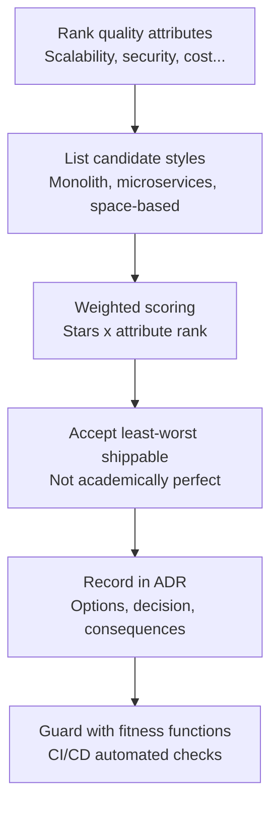
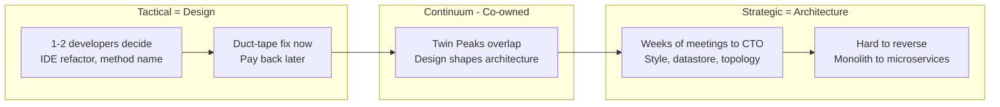
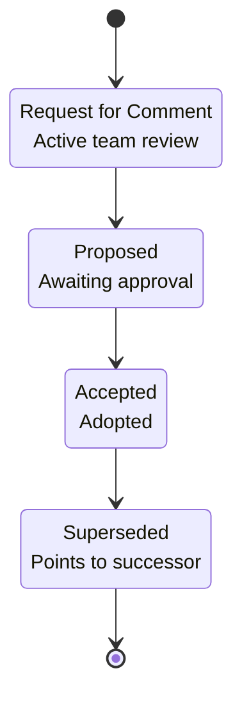
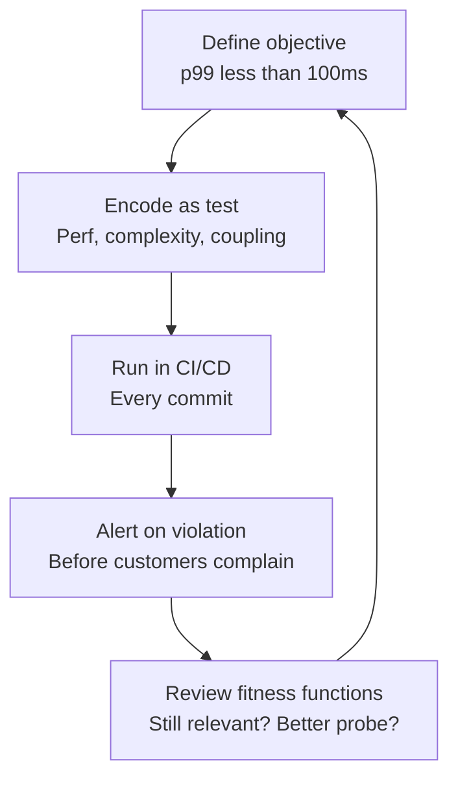

# Chapter 9: Software Architecture — Definitive Technical Summary
*From: Fundamentals of Software Engineering: From Coder to Engineer by Nathaniel Schutta and Dan Vega*
*Source PDF: pp. 352–379 (Ch. 9) — figures below cite PDF pages.*

> [!NAV] **Chapter Navigation**
> ⬅️ **Previous:** [[chapter-08-caching-and-performance|Chapter 08: Caching and Performance]] | 🏠 **Index:** [[00-Master-Reading-Dashboard|Master Dashboard]] | ➡️ **Next:** [[chapter-10-to-production|Chapter 10: To Production]]

---

## 1. Executive Summary & Core Engineering Problem

- **Core Thesis:** Architecture is the set of decisions that are hard to change later, made by weighing trade-offs among quality attributes ("illities") — not by Googling for a right answer. There are no right or wrong answers in architecture, only trade-offs, and usually you must accept the least-worst option that still ships on time (PDF pp. 352–355).
- **The Core Problem Statement:** Naive designs satisfy only functional requirements ("it works") and collapse under unstated requirements: scale, performance, security, availability, cost, regulation. Classic failure: six months into a Spring microservices build you realize you wanted a modular monolith — the rewrite costs more than the original build. Or the ticketing system that sells seat A-42 twice at 10,000 req/s because nobody designed for concurrency and bot traffic.
- **What This Chapter Covers (PDF pp. 352–379):** What architecture is (Ford/Richards quote, p. 352) → Architect's question checklist (pp. 353–354) → Trade-offs / "It depends" (p. 355) → The Accidental Architect + runtime vs build-time dependency (pp. 356–358) → Architecture vs Design / Twin Peaks / strategic vs tactical (pp. 358–359) → Quality attributes / "illities" and nonfunctional-requirements sidebar (pp. 359–360) → Concert Comparison kata + ranking (pp. 361–362) → Stakeholder alignment + Power of Indirection / Git story (pp. 362–364) → Architectural styles: monolithic vs distributed (pp. 364–366) → Agile architect / evolutionary architecture / hypothesis-driven development (pp. 366–367) → Fitness functions + Performance Problem story (pp. 368–370) → Architectural diagrams / communication (pp. 370–371) → ADRs full template + live-kata examples (pp. 371–374) → Wrapping up, katas practice, resources (pp. 374–378).
- **Historical & Industry Context:** House-architect analogy (p. 352): electrical/plumbing/ventilation poured in concrete are hard to refactor — same for datastore choice, deployment topology, service boundaries. The industry moved from big-up-front architecture to evolutionary architecture (Ford et al.): design expecting change, guard it with fitness functions and ADRs, rather than pretending you can predict the future.

---

## 2. In-Depth Technical Concepts & Internal Mechanics

### 2.1 What Architecture Is — "The Stuff You Can't Google"

- **Foundational theory & intuition:** Quoting Neal Ford and Mark Richards (authors of *Fundamentals of Software Architecture*, 2nd ed.): the architect owns the big picture — structure, vision, and the unstated requirements around scale, performance, security ("illities"). Internet search answers error messages; it never answers "which datastore for the Foo App?" (PDF p. 352).
- **Working definition:** Architecture = the decisions that are hard to change later (p. 352). A single-family home vs an apartment building have different landscapes — so do a 300-person Brazilian document system vs a global ticketing platform. The Brazil example (p. 354): locate near Brazil, consult legal on Brazilian regulation, size documents/month, ask about expansion, translation, analysis needs.
- **The architect's question checklist (pp. 353–354, preserved in full):** How many users / concurrent? Where located? Availability target? Spike causes? Usage hours? Constraints and integrations? Contracted cloud provider(s)? Competitive landscape? Ideal vs current deployment environment? What data, retention? Carbon footprint and cost, and how to optimize each? Laws/regulations? Acceptable response times? Security policies? Privacy concerns? No generic answers — every app is unique.
- **Concrete example — Alice picks a datastore:** Alice's team needs a store for orders. Postgres gives transactions and joins; Cassandra gives write elasticity; S3+Athena gives cheap analytics. Each maximizes one "illity" and tanks another. The decision is strategic (many teams, hard to reverse) — hence architectural, not a Tuesday-afternoon design pick.

### 2.2 Trade-Offs — "It Depends" Is the Whole Job

- **Theory:** Rich Hickey epigraph (p. 355): "Programmers know the benefits of everything and the trade-offs of nothing. Architects need to understand both." Every architectural style carries star ratings across characteristics — but you cannot just pick the most stars. Weight by what matters to *your* app. Academically perfect architectures fail; good architects make the best shippable call (p. 355).
- **Mechanics of a trade-off analysis:**
  1. List candidate options (e.g., monolith, microservices, space-based).
  2. Rank your quality attributes (see §2.5).
  3. Score each option per attribute, weighted by rank.
  4. Accept the least-worst total — document losers and why (feeds the ADR, §2.11).
  5. Add a fitness function so drift gets caught (see §2.9).
- **Ken Scrambler hot tips (p. 357, verbatim spirit):** Good things are better than bad things, except when they're not. Nothing is good or bad. It depends. The answer to every question is "it depends," except when it doesn't. Name three things you like — you can't have them at once.
- **Failure mode:** Analysis paralysis (months of meetings up to the CTO) vs snap decisions with incomplete info. The chapter's cure: timebox deliberation to hours/days, decide, write the ADR, move on (p. 371).

### 2.3 The Accidental Architect — Runtime vs Build-Time Dependency

- **Theory (p. 356):** Most orgs are territorial with titles and short on architects. You will do architectural work without the title — the *accidental architect*. When that happens, force yourself to see the bigger picture and get feedback from team and org.
- **Worked trade-off — shared library as service or jar? (pp. 356–358):**
  - *Runtime dependency (service call):* Good when the library is volatile and callers must have the latest version simultaneously (deploy once, all callers current). Bad: new out-of-process hop = new error surface (unreachable? geographically distributed? need cached/default fallback?), harder to test, network latency.
  - *Build-time dependency (compiled-in jar):* Good: no network hops, fewer error modes, simpler tests. Bad: rollout means every caller rebuilds/redeploys; version skew across the org is near-certain.
- **Concrete example — sales-tax utility (p. 358):** Tax rules change constantly and must be current — argues for runtime. But if the network blocks tax calculation at checkout, executives call within minutes — so you need a backup (cached tables, default rate + reconciliation) or you accept build-time staleness deliberately. The authors ask point-blank: what would *you* recommend? There is no answer without context — it depends.

### 2.4 Architecture Versus Design — Twin Peaks, Strategic vs Tactical

- **Twin Peaks Model (p. 358):** Design decisions affect architecture and vice versa — chicken-and-egg along a continuum. Picking an architectural style is clearly architecture; picking a data type in a class is clearly design; the vast majority lives between.
- **Two lenses to place a decision (pp. 358–359):**
  - *Who decides?* One or two developers → tactical (design). Weeks of meetings up to the CTO → strategic (architecture).
  - *Cost of change?* IDE refactor of a method → tactical. Refactoring a monolith to microservices → strategic. Naming a method → tactical (but still sparks debate); naming an external service used by countless customers → strategic.
- **Strategic vs tactical framing:** Strategic = long-term direction, may take longer or require backtracking ("take the time it takes so it takes less time"). Tactical = duct-tape fix for an acute problem, knowingly incurring debt ("don't be surprised when that short-term fix is still running years later").
- **Collaboration rule:** Architects and developers must co-own the middle of the continuum. Title doesn't settle it — best-positioned person plus feedback does (see also sidebar p. 368: senior devs routinely do architect-domain work; some companies have no architect title at all).

### 2.5 Quality Attributes ("Illities") — Finding and Ranking What Matters

- **Theory (pp. 359–360):** The architect's focus is broader than features. Quality attributes are also called nonfunctional requirements, architectural characteristics, quality goals, constraints, QoS goals, architecturally significant requirements — colloquially the "illities": maintainability, scalability, reliability, security, deployability, simplicity, usability, compatibility, fault tolerance, and more.
- **Why not say "nonfunctional" (sidebar pp. 360–361):** Tell a stakeholder about "nonfunctional things" and they stop listening ("I don't want any of that nonfunctional stuff"). Talk about *quality* and customers engage. Frame benefits in their terms, not pure tech (p. 363).
- **Inverse relationships (p. 361):** You cannot turn every knob to 11. Security vs usability is the classic tension (an un-networked machine in a locked room with no login is secure and useless). Your job: identify the attributes, orient them in correct tension, and convince stakeholders the invisible ones (maintainability, simplicity) matter.
- **Concert Comparison kata (pp. 361–362):** Ticketing site, thousands concurrent, bursts to 10,000/s on onsale. Requirements: concurrent buying, never double-sell a seat, show remaining-seat overview. Context: implement in both space-based and microservices styles; name trade-offs. Signals to catch: huge bursts → elasticity + resilience + scale-to-near-zero after; no double-sell → distributed locking without letting one user hoard hundreds of seats; unstated → bot mitigation.
- **Ranking mechanics (p. 362):** Capture attributes in a mind map, table, or numbered list. Share with stakeholders, take feedback, iterate. Device-driver project ranks performance over maintainability; ecommerce ranks availability and scalability first — type of app decides (pp. 360–361).

### 2.6 Stakeholder Alignment — Influence and Indirection

- **Mechanics (pp. 362–363):** Outline quality-attribute benefits in stakeholder-relevant terms. Find the influential people (rarely the org chart). Approach as an equal, lead with ideas and reputation, use reciprocity. Frances Willard epigraph: "A reform often advances most rapidly by indirection."
- **War story — The Power of Indirection (p. 364):** Nate's team wrote a compelling gist for replacing a legacy VCS with Git. Architecture group approved; the team owning the old tool shut them down hard. They recruited the CTO's right hand, who reframed Git as a *complement* (code-collaboration/sharing tool), not a replacement. Additive framing defused resistance; pilot → reuse wins → enterprise rollout in months. Lesson: the direct path invites maximum resistance; reframe indirectly, borrow clout.
- **Failure mode:** Technically correct proposal, politically dead on arrival. Fix: pilot scope, additive framing, influential sponsor.

### 2.7 Architectural Styles — Monolithic vs Distributed

- **Theory (pp. 364–366):** A style describes overall code structure plus datastore interaction. Two families:
  - *Monolithic (single deployable):* big ball of mud, layered, microkernel, pipeline.
  - *Distributed (multiple deployables):* space-based, service-oriented, microservices, event-driven.
- **Key correction (p. 365):** Monoliths are not inherently unmaintainable — poor structure is. Maintainable modular monoliths exist; undisciplined distributed systems rot into distributed balls of mud with extra network hops, complexity, cost, and observability burden.
- **Worked contrast — microservices (p. 365):** Excellent elasticity/scalability; pays with network hops (performance), complexity, cost, and mandatory monitoring/tracing/debugging investment. Right when scalability/elasticity are top-ranked; wrong otherwise.
- **Decision rule (p. 366):** Never Google "what style should I use" — the answer is "it depends." Style selection from ranked attributes is one of the architect's most important acts. Full catalog is out of scope here; the authors point to Richards & Ford (footnote 15).

| Dimension | Monolithic (modular) | Distributed (microservices / event-driven) |
| :--- | :--- | :--- |
| Deploy units | One | Many |
| Elasticity / scalability | Limited (scale whole) | Excellent (scale hot services) |
| Performance (network) | In-process, fast | Hop-heavy, slower per call |
| Complexity / cost | Lower | Higher (ops, observability) |
| Debuggability | Stack traces suffice | Needs tracing, correlation IDs |
| Best when | Team small, attributes favor simplicity/deployability | Bursty scale, independent deployability top-ranked |

### 2.8 The Agile Architect — Evolutionary Architecture

- **Theory (pp. 366–367):** "Aren't architects anti-Agile?" No — every project has people making architectural decisions regardless of titles; you'll know in a year or two if they were good. Some architectural work won't fit an iteration (procurement, legal), and that's fine.
- **Evolutionary architecture (Ford et al., quoted p. 366):** "An evolutionary architecture supports guided, incremental change across multiple dimensions." Instead of future-proofing for imagined requirements, design *expecting* change; evolve incrementally via nested feedback loops (Agile demos with real working software).
- **Hypothesis-driven development (p. 367):** `We believe <change> / Will result in <outcome> / We will know we succeeded when <metric X moves>.` Example: "We believe adding a distributed cache / will result in faster startup / we succeed if startup < 15 s." Data beats loudest-voice debates.

### 2.9 Fitness Functions — Automated Architectural Governance

- **Theory (pp. 368–370):** Second law of thermodynamics applies to software: without counter-pressure, architecture devolves into a big ball of mud from the first commit. New members lack the original nuance; customers eventually complain about performance/scalability.
- **Definition:** A fitness function measures how closely the architecture meets an objective — lightweight, low-ceremony governance, effectively a to-do list from architects to developers. From evolutionary computing (mutate → test fitness). Examples: service calls average < 100 ms; cyclomatic complexity ≤ 5; response times stay reasonable as users/requests grow.
- **War story — The Performance Problem (p. 369):** Nate inherited an ancient VB6 app with a "performance problem that started sometime in the last three years." Diagnosis was archaeology. A continuous performance fitness function would have caught drift before customers did.
- **Mechanics:** Identify early, automate into CI/CD where possible (some stay manual), review periodically for relevance, evolve the tests as better probes appear.

### 2.10 Architectural Diagrams — Communication First

- **Theory (pp. 370–371):** Architecture is communication; models are how you speak (see Ch. 5). Component, deployment, sequence — no shortage of options. A developer-perfect diagram baffles a VP of engineering.
- **Rule:** Before drawing, name the audience (developer? architect? business partner? yourself exploring?). Ask: does this diagram help tell the story? If yes, build it; if no, skip it. Diagrams provide context, explain/manage complexity, surface quality attributes.

### 2.11 Architectural Decision Records (ADRs) — "Why > How"

- **Theory (pp. 371–374):** Every project forces forks in the road under time pressure and thin information. You decide and soldier on — but do you write down *why*? Second law of software architecture: *why is more important than how.* Future maintainers (and future you, mid-crisis) need the reasoning trail. ADRs (introduced by Michael Nygard) are that sequential log — short, Markdown/AsciiDoc plain text (searchable), version-controlled or wiki-kept.
- **ADR template (pp. 372–374, preserved):**
  - *Title:* three-digit sequential ID + descriptive name (sortable history).
  - *Status:* Request for comment → Proposed → Accepted → Superseded (immutable; superseded ADRs point to their successor).
  - *Context:* Constraints and circumstances (e.g., CIO's preferred-vendor list). Don't skimp.
  - *Options:* What was considered; what was eliminated early and why.
  - *Decision:* What was chosen, why, what was rejected and why. Err verbose.
  - *Consequences:* Positive and negative fallout. Err verbose.
  - *Governance:* How compliance is enforced — which fitness functions.
  - *Notes:* Authors, dates (accepted/superseded), approvers, plus diagrams/supporting material. Write for a first-day reader; never assume "common knowledge."
- **Real examples (p. 373):** First Architectural Katas live-training outputs on GitHub (health-food startup, teams of 3–5): ArchColider, Miyagi's Little Forests, Jiakaturi — recommended study.
- **Mechanics:** Keep tooling simple and searchable; plain text aids search for "that tricky network-settings ADR" months later.

---

## 3. Important Figures, Diagrams & Visual Architecture

> 📕 **Original figures quick index (source PDF, Ch. 9 has no numbered figures — reconstructions below map concepts to pages):** open the PDF at the cited page to verify each concept.
>
> | Concept | PDF page | What to compare |
> |---|---|---|
> | Architect's question checklist | PDF pp. 353–354 | 16 scoping questions |
> | Runtime vs build-time dependency | PDF pp. 356–358 | Sales-tax scenario |
> | Strategic vs tactical continuum | PDF pp. 358–359 | Twin Peaks framing |
> | Concert kata signals | PDF pp. 361–362 | 10k/s burst, no double-sell |
> | ADR lifecycle + template | PDF pp. 372–374 | 8-section outline |
> | Fitness-function loop | PDF pp. 368–370 | CI/CD governance |

### Diagram 9-1: Trade-Off Analysis Flow (Concept → PDF pp. 355–356)
- **Reference:** Trade-off flow → PDF pp. 355–356 — open the source PDF at pages 355–356 to compare.
- **Visual flow:** Rank attributes, score styles weighted by rank, accept least-worst shippable option, record in ADR, guard with fitness functions.
- **Mermaid diagram:**



- **Key takeaway:** Analysis serves a shippable decision plus its paper trail — not a perfect architecture.

### Diagram 9-2: Strategic vs Tactical Continuum (Concept → PDF pp. 358–359)
- **Reference:** Twin Peaks / strategic–tactical lens → PDF pp. 358–359.
- **Visual flow:** Who-decides and cost-of-change place each decision; middle continuum is co-owned.
- **Mermaid diagram:**



- **Key takeaway:** Cost-of-change and decider-count locate the decision; architects and developers jointly own the middle.

### Diagram 9-3: ADR Lifecycle (Concept → PDF pp. 372–374)
- **Reference:** ADR statuses → PDF pp. 372–373 — open the source PDF at pages 372–373 to compare.
- **Visual flow:** RFC under review, proposed awaiting approval, accepted adopted, superseded pointing forward; all immutable and searchable.
- **Mermaid diagram:**



- **Key takeaway:** ADRs are append-only history; obsolescence links forward instead of rewriting the past.

### Diagram 9-4: Fitness-Function Governance Loop (Concept → PDF pp. 368–370)
- **Reference:** Fitness functions in CI/CD → PDF pp. 369–370.
- **Visual flow:** Architect declares objectives as tests; every commit/refactor runs them; violations alert before customers notice; functions themselves are periodically reviewed.
- **Mermaid diagram:**



- **Key takeaway:** Hope is not a strategy (p. 369) — automated architectural tests are.

---

## 4. Real-World Systems, Case Studies & Code Examples

- **Brazil document-management sizing (p. 354):** 300 users in Brazil → host in/near Brazil, check Brazilian law with legal, quantify docs/month and sizes, probe expansion/translation/analysis. Demonstrates that context questions precede style choice.
- **Sales-tax library decision (pp. 356–358):** Runtime service = always current, survivable only with cached/default fallback; build-time jar = simple and testable, doomed to version skew. Forces explicit fallback design either way.
- **Git adoption via indirection (p. 364):** Compelling gist won architects but lost to incumbent-tool owners; reframing as additive collaboration tooling plus a CTO-adjacent sponsor won enterprise rollout in months. Template for any tool migration.
- **VB6 performance archaeology (p. 369):** Three-year-old drift with no baseline made diagnosis miserable — the cautionary tale that justifies fitness functions from day one.
- **Live Architectural Katas artifacts (p. 373):** ArchColider, Miyagi's Little Forests, Jiakaturi on GitHub — full architectures with ADRs from 3–5-person teams; the chapter's recommended real-world reading.
- **Code — ADR skeleton (distilled from pp. 372–374 template):**

```markdown
# ADR-007: Choose Modular Monolith for Foo App

## Status
Accepted (2025-03-14)

## Context
Team of 4; must ship in 10 weeks; CIO preferred-vendor list limits
cloud choice; scale target 300 Brazilian users, bursty month-end load.

## Options
1. Microservices on Spring — rejected: elasticity unneeded, ops cost
   exceeds team capacity, 10-week window unachievable.
2. Space-based — rejected: 10k/s bursts not in profile.
3. Modular monolith — chosen.

## Decision
Ship modular monolith with strict module boundaries; revisit if
concurrent users exceed 5,000 sustained.

## Consequences
+ Single deployable, simple observability, hits deadline.
- Must enforce boundaries (fitness function) or decay to big ball of mud.

## Governance
Fitness functions: `avg service response < 100ms`;
`cyclomatic complexity <= 5`; ArchUnit `no cycles between modules`.

## Notes
Author: N. Schutta. Approvers: CTO, lead dev. Supersedes: n/a.
```

---

## 5. Architectural Trade-Off Matrix

| Decision | Option A | Option B | Wins | Costs / Risks | Use A when… | Use B when… |
| :--- | :--- | :--- | :--- | :--- | :--- | :--- |
| Shared capability | Runtime service | Build-time library | Always-current rollout | Network errors, fallback design, test complexity | Volatile rules (tax), must-be-current | Stable util, offline-safe, simple tests |
| Scope | Monolith (modular) | Microservices / distributed | Simple deploy, debug, cost | Scales as one unit | Small team, modest scale, deadline pressure | Elasticity/scale dominate, independent deploys needed |
| Process | Evolutionary + fitness fns | Big upfront design | Adapts to change, shippable slices | Requires discipline, continuous tests | Requirements/tech shifting | Regulated fixed-scope with stable context |
| Knowledge | ADRs in version control | Tribal memory / wiki sprawl | Searchable why-trail | Small writing overhead per decision | Any project > 1 dev or > 1 month | Throwaway spikes (still consider one ADR) |
| Attribute tension | Security-first | Usability-first | Breach resistance | Friction, lockout risk | Regulated/PII/finance/health | Consumer growth, low-risk data |

**Decision heuristics:** If one team can hold the design in its head and scale is modest → modular monolith + ADRs + fitness functions. If bursts hit 10k/s and double-sell is catastrophic → distributed styles with locking, bot defense, and elasticity ranked first. If stakeholders glaze at "nonfunctional" → reframe as quality outcomes they buy. If a decision survives three months unchallenged → re-read its ADR; context may have moved.

---

## 6. Jargon Buster & Key Terminology

- **Software architecture (decisions hard to change later):** Structure, vision, and cross-cutting choices (datastore, topology, style). *Pitfall:* confusing tool picks (frontend library, whiteboard sketch) with architecture.
- **Quality attributes / "illities" (architectural characteristics):** Scalability, reliability, security, maintainability, deployability, etc. *Pitfall:* calling them "nonfunctional" to stakeholders — they tune out.
- **Trade-off analysis (weighted least-worst choice):** Scoring options against ranked attributes. *Pitfall:* chasing the academically perfect maximum-stars answer.
- **Accidental architect (untitled architecture work):** Doing architect-scope decisions without the title. *Pitfall:* staying in code blinders; duty is to lift to bigger picture + seek feedback.
- **Runtime vs build-time dependency (service call vs compiled jar):** Currency and single rollout vs simplicity and skew. *Pitfall:* runtime without fallback; build-time without upgrade plan.
- **Twin Peaks Model (design ↔ architecture co-evolution):** Each constrains the other along a continuum. *Pitfall:* turf war over who owns the middle — co-own it.
- **Strategic vs tactical (long-term direction vs duct-tape fix):** Decider-count and cost-of-change locate the call. *Pitfall:* tactical fixes that never get repaid.
- **Architectural style (monolithic vs distributed families):** Overall code + datastore shape. *Pitfall:* equating monolith with mess; structure, not topology, decides maintainability.
- **Evolutionary architecture (guided incremental change):** Design for change, evolve in slices. *Pitfall:* gold-plating for futures that never arrive.
- **Hypothesis-driven development (belief → outcome → metric):** Data-gated change format. *Pitfall:* shipping opinions without success metrics.
- **Fitness function (automated architectural test):** Executable objective (latency, complexity) run in CI/CD. *Pitfall:* write-once tests that rot — review them.
- **ADR — Architectural Decision Record (sequential why-log):** Title/Status/Context/Options/Decision/Consequences/Governance/Notes. *Pitfall:* documenting how without why; omitting "obvious" context the next reader lacks.
- **Architectural kata (practice design exercise):** Time-boxed group design on a prompted domain. *Pitfall:* treating it as trivia — the questions asked *are* the skill.

---

## 7. System Design & Practical Engineering Takeaways

### 7.1 Production Engineering Checklist
1. Open every effort with the 16-question scoping pass (users, spikes, data, cost, carbon, law, security, privacy — pp. 353–354) before choosing a style.
2. Rank quality attributes explicitly (mind map/table/list), get stakeholder sign-off, and let the ranking — not fashion — pick monolith vs distributed.
3. Default to modular monolith for small teams and modest scale; extract services only when ranked attributes demand it.
4. Write an ADR for every strategic call (why, losers, consequences, governance) in searchable plain text under version control.
5. Encode each ADR's invariants as fitness functions in CI/CD (latency, complexity, coupling) and review them quarterly.

### 7.2 System Design Interview Blueprint
- Open with scoping questions and attribute ranking ("300 Brazilian users, bursty month-end, PII retention X — so I rank availability, simplicity, and compliance first, which points to…").
- Narrate one trade-off with losers ("runtime tax service vs jar: I chose X because volatility outranked offline-safety, with fallback Y").
- Name governance unprompted ("ADR-007 records it; fitness functions enforce p99 and module cycles in CI").
- Avoid "microservices by default" — justify topology from attributes, and state the revisit trigger ("revisit if sustained concurrency exceeds 5k").

### 7.3 Mastery Self-Assessment Questions

#### Question 1 — Trade-off reasoning
*Your team of four must ship a document system for 300 Brazilian users in 10 weeks. A senior proposes Spring microservices "for scalability." Decide and defend.*
- **Answer:** Ship a modular monolith. Ranked attributes: time-to-market, simplicity, deployability, Brazilian compliance — not 10k/s elasticity. Microservices add network hops, observability burden, and ops cost a four-person team cannot carry in 10 weeks. Record in an ADR with a revisit trigger (e.g., sustained 5k concurrent users) and fitness functions guarding module boundaries so the monolith stays modular.

#### Question 2 — Runtime vs build-time
*Tax rules change weekly and must be current, but checkout cannot fail if the tax service is unreachable. Service or library?*
- **Answer:** Runtime service *with* designed fallback — cached rate tables plus a default-and-reconcile path — because currency is mandatory but availability at checkout outranks precision. Pure build-time jar goes stale weekly and skews versions; pure runtime without fallback pages executives. Document the fallback staleness window and its fitness function (e.g., cache age alert) in the ADR.

#### Question 3 — Fitness functions
*What breaks without fitness functions, and what makes a good one?*
- **Answer:** Entropy wins: module boundaries erode, latency drifts (the VB6 three-year mystery, p. 369), and newcomers repeat old mistakes. Good functions are automated in CI/CD, tied to ranked attributes (avg response < 100 ms, complexity ≤ 5), and periodically reviewed for relevance — lightweight governance, not bureaucracy.

### 7.4 Resources
- *Thinking Architecturally* — Nathaniel Schutta (O'Reilly, 2018) (PDF p. 376).
- *Head First Software Architecture* — Raju Gandhi et al. (O'Reilly, 2024) (PDF p. 376).
- *Fundamentals of Software Architecture* — Mark Richards and Neal Ford (O'Reilly, 2020) (PDF p. 376).
- *How to Win Friends and Influence People* — Dale Carnegie (Simon & Schuster, 1936) (PDF p. 377) — stakeholder influence companion.
- *Building Evolutionary Architectures*, 2nd ed. — Neal Ford et al. (O'Reilly, 2022) (PDF p. 377).
- "Code as Design" — Jack W. Reeves (PDF p. 377).
- *Influence*, New and Expanded — Robert B. Cialdini (Harper Business, 2021) (PDF p. 377).
- The C4 model for visualizing software architecture (PDF p. 377).
- *Communication Patterns* — Jacqui Read (O'Reilly, 2023) (PDF p. 377).
- *Creating Software with Modern Diagramming Techniques* — Ashley Peacock (Pragmatic, 2023) (PDF p. 377).
- *UML Distilled*, 3rd ed. — Martin Fowler (Addison-Wesley, 2003) (PDF p. 377).
- Practice: Architectural Katas — solo or small-group time-boxed designs; revisit after weeks; use for interviews (observe questions asked, not trivia recall); O'Reilly live Architectural Katas sessions (PDF pp. 374–376).

---

> [!NAV] **Chapter Navigation**
> ⬅️ **Previous:** [[chapter-08-caching-and-performance|Chapter 08: Caching and Performance]] | 🏠 **Index:** [[00-Master-Reading-Dashboard|Master Dashboard]] | ➡️ **Next:** [[chapter-10-to-production|Chapter 10: To Production]]
