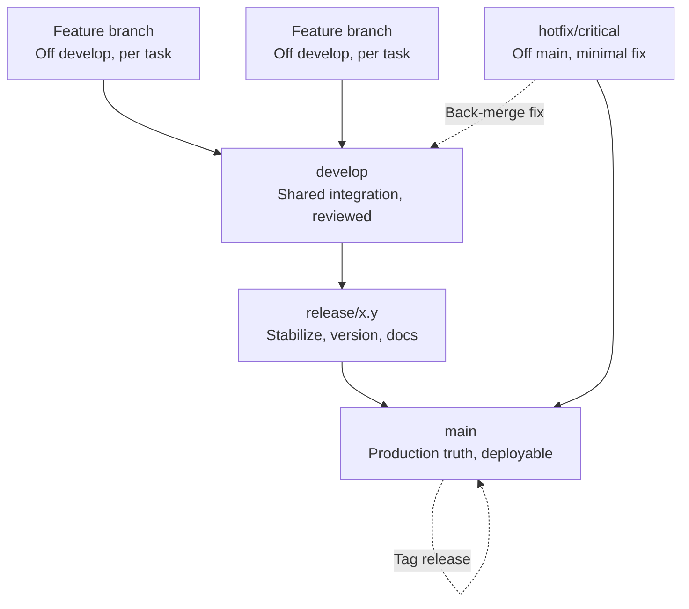
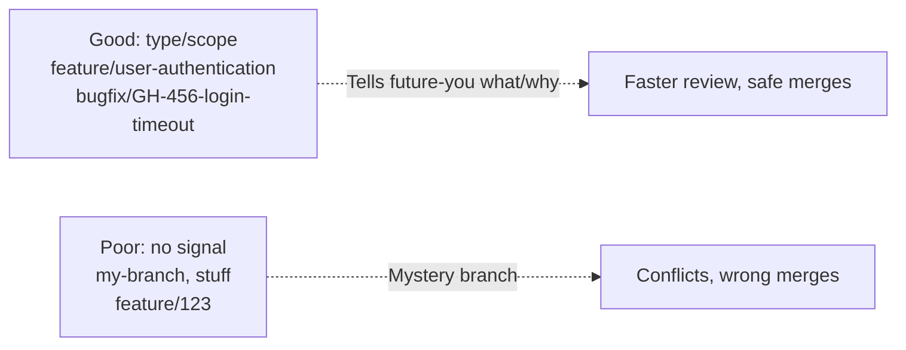
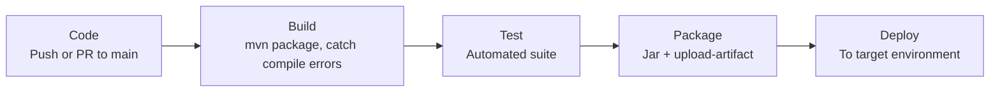
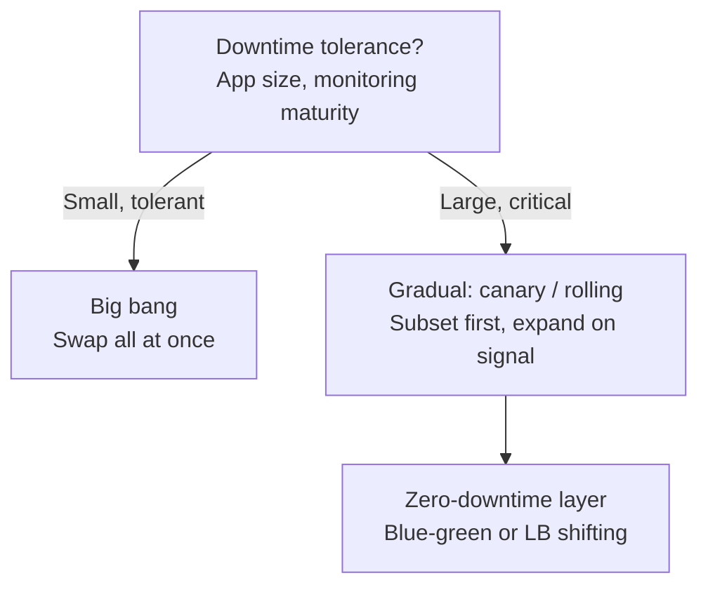

# Chapter 10: To Production — Definitive Technical Summary
*From: Fundamentals of Software Engineering: From Coder to Engineer by Nathaniel Schutta and Dan Vega*
*Source PDF: pp. 380–441 (Ch. 10) — figures below cite PDF pages.*

> [!NAV] **Chapter Navigation**
> ⬅️ **Previous:** [[chapter-09-software-architecture|Chapter 09: Software Architecture]] | 🏠 **Index:** [[00-Master-Reading-Dashboard|Master Dashboard]] | ➡️ **Next:** [[chapter-11-powering-up-your-productivity|Chapter 11: Powering Up Your Productivity]]

---

## 1. Executive Summary & Core Engineering Problem

- **Core Thesis:** Production is the ultimate test — real users, real data, real load — and the gap between "works on my machine" and "works for users" is closed by thinking production-ready from day one: environment-aware configuration, error handling and observability, layered security, version-control discipline, and automated CI/CD with safe deployment and rollback (PDF pp. 379–380, 387–388).
- **The Core Problem Statement:** Code passes locally and in QA, then collapses on maiden voyage: divergent OS/DB/dependency versions, hardcoded local configs, Black-Friday concurrency, messy legacy data, flaky payment/email/auth dependencies, and locked-down TLS/firewall/CORS production surfaces. Users never use software the way developers imagined (the CD-ROM "drink holder" support call, p. 381) — no test suite replicates the wild.
- **What This Chapter Covers (PDF pp. 380–441):** Complexities of production (unpredictable users; "works on my machine" six variables, pp. 380–387) → Building production-ready code: performance optimization, environment-specific config (files/env-vars/feature-flags/secrets), error handling + logging levels, security essentials (HTTPS/TLS, auth, PII/encryption, compliance/SBOM) (pp. 387–409) → Deployment pipeline: 4 components, 4 environments, version-control strategies with Git Flow deep dive (Table 10-1 p. 416, Fig. 10-1 p. 420), deployment automation (deploy + rollback scripts), deployment strategies (big-bang vs gradual/canary/rolling/blue-green), CI/CD with GitHub Actions Java example, monitoring/maintenance/AI note (pp. 409–437) → Wrapping up, practice drills, resources (pp. 437–441).
- **Historical & Industry Context:** From manual checklist deploys ("build the app, run tests, update DB, deploy" — panic-inducing, p. 427) to scripted deploys to CI/CD culture: every commit built, tested, packaged, and releasable the same way, with canary/blue-green and observability making production survivable.

---

## 2. In-Depth Technical Concepts & Internal Mechanics

### 2.1 Why Production Bites — Users Are Unpredictable (pp. 381–383)

- **Theory:** No test count simulates real-world use. Five unpredictability factors (pp. 381–382): real-world (Hollywood-screenplay) form data; scale/concurrency exposing hidden bottlenecks; diverse client environments (OS, resources, browser, latency); environmental drift (library/version skew); unexpected use cases and edge cases.
- **Antidotes named upfront (p. 382):** canary releases, A/B testing, robust observability (logging + metrics + distributed tracing) — leverage real users while bounding blast radius.
- **Intuition:** QA is a dress rehearsal with a polite audience; production is opening night with 10,000 critics typing with their elbows.

### 2.2 "But It Works on My Machine" — Six Divergence Variables (pp. 383–387)

1. **Environment differences:** MacBook/16 GB/MySQL 8.0 locally vs Linux/production Postgres 14, different RAM, network, dependency versions — perfect locally, spectacular failure remotely.
2. **Configuration management:** Local DB + verbose logging + fake-credit-card sandbox API must flip to secure cloud DB + error-only logging + real money-charging processor in production — automatically.
3. **Concurrency and load:** Solo "Add to Cart" clicks vs thousands on Black Friday; memory 30% → 95%, DB overwhelmed.
4. **Data diversity:** Hand-made "John Smith, 555-123-4567" rows vs millions of messy legacy records plus volume that turns instant queries into full scans. Test with realistic, diverse datasets.
5. **External dependencies:** Team-sport app — payment processor slow, email rate-limited, Google auth down → your team loses even when your code is fine. Design fallbacks.
6. **Security constraints:** Laptop accepts plain HTTP from anywhere; production demands HTTPS/TLS, firewall rules, CORS enforcement. Same fetch, blocked request.
- **Bridging strategies (pp. 386–387):** Containerization (Docker parity); observability (logs/metrics/tracing); staging mirroring production; CI/CD testing under production-like conditions. Users care that it works on *their* machine.

### 2.3 Performance Optimization — Mindset, Not a Dial (pp. 388–390)

- **Theory:** Adopt before writing code; review continuously. Goal is user experience, not raw speed. Building blocks (use incrementally):
- **Async programming:** Background tasks with completion callbacks instead of blocking waits — powerful but adds complexity; use cautiously.
- **Reducing network calls:** Batch small calls into fewer round-trips; every request costs time and resources.
- **Caching:** Memorize unchanging hot data in memory/fast storage; cuts DB load and latency (trade-offs detailed in Ch. 8).
- **DB query optimization:** Efficient SQL, proper indexes, kill N+1 query patterns.
- **Minification:** Strip whitespace/newlines/comments without changing behavior — smaller downloads.
- **Bundling:** Combine 20 JS files into 1–2 (Webpack/Vite) plus tree-shaking (drop unused code).
- **Lazy loading:** Fetch images/chunks/components only when needed — faster first paint.
- **CDNs:** Serve assets from edge locations near users.

### 2.4 Environment-Specific Configuration (pp. 390–395)

- **Anti-pattern → fix (p. 391):** Hardcoded `jdbc:postgresql://localhost:5432/fose / admin / secret` inside `DbConnection` does not scale across environments. Inject via `AppConfiguration` (`config.getDatabaseUrl()` etc.) instead.
- **What varies (p. 391):** Logging settings, external endpoints, database/cache/email settings, security settings, feature flags and app behavior.
- **Configuration files (p. 392):** Per-environment YAML (`application.yaml` for dev: localhost URLs, `api-key: 123456`, `INFO` logging; `application-prod.yaml`: real hosts, strong password, `ERROR` logging). Human-readable, one file per stage.
- **Environment variables (p. 393):** Never check secrets into VCS, and rotating a checked-in key forces full redeploy. Reference `${SERVICE1_URL}` / `${SERVICE1_API_KEY}` from the environment instead.
- **Feature flags / toggles (pp. 393–394):** Runtime control panel — ship to prod hidden, roll out gradually, A/B test, kill-switch without redeploy. Types: *release* flags (hide incomplete work, keep main deployable), *experiment* flags (compare experiences, gather data), *permission* flags (gate by role/tier). Tip: review regularly, set expirations, document purpose/lifespan — temporary flags calcify into debt.
- **Secrets (pp. 394–395):** Never in code or VCS (history rewrites, third-party leaks, money/trust loss). Use AWS Secrets Manager / HashiCorp Vault / Azure Key Vault (encryption + access control); rotate regularly (ideally automated); least-privilege access; separate secrets per environment (dev/staging/prod never share).

### 2.5 Error Handling and Logging (pp. 395–398)

- **Theory:** Happy path is ~20% of code; edge cases and errors are ~80% of effort — where seniors separate themselves (Pareto, p. 396).
- **Error-handling strategies:** Graceful degradation (cached weather + staleness note instead of error page); meaningful user messages ("trouble loading data, retry in minutes" not "DB connection failed"); behind-scenes logging of codes/traces; fallback options (backup payment processor auto-switch).
- **Logging levels — Java (pp. 397–398):** ERROR (needs immediate attention) → WARN (potentially harmful) → INFO (normal business events) → DEBUG (detailed diagnostics). Balance signal vs noise.
- **Never log (p. 398):** Passwords/keys/tokens/secrets; PII; giant objects/entire payloads (log identifying slices); duplicate same-fact logs across layers.

### 2.6 Security Essentials (pp. 398–409)

- **Posture:** Built in from the start, never bolted on; you need not be a security expert but must know fundamentals. OWASP is the recommended free reference (p. 398).
- **HTTPS/TLS (pp. 399–400):** HTTP is a postcard (readable by anyone intercepting); HTTPS is a sealed envelope (TLS encryption + integrity). TLS certificates are site ID cards from trusted CAs; browser verifies, then negotiates encryption. Note: "SSL" in conversation almost always means TLS — SSL itself is broken, never use in prod. Practices: HTTPS everywhere (not just login), HTTP→HTTPS redirects, fresh certs (automated management), TLS ≥ 1.2.
- **Authentication best practices (pp. 400–403):** AuthN = who you are; AuthZ = what you may do. Never roll your own — use battle-tested stacks (Spring Security, 20+ years). BCrypt-encode passwords before storage (`PasswordEncoder` bean + `passwordEncoder.encode(...)`). Password policy: ≥ 12 chars mixed classes, compromised-password denylist, no reuse, salted modern hashes (salt defeats rainbow tables), password-manager support. Brute-force defense: exponential backoff (5 s → 30 min), cross-account IP tracking, CAPTCHA after failures, new-device alerts, secure recovery. Sessions: high-entropy tokens, 30-min idle / 8-h absolute timeouts (shorter for banking), revoked-token blocklist. MFA: authenticator apps/keys/biometrics; SMS/email accepted but SIM-swappable; risk-triggered step-up (new location/device), MFA on recovery, backup codes, trusted-device caching with controls.
- **Safeguarding user data — PII and encryption (pp. 403–405):** Treat user trust as professional/ethical duty. PII spans obvious (name, SSN) to quasi-identifiers (IP, device ID, combos). Mark with `@Sensitive` annotation on `email/phoneNumber/dob` (Java example, p. 404). Encrypt at rest (AES-GCM: 128-bit strong, 256-bit future-proof; random 12-byte IV per value, `IV||ciphertext` Base64 — book's `DataEncryptionService`, p. 405) as the last-line vault.
- **Compliance (pp. 405–408):** Privacy by design; secure-coding standards; encrypt in transit (HTTPS) and at rest; careful in-memory decryption; deletion/export mechanisms; document sensitive-data touches; involve security pros early. Regulations: GDPR/CCPA (consent, deletion/right-to-be-forgotten, minimization, safeguards); HIPAA (encrypt health data, strict per-user access, audit logs, HIPAA-compliant vendors, minimal retention); PCI DSS (never store CVV, encrypt cardholder data, strong access controls, secure systems). SBOM = ingredient list (every library + version) so vulnerable components are findable and patchable; generate automatically; scan on cadence (monthly/quarterly); log security actions but never sensitive data. Warning callout (p. 408): security is layers — no single measure suffices.

### 2.7 Deployment Pipeline — Four Gears (pp. 409–410)

1. **Deployment environments** (where code lives: local → testing/QA → staging → prod).
2. **Version-control strategies** (how teammates share code safely, release, and handle emergencies).
3. **Deployment automation** (same reliable process every time, no skipped checklist steps).
4. **CI/CD** (automatic motion from commit to production).

### 2.8 Deployment Environments (pp. 410–411)

- **Local development:** Personal playground; teammates run similar setups.
- **Testing/QA:** First shared checkpoint; suite may behave differently than locally.
- **Staging:** Dress rehearsal — production-like, final performance and user-acceptance testing.
- **Production:** Main stage, real users. Configuration management rides along every hop — integral, not afterthought.

### 2.9 Version Control Strategies — Git Flow Deep Dive (pp. 411–420)

- **Why it matters in prod (p. 411):** Ship features without disrupting live service; roll back (or forward) fast; keep audit trails for compliance.
- **Four workflows compared (p. 412):** *Git Flow* (long-lived branches per work type, strong dev/prod isolation — examined in depth); *GitHub Flow* (main + short-lived feature branches straight to prod after review); *trunk-based* (single main, sub-day branches, frequent integration); *release train* (scheduled bundled releases weekly/monthly).
- **Core branches (pp. 413–414):** `main` = production truth, always stable/deployable, protected from direct commits, all tests green (note: `master` renamed `main` for inclusive terminology). `develop` = shared workspace where features integrate; protected by code review on merge-in; always buildable (compiles, basic tests pass); full suite run frequently to catch cross-feature breaks.
- **Supporting branches (pp. 415–418):** *Feature* branches (off `develop`, where you live; name clearly). *Release* branches (stabilization while `develop` moves on; version bumps, docs, deploy config; quality-gate/release-candidate approval; freeze for scheduled windows — optional if org lacks formal releases). *Hotfix* branches (off stable `main`, bypassing half-done `develop` work; merged to both `main` for immediate deploy and `develop` so the fix persists; minimal, fast, low-risk).
- **Table 10-1 — Branch name examples (p. 416, reconstructed):**

| Good branch names | Poor branch names |
| :--- | :--- |
| `feature/user-authentication` | `my-branch` |
| `bugfix/login-timeout` | `stuff` |
| `enhancement/performance-optimization` | `feature/123` (no context) |
| `feature/JIRA-123-user-authentication` | |
| `bugfix/GH-456-login-timeout` | |

- **Lifecycle (pp. 418–420):** Feature → `develop` → release stabilization → `main`; hotfixes patch `main` + `develop` directly. Git Flow is one approach among many — goals are constant: protect code, isolate work, integrate cleanly.

### 2.10 Deployment Automation — Scripts and Rollbacks (pp. 421–424)

- **Why (p. 421):** Manual deploys (prepare, package, test, provision servers, execute, verify) are slow, error-prone, stressful. A deploy script is factory instructions: documented steps, error handling, backups, systematic order. Even a simple script beats none; improve incrementally.
- **Deploy script anatomy (pp. 421–422, bash/JAR example):** Configure (`APP_NAME`, `JAR_FILE`, `DEPLOY_DIR`, `BACKUP_DIR`, `LOG_FILE`, `PID_FILE`, `JVM_OPTS`); `mkdir -p`; timestamped backup of current jar; stop via PID file; copy new jar (fail fast if missing); `nohup java` start; health-check via `kill -0` on PID.
- **Rollback script anatomy (pp. 423–424):** Locate latest timestamped backup (fail if none); stop current; restore backup jar; restart; verify. Prerequisites: backups exist pre-deploy; rehearse rollbacks; document DB-migration reversal; keep multiple versions; monitor during rollback. Goal is confidence, not just speed.

### 2.11 Deployment Strategies (pp. 424–426)

- **All-at-once / big bang:** Swap everything in one go. Simple, high-risk, whole user base feels breakage, hard rollback. Fits small apps, dev/test, downtime-tolerant systems.
- **Gradual / phased:** Subset first, expand on signal — restaurant-trials-new-recipe model. Includes *canary* (small % of users) and *rolling* (servers one by one), often zero-downtime via blue-green (two identical envs, flip traffic) or load-balancer shifting. Fits large scale, feedback-valuable features, monitoring-heavy systems.
- **Choosing:** "It depends" — complexity, downtime tolerance, monitoring maturity. Starting simple and evolving is respectable.

### 2.12 CI/CD — Continuous Integration and Deployment (pp. 426–432)

- **Definitions (p. 427):** CI auto-merges/tests everyone's changes; continuous delivery stages tested code for release; continuous deployment auto-releases to prod.
- **Benefits (pp. 427–428):** Consistency (kills works-on-my-machine); automatic test runs per change; less stress (scripts don't skip steps or typo); early integration-issue detection (cheap); shorter code-to-user lag (code has no value until users touch it).
- **Basic workflow (pp. 428–429):** Code (push) → Build (compile) → Test (automated suite) → Package (deployable artifact) → Deploy (to target env).
- **GitHub Actions Java example (pp. 429–431):** `Java CI/CD Pipeline` on `push`/`pull_request` to `main`; `ubuntu-latest`; `actions/checkout@v4`; `setup-java@v4` (JDK 25, Temurin); `./mvnw -B package`, `./mvnw test`, `./mvnw package -DskipTests`; `upload-artifact@v4` storing `target/*.jar`. `on` gates triggers; fresh VM per job; sequential steps with fail-fast dependencies.
- **Advanced patterns (pp. 431–432):** Canary (subset-first expansion) and blue-green (idle-env deploy + traffic flip). Adoption ladder: build+test pipeline → more checks → keep it fast (quick feedback) → monitor/optimize → document for collaboration. CI/CD is culture (continuous improvement + reliable delivery), not just tools.

### 2.13 Monitoring and Maintenance (pp. 432–437)

- **Monitoring (pp. 433–434):** No news is *not* good news — users leave silently. Two halves: real-time metrics (response time, load, throughput — interpreted against baseline: 300 ms alarms if normal is 50 ms) and logs (historical reconstruction). Five rules: log what you'll need in incidents; always timestamp + user ID; mark errors as errors (no burying alerts in info); never log secrets/PII; rotate/delete old logs before they eat storage. Tip: start simple (response times, error counts, resources); fancy tools later. AI note (p. 434): AI over logs/metrics finds anomalies early and scaffolds dashboards from metrics, shortcutting manual setup.
- **Maintenance (pp. 435–437):** Prod is the beginning, not the end. OS/security patches first (vulns, perf, bugs, features — never defer security). Dependency management is the most overlooked: dozens–hundreds of libraries, each a vuln vector — the SBOM (§2.6) plus Maven/Gradle analyzers and automated scans (Dependabot/Dependency-Check GitHub Action example, p. 436) catch the `spring-boot-starter-web:2.5.5`-style rot. Policy: regular intervals, emergency-patch procedure, automated scanning, documented process, update log. Prevention < recovery; calendar the reviews — automation still needs human oversight.

---

## 3. Important Figures, Diagrams & Visual Architecture

> 📕 **Original figures quick index (source PDF):** open the PDF at the cited page to verify each reconstruction.
>
> | Book item | PDF page | What to compare |
> |---|---|---|
> | Table 10-1 branch names | PDF p. 416 | Good vs poor names |
> | Figure 10-1 Git Flow | PDF p. 420 | Branch lifecycle diagram |
> | Deploy script listing | PDF pp. 421–422 | Bash deploy with backup + health check |
> | Rollback script listing | PDF pp. 423–424 | Bash restore + verify |
> | GitHub Actions workflow | PDF pp. 429–430 | Java CI/CD YAML |

### Figure 10-1: Git Flow Workflow (Reconstructed → PDF p. 420)
- **Figure Reference:** `Figure 10-1: Git Flow workflow (from text p. 420)`
- **Original PDF:** Fig 10-1 → PDF p. 420 — open the PDF at page 420 to compare with the Mermaid reconstruction below.
- **Visual Flow & Description:** Feature branches feed `develop`; release branches stabilize toward `main`; hotfixes cut from `main` and merge back to both `main` and `develop`. Core branches are long-lived; supporting branches are temporary per task.
- **Mermaid.js Architectural Diagram:**



- **Key Takeaway:** Long-lived `main`/`develop` give stability and coordination; short-lived feature/release/hotfix branches isolate risk by task type.

### Table 10-1: Branch Naming (Reconstructed → PDF p. 416)
- **Figure Reference:** `Table 10-1: Branch name examples (from text p. 416)`
- **Original PDF:** Table 10-1 → PDF p. 416 — open the PDF at page 416 to compare.
- **Visual Flow & Description:** Good names encode type + intent (+ tracker ID); poor names encode nothing. Tabulated in §2.9 above.



- **Key Takeaway:** Branch names are coordination protocol — include type, scope, and tracker ID.

### Supplementary S10-3: CI/CD Pipeline Stages (Listings → PDF pp. 428–431)
- **Figure Reference:** `Supplementary S10-3 [Supplementary synthesis of pp. 428–431 listings]: Code → Build → Test → Package → Deploy`
- **Visual Flow & Description:** Push/PR triggers a fresh VM that compiles, tests, packages the jar, and stores the artifact for deploy — same steps every time.
- **Mermaid.js Architectural Diagram:**



- **Key Takeaway:** Automation converts a panicky checklist into a repeatable, auditable conveyor.

### Supplementary S10-4: Deployment Strategy Choice (Concepts → PDF pp. 424–426)
- **Figure Reference:** `Supplementary S10-4 [Supplementary synthesis of pp. 424–426]: Big-bang vs gradual/canary/rolling/blue-green`
- **Visual Flow & Description:** Small/downtime-tolerant workloads take the simple big-bang swap; large/mission-critical workloads pay the setup cost of gradual traffic shifting for zero-downtime safety.
- **Mermaid.js Architectural Diagram:**



- **Key Takeaway:** Strategy follows blast-radius economics — start simple, graduate to gradual as scale and intolerance grow.

---

## 4. Real-World Systems, Case Studies & Code Examples

- **Apollo 13 opener (p. 380):** "Houston, we have a problem" — even controlled environments surprise you; production is the least controlled of all.
- **Maiden-voyage meltdown (p. 380):** Full QA sign-off, clean launch, then bug/performance floods and alert storms — the canonical "worked everywhere but prod" incident that motivates the chapter.
- **Drink-holder support call (p. 381):** User reports broken "drink holder" — it is the CD-ROM tray. Proof no test matrix covers human creativity.
- **Black Friday cart (pp. 384–385):** Solo clicks at 30% memory vs thousands concurrent at 95% with overwhelmed DB — the concurrency/data-volume gap in one scene.
- **Second-week deploy panic (p. 427):** New hire handed a vague "build, test, update DB, deploy" doc — the stress case CI/CD exists to abolish.
- **Code — environment-injected DB config (p. 391):**

```java
// DON'T DO THIS — hardcoded local credentials
public class DbConnection {
    private final String url = "jdbc:postgresql://localhost:5432/fose";
    private final String username = "admin";
    private final String password = "secret";
}

// DO THIS INSTEAD — per-environment configuration
public class DbConnection {
    private final String url;
    private final String username;
    private final String password;
    public DbConnection(AppConfiguration config) {
        this.url = config.getDatabaseUrl();
        this.username = config.getDatabaseUsername();
        this.password = config.getDatabasePassword();
    }
}
```

- **Code — per-environment YAML + env-var secret (pp. 392–393):**

```yaml
# application.yaml (dev)
services:
  service1:
    url: http://localhost:8080
    api-key: 123456
database:
  url: jdbc:postgresql://localhost:5432/fose
  username: postgres
  password: postgres
logging:
  level: INFO
# application-prod.yaml — secrets via environment, never checked in
services:
  service1:
    url: ${SERVICE1_URL}
    api-key: ${SERVICE1_API_KEY}
```

- **Code — PII marking + AES-GCM encryption (pp. 404–405):**

```java
public class UserProfile {
    private String userId;
    private String hashedPassword;
    @Sensitive  // custom annotation marking PII
    private String email;
    @Sensitive
    private String phoneNumber;
    @Sensitive
    private LocalDate dob;
}
```

```java
class DataEncryptionService {
    private final SecretKey key;
    DataEncryptionService(SecretKey key) { this.key = key; }
    String encrypt(String s) throws GeneralSecurityException {
        byte[] iv = new byte[12]; new SecureRandom().nextBytes(iv);
        Cipher c = Cipher.getInstance("AES/GCM/NoPadding");
        c.init(Cipher.ENCRYPT_MODE, key, new GCMParameterSpec(128, iv));
        byte[] ct = c.doFinal(s.getBytes(StandardCharsets.UTF_8));
        byte[] out = ByteBuffer.allocate(iv.length + ct.length)
                       .put(iv).put(ct).array();
        return Base64.getEncoder().encodeToString(out); // IV||ciphertext
    }
}
```

- **Code — BCrypt password handling (p. 401):**

```java
@Bean
public PasswordEncoder passwordEncoder() {
    return new BCryptPasswordEncoder();
}
User user = new User();
user.setUsername(registrationDto.getUsername());
user.setEmail(registrationDto.getEmail());
user.setPassword(passwordEncoder.encode(registrationDto.getPassword()));
return userRepository.save(user);
```

- **Systems referenced:** Docker (parity), GitHub Actions (CI/CD), Maven/Gradle + Dependency-Check (vuln scanning), AWS Secrets Manager / HashiCorp Vault / Azure Key Vault, Spring Security + BCrypt, OWASP guidance, TLS CA infrastructure.

---

## 5. Architectural Trade-Off Matrix

| Approach | Deploy risk | Feedback speed | Ops cost | Recovery | Best Used When | Avoid When |
| :--- | :--- | :--- | :--- | :--- | :--- | :--- |
| **Big-bang deploy** | High (all users at once) | Instant (good or bad) | Low setup | Hard rollback | Small apps, dev/test, downtime OK | Large scale, mission-critical, weak monitoring |
| **Gradual (canary/rolling)** | Low (subset first) | Staged signal | Medium | Easy halt/rollback | Large scale, feedback-valuable, careful monitoring | Tiny apps where setup exceeds risk |
| **Blue-green** | Lowest (instant flip) | Immediate + safe | High (2× envs) | Instant switchback | Zero-downtime mandates, high traffic | Cost-constrained, low-risk services |
| **Git Flow** | Low (isolation) | Slower (release gates) | Branch overhead | Clean hotfix path | Formal releases, scheduled windows, compliance trails | Solo/small fast-moving teams (prefer GitHub Flow/trunk) |
| **GitHub Flow / trunk** | Medium (thin gates) | Fastest | Minimal | Roll forward | Small teams, continuous delivery | Regulated releases needing candidates/approvals |
| **Feature flags** | Low (kill-switch) | Runtime control | Flag-debt if unexpired | Instant off | Gradual rollouts, A/B, tiered access | Unmanaged permanent toggles |
| **Manual checklist deploy** | High (skips/typos) | Slow, stressful | Human toil | Ad hoc | Never in prod (learn only) | Any production path — automate instead |

**Decision heuristics:** Formal release train or compliance audit → Git Flow + release branches + SBOM. Small team shipping daily → GitHub Flow/trunk + flags. Downtime-intolerant checkout → gradual + blue-green + automated rollback rehearsed. Secrets or PII anywhere → Vault/KMS + per-env credentials + AES-GCM; never YAML-checked-in plaintext.

---

## 6. Jargon Buster & Key Terminology

- **Production (live user environment):** Where real traffic, data, and money meet code. *Pitfall:* treating staging-green as prod-safe.
- **Environmental drift (cross-env skew):** Version/config differences between dev and prod. *Pitfall:* "unable to reproduce" closes the ticket, not the bug.
- **Staging (production-like dress rehearsal):** Final perf and acceptance ground. *Pitfall:* staging that shares prod secrets or toy data.
- **Feature flag / toggle (runtime switch):** Release/experiment/permission gating without redeploy. *Pitfall:* immortal temporary flags.
- **Secrets management (vaulted credentials):** Encrypted, access-controlled, rotatable storage (Vault/AWS/Azure). *Pitfall:* env-var dumps in logs or VCS.
- **PII — Personally Identifiable Information (linkable identity data):** Names, SSN, IP/device IDs, combos. *Pitfall:* logging it or storing unencrypted.
- **TLS (encrypted transport):** CA-verified, ≥ 1.2, everywhere with HTTP→HTTPS redirect. *Pitfall:* saying "SSL" while running actual SSL.
- **BCrypt + salt (adaptive password hashing):** One-way salted hashes defeating rainbow tables. *Pitfall:* plaintext or fast-hash (MD5/SHA-1) storage.
- **SBOM — Software Bill of Materials (dependency ingredient list):** Library + version inventory for vuln triage. *Pitfall:* generating once and never scanning.
- **Git Flow (main/develop + feature/release/hotfix):** Isolation-by-branch-type workflow. *Pitfall:* paying release-branch overhead with no formal releases.
- **CI / CD (auto build-test / auto deliver-deploy):** Commit-to-prod conveyor. *Pitfall:* tools without culture (slow, flaky, undocumented pipelines).
- **Canary / rolling / blue-green (gradual strategies):** Subset-first, server-by-server, dual-env flip. *Pitfall:* gradual without monitoring/rollback rehearsal.
- **Observability (logs + metrics + traces):** Real-time state plus reconstructable history. *Pitfall:* info-level haystacks hiding error needles, or secret-bearing logs.

---

## 7. System Design & Practical Engineering Takeaways

### 7.1 Production Engineering Checklist
1. Externalize every environment-varying value (URLs, keys, DB/cache/email, log levels, flags) — no hardcoded local credentials; secrets only from vaults/env, per environment.
2. Log ERROR/WARN/INFO/DEBUG with timestamps + user IDs, never secrets/PII/payloads/duplicates; alert on errors, rotate old logs.
3. Layer security from day one: HTTPS/TLS ≥ 1.2 everywhere, BCrypt + MFA + session timeouts, `@Sensitive` + AES-GCM at rest, GDPR/CCPA/HIPAA/PCI awareness, SBOM + scheduled scans.
4. Branch by workflow purpose (`feature/`, `bugfix/`, `release/`, `hotfix/` with tracker IDs); protect `main`/`develop`; back-merge hotfixes to both.
5. Automate build→test→package→deploy in CI/CD (GitHub Actions or equivalent); rehearse deploy *and* rollback; start with big-bang only where downtime is acceptable, graduate to canary/rolling/blue-green with monitoring.

### 7.2 System Design Interview Blueprint
- Narrate the full path: "Feature branch → PR into `develop` with review → release stabilization → `main` → Actions pipeline (build/test/package) → canary 5% with metrics → full rollout or instant rollback."
- Quantify prod-readiness: configs externalized, top-3 failure modes handled with fallbacks, logging plan, TLS/auth/PII story, SBOM scanning, rollback steps written before deploy.
- Name the strategy trade: "Big-bang for internal tooling (downtime OK); canary + blue-green for checkout (zero-downtime mandate) because…"
- Close with operations: "Dashboards on latency/errors/resources, logs with IDs, on-call runbook, dependency-update cadence."

### 7.3 Mastery Self-Assessment Questions

#### Question 1 — Config and secrets
*Your `application-prod.yaml` contains a real API key and prod DB password, checked into git. Name every problem and fix.*
- **Answer:** Exposure (VCS history, third-party sharing), rotation forces full redeploy, dev/prod credential sharing risks prod damage. Fix: move secrets to Vault/AWS/Azure Key Vault or env vars (`${SERVICE1_API_KEY}`), per-environment credentials, least-privilege access, automated rotation; rewrite history to purge the leak and rotate compromised credentials immediately.

#### Question 2 — Branching under fire
*Prod has a critical payment bug; `develop` holds three half-done features. Walk the Git Flow response.*
- **Answer:** Cut `hotfix/payment-charge` from stable `main` (not `develop`), fix minimally, test, merge to `main` for immediate deploy/tag, then back-merge to `develop` so the fix persists. This bypasses unstable code, keeps history clean, focuses the team, and minimizes risk — the four hotfix rationales (pp. 417–418).

#### Question 3 — Deploy strategy choice
*Internal admin tool (20 users, downtime OK) vs checkout service (zero-downtime, high traffic). Pick strategies.*
- **Answer:** Admin tool → big-bang: simple, cheap, acceptable blast radius with good tests. Checkout → gradual (canary 1–5% → rolling) over blue-green infra with load-balancer shifting: early signal, zero downtime, instant switchback. Factor matrix: complexity, tolerance, monitoring maturity — "it depends," evolving with the app (pp. 424–426).

#### Question 4 — Observability and maintenance
*Prod slows from 50 ms to 300 ms with no errors. How do your chapter practices catch and resolve it?*
- **Answer:** Real-time metrics flag the deviation against baseline (300 ms is fine absolutely, alarming relatively); structured logs with timestamps/user IDs reconstruct the window; tracing isolates the slow hop (DB? downstream?). Longer term: dependency/SBOM scan (stale `spring-boot-starter-web:2.5.5`?), OS patch review, update log. AI-assisted log search accelerates anomaly spotting and dashboard scaffolding (p. 434).

### 7.4 Resources
- *Continuous Delivery* — Jez Humble and David Farley (Addison-Wesley, 2010) (PDF p. 440).
- *The Phoenix Project* — Gene Kim et al. (IT Revolution Press, 2013) (PDF p. 440).
- *Head First Git* — Raju Gandhi (O'Reilly, 2022) (PDF p. 440).
- *Learning GitHub Actions* — Brent Laster (O'Reilly, 2023) (PDF p. 440).
- *Feature Flags* — Ben Nadel (self-published, Lulu, 2024) (PDF p. 440).
- Practice drills (pp. 438–440): pre-code failure/log/config lists; feature branch + top-3 error handling + no-secret logging + realistic-behavior test + externalized config while coding; written deploy steps + rollback plan + prod-minded review before deploy; post-deploy log watch + retrospective after.

---

> [!NAV] **Chapter Navigation**
> ⬅️ **Previous:** [[chapter-09-software-architecture|Chapter 09: Software Architecture]] | 🏠 **Index:** [[00-Master-Reading-Dashboard|Master Dashboard]] | ➡️ **Next:** [[chapter-11-powering-up-your-productivity|Chapter 11: Powering Up Your Productivity]]
