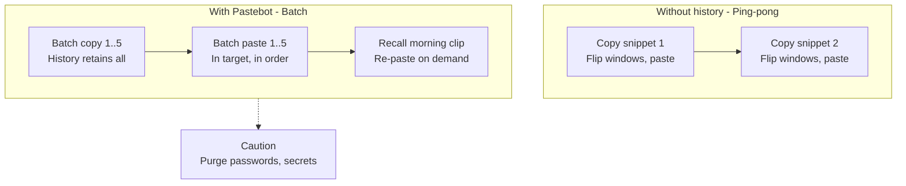
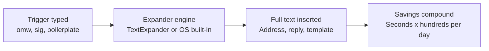
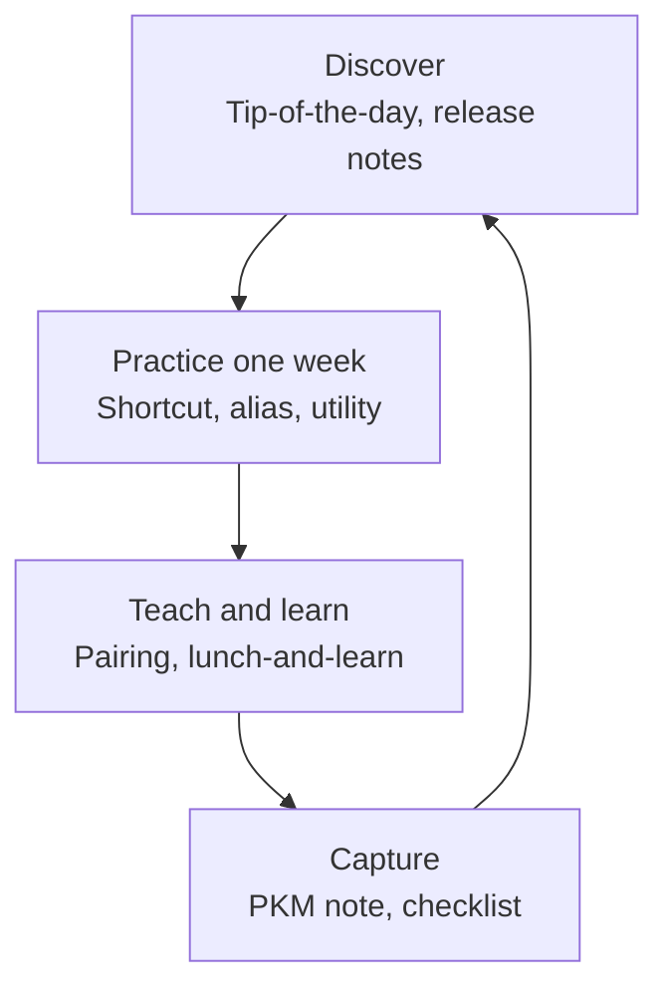

# Chapter 11: Powering Up Your Productivity — Definitive Technical Summary
*From: Fundamentals of Software Engineering: From Coder to Engineer by Nathaniel Schutta and Dan Vega*
*Source PDF: pp. 442–462 (Ch. 11) — figures below cite PDF pages.*

> [!NAV] **Chapter Navigation**
> ⬅️ **Previous:** [[chapter-10-to-production|Chapter 10: To Production]] | 🏠 **Index:** [[00-Master-Reading-Dashboard|Master Dashboard]] | ➡️ **Next:** [[chapter-12-learning-to-learn|Chapter 12: Learning to Learn]]

---

## 1. Executive Summary & Core Engineering Problem

- **Core Thesis:** There are no 10× developers, only engineers who deliberately compound small wins: own your tools (no communal knife block), stay in flow, keep hands on home row, automate anything done more than once, and run a personal knowledge system so answers survive longer than memory (PDF pp. 442–443, 453–456).
- **The Core Problem Statement:** Defaults tax you hundreds of micro-interruptions daily — trackpad reaches, retyped commands, five-item copy/paste round-trips, re-Googleable errors, setup amnesia on every new machine. Tinkering without timeboxes becomes its own tax (font/theme rabbit holes; the Vim-Dvorak-special-keyboard pairing disaster, p. 442).
- **What This Chapter Covers (PDF pp. 442–462):** Know your tools + flow state + tip-of-the-day habit (pp. 442–443) → Build-your-lightsaber environment (fonts, themes, OS, utilities, ergonomics, keyboard) (pp. 443–446) → Command line: pipes, modern replacements, aliases, history, shells (pp. 446–448) → Keyboard shortcuts: touch typing, OS/IDE/Emacs bindings, Pastebot clipboard history (Fig. 11-1 p. 451), text replacement (Fig. 11-2 p. 452) (pp. 448–452) → Strategic automation: rule-of-repetition, helper scripts, regex, AI help, timebox warning (pp. 453–454) → Productive habits: weekly learning, collaborative/lunch-and-learn, language evolution, personal knowledge management + Notion + conferences + binder-clip minimalism (pp. 454–459) → Wrap-up, practice, resources (pp. 459–462).
- **Historical & Industry Context:** From rudimentary early editors to IntelliJ IDEA / VS Code plugin ecosystems and Oh-My-Zsh / fuzzy-finder shells — the modern leverage is customization compounded weekly, not heroic all-nighters. Tim Ferriss epigraph: "Focus on being productive instead of busy."

---

## 2. In-Depth Technical Concepts & Internal Mechanics

### 2.1 Know Your Tools — Flow Is the Asset (pp. 442–443)

- **Theory:** Chefs bring their own knives; mechanics own their toolboxes; engineers own their toolkits (licenses may be company-paid, mastery is personal). Goal is Mihaly Csikszentmihalyi's *flow* — deep absorption where code "magically appears." Every trackpad reach or command lookup breaks it. Mark Heckler's image: flow moves brain → IDE → build/test/run because key combinations are muscle memory.
- **Mechanics:** Learn editor + VCS deeply enough to never endanger the team (the cautionary `force-push to main` losing three weeks). Don't memorize everything — master daily paths cold. Habit: one new IDE feature per week; enable IntelliJ's tip-of-the-day (or equivalent) to surface shortcuts, refactorings, debugging, plugins.
- **Warning (p. 442):** Timebox customization. Endless font/theme fiddling when you should be working — and over-customization that makes pairing impossible — are anti-productivity.

### 2.2 Build Your Own Lightsaber — Environment Fit (pp. 443–446)

- **Theory:** Factory car defaults aren't comfortable or safe — adjust seat, wheel, mirrors. Likewise fonts, themes, OS, utilities, and furniture should conform to you, not vice versa.
- **Editor surfaces:** Monospace fonts (try one for a day or two; 11/12 pt is convention, not law); themes (dark mode eases bright-display strain for many, not all — experiment; OS auto-brightness/night modes help); per-theme tweaks encouraged (off-the-rack need not stay stock).
- **OS and utilities:** Move the dock, tune magnification, change wallpaper to something resonant; install friction-removers (clipboard managers, sound control, menu-bar organizers). Seeing an unfamiliar menu-bar icon on a colleague's machine? Ask — that question can save hours monthly.
- **Physical environment:** Neutral-posture chair/monitor; sit-stand options; ergonomics assessment and stipend requests (home-office chair/desk are back-saving investments); eye care (distance breaks, optometrist-aware coatings/prescriptions, dedicated coding glasses for some).
- **Keyboard callout — Buy a better keyboard (p. 446):** Bulk-purchased boards rarely fit. Ergonomic splits (e.g., infinitely customizable ErgoDox EZ with switch choice) prevent repetitive-strain pain; many companies subsidize on request — don't wait for injury.

### 2.3 Leverage the Command Line (pp. 446–448)

- **Theory:** GUIs welcome, but CLI is the force multiplier — a few keystrokes beat minutes of clicking. Spend minutes weekly on new commands; `man` is the built-in manual.
- **Core composition — pipes:** Chain single-purpose tools: `cat .git/config | grep url | cut -f2 -d= | pbcopy` yields the repo URL straight to clipboard. Base vocabulary: `cd/pwd/ls/mkdir/open/cat/cut/grep/pbcopy`, plus play (`say I can't let you do that Nate`).
- **Modern replacements:** `bat` (cat + syntax highlighting), `diff-so-fancy` (readable diffs), `fx` (JSON inspection), `exa` (colorful ls).
- **Aliases — shell-config lines (p. 447):**

```bash
alias k=kubectl
alias d='docker'
alias dc='docker compose'
```

Use for frequent/long commands — but sparingly enough to survive foreign machines.

- **History and shells:** `history` list, `Ctrl-R` reverse search, scroll/Tab completion, tunable size/ignores, fuzzy finders (rarely retype anything twice). Graduate beyond the default shell — Oh My Zsh brings thousands of plugins, themes, helpers.

### 2.4 Keyboard Shortcuts — Hands on Home Row (pp. 448–452)

- **Theory:** Pointers democratized computing; pros keep hands on home row (resting finger row with tactile index markers). Shortcuts are faster and kinder to wrists/hands than constant mouse/trackpad shuttling.
- **Touch-typing mandate (Tip, p. 449):** If you don't touch-type, learn — seriously. Thumb-typing doesn't scale to code; all digits, gamified online trainers, faster and easier on hands/eyes/neck.
- **Layered mastery:** Editor shortcuts + OS shortcuts. Beyond `Cmd-C/V`: `Ctrl-down` (all windows of front app), `Cmd-H` (hide front app), IntelliJ `Cmd-D` on two files (diff — even inside JARs/ZIPs).
- **Emacs bindings (near-universal):** `Ctrl-F/B` (char forward/back), `Meta-F/B` (word forward/back; Meta ≈ Alt/Caps/Escape), `Ctrl-A/E` (line start/end). Minutes of study, years of navigation dividends. Emacs-vs-vi holy war acknowledged (p. 450): Emacs is "a great OS lacking a decent editor," Vim "a great editor lacking a decent window manager" — but learn vi basics regardless; sometimes it's the only editor on the box.
- **Clipboard superpower — Pastebot (Fig. 11-1 → PDF p. 451):** `Ctrl-C/V` alone forces window-flip ping-pong for five snippets. Pastebot-style history batches copies then pastes, plus recalls earlier clips. Caution: history retains passwords/secrets — clear or exclude sensitive copies.
- **Text expansion (Fig. 11-2 → PDF p. 452):** Standalone TextExpander or built-in OS text replacement, fully tunable — tiny per-use savings compounding daily.
- **Through-line (p. 452):** Defaults are a starting point. Tweaking time is productivity investment — provided it's timeboxed.

### 2.5 Strategic Automation — Code Away Your Own Toil (pp. 453–454)

- **Rule of repetition:** Computer science counts 0, 1, n — anything done more than once will be done countless times. Thirty lines of Python today saves hours across the year; regex literacy alone (even a little) pays constantly. Let AI draft the script — but read and test it; the barrier has never been lower.
- **Warning (p. 453):** Automation is a potential time sink — scripting can cost more than the one-off task. Wait until a handful of repetitions confirm the pattern, then timebox the build. Judgment over zeal.
- **Intuition:** You write code for others all day; spend some on yourself, and treat it as language/technique play.

### 2.6 Perpetual Habits — Weekly, Collaborative, Captured (pp. 454–459)

- **Cadence:** The shortcut/utility universe is endless — don't cram it in a month. Improve slightly daily; one new thing weekly is sustainable and retainable.
- **Collaborative learning (pp. 454–455):** Coworkers are the best tip source. Ask about unfamiliar tools/commands; demo simpler paths when you see toil (repeat 3–4× to cement); help others adopt your favorites (shared fluency eases pairing — teams may standardize a pairing-compatible baseline); run lunch-and-learns; never assume shared knowledge; never skip a session on a "known" tool — there's always a new corner. Extend to languages: read release notes on version drops, explore features, lead study groups — see one, do one, teach one.
- **Personal knowledge management (pp. 455–459):** Tech inflow (podcasts, posts, videos, tutorials) demands a capture repo — complexity optional, searchability and portability mandatory. Frustration to avoid: knowing you *had* the answer but not where. "Take notes. You will run into that problem again. So will a teammate. Write it down." (p. 455). Media range from binder-clipped scraps to Field Notes/Moleskine + Mark Two/Space Pen to Org Mode/Evernote/Notion, plus synced bookmarks or Pinboard.
- **Notion spotlight — Dan's setup (pp. 457–458):** Learning vaults (notes + snippets + images per topic), living documentation (Markdown with live preview), checklists (e.g., code-review checklist), central notes with mobile app + Clipper for later-reading. Power = adaptable second brain — but "your mileage may vary; use what works."
- **Conferences as pipeline (p. 458):** Attend, then curate talk playlists for replay (even at 1×+ speed as walking/workout podcasts). Capture must be mobile-ready — muse strikes anywhere; friend recommendations deserve instant logging.
- **Keep-it-simple proof (p. 459):** Nate's colleague ran years of commands/tips on binder-clipped scrap paper — paging to the exact answer on demand. Simple that works beats fancy that doesn't.

---

## 3. Important Figures, Diagrams & Visual Architecture

> 📕 **Original figures quick index (source PDF):** open the PDF at the cited page to verify each reconstruction.
>
> | Book Fig | PDF page | What to compare |
> |---|---|---|
> | Fig. 11-1 Pastebot | PDF p. 451 | Clipboard-history manager |
> | Fig. 11-2 text replacement | PDF p. 452 | OS text-replacement options |

### Figure 11-1: Pastebot Clipboard History (Reconstructed → PDF p. 451)
- **Figure Reference:** `Figure 11-1: Pastebot gives you access to your clipboard history (from text p. 451)`
- **Original PDF:** Fig. 11-1 → PDF p. 451 — open the PDF at page 451 to compare with the Mermaid reconstruction below.
- **Visual Flow & Description:** Without history each snippet demands a window round-trip; with Pastebot the engineer batch-copies five items, then batch-pastes them in the target — history also rescues morning clips. Sensitive entries must be excluded or purged.
- **Mermaid.js Architectural Diagram:**



- **Key Takeaway:** Clipboard history converts O(n) window flips into one copy pass plus one paste pass.

### Figure 11-2: Text Replacement Options (Reconstructed → PDF p. 452)
- **Figure Reference:** `Figure 11-2: Text replacement options can improve your productivity (from text p. 452)`
- **Original PDF:** Fig. 11-2 → PDF p. 452 — open the PDF at page 452 to compare with the Mermaid reconstruction below.
- **Visual Flow & Description:** User-defined triggers expand to full snippets via standalone TextExpander or built-in OS replacement — keystrokes collapse across every repetitive phrase, signature, or boilerplate.
- **Mermaid.js Architectural Diagram:**



- **Key Takeaway:** Small per-expansion savings dominate once multiplied by daily repetition.

### Supplementary S11-3: Weekly Compounding Loop (Concepts → PDF pp. 443, 454)
- **Figure Reference:** `Supplementary S11-3 [Supplementary synthesis of pp. 443, 454]: One-feature-a-week compounding`
- **Visual Flow & Description:** Tip-of-the-day discovery → deliberate practice → teammate exchange (lunch-and-learn) → captured note → next week's tip. Sustainable where cramming fails.
- **Mermaid.js Architectural Diagram:**



- **Key Takeaway:** Productivity is interest on weekly deposits, not lottery tickets.

---

## 4. Real-World Systems, Case Studies & Code Examples

- **Vim-Dvorak pairing failure (p. 442):** Nate's pairing attempt with a Vim-only/Dvorak/special-keyboard developer collapsed — the canonical over-customization cost (pairing compatibility matters; teams may set a baseline).
- **Flow testimony (pp. 442–443):** Csikszentmihalyi's *Flow* plus Heckler's brain→IDE pipeline — mastery evidence is building/testing/running without conscious key Recall.
- **Force-push horror (p. 443):** The teammate who `force-push`es `main` and costs three weeks — why VCS fluency is non-negotiable before speed.
- **Menu-bar serendipity (p. 445):** Asking about one unfamiliar icon can save hours monthly — collaboration as discovery protocol.
- **Ergonomics ledger (pp. 445–446):** Sit-stand desks for ache relief, company ergonomics assessments, home stipends, coding glasses — priced against chronic pain, cheap.
- **Pipe one-liner (p. 447):** `cat .git/config | grep url | cut -f2 -d= | pbcopy` — four single-purpose tools composed into repo-URL-to-clipboard.
- **Thirty-line Python parable (p. 454):** The chapter's unit of automation virtue — small script, hours reclaimed, plus language play.
- **Binder-clip PKM (p. 459):** Scrap paper + clip outperforming fuzzy memory for years — proof the system only needs to be used, searchable, and portable.
- **Systems referenced:** IntelliJ IDEA (tip-of-day), VS Code, Vim/vi, Emacs bindings, Pastebot, TextExpander (+ OS built-in replacement), Oh My Zsh, `bat`, `diff-so-fancy`, `fx`, `exa`, fuzzy finders, Notion (+ Clipper, mobile), Evernote, Org Mode, Field Notes/Moleskine, Pinboard.

```bash
# Shell leverage kit (pp. 447–448)
cat .git/config | grep url | cut -f2 -d= | pbcopy  # repo URL to clipboard
alias k=kubectl
alias d='docker'
alias dc='docker compose'
history        # review recent commands
# Ctrl-R       # reverse-search history (keystroke, not a command)
man grep       # built-in manual for any command
```

---

## 5. Architectural Trade-Off Matrix

| Approach | Speed gain | Learning/setup cost | Pairing/portability | Best Used When | Avoid When |
| :--- | :--- | :--- | :--- | :--- | :--- |
| **Deep IDE mastery (weekly feature)** | High (flow preserved) | Low, spread out | Good (stock + documented tweaks) | Daily-driver editor paths | Cramming everything in a month |
| **Exotic customization (Vim-only/Dvorak/special HW)** | Personal peak | High | Poor (pairing breaks) | Solo specialist with team agreement | Shared pairing/on-call boxes |
| **CLI + pipes + modern tools** | High for composable tasks | Medium (weekly minutes) | Good (scripts shared) | Repetitive file/text/repo chores | One-off GUI-trivial tasks |
| **Aliases (k/d/dc)** | Keystroke savings | Minutes | Risky on foreign machines | Frequent long commands | Muscle-memory lock-in you can't shed |
| **Pastebot / text expansion** | Batch/async savings | Minutes + curation | Good (personal) | Multi-snippet moves, boilerplate | Password-bearing histories (purge!) |
| **Custom automation scripts** | Hours reclaimed | Timeboxed build | Good if read/tested + shared | 3+ repetitions confirmed | One-offs (script costs > task) |
| **Fancy PKM suite (Notion etc.)** | Searchable second brain | Setup + upkeep | Excellent (shared/Clipped) | High inflow, team sharing | Binder clip already works — don't migrate for fashion |

**Decision heuristics:** Timebox every experiment; keep a pairing-compatible baseline; automate only confirmed repetitions; capture everything worth re-finding in a portable, searchable repo; teach one thing weekly.

---

## 6. Jargon Buster & Key Terminology

- **Flow state (deep absorption):** Csikszentmihalyi's optimal-experience mode; code appears without conscious friction. *Pitfall:* mistaking busyness for flow.
- **Home row (touch-typing rest position):** Index-marker row minimizing hand travel. *Pitfall:* hunting-and-pecking while "learning shortcuts."
- **Tip-of-the-day (IDE discovery feed):** Launch-time feature surfacing (IntelliJ et al.). *Pitfall:* disabling it before mastery.
- **Lightsaber environment (personalized toolchain):** Fonts/themes/OS/utilities/furniture fit to you. *Pitfall:* endless tinkering or unpairable exoticism.
- **Pipe `|` (CLI composition):** Chaining single-purpose tools into pipelines. *Pitfall:* mega-one-liners nobody (including future-you) can read.
- **Aliases (shell abbreviations):** `k/d/dc` keystroke savers in `~/.bashrc`/`~/.zshrc`. *Pitfall:* helplessness on stock machines.
- **History + Ctrl-R (command Recall):** Scrollable log plus reverse search; tunable size/ignores. *Pitfall:* secrets typed into immortal history.
- **Oh My Zsh (extensible shell):** Plugins/themes/helpers beyond stock shells. *Pitfall:* plugin bloat slowing every prompt.
- **Emacs bindings (near-universal text keys):** `Ctrl-F/B/A/E`, `Meta-F/B` navigation. *Pitfall:* assuming every app honors them.
- **Pastebot / clipboard history (multi-clip memory):** Batch copy/paste plus Recall. *Pitfall:* password retention — purge/exclude.
- **Text expansion (trigger → snippet):** TextExpander/OS replacement abbreviation engine. *Pitfall:* cryptic triggers colliding with prose.
- **Strategic automation (self-serving scripts):** 0/1/n rule + regex + AI-drafted helpers. *Pitfall:* automating unconfirmed one-offs past the timebox.
- **PKM — Personal Knowledge Management (external second brain):** Notes/checklists/clips from binder scraps to Notion. *Pitfall:* collecting without organizing or portability.
- **See one, do one, teach one (fluency loop):** Learn → apply → instruct. *Pitfall:* tutorial-only consumption.

---

## 7. System Design & Practical Engineering Takeaways

### 7.1 Production Engineering Checklist
1. Enable tip-of-the-day (or equivalent) and bank one new IDE/shell feature every week — timeboxed.
2. Keep hands on home row: touch-type, learn OS + editor + Emacs-navigation shortcuts, batch clips with Pastebot-style history (purged of secrets), expand boilerplate with text replacement.
3. Compose the CLI: pipes over GUI repetition, modern replacements (`bat`, `diff-so-fancy`, `fx`, `exa`), a handful of aliases, `Ctrl-R` history, fuzzy finder, Oh-My-Zsh-class shell.
4. Automate confirmed repetitions (3+ sightings) with small tested scripts — AI may draft, you still read/test; never let scripting exceed the timebox.
5. Run a portable, searchable PKM (even scraps + clip, ideally versioned/synced): notes, checklists, clips, conference playlists; teach weekly via pairing and lunch-and-learns; track language release notes.

### 7.2 System Design Interview Blueprint
- This chapter rarely appears as whiteboard design — it appears as *meta-signal*: narrate your toolchain fluently (editor, CLI composition, automation example, PKM-backed Recall) when asked "how do you stay effective?"
- Tell one compounding story: "Repetitive X → 30-line script → hours saved → shared via lunch-and-learn → captured as checklist."
- Show restraint maturity: timeboxes, pairing baselines, secret hygiene in clipboards/history, tested AI-drafted code.

### 7.3 Mastery Self-Assessment Questions

#### Question 1 — Shortcuts vs flow
*You reach for the trackpad dozens of times daily and retype long `kubectl`/`docker` commands. Prescribe the chapter's fix.*
- **Answer:** Touch-type foundation, then one shortcut weekly (editor + OS + Emacs navigation: `Ctrl-A/E/F/B`, `Meta-F/B`); add `alias k/d/dc` for the long commands (kept few enough to survive stock machines); use `Ctrl-R`/fuzzy history instead of retyping; batch multi-snippet moves with Pastebot-style history. Each removal protects flow — the asset being optimized.

#### Question 2 — Automation judgment
*When do you script a chore vs just doing it, per the chapter?*
- **Answer:** 0/1/n rule: once is anecdote, repeated handful is pattern. Script only confirmed repetitions (a few sightings), timeboxed, with regex/AI leverage — and still read/test output. One-offs stay manual; scripting past the timebox is the documented time sink (WARNING p. 453).

#### Question 3 — Knowledge that survives
*You solve a gnarly error, then hit it again in three months with no memory of the fix. What system prevents the loop?*
- **Answer:** PKM capture at solve time — note with symptoms, cause, exact commands, links — in whatever portable searchable repo you actually use (Notion vault, Org/Evernote, synced bookmarks/Pinboard, even binder scraps). Reviewable weekly, shareable in pairing/lunch-and-learns, replayable via conference playlists. "Write it down. You won't remember" (p. 455).

### 7.4 Resources
- *Flow: The Psychology of Optimal Experience* — Mihaly Csikszentmihalyi (Harper & Row, 1990) (PDF p. 460).
- *The Productive Programmer* — Neal Ford (O'Reilly, 2008) (PDF p. 460).
- *Building a Second Brain* — Tiago Forte (Simon Element/Simon Acumen, 2022) (PDF pp. 460–461).
- *The Passionate Programmer*, 2nd ed. — Chad Fowler (Pragmatic, 2009) (PDF p. 461).
- Practice (p. 460): automate one repetitive task (or extend an existing automation); one new shortcut weekly for months; 15-minute Friday editor-doc skim with tip-of-day on; audit your PKM for fit; write down every new command (external brain).

---

> [!NAV] **Chapter Navigation**
> ⬅️ **Previous:** [[chapter-10-to-production|Chapter 10: To Production]] | 🏠 **Index:** [[00-Master-Reading-Dashboard|Master Dashboard]] | ➡️ **Next:** [[chapter-12-learning-to-learn|Chapter 12: Learning to Learn]]
