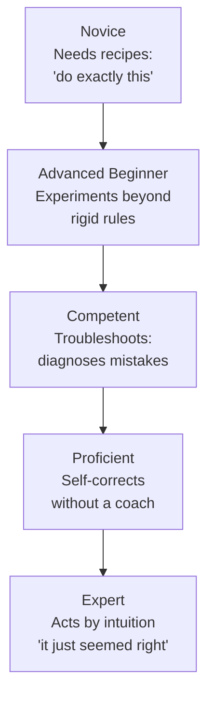
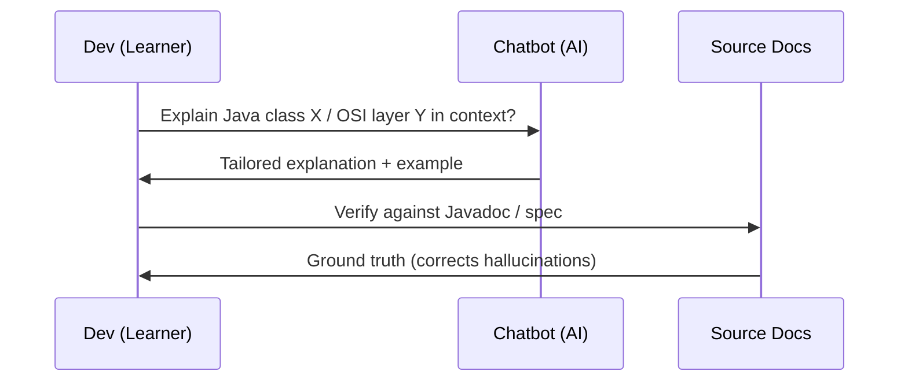

# Chapter 12: Learning to Learn — Definitive Technical Summary
*From: Fundamentals of Software Engineering: From Coder to Engineer by Nathaniel Schutta & Dan Vega*
*Source PDF: pp. 463–492 (30-page PDF range) — figures below cite PDF pages.*

> [!NAV] **Chapter Navigation**
> ⬅️ **Previous:** [[chapter-11-powering-up-your-productivity|Chapter 11: Powering Up Your Productivity]] | 🏠 **Index:** [[00-Master-Reading-Dashboard|Master Dashboard]] | ➡️ **Next:** [[chapter-13-mastering-soft-skills|Chapter 13: Mastering Soft Skills]]

---

## 1. Executive Summary & Core Engineering Problem

- **Core Thesis:** Technology changes too fast to survive on what you already know. The durable career skill is not any one language or framework but the *habit and method of learning itself* — spaced, deliberate, passion-guided, practiced in public, and validated hands-on. Engineers who block time, go deep on what energizes them, and prove ideas against real project constraints outlast every hype cycle.
- **The Core Problem Statement:** The naive approach breaks in two predictable ways: (1) **Cramming** — bingeing a tutorial the weekend before you need it feels productive but never encodes into long-term memory, so you re-learn the same `rm -f` lesson after wiping a laptop; (2) **Chasing the shiny new thing** — adopting a library at peak hype, before its rough edges are sanded down, then discovering six months later it cannot be sprinkled into your legacy app without a full rewrite. Without a learning system you burn attention (a nonrenewable resource), practice resume-driven development, and burn out.
- **What This Chapter Covers (PDF pp. 463–492):** The Shiny New Thing Paradox + Cramming Doesn't Work (p.463) → Forgetting as feature / R-mode vs L-mode (pp.464–465) → Skills Acquisition: Shu Ha Ri, Imitate-Assimilate-Innovate, Dreyfus model Fig 12-1 (pp.465–468) → The Learning Habit + Learning Depth Strategy + Spaced Repetition / Ebbinghaus + Weekly-Monthly-Yearly cadence + Learn Out Loud (pp.468–471) → Technology Merry-Go-Round + Morning Coffee ritual (pp.471–472) → Learning Through AI, Figs 12-2/12-3 (pp.472–476) → FOMO, Attention, Resume-Driven Development (pp.476–478) → Let Your Passion Guide You / Sock-Drawer test (pp.479–480) → Where to Invest: Hacker's Radar, COBRA→Microservices pendulum, Thoughtworks Radar, Build Your Own Radar (pp.480–482) → Practice Innovation: book clubs, hacker days, showcases, tech talks, internal conferences (pp.482–485) → Architectural Briefings + Workshops + Legacy-constraint story (pp.485–487) → Practice Grace + Wrapping Up + Putting It into Practice + Resources (pp.488–490).
- **Historical Context:** From Ebbinghaus's 1880s forgetting-curve experiments (half forgotten in 30 minutes) to Shu Ha Ri (Japanese martial arts) and the Dreyfus brothers' 1980 skill-acquisition model, to Paul Graham's 2001 "hacker's radar" Java mis-call, to Thoughtworks' twice-yearly Technology Radar — the chapter argues learning science is old and stable while the *objects* of learning churn every 15 minutes like buses.

---

## 2. In-Depth Technical Concepts & Internal Mechanics

### 2.1 Why Cramming Fails — Encoding, Stories, and Forgetting

- **Foundational Theory & Intuition:** To truly learn you must *encode*: make information elaborate, meaningful, and contextual. Stories do this better than warnings. Being told "be careful with `rm -f`" is forgettable; hearing how a colleague wiped their laptop hard drive with a script containing `rm -f` sticks for years.
- **Forgetting is a feature:** Your brain actively "takes out the trash." Decay is predictable but personal. Counter it with **spaced repetition** (flashcards, language apps with gamified intervals) — review at gradually increasing intervals *before* the memory is fully lost.
- **Two processing modes:**
  - **R-mode** — nonverbal, background search-and-retrieve, uncontrollable. The actor's name that pops into your head five minutes after you stopped trying — that's R-mode.
  - **L-mode** — verbal, analytical, linear, logic-and-computation focused.
- **Practical protocol when stuck:** Think hard about the bug, then deliberately distract L-mode — shower, walk, cook dinner. R-mode keeps working and the answer surfaces later. Beating your head against the wall is the least effective debugger.
- **Failure mode:** Re-reading without retrieval (highlighting a book for hours) feels like learning but produces zero encoding. If you cannot retell it as a story or reproduce it without the tutorial open, you haven't learned it.

### 2.2 Skills Acquisition — Shu Ha Ri, Imitate-Assimilate-Innovate, and Dreyfus

- **Shu Ha Ri (martial arts) / Clark Terry's Imitate–Assimilate–Innovate:**
  - **Shu / Imitate:** Follow the instructor exactly. Duplicate without asking why. Copy-paste the "Hello World," follow the Getting Started verbatim.
  - **Ha / Assimilate:** Basics are muscle memory. Branch out, seek other teachers, fill in theory, modify the grip/stance to see what happens.
  - **Ri / Innovate:** Learn from yourself. Practice drives learning; you dissolve the principle (Bruce Lee: "Learn the principle, abide by the principle, dissolve the principle").
- **Dreyfus model — five stages (see Fig 12-1, PDF p.467):**
  1. **Novice:** Needs recipes — "do exactly this." Coach moves your foot a few degrees. Tell a novice "hit a cut by thinking about hitting a cut" and nothing happens.
  2. **Advanced Beginner:** Moves beyond rigid rules, experiments (change grip, tweak config) to see what happens.
  3. **Competent:** Can troubleshoot — watches ball flight and diagnoses the mistake.
  4. **Proficient:** Can self-correct in the moment without a coach pointing it out.
  5. **Expert:** Acts by intuition — "I need this ball to cut" and it cuts; would struggle to articulate *how*.
- **Framework-learning walkthrough (Alice learns Spring):**
  1. Copies tutorial code, leans on search/chatbot for every stack trace (Novice).
  2. Tweaks annotations, breaks things deliberately (Advanced Beginner).
  3. Reads a stack trace and knows the misconfigured bean (Competent).
  4. Feels the design smell before the test fails (Proficient).
  5. "Sees" the solution when given a task; expresses intent *through* the framework (Expert).
- **Key rule:** Rules/recipes are vital for beginners and *stifling* for experts — they inhibit hard-earned intuition. Match guidance to stage. Most engineers stall at Advanced Beginner on most topics, and that's fine — you cannot be expert at everything.

### 2.3 The Learning Habit — Depth Strategy, Cadence, and Morning Coffee

- **Christopher Judd's Learning Depth Strategy** — not everything deserves the same depth:
  | Level | Activities | When |
  |---|---|---|
  | **Survey** | Podcasts, user-group/conference sessions, keynotes, release notes | Scanning the horizon |
  | **Shallow dive** | Short videos, blog posts/articles, tutorials | Evaluating interest |
  | **Deep dive** | Live workshop (in-person/online), books | Committing to competence |
  | **Ultra deep dive** | Deliver a presentation / lead a workshop on it | Driving to mastery (teaching forces encoding) |
- **Spaced cadence (Ebbinghaus applied to a year):**
  - **Weekly:** 1–2 podcasts/videos/articles.
  - **Monthly:** A technical/business book, user group/meetup, online course.
  - **Yearly:** A conference, a new language, a side project, a certification, teaching a talk.
- **Learn out loud:** Post progress on social media; write up what you learned. Future-you will Google a question and find your own post — both authors report this happening.
- **Technology merry-go-round (Nate's story, PDF p.471):** Early career he asked his manager why they'd left tech for management — "tired of constantly learning new things." He didn't get it fresh out of university; he gets it now. Management is not the easy path, but engineering *is* a near-constant stream of portfolio additions — invigorating and exhausting.
- **Guardian of your own time:** Block learning on your calendar (Friday afternoons are often quiet; or Tuesday morning / Thursday lunch — experiment, Trello board, reminders). You will have to schedule *over* it sometimes; protect it anyway.
- **Morning coffee (15–30 min):** First thing, beverage in hand, *before the day gets away into fire drills*: peruse news/social, a podcast, a tutorial, an early-edition tech book. Even on days you "got nothing done," you learned something.

### 2.4 Learning Through AI — Accelerator, Not Substitute (Figs 12-2, 12-3)

- **Thesis:** Chatbots give tailored learning paths and conversational deep-dives — e.g., explain an unfamiliar Java class without reading all the Javadoc, or walk through a reference model like OSI layer by layer. See Figure 12-2 (PDF p.474) and Figure 12-3 (PDF p.476).
- **Protocol:** Ask, then *verify against source material*. Hallucinations are real — confident, plausible, wrong. Use AI to brush up and orient, not as ground truth.
- **Failure mode:** Copy-pasting AI explanation into a design doc without checking the docs. The time saved generating must be reinvested in validation (a theme that pays off in Chapter 15).

### 2.5 FOMO, Attention, and Passion — What *Not* to Learn

- **FOMO math:** In the time it takes to read one paragraph, roughly a week's worth of video is uploaded to YouTube — plus podcasts, guides, social feeds. You literally cannot consume everything. If something truly big happens, you *will* hear about it via your network. Shard learning across friends with different specializations and swap notes.
- **Attention is the resource (Godin: "not making any more of it"; Hightower: "Focus means you won't get to surf every wave"):** Don't practice **resume-driven development** — adopting tech to pad a resume without a *why*. Wait until the last responsible moment; let hype play out. Spotting patterns comes with experience: today's "new" thing is often a renamed 1990s thing.
- **Outsource learning:** Friend exploring a space you're unsure of? Check in periodically; let them absorb the rough patches, then learn from their scars.
- **Let your passion guide you (Nate's sock drawer, PDF p.479):** Sat down to grind a databases book, quit after 20 minutes to organize his sock drawer — unambiguous signal of no passion. Schedule time all you like; the *what* must energize you or you'll never practice. Follow experts, podcasts, docs for what excites you; joyless books get closed without guilt — no extra points for finishing. But passion ≠ automatic adoption: a tool you love may be wrong for your project. Be a critical consumer (Hickey: "Programmers know the benefits of everything and the trade-offs of nothing"). There is rarely a "best" way — only least-worst trade-offs.

### 2.6 Where to Invest — Hacker's Radar, Pendulums, and the Thoughtworks Radar

- **Temper your hunches (Graham's Java call):** Paul Graham's hacker's-radar criteria led him in 2001 to predict Java "won't be a very successful language." Twenty-plus years later Java is one of the most successful ever. Even excellent intuition misfires — stay humble.
- **The pendulum test:** Old things get dusted off, refined, renamed, reintroduced. "Components in different languages on various computers communicating and working together" — microservices? That's also the 1990s CORBA (COBRA in text) definition. Ask: is this new thing *actually* new, or did the old problems get fixed — or not?
- **Wisdom of the crowd (use carefully):** Community attention surfaces interesting things but also hypes. Combine with your own experience and probing questions.
- **Thoughtworks Technology Radar (twice yearly):** Snapshot of tools/techniques/platforms/languages/frameworks with adoption-cycle placement, synthesized across many projects. Use it to discover and to gauge maturity. Build your *own* radar (simple paper is fine; see Chapter 14 for the full method: Adopt / Trial / Assess / Hold across Languages-Tools-Platforms-Techniques).

### 2.7 Practice Innovation — Bringing New Things Into the Org

| Mechanism | How it works | Why it works |
|---|---|---|
| **Book club** | Like-minded engineers, one tech book, weekly over breakfast/lunch (company usually pays books + catering) | Social accountability — you read the chapter because Tuesday discussion is coming |
| **Hacker / innovation days, hackathons** | Safe hands-on space to explore; relief valve so devs don't sneak new libs into production via "forgiveness > permission" | Real contact with tech in *your* context; even throwaway code teaches |
| **Showcases / demo days** | Lightning talks to booth fairs, dept or company-wide | Discover who uses what — and who to ask when you need it |
| **Tech-talk / lunch-and-learn series** | Colleagues or outside experts; "chew and spews" optional | Steady diet of new concepts; volunteering to speak forces *you* to learn |
| **Local meetups / regional events** | Evening talks, often with dinner, cheap vs Vegas/SF | Low-cost exposure; speaking locally is the on-ramp to conference speaking |
| **Internal conference** | Half-day internal to multi-day multisite with externals | Cross-pollination beyond daily contacts; presentation reps + visibility → promotion fuel |

- **Architectural briefings (45–60 min, interactive, anyone can give one):** Must answer: *Why use this? Why NOT use this? What must we know to answer that? What must we know to use it?* Go beyond Getting Started, invite pushback, take notes, ask good questions.
- **Workshops — prove it under *your* constraints:** Can't build the app twice and throw one away (good luck getting that approved). Scope to key features, simple setup, stated objectives, follow-up material, and deliberately go off the happy path. **Test against legacy constraints — fork the real project**, not greenfield. Nate's cautionary tale (PDF p.487): a team greenfield-workshopped three UI libraries, picked one to "sprinkle in" — six months later learned it required a full rewrite. They'd fallen for hype and skipped legacy-context testing. They might still have chosen it, but with eyes open. *You play how you practice.*

### 2.8 Practice Grace

- Keeping up is vital *and* overwhelming. Don't trade sleep or mental/physical health for it. Burnout from staying on top of everything is easy; learning should be fun, not a stressor.
- No statute of limitations: if it has staying power, you can learn it next week/month/year. Patience beats panic.

---

## 3. Important Figures, Diagrams & Visual Architecture

| Figure | PDF Page | Description |
|---|---|---|
| Fig 12-1 | 📕 PDF p.467 | Dreyfus model — five stages of skill acquisition (reconstructed below) |
| Fig 12-2 | 📕 PDF p.474 | Chatbot explaining a Java class (screenshot in book — open PDF p.474 to compare; interaction pattern reconstructed below) |
| Fig 12-3 | 📕 PDF p.476 | Chatbot explaining the OSI reference model (screenshot in book — open PDF p.476 to compare) |

**Figure 12-1 — Dreyfus model (PDF p.467).** Progression from rule-following to intuition; recipes help novices and hinder experts.

- **Original Book Figure:** Figure 12-1 → 📕 PDF p.467 — open the source PDF at page 467 to compare.
- **Key takeaway:** Match instruction to stage; practice (not videos/tips alone) moves you right.

**Figures 12-2 / 12-3 — Learning-through-AI interaction pattern (PDF pp.474, 476).** Screenshots in the book show a chatbot explaining a class (12-2) and the OSI model (12-3). Pattern reconstructed as a sequence:

- **Original Book Figures:** Figure 12-2 → 📕 PDF p.474; Figure 12-3 → 📕 PDF p.476 — open the source PDF at those pages to compare screenshots with this interaction pattern.
- **Key takeaway:** AI accelerates orientation; docs remain the source of truth.

---

## 4. Real-World Systems, Case Studies & Code Examples

- **The `rm -f` story (p.463):** Warning vs scar tissue. A war story about wiping a laptop with an `rm -f` script encodes caution permanently — prefer stories over edicts when teaching.
- **Golf-coach progression (pp.465–466):** Foot moved degrees → endless repetition → experimenting with grip → reading ball flight → self-correction → "think cut, hit cut." Direct analog for framework mastery.
- **Nate's manager on the merry-go-round (p.471):** "Tired of constantly learning" drove a move to management. Validates that learning load is the job's emotional core, not a side quest.
- **Nate's sock drawer (p.479):** The 20-minute databases-book abandonment as passion instrument. If organizing socks beats the topic, stop.
- **Graham vs Java (2001, p.480):** Even sharp radar misfires badly — humility input to every adoption decision.
- **CORBA → microservices (p.481):** Same definition ("components in different languages on various computers communicating"), decades apart. Pendulum-spotting as a senior skill.
- **Legacy-workshop failure (p.487):** Greenfield success, six-month rewrite discovery. Moral: fork the legacy app for evaluation or accept blindness.
- **Code-ish artifact — personal radar starter (from pp.480–482, detailed in Ch.14):** Write four lists (Adopt / Trial / Assess / Hold) on paper today; that counts. Tooling (Thoughtworks BYOR) is optional.

---

## 5. Architectural Trade-Off Matrix

*Adapted: learning-investment decisions, not storage engines.*

| Approach | Time cost | Retention | Risk | Best used when | Avoid when |
|---|---|---|---|---|---|
| Survey (podcasts/keynotes/notes) | Low | Low — orientation only | FOMO grazing, zero depth | Scanning horizon | You must ship with it next sprint |
| Shallow dive (posts/videos/tutorials) | Medium | Medium — can follow a guide | Tutorial-hell illusion of competence | Evaluating interest | Stakes are high / legacy constraints matter |
| Deep dive (workshop/book) | High | High — structured + practiced | Slow; opportunity cost | Committing to competence | Just curious |
| Ultra deep dive (teach it) | Highest | Highest — teaching encodes | Prep burden | Driving to mastery + visibility | Deadline crunch |
| AI-accelerated orientation | Minutes | Fragile — hallucination risk | Confident wrongness | Unfamiliar class/model overview | Source of truth needed — always verify |
| Hacker-day spike | Half-day–day | Medium-high (hands-on) | Throwaway code; needs legacy follow-up | Testing fit in your context | Greenfield-only evaluation of a legacy insertion |

- **Decision heuristics:** Need it now and stakes high → deep dive + legacy-constrained workshop. Curious but unsure → survey → shallow → check passion (sock-drawer test) before investing. Hype screaming → wait until last responsible moment; let others absorb rough edges. Excited *and* project-fit → ultra-deep (volunteer the talk) for maximum retention + promotion visibility.

---

## 6. Jargon Buster & Key Terminology

- **Shiny New Thing Paradox (Buses every 15 min):** Early hype + unready tech; maturity arrives as hype fades. Don't board every bus.
- **Encoding (Elaborate / Meaningful / Contextual):** The process that moves info into long-term memory. Stories encode; re-reading doesn't.
- **Spaced Repetition (Ebbinghaus):** Reviews at increasing intervals before total decay. The engine behind flashcards and language-app streaks.
- **R-mode (Background retrieval):** Nonverbal, uncontrollable search process. Pitfall: trying to force it by grinding harder.
- **L-mode (Linear analysis):** Verbal, logical computation. Pitfall: letting it drown out R-mode when stuck.
- **Shu Ha Ri (Obey / Digress / Separate):** Imitate exactly → assimilate theory and branch → innovate from self. Confused with: seniority titles — it's about *topic-specific* stage, not rank.
- **Dreyfus Model (Novice → Expert):** Five-stage skill ladder. Recipes help the left, strangle the right.
- **Learning Depth Strategy (Survey / Shallow / Deep / Ultra):** Judd's effort-matching ladder. Confused with: "I watched a keynote so I know Kubernetes."
- **Learn Out Loud:** Publishing progress/notes publicly. Side effect: your own write-up becomes your future search result.
- **Morning Coffee (15–30 min):** Protected daily learning block before fire drills. Not: doomscrolling — it's deliberate input.
- **FOMO (Fear of Missing Out):** Anxiety that skipping content = falling behind. Antidote: network sharding + "big things will find you."
- **Resume-Driven Development:** Adopting tech for resume padding, not project benefit. Test: can you name the *why* beyond novelty?
- **Hacker's Radar (Graham):** Criteria for judging new tech's staying power. Warning: even its inventor whiffed on Java.
- **Technology Radar (Thoughtworks, 2×/year):** Org-level Adopt/Trial/Assess/Hold snapshot. Personal version: same rings, your stack.
- **Architectural Briefing (Why / Why-not / What-to-decide / What-to-use):** 45–60-min interactive evaluation talk. Not a Getting-Started replay.
- **Practice Grace:** Deliberate self-kindness about pace. No statute of limitations on learning something durable.

---

## 7. System Design & Practical Engineering Takeaways

- **Production Engineering Checklist (learning as production system):**
  1. Protect a daily 15–30-min morning-coffee block; you are the guardian of your time.
  2. Keep a fluid want-to-learn list with explicit depth per item (Survey → Ultra); default new hype to Survey.
  3. Schedule spaced touchpoints — weekly skim, monthly book/meetup/course, yearly conference/language/side-project/teach.
  4. Evaluate every adoption under legacy constraints (fork the real app) via briefing → workshop → trial project.
  5. Learn out loud and teach: book club, lunch-and-learn, meetup talk — visibility + retention in one motion.
- **Interview / Promotion Blueprint:** Frame answers as learning systems, not tool lists: "I surveyed X, shallow-dived Y, deep-dived Z because [business why]; here is the briefing I gave and the legacy-constrained spike that decided it; here is what I chose *not* to adopt and why." Pitfall: reciting hype without trade-offs (Hickey's razor). Capacity rule: attention doesn't scale — show what you deliberately *ignored*.
- **Deep Mastery Questions:**
  1. *Q: You have Friday afternoon free and three candidate topics: a hyped UI library, flaky-test techniques your team needs now, and Rust curiosity. How do you allocate? A:* Apply depth strategy + passion + last-responsible-moment. Flaky tests → deep dive/workshop (immediate project pain, clear why). UI lib → survey only + ask a friend already spiking it (outsource hype absorption). Rust → morning-coffee survey unless sock-drawer test says energizing — then shallow side-project; ultra-deep only if sustained excitement survives a month. Document the *no* for the lib explicitly.
  2. *Q: Your team wants to adopt Library L after a greenfield hack-day win. What do you do before committing? A:* Run the briefing four questions, then a legacy-fork workshop: install into a branch of the real app, exercise auth/build/back-compat/off-happy-path, state objectives and follow-ups. Define a low-risk trial project (non-critical). The p.487 story is the template — greenfield success predicted nothing about sprinkle-in feasibility. Decide eyes-open, even if the answer is still L.
  3. *Q: Stuck on a bug for 3 hours — push harder or walk away? Justify neurologically. A:* Walk away deliberately. L-mode is saturated; R-mode needs background cycles. State the problem crisply (rubber-duck it or prompt AI for orientation), then shower/walk/cook. Return with a fresh hypothesis and verify AI suggestions against docs/tests. Cramming-style grinding encodes frustration, not solutions.
  4. *Q: How do you use AI to learn a new Java class without fooling yourself? A:* Prompt with context (version, framework, what you're building), request explanation + minimal example, then verify method signatures/behavior in Javadoc/source and run a spike test (Figs 12-2/12-3 pattern, pp.474/476). Treat output as orientation draft; log corrections in your learn-out-loud notes so future-you benefits.

*Additional Resources (book list, pp.490–491): "Thinking Architecturally" (Schutta, O'Reilly 2018); The Pragmatic Programmer (Hunt & Thomas, 1999); The Passionate Programmer (Fowler, 2009); Thoughtworks Technology Radar; The First 20 Hours (Kaufman, 2014); Pragmatic Thinking and Learning (Hunt, 2008).*
