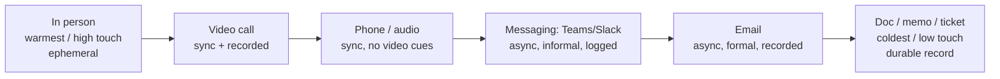
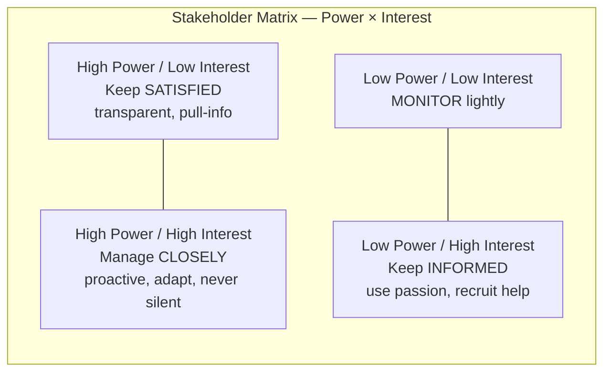

# Chapter 13: Mastering Soft Skills in the Tech World — Definitive Technical Summary
*From: Fundamentals of Software Engineering: From Coder to Engineer by Nathaniel Schutta & Dan Vega*
*Source PDF: pp. 493–524 (32-page PDF range) — figures below cite PDF pages.*

> [!NAV] **Chapter Navigation**
> ⬅️ **Previous:** [[chapter-12-learning-to-learn|Chapter 12: Learning to Learn]] | 🏠 **Index:** [[00-Master-Reading-Dashboard|Master Dashboard]] | ➡️ **Next:** [[chapter-14-career-management|Chapter 14: Career Management]]

---

## 1. Executive Summary & Core Engineering Problem

- **Core Thesis:** Every technical skill has a shelf life; soft skills compound for 30–50 years. Communication, influence, stakeholder management, and time stewardship are not personality traits but *habits* — choosing the right channel, preparing for enterprise operator, speaking exec, wielding ninja-over-hammer influence, and guarding maker time. Effective communicators get promoted because what others say about you when you're not in the room decides advancement.
- **The Core Problem Statement:** The naive "lone wolf" model — brilliant code, minimal human contact — breaks on modern multimillion-line codebases that no single head can hold. Failure looks like: a sarcastic Slack joke read literally by an executive, a 200-person meeting with no agenda burning thousands per week, a "corporate standard" that is actually third-hand telephone distortion (JavaScript MVC misheard as Windows MVC), or a 10 a.m. 30-minute meeting shredding a maker's entire morning. Software design is, as Kent Beck says, "a human process done by humans for humans."
- **What This Chapter Covers (PDF pp.493–524):** Soft skills ROI + lone-wolf is over (pp.493–494) → Collaborative Communication + Communication Channels / Continuum Fig 13-1 (pp.494–497) → Messaging (pp.497–499) → Meetings: cost, attendance triage, big-room prep, virtual etiquette, running them (pp.499–504) → Presentations: elevator pitch to Toastmasters (pp.504–505) → Code as communication / Fowler (pp.505–506) → Enterprise Operator + Hostile-Room story (pp.506–509) → Know Your Audience / Speak Exec (pp.509–510) → Practicing Influence: hammer vs ninja, messenger-matters TDD story (pp.510–513) → Stakeholder Management + Power/Interest Fig 13-2 (pp.514–517) → Time Management: maker vs manager schedule, hammock-driven development, Pomodoro (pp.517–520) → Wrapping Up + Practice + Resources (pp.521–522).
- **Historical Context:** From literal human "computers" doing calculations solo, through windowless cube farms, to project-room and multi-site/remote collaboration — team size and distribution grew while human operating systems (millennia to update) stayed constant. Hence soft skills never go out of date while frameworks expire.

---

## 2. In-Depth Technical Concepts & Internal Mechanics

### 2.1 The Communication Continuum — Right Channel, Right Time

- **Intuition:** Channels run warm→cold, high-touch→low-touch, ephemeral→recorded, deniable→auditable. Your job is matching fidelity and permanence to stakes and audience. See Fig 13-1 (PDF p.497).
- **Audience first:** Some live on email, others haven't checked inbox in months; some orgs run on chat, others on meetings. Map how information *actually* flows before choosing.
- **When a record is critical:** Security-vulnerability upgrade, compliance decision — use a durable written channel so everyone shares the same resolution and the org avoids a crippling hack.

### 2.2 Messaging (Teams / Slack / Google Chat)

- **Strengths:** Async, informal, group or 1:1, rich (files/code/images/GIFs/paste instead of retype). Ideal for quick questions, heads-ups, offloading short-term memory ("refactor `parseOrder` next commit"). Even co-located teams message the person three desks away to avoid chatter/interruption.
- **Operating rules:**
  1. Respect async-ness — recipient may not see it promptly; set team norms but honor focus time, notification settings, calendar blocks. Every "quick question" can detonate a morning.
  2. Close the loop even when swamped — "plate's full today, can chat Thursday" beats silence (Golden Rule from Ch.1; perception drives promotion).
  3. Assume permanence — retention policies and lawyers aside, anything typed can be forwarded/retrieved. Never workshop standup material in corporate chat.
  4. Tone doesn't transfer — sarcasm reads literally outside your brain. Err cautious.
- **Scope note:** Fine for your immediate team; senior-leader appropriateness varies with org flatness. Calibrate.

### 2.3 Meetings — Expensive, Sometimes Fastest

- **Cost reality (Nate's Thursday, PDF p.500):** Standing 2-hour meeting, 200+ senior technologists. Thousands of dollars *per week*. Worth it — environment/deployment changes with cross-impact callouts — *because* it was well run: detailed agenda weekly, people stepped in/out as needed. Cost ≠ waste; aimlessness = waste.
- **Attendance triage:** Double/triple-booked or broad-distribution invites often don't need you. Ask the organizer your role, check with your manager, clarify goal and whether full attendance is required or email suffices. An agenda is minimum courtesy.
- **The big meeting (CTO / VP / big client):** Career-growth signal and intimidation risk. Prep: ask organizer + regulars how it flows — collaboration vs marching orders? Interject freely vs wait-to-be-called? Senior-manager expectations are often undocumented; recruit allies (manager, senior tech) for calibration, air cover, and post-mortem feedback. Do homework on pre-reads; watch nonverbals (furrowed brows, crossed arms); identify the decision maker — present or external?
- **Virtual etiquette:** Multi-site is default. Learn camera/background norms, invest in a headset and *test mic sensitivity before the CTO call*, stay muted when not speaking (nobody wants lunch audio; Vader-breathing is worse). Use back-channel chat to clarify without interrupting — or to assert yourself when the floor is hard to win. Know who's actually on (IT only? customers? execs?) — don't assume.
- **Running meetings (hygiene):**
  1. Agenda, minimal invite list, notes volunteer.
  2. Break the 60-min default — try 25/50, start :05/:10 past to absorb overruns and bio breaks. If done in 30, give time back; never fill with fluff — meetings expand to their container ("shouldn't take the whole hour?" → then why book it?).
  3. Start on time; curtail tangents with follow-ups; circle back so everyone contributes; send pre-reads with real lead time; verify room/location accuracy for other sites.

### 2.4 Presentations — Non-Optional Career Lever

- **Ladder:** 1-minute elevator pitch (impromptu senior-leader moment — don't bury the lede) → 5–10-min project update to eng/arch/CTO-staff (reshape message per audience) → meetup/conference talk. Shorter is harder.
- **Improvement has no shortcut:** Volume + dry runs (pets for timing, friendly audience for feedback). Talks evolve — Nate's React-vs-Angular comparison became, after 3–4 deliveries, a generalized compare-any-technology talk. The real nugget hides where you didn't expect.
- **Supports:** Toastmasters (some tech-focused chapters) for safe reps; *Presentation Patterns* (co-written by an author) + O'Reilly videos; *Resonate* (Duarte); *Presentation Zen* (Reynolds). Local user-group slots are the classic starting stage — and a forcing function for learning (Ch.12 ultra-deep-dive).

### 2.5 Code as Communication

- **Code is the ultimate source of truth** — every other doc decays on write; the code is the freshest documentation you have. So optimize for the human reader: good names, concision, no cleverness. Fowler: "Any fool can write code that a computer can understand. Good programmers write code that humans can understand." Tests and clean practices are communication acts. (You are often the follower of yourself.)

### 2.6 Enterprise Operator — The Telephone Game at Scale

- **Mechanism:** Like party Telephone — whisper down the circle, last person announces a mutated phrase. In orgs: misspeaking, motivated hearing, unfamiliarity substitution. You *will* land in a game; prepare, don't pretend otherwise.
- **Hot zone:** Enterprise standards. "Alice said we're out of compliance" / "Foo is the corporate standard" — is there a standard? Does it cover your app? Bring receipts.
- **Response protocol:** (1) Notice it — noise + unsanguine moods are the tell. (2) Locate the garble — who got half the story? (3) Identify hidden stakeholders — who must be looped in? Reach out proactively. (4) Retro — what would have prevented it?
- **Hostile-room case (Nate, pp.508–509):** After preaching client-rendered-UI/JSON-pump best practice, a division chief architect invited him; one attendee erupted — "you're demanding a full redesign to Windows MVC!" He'd said nothing about implementation tech. Diagnosis: a business partner had heard "JavaScript MVC libraries," unknown term → substituted "Windows MVC," fearing a standards violation. They were already ~90% compliant. Clearing the distortion flipped the room positive. Lesson: assume garble before malice.

### 2.7 Know Your Audience — Speak Exec

- **Translation duty:** Fellow engineers/architects/testers/PMs share jargon; execs and business partners don't (Spring is a season). Sales engineers model the skill: describe deep tech so it resonates — tie to business problems, not "cool new technology."
- **Domain fluency:** Know your business partner's top concerns and the value your software delivers. Cynical "RTFM" personas stall; low-confrontation clarity advances.
- **Decision-maker alignment (bridges to §2.8):** Frame by *their* mission — time-to-market, efficiency, cost, release drama — and cite *their* trusted sources (analyst firm, vendor paper).

### 2.8 Practicing Influence — Leadership Is Influence (Maxwell)

- **Why commands fail:** Unless you're founder/CEO, orders don't move people (Ch.9). Influence = getting someone to do what you want, ideally thinking it was their idea. Reps are everywhere — framework choice to break-room snacks.
- **Find real power:** Not always the org chart. Watch who gets the interesting assignments; managers cultivate expert orbits. If you lack CTO line-of-sight, influence the influencers.
- **Hammer vs ninja:** Hammer (order/yell louder) backfires; ninja (nudge, converse, start small, show success, grow) compounds. Passion reads as aggression — listen first: concerns, resonance, phrasing. Adjust wording to expectations.
- **Reputation + allies + messenger:** Your reputation speaks when you're absent — ask what it is, even if the answer stings. Recruit co-believers (strength in numbers, fresh angles). And sometimes the message must come from someone else.
- **Messenger-matters case (TDD, p.513):** New-joiner author preached TDD — cold reception. Months later his friend Steve, tenured and trusted, coached his own team out of the muck with TDD, then gave essentially the *same talk verbatim* — universal praise and rollout. Difference wasn't content; it was tenure/trust. Work through clout when needed; spotlight < outcome.
- **Shape to org messaging:** Startup → speed to customer; cost-constrained enterprise → savings. Same idea, different frame.

### 2.9 Stakeholder Management — Power/Interest Matrix (Fig 13-2)

- **Who counts:** Teammates, management, users — plus Level-2 ghosts ("the VP will never go for that") whose imagined veto disrupts without them present. Get them in the room to break logjams.
- **Quadrants (PDF pp.515–517; Fig 13-2, PDF p.515):**
  - **High power / Low interest (upper-left):** Keep satisfied with frictionless transparency — let them pull info as wanted. They pivot to high-interest fast; respect their time.
  - **High power / High interest (upper-right):** Manage closely — make-or-break, promotion/bonus voice, jam-packed calendars, occasional last-minute upending. Be proactive, adapt working style by agreement, never go silent (demos, summaries, 1:1s in *their* preferred channel).
  - **Low power / High interest (lower-right):** Keep informed and *use* them — contagious enthusiasm, best advocates, volunteers (testing, shadowing, interviews), bridges to the powerful. Ignore at your peril — neglected champions become saboteurs.
  - **Low / Low:** Minimal effort (monitor lightly).
- **Bottom line:** "Despite zeros and ones, software is about people." Mapping the web decides failed vs smashing.

### 2.10 Time Management — Maker Time, Hammocks, Pomodoros

- **Time is nonrenewable, unscalable.** Guard it: block uninterrupted time for the most important work; build around personal rhythm (morning person vs afternoon peak; rote work in troughs); leave breathing room.
- **Hammock-driven development (Hickey):** Big problems are misconceptions — overloaded terms with critical nuance. Cheapest bug is the one never introduced; thinking time *is* engineering time ("take the time it takes so it takes less time"; "slow is smooth, smooth is fast").
- **Maker's vs manager's schedule (Graham):** Managers live in interchangeable 1-hour blocks — any open slot works for consensus/budget. Makers think in half/full days; a 10 a.m. 30-min meeting shatters the morning into unusable shards (mental model loaded, breakpoint set, state rebuilt — then BANG, interruption). Defenses: kill notifications/DND, close mail/chat sirens, batch meetings to 1–2 days, propose no-meeting blocks/days as an experiment.
- **Staying on task:** Infinite email/IM/internet pull; structure beats willpower. **Pomodoro:** pick one task, 25-min timer, jot intrusions aside, break, repeat; longer break every four. Alternatives: Focus Course, Clear's habit systems — quality non-CS input is allowed.

---

## 3. Important Figures, Diagrams & Visual Architecture

| Figure | PDF Page | Description |
|---|---|---|
| Fig 13-1 | 📕 PDF p.497 | Communication Continuum — warm/high-touch to cold/low-touch channels (reconstructed below) |
| Fig 13-2 | 📕 PDF p.515 | Power/Interest stakeholder matrix (reconstructed below) |

**Figure 13-1 — Communication Continuum (PDF p.497).** Visualizes channels from personal/ephemeral to impersonal/recorded; the book's point is deliberate selection, not any single tool.

- **Original Book Figure:** Figure 13-1 → 📕 PDF p.497 — open the source PDF at page 497 to compare.
- **Key takeaway:** High-stakes ambiguity → move warm (meet); need proof/alignment → move cold (write it down).

**Figure 13-2 — Power/Interest matrix (PDF p.515).** Effort follows power × interest.

- **Original Book Figure:** Figure 13-2 → 📕 PDF p.515 — open the source PDF at page 515 to compare.
- **Key takeaway:** Upper-right makes or breaks you; lower-right champions you ignore at your peril.

---

## 4. Real-World Systems, Case Studies & Code Examples

- **The $thousands Thursday (p.500):** 200 seniors × 2 hours weekly with agendas and in/out flexibility — proof expensive meetings can be worth it, and the bar for justifying yours.
- **Hostile room → 90% compliant (pp.508–509):** JS-MVC → Windows-MVC telephone distortion dissolved by asking "walk me through your architecture." Template for every standards panic.
- **TDD messenger swap (p.513):** Identical talk, opposite reception — new-guy vs Steve-with-tenure. Playbook: launder good ideas through trusted voices.
- **Code as truth (p.506):** Outdated-spec rescue — when docs lie, tests + readable code arbitrate. Fowler's razor for every review comment about cleverness.
- **Meeting-hygiene snippet (distilled from pp.502–503):** Invite template — Goal (1 line) / Must-decide / Pre-read (link + lead time) / Attendees (required only) / Length (25 or 50, start :05 past) / Notes owner. If no goal, no meeting.

---

## 5. Architectural Trade-Off Matrix

*Adapted: communication-channel and time-allocation decisions.*

| Approach | Fidelity / Speed | Record / Async | Cost / Risk | Best used when | Avoid when |
|---|---|---|---|---|---|
| In-person / video | Highest nuance, fastest convergence | Ephemeral (unless recorded) | Calendar + interruption cost | Ambiguity, conflict, big-room alignment | Need durable proof or broad async reach |
| Messaging | Fast, low ceremony | Logged but tone-fragile | Distraction shrapnel; misread sarcasm | Quick Qs, heads-ups, memory offload | Sensitive, nuanced, or exec-visible without care |
| Email / doc / ticket | Formal, referenceable | Durable, searchable | Slow; overkill for trivia | Vulnerability notices, decisions, compliance | Rapid iteration or relationship repair |
| Big meeting | Broadcast + cross-impact detection | Slides/recording if kept | $thousands/hour at scale | Environment changes, all-hands context | No agenda or oversized invite list |
| Influence-via-ally (ninja) | Slow but sticky | Social capital | Ego cost (not your spotlight) | Low trust/tenure or entrenched opposition | You need public ownership for promotion case — then co-present |
| Maker block / DND | Deep work, fewer misconception bugs | None (that's the point) | Coordination delay | Debugging, design, writing | True urgency — then timebox and return |

- **Decision heuristics:** Ambiguous + high-stakes → go warm and small, then write the durable record. Need speed → message, but set response norms and close loops. Need adoption → frame to decision-maker's mission, cite their sources, and pick the messenger they'll actually hear.

---

## 6. Jargon Buster & Key Terminology

- **Soft Skills (Evergreen skills):** Communication, influence, time habits effective for decades. Confused with: charisma — they're trainable routines.
- **Lone Wolf (Obsolete model):** Solo-dev fantasy from small-codebase days. Modern codebases require team sport.
- **Communication Continuum (Fig 13-1):** Warm→cold channel spectrum. Pitfall: defaulting to your favorite channel regardless of stakes.
- **Meeting Hygiene (Agenda / 25-50 / Give-back):** Minimum viable respect: purpose, right-size invite, short default, end early. "Expand to container" is the enemy.
- **Elevator Pitch (60-second version):** Impromptu senior-leader summary without burying the lede.
- **Code as Truth:** Code is the freshest doc; write for human readers. Cleverness is a communication bug.
- **Enterprise Operator (Telephone distortion):** Message mutation across hops. Antidote: receipts, source-tracing, retro.
- **Speak Exec (Business translation):** Tie tech to value in audience terms. "Cool" persuades nobody with budget.
- **Hammer vs Ninja (Influence modes):** Ordering/yelling vs nudging through conversation and small wins. Hammer backfires interpersonally.
- **Messenger Matters:** Identical message, different reception by trust/tenure. Route through credibility.
- **Power/Interest Matrix (Fig 13-2):** Stakeholder effort map (Satisfy / Manage closely / Inform-use / Monitor). Silence is not golden with the powerful.
- **Maker's Schedule (Graham):** Half/full-day blocks; meetings shatter them. Manager's schedule is interchangeable hours — don't let it schedule you.
- **Hammock-Driven Development (Hickey):** Uninterrupted thinking prevents misconception bugs. Thinking *is* shipping.
- **Pomodoro (25-min sprints):** Micro-Agile focus loop with capture-and-return for intrusions.

---

## 7. System Design & Practical Engineering Takeaways

- **Production Engineering Checklist:**
  1. Before sending, pick the channel deliberately (warm for ambiguity, written for proof); include goal + pre-read lead time for any meeting you call.
  2. Default meetings to 25/50 starting :05 past; end early and return time; keep invite minimal with a notes owner.
  3. Maintain a 60-second pitch for your current project framed in business value, not jargon.
  4. Map stakeholders on power×interest quarterly; give the upper-right proactive updates in *their* channel and arm the lower-right champions.
  5. Protect maker blocks (DND, batched meeting days) and run a 2-week Pomodoro experiment; review what it did to throughput and mood.
- **Promotion / Interview Blueprint:** Tell influence stories with structure: garbled standard → traced source → stakeholder looped → retro fix; or hammer-failure → ninja reframe → ally messenger → adoption. Show exec translation ("tied to release-drama reduction, cited their analyst source"). Pitfall: claiming communication = more meetings. Capacity rule: guard prime hours; show what you declined to attend and why.
- **Deep Mastery Questions:**
  1. *Q: A "corporate standard mandates Windows MVC rewrite" rumor is panicking a team. Walk through your response. A:* Treat as enterprise operator until proven otherwise. Stay calm, ask for receipts (who said what, where written?), trace the hop chain, find the garble (here: JS-MVC → Windows-MVC), inspect actual architecture (likely already compliant), loop in the hidden stakeholder, align on facts in the room, then retro the channel that mutated (pp.506–509). Never forward the rumor.
  2. *Q: Your TDD proposal flopped as the new hire. Next move? A:* Don't yell louder (hammer). Coach one receptive team (Steve's), produce visible muck-to-clean results, then let the trusted insider deliver the talk. Pre-align with influencers, frame to org values (defect reduction / cost), recruit allies, accept backstage credit (p.513). Influence compounds; ego discounts.
  3. *Q: Design your week to protect maker time while staying collaborative. A:* Batch meetings to 1–2 days, default 25/50 with agendas, decline-or-clarify broad invites via organizer/manager, DND + closed chat for deep blocks aligned to personal peak, async messaging norms for the rest, plus hammock time before committing designs (pp.517–520). Measure: fewer context shatters, fewer misconception bugs, explicit "time back" given.
  4. *Q: You must brief execs on a framework switch in 5 minutes. How? A:* Open with business value (time-to-market / cost / risk), not features; tailor depth to nontechnical audience; name trade-offs and why-not; cite sources they trust; bring one durable follow-up doc. Rehearse the elevator version and a 5-min variant; dry-run with a friendly audience first (pp.504–510).

*Additional Resources (book list, pp.521–522): "Thinking Architecturally" (Schutta, O'Reilly 2018); How to Win Friends & Influence People (Carnegie, 1936); Influence (Cialdini, 2021); "Maker's Schedule, Manager's Schedule" (Graham); "Hammock-Driven Development" (Hickey).*
