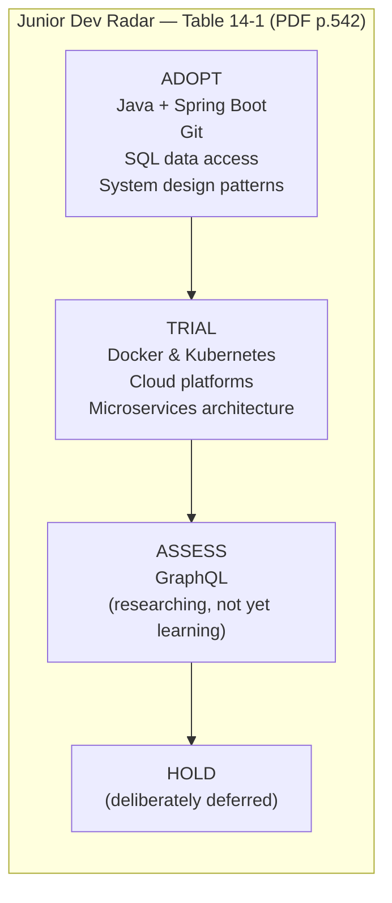
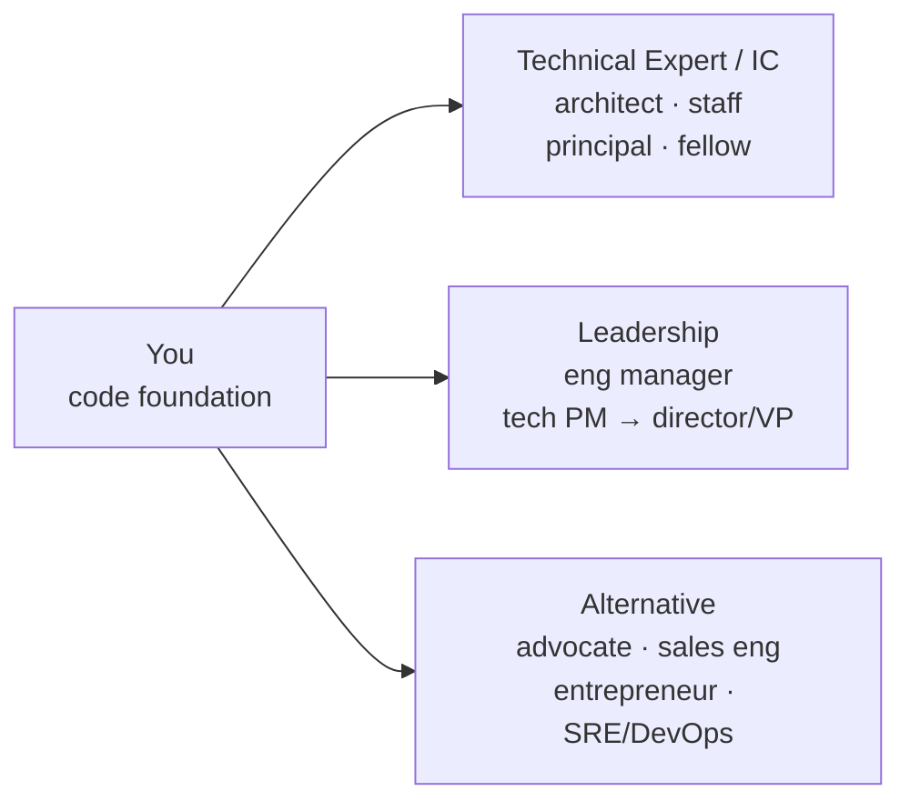

# Chapter 14: Career Management — Definitive Technical Summary
*From: Fundamentals of Software Engineering: From Coder to Engineer by Nathaniel Schutta & Dan Vega*
*Source PDF: pp. 525–584 (60-page PDF range) — figures/tables below cite PDF pages.*

> [!NAV] **Chapter Navigation**
> ⬅️ **Previous:** [[chapter-13-mastering-soft-skills|Chapter 13: Mastering Soft Skills]] | 🏠 **Index:** [[00-Master-Reading-Dashboard|Master Dashboard]] | ➡️ **Next:** [[chapter-15-ai-powered-software-engineer|Chapter 15: The AI-Powered Software Engineer]]

---

## 1. Executive Summary & Core Engineering Problem

- **Core Thesis:** A great engineering career is *designed*, not drifted into. Discover what energizes you, pick a track (technical expert / leadership / alternative) with eyes open, walk backward from a 3–5-year vision into yearly milestones, acquire skills deliberately (core → T-shaped → strategic), track it on a personal technology radar, and compound the journey with wins documentation, community, interview readiness, and work–life boundaries. Only two career decisions are truly permanent: ethical violations and burned bridges — everything else can be redirected.
- **The Core Problem Statement:** The naive model — "learn to code, get better at coding, keep coding" — breaks when interests evolve, technology churns, and life phases shift. Without intention you get resume-driven development (chasing trendy tools that die in two years), invisible impact (no wins log at review time), imposter paralysis (never speaking because you don't "know everything"), a network of zero (no referrals when layoffs hit), and burnout (boundaries dissolved by on-call pressure and endless learning). The chapter replaces drift with two halves: *plan the path* then *walk it well*.
- **What This Chapter Covers (PDF pp.525–584):** Plan Your Career Path intro (p.525) → Find Passion: domains, side projects, +1/−1 journal, Dan's personal-site story (pp.525–528) → Career Options: IC (architect, staff), leadership (EM, TPM), alternatives (advocate, sales engineer, entrepreneur) (pp.529–535) → Walking Backward from Goals: 5-yr architect milestones + TIP (pp.536–537) → Deliberate Skill Acquisition: core, T-shaped, strategic 5 questions (pp.537–540) → Personal Tech Radar: 4 quadrants × 4 rings, build steps, Table 14-1 junior example (pp.540–542) → Life Phases: 5 decision factors, early→later priorities, company types (startup/traditional/big tech/consulting), practical considerations (pp.543–547) → Walking the Path: wins doc, imposter syndrome, community, interviews, balance (p.548) → Celebrate/Record Wins (pp.548–549) → Overcome Imposter Syndrome: signs, doubt-as-fuel, confidence-through-action (pp.549–553) → Build Professional Community: local vs online, principles, Dan's network story (pp.553–560) → Acing Interviews: research + AI prompt (p.563), mutual fit, common + technical Qs, mock + AI-mock, during/after (pp.561–574) → Work–Life Balance + Remote work benefits/challenges (pp.574–580) → Wrapping Up + 9 Practice steps + Resources (pp.581–583).
- **Historical Context:** From single-ladder "senior = manager" orgs to dual IC/management ladders (staff/principal/distinguished matching management comp), to hybrid roles (advocate, sales engineer, entrepreneur, SRE/DevOps) and post-2020 remote/distributed normalcy — optionality exploded, so deliberate choice replaced default promotion paths.

---

## 2. In-Depth Technical Concepts & Internal Mechanics

### 2.1 Find What You're Passionate About — Domains, Side Projects, Energy Audits

- **Premise:** Unique skill×interest×value combos shape sustainable paths (see Ch.12 "Let Your Passion Guide You"). Early on, sample broadly:
  Consumer apps (millions of users) · Enterprise systems · Data-intensive/analytics · Infrastructure/DevOps · Gaming/interactive · EdTech · Healthcare · E-commerce · Mobile · AI/ML. Each differs in challenge, impact, and culture — customer-joy people belong in consumer; uptime-minded in infra.
- **If your day job narrows you:** Use side projects as low-risk labs with full choice of *what* and *how*. Backend-dev-curious-about-frontend? Build a good-looking frontend. Selection method: scrape 10 dream-company postings for repeated technologies (demand signal) *plus* deliberately pick something *unlike* your day job (different language/env/platform) to expand your mental map. Bonus: standout resume signal for internal or external moves.
- **Energy audit:** Track +1 (energizing) vs −1 (draining) per activity with a why-note. Patterns emerge fast: pixel-perfect CSS drains you but interactive web thrills — or debugging complex systems fuels you while design precision bores. Journal it; don't trust memory.
- **Dan's rule (p.528):** Build something *you* need — his perennial personal site/blog forced frameworks he'd never touch at work and fed open-source teaching loops. Scratch your own itch; latitude teaches.

### 2.2 Career Options — Three Families Beyond "Just Code"

> Only ethics violations and burned bridges are permanent. Tech, company, even track can be redirected with planning + effort.

- **Technical expert / Individual Contributor (IC):** Advance hands-on; ladders senior → staff → principal → distinguished/fellow (titles vary); senior IC comp can match/exceed management.
  - **Architect:** System structure + high-level decisions → business reqs into technical solutions + standards. Balances trade-offs, explains to nontechnical stakeholders, stays curious, codes enough to stay credible/practical. Typically 8+ years.
  - **Staff engineer (incl. senior/lead/principal variants):** Coding + broader influence; technical excellence, mentorship, cross-team direction; deep domain expertise; multi-team/project scope.
- **Leadership:** Guide teams, shape product, align tech to business; ladder team-lead → director → VP → C-level.
  - **Engineering manager:** People/process/delivery — team building, growth, obstacle removal, happiness-vs-objectives balance. Little/no code; strong interpersonal + organizational chops; bonus/equity-heavy comp. Not for everyone — and that's fine.
  - **Technical product manager:** Business↔tech bridge — vision, prioritization, stakeholder collaboration. Less coding, more strategy; needs tech depth *and* business acumen; path to senior product/strategy.
- **Alternative / hybrid:** Code knowledge + complementary craft.
  - **Developer advocate:** Company↔community bridge — content, talks, community building; strong teaching/communication; travel/speaking; stays current; → DevRel/technical marketing.
  - **Sales engineer:** Technical expert in the sales motion — demos, objection handling, trust; presentation + interpersonal + translation of complex to varied audiences; travel; → senior sales/sales-management/customer success.
  - **Technical entrepreneur:** Build business from engineering — opportunity finding, broad tech+business, high risk/reward; often starts as side project; → founder/early-startup.
  - Plus SRE, DevOps, and more — list is illustrative, not exhaustive.
- **How to choose:** Talk to practitioners, ask for guidance/mentorship, tell your manager what you want (they can't help what they don't know), shadow or rotate formally/informally. Advocate for yourself — progression is your responsibility.

### 2.3 Walking Backward from Goals — 5-Year Architect Example

- **Method:** Engineers decompose big problems; do the same for careers. Fix a 3–5-year vision (architect? EM? client-facing product direction?), then derive intermediate milestones.
- **Worked example — goal: technical architect:**
  - **Year 1–2:** Master current stack; take harder technical challenges; start system design; book periodic 1:1s with 1–2 architects (ask their junior→senior→architect story).
  - **Year 3–5:** Lead technical projects; mentor juniors; gain distributed-systems experience; build scalability/performance depth; assist your architect's deliverables.
  - **Year 5+:** Drive major-project architecture; author cross-team standards; build beyond-team influence; level up nontechnical skills (presenting, effective meetings).
- **TIP:** Mine lived journeys — one coffee chat with someone *in* the target role beats ten blog posts.

### 2.4 Deliberate Skill Acquisition — Core, T-Shaped, Strategic

- **Random learning → random results.** Don't chase every trend (many die in years) — that's resume-driven development (learning to list, not to grow). Pair Ch.12 learning skill with deliberate targeting.
- **Core skills (vertical bar foundation first):** Data structures & algorithms · Design patterns · Testing methodologies · Version control · Database design. Master fundamentals before complexity.
- **T-shaped development:** Vertical = deep primary stack; horizontal = broad adjacent. Example backend-Java dev — deep: Java, Spring, SQL/NoSQL storage; broad: basic frontend, DevOps practices, system design. Specialized *and* adaptable.
- **Strategic filter (ask before investing time):** Aligns with career goals? Relevant in 3–5 years? Competitive advantage? More valuable in current role/team? Does it excite you? A "no" across the board is permission to skip.

### 2.5 Personal Technology Radar — Table 14-1 (PDF p.542)

- **Concept (Thoughtworks-origin, Ch.12):** Decision/communication tool tracking tools/frameworks/platforms/techniques over time. Personal adaptation:
  - **Quadrants:** 1 Languages & Frameworks · 2 Tools & Infrastructure · 3 Platforms & APIs · 4 Techniques & Methodologies.
  - **Rings:** **Adopt** (using/mastering) · **Trial** (actively learning/experimenting) · **Assess** (researching, not yet learning) · **Hold** (deliberately not pursuing now).
- **Build (paper to BYOR — medium doesn't matter):**
  1. List daily stack + proficiency + gaps.
  2. Add tech from 1–2-year-target job postings (required vs nice-to-have).
  3. Add emerging domain traction from blogs/conferences (patterns, not every trend).
  4. Quarterly review — move items as relevance shifts. Reflect popular *and* future; focus near + medium term; combine with career roadmap; nothing permanent.
- **Table 14-1 junior example (PDF p.542, reconstructed):** Adopt — Java/Spring Boot (Lang), Git (Tools), SQL data access (Platforms), System design patterns (Techniques); Trial/Assess side — Docker & Kubernetes, Cloud platforms / GraphQL, Microservices architecture. (Open PDF p.542 to compare exact cell layout — extraction is row-flattened.)

### 2.6 Aligning Choices with Life Phases

- **Five drivers (priority shifts by phase):** Compensation (salary/benefits/equity — am I paid adequately?) · Team/culture (do I like the people/org?) · Work content (do I like the work/challenges?) · Growth/future (will this get me the *next* job? what's the opportunity cost?) · Work–life balance (relationships + well-being sustainable?).
- **Phase sketches:** Early → growth + challenge, accept lower pay at cutting-edge startup. Family formation → insurance, stable hours/predictable income, established orgs. Mid-career → maximize comp via strategic moves. Later → balance + culture + legacy (mentoring, meaningful/lasting projects).
- **Company types:**
  | Type | Pros | Cons |
  |---|---|---|
  | **Startup** (novel product/service) | Rapid diverse learning, many hats | Long hours, failure risk, thin benefits |
  | **Traditional** (healthcare/finance/retail/… — tech supports the business) | Stability, predictable hours, strong benefits/balance | Slower pace, less bleeding-edge, lower total comp |
  | **Big tech** (Alphabet/Amazon/Apple/Meta/Microsoft) | Security, benefits, credibility, cutting-edge | Selective hiring, heavy algorithm prep |
  | **Consulting** (firm or independent) | Breadth across cos/tech/industries, often higher pay; independent = project choice + flexibility | Constant re-adaptation, travel; independent = find clients + run the business |
- **Practical checklist:** Health-insurance need vs partner coverage? Geographic stability? Equity-vs-salary tolerance? Learning-curve bandwidth? Travel appetite? Brand building? Remote vs office + commute sanity? Risk tolerance? Balance needs? Domain excitement? No single right path — right *for current circumstances*, with flexible ambitious goals because plans rarely unfold exactly (that's where growth lives).

### 2.7 Celebrate and Record Your Wins

- **Why:** Pace whiplash (fix → next fire) erases memory. A wins doc is imposter-syndrome antidote, review/resume/interview fuel, and growth pattern detector.
- **How:** Synced + backed-up beats fancy (Apple Note / Google Doc fine; paper if you'll keep it). Log as it happens: technical wins (features/bugs), process improvements initiated, positive feedback (colleagues/stakeholders/community), new skills, talks/knowledge-shares led. Include dates (reviews/resumes thank you).
- **Specificity rule:** Not "improved performance" but "improved flagship performance 25% via virtual threads, improving customer experience." Specific wins become resume bullets and interview stories (reused explicitly in §2.9).

### 2.8 Overcome Imposter Syndrome — Doubt as Fuel

- **Reframe:** "Do I belong? Am I smart enough?" persisting *throughout* a career is normal and healthy — it signals caring and grasp of the ocean you don't know. Beware the know-everything person; they're dangerous on a project. Software is too vast to hold entirely; humility + confidence coexist.
- **Common signs:** Hesitating in technical discussion · needing omniscience before contributing · comparing to seniors · attributing success to luck · fearing discovery as fraud. Overwhelm at required knowledge is universal.
- **Convert doubt to motion:**
  - Hesitate to speak → speak from experience (incontestable; wrong → learn).
  - Need omniscience → accept never-knowing as growth unlock.
  - Compare upward → treat proximity as tuition.
  - Luck-attribution → luck = preparation × opportunity; skill compounds from failure post-mortems.
  - Fear discovery → you belong; belief accelerates enjoyment.
- **Confidence through action:** First encounter panics; review feedback welcomes (reviewers aren't smarter, just more repetitions); lightweight retro (what worked/didn't/next-time); stand firm when conviction warrants (conviction ≠ combativeness). Repetition welds confidence to experience — wobbly bike → second nature.
- **Growth reps:** Pick the avoided-area ticket, not the 11th identical fix. Own "payment systems" by volunteering where others won't; breadth + problem-solving + team value in one move.

### 2.9 Build Your Professional Community — Quality Over Followers

- **Reframe networking:** Not crowded-mixer small talk or follower counts. Genuine, mutual-value relationships for advice, opportunities, venting. Lean into natural connection style; 5,000 LinkedIn connections with zero recommenders = vanity metric.
- **Dan's testimony (p.555):** Every career opportunity traced to community — user groups/conferences → enduring friendships → doors opened indirectly if not directly. No random meetings; show up, follow through.
- **Where:**
  - **Local:** User groups (per-tech), hackathons, meetups/socials, professional chapters. Benefit: depth via regular face time + higher engagement than backgrounded virtual. Cost: 3–4 hrs all-in with travel/networking/event. Can't find it → start it.
  - **Online:** GitHub discussions, Stack Overflow, Discord, Twitter/X tech circles, LinkedIn groups. Benefit: global expertise, async, multi-community breadth. Cost: thinner ties, overload, always-on pressure. Can't find it → create it.
- **Principles:** Authenticity (admit unknowns → learning moment) · Dependability (hit Thursday or flag early; show up on time, don't flake coffees) · Mutual value (don't just mine the frontend expert — trade) · Respect (multiple valid solutions; listen actively) · Communication (clear, audience-calibrated — Ch.13).
- **Maintenance:** Share solved problems, discuss/ask thoughtfully on GitHub/SO/meetings (lurking insufficient; document solutions for future-you), give help/feedback, check in without an ask (scheduled coffees, forwarded article/podcast). If they hear from you only when needy, they'll dodge you. Mechanical reminders are fine — nurturing is time well spent.

### 2.10 Acing Your Next Interview — Prepare, Perform, Follow Through

- **Why always-ready:** Interviews = promotions, external moves, first jobs — and insurance for layoffs. Network feeds it (intel, intros, references).
- **Strategic research:** Pre-apply — does role/company fit goals/values? Post-invite — deepen into culture, stack, challenges, process. You're already ahead of the 100th-resume-of-the-day crowd. Sources: LinkedIn (network, interviewers, culture) + insiders + AI deep-research. Example prompt (PDF p.563): company background/mission/leaders; 6–12-mo news/launches/acquisitions; stack/open-source/eng-blog/challenges; competitors/share/differentiators/performance; culture/reviews/balance/remote/growth; process/questions/assessments/valued skills; smart questions to ask — formatted for review with interview-mentionable highlights. TIP: ChatGPT/Gemini/Claude synthesize news/blogs/filings/reviews — then *validate*; never blindly ship AI cover letters/resumes (recruiters spot them; authenticity is the first impression; use AI for polish, not authorship). Also decode interview *style* (behavioral mix vs FAANG algorithms vs take-home) + boots-on-ground human intel. Prep = calm + confidence + better offers.
- **Mutual fit (you interview them):** Team dynamics/culture · technical challenges + decision process · stack/practices · growth/mentorship · travel %. Research-powered questions prove interest *and* filter alignment.
- **Common Qs:** "Why leaving?" — honest, professional (comp, challenges, growth — never trash current employer; networks are small, references recognizable). "Where in N years?" — ambition + commitment + alignment; reference your roadmap (architect/leadership/mentoring arcs). Technical set (pp.566–568): debug-a-prod-perf-issue walkthrough (systematic method) · hardest problem + *thought process* · staying current + tool evaluation · code-review giving/receiving (technical + interpersonal) · design-a-URL-shortener/chat-app (requirements → decisions → trade-offs). TIP: mine your wins doc for every behavioral/technical story.
- **Mock reps:** Partners who give *tangible* feedback (not "great!") — coworkers, network contacts, interviewing.io, community peers. **AI mocks:** 24/7 role-tailored Qs, coding challenges, voice-mode verbal reps + follow-ups; pre-human warmup, not replacement. Treat mocks as real: record + self-review verbal + nonverbal, solicit clarity/depth critique, drill behavioral examples, hold professional body language/eye contact.
- **During:** Command technical — don't type instantly; clarify requirements/constraints, outline, then implement; decompose unfamiliar problems, compare options, narrate choice; anchor to wins-doc evidence. Be professional — research names/roles, bring role questions + resume copies (even virtual), dress, sleep, silence devices. In-person: arrive early. Virtual: test camera/mic/lighting/app login, kill notifications, close heavy apps, tidy background, warn household. Embrace it — rejections 1–3 are normal reps; enthusiasm + lasting impression seeds future roles.
- **After:** Two outcomes — offer (evaluate, negotiate, prep day one) or not (normal; often internal-candidate/priority-freeze/skill-match, not verdict on you — don't personalize). Grow: request decision feedback, convert gaps into learning focus (there *will* be a next one), keep bridges unburned — future roles, referrals, hiring-manager moves flow through today's "no."

### 2.11 Work–Life Balance & Remote Work

- **Challenge map + counters:**
  - **Relentless change** → deliberate learning (Ch.12) + radar (this chapter) + knowledge-sharing network.
  - **Unswitchable problems** (mentally engaging = follows you home) → step away (walk/run, subconscious delivers), rubber-duck (person/duck/chatbot exposes logic gaps).
  - **Distributed/Agile across zones/cultures** → explicit channels + cadence alignment; standardized tools/practices.
  - **Health/stress/burnout** → boundaries, self-care (people, exercise, food, mindfulness), grace/breaks.
- **Remote — benefits:** No commute (hours + road-rage saved) · uninterrupted maker focus (no desk drop-bys that Slack could've been) · async flexibility (work peak hours; coffee-shop scenery) · health (fewer office germs, home cooking, midday workouts) · global opportunity/relocation freedom + comp breadth · custom ergo setup (stipend > cubicle lottery).
- **Remote — challenges:** Isolation/loneliness (fix: gym class, coffee-shop days) · home distractions (bed/TV/chores need discipline) · digital-misunderstanding + timezone lag (office tap ≠ async wait — patience + clarity) · mentorship friction (early-career hallway Q → scheduled call decision) · boundary blur (home = office → temptation to "quickly fix" at midnight) · tech dependency (outage = halted; keep 2 backup work spots) · visibility/promotion anxiety ("out of sight, out of mind" — counter with wins doc + proactive updates per Ch.13 stakeholder rules).

---

## 3. Important Figures, Diagrams & Visual Architecture

| Figure / Table | PDF Page | Description |
|---|---|---|
| Table 14-1 | 📕 PDF p.542 | Junior developer's technology radar example (Adopt/Trial/Assess across quadrants — reconstructed below) |
| Career tracks | 📕 PDF pp.529–535 | IC vs Leadership vs Alternative paths (supplementary overview diagram) |
| Radar framework | 📕 PDF pp.540–541 | 4 quadrants × 4 rings personal radar (supplementary reconstruction; book gives text spec, no drawn figure) |

**Table 14-1 — Junior radar example (PDF p.542).**

- **Original Book Table:** Table 14-1 → 📕 PDF p.542 — open the source PDF at page 542 to compare (extraction flattens the quadrant grid; content above preserves every named item).
- **Key takeaway:** Today's Adopt funds tomorrow's Trial; Assess/Hold make the *no* explicit.

**Career tracks overview (PDF pp.529–535, supplementary diagram — text spec in book).**

- **Reference:** Career-options text → 📕 PDF pp.529–535 (no single book figure; diagram synthesizes the three families).
- **Key takeaway:** All three grow impact + comp; only ethics/bridges lock doors.

---

## 4. Real-World Systems, Case Studies & Code Examples

- **Dan's personal site (p.528):** Lifelong site + blog → open-source + teaching loop → frameworks the day job never offered. Template for "solve your own problem" side projects.
- **Job-posting scrape (p.527):** 10 dream postings → repeated-tech list = demand-grounded Trial ring. Evidence over hype.
- **+1/−1 journal (p.528):** "Pixel-perfect CSS −1 (draining, why: …)" vs "interactive web +1 (energizing)" — worked self-discovery artifact.
- **AI research prompt (p.563):** Seven-part company dossier prompt (background → recent → stack → market → culture → process → questions-to-ask) — copy-paste starter for every interview; TIP authors explicitly bless deep-research assistants with validation caveat.
- **AI mock interview (p.569):** Voice-mode chatbot as sparring partner — tailored Qs + coding challenges + follow-ups → human-mock readiness. 24/7 availability vs human nuance trade-off stated honestly.
- **"Where do you see me in N years?" (p.583 n.6):** Flip the script on the interviewer — forces them to picture you hired and progressing. High-leverage closer.
- **Remote playbook snippets:** Two-backup-location rule for outages; coffee-shop/gym antidote for isolation; household "do not disturb" broadcast before virtual loops.

---

## 5. Architectural Trade-Off Matrix

*Adapted: career-path and company-type decisions.*

| Approach | Growth / Learning | Comp / Stability | Balance / Risk | Best used when | Avoid when |
|---|---|---|---|---|---|
| IC deep (architect/staff) | Deep mastery, cross-team influence | Matches management at senior levels | Sustained hands-on; narrower people-scope | You love hard technical problems + code | You want org/people authority |
| Leadership (EM/TPM) | People/product leverage, strategic | Bonus/equity upside | Little/no code; happiness-vs-delivery tension | You enjoy people, process, alignment | You recharge only by building systems |
| Alternative (advocate/sales/founder) | Communication/business breadth, visibility | Variable; entrepreneurial variance | Travel/ambiguity/risk | You light up teaching, selling, founding | You need predictable scope + hours now |
| Startup | Many hats, fastest breadth | Lower cash, equity lottery | Long hours, failure risk | Early career growth sprint | Need stability/benefits/predictability |
| Traditional enterprise | Steady depth, strong benefits | Moderate comp, predictable | Best balance, slower tech | Family formation / balance priority | Need bleeding-edge + max comp |
| Big tech | Cutting-edge at scale, credibility | Top comp + security | Selective grind, prep tax | Maximizing comp + scale problems | Clock-sensitive or interview-averse season |
| Consulting (firm/independent) | Max breadth, many domains | Often higher; independent = variable | Travel/client churn; independent = pipeline stress | Sampling industries or autonomy | Need single-team depth + roots |

- **Decision heuristics:** Early → optimize growth/challenge over pay. Family → optimize insurance/hours/predictability. Mid → optimize comp via strategic moves + opportunity-cost math. Later → optimize culture/balance/legacy. Always cross-check the practical list (insurance, geography, equity tolerance, bandwidth, travel, brand, remote/commute, risk, balance, domain joy) — then keep the plan flexible.

---

## 6. Jargon Buster & Key Terminology

- **Career Roadmap (Walk backward):** 3–5-yr vision decomposed to yearly milestones. Confused with: wish list — milestones must be checkable.
- **Resume-Driven Development:** Learning tech to list it, not to grow. Filter: 3–5-yr relevance + goal alignment + excitement.
- **Core Skills (Bedrock):** DS&A, patterns, testing, VCS, DB design. The vertical bar you build before breadth.
- **T-Shaped Development (Depth × Breadth):** Deep stack + broad adjacent (e.g., Java/Spring/SQL deep; frontend/DevOps/design broad). Pitfall: all-horizontal "know a little of everything."
- **Strategic Learning (5-question filter):** Goal/3-yr/advantage/value/excitement gate before time spend.
- **Technology Radar (Adopt / Trial / Assess / Hold):** Quadrant×ring tracker (Lang-Tools-Platforms-Techniques). Quarterly refresh; nothing permanent.
- **Life-Phase Alignment (5 factors):** Comp, team/culture, content, growth/future, balance — reweighted per season.
- **Wins Document (Dated log):** Specific achievements + feedback + talks. "25% via virtual threads" beats "improved performance."
- **Imposter Syndrome (Belonging doubt):** "Do I belong?" as care/ocean-awareness signal. Danger flips: the know-everything teammate.
- **Professional Community (Mutual-value network):** Local depth + online breadth, maintained by giving. Vanity metric: follower counts with zero recommenders.
- **FAANG-Style / Take-Home (Interview styles):** Algorithm-heavy vs project-heavy loops. Prep differs — decode first.
- **AI Deep Research (Validate-first):** LLM synthesis across news/blogs/filings/reviews. Never ship cover letters unverified.
- **Mock Interview (Record + critique):** Rehearsal with tangible feedback + self-review. AI voice-mode = warmup, humans = exam.
- **Maker vs Manager Schedule (Ch.13 reprise):** Deep blocks vs interchangeable hours — remote async protects the former.
- **Rubber-Ducking (Talk it out):** Explaining to person/duck/bot to surface gaps. Remote step-away variant: walk/run.

---

## 7. System Design & Practical Engineering Takeaways

- **Production Engineering Checklist:**
  1. Write 1/3/5-year goals + walking-backward milestones; review radar quarterly against them.
  2. Log every win specifically with dates; mine it for reviews, resumes, and interview stories.
  3. Ship one community rep weekly (answer, write-up, check-in without an ask); prefer depth over follower counts.
  4. Keep interview readiness warm: research template + 5 technical stories + one recorded mock per quarter.
  5. Enforce work–life boundaries (focus blocks, step-away rule, remote backup spots, grace over grind).
- **Promotion / Interview Blueprint:** Open with roadmap ("walking backward from architect, here's Year-1–2/3–5 evidence"), подкреп with wins-doc numbers, show T-shape + strategic-learning filter for tool choices, close with mutual-fit questions + the flipped "where do you see *me* in N years?" Pitfalls: trashing current employer, generic "I know everything," unverified AI prose. Capacity rule: name the Hold ring — what you deliberately deferred and why.
- **Deep Mastery Questions:**
  1. *Q: Junior asks "what should I learn?" — give them a system, not a list. A:* Audit energy (+1/−1), scrape 10 target postings, map current stack proficiency, draft 4×4 radar (Adopt/Trial/Assess/Hold), filter candidates through the 5 strategic questions, set quarterly refresh + walking-backward milestones (pp.537–542). Revisit when passion fades — moving rings is free.
  2. *Q: Mid-career with young kids, choosing startup vs traditional vs big tech — decide. A:* Weight the 5 life-phase factors: family season elevates insurance/hours/predictability (traditional) unless comp maximization (big tech) offsets with support; startup breadth costs nights/weekends most can't spend now. Run the practical checklist (geography, equity tolerance, commute, risk, domain joy) and build flex for plan drift (pp.543–547). No permanent door except ethics/bridges.
  3. *Q: Imposter spike before a staff-level technical discussion — concrete protocol? A:* Normalize (signal of care, not fraud), speak from experience, accept partial knowledge, treat seniors as tuition, log prep + retro the rep in the wins doc, then take the avoided-area ticket next sprint to convert doubt to domain ownership (pp.549–553). Confidence follows repetitions, not affirmations.
  4. *Q: Two weeks to a dream-company loop — prep plan using this chapter? A:* Week 1: AI deep-research dossier (p.563 prompt) + insider chats + style decode; draft mutual-fit questions; pull 5 wins-doc stories mapped to the 5 technical Q archetypes (debug/hardest/current/review/system-design). Week 2: voice-mode AI mocks → human mock recorded + critiqued; logistics (names/roles, resume, dress/sleep, tech check, early arrival). After: thank-you, feedback request on no-offer, bridge preserved (pp.561–574).
  5. *Q: Remote IC feels invisible at promotion time — fix without returning to office? A:* Counter "out of sight" with Ch.13 stakeholder cadence (upper-right proactive updates in their channel), demos/summaries, wins-doc-fed visibility, community presence (talks/write-ups), explicit boundary + backup-spot reliability, and health-sustaining routine so output stays high (pp.574–580). Visibility is a system, not a location.

*Additional Resources (book list, pp.582–583): Developer Career Masterplan (VanCura & Souza, 2023); The Manager's Path (Fournier, 2017); Developer, Advocate! (Wielenga, 2019); Help Your Boss Help You (Kousen, 2021); The Passionate Programmer (Fowler, 2009); The Pragmatic Programmer (Thomas & Hunt, 1999); Never Eat Alone (Ferrazzi & Raz, 2014).*
