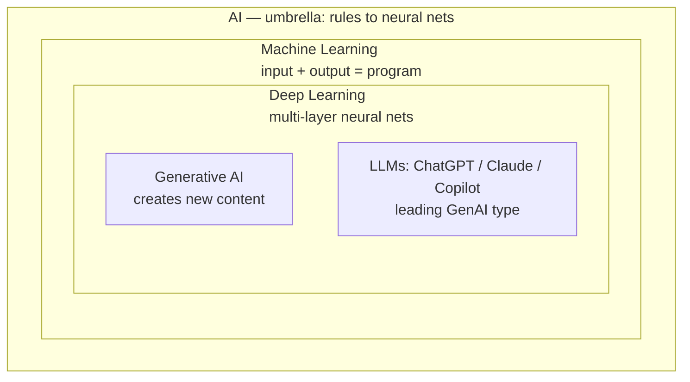
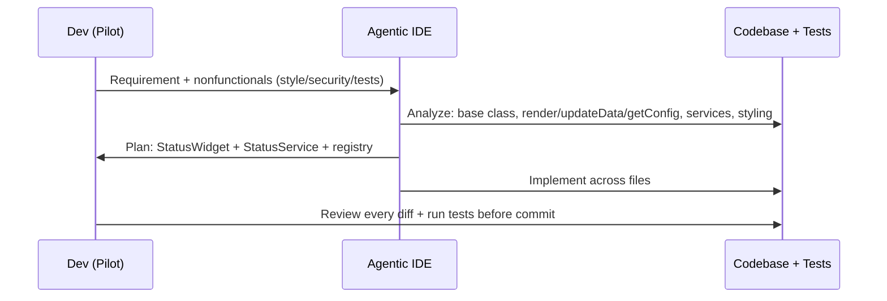

# Chapter 15: The AI-Powered Software Engineer — Definitive Technical Summary
*From: Fundamentals of Software Engineering: From Coder to Engineer by Nathaniel Schutta & Dan Vega*
*Source PDF: pp. 585–630 (46-page PDF range) — figures below cite PDF pages.*

> [!NAV] **Chapter Navigation**
> ⬅️ **Previous:** [[chapter-14-career-management|Chapter 14: Career Management]] | 🏠 **Index:** [[00-Master-Reading-Dashboard|Master Dashboard]] | ➡️ **Next:** *End of Book*

---

## 1. Executive Summary & Core Engineering Problem

- **Core Thesis:** The Jacquard loom didn't end weaving — it superpowered weavers who learned patterns, operation, and design, creating roles that hadn't existed. AI does the same for developers: master fundamentals *and* wield AI as a tireless pair programmer and you become more in demand, not obsolete. That requires demystified terminology, honest capability/limitation accounting, the right assistant for each job, prompt-engineering fluency, and non-negotiable verification — you own every line, human or machine.
- **The Core Problem Statement:** Two naive extremes both fail: (1) **Vibe-coding euphoria** — prompt an agentic IDE over a weekend, ship a payroll system for thousands of employees across tax jurisdictions the same way you'd ship a personal expense tracker, and discover the difference on pager duty; (2) **AI abstinence** — hand-writing every boilerplate getter, doc page, and test while competitors flip the 70/30 ratio (70% boilerplate/30% problem-solving → 70% architecture-requirements-judgment/30% typing) and pull ahead. Add hallucinations, stale knowledge, missing codebase context, bias, and secret-leaking prompts, and unreviewed AI output becomes Neal Ford's "tsunami of bad code." As Jeff Atwood is quoted: AI won't replace developers, but developers who use AI will replace those who don't.
- **What This Chapter Covers (PDF pp.585–630):** Jacquard-loom framing (p.585) → What Is AI Really? 1950s→winters→ChatGPT Nov 2022 (1M/5d, 100M/2mo) (pp.585–586) → Demystifying Terminology + Fig 15-1 Venn (pp.586–587) → ML: input+output=program, spam, classification/regression/clustering, `EmailClassifier` (pp.588–590) → Deep Learning: 86B neurons, layers, face pipeline, `ImageClassifier` (pp.590–591) → GenAI: text/code/images/audio/video, `TestDataGenerator` + validate NOTE (pp.591–593) → LLMs: ChatGPT/Claude/Copilot, context/nuance, `CodeDocumentationGenerator` + temperature NOTE (pp.593–595) → Capabilities: 9 strengths (pp.595–598) → Limitations: model-vs-product, 7 limits + WARNING treat-as-first-draft (pp.598–600) → Pair Programmer: chatbots, inline IDE, agentic (Cursor/Junie/Cline) + StatusWidget analysis/planning/implementation + pilot-not-passenger TIP (pp.600–606) → Prompt Engineering: what-it-is (junior-dev "fix login" parable), basics (specific/structure/chain-of-thought), 7 practical tips, advanced (zero/one/few-shot, XML tags, decomposition) (pp.607–615) → Future: Will AI take my job? (70/30 flip, lines-of-code NOTE), vibe coding (Karpathy Feb 5 2025), expense-vs-payroll, enterprise issue→agent→PR→human, reviews-more-important, new mindset 5 skills (pp.616–623) → Force Multiplier: camera analogy, REST-API time reallocation (pp.623–625) → Wrapping Up + 7 Practice steps + Resources (pp.626–630).
- **Historical Context:** AI summers and winters since the 1950s room-size machines; quiet practical AI (fraud, vision, search) between winters; ChatGPT's 2022 breakout turning research curiosity into anyone's tool. Programming's own ladder — assembly → high-level → IDEs → CI/CD — never reduced developer demand; each layer moved value upward from typing to judgment.

---

## 2. In-Depth Technical Concepts & Internal Mechanics

### 2.1 What AI Really Is — Umbrella, History, Pattern Probabilities

- **Definition:** No single answer — umbrella from rule systems to brain-inspired neural nets. Modern core: teach computers pattern/probability recognition and pick the statistically most likely answer, versus traditional step-by-step instructions. Focus here is the developer-relevant slice that solves interesting problems, not the whole discipline.
- **Timeline beats:** 1950s pursuit → excitement/winter cycles (funding droughts for general AI, quiet applied wins underneath) → Nov 2022 ChatGPT public (1M users in 5 days, 100M in 2 months) → AI as harnessable tool, not curiosity.

### 2.2 Machine Learning — Input + Output = Program

- **Flip:** Traditional: input + program = output (you write rules). ML: input + output = program (you supply examples; algorithms infer rules). Perfect for human-easy/machine-spec-hard tasks.
- **Spam parable:** You recognize spam from thousands of examples instantly; hand-coding rules (suspicious phrases, sender patterns, formatting quirks × thousands) loses to spammers' daily evolution. ML learns from spam/legit corpora and adapts as patterns shift. Facial recognition identical: no per-face code, just thousands of faces → distinguishing patterns.
- **Three developer-facing shapes:**
  - **Classification ("What is this?"):** Spam/legit, disease/healthy, appropriate/inappropriate moderation.
  - **Regression ("How much/many?"):** House prices, delivery ETAs, sales forecasts from feature→number relationships.
  - **Clustering ("What groupings exist?"):** Customer segments, doc collections, behavior patterns — groups *discovered*, not prescribed.
- **Integration posture:** Consume pretrained models/APIs, don't build algorithms from scratch:
```java
// Using a pre-trained ML model through an API (book, PDF p.590)
public class EmailClassifier {
    public boolean isSpam(String emailContent) {
        MLPrediction prediction = mlService.classify(emailContent, "spam-detection-model");
        return prediction.getConfidence() > 0.85 && prediction.getLabel().equals("spam");
    }
}
```
Threshold (0.85) + label gate = the production decision, not raw model output.

### 2.3 Deep Learning — Deep Nets That Learn Nuance

- **Model:** Brain-inspired artificial neurons (~86B biological reference) wired in layers: input (raw) → hidden ×N (each transforms; ≥3 total ≈ "deep") → output (verdict). Depth buys context/nuance over shallow pattern match.
- **Face pipeline:** Layer 1 edges/lines → mid layers shapes → deep layers eyes/structures → final "Dan"/"Nate." Traditional ML recognizes; DL captures *how features compose*.
- **Posture (again):** Load pretrained nets, don't hand-build:
```java
// Using a pretrained deep learning model (book, PDF p.591)
public class ImageClassifier {
    public String identifyImage(byte[] imageData) {
        DeepLearningModel model = ModelLoader.load("face-recognition-v1");
        return model.classify(imageData);
    }
}
```

### 2.4 Generative AI — From Analyzing to Creating

- **Shift:** Traditional AI categorizes what exists; GenAI creates what didn't — trained on massive multi-modal human corpora, learning styles/structures then generating human-like new artifacts. ML recognizes the good painting; GenAI paints a new one.
- **Modalities:** Text/code (articles, docs, functions, apps, error messages, test data) · Images (icons in flat style, marketing/placeholder visuals) · Audio (accessible speech, music, SFX) · Video (demos, animated explainers, marketing — "30-sec mobile-feature video").
- **Spring-AI-flavored workflow (book, PDF pp.592–593):**
```java
// Using generative AI to create test data (book, abridged)
public List<User> generateTestUsers(int count) {
    var userList = chatClient.prompt()
        .user(u -> { u.text("Generate {n} realistic user profiles with name, email, age, and interests").param("n", count); })
        .call().entity(UserList.class);
    return userList.users();
}
```
- **NOTE (book, hard rule):** Validate everything — test generated code, review generated data, check user-facing output for accuracy/appropriateness.

### 2.5 Large Language Models — Deep GenAI for Language

- **Position:** LLMs = deep-learning neural nets + leading GenAI type, trained on vast data to understand/generate human-like content. ChatGPT, Claude, Copilot are LLM-powered.
- **Superpower:** Context/nuance beyond keywords — meaning, conversation state, implication. Hence debug help, concept explanation, relevant completions.
- **Doc-generation integration (book, PDF p.594):**
```java
// LLM-generated JavaDoc (book, abridged)
public String generateDocumentation(String code) {
    String prompt = String.format("Generate JavaDoc comments for this method:\n%s", code);
    return llm.complete(prompt, new CompletionOptions().setMaxTokens(200).setTemperature(0.3));
}
```
- **Temperature NOTE (PDF p.595):** 0.0–0.5 predictable/focused; 0.7–1.0 creative. Code/facts → low. High heat raises hallucination risk (confident-but-wrong).

### 2.6 What AI Excels At — Nine ROI Zones

1. **Repetitive coding:** Cross-file patterns, consistent APIs, whole-feature scaffolds → frees unique-problem time.
2. **Glue/automation:** Downloads, directory wrangling, deploy steps — shell/bash/human-glue scripts.
3. **Code explanation:** Onboard fast — "what does this app do? entry points? dependencies?" + personalized learning plans.
4. **Documentation:** Method→project level, Markdown→HTML conversion (devs' least-loved, most-aided).
5. **Refactor/optimize review:** Bottlenecks, cleaner idioms, modern library suggestions — tireless senior eyes.
6. **Test generation:** Style-aligned suites + missed edge cases (second neglected area AI rescues).
7. **Code conversion:** Python/JS/Java translation (weaker on low-level/hardware-tangled/special deps — always re-test subtleties).
8. **UI/mockups:** Layouts, components, responsive patterns, interactive prototypes from description.
9. **Language/framework Q&A:** Patient pair for API nuance — faster than doc spelunking *with proper prompting*.

### 2.7 Limitations — Model vs Product, Seven Cautions + WARNING

- **Frame first:** Chatbot = *product* atop a *model*. Limits below live at model level; products patch with tools (e.g., web search for today's stock price beyond training cutoff).
- **The seven:** (1) **No real-time knowledge** — misses new docs/tools/events. (2) **Hallucinations** — pattern-generated plausibility, not fact retrieval; most dangerous because confident. (3) **No codebase context** — blind to your architecture/conventions/business rules; isolated-code bias. (4) **Embedded bias** — stale/culturally-skewed/inaccessible patterns from training repos. (5) **No business judgment** — can't trade perf vs maintainability, compliance, domain-specific user needs. (6) **Domain variance** — strong on popular stacks, thin on niche/new/specialized. (7) **Privacy/security** — history retention, training reuse, leakage of proprietary code/keys/schemas/logic.
- **WARNING (book, p.600):** Treat AI code as a *first draft from a human* — same tests, reviews, integration planning. Reinvest generation savings into validation.

### 2.8 AI as Pair Programmer — Three Categories (Products Illustrative, Categories Durable)

- **Standalone chatbots (ChatGPT / Gemini / Claude):** Out-of-IDE text/voice mentor. Best for concepts, hairy debugging, architecture deliberation, explained generation, long threads. Habits: state goal context, paste relevant snippets, assign persona ("as senior Java architect…"), ask for explanations not just answers, use for tech onboarding. Specificity wins: not "how do I sort?" but "sort `List<Customer>` by registration date desc, Java 24."
- **Inline IDE assistants (Copilot / JetBrains AI / CodeWhisperer):** In-editor completions as you type. Best for getters/setters/constructors, standard patterns (singleton/builder), suite-styled tests, comments/docs, API/syntax nudges. Habits: review before accept; starting point not final; watch repo-learned patterns; never let suggestions override architecture; ramp simple→complex. Calculator/JavaDoc snippet (PDF p.603) is the canonical micro-demo.
- **Agentic IDE environments (Cursor / Junie / Cline):** Beyond suggest → participate: multi-file edits, whole functions/files from requirements, codebase-wide context. Best for large refactors, multi-spot features, migrations, consistency enforcement. Habits: crisp requirements + nonfunctionals upfront (style/security/tests); review *all* diffs; version-control everything; decompose large tasks.
- **StatusWidget worked loop (PDF pp.605–606):** Five-widget dashboard (Weather/Stock/News/Calendar/TaskList) + "add system-health StatusWidget." Agent **analyzes** (base class, `render/updateData/getConfig`, data-service pattern, styling/org), **plans** aloud (extend base, add StatusService, reuse refresh, register), then **implements** (StatusWidget.java + StatusService.java + config + matching style). Power = context-respecting consistency, not just tokens.
- **TIP (pilot, not passenger):** You own understanding, architecture, and quality. "Do I understand every line well enough to defend in review?" If no → research until yes. Amplify thinking, don't replace it.

### 2.9 Prompt Engineering — Teach, Don't Command

- **Core claim:** Developers fail with AI from communication failure, not model failure — same muscle as writing teammate requirements and docs. "Fix the login bug" to a junior wastes hours across ticket hunts and wrong forms; "dashboard login email-format validation lets invalid addresses downstream" gets results. Prompts obey the same law: quality in → quality out.
- **Three contrasts (bad→good):**
  - *Specificity:* "Write some Java code for sorting" (sort what? how?) → "Java method sorting `ArrayList<Employee>` by salary desc, null-input handling."
  - *Structure:* "Explain database indexing" (any depth/format) → "As experienced Java dev, 3 parts (what/why; clustered vs non-clustered; one Postgres `CREATE INDEX`), 2–3 sentences each + one code example."
  - *Chain-of-thought teaching:* "Optimize this code [paste]" (optimize *what*?) → "Java method over large dataset: first time complexity, then specific improvements, then refactored code with gain comments [paste]." Guide reasoning, don't demand output.
- **Seven immediate upgrades:** Context (greenfield vs legacy, personal vs mission-critical) · Examples (show desired format) · Environment (Java version, frameworks, constraints) · Role ("as performance expert…") · Iterate (first draft → refine) · Meta-prompt ("how should I rephrase for specific debug steps?") · Library (save winners; see Personal Knowledge Management).
- **Advanced — structuring:** **Zero-shot** (no example: "Observer-pattern stock monitor class") — fine when it hits. **One-shot** (one style example: null-guarded `Optional<User> findUserByEmail` → "now `findUserById(Long)` likewise") — clones conventions. **Few-shot** (several input→output: 3 review→Positive/Negative → classify "helpful features but confusing UI") — teaches classification by demonstration.
- **Advanced — organizing:** **XML/Markdown/JSON framing** separates task/requirements/constraints so priorities survive (REST `POST /users` example with Java 17 / Boot 3.0 / starter-only limits). **Decomposition** phases file-system work (read strategy → validation → error/logging → tests) starting with Phase-1 1GB+ stream-vs-batch analysis — big blobs overwhelm models; phased slices stay thorough and steerable.
- **Bottom line:** Clarity habits compound; no framework memorization required.

### 2.10 Future — Jobs, Vibe Coding, Reviews, Force Multiplier

- **Will AI take my job?** You've seen code/test/doc automation — but Ch.2 (reading > writing) and Ch.9 ("it depends" judgment) already named the durable work: ambiguous reqs → working systems, perf-vs-maintainability trade-offs, politics, mentoring, stakeholder translation, *why/who* not just *how*. Models remix millions of good/bad examples; they don't know your business model, users, or why the CEO's "simple request" is an architectural nightmare. Demand grew through assembly→high-level→IDEs→CI/CD; AI repeats the pattern — mundane toil liberated, creative/strategic share expanded.
- **Vibe coding (Karpathy, X, Feb 5 2025 — tongue-in-cheek coinage, not endorsement):** Describe → agentic IDE generates whole apps. Democratizes prototypes (restaurant ordering, classroom quiz, portfolio) — brilliant for *throwaway weekend projects* (key word: throwaway). Stakes split: miscategorized coffee budget (tolerable) vs multi-state payroll with tax/legal consequences (intolerable).
- **Enterprise reality check:** "25% of code written by AI" = disciplined issue→agent→PR→human-review flow (Microsoft-style demo), not magic prompts. Weekend code lacks what enterprises require: reviews, test frameworks, pipelines, QA. Processes matter *more*, not less.
- **Reviews matter more (Ford's tsunami warning):** Generated code hides bugs/vulns/mis-architected choices like human code. Creator duty: understand and explain every submitted line — "AI wrote it" is never a defense. Reviewer duty: full attention regardless of author. Catch it in review or on pager duty — your choice.
- **New mindset (creator + curator, anti prompt-and-pray):** Effective prompts · fast comprehension of generated code · issue-spotting in both provenances · bias/exclusion detection · review communication.
- **Force multiplier (camera parable):** $5,000 DSLR vs 20-year pro with a phone — pro wins on aperture/exposure/composition/vision. Tool amplifies existing skill; creates none. AI is the smartphone: routine generation/debugging absorbed, 70% reallocated to req analysis, API design intuition, throughput/concurrency/scale-and-graceful-failure thinking. REST-API example: scaffold domain/validation/controller/repo in minutes via good prompts + org templates, then spend saved hours on the questions that decide production fate.
- **Dan's NOTE (p.625):** Lines of code never measured value ("saved 20% cloud bill via architecture" beats "wrote 10k lines" on every resume).

---

## 3. Important Figures, Diagrams & Visual Architecture

| Figure | PDF Page | Description |
|---|---|---|
| Fig 15-1 | 📕 PDF pp.586–587 | AI / ML / Deep Learning / GenAI relationship Venn (reconstructed below) |
| Agentic loop | 📕 PDF pp.605–606 | StatusWidget analysis → plan → implement (supplementary sequence from text spec) |
| Prompt ladder | 📕 PDF pp.612–615 | Zero/one/few-shot + XML + decomposition (supplementary overview) |

**Figure 15-1 — AI terminology Venn (PDF pp.586–587).** Nested subsets: AI ⊃ ML ⊃ Deep Learning; GenAI/LLMs sit inside DL (LLMs a leading GenAI type).



- **Original Book Figure:** Figure 15-1 → 📕 PDF pp.586–587 — open the source PDF at pages 586–587 to compare.
- **Key takeaway:** As a builder you rarely train subsets from scratch — you *integrate* pretrained members of the inner sets via APIs.

**Agentic StatusWidget loop (PDF pp.605–606, supplementary reconstruction).**



- **Reference:** Analysis/planning/implementation text → 📕 PDF pp.605–606.
- **Key takeaway:** Context-respecting multi-file change with human-owned verification.

---

## 4. Real-World Systems, Case Studies & Code Examples

- **Jacquard loom, 1801 (pp.585/616):** Punch-card automation alarmed master weavers; winners became pattern designers/operators/engineers, output soared, new roles appeared. Direct template for "operate it, design for it, create the impossible with it."
- **ChatGPT breakout (p.585):** 1M in 5 days, 100M in 2 months — the moment AI became anyone's tool; why the book's timing centers LLMs.
- **Production code quartet (all above):** `EmailClassifier` (confidence-gated spam decision), `ImageClassifier` (pretrained face net), `TestDataGenerator` (Spring `ChatClient` user-profile synthesis), `CodeDocumentationGenerator` (temperature-0.3 JavaDoc) — each paired with its validation rule.
- **Sorting/indexing/optimize prompt pairs (pp.608–610):** Copy-ready bad-vs-good exemplars for specificity, structure, and chain-of-thought.
- **Observer-pattern zero-shot / `findUserById` one-shot / review-sentiment few-shot (pp.612–614):** Minimal complete ladder from no-example to N-example teaching.
- **XML task/requirements/constraints + phased file-processor (pp.614–615):** Structure that survives complex requests; decomposition that prevents overwhelmed-model failures.
- **Vibe-coding pair (pp.620–622):** Expense tracker (weekend-tolerable) vs payroll-at-scale (legally intolerable) + Microsoft issue→agent→PR→human as the enterprise-correct shape.

---

## 5. Architectural Trade-Off Matrix

*Adapted: AI-assistant and prompting choices.*

| Approach | Speed / Leverage | Quality / Control | Risk | Best used when | Avoid when |
|---|---|---|---|---|---|
| Standalone chatbot | Thoughtful, explained, conversational | Manual port to IDE | Hallucinated confidence; no repo context | Concepts, debugging, architecture threads | Repetitive in-editor typing |
| Inline IDE assistant | Real-time, low friction | Suggestion-level; learns local patterns | Accept-and-move-on without understanding | Boilerplate, patterns, tests, docs | Architecture decisions or cross-file refactors |
| Agentic IDE env | Multi-file, consistent, ambitious | Requires full-diff review + VCS discipline | Silent broad breakage; secret leakage | Refactors, features, migrations | Vague requirements or unreviewed commits |
| Zero-shot prompt | Fastest | Hit-or-miss | Underspecification | Simple, conventional asks | Style-sensitive or nuanced output |
| One/few-shot prompt | Aligned to examples | Costs curation effort | Example bias | Style cloning, classification | No good examples exist |
| XML-structured / decomposed | Priorities survive; steerable | More prompt craft | Over-engineering trivia | Complex, constrained, phased work | One-line trivia |
| Vibe-coded prototype | Weekend-to-demo | Unreviewed, untested | Tsunami of bad code; pager-duty discovery | Throwaway prototypes | Production, payroll, regulated, scaled |

- **Decision heuristics:** Match assistant to scope (chat → think, inline → type, agentic → reshape); match prompting to stakes (zero for trivia, examples + structure + phases for production); always spend generation savings on tests + reviews — you are pilot, and the code is yours regardless of author.

---

## 6. Jargon Buster & Key Terminology

- **AI (Umbrella term):** Rules → neural nets; modern core = pattern/probability + most-likely pick. Confused with: LLMs (a subset).
- **ML (Input + Output = Program):** Rules inferred from examples. Shapes: classification / regression / clustering. Pitfall: hand-rolling what an API already does.
- **Deep Learning (Many-layer nets):** Layered artificial neurons learning compositional nuance (edges→shapes→faces). "Deep" ≈ 3+ layers.
- **GenAI (Creation, not categorization):** New text/code/images/audio/video from human-corpus patterns. Rule: validate before shipping.
- **LLM (Language GenAI):** Deep GenAI for understanding/generating language with context (ChatGPT/Claude/Copilot). Strength: nuance; weakness: facts.
- **Temperature (0.0–1.0 randomness):** Low = focused (code/facts ~0.3); high = creative + hallucination-prone.
- **Hallucination (Confident wrongness):** Plausible generation without fact grounding. Antidote: source verification + low heat + tests.
- **Model vs Product:** Model limits (knowledge cutoff, context blindness) vs product patches (web tools). Don't conflate a chatbot demo with model capability.
- **Inline Assistant (In-IDE completion):** Copilot-class typing aid. Trap: accepted-but-ununderstood lines.
- **Agentic Environment (Cursor/Junie/Cline):** Codebase-aware multi-file actor. Duty: requirements + nonfunctionals upfront, review all diffs.
- **Prompt Engineering (Teach, don't command):** Context + examples + structure + iteration. Junior-dev parable applies.
- **Zero/One/Few-Shot (0/1/N examples):** Teaching by demonstration count. More shots → more alignment, more curation.
- **Task Decomposition (Phase it):** Big request → steerable slices. Prevents overwhelmed-model mush.
- **Vibe Coding (Karpathy, 2025):** Prompt-generated whole apps; satirized for production, fine for throwaways. Enterprise gap: reviews/pipelines/QA.
- **Vibe Code Review (Creator duty):** Pre-PR self-interrogation of every generated line. "AI wrote it" = no defense.
- **Force Multiplier (Amplifier, not creator):** Camera-grade leverage on existing skill. 70/30 flip funds judgment work.

---

## 7. System Design & Practical Engineering Takeaways

- **Production Engineering Checklist:**
  1. Choose the smallest sufficient assistant (chat/inline/agentic) and state nonfunctionals before generation.
  2. Engineer prompts with context + examples + structure; save winners to a personal library (see Practice §3).
  3. Treat all AI output as first draft — test, review, and integration-plan like human code; verify facts against sources.
  4. Never paste secrets/proprietary logic; define where AI may/may not touch and what needs extra scrutiny.
  5. Reinvest typing-time savings into requirements, architecture, edge cases, and review rigor — ship fewer, better-thought-out releases.
- **Promotion / Interview Blueprint:** Narrate the flip: "AI scaffolds REST boilerplate in minutes from org templates; I spend the savings on throughput/concurrency/graceful-failure design + review depth — here's a hallucination I caught and the test that proves it." Show prompt craft (bad→good rewrite), agentic discipline (plan-before-implement, full-diff review), and business judgment (why build, who served). Pitfalls: vibe-coding bravado, unexplainable diffs, line-count bragging. Capacity rule: temperature low for code, validation budget explicit.
- **Deep Mastery Questions:**
  1. *Q: Convert "optimize this code [paste]" into a production-grade prompt and justify each addition. A:* Specify language/version + dataset scale + goal dimension (latency vs memory vs readability), demand staged reasoning (complexity → improvements → commented refactor), attach constraints (framework, deps), and request gain explanations — each element removes a guessing degree that otherwise yields generic, possibly hallucinated refactors (pp.610–611). Run resulting diff through tests + review before merge.
  2. *Q: Teammate vibe-coded an auth module over the weekend and opened a PR. Review protocol? A:* Full vibe-code-review: demand walkthrough of every line/decision, check bias/exclusion + security (secrets, injection, authz gaps), require tests (happy + edge + abuse), verify against docs/standards, run static/security scans, and reject prompt-and-pray scope — weekend-prototype rigor ≠ auth-system rigor (expense-vs-payroll split, pp.619–623). Author owns all of it.
  3. *Q: AI suggests a niche-framework solution with high confidence. Trust it? A:* No — domain-variance + hallucination + stale-knowledge triple risk. Verify against current docs/source, spike-test in isolation, seek codebase-context fit, and prefer popular-pattern cross-checks; keep temperature low and treat output as hypothesis (pp.598–600). Log the correction to your prompt library.
  4. *Q: How do you allocate a REST-API sprint with AI available? A:* Template + crisp prompts generate domain/validation/controller/repo scaffolding in minutes; reallocate ~70% to design intuition, concurrency/scale/failure analysis, and review/test depth — measuring impact (latency, cost, defect escape), never lines of code (pp.623–625 + Dan's NOTE). Demonstrate one architectural decision the freed time enabled.

*Putting It into Practice (book, pp.627–628): explain + improve + test-case an existing method via AI and cross-check; craft 3 structured prompts (debug/review/docs); save 5–10 prompt library entries; one-assistant-one-week trial log; vibe-review a generated class as if junior-written; convert a small snippet across languages with manual verification; publish personal AI-use guidelines (when/when-not, scrutiny tiers, secret handling).*

*Additional Resources (book list, pp.628–629): AI Engineering (Huyen, 2024); Beyond Vibe Coding (Osmani, 2025); Prompt Engineering for LLMs (Berryman & Ziegler, 2024); "No Silver Bullet" (Brooks); Rebooting AI (Marcus, 2020); Co-Intelligence (Mollick, 2024); Human Compatible (Russell); AI: A Modern Approach (Russell & Norvig); Deep Learning with Python (Chollet, 2021); Taming Silicon Valley (Marcus, 2025); Simon Willison's Weblog; Marcus on AI; Practical AI podcast.*
