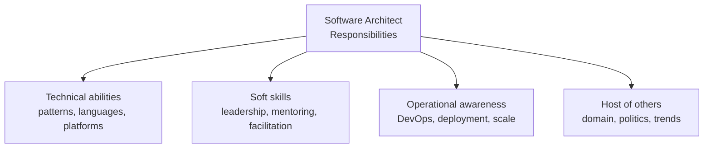
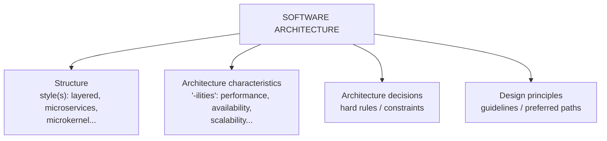
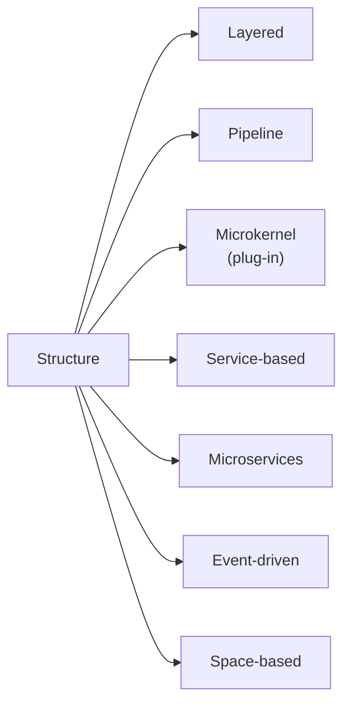
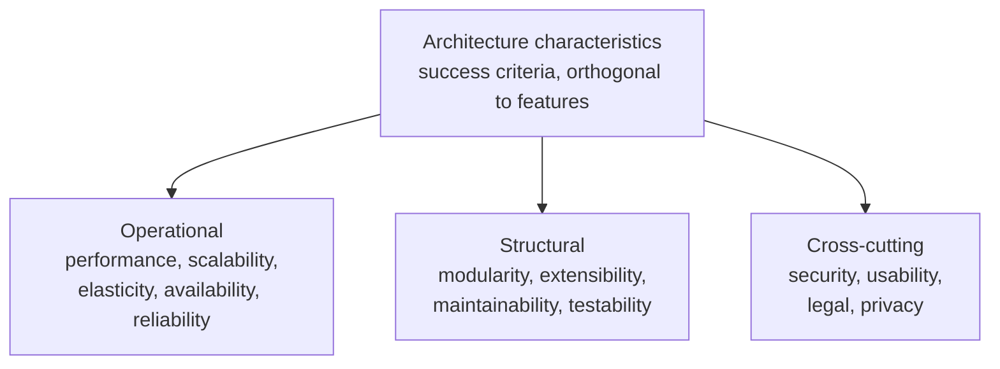
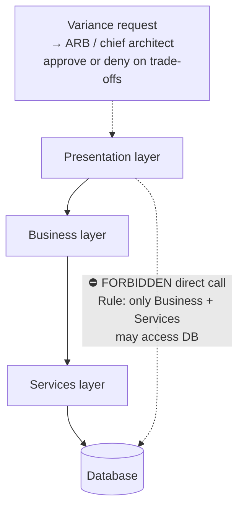
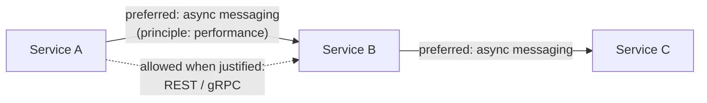
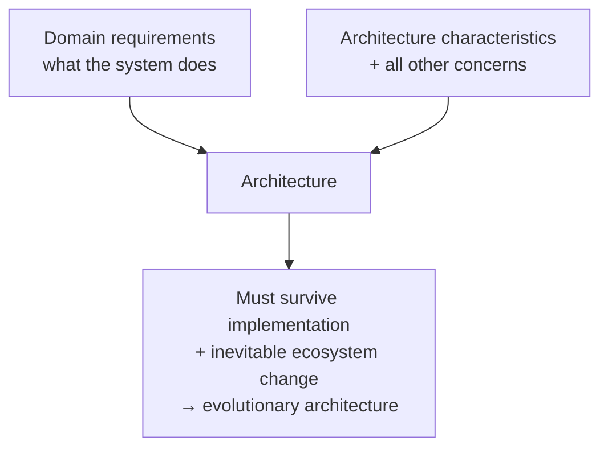

# Chapter 1: Introduction — Definitive Summary
*From: Fundamentals of Software Architecture by Mark Richards & Neal Ford*
*Source PDF: pp. 22–43 (422-page PDF) — figures below cite PDF pages.*

> [!NAV] **Chapter Navigation**
> ⬅️ **Previous:** *None (Start of Book)* | 🏠 **Index:** [[00-Master-Reading-Dashboard|Master Dashboard]] | ➡️ **Next:** [[chapter-02-architectural-thinking|Chapter 02: Architectural Thinking]]

---

## 1. Executive Summary & Core Problem

- **Core thesis:** Software architecture has no fixed definition because the ecosystem never stops moving. The Wikipedia definition ("fundamental structural choices costly to change") is already outdated — microservices were *designed* for incremental structural change. Architecture = **structure + architecture characteristics ("-ilities") + architecture decisions + design principles** (Fig 1-2, PDF p.24). Structure alone ("it's microservices") tells you almost nothing.
- **Core problem:** (1) Definitions rot within years; (2) most literature treats architecture as static/solve-once; (3) much inherited vocabulary is historical baggage (dead acronyms); (4) every decision is context-bound. The 2002 thought experiment proves it: propose "50 Windows licenses + 30 app-server licenses + 50 database licenses, one per service" in a 2002 data center and you get laughed out — open source + DevOps is what made microservices economically possible.
- **What this chapter covers (PDF pp.22–40):** Why fundamentals now (p.23) → Defining architecture — Figs 1-2…1-6 (pp.24–28) → 8 Expectations of an architect (pp.28–33) → Intersections: engineering practices/XP→CD (pp.34–37), Ops/DevOps (pp.37–38), process (p.38), data (p.39) → Laws of architecture (pp.39–40) → Part I Foundations intro (p.41).
- **Two laws introduced here (memorize):** **First Law: Everything in software architecture is a trade-off** (+ Corollary: if you see no trade-off, you haven't found it yet). **Second Law: Why is more important than how** — timed workshop diagrams captured topology but not rationale, making them useless.

---

## 2. In-Depth Concepts & Mechanics

### 2.1 Why fundamentals *now* — context is everything
- Scope isn't the only thing changing — tech, capabilities, foundations for decisions all change. Older books ignore DevOps because it didn't exist. Late-20th-century goal: squeeze shared expensive resources (commercial OS/app-server/DB licenses). Today's goal set assumes cheap open source + automated provisioning.
- Art analogy: like art, architecture is only understandable **in context**. Never copy a style without its context (team size, ops maturity, budget, regulation).

### 2.2 The 4-part definition (Figs 1-2…1-6)
1. **Structure** (Fig 1-3): the style(s) — layered, microservices, microkernel, etc. Necessary but insufficient.
2. **Architecture characteristics** (Fig 1-4): success criteria orthogonal to functionality — performance, availability, scalability, etc. No knowledge of features needed to state them, yet system fails without them. Gets several full chapters (4–7).
3. **Architecture decisions** (Fig 1-5): hard **rules/constraints**. Example: "only business + services layers may touch the DB; presentation layer must go through layers." Violations need a formal **variance** approved by an Architecture Review Board (ARB) or chief architect. Purpose of the example rule: *control change* — DB schema can evolve without touching presentation.
4. **Design principles** (Fig 1-6): **guidelines, not rules**. Example: "prefer async messaging between microservices for performance" — developer may still choose REST/gRPC when circumstance demands. Decisions constrain; principles guide.

### 2.3 The 8 expectations of an architect (role-independent)
1. **Make architecture decisions** — *guide*, don't dictate. Bad: "use React.js." Good: "use a reactive-based frontend framework" (Angular/Elm/React/Vue all qualify). Exception: may name a technology when needed to preserve a characteristic (e.g., mandate a specific broker for scalability). Full treatment in Ch 19.
2. **Continually analyze the architecture** — architecture vitality: is a 3+-year-old architecture still viable given business/tech drift? Watch **structural decay** (code changes eroding performance/availability/scalability) *and* forgotten test/release environments (fast code + 3-month releases = no agility).
3. **Keep current with trends** — decisions are long-lived and hard to reverse; trend-spotting is risk management. Techniques in Ch 24.
4. **Ensure compliance** — verify teams follow decisions/principles; otherwise the presentation-layer-direct-to-DB shortcut destroys the change-control benefit. Automated via fitness functions (Ch 6).
5. **Diverse exposure/experience** — breadth over depth: better to know pros/cons of 10 caches than be expert in 1. Stretch comfort zone; heterogeneous environments demand interfacing with anything.
6. **Business domain knowledge** — can't design for a bank without knowing ADX, aleatory contracts, rates rally, nonpriority debt. Domain fluency buys credibility with C-level/business.
7. **Interpersonal skills** — Weinberg: "no matter what they tell you, it's always a people problem." Leadership + mentoring + facilitation is ≥50% of effectiveness; differentiator in a crowded architect market.
8. **Understand/navigate politics** — developer's strategy-pattern choice needs no approval; architect's "application silos — no shared CRM DB, use REST/SOAP" gets challenged by *everyone* (cost, effort, convenience). Negotiation is mandatory (full chapter: Ch 23).

### 2.4 Intersections (architecture's growing scope)
- **Engineering practices vs process:** Process = team/meeting/workflow mechanics (Scrum, Lean, Crystal — mostly architecture-neutral). Practices = proven process-agnostic techniques (CI, automation, testing). **XP origin story (1996, Kent Beck):** correlate past successes → push to extreme (more tests → test-first). XP → *Continuous Delivery* (Humble/Farley) → **DevOps** (ops adopts XP: automation, testing, single source of truth). Microservices *assumes* automated provisioning/testing/deployment — build it with manual ops and you get friction. Symbiotic mesh: domain↔style *and* style↔practices must match.
- **Evolutionary architecture bridge:** Requirements + characteristics = architecture (Fig 1-7); nothing stays static. *Building Evolutionary Architectures* answer: **fitness functions** — objective integrity assessments (metrics, tests, monitors, chaos) run in CI, e.g., fail build if page-load time regresses. Cadence correlates with feedback value.
- **Operations/DevOps:** 1990s–2000s outsourced-ops assumption forced defensive complexity *inside* architecture (ESB-driven SOA handled elastic scale itself). Microservices reassigns scale/elasticity to ops via architect↔DevOps liaison → simpler design. Space-based architecture (Ch 15) is the cautionary example of designing around uncontrollable ops.
- **Process:** Axiom "process ⊥ architecture" is weakening. Agile's tight feedback enables aggressive experimentation, Strangler Pattern + feature toggles for style migrations (monolith→modern). Book assumes Agile baseline; monoliths on Waterfall called out as exceptions.
- **Data:** Code↔data symbiotic; DBAs co-design data architecture (reuse/relationships across portfolio). Book scope: acknowledge external stores (esp. for operational characteristics + architectural quanta, p.92), not full data-architecture treatise.
- **Pets.com lesson (pp.33–34):** brilliant sock-puppet marketing, zero infrastructure; Christmas rush → slow site, lost transactions, delayed delivery → bankruptcy; mascot sold to competitor. Birth of **elastic scale** (spin up instances on demand, now commodity cloud). "Too much success can kill the business" without it.

### 2.5 Laws restated with mechanics
- First Law + corollary in §1. Second Law operationalized: always capture **why** (ADR — Ch "Architecture Decision Records" p.285); diagrams alone decay into mystery.

---

## 3. Figures — ALL Reconstructed in Mermaid

> 📕 **Original figures quick index:** Fig 1-1 (PDF p.22), Fig 1-2 (p.24), Fig 1-3 (p.25), Fig 1-4 (p.26), Fig 1-5 (p.27), Fig 1-6 (p.27–28), Fig 1-7 (p.36). Open the PDF at each page to verify.

### Figure 1-1: Responsibilities of a software architect (📕 PDF p.22)
- **Description:** Four-quadrant Venn/mind-map: technical abilities + soft skills + operational awareness + "host of others." Sets up the 8 expectations.
- **Mermaid:**

- **Key takeaway:** Pure technologists fail at architecture — the role is socio-technical.

---

### Figure 1-2: What architecture consists of (📕 PDF p.24)
- **Description:** Central "Architecture" node supported by four pillars (heavy black structure lines in original).

- **Key takeaway:** "It's microservices" describes only 1 of 4 parts — demand the other three before claiming you understand an architecture.

---

### Figure 1-3: Structure = style(s) (📕 PDF p.25)

- **Key takeaway:** Structure is the topology vocabulary; Part II catalogs each style's trade-offs.

---

### Figure 1-4: Architecture characteristics — the "-ilities" (📕 PDF p.26)

- **Key takeaway:** Characteristics need no feature knowledge yet determine whether features succeed.

---

### Figure 1-5: Architecture decisions as rules (📕 PDF p.27)
- **Description:** Layered stack (Presentation → Business → Services → Persistence/DB) with a prohibition: presentation may NOT arrows-to DB; must traverse layers. Variance path via ARB.

- **Key takeaway:** The rule buys *change control* at the price of extra hops — classic trade-off made explicit.

---

### Figure 1-6: Design principles as guidelines (📕 PDF p.27–28)
- **Description:** Microservices A→B→C with preferred async edge highlighted; sync alternatives (REST/gRPC) remain legal.

- **Key takeaway:** Principles steer without handcuffing — use rules only where violation breaks the architecture.

---

### Figure 1-7: Requirements + characteristics = architecture (📕 PDF p.36)

- **Key takeaway:** Static blueprints die; build verification (fitness functions) so architecture evolves gracefully.

---

## 4. Real-World Systems / Cases

- **2002 data-center thought experiment (p.23):** Microservices demand (50 OS + 30 app-server + 50 DB licenses) was economically insane before open source + DevOps. Lesson: cost/licensing context picks winners, not pure technical merit.
- **Pets.com (pp.33–34):** elastic-scale horror story — success-induced death; directly motivates cloud autoscaling + load testing + capacity fitness functions.
- **CRM application silos (pp.32–33):** architect bans direct CRM-DB access → every consumer must use remote calls; technically sound (security/change control), politically explosive. Preview of Ch 23 negotiation.
- **Layered-DB compliance violation (p.30):** UI dev bypasses layers for "performance" → destroys layer-closure benefit. Real-world fix today: ArchUnit/NetArchTest fitness function (Ch 6) failing the build on illegal imports.
- **Going Going Gone / Sysops Squad (forward pointers):** Book's running katas/cases for later style chapters — not yet in Ch 1; treat Ch 1's Pets.com + CRM silos as the seed cases.

---

## 5. Trade-Off Matrix

| Decision | Option A | Option B | What you gain / lose | Book's guidance |
|---|---|---|---|---|
| Definition scope | Structure only ("it's microservices") | Full 4-part (structure + characteristics + decisions + principles) | A is cheap to state, useless to govern; B costs analysis effort, enables compliance | Always demand all four |
| Rule vs guideline | Architecture decision (hard rule, ARB variance) | Design principle (guideline) | Rule: enforceability + rigidity; Principle: flexibility + drift risk | Rules for load-bearing constraints; principles for preferences |
| Ops coupling | Defensive in-architecture scale (ESB/SOA era) | Liaison with DevOps (microservices) | In-house: control, huge complexity; Liaison: simplicity, ops-maturity dependency | Match style to ops reality |
| Process | Waterfall + Big Design Up Front | Agile iterative | W: predictability theater, unknown-unknown fragility; A: feedback, experimentation | "All architectures become iterative; Agile just does it sooner" (Mark Richards) |
| Change strategy | Over-specify characteristics (Vasa preview) | Least-worst minimal set | Over: generic unwieldy design; Minimal: focus, iteration risk | "Never shoot for best; least worst" |

---

## 6. Jargon Buster

- **Architecture characteristics ("-ilities"):** nondomain success criteria (performance, scalability…). *Confused with:* features/requirements.
- **Architecture decision:** enforceable construction rule + variance process. *Confused with:* tech pick ("use React").
- **Design principle:** preferred-path guideline; violable with justification.
- **Variance / ARB:** formal exception to a decision, approved/denied on trade-offs by review board/chief architect.
- **Structural decay:** vitality loss as code changes erode characteristics.
- **Architecture vitality:** how viable a 3-year-old architecture remains today.
- **Fitness function:** objective integrity check (metric/test/monitor/chaos) guarding a characteristic in CI.
- **Evolutionary architecture:** design for graceful change over time, not static perfection.
- **Unknown unknowns (Rumsfeld quote, p.35):** the reason Big Design Up Front fails.
- **Strangler Pattern / feature toggles:** incremental migration techniques (Agile advantage).

---

## 7. Takeaways

### Checklist — apply this chapter tomorrow
- [ ] Write your architecture as 4 parts (structure, characteristics, decisions, principles) — refuse one-line style labels.
- [ ] Convert every tech mandate into a guiding decision ("reactive framework" not "React") unless a characteristic forces specificity.
- [ ] File ADRs capturing *why* for each decision; review them at 6/12/36 months for vitality.
- [ ] Map each style choice to required engineering practices + ops maturity (CI, automated provisioning, test/release lead times).
- [ ] Route every decision exception through a lightweight variance log (mini-ARB), even on small teams.

### Interview strategy
- Q: "Define software architecture." A: 4-part definition + why structure-alone fails + variance vs principle example (DB-access rule vs async-preference).
- Q: "What does an architect actually do?" A: recite 8 expectations, deep-dive 2 (guide-vs-dictate with React example; compliance via fitness functions).
- Q: "Microservices in 2002?" A: licensing/ops context story → proves architecture is contextual + economics shapes styles.
- Q: "First and Second Laws?" A: trade-offs + corollary; why>how with workshop-diagram anecdote and ADR remedy.

### Mastery Q&A (with answers)
1. **Q: Why is "software architecture is making structural choices costly to change" outdated?** A: Microservices internalizes incremental structural change (independent deployability); cost moved to coupling/operational complexity — a trade-off, per First Law.
2. **Q: Decision vs principle — give the book's canonical pair.** A: Decision: only business/services layers access DB (rule, ARB variance). Principle: prefer async messaging between services (guideline, REST/gRPC allowed with reason).
3. **Q: What is architecture vitality and structural decay?** A: Vitality = fitness of a ≥3-year-old architecture today; decay = code/test/release drift eroding characteristics (perf, availability, agility).
4. **Q: How did XP lead to DevOps per the book?** A: XP (1996 Beck) pushed proven practices to extreme (test-first) → Continuous Delivery codified them → ops adopted automation/testing/single-source-of-truth = DevOps; enables microservices' assumptions.
5. **Q: State both Laws + corollary.** A: 1st: everything is a trade-off; corollary: unseen trade-off = unfound trade-off. 2nd: why > how — capture rationale (ADRs), not just topology.
