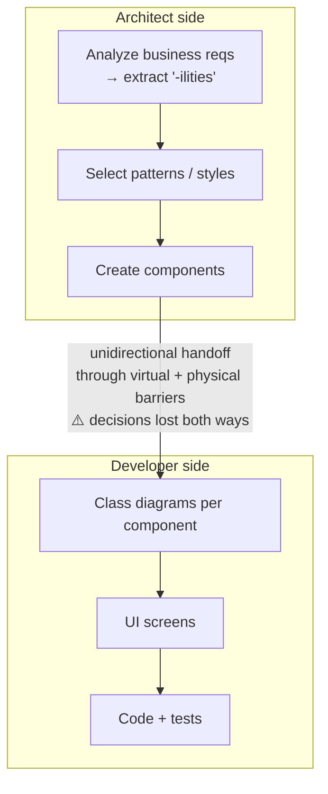
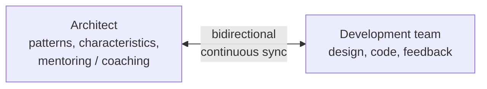
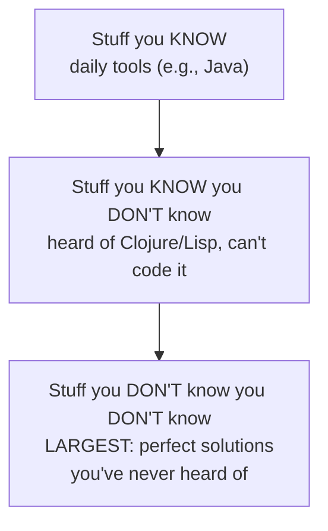
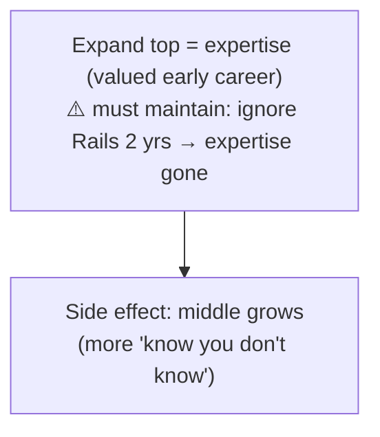
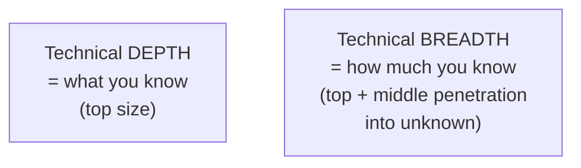
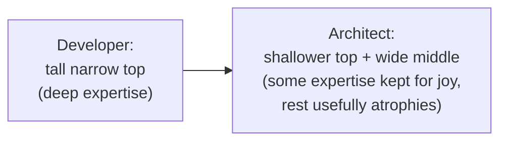
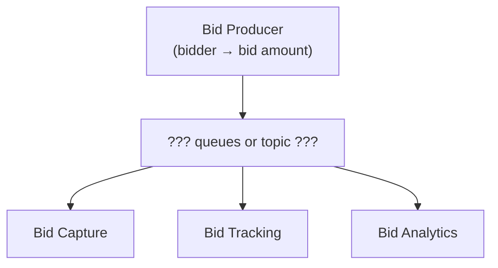
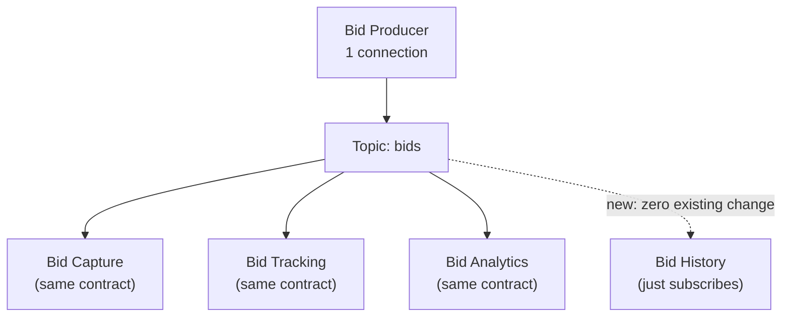
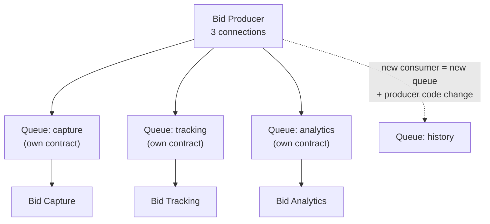

# Chapter 2: Architectural Thinking — Definitive Summary
*From: Fundamentals of Software Architecture by Mark Richards & Neal Ford*
*Source PDF: pp. 44–56 (422-page PDF) — figures below cite PDF pages.*

> [!NAV] **Chapter Navigation**
> ⬅️ **Previous:** [[chapter-01-introduction|Chapter 01: Introduction]] | 🏠 **Index:** [[00-Master-Reading-Dashboard|Master Dashboard]] | ➡️ **Next:** [[chapter-03-modularity|Chapter 03: Modularity]]

---

## 1. Executive Summary & Core Problem

- **Core thesis:** Architectural thinking ≠ "thinking about architecture." It is four disciplines: (1) dissolving the architect↔developer barrier (architecture and design are one synchronized circle, not a handoff), (2) trading technical **depth for breadth**, (3) analyzing **trade-offs** for every solution ("it depends"), (4) translating **business drivers into characteristics**. Plus the meta-skill: stay hands-on without becoming the bottleneck.
- **Core problem:** The traditional model (Fig 2-1) puts architect and developer on opposite sides of virtual + physical barriers with a **unidirectional** handoff (requirements → characteristics → patterns → components → class diagrams → screens → code). Decisions get lost downstream; code realities never flow back. Result: architecture that "rarely provides what it was originally set out to do." Add two human failure modes: Frozen Caveman (trauma-driven pet concerns, e.g., "But what if we lose Italy?") and stale-expertise architects deciding on decade-old criteria.
- **Auction-system proof:** Bid Producer → Capture/Tracking/Analytics via **topic (pub-sub)** looks obviously best (extensibility, decoupling) until the architect lists the negatives: wiretap-easy insecurity, homogeneous-contract lockstep, no per-consumer monitoring/autoscale. Verdict: *it depends* — summarized in Table 2-1 (PDF p.53).

---

## 2. In-Depth Concepts & Mechanics

### 2.1 Architecture vs design — kill the handoff
- **Traditional (Fig 2-1, PDF p.44):** Architect owns: extract characteristics from business requirements, select patterns/styles, create components → throws artifacts over wall → developers own: class diagrams, UI screens, code/tests. Single arrow through barriers = information loss both directions.
- **Working model (Fig 2-2, PDF p.45):** Same virtual team, **bidirectional** collaboration + architect as mentor/coach. Architecture evolves every iteration (unlike waterfall static architecture), so sync is continuous.
- **Boundary answer:** "Where does architecture end and design begin? It doesn't." Both are the circle of life of a project.

### 2.2 Technical breadth — the knowledge pyramid (Figs 2-3…2-6)
- **Pyramid (Fig 2-3, p.46):** all knowledge = *stuff you know* (daily tools, e.g., Java for a Java dev) + *stuff you know you don't know* (heard of Clojure/Lisp, can't code it) + *stuff you don't know you don't know* (largest: perfect-fit techs you've never heard of).
- **Developer phase (Fig 2-4, p.47):** grow the top (expertise valued) — but top requires maintenance (ignore Rails for 2 years, expertise evaporates). Top size = **technical depth**.
- **Architect phase (Figs 2-5/2-6, pp.48–49):** value shifts to top + middle; middle's penetration into bottom = **technical breadth**. Knowing *five* cache options' pros/cons beats expertise in one. Deliberately let some depth atrophy; keep a few deep areas for joy/credibility.
- **Two dysfunctions:** (1) trying to stay expert in everything → burnout + mediocrity everywhere; (2) **Frozen Caveman Anti-Pattern** (p.50): past burn ("Italy outage years ago") becomes irrational veto on every design. Antidote: distinguish genuine vs perceived risk; ask relevant questions, not traumatic ones.

### 2.3 Analyzing trade-offs — "architecture is the stuff you can't Google" (Mark Richards)
- **Mantras:** "It depends — on deployment env, business drivers, culture, budget, timeframe, skill set, dozens of factors." / "No right/wrong answers, only trade-offs" (Neal Ford). / Hickey: "Programmers know benefits of everything and trade-offs of nothing; architects must know both."
- **Auction mechanics (Figs 2-7…2-9, pp.51–52):** Bid Producer fans out bids to Capture + Tracking + Analytics.
  - *Topic (Fig 2-8):* one connection, new Bid History subscriber with zero producer change, producer decoupled (doesn't know consumers).
  - *Queues (Fig 2-9):* three connections; new consumer = new queue + producer modification; producer knows exactly who consumes what.
  - *Topic negatives (the architect's job):* anyone can subscribe → **security/wiretap** (queue theft self-announces via lost message + alarm); **homogeneous contract** (adding asking-price for History forces all consumers to change; queues allow per-consumer contracts); **no per-consumer queue-depth monitoring → no programmatic autoscale** per consumer (AMQP exchange/queue split enables it for queues).
- **Table 2-1 (p.53):** Topic advantages (extensibility, decoupling) vs disadvantages (security, no heterogeneous contracts, no monitoring/scalability). Decision = "which matters more: extensibility or security?" — answered only from business drivers/environment.

### 2.4 Business drivers → characteristics
- Architects speak scalability/fault tolerance; stakeholders speak M&A, satisfaction, time-to-market, competitive advantage — "lost in translation." Job: translate + collaborate (full method in Ch 4–6).
- Requires domain knowledge + stakeholder relationships; no shortcut.

### 2.5 Staying hands-on without bottlenecking
- **Belief:** every architect should code (maintains depth). **Bottleneck trap:** architect owns critical-path/framework code → part-time coder blocks full-time team (diagrams + meetings vs code).
- **Primary fix:** delegate critical path to team; architect codes **business functionality 1–3 iterations ahead** — gains: real production pain empathy, no blocking, framework ownership where it belongs.
- **If embedded coding impossible, four practices:** (1) **POCs** (e.g., spike two caches, compare scalability/perf/fault-tolerance + effort; write production-quality — throwaway code becomes reference architecture); (2) **tech-debt/architecture stories** (low-priority, safe to slip); (3) **bug fixes** (maps weak spots); (4) **automation/tools** (validators, checklists, refactors; ArchUnit fitness functions — Ch 6) + **code reviews** (compliance + coaching without writing code).

---

## 3. Figures — ALL Reconstructed in Mermaid

> 📕 **Index:** Fig 2-1 (p.44), Fig 2-2 (p.45), Fig 2-3 (p.46), Fig 2-4 (p.47), Fig 2-5 (p.48), Fig 2-6 (p.49), Fig 2-7 (p.51), Fig 2-8 (p.51), Fig 2-9 (p.52), Table 2-1 (p.53).

### Figure 2-1: Traditional arch vs design — the broken handoff (📕 PDF p.44)

### Figure 2-2: Making it work — one virtual team (📕 PDF p.45)

- **Takeaway:** Co-location (virtual or physical) + coaching beats specification dumps.

### Figure 2-3: Knowledge pyramid (📕 PDF p.46)

### Figure 2-4: Depth needs maintenance (📕 PDF p.47)

### Figure 2-5: Depth vs breadth (📕 PDF p.48)

### Figure 2-6: Architect's portfolio shift (📕 PDF p.49)

### Figure 2-7: Auction trade-off setup (📕 PDF p.51)

### Figure 2-8: Topic / pub-sub (📕 PDF p.51)

### Figure 2-9: Queues / point-to-point (📕 PDF p.52)

---

## 4. Real-World Systems / Cases

- **Auction system (pp.51–53):** the book's canonical trade-off lab — extensibility/decoupled (topic) vs security/contract-independence/autoscale (queues). AMQP nuance: exchange/queue separation restores monitoring for queue-based designs.
- **Frozen Caveman — "But what if we lose Italy?" (p.50):** centralized-system client traumatized by a freak Italy comms outage years prior; every review re-litigates it despite near-zero recurrence odds. Generalizes to any architect burned once (outage, breach, vendor lock) who gold-plates every future design.
- **Caching POC (p.55):** architect spikes two cache products in production-quality code to compare scalability/performance/fault-tolerance + implementation effort — doubles as decision evidence and reference implementation.
- **Founder-architect staleness (p.49):** startup founders turned execs still deciding on decade-old criteria — organizational Frozen Caveman.

---

## 5. Trade-Off Matrix

| Dimension | Option A | Option B | Trade-off | When A wins |
|---|---|---|---|---|
| Collaboration | Traditional handoff (Fig 2-1) | One virtual team (Fig 2-2) | A: clear roles, lost decisions; B: sync cost, mentoring load | B always for evolving systems; A only for throwaway/static |
| Knowledge | Depth (expert in 1) | Breadth (compare 5) | Depth: precision, narrow applicability + maintenance tax; Breadth: optionality, shallower detail | Architect: breadth; Developer early career: depth |
| Messaging | Topic pub-sub | Queues P2P | Topic: +extensibility/decoupled, −security/homogeneous/no-autoscale; Queues: inverse (Table 2-1) | Topic: evolving consumer set, low-sensitivity broadcast; Queues: sensitive data, per-consumer contracts/SLOs |
| Hands-on | Own critical path | Code 1–3 iterations ahead / POCs / debt stories / fixes / tooling / reviews | Critical path: leverage, bottleneck risk; Ahead: empathy, safety | Never own the critical path as a part-time coder |

---

## 6. Jargon Buster

- **Architectural thinking:** 4-part lens (arch-vs-design sync, breadth, trade-offs, business drivers). *Confused with:* merely thinking about architecture.
- **Technical breadth / depth:** how much you can compare vs what you know deeply (Fig 2-5).
- **Frozen Caveman Anti-Pattern:** trauma-driven pet concern applied to every design ("lose Italy").
- **Bottleneck trap:** architect-owned critical-path code blocking the team.
- **POC (proof of concept):** production-quality spike validating a decision's implementation reality.
- **Pub-sub topic vs P2P queue:** one-to-many broadcast (single contract, easy wiretap) vs one-to-one channels (per-consumer contracts, monitorable depth).
- **Homogeneous contract:** all subscribers forced onto identical payload — topic's coupling tax.
- **AMQP exchange/queue split:** producer→exchange, consumer→queue; enables per-queue monitoring/load-balancing.

---

## 7. Takeaways

### Checklist
- [ ] Co-locate (virtually/physically) with devs; replace handoff docs with bidirectional reviews + coaching.
- [ ] Audit your pyramid quarterly: name 3 areas where you'll deliberately let depth atrophy to fund breadth.
- [ ] For every decision, write benefits *and* negatives (Hickey test) before recommending; cite Table-2-1-style rows.
- [ ] Name your Frozen Cavemans (personal + organizational) and attach recurrence probabilities.
- [ ] Never take critical-path code; pick ahead-of-roadmap business slices, debt stories, or ArchUnit tooling instead.

### Interview strategy
- Q: "Architecture vs design?" A: no boundary — circle of life; contrast Figs 2-1/2-2; mentoring duty.
- Q: "Breadth vs depth?" A: pyramid Figs 2-3…2-6; 10-caches example; atrophy strategy; two dysfunctions.
- Q: "Topic or queue?" A: walk the auction case both directions, land on "it depends (security vs extensibility)" + AMQP caveat — shows architect-grade analysis, not Googled answer.
- Q: "How do you stay technical as architect?" A: bottleneck trap + 4+1 practices with caching-POC story.

### Mastery Q&A (with answers)
1. **Q: Why does Fig 2-1 "show exactly why architecture rarely works"?** A: Unidirectional arrow through barriers loses architect decisions downstream and hides dev-driven architecture changes upstream — no feedback loop.
2. **Q: What does the middle pyramid section represent for an architect?** A: "Know you don't know" inventory; its penetration into the unknown = breadth — the quiver of comparable options.
3. **Q: List all three topic disadvantages from the book.** A: (1) Data-access/security wiretap ease; (2) homogeneous contracts only; (3) no per-consumer monitoring/programmatic autoscale.
4. **Q: What is the Rule for POC code quality and why?** A: Write production-quality — it often becomes the reference architecture, and it trains good habits vs throwaway sloppiness.
5. **Q: Translate "it depends" into concrete factors.** A: Deployment env, business drivers, culture, budgets, timeframes, skill set + dozens more — hence unGoogleable.
