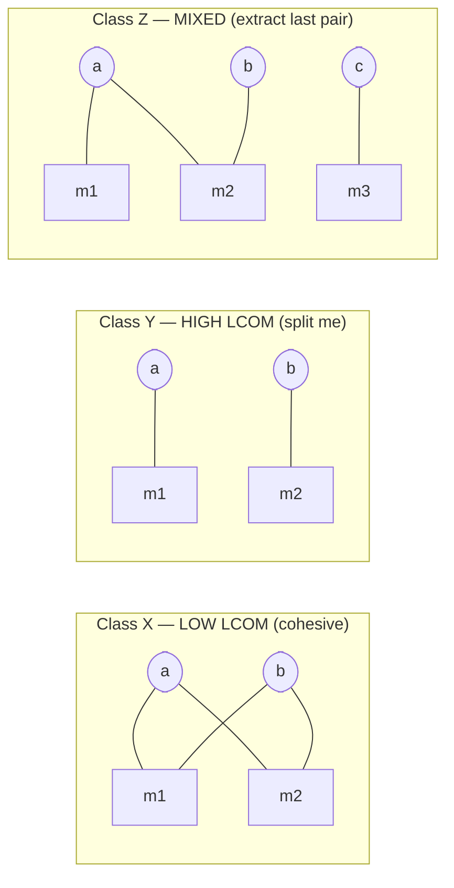
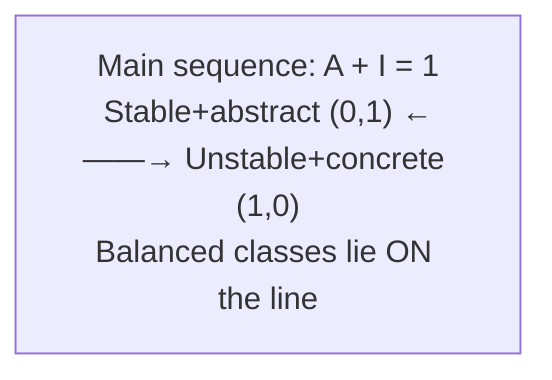
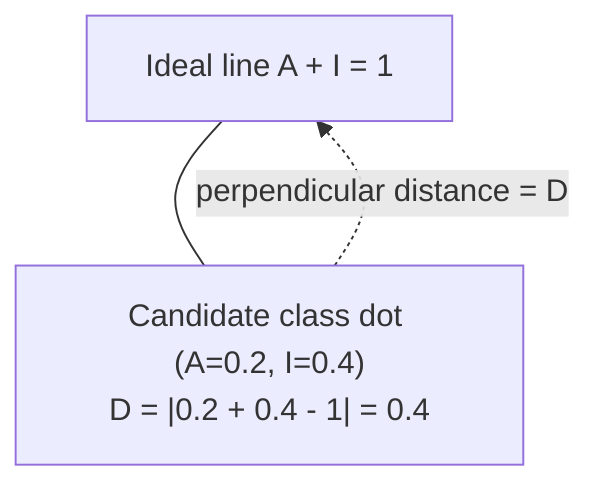
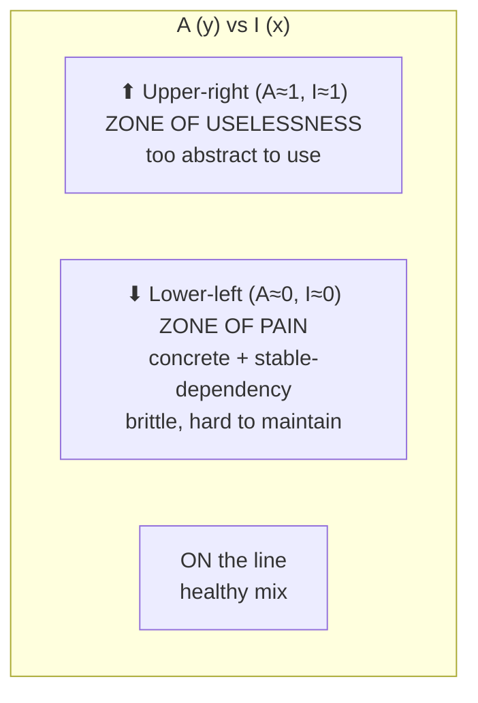
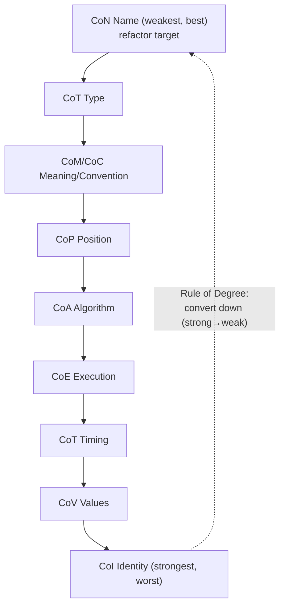
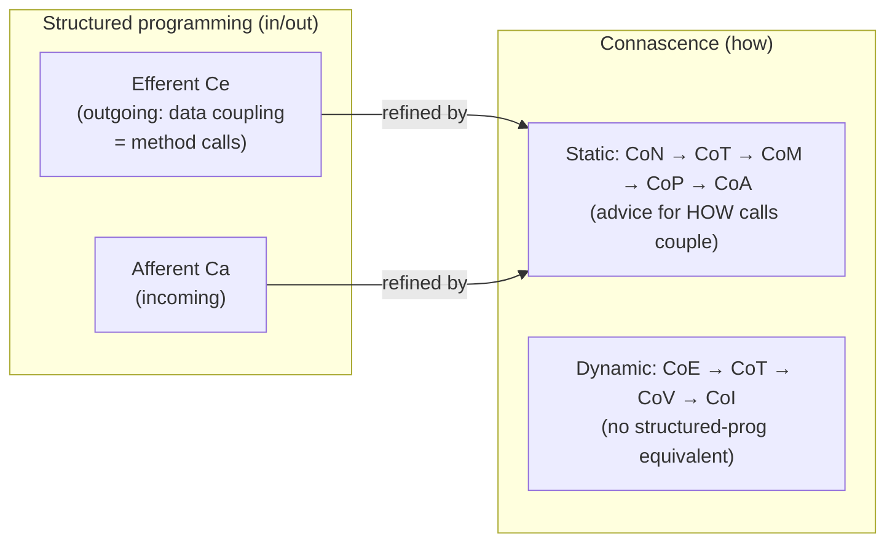

# Chapter 3: Modularity — Definitive Summary
*From: Fundamentals of Software Architecture by Mark Richards & Neal Ford*
*Source PDF: pp. 58–74 (422-page PDF) — figures below cite PDF pages.*

> [!NAV] **Chapter Navigation**
> ⬅️ **Previous:** [[chapter-02-architectural-thinking|Chapter 02: Architectural Thinking]] | 🏠 **Index:** [[00-Master-Reading-Dashboard|Master Dashboard]] | ➡️ **Next:** [[chapter-04-architecture-characteristics-defined|Chapter 04: Architecture Characteristics Defined]]

---

## 1. Executive Summary & Core Problem

- **Core thesis:** Modularity (logical grouping of related code — classes, functions, packages/namespaces) is the organizing principle that fights software entropy. Without deliberate energy, complex systems drift to disorder. Architects get three lenses: **cohesion** (do these parts belong together?), **coupling** (how connected is this to everything else?), **connascence** (how *must* they change together?). Myers (1978) epigraph frames the scandal: "95% of words extol modularity's benefits; little says how to achieve it" — this chapter is the *how*.
- **Core problem:** Platforms offer overlapping reuse mechanisms (functions/methods/classes/packages/namespaces/metaobject protocols) with different visibility rules; Java even requires package↔directory mirroring. Loose logical lumps feel convenient in a monolith but become the impediment when restructuring. Low-level 1990s metrics (afferent/efferent, raw connascence) measure code hygiene well but not architectural structure (sync vs async, granularity) — hence the bridge to Ch 7's quanta.
- **Key instruments delivered:** LCOM (Eq 3-1, 3-2 + Fig 3-1 X/Y/Z) for cohesion gaps; afferent/efferent + **abstractness (Eq 3-3), instability (Eq 3-4), distance from main sequence (Eq 3-5)** with Figs 3-2…3-4 (zones of pain/uselessness); full **static (CoN/CoT/CoM-CoC/CoP/CoA) + dynamic (CoE/CoT-timing/CoV/CoI)** connascence catalog with strength/locality/degree properties, Weirich's two rules, Page-Jones's three guidelines, and the Fig 3-6 unification.

---

## 2. In-Depth Concepts & Mechanics

### 2.1 Definitions + history (pp.58–60)
- **Module** (dictionary): standardized part/independent unit composing complex structures. **Modularity** (book): logical grouping of related code — not necessarily physical separation. Example: `com.mycompany.customer` should hold customer things. Namespace doubles as globally-unique naming (internet domains; Java packages; .NET namespaces).
- **Why so many schemes?** Backward-compatibility of *thought*, not code. Dijkstra's 1968 "GOTO Considered Harmful" → structured programming (Pascal/C) → no grouping construct → **modular-language era** (Modula, Ada — modules without classes, short-lived) → OO kept modules as packages/namespaces. Java supports modular (packages + static initializers) + OO + functional simultaneously, each with quirks.
- **Java 1.0 namespace hack (p.59):** classpath = directories only; `order` (catalog) vs `order` (installation) disambiguated by package↔directory mirroring leveraging filesystem uniqueness. Java 1.2 (Java 2) JARs broke the guarantee (two JARs, same class → classloader wars) for packaging convenience — decade of classpath debugging.
- **Implicit characteristic:** no requirement ever says "ensure good modular communication," yet unsustainable without it — exemplar of *implicit* architecture characteristic (Ch 4–5).

### 2.2 Cohesion — 7 levels + LCOM (pp.60–64)
- **Constantine:** "Dividing a cohesive module only increases coupling and decreases readability." Best→worst: **functional > sequential > communicational > procedural > temporal > logical > coincidental**. `StringUtils` = classic logical cohesion (static String methods, otherwise unrelated). Startup-init task list = temporal.
- **Customer vs Order worked example (pp.61–62):** 6 ops (`add/update/get/notify customer` + `get/cancel customer orders`) — one module or split into Customer + Order Maintenance? Depends on: only-two-order-ops? (collapse), Customer growth? (extract), cross-module knowledge cost? (coupling price of split). Pure trade-off analysis.
- **LCOM v1 (Eq 3-1, p.62):** `LCOM = P − Q if P > Q else 0`, where P = method pairs *not* sharing a field, Q = pairs sharing. **LCOM96b (Eq 3-2, p.63):** normalized `1 − (1/a)Σ(μ(Aj)/m)` over attributes — book spares the algebra: "sum of sets of methods not shared via sharing fields." High LCOM = high *lack* of cohesion.
- **Fig 3-1 (p.63):** octagons = fields, squares = methods. **X** (low LCOM, webbed) = cohesive; **Y** (disjoint pairs) = each pair could be its own class; **Z** (mixed) = refactor last field/method pair out. Use: find incidentally-coupled utility classes when migrating styles. Limit: structural only — cannot judge *logical* fit (Second Law: why > how).

### 2.3 Coupling — afferent/efferent → A/I/D (pp.64–67)
- **Yourdon & Constantine (1979) Structured Design:** **afferent (Ca)** = incoming connections; **efferent (Ce)** = outgoing. Mnemonics: *a* before *e* = in before out; *e*fferent ≈ *e*xit. Graph-theoretic: calls/returns = call graph → mathematical analysis; per-platform tooling exists.
- **Abstractness (Eq 3-3, p.65):** `A = Σma / Σmc` (abstract artifacts ÷ concrete). 5,000-line `main()` → A≈0. Too many abstractions → `AbstractSingletonProxyFactoryBean` incomprehensibility.
- **Instability (Eq 3-4, p.65):** `I = Ce / (Ce + Ca)`. High-I (many outgoing callees) = volatile — any callee change can break caller.
- **Distance (Eq 3-5, p.66):** `D = |A + I − 1|` (book prints `D = A + I − 1`; normalized distance is absolute deviation). Both A,I ∈ [0,1] → ideal line A+I=1 (**main sequence**, Fig 3-2). Fig 3-3: plot class, measure perpendicular distance; near line = balanced. Fig 3-4: upper-right = **Zone of Uselessness** (over-abstract, unusable); lower-left = **Zone of Pain** (concrete + unstable = brittle). Tooling per platform; use for unfamiliar-codebase triage, migration, tech-debt assessment.
- **Metrics caveat (p.68):** blunt instruments vs other engineering disciplines; CC can't separate essential vs accidental complexity — establish baselines + govern via fitness functions (Ch 6).

### 2.4 Connascence — Page-Jones (1996) refined (pp.68–73)
- **Definition:** "Two components are connascent if a change in one would require the other to be modified to maintain overall correctness."
- **Static (source-level; degrees of afferent/efferent):**
  - **CoN (Name):** agree on entity name (method names) — most desirable; modern refactoring tools make renames trivial.
  - **CoT (Type):** agree on type (static typing; selective typing in dynamic langs — Clojure Spec).
  - **CoM/CoC (Meaning/Convention):** agree on value semantics — `int TRUE=1, FALSE=0` flip hazard; magic numbers.
  - **CoP (Position):** agree on order — `updateSeat(name, seatLocation)` called as `("14D","Ford, N")` type-checks but misbehaves.
  - **CoA (Algorithm):** agree on algorithm — client+server security hash must match exactly; highest static coupling.
- **Dynamic (runtime):**
  - **CoE (Execution):** order matters — `new Email(); setRecipient; setSender; send(); setSubject("whoops")` fails (subject after send).
  - **CoT (Timing):** timing matters — race conditions, two threads joint outcome.
  - **CoV (Values):** related values change together — rectangle's 4 corners; distributed-transaction single value across DBs (all-or-nothing).
  - **CoI (Identity):** must reference same entity — shared distributed queue/data structure. Hardest to tool (weak runtime-call analysis).
- **Properties (pp.71–72):** **Strength** (refactorability ranking — Fig 3-5 ladder; prefer static over dynamic — analyzable + tool-fixable, e.g., CoM→CoN via named constant); **Locality** (proximity — same-module CoM tolerable, cross-codebase CoM is smell; evaluate with strength jointly); **Degree** (blast radius — few classes vs many; small dynamic connascence grows with codebase).
- **Guidance:** Page-Jones 3: (1) minimize overall connascence via encapsulation, (2) minimize cross-boundary remainder, (3) maximize within-boundary. Weirich 2: **Rule of Degree** (strong→weak conversion), **Rule of Locality** (greater distance → weaker form required).
- **Unification (Fig 3-6, p.73):** left = structured-programming in/out (data coupling = method calls); right = connascence *how*. Structured design never addressed dynamic connascence — deferred to architectural quanta (p.92).
- **1990s-connascence limits (p.73):** (1) code-hygiene granularity, not architectural (architect cares sync-vs-async, not impl); (2) no answer to modern sync/async distributed choice. Ch 7 introduces new thinking after Ch-characteristics scope.

### 2.5 Modules → components (p.73)
- Module = generic bundling; **component** = platform's building block. Logical-vs-physical separation debate is ancient; outcomes still poor — derivation from domain deferred to Ch 8.

---

## 3. Figures — ALL Reconstructed in Mermaid

> 📕 **Index:** Fig 3-1 (p.63), Fig 3-2 (p.66), Fig 3-3 (p.67), Fig 3-4 (p.67), Fig 3-5 (p.71), Fig 3-6 (p.73).

### Figure 3-1: LCOM X/Y/Z (📕 PDF p.63)
- **Description:** Octagons (fields a,b) + squares (methods). X fully cross-linked; Y disjoint pairs; Z mostly linked + one orphan pair.



### Figure 3-2: Main sequence ideal (📕 PDF p.66)
- **Description:** X-axis instability (0 stable ← → 1 unstable), Y-axis abstractness (0 concrete → 1 abstract). Diagonal A+I=1.



```mermaid
xychart-beta
  x-axis [0, 0.5, 1]
  y-axis "Abstractness" 0 --> 1
  line [1, 0.5, 0]
```

### Figure 3-3: Normalized distance for a class (📕 PDF p.67)



- **Takeaway:** Closer = better balanced abstraction-vs-volatility.

### Figure 3-4: Zones of Pain / Uselessness (📕 PDF p.67)



### Figure 3-5: Connascence strength ladder (📕 PDF p.71)
- **Description:** Vertical ranking — weakest (best) at top → strongest (worst) at bottom; arrow = refactoring direction.



### Figure 3-6: Coupling-connascence unification (📕 PDF p.73)



---

## 4. Real-World Systems / Cases

- **Shared utility classes (p.64):** LCOM's killer app — incidentally-coupled `Utils`/`Helpers` block style migrations; high-LCOM classes are the split candidates before monolith→services.
- **5,000-line `main()` (p.65):** A≈0 exemplar — zero abstraction; opposite pole from `AbstractSingletonProxyFactoryBean` over-abstraction.
- **Classpath/JAR wars (p.59–60):** Java 1.0 dirs-only → 1.2 JAR convenience → decade of duplicate-class debugging — namespace-vs-packaging trade-off.
- **`updateSeat("14D","Ford, N")` (p.69):** CoP production bug archetype — passes type-check, corrupts semantics; fix = parameter objects / named args (CoP→CoN).
- **Email `setSubject` after `send()` (p.70):** CoE ordering bug; builder/fluent + send-last enforces order structurally.
- **Rectangle 4-points / cross-DB single value (p.70):** CoV integrity — distributed version foreshadows saga/atomicity (Part II).
- **Silicon Sandwiches / Going Going Gone / Sysops Squad:** running book cases exercised in later chapters — modularity hygiene (this chapter's metrics) is the pre-migration screen for all three.

---

## 5. Trade-Off Matrix

| Dimension | Option A | Option B | Trade-off | Guidance |
|---|---|---|---|---|
| Cohesion split (Customer/Order) | One module (6 ops) | Two modules | A: simple, risks bloat; B: clarity, coupling tax if Order needs Customer knowledge | Decide on growth forecast + knowledge cost (p.62 questions) |
| Abstraction level | High A (interfaces everywhere) | Low A (concrete) | High: flexibility, comprehension cost; Low: directness, brittleness | Ride the main sequence (D→0) |
| Stability posture | Stable (high Ca, low Ce) | Unstable (high Ce) | Stable: safe to depend on, hard to change; Unstable: flexible, breakage-prone | Depend toward stability; abstract the unstable |
| Coupling detail | Static (analyzable, tool-fixable) | Dynamic (runtime, hard to see) | Static: cheap governance; Dynamic: expressive, dangerous | Prefer static; isolate dynamic behind boundaries |
| Connascence fix | Strength upgrade (CoM→CoN constant) | Locality move (co-locate) | Upgrade: permanent; Move: containment | Apply both; Weirich: distance↑ → weakness↑ |
| Logical vs physical | Logical grouping only | Physical separation | Logical: cheap, restructuring pain later; Physical: enforced, premature rigidity | Keep logical clean in monoliths; physicalize at style-migration time |

---

## 6. Jargon Buster

- **Module / modularity:** logical related-code grouping (package/namespace/functions). *Confused with:* component (platform building block) / physical separation.
- **Cohesion (7, best→worst):** functional, sequential, communicational, procedural, temporal, logical, coincidental.
- **Afferent (Ca) / efferent (Ce):** incoming / outgoing coupling. Mnemonics: a<e alphabetically = in<out; e≈exit.
- **Abstractness A = Σma/Σmc; Instability I = Ce/(Ce+Ca); Distance D = |A+I−1|:** the Martin trio.
- **Main sequence / Zones:** ideal A+I=1 line; upper-right useless, lower-left pain.
- **LCOM:** lack-of-cohesion via unshared-field method sets (high = bad).
- **Connascence (static CoN/CoT/CoM-CoC/CoP/CoA; dynamic CoE/CoT/CoV/CoI):** change-together coupling + strength/locality/degree properties.
- **Big Ball of Mud:** end-state of ungoverned cyclic coupling (previewed p.85, Ch 6).

---

## 7. Takeaways

### Checklist
- [ ] Run LCOM on util packages; split high scorers before any style migration.
- [ ] Track Ca/Ce per package; fail builds on cycles + D-tolerance breach (Ch 6 fitness functions).
- [ ] Replace magic values with named constants (CoM→CoN) at every touch; wrap positional params >2 in objects (kill CoP).
- [ ] Co-locate strongly-connascent code; push cross-boundary contracts toward CoN/CoT.
- [ ] Document *why* groupings exist (logical-fit rationale LCOM can't see).

### Interview strategy
- Q: "Cohesion vs coupling vs connascence?" A: belong-together / connectedness / change-together + 7 cohesion levels + Ca/Ce mnemonics + static/dynamic catalog.
- Q: "Explain A/I/D with zones." A: formulas + 5,000-line-main vs AbstractSingletonProxyFactoryBean + uselessness/pain corners.
- Q: "Refactor connascence?" A: Page-Jones 3 + Weirich 2 with updateSeat→param-object and TRUE/FALSE→constant examples.

### Mastery Q&A (with answers)
1. **Q: Compute LCOM v1 intuition for Class Y (Fig 3-1).** A: No method shares a field → P maximal, Q=0 → LCOM=P (high) → split into two classes losslessly.
2. **Q: A class has A=0.1, I=0.9. Where is it and is it healthy?** A: On the main sequence (0.1+0.9=1, D=0) — healthy balance (concrete but appropriately unstable, e.g., a leaf implementation).
3. **Q: Why prefer CoN over CoM?** A: Strength — renames are tool-trivial and compiler-checked; meaning flips are silent runtime corruption.
4. **Q: State Weirich's rules + example.** A: Degree: strong→weak (hash-algorithm handshake → versioned contract + negotiation); Locality: distant elements must use weaker forms (cross-service CoP params → explicit schema/CoN).
5. **Q: What can't 1990s metrics answer?** A: Architectural coupling mode (sync vs async) and granularity — needs Ch 7 quanta + characteristics scope.
