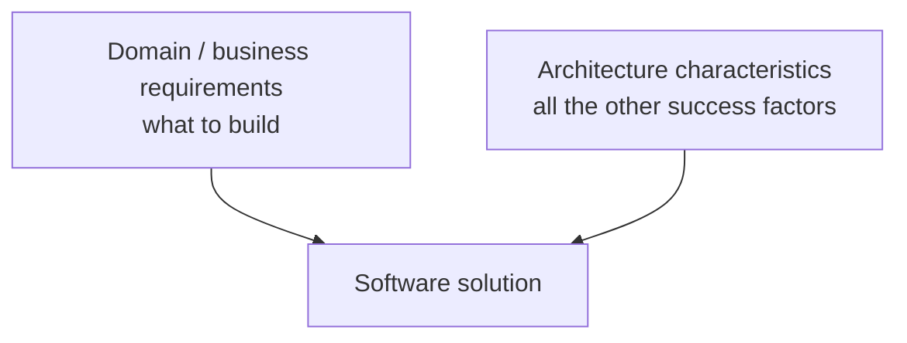
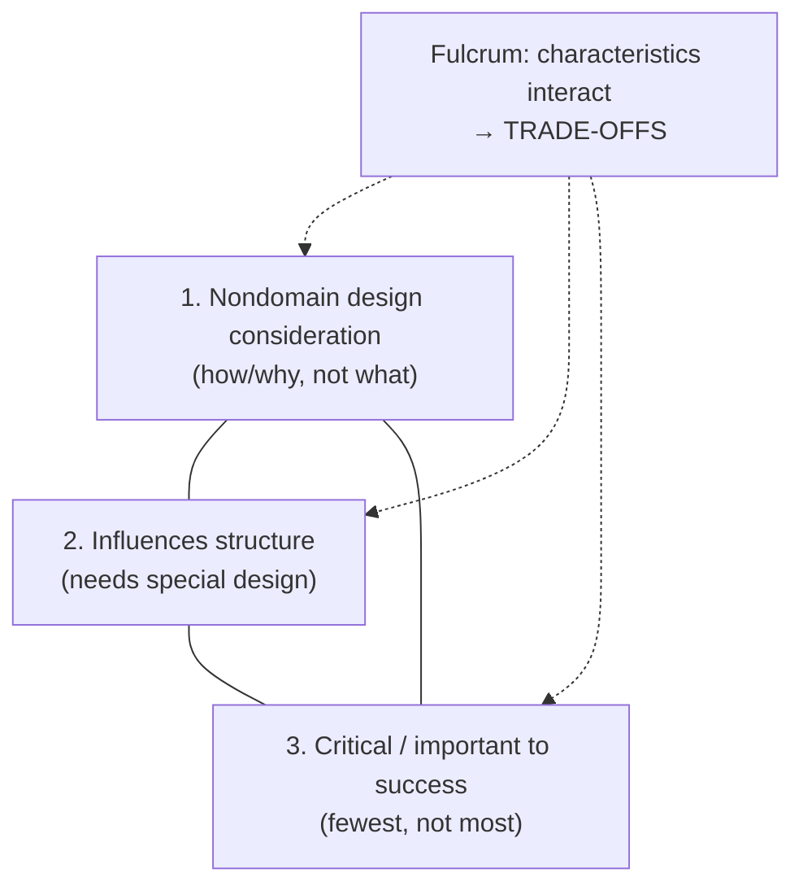
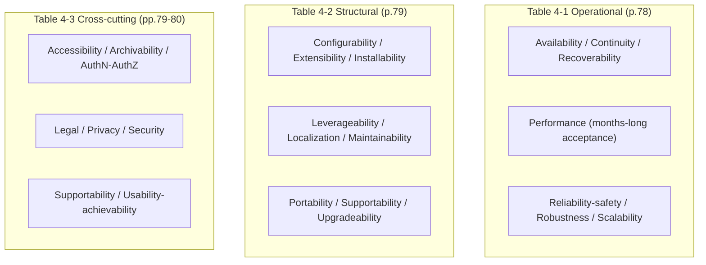

# Chapter 4: Architecture Characteristics Defined — Definitive Summary
*From: Fundamentals of Software Architecture by Mark Richards & Neal Ford*
*Source PDF: pp. 75–84 (422-page PDF) — figures below cite PDF pages.*

> [!NAV] **Chapter Navigation**
> ⬅️ **Previous:** [[chapter-03-modularity|Chapter 03: Modularity]] | 🏠 **Index:** [[00-Master-Reading-Dashboard|Master Dashboard]] | ➡️ **Next:** [[chapter-05-identifying-architecture-characteristics|Chapter 05: Identifying Architecture Characteristics]]

---

## 1. Executive Summary & Core Problem

- **Core thesis:** Beyond domain requirements sits the architect's real design driver: **architecture characteristics** — nondomain considerations that shape structure and decide success. Three hard gates (Fig 4-2, PDF p.76): (1) **nondomain design consideration**, (2) **influences structure**, (3) **critical/important to success**. Miss any gate and it's just good practice, not a characteristic. Support as *few* as possible — each one complicates design and trades against others (security↔performance). Target the **least worst architecture**, never the best.
- **Terminology war (p.75–76):** *nonfunctional requirements* rejected (self-denigrating — who funds "nonfunctional"?); *quality attributes* rejected (implies after-the-fact QA, not design). *Architecture characteristics* wins — design-time, success-critical, no apology.
- **Catalog delivered:** Table 4-1 operational (availability→scalability, p.78), Table 4-2 structural (configurability→upgradeability, p.79), Table 4-3 cross-cutting (accessibility→usability, pp.79–80), plus ISO 25010's 7 families (pp.81–82) with the explicit demotion of *functional suitability* (completeness/correctness/appropriateness = motivators to build, not characteristics). Ambiguity showcase: **Italy-ility** (p.80) — availability+recoverability+resilience fused by trauma into one bespoke "-ility."

---

## 2. In-Depth Concepts & Mechanics

### 2.1 The triangle definition (Fig 4-2, pp.76–77)
- **Gate 1 — nondomain:** *how/why*, not *what*. Performance targets, technical-debt prevention rarely appear in requirements yet decide implementation. Explicit (in requirements) vs **implicit** (availability/reliability/security assumed; high-frequency trading's unstated low-latency) — Ch 5 method.
- **Gate 2 — structural impact:** does it need *special structure*? Payment via **third-party processor** → baseline hygiene (encryption/hashing), no new structure — NOT a characteristic. **In-app payment processing** → dedicated isolated module/service — IS a characteristic. Modifiers apply (incident history, integration shape can flip the verdict).
- **Gate 3 — criticality:** every supported characteristic adds complexity → choose the *fewest*. Triangle shape intentional: gates mutually support design; fulcrum = characteristics interact → **trade-offs everywhere**.
- **Fig 4-1 (p.75):** solution = domain requirements + architecture characteristics. Architects may co-define requirements, but characteristics are their distinctive duty.

### 2.2 The three catalogs (verbatim content preserved)
- **Table 4-1 Operational (p.78):** Availability (24/7 + fast recovery posture), Continuity (disaster recovery), Performance (stress/peak/frequency/capacity/response; acceptance can take *months*), Recoverability (time-to-online → backup + duplicated HW), Reliability/safety (fail-safe? life-critical? money-critical?), Robustness (error/boundary behavior under net/power/HW loss), Scalability (users/requests growth).
- **Table 4-2 Structural (p.79):** Configurability (end-user config via usable interfaces), Extensibility (plug new functionality), Installability (all platforms), Leverageability/reuse (shared components), Localization (languages, multibyte, units/currencies), Maintainability (change ease), Portability (multi-platform, e.g., Oracle + SAP DB frontends), Supportability (support level + logging/debug facilities), Upgradeability (server+client version jumps).
- **Table 4-3 Cross-cutting (pp.79–80):** Accessibility (disabilities — colorblindness/hearing), Archivability (delete/archive after N months — e.g., accounts → secondary DB), Authentication (who are you), Authorization (what may you touch — use-case/subsystem/page/rule/field), Legal (GDPR, Sarbanes-Oxley, data protection, build/deploy regs), Privacy (hide transactions even from DBAs/net-architects — encrypted), Security (at-rest + in-transit encryption, remote-auth), Supportability (repeated — logging/debug emphasis), Usability/achievability (training needed to reach goals — as serious as any architectural issue).
- **No list is complete:** any system may mint characteristics (Italy-ility). Definitions overlap/blur: interoperability (published APIs, integration ease) vs compatibility (standards conformance); learnability (user learning curve) vs ML self-optimization; availability (up-and-reachable) vs reliability (correct over time) — UDP is available but not reliable (packets may reorder/drop).

### 2.3 ISO 25010 digest (pp.81–82)
Performance efficiency (time/resource/capacity) → Compatibility (coexistence + interoperability) → Usability (recognizability, learnability, error protection, accessibility) → Reliability (maturity, availability, fault tolerance, recoverability) → Security (confidentiality, integrity, nonrepudiation, accountability, authenticity) → Maintainability (modularity, reusability, analyzability, modifiability, testability) → Portability (adaptability, installability, replaceability). **Excluded:** functional suitability trio — requirements, not characteristics (evolution preview → Ch 7).

### 2.4 Least-worst + helicopter metaphor (pp.83–84)
- Pilots fight helicopters: one control per hand/foot, every input perturbs the others — exactly like characteristics. Maximizing all = generic unwieldy design solving every business problem badly.
- Corollary: design **iteratively** (Agile lesson at architecture level) so first-attempt precision matters less — evolutionary escape hatch.

---

## 3. Figures — ALL Reconstructed in Mermaid

> 📕 **Index:** Fig 4-1 (p.75), Fig 4-2 (p.76), Table 4-1 (p.78), Table 4-2 (p.79), Table 4-3 (pp.79–80).

### Figure 4-1: Solution = requirements + characteristics (📕 PDF p.75)

### Figure 4-2: The three-gate triangle (📕 PDF p.76)

- **Takeaway:** Triangle, not checklist — gates reinforce each other and collide with each other.

### Tables 4-1/4-2/4-3 — compact Mermaid maps

---

## 4. Real-World Systems / Cases

- **Third-party vs in-app payments (p.77):** the book's structural-impact litmus test — same word "security," opposite architectural consequences. Flip conditions: breach history, integration trust depth.
- **High-frequency trading latency (p.77):** implicit characteristic par excellence — never written per-system, always designed for.
- **UDP vs TCP (p.80):** availability-without-reliability existence proof — dissolves the "they're the same thing" conflation.
- **Italy-ility (p.80):** "But what if we lose Italy?" institutionalized — freak outage → centralized-architecture client demands bespoke availability+recoverability+resilience blend on every design. Lesson: ubiquitous language (DDD advice, p.83) must be team-local; industry-wide standardization is hopeless.
- **Helicopter controls (p.83):** four-limb balancing = characteristics balancing — the interview-ready metaphor.

---

## 5. Trade-Off Matrix

| Pair | Improving… | Degrades… | Mechanism | Book example |
|---|---|---|---|---|
| Security ↔ Performance | encryption, secret indirection, auth checks | latency/throughput | more on-the-fly work per request | canonical p.83 example |
| Availability/recoverability ↔ Simplicity | duplication, backup, failover structure | design + ops complexity | extra paths/state to maintain | Italy-ility cost |
| Any characteristic ↔ Design load | each +1 supported | comprehensibility, velocity | structural + decision overhead | "fewest, not most" rule |
| Explicit ↔ Implicit focus | stated N users/scale | assumed availability/security | attention allocation | over-specifying explicit while missing implicit = failure |
| Best ↔ Least-worst | maximize all | ship anything coherent | generic-design bloat | "Never shoot for best" |

---

## 6. Jargon Buster

- **Architecture characteristic:** 3-gate success factor (nondomain + structural + critical). *Confused with:* feature/requirement.
- **Explicit / implicit:** in-requirements vs domain-assumed (availability, reliability, security baseline).
- **Operational / structural / cross-cutting:** runtime capabilities / code-shape qualities / boundary-defying constraints.
- **Italy-ility:** bespoke fused characteristic from organizational trauma.
- **Interoperability vs compatibility:** API-integration ease vs standards conformance.
- **Least-worst architecture:** satisficing minimal set over maximizing all.
- **Ubiquitous language (DDD):** team-local glossary to survive industry terminological chaos (p.83).

---

## 7. Takeaways

### Checklist
- [ ] Run every candidate "-ility" through the 3 gates; demote failures to design hygiene.
- [ ] Label each survivor explicit/implicit + which structure it forces (module/service/topology).
- [ ] Cap the list (aim ≤5–7 drivers); record rejected ones with rationale.
- [ ] Pair each kept characteristic with its known enemy (security→performance) and acceptable degradation bound.
- [ ] Establish team ubiquitous-language glossary (ISO terms mapped to local meanings).

### Interview strategy
- Q: "Nonfunctional requirements vs characteristics?" A: naming politics + 3-gate definition + payments litmus test.
- Q: "How many characteristics should we support?" A: fewest; helicopter metaphor; least-worst > best; Vasa preview (Ch 5).
- Q: "Availability vs reliability?" A: UDP counterexample; overlap ≠ identity.

### Mastery Q&A (with answers)
1. **Q: Why does in-app payment elevate security to a characteristic but third-party doesn't?** A: Gate 2 — only in-app demands dedicated isolating structure; third-party needs hygiene only (modulo incident/integration modifiers).
2. **Q: What are the exact three gates?** A: Nondomain consideration + structural influence + criticality — triangle with trade-off fulcrum.
3. **Q: Why reject "quality attributes"?** A: Implies post-hoc assessment, not design-time structural driver.
4. **Q: Give two term pairs the book calls ambiguous and their disambiguation.** A: Interop (APIs) vs compatibility (standards); learnability (users) vs self-learning (ML systems).
5. **Q: What is Italy-ility compositionally?** A: Availability + recoverability + resilience fused by the Italy-outage trauma into one local requirement.
