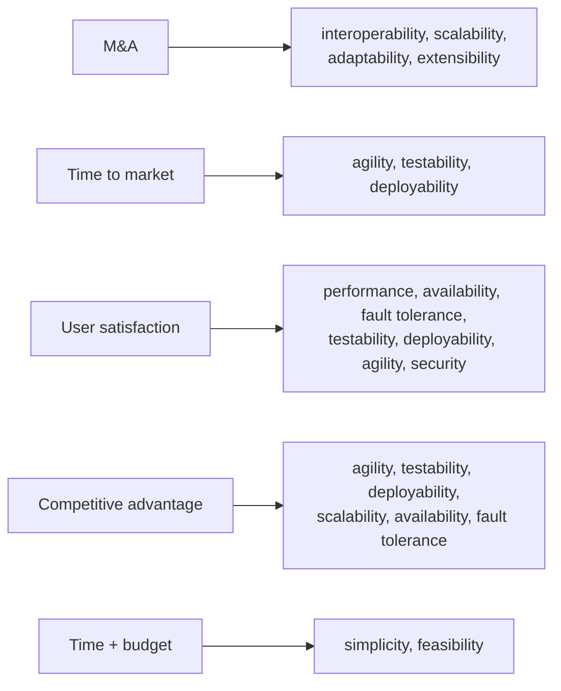
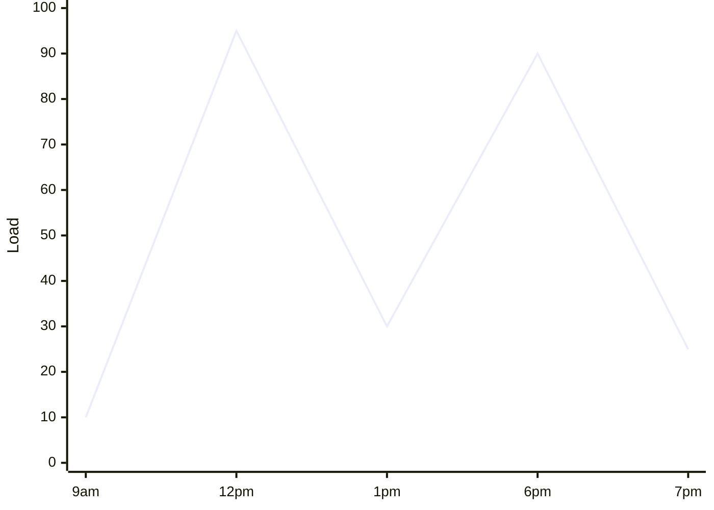
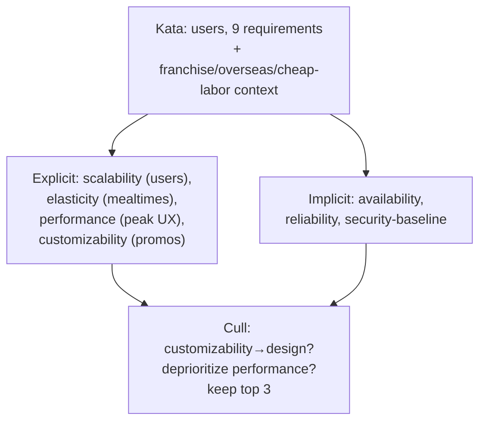

# Chapter 5: Identifying Architecture Characteristics — Definitive Summary
*From: Fundamentals of Software Architecture by Mark Richards & Neal Ford*
*Source PDF: pp. 85–96 (422-page PDF) — figures below cite PDF pages.*

> [!NAV] **Chapter Navigation**
> ⬅️ **Previous:** [[chapter-04-architecture-characteristics-defined|Chapter 04: Architecture Characteristics Defined]] | 🏠 **Index:** [[00-Master-Reading-Dashboard|Master Dashboard]] | ➡️ **Next:** [[chapter-06-measuring-and-governing|Chapter 06: Measuring and Governing]]

---

## 1. Executive Summary & Core Problem

- **Core thesis:** Characteristics are uncovered three ways — **domain concerns, explicit requirements, implicit domain knowledge** — then ruthlessly culled to the shortest defensible list. Architects and stakeholders speak different languages (scalability vs "user satisfaction"), so translation (Table 5-1, PDF p.87) is the core skill. Never prioritize 1…N (fool's errand — no consensus possible); ask stakeholders for **top 3 in any order** to force trade-off conversation. There are no correct answers, only incorrect/expensive ones (Mark Richards: "no wrong answers, only expensive ones").
- **Vehicles:** Vasa warship (1626–1628, two gun decks + double-size cannons → capsized on cannon-salute, now Stockholm museum) = over-specification parable. **Silicon Sandwiches kata** (pp.89–95: thousands→millions users, order+pickup+traffic-maps, delivery dispatch, mobile, national+local promos, 3 payment modes, franchised owners, overseas expansion, cheap-labor goal) derives explicit (scalability, elasticity, performance, customizability) vs implicit (availability, reliability, security-baseline) sets, then practices culling (drop customizability→design-pattern or deprioritize raw performance).
- **Critical distinction sharpened:** scalability (concurrent-user load curve, Fig 5-1) ≠ elasticity (burst tolerance, Fig 5-2). Hotel reservations = scalable-but-not-elastic; concert tickets = elastic (+ usually scalable). Sandwich shops burst at mealtimes → elastic even though requirements never say so.

---

## 2. In-Depth Concepts & Mechanics

### 2.1 Extraction method (pp.85–89)
- **Keep-short imperative:** each characteristic complicates design before domain work starts — generic architectures supporting everything are the anti-goal (Vasa). Don't obsess over count; obsess over simplicity motivation.
- **Top-3 ritual:** consensus on full ranking impossible; top-3-any-order is achievable and surfaces what stakeholders truly value → feeds trade-off analysis for decisions.
- **Table 5-1 translation (p.87, verbatim):** M&A → interoperability, scalability, adaptability, extensibility. Time-to-market → agility, testability, deployability. User satisfaction → performance, availability, fault tolerance, testability, deployability, agility, security. Competitive advantage → agility, testability, deployability, scalability, availability, fault tolerance. Time+budget → simplicity, feasibility.
- **Agility trap:** agility ≠ time-to-market; **agility = agility + testability + deployability** (flour-in-cake: omit one, recipe fails). Fund-pricing counterexample (p.87): "finish end-of-day pricing on time" naively → performance only; correctly → performance + availability (up when needed) + scalability (more funds) + reliability (no crash mid-run) + recoverability (resume at 85%) + auditability (correctness proof).
- **Requirements + implicit knowledge (pp.87–88):** explicit numbers (users/scale) + architect's lived domain sense. University registration: 1,000 students / 10 hours — even distribution (consistent scale) or all-1,000-in-last-10-minutes (procrastination reality)? Requirements won't say; architects must know.
- **Architecture katas (Ted Neward origin, pp.88–89):** martial-arts kata = form-practice; Brooks: "great designers design." Format: Description + Users + Requirements + (Neal Ford addition) Additional context. 45-min small-team design → cross-group vote. Brown-bag + experienced-architect critique = deliberate practice for people who architect <6 times per career.

### 2.2 Silicon Sandwiches derivation (pp.89–95)
- **Users signal:** "thousands, perhaps one day millions" → decode to **scalability** (no explicit request — translation work).
- **Elasticity inference:** lunch/dinner bursts → Fig 5-2 shape; requirements silent — architect-supplied.
- **Requirement-by-requirement walk (pp.91–93):**
  1. Order + pickup time + external traffic-maps → integration points → **reliability** conditional (if maps down: fail site vs degrade gracefully? guard against brittleness).
  2. Delivery dispatch → no characteristic.
  3. Mobile accessibility → design (portable web vs natives; budget → mobile-optimized web) + mobile-sensitive **performance** page-load budgets with UX collaboration.
  4–5. National + local promos (+ location-based traffic) → **customizability** candidate → microkernel plug-ins vs Template-Method pattern (trade-off: style cost vs pattern sufficiency).
  6. 3-mode payments → baseline security hygiene only (third-party assumption, Ch 4 gate 2).
  7. Franchised owners → cost/time/skill **feasibility** — consider simple/sacrificial architecture.
  8. Overseas expansion → i18n — design techniques, no special structure.
  9. Cheap labor → usability — design, not architecture.
- **Performance nuance:** define baseline (unloaded) + loaded (N users → acceptable latency) jointly — characteristics interlock.
- **Implicit set (p.93):** availability (reachable), reliability (stays up mid-purchase), security (implicit always; structural only if critical — here third-party → hygiene suffices). Over-specifying = overcomplicating — equal damage to under-specifying.
- **Culling exercise (pp.94–95):** ask "which one must go?" Explicit candidates culled first (implicit underpin success). Sandwiches: drop **customizability→design** (Template Method) or deprioritize **performance** (don't build *slow*, just don't privilege it over scalability/availability).

### 2.3 Design vs architecture (p.94)
- Same need, two homes: microkernel *structural* customizability vs Template-Method *design* customizability. Choice factors: competing characteristics' difficulty per home, cost per home — with devs/PMs/ops co-deciding (anti-Ivory-Tower). Correct structural picks enable simpler/elegant design, but no "exactly correct set" exists — least-worst trade-offs again.

---

## 3. Figures — ALL Reconstructed in Mermaid

> 📕 **Index:** Table 5-1 (p.87), Fig 5-1 (p.90), Fig 5-2 (p.91).

### Table 5-1: Domain → characteristics (📕 PDF p.87)



### Figure 5-1: Scalability — concurrent-user performance (📕 PDF p.90)
- **Description:** X = concurrent users (rising), Y = throughput/response; curve rises then plateaus/degrades — capacity limit visible.

```mermaid
xychart-beta
  x-axis [0, 1000, 10000, 100000, 1000000]
  y-axis "Throughput (req/s)" 0 --> 100
  line [5, 40, 80, 92, 85]
```

- **Takeaway:** Answers "how many simultaneous users before degradation?" — capacity planning curve.

### Figure 5-2: Elasticity — burst tolerance (📕 PDF p.91)
- **Description:** Spiky traffic over time (mealtime peaks, concert on-sales); system must stretch/shrink without failure.



- **Takeaway:** Answers "can we absorb sudden 10× spikes and release resources after?" — hotel (flat) vs concert/sandwich (spiky).

### Supplementary: Silicon Sandwiches derivation flow (synthesis of pp.89–95)



---

## 4. Real-World Systems / Cases

- **Vasa (1626–1628, pp.66–67):** King Adolphus demands troop-transport + gunship, 2 decks, double cannons → top-heavy → sank on harbor salute; salvaged 20th century, Stockholm museum. Over-specification kills — whether ships or "-ilities."
- **Silicon Sandwiches (pp.89–95):** full worked kata — franchise economics → feasibility/sacrificial option; overseas → i18n-by-design; traffic-API outage → graceful-degradation reliability call.
- **End-of-day fund pricing (p.87):** single-domain-sentence → 6-characteristic expansion (performance, availability, scalability, reliability, recoverability, auditability) — the "don't just do performance" lesson.
- **University registration (pp.87–88):** 1,000 students / 10 h — procrastination-aware elasticity vs naive even-distribution — implicit-knowledge parable.
- **Going Going Gone / Sysops Squad:** book's later running katas (auction/supply-chain style) — apply this chapter's extraction ritual to each when reached.

---

## 5. Trade-Off Matrix

| Choice | A | B | Consequence | Book steer |
|---|---|---|---|---|
| List size | Long (cover all) | Short (top 3) | Long: Vasa complexity; Short: focus + iteration risk | Short; cull via "which must go?" |
| Prioritization | Rank 1…N | Top-3 unordered | Ranked: endless stakeholder war; Top-3: consensus + discussion | Top-3 |
| Agility reading | Agility alone = speed | Agility+testability+deployability | Alone: untestable/undeployable "speed"; Trio: real time-to-market | Always trio |
| Signal source | Requirements text only | + implicit domain knowledge | Text-only: misses bursts/habits; +implicit: procrastination/mealtime reality | Both; architect supplies implicit |
| Customizability home | Microkernel structure | Template-Method design | Structure: power + style cost; Design: cheap + limited | Co-decide with team on cost/characteristic interactions |

---

## 6. Jargon Buster

- **Explicit / implicit characteristics:** requirements-stated vs domain-assumed (availability/reliability/security).
- **Scalability vs elasticity:** concurrent volume vs burst shape (Fig 5-1 vs 5-2).
- **Architecture kata:** 45-min domain-description design drill (Description/Users/Requirements/Additional context) + peer vote.
- **Vasa anti-pattern:** over-specified characteristics capsizing the project.
- **Top-3 ritual:** unordered 3-pick consensus forcing trade-off talk.
- **Sacrificial architecture:** deliberately simple/throwaway given feasibility constraints (franchise-cost case).
- **i18n:** internationalization (overseas expansion → design-level).

---

## 7. Takeaways

### Checklist
- [ ] Translate each stakeholder phrase via Table 5-1 before accepting it as a characteristic.
- [ ] Separate explicit vs implicit columns; challenge each explicit with "what breaks if degraded?" and each implicit with "does it need structure?"
- [ ] Draw scalability (load) + elasticity (burst) expectations as curves with numbers (users, peak multiplier).
- [ ] Run the cull: force-rank-out one characteristic; record where the loser lives instead (design/ops/backlog).
- [ ] Host a kata (Silicon Sandwiches) brown-bag: 45 min, vote, senior critique of missed trade-offs.

### Interview strategy
- Q: "How do you identify characteristics?" A: 3 sources + Table 5-1 translation + top-3 ritual + Vasa caution.
- Q: "Scalability vs elasticity?" A: hotel vs concert vs sandwich-shop curves (Figs 5-1/5-2).
- Q: "Walk me through a kata." A: Silicon Sandwiches 9-requirement walk, explicit/implicit split, cull to top 3.

### Mastery Q&A (with answers)
1. **Q: Reproduce Table 5-1 rows.** A: M&A→interop/scale/adapt/extend; TTM→agility/test/deploy; satisfaction→perf/avail/fault-tol/test/deploy/agility/security; advantage→agility/test/deploy/scale/avail/fault-tol; time+budget→simplicity/feasibility.
2. **Q: Why is prioritizing 1…N a fool's errand?** A: No stakeholder consensus achievable; wastes time + breeds frustration — top-3-any-order sidesteps it.
3. **Q: Which Silicon Sandwiches requirements yield customizability and what are its two homes?** A: National+local promos + location traffic → microkernel plug-ins (structure) vs Template Method (design).
4. **Q: What six characteristics does fund-pricing need beyond naive performance?** A: Availability, scalability, reliability, recoverability, auditability (+ performance itself) — p.87 chain.
5. **Q: State the kata format + timing.** A: Description/Users/Requirements/Additional context; 45-min teams + peer vote + expert trade-off critique.
