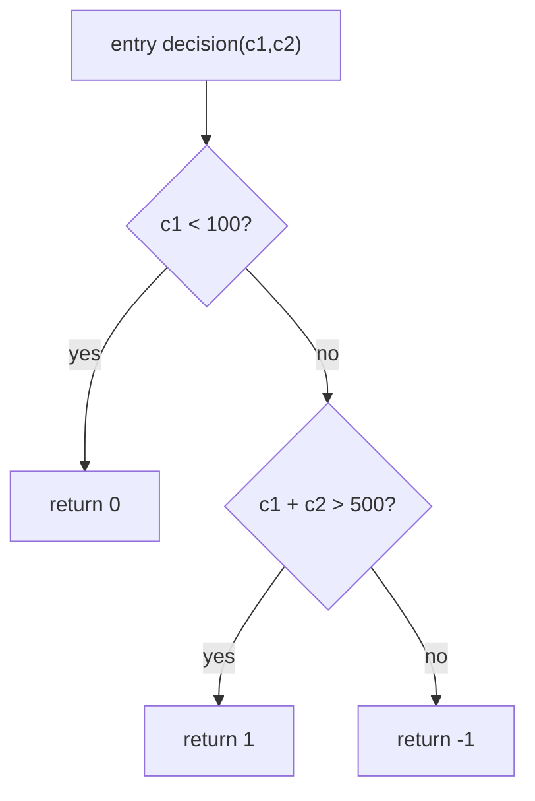
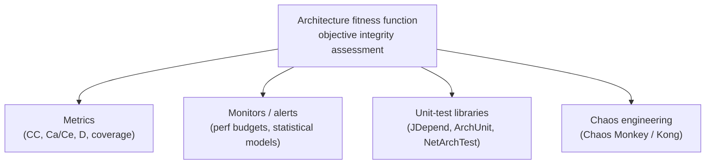
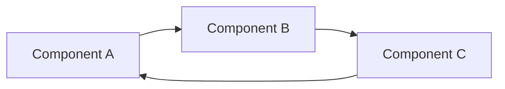
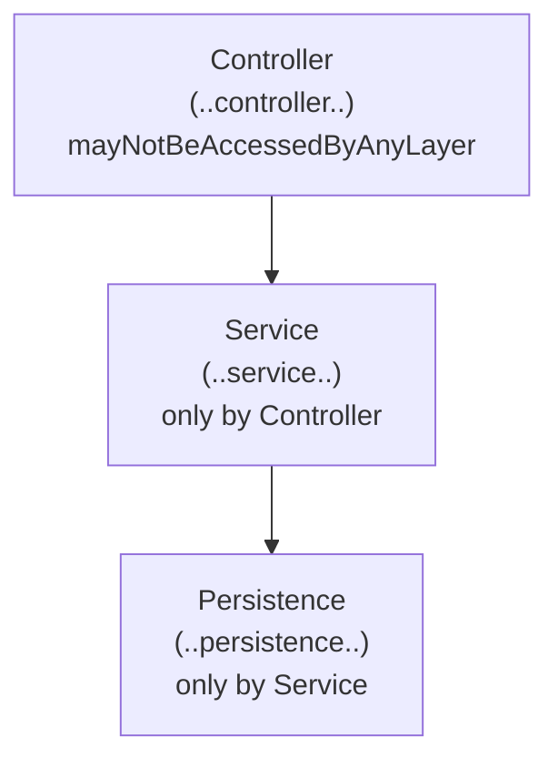

# Chapter 6: Measuring and Governing Architecture Characteristics — Definitive Summary
*From: Fundamentals of Software Architecture by Mark Richards & Neal Ford*
*Source PDF: pp. 98–111 (422-page PDF) — figures below cite PDF pages.*

> [!NAV] **Chapter Navigation**
> ⬅️ **Previous:** [[chapter-05-identifying-architecture-characteristics|Chapter 05: Identifying Architecture Characteristics]] | 🏠 **Index:** [[00-Master-Reading-Dashboard|Master Dashboard]] | ➡️ **Next:** *Chapter 07 (next batch — Scope of Architecture Characteristics)*

---

## 1. Executive Summary & Core Problem

- **Core thesis:** Characteristics fail for three definitional reasons — **not physics** (what does "agile/deployable" mean?), **wildly varying definitions** (perf means different things to dev/arch/ops), **too composite** (agility = modularity + deployability + testability). Cure: **objective, organization-wide, measurable definitions** creating ubiquitous language + unpacking composites into testable parts (statistical performance budgets, CC thresholds, coverage, deploy metrics).
- **Governance answer: fitness functions** (from *Building Evolutionary Architectures*, Parsons et al.). Borrowed from genetic algorithms (traveling-salesperson route-length evaluator): **any mechanism providing objective integrity assessment of characteristics** — metric, monitor, unit test, chaos experiment (Fig 6-2). Wired into CI/production they guard the *important-but-not-urgent* (modularity) against urgency. Checklist Manifesto framing: not heavyweight bureaucracy but professional reminders.
- **Concrete instruments delivered:** CC formula + `decision()` graph (Fig 6-1, CC=3) with thresholds (<10 industry, <5 preferred, >50 + low coverage = crap per Crap4J, horror story: CC>800, 4,000-line C function with GOTOs); JDepend cycle test (Ex 6-2), distance-tolerance test (Ex 6-3, tolerance 0.5), ArchUnit layer rule (Ex 6-4 Controller→Service→Persistence), NetArchTest C# equivalent (Ex 6-5 Presentation↛Data), Netflix Simian Army (Conformity/Security/Janitor + Chaos Monkey/Kong origin: AWS move, latency chaos, AZ-failure drills).

---

## 2. In-Depth Concepts & Mechanics

### 2.1 Measurement problems → objective definitions (pp.98–99)
- Three problems (§1) solved by org-wide concrete definitions + decomposition. Ubiquitous language dividend: dev/arch/ops finally mean the same "performance."
- **Operational nuance — average lies:** mean response hides 1%-at-10× tail; also track **max**, percentiles, budgets. High-level teams use **statistical models** (video-streaming scale baseline + alarms on deviation — model-wrong vs system-wrong both informative), **performance budgets** (first-page render 500 ms optimum vs double-digit reality; K-weight byte budgets for physics-constrained mobile/high-latency), evolving web metrics (first contentful paint, first CPU idle).

### 2.2 Structural measures — CC (pp.99–101)
- **McCabe 1976:** graph decision points → paths. Single-method: **CC = E − N + 2** (E edges/decisions, N nodes/lines); multi-component: **CC = E − N + 2P** (P connected components/fan-out).
- **Example 6-1 (p.100):** `decision(int c1,int c2)` — `if(c1<100)→0; else if(c1+c2>500)→1; else→−1` → CC = 3−2+2 = **3** (Fig 6-1: entry → cond1 → cond2 → 3 returns).
- **Thresholds:** industry <10 acceptable (domain-modulated); authors prefer <5 (cohesive, well-factored); Crap4J: CC>50 = crappy regardless of coverage; horror: CC 800/4,000 lines/GOTOs. **TDD side effect:** test-first → small discrete behaviors → low CC naturally. Open question per method: domain complexity vs poor factoring (split large methods?).

### 2.3 Process measures — decomposing agility (pp.101–102)
- Testability → **coverage tools** (100% coverage + poor assertions = false confidence — thinking irreplaceable). Deployability → success/failure %, duration, deploy-raised bugs, etc. Team owns its meaningful set (quality + quantity).
- Structure follows: testability/deployability priority → architect invests in modularity/isolation — characteristic driving structural decision. Anything meeting the 3-gate definition (Ch 4) can ascend to characteristic status.

### 2.4 Governance + fitness functions (pp.102–109)
- **Governance** (Greek *kubernan*, to steer): everything architects influence — incl. org-wide quality. Automation lineage: XP → CI → DevOps → governance-as-code.
- **Definition + spectrum (Fig 6-2):** evolutionary (computing, not biology — Parsons) fitness = objective guidance; architecture fitness = any integrity mechanism across metrics/monitors/tests/chaos. Not a downloadable framework — a perspective on existing tools.
- **Cycle governance (Fig 6-3 + Ex 6-2, pp.105–106):** IDE auto-import reflex → A↔B↔C webs → nothing reusable alone → **Big Ball of Mud**. Code review too late (week of damage). Fix: JDepend `containsCycles()` assertion in CI — `addDirectory(persistence/web/thirdpartyjars)` → `analyze()` → `assertEquals(false, cycles)`.
- **Distance governance (Ex 6-3, p.106):** `ideal=0.0, tolerance=0.5` (project-dependent); iterate `JavaPackage`s, assert `distance()` within tolerance. Collaboration mandate: no ivory-tower esoterica — developers must understand purpose before imposition.
- **Layer governance (Fig 6-4 + Ex 6-4/6-5, pp.107–108):** defined Controller (`..controller..`) → Service (`..service..`) → Persistence (`..persistence..`); rules: Controller unaccessed, Service only-by-Controller, Persistence only-by-Service. "Better to ask forgiveness" perf shortcuts erode rationale — tests stop erosion. .NET mirror: `ResideInNamespace(Presentation).ShouldNot().HaveDependencyOn(Data)`.
- **Simian Army (pp.108–109):** Conformity (REST-verb completeness), Security (ports/config), Janitor (unrouted orphan services burn cloud money — disintegrated). Origin: AWS migration → loss-of-ops-control fear → Chaos Monkey (general chaos), Latency Monkey (AWS latency), Chaos Kong (whole-AZ failure) — chaos engineering premise: *when*, not *if*. Real AZ outages later survived because of drills.
- **Checklist lens (Gawande):** pilots/surgeons use checklists not from ignorance but repetition-slip; fitness functions = architects' checklists codified in substrate.

---

## 3. Figures — ALL Reconstructed in Mermaid

> 📕 **Index:** Fig 6-1 (p.100), Fig 6-2 (p.104), Fig 6-3 (p.105), Fig 6-4 (p.107), Ex 6-1 (p.100), Ex 6-2 (p.105–106), Ex 6-3 (p.106), Ex 6-4 (p.107), Ex 6-5 (p.108).

### Figure 6-1: CC graph for `decision()` — CC=3 (📕 PDF p.100)
- **Description:** Nodes: entry → `c1<100?` → `c1+c2>500?` → return 0/1/−1. E=3, N=2 (simplified in book) → 3−2+2=3.

- **Code (Ex 6-1, verbatim logic):** `if (c1<100) return 0; else if (c1+c2>500) return 1; else return -1;`

### Figure 6-2: Fitness-function mechanisms (📕 PDF p.104)

### Figure 6-3: Cyclic dependencies (📕 PDF p.105)

- **Takeaway:** Reuse of any one drags all — mud-ward slide; CI cycle test is the brake.

### Figure 6-4: Layered monolith under governance (📕 PDF p.107)

### Examples 6-2…6-5 — essence (transcribed, see PDF for full text)
- **Ex 6-2 JDepend cycles:** `addDirectory(persistence/web/jars)` → `analyze()` → `assertEquals(false, containsCycles())` — CI gate.
- **Ex 6-3 Distance:** `ideal 0.0, tolerance 0.5` → assert each package `distance()` within bound.
- **Ex 6-4 ArchUnit:** `layeredArchitecture().layer(...)...whereLayer(...)` chain above.
- **Ex 6-5 NetArchTest:** `ResideInNamespace(Presentation).ShouldNot().HaveDependencyOn(Data)`.

---

## 4. Real-World Systems / Cases

- **Video-streaming scale modeling (p.99):** statistical baseline + deviation alarms — model-vs-reality double signal.
- **500 ms first-render + K-weight budgets (pp.98–99):** user-research-backed thresholds; physics rationale (bytes over thin mobile pipes).
- **CC 800 monster (p.101):** 4,000-line C heart-of-product with GOTOs escaping nested loops — Neal's most terrifying artifact; justifies CI CC gates.
- **Trigger-happy auto-import (p.104):** IDE helpfulness → modularity disaster — the human-factors root of Fig 6-3.
- **Netflix vs AWS (p.108):** surrendering ops control → inventing chaos engineering; Latency Monkey (instance latency), Chaos Kong (AZ loss) → survived real outages. Conformity/Security/Janitor = governance-in-production (REST completeness, port hygiene, orphan-burn for cloud bills).

---

## 5. Trade-Off Matrix

| Measure / Tool | What it guards | Cost / limit | When to use |
|---|---|---|---|
| Mean + max + percentiles | Tail-hiding averages | metric cardinality | always for perf/scale |
| Statistical model alarms | Arbitrary-threshold brittleness | model maintenance | high-traffic streaming/scale |
| CC <5 gate (<10 max) | Complexity drift (modularity/testability/deployability) | domain-complexity false positives | CI per-method; baseline per domain |
| Coverage | Testability completeness | 100% + weak asserts = theater | paired with mutation/assertion review |
| JDepend cycles | Reuse-destroying webs | package-scope config | every CI run |
| Distance tolerance 0.5 | Abstraction/volatility balance | project-tuned threshold | migration + debt sprints |
| ArchUnit/NetArchTest layers | Erosion-by-shortcut | rule upkeep | layered monoliths |
| Chaos (Monkey/Kong) | Availability/recoverability theater | prod-blast-radius control | evolutionary/cloud architectures |

---

## 6. Jargon Buster

- **Objective characteristic definition:** org-wide measurable meaning (ubiquitous language for "-ilities").
- **Performance budget:** hard allowance (500 ms render, K-weight bytes, paint/idle marks).
- **Cyclomatic complexity CC = E−N+2 (+2P generalized):** path-count complexity; P = connected components.
- **Crap4J:** CC × coverage "crappiness" detector (CC>50 irredeemable).
- **Fitness function:** any objective characteristic assessment (metric/monitor/test/chaos).
- **JDepend / ArchUnit / NetArchTest:** Java-deps / Java-architecture-rules / .NET-architecture-rules test libs.
- **Simian Army (Conformity/Security/Janitor; Chaos/Latency Monkey, Chaos Kong):** Netflix prod-governance + chaos fleet.
- **Chaos engineering:** anticipating *when* breaks occur via injected failure.

---

## 7. Takeaways

### Checklist
- [ ] Define each top characteristic with number + measurement (mean/p99/max, window, statistical baseline).
- [ ] Add CI gates: CC (<5 warn, <10 fail), no cycles, D-tolerance, layer rules — before any style migration.
- [ ] Decompose composites (agility → coverage %, deploy success %, lead time) with team-owned targets.
- [ ] Explain each fitness function to devs pre-enforcement (no ivory tower); link failures to rationale.
- [ ] Graduate to prod fitness (Conformity/Security/Janitor-style) + game-day chaos once CI hygiene holds.

### Interview strategy
- Q: "How do you govern architecture?" A: *kubernan* scope → fitness-function spectrum → cycle/distance/layer examples + collaboration caveat + checklist framing.
- Q: "What's a good CC?" A: it-depends + <10/<5/Crap4J-50/CC-800 story + TDD effect + E−N+2(P) formulas.
- Q: "Tell me about chaos engineering's origin." A: Netflix-AWS control loss → Chaos→Latency→Kong → real-outage survival; when-not-if mindset.

### Mastery Q&A (with answers)
1. **Q: Name the three definitional problems + cure.** A: Not-physics, varying definitions, too-composite → org-wide objective measurable definitions + unpacking composites.
2. **Q: Compute CC for Ex 6-1 and state the formula variants.** A: 3 (=3−2+2); single-method E−N+2, general E−N+2P.
3. **Q: What does Ex 6-2 assert and where does it run?** A: `containsCycles()==false` across persistence/web/jars in continuous build — stops week-long auto-import damage.
4. **Q: Recite the ArchUnit layer rules (Ex 6-4).** A: Controller unaccessed; Service only-by-Controller; Persistence only-by-Service.
5. **Q: Map the three Simian governance monkeys to characteristics.** A: Conformity→consistency/interop (REST verbs); Security→security hygiene; Janitor→cost/efficiency (orphan spend).
