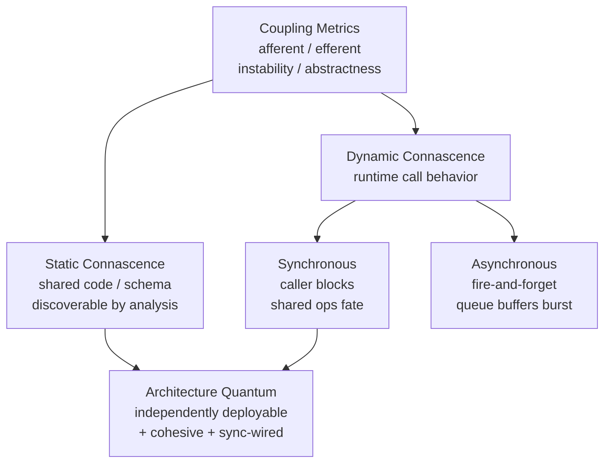

# Chapter 07: Scope of Architecture Characteristics — Definitive Technical Summary
*From: Fundamentals of Software Architecture: An Engineering Approach by Mark Richards & Neal Ford*
*Source PDF: pp. 112–119 (ground truth b03_ch07.txt) — figures below cite PDF pages.*

> [!NAV] **Chapter Navigation**
> ⬅️ **Previous:** *Chapter 06 (Coupling Measures — see Master Dashboard)* | 🏠 **Index:** [[00-Master-Reading-Dashboard|Master Dashboard]] | ➡️ **Next:** [[chapter-08-component-based-thinking|Chapter 08: Component-Based Thinking]]

---

## 1. Executive Summary & Core Engineering Problem

- **Core Thesis:** Architecture characteristics (the "-ilities": scalability, elasticity, availability, reliability, performance, security) cannot be meaningfully scoped at whole-system level in modern systems. Richards & Ford introduce the **architecture quantum** — an independently deployable artifact with high functional cohesion and synchronous connascence — as the correct scope for analyzing characteristics. Different quanta legitimately need different characteristics, which leads directly to hybrid architectures.
- **The Core Problem Statement:** Naive approach: declare "the system shall be scalable, highly available, secure" uniformly. Breaks in practice: in an online auction, the auctioneer's single stream needs extreme availability + reliability (if auctioneer drops, all bidding stops), while thousands of bidder streams need elasticity + scalability for last-second bidding bursts, while video/bid streams need raw performance + scalability but tolerate different failure modes. A single uniform rating forces over-engineering one part and under-engineering another.
- **What This Chapter Covers (PDF pp.112–119):** Coupling & Connascence recap (p.112) → Architectural Quanta & Granularity — quantum definition dissected (pp.112–114, Fig 7-1) → Domain-Driven Design's Bounded Context (p.114) → New scope = quantum level, not system level (p.115) → Case Study: Going, Going, Gone kata dissected requirement-by-requirement (pp.115–119) → Three quanta + per-quantum characteristics (pp.118–119).
- **Historical Context:** Code-level coupling metrics (afferent/efferent, instability, abstractness — Ch.6) are too fine-grained for architecture. Meilir Page-Jones (1996, *What Every Programmer Should Know About Object-Oriented Design*) coined **connascence** as "wired-togetherness." Authors adapt it, add *synchronous vs asynchronous communication connascence*, and fuse it with DDD bounded contexts (Eric Evans) and physics' "quantum" (minimum indivisible unit of interaction) to get an operationalizable deployability scope.

---

## 2. In-Depth Technical Concepts & Internal Mechanics

### 2.1 Coupling vs Connascence — Why Architects Need a Different Measure

- **Intuition:** Afferent/efferent coupling counts class-level imports — useful for developers, noise for architects. Architect asks: "if I change service A, must I change/deploy service B to keep the system correct?" That is connascence.
- **Formal definition:**
  > **Connascence (Page-Jones) (Static discoverability):** Two components are connascent if a change in one would require the other to be modified to maintain overall correctness.
- **Two axes from the book:**

| Dimension | Variants | Example | Architectural implication |
|---|---|---|---|
| **Static vs Dynamic** | Static = discoverable by code analysis; Dynamic = runtime behavior | Shared `Address` class between two microservices (static); caller blocks on callee response (dynamic synchronous) | Static connascence → shared code / schema coupling; Dynamic → operational coupling |
| **Synchronous vs Asynchronous (authors' addition)** | Synchronous = caller waits; Asynchronous = fire-and-forget via queue/event | Auction → Payment sync REST call vs Auction → Payment via message queue buffering | Sync creates shared operational fate for call duration; Async decouples operational characteristics |

- **Concrete example — Alice's Address change:** `PaymentService` and `AuctionService` both import `com.auction.Address`. Alice adds `addressLine3` field. Both services must recompile/redeploy or deserialization breaks → statically connascent. Fix: duplicate the tiny class per bounded context (accept duplication to kill coupling) or version the contract.
- **Concrete example — Payment bottleneck:** `AuctionService` calls `PaymentService` synchronously; Payment handles 1 payment / 500 ms. 200 auctions end simultaneously → 199 callers block, time out, retry, thundering herd. Same link via async queue: queue buffers burst, Payment drains at its own pace, no timeouts. Async connascence = more flexible architecture (deep dive in Ch.14).

### 2.2 Architecture Quantum — Definition Dissected

> **Architecture quantum (Independently deployable + cohesive + synchronously wired):** An independently deployable artifact with high functional cohesion and synchronous connascence.

Three parts (PDF pp.113–114):

**1. Independently deployable — "can it run without the rest?"**
1. Quantum includes everything needed to function: code + config + database + dependencies.
2. A legacy monolith + single shared database = exactly **one quantum** by definition (DB is part of the quantum; system cannot function without it).
3. Microservices each with own database = **many quanta** — each service deploys, scales, fails independently.
4. Test: can you deploy quantum Q on Friday at 5pm without coordinating with team owning quantum R? If yes → separate quanta.

**2. High functional cohesion — "does it do one purposeful thing?"**
- Component cohesion (Ch.8): `Customer` component with all customer behavior = high; `Utils` grab-bag = low.
- Quantum-level: each quantum maps to one workflow / bounded context (e.g., "capture bids", "stream video"), not a technical layer.
- Monolith: distinction barely matters (one quantum anyway). Microservices: each service should match one bounded context → high cohesion.

**3. Synchronous connascence — "are operational fates tied at runtime?"**
- If Service A synchronously calls Service B, for the duration of that call their scalability, elasticity, availability, performance **must match** — otherwise timeouts/reliability failures.
- Caller 10× more scalable than callee + sync link = caller threads pile up waiting → cascading failure.
- Async link breaks this: each side can have wildly different throughput/availability; queue absorbs the difference.

| Quantum test | Pass | Fail → same quantum |
|---|---|---|
| Separate deploy | Own pipeline, own DB/schema | Shared DB, lockstep release |
| Separate function | One bounded context | Random utilities / CRUD over all entities |
| Separate operations | Async or no runtime call | Sync call requiring matched SLAs |

### 2.3 DDD Bounded Context — The Modeling Ally

- **Source:** Eric Evans, *Domain-Driven Design* (Addison-Wesley).
- **Idea:** Everything about a domain is visible internally, opaque externally. No enterprise-wide `Customer` god-class; each bounded context owns its `Customer` view and reconciles at integration points.
- **Why it matters here:** Before DDD, orgs chased holistic reuse (shared `Customer.jar` everywhere) → coupling + coordination cost + complexity. Bounded context gives intellectual permission to **duplicate** and decouple — the exact precondition for multiple quanta.
- **Link to quantum:** Bounded context = functional cohesion boundary; independent deployability + sync-connascence analysis = operational boundary. Together they locate quantum seams.

### 2.4 New Scope Rule — Characteristics per Quantum, Not per System

- Old habit: scorecard for "the system": Scalability ★★★, Availability ★★★★.
- New rule: scorecard **per quantum**. Streaming bids vs auctioneer vs online bidders each get their own row.
- Payoff: hybrid architectures surface early. You stop asking "monolith or microservices for the whole system?" and start asking "which quanta need independent scaling/availability enough to justify distribution cost (Ch.9 fallacies)?"

---

## 3. Important Figures, Diagrams & Visual Architecture

| Figure | PDF Page | Description |
|---|---|---|
| Fig 7-1 | p.114 | Unified coupling/connascence diagram + new quantum (communication) connascence |

**Figure 7-1 — Adding quantum (communication) connascence to the unified diagram (PDF p.114).**
Visual flow: Ch.6 diagram (afferent/efferent → instability → connascence static/dynamic) gains a new branch: dynamic connascence splits into synchronous vs asynchronous communication. Synchronous arrow labeled "shared operational fate"; asynchronous arrow labeled "buffered, decoupled fate."

- **Original Book Figure:** Figure 7-1 → PDF p.114 — open the source PDF at page 114 to compare.
- **Key takeaway:** Only synchronous runtime wiring (plus static sharing) binds components into the same quantum. Async messaging is the escape hatch.

---

## 4. Real-World Systems, Case Studies & Code Examples

### Case Study: Going, Going, Gone (Online Auction Kata, PDF pp.115–119)

> Description: auction company going nationwide online. Hundreds–thousands of participants per auction, many simultaneous auctions. Live video + live bid stream, online + room bids strictly ordered, credit-card on file auto-charged on win, reputation index per participant. Aggressive M&A growth, unconstrained budget, fresh fraud-lawsuit settlement.

**Requirement-by-requirement derivation (the book's worked analysis):**

1. **"Nationwide, hundreds–thousands per auction, as real-time as possible"** → explicit **scalability** (sheer numbers) + implicit **elasticity** (bidding is bursty — polite spread vs frantic last-minute sniping? Domain knowledge says frantic) + **performance** (real-time bid delivery).
2. **"Credit card auto-charge" + "just settled fraud suit"** → **security** is implicit in every app, but does it need special structure? Card hygiene (no plaintext storage, TLS) = general hygiene, not structural. Fraud history = architect must stop and interrogate — prior lawsuit elevates security/auditability to structural concern.
3. **"Reputation index tracking"** → litmus test: does it need domain knowledge or is it abstract? "Reputation index" needs a business analyst to explain — it is domain behavior, not an architecture characteristic. "Elasticity" needs no domain knowledge — abstract, structural. Don't promote every fancy requirement to an "-ility."
4. **"Expanding via mergers"** → implicit **interoperability**. No immediate structural effect, but decisive in trade-offs: pick interoperable integration protocols over exquisite proprietary ones.
5. **"Budget unconstrained, strategic"** → permission for elaborate/special-purpose architecture (streaming, separate quanta) rather than cheapest monolith.
6. **"Live video + ordered bids; auctioneer vs bidders"** → availability is **not uniform**. Auctioneer's availability >> one bidder's. **Reliability** (uptime + message ordering, no race conditions) is critical for the auctioneer path.

**Resulting quanta + characteristics (PDF p.118):**

| Quantum | Covers | Characteristics |
|---|---|---|
| **Bidder feedback** | Bid stream + video stream to watchers | Availability, Scalability, Performance |
| **Auctioneer** | Live auctioneer capture + ordering | Availability, Reliability, Scalability, Elasticity, Performance, Security |
| **Bidder** | Online bidders placing bids | Reliability, Availability, Scalability, Elasticity |

- Lesson: the last requirement alone proves system-wide scoring is futile. Three quanta, three different scorecards → hybrid design (e.g., CDN/streaming for feedback, strongly consistent ordered core for auctioneer, elastically scaled edge for bidders).

---

## 5. Architectural Trade-Off Matrix

| Approach | Coupling effect | Operational fate | Best used when | Avoid when |
|---|---|---|---|---|
| **Shared class/schema (static connascence)** | Change ripples to all consumers | Lockstep deploys | Tiny stable value objects, single team | Multi-team services with independent cadence |
| **Synchronous call** | Temporal + ops coupling for call duration | Caller/callee must match scale/availability | Query needing immediate consistent answer | Bursty producer vs slow consumer (use queue) |
| **Asynchronous message** | Decoupled tempo, eventual consistency | Independent scaling, buffered bursts | Auction→Payment, telemetry, notifications | Strict ordering + immediate consistency required |
| **System-wide characteristics** | Simple one-row scorecard | One-size-fits-all ops | True single-quantum monolith | GGG-style multi-quantum domain |
| **Per-quantum characteristics** | More analysis upfront | Right-sized ops per quantum, hybrid arch | Any system with divergent scale/availability needs | Trivial CRUD app (overkill) |

**Decision heuristics:** If all components share one DB + sync calls + one deploy → one quantum → monolith wins. If you find ≥2 groups with irreconcilable scalability/elasticity/availability → separate quanta → budget for distribution (and re-read Ch.9 fallacies first).

---

## 6. Jargon Buster & Key Terminology

- **Connascence (Wired-togetherness):** Two components are connascent if changing one forces changing the other to stay correct. Stronger than "coupling" — implies required co-change.
- **Static connascence (Analysis-visible coupling):** Shared classes/schemas/naming. Found by linters, breaks builds.
- **Dynamic connascence (Runtime coupling):** Caller/callee temporal dependence. Found by load tests and outages.
- **Synchronous connascence (Blocking fate-sharing):** Caller waits; ops characteristics must match for call duration. Pitfall: confusing "fast network" with "zero coordination cost."
- **Asynchronous connascence (Buffered decoupling):** Fire-and-forget via queue; tempo decoupled at cost of immediacy/ordering complexity.
- **Architecture quantum (Smallest deployable unit of architecture):** Independently deployable + functionally cohesive + synchronously connascent bundle (code + data + ops). Includes its database.
- **Functional cohesion (Purposeful unity):** Code unified around one workflow/entity, not a miscellany. Quantum-level: one bounded context per quantum.
- **Bounded context (DDD visibility boundary):** Domain internals visible inside, opaque outside; duplicate entities per context rather than one enterprise god-class.
- **Implicit vs Explicit characteristic (Stated vs inferred -ility):** Explicit = requirement names it ("scale to thousands"); Implicit = architect infers from domain (burstiness → elasticity; merger → interoperability).
- **Domain vs Architecture characteristic litmus test (Knowledge test):** Needs a subject-matter expert to explain → domain behavior. Discussable in pure abstract across banking/catalog/video → architecture characteristic.

---

## 7. System Design & Practical Engineering Takeaways

**Production checklist:**
1. Map static connascence (shared libs, schemas) before splitting services — shared `Address` = same quantum until de-duplicated.
2. Convert burst-mismatched sync calls (auction-end → payment) to async queues with backpressure metrics.
3. Score characteristics per quantum in the first design review — one row per quantum, not one row per system.
4. Apply the domain-vs-architecture litmus test to every "fancy" requirement before promoting it to structural work.
5. Interrogate history (fraud suit, merger spree) — past incidents and org trajectory are implicit characteristics sources.

**Interview blueprint:** Present quantum as "microservices bounded by deployability + sync-wiring, not just DDD." Draw Fig 7-1 from memory, give Payment/Auction 500 ms example with numbers (200 simultaneous completions × 500 ms serial = 100 s drain → queue required). Pitfall: claiming async "removes coupling" — it trades temporal coupling for eventual-consistency + ordering + ops complexity.

**Deep Mastery Q&A:**

**Q1. Why isn't a shared database "just an implementation detail" for quanta?**
Because independent deployability requires the data to deploy with the code. A shared database forces lockstep schema migrations and couples availability — one slow query or migration locks all consumers. Hence one shared DB = one quantum. Separate schemas/databases per service is what creates multiple quanta.

**Q2. When does synchronous connascence force identical operational characteristics?**
Only for the duration of the call, but that is enough to kill you. If caller handles 5,000 rps and callee 20 rps synchronously, caller threads exhaust waiting (thread-pool starvation, timeouts, retries amplifying load). Buffer (queue), shed (backpressure/circuit breaker), or colocate (same quantum) — no fourth option.

**Q3. Is the GGG "Bidder feedback" quantum allowed weaker reliability than "Auctioneer"?**
Yes — that is the point of per-quantum scoping. Dropping one video frame for one watcher is tolerable; dropping the auctioneer's authoritative bid order corrupts the auction for everyone. Architect budgets strong ordering/reliability where it is load-bearing (auctioneer core) and raw fan-out performance where it matters (feedback streams).

**Q4. How do you avoid over-promoting domain features to architecture characteristics?**
Ask: can I discuss this -ility without domain knowledge? Elasticity, scalability, availability — yes, abstract. "Reputation index" — no, needs a BA to define the formula and rules. If it needs domain knowledge, implement it as domain behavior first; elevate only if it demonstrably forces structure (e.g., fraud history forcing tamper-evident audit store).

**Q5. Does per-quantum analysis always imply distributed architecture?**
No. It implies *awareness* of divergence. If divergence is mild, a modular monolith with internal bulkheads suffices (one deploy, logical quanta). If divergence is severe (GGG streaming vs ordering vs elastic bidding), it justifies paying distributed costs — but only after weighing Ch.9's eight fallacies.
